### C ve Sistem Programcıları Derneği
### Java ile Nesne Yönelimli Programlama
### Eğitmen: Oğuz KARAN

> Java 1995 yılında Sun firması'nda çalışan `James Gosling` tarafından tasarlanmıştır. Sun firması daha sonra Oracle tarafından satın alınmıştır ve şu an Java aslında Oracle firmasına aittir. Java 1.0 versiyonu ile çıkmıştır. Şu an, 18 Mart 2025 itibariyle Java 24 son sürüm olarak ilan edilmiştir. Java ismi hem programlama diline hem de ortama verilen genel bir isimdir. Java'da yıllar içerisinde pek çok değişiklikler olmuştur. Bu anlamda bazı sürümler majör bazı eklentilerle ve değişikliklerle yayınlanmıştır. Majör değişiklikler genel olarak programlama yaklaşımının bile değişebilmesine yol açabilen değişiklikleri kapsar. Bu anlamda programlama dilinde ve ortamında da değişiklikler olabilmektedir. Java sürümleri içerisinde majör değişikliklerin en belirgin olduğu iki sürüm Java 5 ve Java 8 sürümleridir. Bu sürümlerde Java'ya hem ortam hem de programlama dili anlamında radikal eklentiler yapılmıştır. Bazı sürümlerde yine önemli eklentiler olabilir ancak bunların sayısı az olabilmektedir. Örneğin Java 7, Java 11, Java 17 ve Java 21 sürümleri bu şekildedir. Yine bazı sürümlerde çok önemli olmayan da değişiklikler olabilmektedir. Bazı sürümlerde eklenen değişiklikler **preview/experimental** denilen biçimdedir. Bu değişiklikler doğrudan kullanılamaz. Derleme işleminde bir takım switch'lerin verilmesi gerekir. 

##### Java Ortamının Temel Özellikleri

> **1. Ara kodlu Çalışma Sistemi:** C, C++ ve Go gibi dillerde yazılan kodlardan elde edilen (hangi aşamalardan geçilerek elde edildiği şu an için önemsizdir) `çalışabilir dosya (executable file)` sisteme (genel olarak işletim sistemi, donanım vb.) özgüdür ve bazı durumlarda yazılan kodlar her sisteme göre ayrı olabilmektedir. Eğer kod sistemden bağımsız olarak yani standart olarak yazılmışsa bile her sistem için ayrı executable file'lar elde edilmelidir. Oysa Java programlama dili ile yazılmış bir program derlendiğinde (compilation) elde edilen dosyanın içerisinde hiç bir sistemin dili olmayan yapay bir kod bulunur. Bu ara koda Java dünyasında **byte code (BC)** denilmektedir. **BC doğrudan çalıştırılamaz.** Çalıştırılabilmesi için ayrı bir uygulama gerekir. Bu uygulama BC'yi yorumlayarak makine koduna yani sisteme özgü koda dönüştürerek programı çalıştırır. Bu dönüştürme işlemine **JIT (Just In Time) compilation** denilmektedir. Geliştirme ve çalıştırma ortamında 3 tane temel kavram söz konusudur:
> - **JVM (Java Virtual Machine):** BC'yi makine koduna dönüştürür. JVM aslında BC'nin nasıl makine koduna dönüştürüleceğini tanımlayan soyut bir kavramdır.
>
> - **JRE (Java Runtime Environment):** Genel olarak Java ile yazılmış bir uygulamayı çalıştırmak (run) için gereken araçları ve uygulamaları içeren bir pakettir. Yani BC elde edildiğinde çalıştırılabilmesi için JRE'ye ihtiyaç vardır. 
> 
> - **JDK (Java Development Kit):** Geliştirme (development) araçlarını ve çalıştırma araçlarının bir çoğunu içeren bir pakettir. Buradaki çalıştırma araçları geliştirme aşamasında kullanılabilmektedir. 
> 
> Java 11 ile birlikte ticari kullanımlarda Oracle tarafından bazı değişikliklere gidilmiştir. Özet (genel) olarak şunlar söylenebilir: Java'da geliştirme ortamı ücretsizdir. Çalıştırma araçları kullanılan araca göre ücretlendirilebilmektedir. Tamamen ücretsiz olarak kullanılabilen çalıştırma araçları da mevcuttur. Bunlardan en tipik olanı `Open JRE`'dir. Burada anlatılanların detayları olduğu unutulmamalıdır. 
> 
> Java 11 ile `Long Term Support (LTS)` kavramı getirilmiştir. LTS sürümleri uzun süre desteklenen ve güncellemesi (hızlandırılması, hataların düzeltilmesi (bugfix) vb) uzun süre yapılan sürümlerdir. Java'da Java 8, 11, 17 ve 21 sürümleri LTS'dir. Ticari uygulamalarda genel olarak (hatta her zaman) LTS sürümleri kullanılır. 
> 
> Ara kodlu çalışma sisteminin en önemli avantajı geliştirilen uygulamaların genel olarak sistemden bağımsız olarak çalıştırılabilmesidir. Bu kavrama `Write Once Run Anywhere (WORA)` denilmektedir. Şüphesiz bunun da ayrıntıları ve istisnaları vardır. 
> 
> Ayrıca unutulmamalıdır ki ara kodlu çalışma sistemi az da olsa bir performans kaybına yol açar. Ancak Java'nın hedeflediği uygulamalar düşünüldüğünde bu kaybın pek de önemi yoktur.


**Anahtar Notlar:*** Aslında Java'da istenirse sisteme özgü çalışabilen bir executable file da son yıllarda elde edilebilmektedir. Bu işlem için genel olarak GraalVM kullanılmaktadır. GraalVM kullanımının belirli kısıtları olabilmektedir. GraalVM ve detayları `Java ile Uygulama 2` kursunda ele alınacaktır.
 
> **2. Hızlı Uygulama Geliştirme Ortamı:** Java `hızlı uygulama geliştirme (rapid application development)` ortamı sunar. Bu anlamda hem öğrenmesi kolaydır hem de ürün çabuk elde edilir.
> 
> **3. Geniş bir sınıf kütüphanesi:** Java'da oldukça geniş sınıf kütüphanesi bulunur. Dosya işlemleri, veritabanı işlemleri vb. işlemler için hazır sınıflar bulunur. Java'nın standart olarak kullanılan kütüphanelerine  `Java Standard Edition (Java SE)` denilmektedir. Ayrıca Java programlamada pratikte başka kişiler, organizasyonlar ve firmalar tarafından geliştirilmiş adeta standart gibi kullanılan pek çok kütüphane de bulunmaktadır.
> 
> **4. Güvenli çalışma ortamı:** Java'da yazılmış olan bir programın sisteme zarar verme olasılığı çok daha azdır. Yazılan bir program yüzünden yanlışlıkla sistemde bir problem olma olasılığı oldukça düşüktür.
##### Dil Kavramı

>İletişimde kullanılan sembollere dil (language) denir. Dilin kurallarına gramer denir. Bir olgu en az aşağıdaki iki özelliğe sahipse bir dildir:
>
>**- Syntax:** Dilin öğelerinin doğru dizilimine denir. Örneğin "I am a programmer" cümlesinde dilin öğeleri doğru dizilmiştir. Cümle "am a programmer I" biçiminde yazılmış olsaydı syntax olarak hatalı olurdu.
>
>**- Semantic:** Doğru dizilmiş öğelerin anlamına denir. Öğeler doğru dizilse bile cümle anlamlı değilse yine hatalıdır.
>
>Doğal dillerde (natural languages) syntax ve semantic dışında da öğeler bulunur. Bilgisayar bilimlerinde kullanılmak üzere tasarlanmış dillere **bilgisayar dilleri (computer languages)** denir. Bir bilgisayar dili **akış (flow)** içeriyorsa, o dile **programlama dili (programming language)** denir. Bu anlamda her programlama dili bir bilgisayar dilidir ancak her bilgisayar dili bir programlama dili olmayabilir. Örneğin, `XML` ve `HTML` programlama dilleri değildir ancak bilgisayar dilleridir. Bu anlamda Java akış içerdiğinden bir programlama dilidir. 
>
>Programlama dilleri zaman içerisinde birbirlerinden esinlenmişlerdir. Hatta bazı programlama kalıpları da bazı dillerden alınarak kullanılmaktadır. 
##### Programlama Dillerinin Sınıflandırılması

>Programlama dilleri çeşitli biçimlerde sınıflandırılabilse de genel olarak 3 şekilde sınıflandırma eğilimi söz konusudur:
>
>**- Seviyelerine göre sınıflandırma:** Programlama dilinin seviyesi (level) onun insan algısına yakınlığının bir ölçüsüdür. Yüksek seseviyeli diller (high level languages) hem dil özellikleri, hem de uygulama geliştirme anlamında insan algısına yakınlıkları dolayısıyla genel olarak daha kolay öğrenilirler. Düşük seviyeli diller (low level languages) makineye daha yakın dillerdir. Olabilecek en düşük seviyeli dil makine dilidir (machine language).
>
>**- Programlama modeline göre sınıflandıma:** Bir programı yazarken kullanılan genel model (paradigm) önemlidir. Bazı dillerde sınıf yoktur. Program çeşitli alt programların (function) bir araya getirilmesiyle yazılır. Bu modele `procedurel model` denir. Bazı dillerde sınıflar vardır ve programlar sınıflar kullanılarak yazılır. Bu modele `nesne yönelimli model (object oriented model)` denir. Bazı dillerde programlar matematiksel formül yazıyormuş gibi yazılır. Bu tarz programlama modeline `fonksiyonel model (functional model)` denir. Bazı diller birden fazla modeli desteklerler. Bu tarz dillere `multi-paradigm languages` denilmektedir. Birden fazla modeli destekleyen diller, modellerin tüm özelliklerini desteklemeyebilirler. 
>
>**- Kullanım alanına göre sınıflandırma:**  Dilin hangi alanlarda kullanılabileceğine göre sınıflandırmadır. Bazı diller birden fazla alanda kullanılabilirler. Bazı diller ise sadece bir alanda kullanılabilirler. Bu anlamda genel amaçlı diller, bilimsel ve mühendislik dilleri, veritabanı dilleri, oyun ve animasyon dilleri, yapay zeka dilleri vb. alanlar için diller söz konusu olabilmektedir.
>
>Buna göre Java, bilimsel ve mühendislik alanlarında, web uygulamalarında, yapay zeka uygulamalarında, mobil programlamada vb. kullanılabilen genel amaçlı, yüksek seviyeli, nesne yönelimli programlama modeli ile uygulama geliştirilebilen ve özellikle Java 8 ile birlikte fonksiyonel programlama modelinin de belirli ölçüde kullanılabildiği multi-paradigm bir dildir.
>

**Anahtar Notlar:** Bir dilin bir çok alanda kullanılması, pratikte de ilgili alanda kullanılacağı anlamına gelmez. Bir alanda daha etkin kullanılabilen bir dil varsa o dil daha fazla tercih edilebilir.

**Anahtar Notlar:** Yukarıda anlatılan kavramların detayları vardır. Zaman içerisinde anlaşılacaktır.

##### Temel Kavramlar

>Bu bölümde programlamada da kullanılan bazı kavramlar temel düzeyde olarak ele alınacaktır.

###### Çevirici Programlar, Derleyiciler ve Yorumlayıcılar

> Bir dilde yazılmış olan programı başka bir dile çeviren programlara **çevirici program (translator)** denir. Çevirici programlarda bir **kaynak dil (source language)** ve bir **hedef dil (target/destination language)** vardır. Kaynak dil yüksek seviyeli, hedef dil düşük seviyeli ise bu durumda çevirici programa **derleyici (compiler)** denir. Örneğin Java programlama dilinden Kotlin programlama diline dönüştürme yapan program bir translator, Java programlama dilinden BC'ye dönüştüren program ise bir derleyicidir. JVM'in BC'yi makine koduna dönüştürme faaliyeti de bir derleme işlemidir. Bu sebeple buna `JIT compilation` denir. Bazı dillerde yazılan programlar herhangi bir kod üretilmeden çalıştırılırlar. Bu tarz çalıştırma yapan programlara **yorumlayıcı (interpreter)** denir. Bazı diller hem derleyici ile hem de yorumlayıcı ile kullanılabilirler. Java pratikte derleyici ile kullanılan, Java 11 ile birlikte yorumlayıcı ile de kullanılabilebilen bir programlama dilidir. Yorumlayıcı ile kullanımı bu kursta ele alınmayacaktır. Yorumlayıcı ile kullanılan diller derleyici ile kullanılan dillere göre daha yavaş olma eğilimindedir. 

**Anahtar Notlar:** Bir uygulama tek bir java dosyasından oluşmak zorunda değildir. Hatta bir Java uygulaması yalnızca Java kodlarından da oluşmak zorunda değildir. Bu durumda farklı Java dosyaları ayrı ayrı derlenir. Hattı aynı dosyada bulunan farklı sınıflar bile ayrı ayrı derlenir. Bir ürün aslında tüm birimlerinin uygun şekilde derlenmesi ve ele alınması (handling) ile elde edilir. Bu işlem için genel olarak `build` terimi kullanılır. Build işlemi yalnızca derleme işlemi değildir. Yani bir uygulamanın ürün olarak elde edilme süreci build işlemidir. Burada anlatıların detayları konular içerisinde ele alınacaktır.

###### İşletim Sistemi
 
>İşletim sistemi (operating system) makinenin donanımını yöneten, bilgisayar ile kullanıcı arasında bir köprü oluşturan yazılımdır. Bir işletim sisteminin pek çok görevi vardır. Programları çalıştırmak, çeşitli cihazları ve aygıtları yönetmek, dosyaları ve dizinleri  (directory) organize etmek vb. görevler sayılabilir. İşletim sistemleri `genel olarak` iki gruba ayrılabilir: **masaüstü işletim sistemleri (desktop operating systems), mobil işletim sistemleri (mobile operating systems).** Şüphesiz başka çeşit işletim sistemleri de vardır. Popüler masaüstü işletim sistemleri `Windows, Mac OS X, Unix, Linux dağıtımları` gibi işletim sistemleridir. Popüler mobil işletim sistemleri `Android` ve `IOS`'dur.

###### Açık kaynak kodlu yazılım, özgür yazılım ve mülkiyete sahip yazılım

>`Özgür yazılım (free software)` ve `açık kaynak kodlu (open source) yazılımlar` arasında farklar olsa da genel olarak aşağıdaki ortak özelliklere sahiptirler:
>- Bedavadır. Kullanılabilmesi için herhangi bir lisans gerekmez.
>- Kaynak kodlar sahiplenilemez. Kaynak koda ekleme yapıldığında ya da bir kaynak kod kullanıldığında kodlar kapatılamaz. Onların da açılması gerekir.
>- Çoğaltılabilir, izin almadan kullanılabilir.
>
>Bunun tam tersi mülkiyete sahip (propriatery) yazlımlardır. Bu yazılımlar para verilerek kullanılır ve izin almadan çoğaltılamaz.

###### IDE (Integrated Development Environment)

>Derleyiciler ve yorumlayıcılar komut satırından çalışan ve basit arayüzlere sahip programlardır. Aslında teorik olarak bir uygulamadaki tüm Java dosyaları ve diğer dosyalar basit bir editör programla yazılıp komut satırından derlenebilir. Ancak bu, uygulama büyüdükçe zahmetli olmaya başlar. Bu da programcıya zaman kaybettirir. Bu amaçla pratikte yazılım geliştirmeyi kolaylaştırmak için IDE denilen yazılımlar kullanılır. IDE'lerde örneğin bir takım yardımlar veren editörler, tasarım araçları, test araçları, debug araçları vb. programcının geliştirme sırasında kullandığı araçlar bulunur. Java ile uygulama geliştirmede iki tane IDE yoğun olarak kullanılmaktadır: **Eclipse, IntelliJIDEA**. Biz kursumuzda belirli bir zaman (yaklaşık kursun yarısına kadar) Eclipse, sonrasında IntelliJIDEA kullanacağız.

##### Sembollerin İngilizce karşılıkları

| Sembol | İngilizce Karşılığı                                         |
| ------ | ----------------------------------------------------------- |
| +      | plus                                                        |
| -      | minus, hyphen, dash                                         |
| *      | asterisk                                                    |
| /      | slash                                                       |
| \      | backslash                                                   |
| .      | period, dot                                                 |
| ,      | comma                                                       |
| :      | colon                                                       |
| ;      | semicolon                                                   |
| “      | double quote                                                |
| '      | single quote                                                |
| (...)  | parenthesis left, right, opening, closing                   |
| [...]  | (square/brackets) parenthesis left, right, opening, closing |
| {...}  | curly brace left, right, opening, closing                   |
| =      | equal sign                                                  |
| &      | ampersand                                                   |
| ~      | tilda                                                       |
| @      | at                                                          |
| <...>  | less than, greater than, angular bracket                    |
| ^      | caret                                                       |
| \|     | pipe                                                        |
| _      | underscore                                                  |
| ?      | question mark                                               |
| #      | sharp, number sign                                          |
| %      | percent sign                                                |
| !      | exclamation mark                                            |
| $      | dollar sign                                                 |
| ...    | ellipsis                                                    |

##### JDK Kurulumu ve Bilgisayarın Java ile Geliştirme Yapmaya Hazır Hale Getirilmesi

>JDK'nın kurulumu için işletim sistemine göre aşağıdaki bağlantıdan `installer` program elde edilebilir: [https://www.oracle.com/tr/java/technologies/downloads/#java21](https://www.oracle.com/tr/java/technologies/downloads/#java21)
>
>Burada `LTS` olması açısında minimum `Java 17` kurulması önerilir. Bununla birlikte `Java 21` ile eklenen bazı özellikler de kursumuzda ele alınacağından `Java 21` kurulması daha iyi olabilmektedir. Kurulum aşamasından sonra `java` ve `javac` programları `-version` seçeneği ile çalıştırılarak versiyon kontrolü yapılabilir:

```java
java -version
javac -version
```

>Aşağıdaki `Hello, World` programını `JDK` kurulu bir bilgisayarda çalıştırmak için temel olarak aşağıdaki işlemleri sırasıyla yapınız
>
>1. Herhangi bir dizinde (directory) `csd` isimli bir dizin açılır. Buradaki `csd` isminin tamamı küçük harf olacak şekilde yazılacaktır.
>
>2. `csd` dizini içerisinde `App.java` isimli bir dosya açılır. Windows sisteminde uzantılar gizlenmişse görünür hale getirip uzantının `.java` olarak değiştirilmesi gerekir. Buradaki dosya isminin `App.java` biçiminde yazılması gerekir.
>
>3. Komut `yorumlayıcı program (command prompt/terminal/shell)` ile `csd` directory'sinin bulunduğu dizine geçilir. Dizin geçişi için `cd` komutu kullanılır. Örneğin `cd D:\Repositories\Java-Jul-2025\src\src-console`
>
>4. Herhangi bir editör program ile `App.java` dosyasının içerisine aşağıdaki programı yazınız.

```java
package csd;

class App {
    public static void main(String [] args)
    {
        System.out.println("Hello, World");
    }
}
```

>5. Komut yorumlayıcı programda, `csd` dizininin bulunduğu dizin içerisinde aşağıdaki komutları çalıştırarak derleme işlemi yapılır:

```java
javac csd/App.java -> Windows dışı sistemler için
javac csd\App.java -> Windows işletim sistemi için
```

> Derleme işleminde herhangi bir hata (error) mesajı alınmazsa derleme işlemi başarılıdır ve `App.class` isminde `BC` üretilir.
>
>6. Komut yorumlayıcı programda aşağıdaki biçimde byte code çalıştırılır:

```java
java csd.App
```

**Anahtar Notlar:** Yukarıdaki adımların detayları konular içerisinde ele alınacaktır. Genel duruma odaklanınız.


>Bir program için, Java programcısı açısından iki durum söz konusudur: **derleme zamanı (compile time), çalışma zamanı (runtime)**. Derleme zamanı, derleme sürecidir. Çalışma zamanı, programın çalışması sürecidir. Bu iki süreç, birbirileriyle ilişkili olsalar da ayrı zamanlar ve kavramlar oldukları unutulmamalıdır.

##### Derleyicinin Verdiği Mesajlar

>Derleyiciler koda ilişkin bazı **teşhis mesajları (diagnostics or diagnostic messages)** verebilirler. Derleyicilerin teşhis mesajları 3 gruba ayrılır:
>
>**- Gerçek hatalar (errors):** Syntax ya da semantic olarak geçersiz bir durumda derleyicinin verdiği mesajdır. Bu durumda `BC`  üretilmez. Bu durumda programcının hataya yol açan kodları düzeltmesi ve yeniden derleme işlemini yapması gerekir. 
>
>**- Uyarılar (warnings):** Programcının olası programlama hatalarına yönelik mesajlardır. Uyarı mesajları `BC'nin` üretimini engellemez. Bununla birlikte programcı derleyicinin uyarı mesajlarını dikkate almalıdır. Özel bir durum yoksa uyarı mesajlarına yol açan durumlar ortadan kaldırılmalıdır. Bazı durumlarda programcının geliştirme yaparken kullandığı `static kod analizi` araçları da derleyici dışında bazı uyarılar verebilirler. Programcı bunları da dikkate almalıdır ancak duruma göre hepsinin ortadan kaldırılması gerekmeyebilir. Pratikte bir ürünün nihai (release)  versiyonunda derleyicinin tüm uyarı mesajlarının ortadan kaldırılmış olması gerekir.
>
>**- Ölümcül hatalar (fatal error):** Derleme işleminin dahi tamamlanamadığı hatalardır. Örneğin, derlenecek dosyanın bulunamaması, erişim yetkisinin olmaması, diskte yer kalmaması vb durumlardır. Bu durumda programcı ölümcül hataya yol açan durum ya da durumları ortadan kaldırmalı ve derleme işlemini yapmalıdır. Yani ölümcül hata, koda ilişkin değildir. 
>
>Derleme işleminin herhangi bir uyarı mesajı vermeden başarılı olması durumunda derleyiciler genel olarak hiç bir mesaj vermeme eğilimindedir. Bununla birlikte bazı derleyiciler uyarı mesajı vermeden başarılı derleme durumunda, işlemin başarılı olduğuna ilişkin mesaj ya da firmaya ilişkin bilgilendirme mesajı verebilirler. Bu tip mesajlar `teşhis mesajı` kategorisine girmezler. Örneğin, kursumuzda da ağırlıklı olarak kullanacağımız `Oracle` firmasına ait `javac` derleyicisi bu durumda hiç bir mesaj vermemektedir. 

**Anahtar Notlar:** Programın çalışma zamanı sırasında oluşan hatalı durumlara **exception** ya da **runtime error** denilmektedir. `Exception handling` konusuna kadar, bir exception oluşması durumunda program `normal olmayan bir biçimde sonlanır (abnormal termination)` sonlanır olarak düşüneceğiz.

##### Atom Kavramı

>Programlama dilinin bölünemeyen en küçük birimine **atom (token)** denir. Java programlama dilinde bulunan atomlar şunlardır:
>
>**- Anahtar sözcükler (keywords/reserved words):** Derleyicinin, bildiği tanıdığı sözcüklerdir. Örneğin `Hello, world` programında `package, class, public, static, void` vb. Anahtar sözcükler tek başına değişken ismi olamazlar.
>
>**- Değişken atomlar (variables/identifiers):** İsmini programcının belirlediği ve belirli kurallara göre isimlendirilebilen atomlardır. Örneğin `Hello, world` programında `csd, App, main, String, args, System, out, println` değişken atomlardır.
>
>**- Sabitler (literals/constants):** Program içerisinde doğrudan yazılan değerlere denir. Örneğin, `100, 3.4` vb.
>
>**- Operatörler (operators):** Belirli bir işleme yol açan ve işlem sonucunda değer üreten atomlardır. Örneğin, `x + y` ifadesinde `+` bir operatördür. Yine `Hello, world` programında 

```java
System.out.println("Hello, world")
```

>ifadesinde `()` ve `.`  birer operatördür
>
>**- String sabitleri (strings/string literals):** İki tırnak içerisinde yazılan yazılara tırnakları ile birlikte `string literal` denir. Örneğin  `Hello, world` programında `"Hello, world"` bir string literal'dır.
>
>**- Ayraçlar (delimiters/punctuators):** Yukarıdakiler dışında kalan atomlardır. Örneğin  `Hello, world` programında `{}, main metodunun parantezleri vb.`

**Anahtar Notlar:** Derleme işlemi genel olarak **atomlara ayırma (tokenizing)** ile başlar.

**Anahtar Notlar:** Klavyeden basıldığında boşluk algısı yaratan karakterlere **whitespaces** denir. Klavyeden tuşlanabilen tipik `whitespaces` şunlardır: `SPACE, TAB(ULAR), ENTER`.


>Java'da kod yazım kuralları şu şekilde özetlenebilir:
>
>- Atomlar arasında istenildiği kadar boşluk (whitespace) bırakılabilir
>- Anahtar sözcükler ve değişken atomlar kendi aralarında bitişik yazılamazlar yani aralarında en az bir tane boşluk (whitespace) olmalıdır. Diğer tüm atomlar bitişik yazılabilirler.

>Atomlar arasında istenildiği kadar boşluk (whitespace) bırakılabilir

```java
package csd;

  

class App {

public

static

void main(String [] args)

{

System .

out.

println("Hello, world");

}

}
```


>Anahtar sözcükler ve değişken atomlar kendi aralarında bitişik yazılamazlar yani aralarında en az bir tane boşluk (whitespace) olmalıdır.

```java
package csd;

classApp { //error
	publicstatic void main(String [] args) //error
	{
	
		System.out.println("Hello, World");
	
	}
}
```

>Diğer tüm atomlar bitişik olarak yazılabilir

```java
package csd;class App{public static void main(String[]args){System.out.println("Hello, World");}}
```

>Yukarıdaki temel yazım kuralları sayesinde programcı daha **okunabilir/algılanabilir (readable)** kodlar yazabilmektedir. 

##### Yorum Satırları

>Programlamada derleyicinin görmezden geldiği kod parçalarına **yorum satıları (comment lines)** denir. Java'da iki çeşit yorum satırı yazılabilir. Yorum satırları okunabilirliği/algılanabilirliği olumsuz etkilemeyecek şekilde koda eklenmelidir.

```java
package csd;

class App {
    public static void main(String [] args) 
    {
        //Burası görmezden gelinecek
        System.out.println("Hello, World"); //Burası da görmezden gelinecek

        /*
        Burası da 
        görmezden gelinecek
        */ 
    }
}
```

##### Eclipse IDE Programı

>Eclipse, Java'nın ilk yıllarından beri `free` olarak kullanılabilen bir IDE programdır. Eclipse tümm masaüstü işletim sistemlerinde çalışabilen bir uygulamadır. Eclipse kurulum programı aşağıdaki bağlantıdan indirilip kurulabilir:

>[https://www.eclipse.org/downloads/](https://www.eclipse.org/downloads/)

>Biz kursumuzda Eclipse ile açılmış tek bir proje üzerinde çalışacağız. Eclipse ile bir `Hello, World` programını çalıştırmak üzere bir proje açmak için işlemler şu şekilde yapılabilir:
>1. Wokspace için bir dizin belirenir
>2. Bir Java projesi açılır. Örneğin File -> New -> Java Project seçilebilir
>3. Açılan pencerede proje ismi yazılmalıdır. Biz burada `Sample` ismini, vereceğiz. Yine bu pencerede JRE altındaki `Use an execution environment JRE` en az JavaSE 17 olarak seçilmelidir. Yine aynı pencerede `Module` altındaki `Create module-info.java file` seçeneği kaldırılmalıdır. 
>4. Bir java dosyası eklemek için src dizininde New -> Class menüsü seçilebilir.
>5. Açılan pencerede package text alanına csd, Name text alanına da App yazılmalıdır. 
>6. Bu işlemden sonra program yazılarak çalıştırılabilir. Çalıştırmak pek çok yöntem vardır. Herhangi bir tanesi tercih edilebilir. Program çalıştırıldığıda Eclipse kendi Console penceresi açarak ilgili çıktıları orada gösterir.
>
**Anahtar Notlar:**  Aslında çalıştırma işlemi derleme işleminden sonra yapılmaktadır. Eclipse'de `build automatically` seçili ise her kod yazımında build işlemi, dolayısıyla derleme işlemi yapılır ve error oluşmazsa arakod üretilir. Eğer `build automatically` seçili değilken çalıştırılırsa önce build işlemi yapılır sonra üretilen arakod çalıştırılır.

**Anahtar Notlar:** Bir IDE programda bir işlemi yapmanın birden fazla yöntemi olabilir ve genelde de birden fazla yönetimi vardır. Yukarıdaki proje açma aşamaları dışında da yöntemler bulunmaktadır.

##### Genel Biçim Açıklama Notasyonu

>Bir dilin kurallarının genel biçimlerini anlatmak için pek çok notasyon kullanılmaktadır. Biz kursumuzda genel olarak `açısal parantez-köşeli parantez tekniğini` kullanacağız. Bu teknikte zorunlu olarak bulunması gerekenler açıklamada açısal parantez içerisinde yazılır. Seçenekli (optional) olması durumunda köşeli parantez içerisinde yazılır. Ayrıca `//...` şeklinde kullanım durumunda `burada bir takım kodlar bulunabilir ancak şu an bizi ilgilendirmiyor` anlamında gelecektir. Genel biçimde doğrudan yazılan herşey orada olması gereken anlamındadır. Yaklaşık 20 yıldır programlamaya ilişkin kaynaklar bir konuyu anlatırken uydurma bazı isimlerkullanmaktadır. Bu isimler genel olarak `foo, bar, tar, zar, car vb.` Biz de bu isimleri zaman zaman kullanacağız. 

##### Bildirim (Declaration)

>Bir ismin derleyiciye tanıtılmasına denir.

##### Hello World Progrmının Genel Açıklaması

>Bir Java programı genel olarak paketlerden (package), paketler sınıflardan (class), sınıflar da metotlardan (method) oluşur. 
>
>Paket bildiriminin genel biçimi şu şekildedir:

```java
package <isim>;
```
>Burada paket ismi ileride ele alacağımız değişken isimlendirme kurallarına uygun olmalıdır. Paketler konusu ileride detaylı bir biçimde ele alınacaktır. Paketler konusunda kadar `csd` isimli paket altında çalışacağız. 

>Sınıf bildiriminin genel biçimi şu şekildedir:

```java
[bildirime ilişkin bazı anahtar sözcükler] class <isim> {
    //...
}
```

>Burada sınıf isminin yine değişken isimlendirme kurallarına uygun olması gerekir. Sınıf bildiriminin detayları konular içerisinde ele alınacaktır. Sınıf kavramı `Nesne Yönelimli Programlama (Object Oriented Programming)` tekniğinin temel taşlarından biridir. 


>Java'da alt programlara **metot (method)** denir. **Metot bildirimi (method declaration)** alt programın kodlarının yazılmasıdır. Bir metot bildirildikten sonra, kodlarının çalıştırılabilmesi için **çağrılması (call/invoke)** gerekir. Metot bildiriminin genel biçimi şu şekildedir:

```java
[erişim belirleyici] [static] <geri dönüş bilgisi> <metot ismi>([parametreler])
{
    //...
}
```

>Erişim belirleyici şunlardan biri olabilir: **public, protected, no-modifier, private.** İlgili konuya gelene kadar tüm metotlarımızı `public` olarak bildireceğiz. Bir metot **static** veya **non-static** olabilir. static anahtar sözcüğü ile bildirilen metotlar static, bildirilmeyenler non-static olurlar. İlgili konuya gelene kadar tüm metotları static olarak bildireceğiz. Bir metodun **geri dönüş değeri (return value)** olabilir ya da olmayabilir. Bir metodun geri dönüş değeri yoksa, geri dönüş bilgisi yerine **void** anahtar sözcüğü yazılır. Hiç bir şey yazılmaması geçersizdir. Bir metodun geri dönüş değerine ilişkin detaylar ileride ele alınacaktır. Metot ismi değişken isimlendirme kurallarına uygun herhangi bir isim olmalıdır. Bir metodun parametreleri olabilir ya da olmayabilir. Olmaması durumundan parantez içerisi boş bırakılır. Bir metodun parametre değişkenlerine ilişkin detaylar ileride ele alınacaktır. `{ ve }` arasında kalan kod bölümüne **metot gövdesi (method body)** denir. Metodun ne iş yaptığına ilişkin kodlar buraya yazılır.

>`static` bir metodun çağrılmasının genel biçimi şu şekildedir:

```java
[paket ismi].[sınıf ismi].<metot ismi>([argümanlar]);
```

Argüman kavramı ileride ele alınacaktır. **Bir metot çağrıldığında akış metodun kodlarına dallanır. Çağrılan metodun kodları çalıştırılır Metot çağrısı bittiğinde yani çağrılan metot sonlandığında, akış çağrılan noktaya geri döner.** Akış main metodundan başlar. Akışın başladığı main metoduna **entry point** denir. mainmetodu `java` programı tarafından (yani JVM tarafından) çağrılır. Özel bazı durumlar dışında main metodu bittiğinde program sonlanır. 
```java
package csd;

class App {
	public static void main(String [] args)
	{	
		System.out.println("Hello, world");
		csd.Sample.foo();
		csd.Sample.bar();		
		System.out.println("Good bye, world");
	}
}


class Sample {
	public static void foo()
	{
		System.out.println("I am foo");
	}
	
	public static void bar()
	{
	
		System.out.println("I am bar");
		csd.Mample.tar();
	}
}


class Mample {
	public static void tar()
	{
		System.out.println("I am tar");
	}
}

```

`print`ve `println` metotları aldıkları değerleri ekrana basmak için kullanılan standart metotlardır. Bu metotlar bir `imleç (cursor)` ile çalışırlar. İmlecin bulunduğu yere yazma yaparlar ve yazdıkları karakter sayısı kadar imleci ilerletirler. `print` metodu imleci son yazdığı karakterden sonrasında bırakır, `println` metodu ile imleci son yazdığı karakterden sonraki satırın (line) başında bırakır. 

```java
package csd;

class App {
	public static void main(String [] args)
	{	
		System.out.print("Merhaba ");
		System.out.println("Nasılsın?");
		System.out.println("İyi misin?");
	}
}
```

**Anahtar Notlar:** `print` ve `println` metotları aslında non-static metotlardır. Aynı zamanda `System` sınıf, `out` `PrintStream` türünden bir `referanstır`. Buradaki detalar konular içerisinde ele alınacaktır.

**Anahtar Notlar:** Aslında teknik olarak `print` ve `println` metotları ekrana yazdıklarını bilmezler. Bu metotlar **standard output (stdout)** denilen bir dosyaya yazma yaparlar. `stdout` dosyası nereye yönlendirilmişse (redirection) yazma oraya yapılır. Bu durumda `stdout` ekrana yönlendirilmişse bu metotlar ekrana yazarlar. Kursumuzda basitleştirmek için `ekrana basma` ya da `ekrana yazma` biçiminde kullanılacaktır. Benzer şekilde klavyeden okuma yapan metotlar **standard input (stdin)** dosyasından okuma yaparlar. `stdin` dosyası klavyeye yönlendirilmişse okuma klavyeden yapılır. Kursumuzda basitleştirmek için `klavyeden okuma` biçiminde kullanılacaktır. Masaüstü işletim sistemlerinin hemen hepsinde default olarak stdout ekrana, stdin klavyeye yönlendirilmiştir. Ayrıca IDE programlar `stdout` dosyasını kendi console pencelerelerine gönderebilirler.


>Çağıran metodun (caller) ait olduğu sınıf ile çağrılan metodun ait olduğu sınıf aynı paket içerisindeyse, çağrı sırasında paket ismi kullanılmayabilir. Çağıran metot ile çağrılan metot aynı sınıf içerisindeyse çağrı sırasında paket ismi de kullanılmamışsa, sınıf ismi de kullanılmayabilir. 

```java
package csd;

class App {
	public static void main(String [] args)
	{	
		System.out.println("Hello, world");
		Sample.foo();
		Sample.bar();		
		System.out.println("Good bye, world");
	}
}


class Sample {
	public static void foo()
	{
		System.out.println("I am foo");
		bar();
	}
	
	public static void bar()
	{	
		System.out.println("I am bar");
		Mample.tar();
	}
}


class Mample {
	public static void tar()
	{
		System.out.println("I am tar");
	}
}
```


##### Sayı Sistemleri

>Bu bölümde Bilgisayar Bilimlerinde kullanılan **sayı sistemleri (number systems)** temel düzeyde ele alınmıştır.
>Biz günlük hayatta 10'luk sistemi **(decimal system)** kullanmaktayız. 10'luk sistemde sayıları ifade etmek için 10 tane sembol vardır:
>
>		0
>		1
>		2
>		3
>		4
>		5
>		6
>		7
>		8
>		9
>10'luk sistemde sayının her bir basamağı 10'nun kuvvetleriyle çarpılıp toplanmaktadır. Örneğin:
>
>		123.25 = 3 * 10^0 + 2 * 10^1 + 1 * 10^2 + 2 * 10^-1 + 5 * 10^-2
>Halbuki bilgisayarlar 2'lik sistemi **(binary system)** kullanmaktadır. 2'lik sistemde sayıları ifade etmek için 2 sembol kullanılmaktadır:
>
>		0 
>		1
>2'lik sistemde sayının her bir basamağına **bit (binary digit)** denilmektedir. 2'lik sistemde sayının her basamağı 2'nin kuvvetiyle çarpılarak sayı elde edilir. **Bit (binary digit)** en küçük bellek birimidir. 8 bite 1 byte denilmektedir. Genellikle bitler 4'erli gruplanarak yazılırlar. Örneğin:
>
>		1010 0010
>		
>Burada 1 byte'lık bir bilgi vardır. `Byte` temel bellek birimidir.
>
>Byte da küçük bir birimdir. Kilo diğer bilimlerde "1000 katı" anlamına gelmektedir. Ancak bilgisayarlar 2'lik sistemi kullandığı için 1000 katı iyi bir kat değildir. Bu nedenle genel olarak Kilo byte için 2'nin 10'uncu kuvveti olan 1024 katı kullanılır. Yani 1KB (kısaca 1K) 1024 byte'tır. Mega diğer bilimlerde kilonun 1000 katıdır. Dolayısıyla milyon kat anlamına gelmektedir. Ancak bilgisayar bilimlerinde genel olarak mega kilonun 1024 katı olarak alınır. Bu durumda 1 MB = 1024 x 1024 (2^20) byte'dır. Giga ise meganın 1024 katıdır. Bu durumda 1 GB = 1024 x1024 x 1024 byte'tır ( 2^30). Giga'dan sonra tera, tera'dan sonra peta, ondan sonra da exa gelmektedir.
>
>1 byte içerisinde yazılabilecek en küçük ve en büyük sayılar şöyledir:
>
>		0000 0000 ---> 0
>		1111 1111 ---> 255
>1 byte içerisinde 1 ve 0'ların bütün permütasyonları 256 tanedir. 2 byte içerisinde en büyük sayıyı yazacak olsak şöyle olurdu:
>
>		1111 1111 1111 1111 ---> 65535
>Biz burada ikilik sistemde tamsayıları ifade ettik. Ama bütün sayıları pozitif kabul ettik. Pekiyi negatif tamsayılar nasıl ifade edilmektedir?
>
>Bugün negatif tam sayıların ifade edilmesi için **ikiye tümleyen (two's complement)** sistemi denilen bir sistem kullanılmaktadır. Bu sistemde pozitif ve negatif sayılar birbirlerinin ikiye tümleyenidirler. İkiye tümleyen **bire tümleyene (one's complement)** bir eklenerek bulunmaktadır. Bir sayının bire tümleyeni sayıdaki 0'ların 1, 1'lerin 0 yapılmasıyla bulunur. Bu durumda ikiye tümleyen şöyle hesaplanır. örneğin aşağıdaki sayının ikiye tümleyenini bulmaya çalışalım:
>
>		0101 0110
>Sayının bire tümleyenine bir ekleyeceğiz:
>
>		1010 1001 + 0000 0001 = 1010 1010
>
>Aslında ikiye tümleyeni bulmanın kolay bir yolu da vardır: Sayıda sağdan sola ilk 1 görene kadar ilk 1 dahil olmak üzere aynısı yazılarak ilerlenir. Sonra 0'lar 1, 1'ler 0 yapılarak devam edilir. Örneğin:
>
>		0101 0110
>		
>sayının ikiye tümleyenini tek hamlede bulalım:
>
>		1010 1010
>		
>Negatif tam sayıları ifade edebilmek için kullanılan ikiye tümleme sisteminde **en soldaki bit (the most significant bit)** işaret bitidir (sign bit). Bu bit 0 ise sayı pozitif, 1 ise negatiftir. **Negatif ve pozitif tam sayılar birbirlerinin ikiye tümleyenidir.** Örneğin bu sistemde +10 yazmak isteyelim. Bunu işaret 0 yaparak yazabiliriz:
>
>		0000 1010	--->	+10
>
>Şimdi -10 yazmak isteyelim. Bunun için +10'un ikiye tümleyenini alalım:
>
>		1111 0110	--->	-10
>		
>Bu sistemde +n ile -n toplandığında 0 elde edilir:
>
>		  0000 1010	+ 1111 0110 = 0000 0000
>		  
>Bu sistemde tek bir sıfır vardır. O da tüm bitleri 0 olan sıfırdır. Bu sistemde 1 byte içerisinde yazılabilecek en büyük pozitif sayı şöyledir:
>
>		0111 1111	--->	+127
>		
>Şimdi bunun ikiye tümleyenini alalım:
>
>		1000 0001	--->	-127
>Pekiyi en küçük (negatif) sayı nedir? Bu sistemde bir tane sıfır olduğuna göre 256 tane permütasyon eşit bölünemez. Demek ki ya pozitif sayılar ya negatif sayılar bir tane daha fazla olmak zorundadır. Bu sistemde ikiye tümleyeni olmayan iki sayı vardır:
>
>		0000 0000 
>		1000 0000
>Birincisi 0'dır. İkinci sayı -127'den bir eksik olan sayıdır. O halde bu sayının -128 kabul edilmesi daha uygundur.
>
>Demek ki bu sistemde n byte içerisinde yazılabilecek en büyük pozitif sayı ilk biti 0 olan diğer tüm birleri 1 olan sayıdır. En küçük (negatif) sayı ise ilk biti 1 olan diğer tüm bitleri 0 olan sayıdır. Örneğin bu sistemde iki byte ile yazabileceğimiz en büyük pozitif sayı şöyledir:
>
>		0111 1111 1111 1111	--->	+32767
>		
>En küçük negatif sayı ise şöyledir:
>
>		1000 0000 0000 000	--->	-32768
>Bu sisteme ilişkin tipik sorular ve yanıtları şöyledir:
>
>**SORU**: Bu sistemde +n sayısını nasıl yazarsınız?\
>**CEVAP:** En soldaki bit 0 yapılıp n sayısı 2'lik sistemde yazılır.
>
>**SORU:** Bu sistemde -n nasıl yazarsınız?\
>**CEVAP:** Yazabiliyorsanız doğrudan yazın. Ancak doğrudan yazamıyorsanız önce +n değerini yazın ve ikiye tümleyenini alın. Örneğin bu sistemde -1 yazalım. Önce +1 yazalım:
>
>		0000 0001	--->	+1
>Şimdi bunun ikiye tümleyenini alalım:
>
>		1111 1111	---->	-1
>		
>**SORU:** Bu sistemde bir sayının kaç olduğu bize sorulsa bunu nasıl yanıtlarız?\
>**CEVAP:** Eğer en soldaki bit 0 ise sayının değeri doğrudan hesaplanır. Eğer en soldaki bit 1 ise bu sayının negatif olduğunu gösterir. Bu durumda sayının ikiye tümleyeni alınır. Pozitifinden hareketle negatifi bulunur.
>Örneğin 1110 1110 sayısı kaçtır? Burada işaret biti 1 olduğuna göre sayı negatiftir. Negatif ve pozitif sayılar birbirlerinin ikiye tümleyenidirler. O zaman bu sayının ikiye tümleyenini alıp pozitifinden faydalanarak sayıyı bulalım:
>
>		0001 0010	--->	+18
>		
>o zaman bize sorulan sayı -18'dir.
>
>Bu sistemde örneğin 1 byte içerisinde yazılabilecek en büyük pozitif sayıya 1 ekleyelim:
>
>		0111 1111	--->	+127
>		1000 0000	--->	-128
>		
>Demek ki bu sistemde bir sayıyı üst limitten taşırırsak yüksek bir negatif sayıyla karşılaırız. Benzer şekilde alt limitten taşırırsak yüksek bir	pozitif sayı ile karşılaşırız
>
>Tamsayılar ikilik sistemde, **işaretsiz (unsigned)** ya da **işaretli (signed)** olarak yorumlanabilirler. İşaretsiz sistemde sayının en soldaki biti işaret biti olarak yorumlanmaz. Sayı herzaman sıfır ya da pozitiftir. İşaretli sistemde ise sayının en solundaki biti işaret bitidir. Sayı ikiye tümleyen aritmetiğine göre yorumlanır.
>
>**İşlemciler aslında genellikle işaretli ve işaretsiz ayırımını yapmazlar. Çünkü ikisi de aslında aynı biçimde işleme sokulmaktadır. Sonucun yorumu değişmektedir.**
>
>Pekiyi noktalı sayılar ikilik sistemde nasıl ifade edilmektedir? İşte insanlar noktalı sayıları ifade etmek için iki format geliştirmişlerdir. Bunlardan birine **sabit noktalı formatlar (fixed point formats)** diğerine **kayan noktalı formatlar (floating point formats)** denilmektedir. Sabit noktalı formatlar eski devirlerde basit bir mantıkla tasarlanmıştır. Bu formatlar bugün hala kullanılıyor olsa da büyük ölçüde artık bunların çağı kapanmıştır. Bugün kayan noktalı format denilen formatlar kullanılmaktadır.
>
>Sabit noktalı formatlarda noktalı sayı için n byte yer ayrılır. Noktanın yeri önceden bellidir. Örneğin sayı 4 byte ile ifade edilsin. Noktanın yeri de tam ortada olsun. Bu durumda sayının tam kısmı 2 byte ile noktalı kısmı 2 byte ile ifade edilir. Ancak sayının noktalı kısmı 2'nin negatif kuvvetleriyle kodlanmaktadır. Böylece iki sabit noktalı sayıyı paralel toplayıcılarla kolay bir biçimde toplayabiliriz: Örneğin bu sistemde 5.25 ile 6.25 sayılarını ifade edip toplayalım:
>
>		0000 0000 0000 0101 . 0100 0000 0000 0000	--->	5.25
>		0000 0000 0000 0110 . 0100 0000 0000 0000	--->	6.25
>		-----------------------------------------
>		0000 0000 0000 1011 . 1000 0000 0000 0000	--->	11.5
>Pekiyi bu yöntemin ne dezavantajı vardır? Yöntemin en önemli dezavantajı dinamik olmamasıdır.
>
>Sabit noktalı formatların dinamik olmaması nedeniyle kayan noktalı formatlar geliştirilmiştir. Bu formatlarda noktanın yeri sabit değildir. Noktanın yeri format içerisinde ayrıca tutulmaktadır. Noktalı sayının noktası yokmuş gibi ifade edilmesi durumunda sayının bu haline **mantis (mantissa)** denilmektedir. İşte kayan formatlarda sayı için ayrılan alanın bir bölümünde mantis bir bölümünde de "noktanın yeri" tutulmaktadır. Noktanın yerini belirleyen kısma **üstel kısım (exponential part)** denilmektedir. Tabii bir de sayının başında işaret biti bulunur. Bu durumda kayan noktalı bir sayının format aşağıdakine benzerdir:
>
>		`[işaret biti] [mantis] [noktanın yeri (exponential)]`
>		
>Bugün ağırlıklı kullanılan kayan noktalı format `IEEE 754` denilen formattır. Bu formatın üç farklı genişlikte biçimi vardır:
>
>		IEEE 754 - Short Real Format 	(4 byte)
>		IEEE 754 - Long Real Format 	(8 byte)
>		IEEE 754 - Extended Real Format (10 byte)
>		
>Bugün Intel, ARM, MIPS, Alpha, Power PC gibi yaygın işlemciler donanımsal olarak bu formatı desteklemektedir. Aynı zamanda bu format yaygın olarak Reel Sayı Ünitesi olmayan mikro denetleyicilerdeki derleyiciler tarafından da kullanılmaktadır.
>
>Kayan noktalı formatların (örneğin IEEE 754 formatının) en ilginç tarafı **yuvarlama hatası (rounding error)** denilen durumdur. Yuvarlama hatası	noktalı sayının tam olarak ifade edilemeyip onun yerine ona yakın bir sayının ifade edilmesiyle oluşan hatadır. Yuvarlama hatası sayıyı ilk kez depolarken de oluşabilir, aritmetik işlemlerin sonucunda da oluşabilir. Tabii noktalı sayıların bir bölümü bu formatta hiçbir yuvarlama hatasına maruz kalmadan ifade edilebilmektedir. Ancak bazı sayılarda bu hata oluşabilmektedir. Bu hatayı ortadan kaldırmanın yolu yoktur. Tabii sayı için daha fazla bir ayrılırsa yuvarlama hatasının etkisi de azalacaktır.
>	
>Yuvarlama hatalarından dolayı programlama dillerinde iki noktalı sayının tam eşitliğinin karşılaştırılması anlamlı değildir. Örneğin aşağıdaki işlemde	yuvarlama hatasından dolayı sayılar sanki eşit değişmiş gibi ele alınacaktır.
>
>		0.2 + 0.1 == 0.3 (false)
>		
>Pekiyi yuvarlama hatasının önemli olduğu ve bunun istenmediği tarzda uygulamalarda (örneğin finansal uygulamalarda, bilimsel birtakım uygulamalarda) ne yapmak gerekir? İşte bunun tek yolu noktalı sayıları kayan noktalı formatta tutmamak olabilir. Bazı programlama dillerinde noktalı sayıyı kayan noktalı formatta tutmayan böylece yuvarlama hatalarına maruz bırakmayan özel türler (örneğin C#'taki decimal) vardır. Ancak bu türler işlemciler tarafından desteklenmediği için yapay türlerdir. 
>
>Bilgisayar dünyasında çok kullanılan diğer bir sayı sistemi de 16'lık sistemdir. 16'lık sisteme İngilizce **hexadecimal system** denilmektedir. 16'lık sistemde sayıları ifade etmek için 16 sembol bulunmaktadır. İlk 10 sembol 10'luk sistemdeki sembollerden alınmıştır. Sonraki 6 sembol alfabetik karakterlerden alınmıştır:
>
>		0
>		1
>		2
>		3
>		4
>		5
>		6
>		7
>		8
>		9
>		A
>		B
>		C
>		D
>		E
>		F
>16'lık sistemdeki her bir basamağa **hex digit** denilmektedir. Örneğin:
>
>		1FC8
>		
>Burada 4 hex digit'lik bir sayı vardır. 16'lık sistemdeki bir sayıyı 10'luk sisteme dönüştürmek için her hex digit 16'nın kuvvetleriyle çarpılıp toplanır. Ancak 16'lık sistemdeki sayı kullanım gereği bakımından aslında 10'lu sisteme pek dönüştürülmez. 16'lık sistemdeki her bir hex digit 4 bit ile ifade edilebilmektedir:
>
>		0	0000
>		1	0001
>		2	0010
>		3	0011
>		4	0100
>		5	0101
>		6	0110
>		7	0111
>		8	1000
>		9	1001
>		A	1010
>		B	1011
>		C	1100
>		D	1101
>		E	1110
>		F	1111
>16'lık sistemden 2'lik sisteme dönüştürme yapmak çok kolaydır. Tek yapılacak şey bir hex digit'e karşılık üstteki tablodaki 4 biti getirmektir. Örneğin:
>
>		1FC9  =  0001 1111 1100 1001
>		FA3D  =  1111 1010 0011 1101
>		
>2'lik sistemdeki bir sayı da 16'lık sisteme çok kolay dönüştürülür. Tek yapılacak şey sayıyı dörderli gruplayıp ona karşı gelen hex digit'i yazmaktır. Örneğin:
>
>		1010 0001 1110 1000 0011 0101 = A1E835
>Bilgisayar dünyasında 16'lık sistem aslında 2'lik sistemin yoğun bir gösterimi olarak kullanılmaktadır. Yani 2'lik sistem çok yer kapladığı için kişiler 2'lik sistem yerine 16'lık sistemi kullanırlar. Bu nedenle belleği, dosyayı gösteren programlar bunları 2'lik sistem yerine 16'lık sistemde gösterirler.
>
>1 byte 2 hex digit ile ifade edilmektedir. Örneğin:
>
>		1A 23 5C 78
>		
>Burada 4 byte'lık bir bilgi vardır. Örneğin 2 byte içerisinde yazılabilecek en küçük negatif işaretli sayının hex karşılığı 8000 biçimindedir. Örneğin bir byte'lık işaretli sistemde yazılabilecek en büyük pozitif sayı 7F biçimindedir. İşareti tamsayı sisteminde 4 byte içerisinde -1 sayısı FFFFFFFF biçimindedir.

>Eskiden daha fazla kullanılıyor olsa da toplamda oldukça seyrek kullanılan diğer bir sayı sistemi de 8'lik sayı sistemidir. Bu sisteme İngilizce **octal system** denilmektedir. 8'lik sayı sistemindeki her bir basamağa **octal digit** denir. Octal digit sembolleri olarak 10'luk sistemin ilk 8 sembolü kullanılmaktadır:
>
>		0
>		1
>		2
>		3
>		4
>		5
>		6
>		7
>Her octal digit 3 bit ile ifade edilebilir:
>
>		0		000
>		1		001
>		2		010
>		3		011
>		4		100
>		5		101
>		6		110
>		7		111
>Bu durumda bir octal sayı 2'lik sisteme kolay bir biçimde dönüştürülebilir:
>
>		476		100 111 110
>		741		111	100	001
>Benzer biçimde 2'lik sistemdeki bir sayı da sağdan sola üçer bir gruplandırılarak 8'lik sisteme dönüştürülebilmektedir. Örneğin:
>
>		1011 1011	=  273
>		0111 1110	=  176
>		
>8'lik sistemde 2'lik sistemin yoğun bir gösterimi olarak kullanılmaktadır. Ancak 8'i tam ortalayamadığı için kullanımı seyrektir.

##### Tür Kavramı

>Bir değişkenin içerisindeki değerin ne kadar uzunlukta (length) tutulduğunu (yani değişken için bellekte ne kadar yer ayrılacağını) ve değerin hangi formatta tutulacağını belirten kavrama **tür (type)** denir. Java'nın **temel türleri (primitive/built-in/predefined types)** şunlardır:

| Tür ismi | Uzunluk (byte) | Sınır Değerler                                 |
| -------- | -------------- | ---------------------------------------------- |
| short    | 2              | `[-32768, 32767]`                              |
| int      | 4              | `[-2147483648, +2147483647]`                   |
| long     | 8              | `[-9223372036854775808, +9223372036854775807]` |
| byte     | 1              | `[-128, +127]`                                 |
| float    | 4              | `[±3.6 * 10-38, ±3.6 * 10+38]`                 |
| double   | 8              | `[±1.6 * 10-308, ±1.6 * 10+308]`               |
| char     | 2              | `[0, 65535]`                                   |
| boolean  | -              | `true, false`                                  |

>**Açıklamalar:**
>- Java'da temel türler birer anahtar sözcüktür.
>
>- short, int, long ve byte türlerine **tamsayı türleri (integer/integral types)** denir. 
>
>- Tamsayı türleri için işaretli sistemde ikiye aritmetiği kullanılır. 
>
>- Java'da işaretsiz tamsayı türü yoktur.
>
>- double ve float türlerine **gerçek sayı türleri (real types)** denir. 
>
>- Gerçek sayı türleri için `IEEE 754` standardı kullanılır. Bu sebeple bu türlere `floating point types` da denilmektedir. Bu türlerle yapılan işlemlerde daha önce anlatıldığı gibi yuvarlama hataları oluşabilir. Aşağıdaki demo örnekte işlemin sonucunun yuvarlanması dolayısıyla, toplam tam olarak 0.3 elde edilmez. Örneğe ilişkin kodların detayları şu an için önemsizdir.

>Aşağıdaki demo örneği çalıştırıp yuvarlama hatalarını gözlemleyiniz. Kodun detaylarını şu aşamada önemsemeyiniz

```java
package csd;

class App {
	public static void main(String [] args)
	{	
		double a = 0.1, b = 0.2;
		double c;
		
		c = a + b;
		
		System.out.printf("%.20f%n", c);
		
		if (c == 0.3)
			System.out.println("Eşit");
		else
			System.out.println("Eşit değil");
	}
}
```
>Aşağıdaki demo örneği çalıştırıp yuvarlama hatalarını gözlemleyiniz. Kodun detaylarını şu aşamada önemsemeyiniz

```java
package csd;

class App {
	public static void main(String [] args)
	{	
		float a = 0.1F, b = 0.2F;
		float c;
		
		c = a + b;
		
		System.out.printf("%.20f%n", c);
		
		if (c == 0.3)
			System.out.println("Eşit");
		else
			System.out.println("Eşit değil");
	}
}
```
>- Programlamada kullanılan karakterler bir tabloda tutulurlar. Bu tabloya karakter tablosu denir. Programlamada pek çok karakter tablosu kullanılmaktadır. Daha önceleri `ASCII` denilen ve 7 bit olarak tutulan ancak daha 8 bit olarak ele alınan bir karakter tablosu kullanılmaktaydı. Daha sonradan, dünyada kullanılan pek çok karakterin de tutulabilmesi için `UNICODE` isimli bir tablo kullanılmaya başlanmıştır. `UNICODE` tablosunun ilk 128 karakteri `ASCII` tablosu ile aynıdır. `UNICODE` tablosunun da çeşitleri vardır. char türü içerisinde tutulan sayı ilgili tabloda sıra numarası (code point) olarak yorumlanır. Yani char türü içerisinde tutulan sayı aslında ilgi karakterin sıra numarasına karlşılık gelir. Bu anlamda değerler işaretsiz 2 byte sınırları içerisindedir ancak bu tür işaretsiz tam sayı türü değildir. Bu durumda char türü `UNICODE` tablonun 2 byte ile tutulan karakterlerine uyumludur. Yazılar da aslında bilgisayar belleğinde 2'lik sistemde sayılar biçiminde tutulmaktadır. Bir yazıyı oluşturan elemanlara **karakter (character)** denilmektedir. İşte bir yazıda her bir karakter 2'lik sistemde bir sayı ile ifade edilir. Böylece yazı  aslında ikilik sistemde bir sayı dizisi gibi tutulmaktadır. İşte bir karakter için hangi sayının karşı geldiğini belirten tablolara **karakter tabloları (character table)** denilmektedir. Karakter tablosundaki karakter şekillerine **glyph** denilmektedir. Her karaktere tabloda bir sıra numarası verilmiştir. Buna da **code point (code point)** denilmektedir. Dünyanın ilk standart karakter tablosu `ASCII` (American Standard Code Information Interchange) denilen tablodur. `ASCII` tablosu aslında 7 bit bir tablodur. Dolayısıyla tabloda 128 tane glyph için code point bulundurulmuştur. `ASCII` dışında `IBM EBCDIC` tablosunu geliştirmiştir. Wang firması `WISCII` tablosunu kullanmıştır. `ASCII` tablosu Amerikalılar tarafından yalnızca İngilizce karakterleri ifade etmek için oluşturulmuştur. Bilgisayarlar yaygınlaşmaya başladığında farklı karakterlere sahip olan Türkiye gibi, Yunanistan gibi, Almanya gibi ülkeler bu `ASCII` tablosunu 8 bite çıkartıp elde edilen 128'lik yeni alanı kendi karakterlerini ifade etmek için kullanmışlardır. `ASCII` tablosunun ilk yarısı (yani [0, 128] numaraları karakterleri) standarttır. Ancak ikinci yarısı **code page (code page)** adı altında farklı ülkeler tarafından farklı yerleşimler yapılarak kullanılmaktadır. DOS zamanlarında Türkçe karakterler için `OEM 857` denilen code page kullanılıyordu. Daha sonra Microsoft Windows sistemlerinde Türkçe karakterler için `1254 code page`'i düzenledi. ISO, bu code page'leri standart hale getirmiştir. Bugün Türkçe karakterler `ISO` tarafından `ASCII 8859-9` code page'i ile düzenlenmiştir. `ASCII` tablosu ve onların code page'leri uzun süre kullanılmış ve hala kullanılmakta olsa da maalesef karışıklıklara yol açmaktadır. İşte ortalama 20 yıldır artık karakterleri 2 byte içerisinde ifade ederek dünyanın bütün dillerinin ve ortak sembollerinin tek bir tabloya yerleştirilmesi ile ismine [UNICODE](https://home.unicode.org) denilen bir tablo oluşturulmuştur. `UNICODE` tablo ISO tarafından `10646` ismiyle de bazı farklılıklarla standardize edilmiştir. `UNICODE` tablonun ilk 128 karakteri standart ASCII karakterleri, ikinci 128 karakteri `ISO 8859-9` code page'indeki karakterlerdir. Bir karakter tablosundaki code point'lerin ikilik sistemde ifade edilme biçimine **encoding** denilmektedir. ASCII code page'lerinde encoding doğrudan code point'in 1 byte'lık sayı karşılığıdır. Ancak `UNICODE` tablonun değişik encoding'leri kullanılmaktadır. `UNICODE` tablonun klasik encoding'i `UTF-16`'dır. Burada code point doğrudan 16 bit bir sayı biçiminde ifade edilir. `UTF-32` encoding'inde ise code point 32 bitlik bir sayı biçiminde ifade edilmektedir. Ancak `UNICODE` tablonun en yaygın kullanılan encoding'i `UTF-8` encoding'idir. `UTF-8` kodlamasında standart ASCII karakterler 1 byte ile, diğer karakterler 2 byte, 3 byte, 4 byte ve 5 byte ile kodlanabilmekedir. Türkçe karakterler `UTF-8` encoding'inde 2 byte yer kaplamaktadr. `UTF-8` encoding'i `UNICODE` bir yazının adeta sıkıştırılmış bir hali gibi düşünülebilir. Bugün pek çok programlama editörü default durumda dosyayı `UNICODE UTF-8` encoding'ine göre saklamaktadır.
>
>- boolean türü mantıksal olarak `doğru` ve `yanlış` kavramlarını temsil eden bir türdür. boolean türden bir değişken iki tane değer alabilir: **true, false**. Bu tür, örneğin flag değişkenlerde kullanılabilmektedir. Bu türün uzunluğu `Java Language Specification` dökumanında belirtilmemiştir. Yani derleyiciyi yazanlara bırakılmıştır (implementation defined/dependent). Zaten iki tane değer alabildiği için de ne kadar uzunlukta olduğunun Java programcısı açısından önemi yoktur.
>
>- Her ne kadar 8 tane temel tür olsa da programcı tamsayı türü kullanacağı zaman önce int türünü düşünmelidir, int türünün uygun olmadığı tamsayının gerektiği bir senaryoda (örneğin int türü sınırları dışındaki değerlerin de tutulması gerektiğinde) diğer türlerden uygun olanı seçilmelidir. Benzer şekilde gerçek sayılar için de öncelikle double türü tercih edilmeli, duruma göre float türü kullanılmalıdır. Bu anlamda int double türlerine **default types** da denilmektedir.
>
>- Java'da boolean türü dışında kalan diğer tüm temel türlerin uzunlukları standarttır yani sistemden sisteme farklılık göstermez. 
>
>- `int türüne `integer` denilmesi terminolojik olarak doğru değildir. `integer` kavramı Java'da tamsayılara verilen genel isimdir. `int` ise 4 byte'lık bir tamsayı (integer) türüdür. 

##### Değişkenler

>Bellekte ayrılan bir bölge ile işlem yapılmasını sağlayan isimlerdir. Bir değişken için bellekte yer ayrılması detayları ayrıca ele alınacaktır.

**Anahtar Notlar:** Her değişken atom bir değişken değildir. Burada anlatılan değişken aynı zamanda bir değişken atomdur. 

>Java'da bir isim bildirilmeden kullanılamaz. Değişken bildiriminin genel biçimi şu şekildedir:

```java
<tür> <isim>[= <ifade>];
```
>Her değişkenin bir türü vardır. Değişken ismi, `değişken isimlendirme kurallarına` uygun olmalıdır. Bir değişkene bildirim noktasında değer verilmesine **ilk değerleme (initialization)** denir. Bir değişkenin derleyici tarafından görülebildiği kod aralığına **faaliyet alanı (scope)** denir. Bir değişkenin bellekte kalma süresine yani yaratılması ile yok edilmesi arasındaki süreye **ömür (storage duration)**. Dikkat edilirse `scope derleme zamanına` ilişkin, `storage duration` ise `çalışma zamanına` ilişkindir. Storage duration kavramı adresler konusunda ele alınacaktır.
>
>Java'da 3 çeşit değişken vardır:
>- Yerel değişkenler (local variables)
>
>- Parametre değişkenleri (parameter variables)
>
>- Sınıf veri elemanları (class member variables)
>
>Bir metot içerisinde `{` ile `}` arasında kalan bölüme **blok (block)** denir. Bu anlamda metodun gövdesi de bir bloktur. Bir metot içerisinde istenildiği kadar `iç içe (nested)` ya da istenildiği kadar `ayrık (discrete/distinct)` blok olabilir. 

>Aşağıdaki demo örneği inceleyiniz

```java
package csd;

class App {
	public static void main(String [] args)
	{	
		{
			//...
			{
				//...				
				{
					//...
				}
			}
			
			{
				//...				
			}
			//...
		}		
	}
}
```

##### Yerel Değişkenler

>Bir blok içerisinde içerisinde bildirilen değişkenlere **yerel değişkenler (local variables)** denir. Aynı yerde bildirilen yerel değişkenler aynı türdende bildirim, virgül ile ayrılacak şekilde yapılabilir. Yerel bir değişkenin faaliyet alanı bildirildiği yerden bildirildiği bloğun sonuna kadardır.

>Aşağıdaki demo örneği inceleyiniz

```java
package csd;

class App {
	public static void main(String [] args)
	{	
		int x, y, z;
		double t, u;
		
		//...
	}
}

class Sample {
	public static void foo()
	{
		int a, b = 20;
		double c = 4.5, d;
		
		//...
		
		{			
			int e, f;
			
			
			f = 45;
		}
		
		a = 10;
		
		e = 30; //error
	}
}
```
>Aynı faaliyet içerisinde aynı isimde yerel değişken bildirimi geçersizdir. Farklı faaliyet alanları içerisinde aynı isimde yerel değişkenlerin bildirimi geçerlidir

```java
class Sample {
	public static void foo()
	{
		int a;
		double a; //error
		
		{
			double a; //error
			
			int x;
			
			//...
		}
		
		{
			int x;
			
			//...
		}
		
		int x;
		
		//...
	}
}
```

>Farklı faaliyet alanları içerisinde aynı isimde yerel değişkenlerin bildirimi yapılabilmesi dolayısıyla aşağıdaki foo ve bar metotları içerisinde a ve b değişkenleri bildirilebilir ve farklı değişkenlerdir

```java
class Sample {
	public static void foo()
	{
		int a;
		double b;
		
		//...
	}
	
	public static void bar()
	{
		int a;
		double b;
		
		//...
	}
}
```
>`print` ve `println` metotları aldıkları bir değişkenin değerini ekrana basarlar

```java
package csd;

class App {
	public static void main(String [] args)
	{	
		int a = 10;
		double b = 3.4;
		
		System.out.println(a);
		System.out.println(b);
	}
}
```

>**Java'da değer verilmememiş bir değişkenin kullanımı error oluşturur.** Yerel değişkenlere otomatik olarak değer verilmez. Yerel bir değişkenin kullanılabilmesi için, kullanılmadan önce en az bir kez programcı tarafından değer verilmiş olması gerekir. Özetle belirtmek gerekirse yerel bir değişkene değer verilmesi programcının sorumluluğundadır

>Aşağıdaki demo örneği inceleyiniz

```java
package csd;

class App {
	public static void main(String [] args)
	{	
		int a;
		double b;
		
		b = 23.4;
		
		double c;
		
		c = a + b; //error
		
		System.out.println(a); //error
		System.out.println(b);
	}
}
```

##### Değişken İsimlendirme Kuralları

>Değişken isimlendirme kuralları tüm değişken atomlar için geçerlidir. Kurallar şunlardır:
>
>- Değişken isimleri bir rakam karakteri ile başlatılamaz. Uygun bir karakter ile başlatılıp istenildiği kadar rakam karakteri kullanılabilir.
>
>- Değişken isimlerinde alfabetik karakterler kullanılabilir.
>
>- Anahtar sözcükler tek başına değişken ismi olamazlar
**Anahtar Notlar:** Java'da daha sonra eklenen bazı sözcükler kullanım yerine göre anahtar sözcük ya da değişken ismi olarak derleyici tarafından ele alınabilmektedir. Aslında bu sözcükler `Java Language Specification (JLS)` dökumanında anahtar sözcükler listesine eklenmezler. Bu tip sözcüklere programlamada genel olarak `contextual keyword` terimi kullanılmaktadır.
>
>- Değişken isimlerinde `_ (underscore)` karakteri kullanılabilir. Değişken isimleri alttire ile başlatılabilir. Java 9 ile birlikte alttire karakterinin tek başına değişken ismi olarak kullanımı geçersiz hale gelmiştir. Bu anlamda Java 9 ile birlikte alttire karakteri tek başına bir anahtar sözcük (keyword/reserved word) durumuna gelmiştir. Aslında Java 1.8'den itibaren alttire karakterinin tek başına değişken ismi olarak kullanılmasının kalkacağı uyarı (warning) olarak verilmeye başlanmıştır.

**Anahtar Notlar:** Programlamada artık kullanılması önerilmeyen bir `şey` için **deprecated** ya da **obselete** terimi kullanılır. Deprecated olmanın çeşitli gerekçeleri olabilir. Programcı deprecated olan bir `şeyi` özel bir durum yoksa kullanmamalıdır. Deprecated olmanın gerekçeleri ve yerine kullanılacaklar çoğu dökumante edilir. Deprecated olan bir `şey` kullanıldığında hemen her durumda derleyici uyarı mesajı verir. Bu anlamda alttire karakterinin tek başına değişken ismi olarak kullanılması Java 1.8'den itibaren `deprecated` olmuştur. 
>
>- Değişken isimleri bir boşluk karakteri (whitespaces) içermez. 
>
>- Değişken isimleri büyük küçük harf duyarlıdır (case-sensitive). Aslında Java case-sensitive bir programlama dilidir. 
>
>- Değişken isimlerinde UNICODE karakterler kullanılabilir. Örneğin, değişken isimlerinde Türkçe karakterlerin kullanımı geçerlidir. 

**Anahtar Notlar:** Her ne kadar değişken isimlendirmede UNICODE karakterler kullanılabilse de programcı yalnızca İngilizce alfabedeki karakterleri tercih etmelidir. Hatta programcı İnglizce dışındaki her hangi bir dile özgü kelimeyi de isimlendirmede kullanmamalıdır. Yani kısacı değişken isimlerinde İngilizce tercih edilmesi önerilir.

>- Değişken isimlerinde `$` karakteri kullanılabilir. Değişken isimleri `$` karakteri ile başlatılabilir, `$` karakteri tek başına değişken ismi olarak kullanılabilir. Ancak `$` karakteri programcı tarafından değişken isimlendirmede kullanılmamalıdır. Derleyiciler bazı durumlarda byte code'a ilişkin dosyaya ve/veya byte code içerisinde isimler üretirler. Derleyciler ürettikleri isimlerde `$` karakterini de kullanırlar. Bu durumda programcının belirlediği isimlerde `$` karakteri kullanılmadığından isim çakışması oluşmaz. JLS dökumanında `$` karakterinin değişken isimlendirmede kullanılması ancak programcının kullanmaması gerekçesi (rationale) bu şekilde açıklanmıştır.
>
>- JLS'de değişken isimlerinin maksimum karakteri sayısı ile ilgili her hangi bir şey söylenmemiştir. Şüphesiz bir sınırı vardır ancak bu sınır oldukça fazla olma eğilimindedir. Dolayısıyla isimlendirme açısından bir sorun oluşturmaz

**Anahtar Notlar:** Değişken isimlerinin okunabilirlik/algılanabilirlik açısından **kolay telaffuz edilebilir, anlamlı ve yeterince uzunlukta** olması önerilir. Bu öneri bir `programming convention` olarak düşünülmelidir. Değişken isimlendirmede bazı teknikler de kullanılabilmektedir. Genel olarak programlama diline göre bir ya da birden fazla teknik kullanılabilmektedir.

##### Klavyeden Okuma İşlemleri

> Java'da klavyeden okuma yapmak (aslında `stdin` dosyasından okuma yapmak) için pek çok sınıf ve metot bulunmaktadır. Biz kursumuzda `Scanner` sınıfının `nextXXX` metotlarını kullanacağız. Belirli konulara gelene kadar bu kullanımları birer kalıp olarak düşüneceğiz. Dolayısıyla kullanılan kalıpların detayları konular içerisinde daha belirgin hale gelecektir. Kullanılan kalıplarda IDE'lerin static kod analizi araçları kullanıma göre uyarı verebilecektir. Bu uyarıları aksi belirtilmediği sürece dikkate almayacağız. Buradaki kalıplarda istenen tür dışında bir değer girilmesi durumunda exception oluşacaktır.
>
> Aşağıdaki kalıpta int türden değerler okunmaktadır. Bu kalıpta değerler aralarında en az bir tane whitespace karakter olcak şekilde okunabilir

```java
package csd;

class App {
	public static void main(String [] args)
	{	
		java.util.Scanner kb = new java.util.Scanner(System.in);
		
		System.out.print("İki sayı giriniz:");
		int a = kb.nextInt();
		int b = kb.nextInt();
		int total;
		
		total = a + b;
		
		System.out.println(total);	
	}
}
```

> Aşağıdaki kalıpta int türden değerler okunmaktadır. Bu kalıpta değerler aralarında ENTER karakteri ile ayrılacak şekilde girilmelidir. Diğer whitespace karakterlerin kullanımı durumunda bu kalıpta exception oluşur


```java
package csd;

class App {
	public static void main(String [] args)
	{	
		java.util.Scanner kb = new java.util.Scanner(System.in);
		
		System.out.print("Birinci sayıyı giriniz:");
		int a = Integer.parseInt(kb.nextLine());
		
		System.out.print("İkinci sayıyı giriniz:");
		int b = Integer.parseInt(kb.nextLine());
		int total;
		
		total = a + b;
		
		System.out.println(total);	
	}
}

```


> Aşağıdaki kalıpta double türden değerler okunmaktadır. Bu kalıpta değerler aralarında en az bir tane whitespace karakter olcak şekilde okunabilir

```java
package csd;

class App {
	public static void main(String [] args)
	{	
		java.util.Scanner kb = new java.util.Scanner(System.in);
		
		System.out.print("İki sayı giriniz:");
		double a = kb.nextDouble();
		double b = kb.nextDouble();
		double total;
		
		total = a + b;
		
		System.out.println(total);	
	}
}
```

> Aşağıdaki kalıpta double türden değerler okunmaktadır. Bu kalıpta değerler aralarında ENTER karakteri ile ayrılacak şekilde girilmelidir. Diğer whitespace karakterlerin kullanımı durumunda bu kalıpta exception oluşur


```java
package csd;

class App {
	public static void main(String [] args)
	{	
		java.util.Scanner kb = new java.util.Scanner(System.in);
		
		System.out.print("Birinci sayıyı giriniz:");
		double a = Double.parseDouble(kb.nextLine());
		
		System.out.print("İkinci sayıyı giriniz:");
		double b = Double.parseDouble(kb.nextLine());
		double total;
		
		total = a + b;
		
		System.out.println(total);	
	}
}
```


> Aşağıdaki kalıpta long türden değerler okunmaktadır. Bu kalıpta değerler aralarında en az bir tane whitespace karakter olcak şekilde okunabilir

```java
package csd;

class App {
	public static void main(String [] args)
	{	
		java.util.Scanner kb = new java.util.Scanner(System.in);
		
		System.out.print("İki sayı giriniz:");
		long a = kb.nextLong();
		long b = kb.nextLong();
		long total;
		
		total = a + b;
		
		System.out.println(total);	
	}
}
```

> Aşağıdaki kalıpta long türden değerler okunmaktadır. Bu kalıpta değerler aralarında ENTER karakteri ile ayrılacak şekilde girilmelidir. Diğer whitespace karakterlerin kullanımı durumunda bu kalıpta exception oluşur


```java
package csd;

class App {
	public static void main(String [] args)
	{	
		java.util.Scanner kb = new java.util.Scanner(System.in);
		
		System.out.print("Birinci sayıyı giriniz:");
		long a = Long.parseLong(kb.nextLine());
		
		System.out.print("İkinci sayıyı giriniz:");
		long b = Long.parseLong(kb.nextLine());
		long total;
		
		total = a + b;
		
		System.out.println(total);	
	}
}
```

##### İfade Kavramı

>Sabitlerden, operatörlerden ve değişkenlerden oluşan bir kombinasyona **ifade (expression)** denir. Bir ifade yalnızca sabitlerden ve operatörlerden oluşuyorsa **sabit ifadesi (constant expression)** denir. Bir sabit ya da bir değişken tek başına bir ifade belirtir ancak bir operatör tak başına bir ifade belirtmez. Her ifadenin bir türü vardır. Bunun bir tane istisnası vardır, ileride ele alınacaktır.

##### Metotların Geri Dönüş Değerleri

> Bir metodun geri dönüş değeri bilgisi yerine bir tür yazılırsa, bu metodun **geri dönüş değeri (return valueI)** vardır denir. Tersine bir metodun geri dönüş değeri varsa, geri dönüş değeri bilgisi yerine tür yazılır. Bir metodun geri dönüş değeri varsa, o metodun çağrısı bittiğinde çağrılan noktaya bir değer ile geri döner. Metodun geri dönüş değeri yoksa, metot sonlandığında çağrılan noktaya yalnızca geri döner, yani bir değer ile geri dönmez. Bir metodun geri dönüş değeri varsa, geri dönüş değeri metot içerisinde **return deyimi (return statment)** ile oluşturulur. return deyiminin genel biçimi şu şekildedir:

```java
return [ifade];
```

>Genel biçimden de anlaşıldığı gibi, return deyimi ya tek başına ya da bir ifade ile kullanılabilmektedir. return deyimi kurallar dahilinde nasıl kullanılırsa kullanılsın, akış return deyimine geldiğinde metot sonlanır. Yani return deyiminin birinci görevi metodu sonlandırmaktır. return deyimi kurallar dahilinde bir ifade ile kullanılmışsa ifadenin değeri çağrılan noktaya aktarılır. Buna geri dönüş değeri denmesinin nedeni budur.

>Aşağıdaki demo örnekte `sum` metodunda kullanıcıdan int türden iki tane değer istmemiş ve toplam değerine geri dönülmüştür. `main` metodu içerisinde `sum` metodu çağrısı bir ifade içerisinde kullanılmış dolayısıyla geri dönüş değeri o ifadede işleme sokulmuştur

```java
package csd;

class App {
	public static void main(String [] args)
	{	
		int result;
		
		result = NumberUtil.sum() * 3;
		
		//...
		
		System.out.println(result);
	}
}

class NumberUtil {
	public static int sum()
	{
		java.util.Scanner kb = new java.util.Scanner(System.in);
		
		System.out.print("Input two numbers:");
		int a = kb.nextInt();
		int b = kb.nextInt();
		int total;
		
		total = a + b;
		
		return total;		
	}
}
```

>Akış return deyimine geldiğinde, return deyimine ilişkin ifade hesaplanır ve elde edilen değere geri dönülür.

>Aşağıdaki demo örneği inceleyiniz

```java
package csd;

class App {
	public static void main(String [] args)
	{	
		int result;
		
		result = NumberUtil.sum() * 3;
		
		//...
		
		System.out.println(result);
	}
}

class NumberUtil {
	public static int sum()
	{
		java.util.Scanner kb = new java.util.Scanner(System.in);
		
		System.out.print("Input two numbers:");
		int a = kb.nextInt();
		int b = kb.nextInt();		

		return a + b;		
	}
}
```
>Bir metodun geri dönüş değeri varsa return tek başına (yani bir ifade olmadan) kullanılamaz.

```java
class NumberUtil {
	public static int sum()
	{
		java.util.Scanner kb = new java.util.Scanner(System.in);
		
		System.out.print("Input two numbers:");
		int a = kb.nextInt();
		int b = kb.nextInt();		

		return; //error
	}
}
```
>Bir metodun geri dönüş değeri varsa, akışın her noktasında değere geri dönebilmesi gerekir. Aksi durumda error oluşur. Yani derleyici açısından geri dönüş değeri olan bir metodun sonlandığı her noktada bir değere geri dönüyor olması gerekir

>Aşağıdaki demo örneği inceleyiniz

```java
class NumberUtil {
	public static int sum() //error
	{
		java.util.Scanner kb = new java.util.Scanner(System.in);
		
		System.out.print("Input two numbers:");
		int a = kb.nextInt();
		int b = kb.nextInt();		
		
	}
}
```

>Aşağıdaki demo örneği inceleyiniz

```java
class NumberUtil {
	public static int sum() //error
	{
		java.util.Scanner kb = new java.util.Scanner(System.in);
		
		System.out.print("Input two numbers:");
		int a = kb.nextInt();
		int b = kb.nextInt();		

	
		if (a > b)
			return a;
	}
}
```

>Bir metodun geri dönüş değeri başka bir metodun geri dönüş değeri olarak doğrudan yazılabilir.

>Aşağıdaki demo örneği inceleyiniz

```java
package csd;

class App {
	public static void main(String [] args)
	{	
		int result;
		
		result = Util.total();
		
		//...
		
		System.out.println(result);
	}
}


class Util {
	public static int total()
	{
		//...
		System.out.println("total");
		
		
		return NumberUtil.sum();
	}
}

class NumberUtil {
	public static int sum()
	{
		java.util.Scanner kb = new java.util.Scanner(System.in);
		
		System.out.print("Input two numbers:");
		int a = kb.nextInt();
		int b = kb.nextInt();		

		return a + b;
	}
}
```

>Aşağıdaki demo örneği inceleyiniz

```java
package csd;

class App {
	public static void main(String [] args)
	{	
		int result;
		
		result = Util.total();
		
		//...
		
		System.out.println(result);
	}
}


class Util {
	public static int total()
	{
		//...
		System.out.println("total");
		
		
		return NumberUtil.sum() * 2;
	}
}

class NumberUtil {
	public static int sum()
	{
		java.util.Scanner kb = new java.util.Scanner(System.in);
		
		System.out.print("Input two numbers:");
		int a = kb.nextInt();
		int b = kb.nextInt();		

		return a + b;
	}
}
```
>Bir metodun geri dönüş değeri varsa, çağrıda geri dönüş değerinin sentaks ve semantik açıdan işleme sokulması zorunlu değildir. Şüphesiz metodun yaptığı işin de buna yönelik olması gerekir.


>Aşağıdaki demo örnekte metodu çağıran programcı senaryo gereği yalnızca değerin ekrana basılması ile ilgilenmektedir. Bu durumda geri dönüş değerini işleme sokmamıştr. Örnekteki `sum` metodu toplam değerini ekrana basmamış olsaydı, geri dönüş değerini kullanmamak yani işleme sokmamak bu metot için anlamlı olur muydu?

```java
package csd;

class App {
	public static void main(String [] args)
	{	
		NumberUtil.sum();
	}
}

class NumberUtil {
	public static int sum()
	{
		java.util.Scanner kb = new java.util.Scanner(System.in);
		
		System.out.print("Input two numbers:");
		int a = kb.nextInt();
		int b = kb.nextInt();		
		int total = a + b;
		
		System.out.println(total);

		return total;
	}
}
```
>Geri dönüş değeri olan metot çağrısında derleyici **geçici değişken (temporary variable)** yaratan ve duruma göre işleme sokan kodu üretir. Aşağıdaki demo örnekte 

```java
result = NumberUtil.sum() * 3;
```

>deyimi için derleyici yaklaşık olarak aşağıdaki gibi bir kodu üretir (yani byte code'a yazar). 

```java
int temp = NumberUtil.sum();

result = temp * 3;
```
```java
package csd;

class App {
	public static void main(String [] args)
	{	
		int result;
		
		result = NumberUtil.sum() * 3;
		
		//...
		
		System.out.println(result);
	}
}

class NumberUtil {
	public static int sum()
	{
		java.util.Scanner kb = new java.util.Scanner(System.in);
		
		System.out.print("Input two numbers:");
		int a = kb.nextInt();
		int b = kb.nextInt();		
		
		return a + b;		
	}
}
```

>Dikkat edilirse geri dönüş değeri olan bir metot çağrısı geçici değişkene yapılan bir aktarım ya da başka bir deyişle atama (assignment) işlemidir.

>Bir metodun geri dönüş değeri olmaması durumunda geri dönüş değeri bilgisi yerine **void** anahtar sözcüğü yazılır. Geri dönüş değeri olmayan metotlara **void metotlar (void methods)** denir. void bir metod sonlandığında çağrılan noktaya bir değer ile geri dönmez. Bu durumda void bir metot içerisinde return deyiminin ifade ile kullanılması error oluşturur.

```java
class NumberUtil {
	public static void printSum()
	{
		java.util.Scanner kb = new java.util.Scanner(System.in);
		
		System.out.print("Input two numbers:");
		int a = kb.nextInt();
		int b = kb.nextInt();
		int total = a + b;
		
		System.out.println(total);
		return total; //error		
	}
}
```

>void bir metot içerisinde return deyimi ifade olmadan yani tek başına istenirse sonlandırmak için kullanılabilir. Bu durumda void bir metot içerisinde return deyimi kullanımı zorunlu değildir. 

>Aşağıdaki demo örneği inceleyiniz

```java
package csd;

class App {
	public static void main(String [] args)
	{	
		NumberUtil.printSum();
	}
}

class NumberUtil {
	public static void printSum()
	{
		java.util.Scanner kb = new java.util.Scanner(System.in);
		
		System.out.print("Input two numbers:");
		int a = kb.nextInt();
		int b = kb.nextInt();
		int total = a + b;
		
		if (total < 0)
			return;
		
		System.out.println(total);				
	}
}
```

>void bir metot çağrısı sanki geri dönüş değeri varmış gibi işleme sokulamaz

```java
package csd;

class App {
	public static void main(String [] args)
	{	
		int result = NumberUtil.printSum() * 2; //error
	} 
}

class NumberUtil {
	public static void printSum()
	{
		java.util.Scanner kb = new java.util.Scanner(System.in);
		
		System.out.print("Input two numbers:");
		int a = kb.nextInt();
		int b = kb.nextInt();
		int total = a + b;
		
		if (total < 0)
			return;
		
		System.out.println(total);				
	}
}
```

**Anahtar Notlar:** Bir metodun geri dönüş değeri o metodun çıktısıdır (output).

**Anahtar Notlar:** Java'da bir metot tek bir değere geri dönebilir. Birden fazla değer geri dönemez.

**Anahtar Notlar:** void bir metot çağrısı da bir ifadedir ancak bu ifadenin türü yoktur. void bir metot çağrısına **void expression** denir.

##### Metotların Parametre Değişkenleri

>Metodun isminden sonra parantez içerisinde bildirilen değişkenlere **metot parametre değişkenleri (method parameter variables)** denir. Metot parametre değişkenleri aralarında virgül atomu ile ayrılacak şekilde yazılırlar

```java
class NumberUtil {
	public static int sum(int a, int b)
	{
		return a + b;
	}
	
	public static int square(int a)
	{
		return a * a;
	}
	
	public static void printSum(int a, int b)
	{
		int result = a + b;
		
		System.out.println(result);
	}
}
```

>Metodun son parametresinden sonra virgül konması error oluşuturur

```java
class NumberUtil {
	public static int sum(int a, int b,) //error
	{
		return a + b;
	}
	
	public static int square(int a,) //error
	{
		return a * a;
	}
}
```

>Bir metodun parametre değişkenleri aynı türden olsa bile her biri için tür bilgisi yazılmalıdır. Aksı durumda error oluşur

```java
class NumberUtil {
	public static int sum(int a, b) //error
	{
		return a + b;
	}
}
```
>Metot parametre değişkenleri faaliyet alanı (scope) bakımından metot başında bildirilen yerel değişkenler gibidir. Yani tüm metot boyunca görülebilirdir. Metot gövdesi dışından görülebilir değildir. 

>Metot çağrılırken parametrelere geçilen ifadelere **argüman (arguments)** denir. Bu anlamda metodun parametreleri, metodun girdileri (input). Bir metodun kaç tane parametresi varsa o kadar sayıda argüman ile çağrılmalıdır. Parametre değişkenleri değerlerini metot çağrısında, ilgili parametreye geçilen argümana ilişkin ifadenin değeri olarak alırlar. Yani metot çağrısında önce argümanlara geçilen ifadeler hesaplar elde edilen değerler ilgili parametreler aktarılır. Bu durumda argümandan parametreye aktarım da bir değer verme yani atama işlemidir. 

>Aşağıdaki demo örneği inceleyiniz

```java
package csd;

class App {
	public static void main(String [] args)
	{	
		java.util.Scanner kb = new java.util.Scanner(System.in);
		
		System.out.print("İki sayı giriniz:");
		int a = kb.nextInt();
		int b = kb.nextInt();
		
		int total = NumberUtil.sum(a, b);
		
		System.out.println(total);
		
		NumberUtil.printSum(a, b);
		
		int result = NumberUtil.square(a);
		
		System.out.println(result);
	} 
}

class NumberUtil {
	public static int sum(int a, int b) 
	{
		return a + b;
	}
	
	public static int square(int a) 
	{
		return a * a;
	}
	
	public static void printSum(int a, int b)
	{
		int result = a + b;
		
		System.out.println(result);	
	}
}
```

>Aşağıdaki demo örneği inceleyiniz

```java
package csd;

class App {
	public static void main(String [] args)
	{	
		java.util.Scanner kb = new java.util.Scanner(System.in);
		
		System.out.print("İki sayı giriniz:");
		int a = kb.nextInt();
		int b = kb.nextInt();
		
		int total = NumberUtil.sum(a, b, 10); //error
		
		
	} 
}

class NumberUtil {
	public static int sum(int a, int b) 
	{
		return a + b;
	}
	
	public static int square(int a) 
	{
		return a * a;
	}
	
	public static void printSum(int a, int b)
	{
		int result = a + b;
		
		System.out.println(result);	
	}
}
```

>Aşağıdaki demo örnekte önce argümanlara ilişkin ifadelerin değerleri hesaplanır, sonra elde edilen değerler parametrelere aktarılır

```java
package csd;

class App {
	public static void main(String [] args)
	{	
		java.util.Scanner kb = new java.util.Scanner(System.in);
		
		System.out.print("İki sayı giriniz:");
		int a = kb.nextInt();
		int b = kb.nextInt();
		
		int total = NumberUtil.sum(a + 2, b * 3);
		
		System.out.println(total);
	} 
}

class NumberUtil {
	public static int sum(int a, int b) 
	{
		return a + b;
	}
}
```

>Aşağıdaki demo örneği inceleyiniz. Bu örnekte 

```java
System.out.println(NumberUtil.sum(a + 2, b * 3));
```

>deyimi kompact olarak yazılmıştır. Bu tarz kompakt ifadelerin yazımında okunabilirliğin/algılanabilirliğin olumsuz etkilenmemesine özen gösterilmelidir.
```java
package csd;

class App {
	public static void main(String [] args)
	{	
		java.util.Scanner kb = new java.util.Scanner(System.in);
		
		System.out.print("İki sayı giriniz:");
		int a = kb.nextInt();
		int b = kb.nextInt();
			
		System.out.println(NumberUtil.sum(a + 2, b * 3));
	} 
}

class NumberUtil {
	public static int sum(int a, int b) 
	{
		return a + b;
	}
}
```

**Anahtar Notlar:** Java'da 3 yerde değer verme ya da başka bir deyişle atama işlemi söz konnusudur:
1. Atama operatörleri ile yapılan değer verme
2. Bir metodun geri dönüş değerinin geçici değişkene aktarımı
3. Argümanlardan parametrelere aktarım


###### Metotlar ne işe yarar? Problem çözümünde neden metotlar yazalım? 

>Bu sorunun cevabı aşağıdaki maddelerle özetlenebillir:
>
>- Bir işin çok fazla yerde yapılması durumu kod tekrarına yol açar. Yazılım geliştirmede temel prensiplerden biri **zorunlu olmadıkça kod tekrarı yapmamaktır.** Bu kavrama İngilizce olarak **Do not repeat yourself (DRY)** denilmektedir.Bu durumda programcı bir metot yazarak ilgili algoritmaya ilişkin kod tekrarını o metodu çağrırarak engellemiş olur
>
>- Bir problemin çözümü gerektiği her noktada metot çağırma yerine kod tekrarlayarak yapılmışsa, bu durumda programcı problemin çözümüne ilişkin kodda bir değişiklik yapmak istediğinde veya bir hata olduğunu farkediği düzeltmek istedğinde tekrarladığı her yerde bu değişikliği yapmak zorunda kalır. Halbuki bu metot yazılmış ve gereken yerlerde çağrılmış olursa sadece metot içerisinde değişiklik yazpılması yeterli olacaktır.
>
>- Bir problemin çözümünün bir metot olarak yazılması onun bağımsız olarak test edilip doğrulanması, varsa hataların farkedilip düzeltilmesini kolaylaştırabilmektedir.
>
>- Bir problemin çözümü gerektiği her noktada metot çağırma yerine kod tekrarlayarak yapılmışsa, kodun okunabilirliği/algılanabilirliği de azalabilir. Metot çağrısı okunabilirliği/algılanabilirliği artırır
>
>- Metotlar yazıldığında başka projelere de çeşitli yöntemlerle taşınarak kullanılabilir. Bu anlamda **code reusablity** açısından da önemlidir.
>
>- Metodu yazan programcı metodun nasıl yazıldığına ilişkin detayları bilmek zorunda değildir. Çünkü metodun çağrıldığı noktada nasıl yazıldığının önemi yoktur, ne iş yaptığının önemi vardır.

**Anahtar Notlar:** Yukarıda anlatılan gerekçelerin en temel çözümü metotlar yazmak ve çağırmak biçimindedir. İleride ele alacağımız başka tekniklerle birlikte daha yüksek seviyeli çözümler de göreceğiz.

##### Formatlı Yazdırma İşlemleri

>Java'da formatlı yazdırma yazdırma yapmak için temel olarak **System.out.printf** metodu kullanılır. Bununla birlikte tamamen aynı işi yapan **System.out.format** isimli metot da kullanılabilmektedir. `printf` metodunun birinci parametresine argüman olarak bir yazı (string, string literal vb.) geçilmelidir. Metodun diğer paramtreleri istenilen sayıda ve türde olabilmektedir. Bu anlamda `printf` metodu `değişken sayıda argüman alan metottur(variable arguments/varargs method).` Bu tarz metotların nasıl yazılacağı bu bölümde ele alınmayacaktır. Metodun birinci parametresine geçilen yazı içerisinde özel bazı karakterler `%` karakteri ile birlikte kullanılabilmektedir. Bu özel karakterlere **format karakterleri (format specifiers)** denir. Bu format karakterleri `%` karakteri ile birlikte kullanıldıklarında **yer tutucu (place holder)** görevi görürler. Bir format karakteri özel bazıları dışında bir türe karşılık gelir ve o yer tutucu yerine metoda geçilen argümanın değeri yerleştirilerek formatlama işlemi yapılır. Format karakterlerinin bazıları şunlardır:

>**d:** Tamsayı türleri için kullanılır. Sayının decimal olarak formatlanmasını sağlar

```java
package csd;

class App {
	public static void main(String [] args)
	{	
		java.util.Scanner kb = new java.util.Scanner(System.in);
		
		System.out.print("İki sayı giriniz:");
		int a = kb.nextInt();
		int b = kb.nextInt();	
		
		System.out.printf("%d + %d = %d%n", a, b, a + b);
		System.out.println("Tekrar yapıyor musunuz?");
	} 
}
```

>**x veya X:** Tamsayı türleri için kullanılır. Sayının değerinin hxadecimal olarak formatlanmasını sağlar. Format karakterinin küçük veya büyük olmasına göre semboller sırasıyla küçük harf veya büyük harf olarak yazılırlar.

```java
package csd;

class App {
	public static void main(String [] args)
	{	
		java.util.Scanner kb = new java.util.Scanner(System.in);
		
		System.out.print("İki sayı giriniz:");
		int a = kb.nextInt();
		int b = kb.nextInt();	
		
		System.out.printf("%x + %x = %x%n", a, b, a + b);
		System.out.printf("%X + %X = %X%n", a, b, a + b);
		System.out.println("Tekrar yapıyor musunuz?");
	} 
}
```

>**o:** Tamsayı türleri için kullanılır. Sayının değerinin octal olarak formatlanmasını sağlar.

```java
package csd;

class App {
	public static void main(String [] args)
	{	
		java.util.Scanner kb = new java.util.Scanner(System.in);
		
		System.out.print("İki sayı giriniz:");
		int a = kb.nextInt();
		int b = kb.nextInt();	
		
		System.out.printf("%o + %o = %o%n", a, b, a + b);
		System.out.println("Tekrar yapıyor musunuz?");
	} 
}

```

>Tamsayılar formatlanırken **hizalama (alignment)** yapılabilmektedir. `%` ile format karakteri arasında pozitif bir tamsayı yazıldığında, yer tutucuya ilişkin değerin karakter sayısı o tanmsayı değerinden küçükse tamamlamak için `SPACE` karakteri yerleştirilir. Eğer hizalama için yazılan pozitif tamsayıdan önce sıfır yazılırsa tamamlamak için sıfır kullanılır.

```java
package csd;

class App {
	public static void main(String [] args)
	{	
		java.util.Scanner kb = new java.util.Scanner(System.in);
		
		System.out.print("Tarih bilgisini giriniz (gün ay yıl):");
		int day = kb.nextInt();
		int month = kb.nextInt();
		int year = kb.nextInt();
		
		System.out.printf("%2d/%2d/%4d%n", day, month, year);
		System.out.printf("%02d/%02d/%04d%n", day, month, year);
		System.out.println("Tekrar yapıyor musunuz?");
	} 
}

```

```java
package csd;

class App {
	public static void main(String [] args)
	{	
		java.util.Scanner kb = new java.util.Scanner(System.in);
		
		System.out.print("Bir sayı giriniz:");
		int a = kb.nextInt();
		
		System.out.printf("a = %08X%n", a);
		System.out.println("Tekrar yapıyor musunuz?");
	} 
}
```

```java
package csd;

class App {
	public static void main(String [] args)
	{	
		java.util.Scanner kb = new java.util.Scanner(System.in);
		
		System.out.print("Bir sayı giriniz:");
		long a = kb.nextLong();
		
		System.out.printf("a = %016X%n", a);
		System.out.println("Tekrar yapıyor musunuz?");
	} 
}
```

>**f:** Gerçek sayı türleri için kullanılır.

```java
package csd;

class App {
	public static void main(String [] args)
	{	
		java.util.Scanner kb = new java.util.Scanner(System.in);
		
		System.out.print("İki sayı giriniz:");
		double a = kb.nextDouble();
		double b = kb.nextDouble();	
		
		System.out.printf("%f + %f = %f%n", a, b, a + b);
		System.out.println("Tekrar yapıyor musunuz?");
	} 
}
```

>Gerçek sayıların formatlanmasında `%` ile `f` arasında `.` ile birlikte bir negatif olmayan tamsayı yazıldığında, noktadan sonra kaç basamağın formatlanacağı bilgisidir. Geri kalan basamaklar bilimsel olarak yuvarlanır (round).

```java
package csd;

class App {
	public static void main(String [] args)
	{	
		java.util.Scanner kb = new java.util.Scanner(System.in);
		
		System.out.print("İki sayı giriniz:");
		double a = kb.nextDouble();
		double b = kb.nextDouble();	
		
		System.out.printf("%.2f + %.2f = %.20f%n", a, b, a + b);
		System.out.println("Tekrar yapıyor musunuz?");
	} 
}
```
**c:** char türü için kullanılır.

```java
package csd;

class App {
	public static void main(String [] args)
	{	
		char c = 45000;
		
		System.out.printf("c = %c%n", c);
		System.out.println("Tekrar yapıyor musunuz?");	
	} 
}
```

**b:** boolean türü için kullanılır.

```java
package csd;

class App {
	public static void main(String [] args)
	{	
		boolean flag = true;
		
		System.out.printf("flag = %b%n", flag);
		System.out.println("Tekrar yapıyor musunuz?");	
	} 
}
```

**n:** İmleci bir sonraki satırın başına çekmek için kullanılır.

```java
package csd;

class App {
	public static void main(String [] args)
	{	
		java.util.Scanner kb = new java.util.Scanner(System.in);
		
		System.out.print("İki sayı giriniz:");
		double a = kb.nextDouble();
		double b = kb.nextDouble();	
		
		System.out.printf("a = %.4f%nb = %.4f%n", a, b);
		System.out.println("Tekrar yapıyor musunuz?");
	} 
}
```
**`%`** `%` karakterinin formatlanması için kullanılır.


```java
package csd;

class App {
	public static void main(String [] args)
	{	
		java.util.Scanner kb = new java.util.Scanner(System.in);
		
		System.out.print("Oranı giriniz:");
		double ratio = kb.nextDouble();
		
		System.out.printf("Oran = %% %f%n", ratio);
		System.out.printf("Oran = %%%f%n", ratio);
		System.out.println("Tekrar yapıyor musunuz?");
	} 
}
```

>Format karakterlerine ilişkin argümanların türlerinin uyuşmaması durumunda exception oluşur.

```java
package csd;

class App {
	public static void main(String [] args)
	{	
		java.util.Scanner kb = new java.util.Scanner(System.in);
		
		System.out.print("Oranı giriniz:");
		double ratio = kb.nextDouble();
		
		
		System.out.printf("Oran = %% %d%n", ratio);
		System.out.println("Tekrar yapıyor musunuz?");
	} 
}
```

**Anahtar Notlar:** Burada anlatılan format karakterlerinin diğer ayrıntıları konular içerisinde ele alınacaktır.

**Anahtar Notlar:** Burada anlatılan format karakterleri dışında da format karakteri vardır. Konular içerisinde ele alınacaktır.

**Anahtar Notlar:** `printf` metodu gibi kullanılan yani formatlamayı aynı şekilde yapabilen ancak ekrana basmayan çok önemli bazı metotlar vardır. Bu sebeple `printf` kullanımının bilinmesi Java programcısı açısından önemlidir. Bu çok önemli metotlar ileride ele alınacaktır.

>**Sınıf Çalışması:** Klavyeden girilen iki double türden sayının toplamını, farkını, çarpımını ve bölümünü aşağıdaki açıklamalara göre ekrana bastıran programı yazınız.
>
>**Açıklamalar:**
>- Sayılar noktadan sonra 4 basamağa kadar, sonuçlar ise noktadan sonra 7 basamağa kadar gösterilecektir
>
>- Ekran çıktıları girilen sayılar örneğin `0.1` ve `0.2` ise aşağıdaki biçimde olacaktır

```
0.1000 + 0.2000 = 0.3000000
0.1000 - 0.2000 = -0.1000000
...
```
>Diğer işlemler içinde benzer çıktılar olacaktır.

>**Çözüm:**

```java
package csd;

class App {
	public static void main(String [] args)
	{	
		java.util.Scanner kb = new java.util.Scanner(System.in);
		
		System.out.print("İki sayı giriniz:");
		double a = kb.nextDouble();
		double b = kb.nextDouble();
		
		System.out.printf("%.4f + %.4f = %.7f%n", a, b, a + b);
		System.out.printf("%.4f - %.4f = %.7f%n", a, b, a - b);
		System.out.printf("%.4f * %.4f = %.7f%n", a, b, a * b);
		System.out.printf("%.4f / %.4f = %.7f%n", a, b, a / b);		
		System.out.println("Tekrar yapıyor musunuz?");
	} 
}
```

##### Bölme İşlemi

>Tamsayılarla bölme işleminde sonuç tamsayı olarak elde edilir. Yapılan işlemin sonucunda değerin noktadan sonraki kısmı atılır. Tamsayılarla bölme işleminde payda sıfır ise exception oluşur.

>Aşağıdaki demo örneği çeşitli değerler ile çalıştırıp sonuçları gözlemleyiniz

```java
package csd;

class App {
	public static void main(String [] args)
	{	
		java.util.Scanner kb = new java.util.Scanner(System.in);
		
		System.out.print("İki sayı giriniz:");
		int a = kb.nextInt();
		int b = kb.nextInt();
		
		System.out.printf("%d / %d = %d%n", a, b, a / b);
		System.out.println("Tekrar yapıyor musunuz?");
	} 
}
```

>`IEEE 754` formatında gerçek sayılar dışında özel bazı değerler de bulunur. Örneğin, `NaN, Infinity, -Infinity` değerleri sırasıyla `Not a Number, Positive Infinity, Negative Infinity` değerlerini temsil eder. Bu durumda gerçek sayılarla bölme işleminde payda sıfır, pay sıfır dışı bir değerse elde edilen sonuç, pay pozitif ise `Infinity`, nagatif ise `-Infinity` biçimindedir. Pay ve paydanın her ikisi birden sıfır ise sonuç `NaN` biçimindedir.

>Aşağıdaki demo örneği çeşitli değerler ile çalıştırıp sonuçları gözlemleyiniz

```java
package csd;

class App {
	public static void main(String [] args)
	{	
		java.util.Scanner kb = new java.util.Scanner(System.in);
		
		System.out.print("İki sayı giriniz:");
		double a = kb.nextDouble();
		double b = kb.nextDouble();
		
		System.out.printf("%f / %f = %f%n", a, b, a / b);
		System.out.println("Tekrar yapıyor musunuz?");
	} 
}
```

>`IEEE 754` formatında başka özel değerler de bulunur. Bunlar konular içerisinde ele alınacaktır. Genel olarak `NaN` Matematikteki belirsiziliği (indeterminate), `Infinity ve -Infinity` ise Matematikteki tanımsızlığı temsil eder. 

##### Standart Metotlar

>JavaSE'de standart olarak bildirilen pek çok metot bulunmaktadır. Programcı bir problemin çözümüne ilişkin işlem yapan standart metotlar varsa önce onları kullanmayı tercih etmelidir. Eğer yoksa bazı çok kullanılan kütüphanelerde varsa onları tercih etmelidir. Hala yoksa bu durumda programcı ilgili işlemleri yapan metotları yazmalıdır. Ancak bu durum, programcının kullandığı bir metodun, standart olsun ya da olmasın nasıl yazıldığını gözardı etmesi anlamına gelmemelidir. Programcının, programlama yaşamı boyunca hepsini olmasa da hazır olarak kullandığı metotların nasıl yazıldığını öğrenmesi gerekir. Bunun hemen yapılması gerekmez.  
>
>Standart metotların, metot kullanmaya da ek olarak avantajları şu şekilde özetlenebilir:
>- Testleri yapılmıştır ve yeterince etkin olarak yazılmıştır. Hatta duruma göre zamanla metodun etkinliği de artırılmış olabilir.
>
>- Taşınabilirdir. Yani, standart metotların çağrıldığı kodlar herhangi bir üçüncü parti koda ya da kütüphaneye ihtiyaç duymadan derlenebilir. 
>
>Bu durumda bir metodun **ne iş yaptığını** anlamak için tipik olarak bir dökumantasyon oluşturulur. JavaSE içerisinde bulunan standart metotların (ait olduğu sınıfların da) dökumantasyonu [https://docs.oracle.com/](https://docs.oracle.com/) bağlantısındaki çeşitli sayfalarda bulunmaktadır. Ancak yine de ilgili dökumantasyon tüm detayıyla açıklama yapmayabilir. Genel olarak Java dökumantasyonu konu hakkında fikir vermek için yazılır. Duruma göre programcı başka kaynaklardan öğrenmek zorunda kalabilir.

##### Matematiksel İşlemler Yapan Önemli Metotlar

>JavaSE'de Matematiksel işlemler yapan metotların büyük bölümü `Math` isimli bir sınıf içerisinde bildirilmiştir. Bu sınıf `java.lang` paketi içerisindedir.

**Anahtar Notlar:** `java.lang` paketi içerisinde bulunan sınıflara herhangi bir bildirim yapmadan ve paket ismi ile kombine etmeden doğrudan erişilebilir. Konunun ayrıntıları `paketler ve isim arama` konularında ele alınacaktır.

>`Math` sınıfı içerisinde bazı metotlar Matematiksel problemleri içeren algoritmalar dışında da pek çok yerde kullanılabilmektedir. Bazıları ise genelde Matematiksel problemleri içeren algoritmalarda kullanılmaktadır. Java'da Matematiksel işlemler gerektiğinde programcı önce bu sınıfa bakmalıdır, varsa bu sınıftakini kullanmalıdır. Yoksa duruma göre başka alternatifler aramalı ya da kendisi yine standart metotları kullanarak yazmalıdır. Burada pratikte Matematiksel olmayan problemlerde karşımıza çıkan önemli bazı elemanlar ele alınacaktır. Ele alınan elemanların detayları ve ele alınmayan metotlar ilgili dökumantasyondan incelenebilir.

>Math sınıfının `sqrt` metodu parametresi ile aldığı double türden değerin kareköküne geri döner: $$\sqrt{a}$$. Metot negatif değerler için `NaN` değerine geri döner.

>Aşağıdaki demo örneği inceleyiniz

```java
package csd;

class App {
	public static void main(String [] args)
	{	
		java.util.Scanner kb = new java.util.Scanner(System.in);
		
		System.out.print("Input a value:");
		double a = kb.nextDouble();
		
		System.out.printf("sqrt(%f) = %f%n", a, Math.sqrt(a));
	} 
}
```

>Math sınıfının `pow` metodu parametresi ile aldığı a ve b değeri için $$a^b$$ değerine geri döner.

>Aşağıdaki demo örneği inceleyiniz

```java
package csd;

class App {
	public static void main(String [] args)
	{	
		java.util.Scanner kb = new java.util.Scanner(System.in);
		
		System.out.print("Input two values:");
		double a = kb.nextDouble();
		double b = kb.nextDouble();
		
		System.out.printf("pow(%f, %f) = %f%n", a, b, Math.pow(a, b));
	} 
}
```

>**Sınıf Çalışması:** Parametresi ile aldığı, kartezyen düzlemde iki noktaya ilişkin koordinat bilgilerine göre Euclid uzaklığına geri dönen `distance` isimli metodu `PointUtil` isimli bir sınıf içerisinde aşağıdaki açıklamalara göre yazınız ve aşağıdaki kod ile test ediniz

>**Açıklamalar:**
>- Koordinat bilgileri double olarak tutulacaktır
>- Euclid uzuklığı formülü $$distance = \sqrt{(x_1 - x_2)^2 + (y_1 - y_2)^2}$$ biçimindedir.


>**Çözüm-1:**

```java
package csd;

class App {
	public static void main(String [] args)
	{	
		PointUtilDistanceTest.run();
	} 
}

class PointUtilDistanceTest {
	public static void run()
	{
		java.util.Scanner kb = new java.util.Scanner(System.in);
		
		System.out.print("Input ccordinates:");
		double x1 = kb.nextDouble();
		double y1 = kb.nextDouble();
		double x2 = kb.nextDouble();
		double y2 = kb.nextDouble();
		
		System.out.printf("Distance = %f%n", PointUtil.distance(x1, y1, x2, y2));
	}
}


class PointUtil {
	public static double distance(double x1, double y1, double x2, double y2) 
	{
		return Math.sqrt((x1 - x2) * (x1 - x2) + (y1 - y2) * (y1 - y2));
	}
}
```

>**Çözüm-2:**

```java
package csd;

class App {
	public static void main(String [] args)
	{	
		PointUtilDistanceTest.run();
	} 
}

class PointUtilDistanceTest {
	public static void run()
	{
		java.util.Scanner kb = new java.util.Scanner(System.in);
		
		System.out.print("Input ccordinates:");
		double x1 = kb.nextDouble();
		double y1 = kb.nextDouble();
		double x2 = kb.nextDouble();
		double y2 = kb.nextDouble();
		
		System.out.printf("Distance = %f%n", PointUtil.distance(x1, y1, x2, y2));
	}
}


class PointUtil {
	public static double distance(double x1, double y1, double x2, double y2) 
	{
		return Math.sqrt(Math.pow(x1 - x2, 2) + Math.pow(y1 - y2, 2));
	}
}
```

>Math sınıfının `PI` ve `E` isimli veri elemanları ile sırasıyla $$\pi$$ ve $$e$$ sayıları elde edilebilir. 

```java
package csd;

class App {
	public static void main(String [] args)
	{	
		System.out.println(Math.PI);
		System.out.println(Math.E);
	} 
}
```

>Math sınıfının `abs` metotları aldıkları değerin mutlak değerine geri dönerler

```java
package csd;

class App {
	public static void main(String [] args)
	{	
		java.util.Scanner kb = new java.util.Scanner(System.in);
		
		System.out.print("Input a value:");
		double a = kb.nextDouble();
		
		System.out.printf("abs(%f) = %f%n", a, Math.abs(a));
	} 
}
```

>Math sınıfının `log` ve `log10` metotları. Bu metotlar, argümanlarına sıfır geçilmesi durumuna `-Infinity`, negatif geçilmesi durumunda `NaN` değerine geri dönerler.

>Aşağıdaki demo örneği inceleyiniz

```java
package csd;

class App {
	public static void main(String [] args)
	{	
		java.util.Scanner kb = new java.util.Scanner(System.in);
		
		System.out.print("Input a value:");
		double a = kb.nextDouble();
		
		System.out.printf("log(%f) = %f%n", a, Math.log(a));
		System.out.printf("log10(%f) = %f%n", a, Math.log10(a));
	} 
}
```

>Math sınıfında herhangi bir tabana göre logaritma hesaplayan bir metot olmadığından Java programcısı aşağıdaki gibi bir metot yazarak kullanabilir

>Aşağıdaki demo örneği inceleyiniz
```java
package csd;

class App {
	public static void main(String [] args)
	{	
		java.util.Scanner kb = new java.util.Scanner(System.in);
		
		System.out.print("Input a value:");
		double a = kb.nextDouble();
		
		System.out.printf("log(2, %f) = %f%n", a, MathUtil.log(2, a));	
	} 
}

class MathUtil {
	public static double log(double a, double b)
	{
		return Math.log(b) / Math.log(a);
	}
}
```

>Math sınıfının trigometrik işlemler yapan metotları (`sin, cos, tan, asin, acos, atan vb.`) radyan ölçü birimiyle çalışır. Bununla birlikte Math sınıfında derece-radyan arasındaki dönüşümler için kullanılabilen `toDegrees` ve `toRadians` metotları da bulunmaktadır.

>Aşağıdaki demo örneği inceleyiniz

```java
package csd;

class App {
	public static void main(String [] args)
	{	
		java.util.Scanner kb = new java.util.Scanner(System.in);
		
		System.out.print("Input degree:");
		double a = kb.nextDouble();
		
		System.out.printf("sin(%f) = %f%n", a, Math.sin(Math.toRadians(a)));	
	} 
}
```

>Math sınıfının `min` ve `max` metotları parametreleri ile aldığı değerlerin sırasıyla en küçüğüne ve en büyüğüne geri döner. 

>Aşağıdaki demo örneği inceleyiniz

```java
package csd;

class App {
	public static void main(String [] args)
	{	
		java.util.Scanner kb = new java.util.Scanner(System.in);
		
		System.out.print("Input two numbers:");
		double a = kb.nextDouble();
		double b = kb.nextDouble();
		
		System.out.printf("min(%f, %f) = %f%n", a, b, Math.min(a, b));
		System.out.printf("max(%f, %f) = %f%n", a, b, Math.max(a, b));
	} 
}
```

>Aşağıdaki demo örneği inceleyiniz

```java
package csd;

class App {
	public static void main(String [] args)
	{	
		java.util.Scanner kb = new java.util.Scanner(System.in);
		
		System.out.print("Input three numbers:");
		int a = kb.nextInt();
		int b = kb.nextInt();
		int c = kb.nextInt();
		
		System.out.printf("min(%d, %d, %d) = %d%n", a, b, c, MathUtil.min(a, b, c));
		System.out.printf("max(%d, %d, %d) = %d%n", a, b, c, MathUtil.max(a, b, c));
	} 
}

class MathUtil {
	public static int max(int a, int b, int c)
	{
		return Math.max(Math.max(a, b), c);
	}
	
	public static int min(int a, int b, int c)
	{
		return Math.min(Math.min(a, b), c);
	}
}
```
>Math sınıfının `round`, `rint`, `ceil` ve `floor` metotları tamsayıya yuvarlama işlemi yapan önemli metotlardır. `round` ve `rint` metotları bilimsel yuvarlama yaparlar. `round` metodunun double parametreli olanı long türden değere geri döner, `rint` metodu ise tamsayıya yuvarlanmış değerin double karşılığına geri döner. Bu iki metodun arasındaki diğer farklar dökumanlardan öğrenilebilir. `ceil` metodu sayıdan büyük veya eşit olan en küçük sayıya, `floor` metodu ise sayıdan küçük veya eşit olan en büyük sayıya geri döner.

>Aşağıdaki demo örneği inceleyiniz

```java
package csd;

class App {
	public static void main(String [] args)
	{	
		java.util.Scanner kb = new java.util.Scanner(System.in);
		
		System.out.print("Input a number:");
		double a = kb.nextDouble();
		
		
		System.out.printf("round(%f) = %d%n", a, Math.round(a));
		System.out.printf("rint(%f) = %f%n", a, Math.rint(a));
		System.out.printf("ceil(%f) = %f%n", a, Math.ceil(a));
		System.out.printf("floor(%f) = %f%n", a, Math.floor(a));
	} 
}
```

##### Sabitler

>Program içerisinde doğrudan yazılan bir değere **sabit (literal/constant)** denir. Anımsanacağı gibi iki tırnak içerisindeki yazılara tırnaklarıyla birlikte `string literals` denir. **Sabitlerin de türleri vardır yani derleme aşamasında bir sabitin türü tespit edilir.**

**Anahtar Notlar:** Derleyicinin bir ifadenin türünü tespit etmesine İngilizce terim olarak **type inference/deduction** denir.

>Sabitlerin türleri aşağıdaki kurallara göre belirlenir:
>
>- Sayı nokta içermiyorsa, sonuna her hangi bir ek almamışsa ve int türü sınırları içerisinde kalıyorsa int türden bir sabittir. Sayı int türü sınırları dışındaysa error oluşur. Örneğin, 100, 234.
>
>- Sayı nokta içermiyorsa ve sonuna L (küçük veya büyük) ekini almışsa long türdendir. L son ekini alan bir sabit long türü sınırları dışındaysa error oluşur. Örneğin, 200L, 4000000000L. Küçük harf L sonekinin bazı yazı türlerinde 1(bir) rakamına benzerliğinden dolayı okunabilirlik/algılanabilirlik açısından kullanımı önerilmez.
>
>- Java'da byte ve short türden sabit yoktur.
>
>- Sayı nokta içeriyorsa ve sonuna her hangi bir ek almamışsa double türdendir. Örneğin, 0.1, 3.566, 7.899.
>
>- Sayı nokta içersin ya da içermesin sonuna D (küçük veya büyük) ekini almışsa double türdendir. Örneğin, 3.4D, 3D, 4d.
>
>- Sayı nokta içersin ya da içermesin sonuna F (küçük veya büyük) ekini almışsa float türdendir. Örneğin, 3.4F, 4f, 5F. Nokta içeren ve noktadan sonraki kısmının tamamı sıfır olmayan bir double türden sabitin sonuna F (küçük ya da büyük) eki getrildiğinde, değeri float türü ile temsil edilemiyorsa, temsil edilebilen en yakın değere yuvarlanır (rounding error).
>
>-  boolean türden iki tane sabit vardır: true, false.
>
>- Tek tırnak içerisinde yazılan karakterlere ilişkin sembollere tırnakları ile beraber **karakter sabitleri (character literals)** denir. Karakter sabitleri char türdendir. Tek tırnak içerisinde özel bazı durumlar dışında tek bir karakter yazılabilir. Aksi durumda error oluşur. Bir karakter sabiti, ilgili karakterin code point'ine karşılık gelir. Bu durumda char türden değişken içerisinde bir karakterin code point'i tutulabilir. Böylelikle **mantıksal olarak** char türü ile bir karakter tutulmuş olur. Bazı karakterler klavyedeki tuş kombinasyonları ile doğrudan yazılamazlar, bazı karakterler ise doğrudan ekrana basılamazlar (non-printable). Bu tarz karakterlere ilişkin sabitler, `\` karakteri ile birlikte özel bir karakter ile tek tırnak içerisinde yani bir karakter sabiti olarak yazılırlar. Sabitleri, ters bölü ile yazılabilen karakterlere **escape sequence characters** denir. Java'da desteklenen escape sequence karakter şunlardır:

| Karakter Sabiti | Karakter Sabiti Adı                          |
| --------------- | -------------------------------------------- |
| `'\n'`          | Line Feed (LF)                               |
| `'\r'`          | Carriage Return (CR)                         |
| `'\t'`          | Tabular (horizontal tab)                     |
| `'\f'`          | Form feed                                    |
| `'\b'`          | Backspace                                    |
| `'\''`          | Single quote                                 |
| `'\"'`          | Double quote (optional)                      |
| `'\\'`          | Back slash                                   |
| `'\0'`          | `null` character                             |
| `'\s'`          | special whitespace character (Since Java 12) |

**Anahtar Notlar:** Bazı escape sequence karakterlerin ekran çıktısına yansıması, kullanılan IDE'nin console penceresinde doğru gösterilmeyebilir. Bu sebeple aşağıdaki demo örnekleri ilgili işletim sisteminizin komut yorumlayıcı programı üzerinde çalıştırmanız ve gözlemlemeniz tavsiye edilir. 


>LF Karakter Sabiti Örneği

```java
package csd;

class App {
	public static void main(String [] args)
	{	
		char c = '\n';
		
		System.out.print("Hi");
		System.out.print(c);
		System.out.println("How are you?");
	} 
}
```

>CR Karakter Sabiti Örneği

```java
package csd;

class App {
	public static void main(String [] args)
	{	
		char c = '\r';
		
		System.out.print("Istanbul");
		System.out.print(c);
		System.out.print("bolu");
	} 
}
```

>Tek tırnak karakter sabiti `\` ile yazılmalıdır. Aksi durumda error oluşur. İki tırnak karakter sabiti doğrudan ya da `\` ile yazılabilmektedir.

```java
package csd;

class App {
	public static void main(String [] args)
	{	
		char c1 = '\'', c2 = '"', c3 = '\"';
		
		System.out.printf("c1 = %c, c2 = %c, c3 = %c%n", c1, c2, c3);	
	} 
}
```

>Ters bölü karakterinin karakter sabiti de yine `\` ile yazılmalıdır. Aksi durumda error oluşur

```java
package csd;

class App {
	public static void main(String [] args)
	{	
		char c = '\\';
		
		System.out.printf("c = %c%n", c);	
	} 
}
```

>Tab karakter sabiti

```java
package csd;

class App {
	public static void main(String [] args)
	{	
		char c = '\t';
		
		System.out.printf("c = (%c)%n", c);	
	} 
}
```

>Backspace karakter sabiti

```java
package csd;

class App {
	public static void main(String [] args)
	{	
		char c = '\b';
		
		System.out.print("Merhaba");
		System.out.print(c);
	} 
}
```

>Escape sequence karakterler genel olarak `string literal` içerisinde kendi anlamındadır

>Aşağıdaki demo örneği inceleyiniz

```java
package csd;

class App {
	public static void main(String [] args)
	{	
		System.out.print("Merhaba\nNasılsın?");		
	} 
}
```

>string literal içerisinde ters bölü ile birlikte uygun olmayan bir escape sequence karakteri yazıldığında error oluşur

```java
package csd;

class App {
	public static void main(String [] args)
	{	
		System.out.print("Merhaba\gNasılsın");	//error	
	} 
}
```

>Aşağıdaki demo örnekte string literal içerisindeki karakterler kendi anlamında olduğundan `C:\test\names.txt` yazısı elde edilemez

```java
package csd;

class App {
	public static void main(String [] args)
	{	
		System.out.println("C:\test\names.txt");		
	} 
}
```

>Aşağıdaki demo örnekte string literal içerisindeki karakterler kendi anlamında olduğundan `C:\test\names.txt` yazısı elde edilir

```java
package csd;

class App {
	public static void main(String [] args)
	{	
		System.out.println("C:\\test\\names.txt");		
	} 
}
```

>Aşağıdaki demo örnekte `\\192.168.1.197\test\names.txt` yazısı elde edilmiştir

```java
package csd;

class App {
	public static void main(String [] args)
	{	
		System.out.println("\\\\192.168.1.107\\test\\names.txt");		
	} 
}
```

>Tek tırnak karakteri string literal içerisinde doğrudan ya da `\` ile kullanılabilir. Bu iki kullanım da tamamen aynı anlamdadır. İki tırnak karakeri string literal içerisinde yalnızca `\` ile kullanılabilmektedir

```java
package csd;

class App {
	public static void main(String [] args)
	{	
		System.out.println("'C ve Sistem Programcıları Derneği'");
		System.out.println("\'C ve Sistem Programcıları Derneği\'");
		System.out.println("\"C ve Sistem Programcıları Derneği\"");
	} 
}
```
>Bir karakter sabiti `\u` ile birlikte sıra numarası yazılarak kullanılabilir. Burada sıra numarasının hexadecimal olarak ve 2 byte (4 hex digit) olarak yazılması gerekir. Aksi durumda error oluşur.


>Aşağıdaki demo örneği inceleyiniz

```java
package csd;

class App {
	public static void main(String [] args)
	{	
		char c = '\u0041';
		
		System.out.println(c);
	} 
}
```

>Aşağıdaki demo örneği inceleyiniz

```java
package csd;

class App {
	public static void main(String [] args)
	{	
		char c = '\u12CE';
		
		System.out.println(c);
	} 
}
```

>Aslında `\u` yazımı değişken isimlendirmede de kullanılabilir. Ancak pratikte tercih edilmez.

>Aşağıdaki demo örneği inceleyiniz

```java
package csd;

class App {
	public static void main(String [] args)
	{	
		int \u03A3OfStudents = 10;
		
		System.out.println(\u03A3OfStudents);
	} 
}
```

>`\0` karakter sabiti, karakter tablosunun ilk karakterine (sıfır numaralı karakter) karşılık gelir. Bu karakter önemli bazı durumlarda karşımıza çıkmaktadır. Kullanımı ileride ele alınacaktır. `\s` karakter sabiti, Java 12 ile birlikte eklenen ve ismine **text block** denilen yeni bir string literal içerisinde kullanılabilmektedir. Text block ve dolayısıyla bu karakter sabiti ileride ele alınacaktır.

>Sayının noktadan sonraki kısmının tamamı sıfırsa, noktadan sonraki sıfır yazılmayabilir. Benzer şekilde sayının tam kısmı da sıfırsa noktadan önce sıfır yazılmayabilir. 


>Aşağıdaki demo örneği inceleyiniz

```java
package csd;

class App {
	public static void main(String [] args)
	{	
		System.out.println(67.);
		System.out.println(67.0);
		System.out.println(.67);
		System.out.println(0.67);
	} 
}
```

>Bir sabit üstel olarak gösterilebilir. Bu gösterime **bilimsel gösterim (scientific notation)** ya da **üstel gösterim (exponential notation)** denir. Üstel olarak gösterilen sabitler değerleri ne olursa olsun double türden dir.

>Aşağıdaki demo örneği inceleyiniz

```java
package csd;

class App {
	public static void main(String [] args)
	{	
		System.out.printf("%.0f%n", 6.02E22);
		System.out.printf("%.0f%n", 6.02E+22);
		System.out.printf("%.0f%n", 6.02e22);
		System.out.printf("%.0f%n", 6.02e+22);
		System.out.printf("%.24f%n", 6.02E-22);
		System.out.printf("%.24f%n", 6.02E-22);
		System.out.printf("%.24f%n", 6.02e-22);
		System.out.printf("%.24f%n", 6.02e-22);
	} 
}
```

>Tamsayı sabitleri `decimal`, `hexadecimal`, `octal` ve Java 7 ile birlikte `binary` olarak yazılabilmektedir. Bir sabit doğrudan yazıldığında decimal olarak ele alınır. Sabitin başında `0x (sıfır ve küçük veya büyük X)` yazılırsa hexadecimal, sıfır yazılırsa octal ve `0b (sıfır ve küçük veya büyük B)` yazılırsa binary olarak ele alınır. Yazılan sabitte, sayı sisteminde geçerli olmayan bir sembol kullanımı durumunda error oluşur

```java
package csd;

class App {
	public static void main(String [] args)
	{	
		int a = 10;
		int b = 0xA;
		int c = 0XA;
		int d = 0xa;
		int e = 012;
		int f = 0b1010; //Since Java 7
		int g = 0B1010; //Since Java 7
		
		System.out.println(a);
		System.out.println(b);
		System.out.println(c);
		System.out.println(d);
		System.out.println(e);
		System.out.println(f);
		System.out.println(g);
	} 
}
```

>Java 7 ile birlikte sabitlerin basamakları arasında alttire karakteri kullanılabilmektedir. Alttire karakteri yalnizca iki basamak arasında istenildiği kadar sayıda yazılabilmektedir. Örneğin, bir sabitin başında, sonunda ya da önek almışsa önekten sonra yazılması error oluşturur. Bu durumun tek bir istisnası vardır: Octal bir sabitin öneki ile (sıfır ile) sabit arasında alttire yazılabilir.

>Aşağıdaki demo örneği inceleyiniz

```java
package csd;

class App {
	public static void main(String [] args)
	{	
		int a = 1______________0;
		int b = 0b0000_1100_0011_1010;
		int c = 0_12;
		double d = 345_789.789_678;
		
		System.out.println(a);
		System.out.println(b);
		System.out.println(c);
		System.out.println(d);
	} 
}
```
##### Derleyicilerin Kod Optimizasyonu

>Derleyiciler **yazılan kodun algoritmasını değiştirmeden** kodun daha iyi çalışmasını sağlamaya çalışırlar. Yani buna yönelik kod üretir. Buna **derleyicilerin kod optimizasyonu (compiler code optimization)** denir. Derleyicilerin kod optimizasyonu genel olarak ikiye ayrılır: **speed optimization, size optimization**. Speed optimization hızlandırmak, size optimization ise üretilen kodun daha az yer kaplamasını sağlamak için yapılır. Hız optimizasyonunda derleyici yazılan algoritmanın daha hızlısını yazmaz. Yani derleyicilerin yazılan bir algoritmayı iyileştirmek gibi bir hedefi yoktur. Hızlandırma var olan algoritmayı değiştirmeden yapılır. Derleyicilerin pek çok optimizasyonu vardır. Konular içerisinde ele alınacaktır.

###### Constant Folding Optimization

>Derleyiciler sabit ifadelerinin (constant expressions) değerlerini hesaplayıp BC'ye yazarlar. Buna **constant folding optimization** denir. 

>Aşağıdaki demo örnekte `1` ile belirtilen ifadede bulunan sabit ifadesi hesaplanıp BC'ye yazılır.

```java
package csd;

class App {
	public static void main(String [] args)
	{		
		for (int i = 0; i < 100; ++i) {			
			double val = 6.02E23 * 2.4567; //1
			
			//...
		}
	}
}
```

##### Temel Operatörler

>Belirli bir işleme yol açan ve bu işlem sonucunda bir değer üreten atomlara **operatör (operator)** denir. Bu bölümde temel operatörler ele alınacaktır. Bazı operatörler konular içerisinde, bazı operatörler `Java ile Uygulama Geliştirme 1` kursunda ele alınacaktır. 

>Bir operatör ile işleme giren ifadelere **operand** denir. 

>Bir operatörün öğrenilmesi, o operatör içim aşağıdaki özelliklerin öğrenilmesi anlamına gelir.

>**Operatörlerin Sınıflandırılması:** Bir operatörün aşağıdaki sınıflarmada nerede olduğu bilgisidir:
>
>1. İşlevlerine göre sınıflandırma: İşlevlerine göre operatörler şu şekilde sınıflandırılabilir:
>
>>- Artimetik Operatörler (Arithmetic Operators)
>>- Karşılaştırma Operatörleri (Comparison Operators)
>>- Mantıksal Operatörler (Logical Operators)
>>- Bitsel Operatörler (Bitwise Operators)
>>- Özel Amaçlı Operatörler (Special Purpose Operators)
>
>2. Operand sayısına göre sınıflandırma: Operand sayısına göre operatörler şu şekilde sınıflandırılabilir:
>
>>- Tek operandlı (unary)
>>- İki operandlı (binary)
>>- Üç operandlı (ternary)
>
>3. Operatörün konumuna göre sınıflandırma: Operatörün, operand ya da operandlarına göre nerede olduğu bilgisidir. Konumuna göre operatörler şu şekilde sınıflandırılabilir:
>
>>- Önek (prefix)
>>- Araek (infix)
>>- Sonek (postfix)
>
>**Operatörün Ürettiği Değer (Product Value):** Operatörün yaptığı işlem sonucunda elde edilen değerdir.
>
>**Operatörün Yan Etkisi (Side Effect):** Operatörün, operandının değerini değiştirip değiştirmemesi durumudur. Değiştiriyorsa yan etkisi vardır, değiştirmiyorsa yoktur.
>
>**Operatörün Kısıtı (Contraint):** Operatörün kullanımına ilişkin zorunluluklardır.
>
>**Operatörün Önceliği (Operator Precedence):** Bir ifadede önceliği olan operatörün genel olarak (ama her operatör için değil) önce işleme girmesidir. Bu durumun önemli bazı istisnaları vardır. 
Aslında terminolojik olarak **operatörün önceliği (operator precedence)** ve **işleme giriş sırası (order of evaluation)** her operatör için aynı şeyler değildir. Bazı operatörler öncelikli olmasına karşın işlem sıraları farklı olabilmektedir. Önceliğe ilişkin basit bir örnek şu şekilde verilebilir: 

```
a = b + c * d ifadesinin yapılış sırası şöyledir:
i1: c * d
i2: b + i1
i3: a = i2
```
>Bir işlemi önceliklendirmek için Matematikteki gibi ifade parantez içerisine alınır. Önceliklendirme parantezi de aslında bir operatördür:

```
a = (b + c) * d ifadesinin yapılış sırası şöyledir:
i1: b + c
i2: i1 * d
i3: a = i2
```

>Bazı operatörler aynı öncelik seviyesinde olabilirler. Bu durumda, aynı öncelik seviyesindeki operatörlerin nasıl ele alınacağı **associativity** denilen bir kavram ile belirlidir. Bu anlamda **left associative** ve **right associative** terimleri kullanılır. Örneğin

```
a = b + c - d ifadesinin yapılış sırası şöyledir:
i1: b + c
i2: i1 - d
i3: a = i2
```

###### Aritmetik Operatörler

>Aritmetik operatörler şunlardır: `+, -, *, /, %, -, +, --, ++`. Bu operatörlerin operandları boolean türden olamazlar. 

>`+, -, *, /, %` operatörleri iki operandlı (binary) ve araek (infix) durumundadır. Bu operatörler işlemin sonucuna ilişkin değeri üretirler. Bu operatörlerin yan etkileri yoktur. `/ ve *` operatörleri aynı öncelik grubundadır ve, aynı öncelik grubunda buluna `+ ve -` operatörlerinden önceliklidir. Bu iki grup da soldan sağa önceliklidir (left associative). 

```java
package csd;

class App {
	public static void main(String [] args)
	{		
		java.util.Scanner kb = new java.util.Scanner(System.in);
		
		System.out.print("Input two numbers:");
		int a = kb.nextInt();
		int b = kb.nextInt();
		
		System.out.printf("%d + %d = %d%n", a, b, a + b);
		System.out.printf("%d - %d = %d%n", a, b, a - b);
		System.out.printf("%d * %d = %d%n", a, b, a * b);
		System.out.printf("%d / %d = %d%n", a, b, a / b);
	}
}
```

>Mod alma işlemi `%` atomu ile belirtilen operatör ile yapılır. Mod alma işlemi de aslında bölme yapılarak hesaplandığından bu operatör `* ve /` operatörleri ile aynı öncelik seviyesindedir. Bu operatör pratikte daha çok tamsayılarla kullanılsa da Java'da gerçek sayılarla da kullanılabilmektedir. Bu operatörün ikinci operandının negatif olmasının bir önemli yoktur. `n` pozitif bir tamsayı olmak üzere, bir sayının `n` sayısına göre modunu almakla `-n` sayısına göre modunu almak aynı sonucu verir. Operatörün birinci operandının pozitif olması durumunda ürettiği değer Matematikteki mod işlemi ile aynıdır ancak birinci operandının negatif olması durumunda, operandın pozitif değerine göre mod işlemi hesaplanır ve negatifi değer olarak üretilir. Yani bu operatörün birinci operandının negatif olması durumunda ürettiği değer Matematikteki ile aynı şekilde hesaplanmaz.

>Aşağıdaki demo örneği çeşitli değerler ile çalıştırıp sonuçları gözlemleyiniz

```java
package csd;

class App {
	public static void main(String [] args)
	{		
		java.util.Scanner kb = new java.util.Scanner(System.in);
		
		System.out.print("Input two numbers:");
		int a = kb.nextInt();
		int b = kb.nextInt();
		
		System.out.printf("%d %% %d = %d%n", a, b, a % b);
	}
}
```

>**Sınıf Çalışması:** Parametresi ile aldığı 3 basamaklı bir sayının basamakları toplamına geri dönen `sumOf3Digits`metodunu `NumberUtil` sınıfı içerisinde yazınız ve aşağıdaki kod ile test ediniz.
>**Açıklamalar:**
>- Metot sayının 3 basamaklı olup olmadığını kontrol etmeyecektir
>- Metot negatif bir sayı için basamakları toplamını pozitif olarak döndürecektir.
>- Metot içerisinde döngü kullanılmayacaktır. Zaten gerek de yoktur.

>**Çözüm-1:** 

```java
package csd;

class App {
	public static void main(String [] args)
	{		
		NumberUtilSumOf3Digits.run();
	}
}

class NumberUtilSumOf3Digits {
	public static void run()
	{
		java.util.Scanner kb = new java.util.Scanner(System.in);
		
		System.out.print("Input a value:");
		int a = kb.nextInt();
		
		System.out.printf("Sum of digits of '%d' is %d%n", a, NumberUtil.sumOf3Digits(a));		
	}
}

class NumberUtil {
	public static int sumOf3Digits(int val)
	{
		int a = val / 100;
		int b = val / 10 % 10;
		int c = val % 10;
		
		return Math.abs(a + b + c);
		
	}
}
```

>**Çözüm-2:**

```java
package csd;

class App {
	public static void main(String [] args)
	{		
		NumberUtilSumOf3Digits.run();
	}
}

class NumberUtilSumOf3Digits {
	public static void run()
	{
		java.util.Scanner kb = new java.util.Scanner(System.in);
		
		System.out.print("Input a value:");
		int a = kb.nextInt();
		
		System.out.printf("Sum of digits of '%d' is %d%n", a, NumberUtil.sumOf3Digits(a));		
	}
}

class NumberUtil {
	public static int sumOf3Digits(int val)
	{
		int a = val / 100;
		int b = val % 100 / 10;
		int c = val % 10;
		
		return Math.abs(a + b + c);
		
	}
}
```
>**Çözüm-3:**

```java
package csd;

class App {
	public static void main(String [] args)
	{		
		NumberUtilSumOf3Digits.run();
	}
}

class NumberUtilSumOf3Digits {
	public static void run()
	{
		java.util.Scanner kb = new java.util.Scanner(System.in);
		
		System.out.print("Input a value:");
		int a = kb.nextInt();
		
		System.out.printf("Sum of digits of '%d' is %d%n", a, NumberUtil.sumOf3Digits(a));		
	}
}

class NumberUtil {
	public static int sumOf3Digits(int val)
	{
		return Math.abs(val / 100 + val % 100 / 10 + val % 10);	
	}
}
```

>Aşağıdaki demo örneği inceleyiniz

```java
package csd;

class App {
	public static void main(String [] args)
	{		
		java.util.Scanner kb = new java.util.Scanner(System.in);
		
		System.out.print("Input two numbers:");
		double a = kb.nextDouble();
		double b = kb.nextDouble();
		
		System.out.printf("%f %% %f = %f%n", a, b, a % b);
	}
}
```

>İşaret `-` operatörü tek operandlı (unary) ve önek (prefix) durumundadır. Bu operatör operandına ilişkin ifadenin değerinin ters işaretlisini üretir. Operatörün yan etkisi yoktur. Operatör ikinci öcelik seviyesindedir. Bu öncelik seviyesindeki operatörler `sağdan sola (right associative)` olarak ele alınırlar. İşaret `+` operatörü, operandı olan ifadenin değerinin aynısını üretir.

>Aşağıdaki demo örneği inceleyiniz

```java
package csd;

class App {
	public static void main(String [] args)
	{		
		java.util.Scanner kb = new java.util.Scanner(System.in);
		
		System.out.print("Input a value:");
		int a = kb.nextInt();
		int b;
		int c;
		
		b = -a;
		c = +a;
		
		System.out.printf("a = %d%nb = %d%nc = %d%n", a, b, c);		
	}
}
```

>Aslında teknik olarak doğrudan negatif sabit yoktur. Negatif bir sabit aslında bir sabite işaret `-` operatörünün uygulanmış biçimidir. 


**Anahtar Notlar:** Okunabilirlik/algılanabilirlik açısından genel olarak binary bir operatör ile operandları arasında bir yalnız bir tane `SPACE` karakteri yazılır. Unary bir operatör ile operandı genel olarak bitişik yazılır.

>Aşağıdaki demo örneği inceleyiniz

```java
package csd;

class App {
	public static void main(String [] args)
	{		
		int a;
		
		a = - - - - - - - - - - - 3;
		
		System.out.printf("a = %d%n", a);
	}
}
```

>Aşağıdaki demo örneği inceleyiniz

```java
package csd;

class App {
	public static void main(String [] args)
	{		
		int a = 2, b = 3, c;
		
		c = a - - - - - - - - - - b; 
		
		System.out.printf("a = %d, b = %d, c = %d%n", a, b, c);
	}
}
```

>`++ (increment)` ve `-- (decrement)` operatörleri tek operandlı operatörleri. Bu operatörler hem önek hem de sonek durumunda kullanılabilirler. Bu operatörlerin operandları değişken olmalıdır. Bu operatörlerin yan etkisi vardır. Bu operatörlerin operandlarına ilişkin değişkenler, boolean türü dışında kalan temel türlerden biri olabilir. `++` operatörü operandına ilişkin ifadenin değerini bir artırır, `--` operatörü operandına ilişkin ifaenin değerini bir azaltır. Bu operatörler ister önek olarak ister sonek olarak kullanılsın yan etkilerini operandına yansıtırlar. 

>Aşağıdaki demo örneği inceleyiniz

```java
package csd;

class App {
	public static void main(String [] args)
	{		
		int a = 10;
		
		++a; //a = a + 1
		
		System.out.printf("a = %d%n", a);
	}

```

>Aşağıdaki demo örneği inceleyiniz

```java
package csd;

class App {
	public static void main(String [] args)
	{		
		int a = 10;
		
		a++; //a = a + 1
		
		System.out.printf("a = %d%n", a);
	}
}
```

```java
package csd;

class App {
	public static void main(String [] args)
	{		
		int a = 10;
		
		--a; //a = a - 1
		
		System.out.printf("a = %d%n", a);
	}
}
```

>Aşağıdaki demo örneği inceleyiniz

```java
package csd;

class App {
	public static void main(String [] args)
	{		
		int a = 10;
		
		a--; //a = a - 1
		
		System.out.printf("a = %d%n", a);
	}
}
```
>`++` operatörünün prefix kullanımında ürettiği değer (işleme giren değer) artırılmış değerdir, postfix kullanımında ürettiği değer artırılMAmış değerdir. Benzer şekilde, `--` operatörünün prefix kullanımında ürettiği değer (işleme giren değer) azaltılmış değerdir, postfix kullanımında ürettiği değer azaltılmaMAmış değerdir.

>Aşağıdaki demo örneği inceleyiniz

```java
package csd;

class App {
	public static void main(String [] args)
	{		
		int a = 10;
		int b;
		
		b = ++a;
		
		System.out.printf("a = %d, b = %d%n", a, b); //a = 11, b = 11
	}
}
```

>Aşağıdaki demo örneği inceleyiniz

```java
package csd;

class App {
	public static void main(String [] args)
	{		
		int a = 10;
		int b;
		
		b = a++;
		
		System.out.printf("a = %d, b = %d%n", a, b); //a = 11, b = 10
	}
}
```

>Aşağıdaki demo örneği inceleyiniz

```java
package csd;

class App {
	public static void main(String [] args)
	{		
		int a = 10;
		int b;
		
		b = --a;
		
		System.out.printf("a = %d, b = %d%n", a, b); //a = 9, b = 9
	}
}
```
>Aşağıdaki demo örneği inceleyiniz
```java
package csd;

class App {
	public static void main(String [] args)
	{		
		int a = 10;
		int b;
		
		b = a--;
		
		System.out.printf("a = %d, b = %d%n", a, b); //a = 9, b = 10
	}
}
```


>Java derleyicisi, soldan sağa ve yukarıdan aşağıya doğru, anlamlı en uzun ifadeyi atomlarına ayıracak (tokenizing) şekilde işlem yapar. Bu kurala **maximal/maximum munch** denir.

>Aşağıdaki demo örneği inceleyiniz

```java
package csd;

class App {
	public static void main(String [] args)
	{		
		int x = 2, y = 3;
		int z;
		
		z = x+++y; //x++ + y
		
		System.out.printf("x = %d, y = %d, z = %d%n", x, y, z);
	}
}
```

>Aşağıdaki demo örnekte error oluşur

```java
package csd;

class App {
	public static void main(String [] args)
	{		
		int x = 2, y = 3;
		int z;
		
		z = x++y; //error
	}
}
```

>Aşağıdaki demo örnekte error oluşur

```java
package csd;

class App {
	public static void main(String [] args)
	{		
		int x = 2, y = 3;
		int z;
		
		z = x++++y; //error
		
		System.out.printf("x = %d, y = %d, z = %d%n", x, y, z);
	}
}
```

>Aşağıdaki demo örneği inceleyiniz

```java
package csd;

class App {
	public static void main(String [] args)
	{		
		int x = 2; 
		int y;
		
		y = x++ - --x;
		
		System.out.printf("x = %d, y = %d%n", x, y);
	}
}
```

>Aşağıdaki demo örneği inceleyiniz

```java
package csd;

class App {
	public static void main(String [] args)
	{		
		int x = 10, y = 3; 
		int z;
		
		z = x++ + --x / y++; 
		
		System.out.printf("x = %d, y = %d, z = %d%n", x, y, z); //x = 10, y = 4, z = 13
	}
}
```

>Aşağıdaki demo örneği inceleyiniz

```java
package csd;

class App {
	public static void main(String [] args) 
	{		
		int a = 2;
		
		a = a++;
		
		System.out.printf("a = %d%n", a);
	}
}
```

>Aşağıdaki demo örneği inceleyiniz

```java
package csd;

class App {
	public static void main(String [] args) 
	{		
		int a = 2;
		
		a = ++a;
		
		System.out.printf("a = %d%n", a);
	}
}
```

###### Karşılaştırma Operatörleri

>Temel karşılaştırma operatörleri 6 tanedir: `< > <= >= == !=`. Bu operatörler iki operandlı ve araek durumundadır. Bu operatörlerin ürettiği değer boolean türdendir. Karşılaştırma işlemi doğru ise `true`, yanlış ise `false` değerini üretir. Bu operatörlerin yan etkisi yoktur. `< > <= >=` operatörleri klasik büyüklük-küçüklük karşılaştırması yapan operatörler. `==` operatörü operandlarına ilişkin ifadelerin değerleri eşit ise `true`, değilse `false` değerini üretir. `!=` operatörü operandlarına ilişkin ifadelerin değerleri eşit değilse `true`, eşitse `false` değerini üretir. Bu operatörler, ilgili işleme göre karşılaştırılabilen türler ile kullanılabilmektedir. Örneğin, int türden iki değer `<` operatörü ile işleme sokulabilir ancak boolean türden iki değer `<` operatörü ile işleme sokulamaz. Yine örneğin, boolean türden iki değer `==` ve `!=` operatörleri ile işleme sokulabilir. 

>Aşağıdaki demo örneği inceleyiniz

```java
package csd;

class App {
	public static void main(String [] args) 
	{		
		java.util.Scanner kb = new java.util.Scanner(System.in);
		
		System.out.print("Input two numbers:");
		int a = kb.nextInt();
		int b = kb.nextInt();
		
		System.out.printf("%d < %d -> %b%n", a, b, a < b);
		System.out.printf("%d > %d -> %b%n", a, b, a > b);
		System.out.printf("%d <= %d -> %b%n", a, b, a <= b);
		System.out.printf("%d >= %d -> %b%n", a, b, a >= b);
		System.out.printf("%d == %d -> %b%n", a, b, a == b);
		System.out.printf("%d != %d -> %b%n", a, b, a != b);
	}
}
```

###### Metot Çağırma Operatörü 

>Java'da metot çağrısı, **metot çağırma operatörü (method call/invoke operator)** ile yapılır. Bu operatör, operatör öncelik tablosunun birinci seviyesindedir. Bu operatör, özel amaçlı, iki operandlı ve araek durumundadır. Bu operatör ile ilgili metot çağrılır ve metodun geri dönüş değeri varsa o değer üretilir. void bir metot çağrısı için bu operatöre ilişkin ifade `void ifadedir (void expression)`. void ifadelerin değeri olmaz. 

###### Mantıksal Operatörler

>Mantıksal operatörler şunlardır: `&& || !`. `&&` operatörü `mantıksal VE (logical AND)`, `||` operatörü `mantıksal VEYA (logical OR)`, `!` operatörü `mantıksal DEĞİL (logical NOT)` işlemlerini yaparlar. Bu operatörlerin operandları boolean türden olmalıdır. Aksi durumda error oluşur. Operatörlerin ürettiği değer boolean türdendir. Bu operatörlerin yan etkileri yoktur.


>`&& ve ||` operatörleri iki operandlı ve araek durumundadır. Bu operatörler `Mantık'taki` ilgili işlemleri yaparlar. Bu operatörlerin doğruluk tablosu (truth table) şu şekildedir:


|  a  |  b  | a `&&` b | a `\|\|`b |
| :-: | :-: | :------: | :-------: |
|  T  |  T  |    T     |     T     |
|  T  |  F  |    F     |     T     |
|  F  |  T  |    F     |     T     |
|  F  |  F  |    F     |     F     |


>Bu doğruluk tablosundan özetle şu sonuçlar çıkartılabilir:
>
>- `&&` işleminde operandlardan en az biri yanlışsa sonuç yanlıştır.
>
>- `||` işleminde operandlardan en az biri doğruysa sonuç doğrudur.

>`&&` işlemi `||` işlemine göre önceliktir. 

>Aşağıdaki demo örneği inceleyiniz

```java
package csd;

class App {
	public static void main(String [] args) 
	{		
		boolean result;
		
		result = Sample.foo() && Sample.bar();
		
		System.out.printf("result = %b%n", result);
	}
}

class Sample {
	public static boolean foo()
	{
		System.out.println("foo");
		
		return true;
	}
	
	public static boolean bar()
	{
		System.out.println("bar");
		
		return false;
	}
}
```

>Aşağıdaki demo örneği inceleyiniz

```java
package csd;

class App {
	public static void main(String [] args) 
	{		
		boolean result;
		
		result = Sample.bar() || Sample.foo();
		
		System.out.printf("result = %b%n", result);
	}
}

class Sample {
	public static boolean foo()
	{
		System.out.println("foo");
		
		return true;
	}
	
	public static boolean bar()
	{
		System.out.println("bar");
		
		return false;
	}
}
```

>**Bu operatörler doğru sonuca (yani Matematiksel olarak elde edilmesi gereken sonuca) en kısa yoldan ulaşmaya çalışırlar. Yani derleyici bu operatörlere ilişkin ifadeler için doğru sonuca en kısa yoldan ulaşacak kodları üretir. Bu sebeple bu operatörlerin bulunduğu ifadeler hesaplanmaya her zaman soldan başlanır.** Bu operatörlerin birinci operandları hesaplandığında elde edilen sonuç, ikinci operand hesaplansa bile değişmeyecekse, ikinci operand hesaplanmaz. Örneğin `&&` operatörünün birinci operandından elde edilen değer false ise ikinci operand hesaplanmaz. Benzer şekilde `||` operatörünün birinci operandından elde edilen değer true ise ikinci operand hesaplanmaz. Çünkü hesaplansa bile sonuç değişmez. Buna **kısa devre davranışı (short circuit behavior)** denir. 

>Aşağıdeki demo örneği inceleyiniz

```java
package csd;

class App {
	public static void main(String [] args) 
	{		
		boolean result;
		
		result = Sample.bar() && Sample.foo();
		
		System.out.printf("result = %b%n", result);
	}
}

class Sample {
	public static boolean foo()
	{
		System.out.println("foo");
		
		return true;
	}
	
	public static boolean bar()
	{
		System.out.println("bar");
		
		return false;
	}
}
```

>Aşağıdaki demo örneği inceleyiniz

```java
package csd;

class App {
	public static void main(String [] args) 
	{		
		boolean result;
		
		result = Sample.foo() || Sample.bar();
		
		System.out.printf("result = %b%n", result);
	}
}

class Sample {
	public static boolean foo()
	{
		System.out.println("foo");
		
		return true;
	}
	
	public static boolean bar()
	{
		System.out.println("bar");
		
		return false;
	}
}
```

>Bu operatörler için doğru sonuca en kısa yoldan ulaşmak söz konusu olduğundan operatör önceliği (operator precedence) ile işleme giriş sırası (order of evaluation) ifadeye göre farklı olabilmektedir. Yani bu operatörlerin bulunduğu bir ifadede operatör önceliği ne olursa olsun, işleme giriş sırası hep soldan başlayacak şekilde yapılır ancak elde edilen sonuç operatör önceliğine uyularak elde edilen sonuç ile aynıdır. Yani bu operatörler kısa devre davranışını da kullanarak doğru sonuca en kısa yoldan ulaşırlar.

>Aşağıdaki demo örneği inceleyiniz

```java
package csd;

class App {
	public static void main(String [] args) 
	{		
		boolean result;
		
		result = Sample.foo() || Sample.bar() && Sample.tar();
		
		System.out.printf("result = %b%n", result);
	}
}

class Sample {
	public static boolean foo()
	{
		System.out.println("foo");
		
		return true;
	}
	
	public static boolean bar()
	{
		System.out.println("bar");
		
		return false;
	}
	
	public static boolean tar()
	{
		System.out.println("tar");
		
		return false;
	}
}
```

>Aşağıdaki demo örneği inceleyiniz

```java
package csd;

class App {
	public static void main(String [] args) 
	{		
		boolean result;
		
		result = Sample.bar() && Sample.foo() || Sample.tar();
		
		System.out.printf("result = %b%n", result);
	}
}

class Sample {
	public static boolean foo()
	{
		System.out.println("foo");
		
		return true;
	}
	
	public static boolean bar()
	{
		System.out.println("bar");
		
		return false;
	}
	
	public static boolean tar()
	{
		System.out.println("tar");
		
		return false;
	}
}
```
>Aşağıdaki demo örneği inceleyiniz

```java
package csd;

class App {
	public static void main(String [] args) 
	{		
		boolean result;
		
		result = (Sample.foo() || Sample.bar()) && Sample.tar();
		
		System.out.printf("result = %b%n", result);
	}
}

class Sample {
	public static boolean foo()
	{
		System.out.println("foo");
		
		return true;
	}
	
	public static boolean bar()
	{
		System.out.println("bar");
		
		return false;
	}
	
	public static boolean tar()
	{
		System.out.println("tar");
		
		return false;
	}
}
```


>`&` (bitwise AND) ve `|` (bitwise OR) operatörleri tamsayılarla ve boolean türü ile kullanılabilen operatörlerdir. Bu operatörler tamsayılar ile kullanıldığında operandlara ilişkin değerlerin karşılıklı bitlerini ilgili işlemlere sokarlar ve ilgili sonucu üretirler. 

>Aşağıdaki demo örneği inceleyiniz

```java
package csd;

class App {
	public static void main(String [] args) 
	{		
		int a = 10; //0x0000000A <-> 00000000000000000000000000001010
		int b = 11; //0x0000000B <-> 00000000000000000000000000001011
		int c;
		
		c = a & b; //0x0000000A <-> 00000000000000000000000000001010
		
		System.out.printf("c = %d, c = %08X%n", c, c); 
		
		c = a | b; //0x0000000B <-> 00000000000000000000000000001011
		
		System.out.printf("c = %d, c = %08X%n", c, c);
	}
}

```

>`&` ve `|` operatörleri boolean türden ifadeler ile kullanıldıklarında mantıksal operatör karşılıkları olan operatörler (yani `&&` ve `||`) ile tek farkları kısa devre davranışının olmamasıdır. Diğer tüm özellkler aynıdır.

>Aşağıdaki demo örneği inceleyiniz

```java
package csd;

class App {
	public static void main(String [] args) 
	{		
		boolean result;
		
		result = Sample.foo() | Sample.bar() & Sample.tar();
		
		System.out.printf("result = %b%n", result);
	}
}

class Sample {
	public static boolean foo()
	{
		System.out.println("foo");
		
		return true;
	}
	
	public static boolean bar()
	{
		System.out.println("bar");
		
		return false;
	}
	
	public static boolean tar()
	{
		System.out.println("tar");
		
		return false;
	}
}
```

>Aşağıdaki demo örneği inceleyiniz

```java
package csd;

class App {
	public static void main(String [] args) 
	{		
		boolean result;
		
		result = Sample.bar() & Sample.foo() | Sample.tar();
		
		System.out.printf("result = %b%n", result);
	}
}

class Sample {
	public static boolean foo()
	{
		System.out.println("foo");
		
		return true;
	}
	
	public static boolean bar()
	{
		System.out.println("bar");
		
		return false;
	}
	
	public static boolean tar()
	{
		System.out.println("tar");
		
		return false;
	}
}
```

**Anahtar Notlar:** Bu operatörler ve diğer bitsel operatörlere ilişkin detaylar `Java ile Uygulama Geliştirme 1` kursunda ele alınacaktır.

>`!` (logical NOT) operatörü tek operandlı ve önek durumundadır. Operatörün yan etkisi yoktur. Bu operatör operandına ilişkin ifadenin değilini (yani true ise false, false ise true değerini) üretir. Bu operatörün doğruluk tablosu şu şekildedir:


|  a  |  !a |
| :-: | :-: |
|  T  |  F  |
|  F  |  T  |

>Aşağıdaki demo örnekte flag değerine göre işlemler yapılmış ve içerisindeki değer değiştirilmiştir

```java
package csd;

class App {
	public static void main(String [] args) 
	{		
		boolean flag = true;
		
		if (flag) {
			//...
		}
		else {
			//...
		}
		
		flag = !flag;
	}
}
```
>Atama operatörü (assignment operator) özel amaçlı, iki operandlı ve araek durumundadır. Operatörün birinci operandı bir değişken olmalıdır. Operatörün yan etkisi vardır, birinci operandına ilişkin değişkenin içerisine ikinci operandına ilişkin ifadenin değeri kopyalanır. Operatör sağdan sola önceliklidir. Operatörün ürettiği değer atanan değerdir. 

>Aşağıdaki demo örneği inceleyiniz

```java
package csd;

class App {
	public static void main(String [] args) 
	{		
		int a, b, c;
		
		a = b = c = 6;
		
		System.out.printf("a = %d, b = %d, c = %d%n", a, b, c);
	}
}
```
>Aşağıdaki demo örnekte soldan sağa ikinci atama operatörünün operandı değişken olmadığından dolayı error oluşur

```java
package csd;

class App {
	public static void main(String [] args) 
	{		
		int a = 10, b = 20, c = 45;
		
		(a = b) = c = 6; //error
		
		System.out.printf("a = %d, b = %d, c = %d%n", a, b, c);
	}
}
```

>Aşağıdaki demo örnek geçerlidir değil mi?

```java
package csd;

class App {
	public static void main(String [] args) 
	{		
		int a = 10, b = 20, c = 45;
		
		a = b = (c = 6);
		
		System.out.printf("a = %d, b = %d, c = %d%n", a, b, c);
	}
}
```

>Aşağıdaki demo örnek geçerlidir değil mi?

```java
package csd;

class App {
	public static void main(String [] args) 
	{		
		int a = 10, b = 20, c = 45;
		
		a = (b = c = 6);
		
		System.out.printf("a = %d, b = %d, c = %d%n", a, b, c);
	}
}
```
>Java'da bir grup `işlemli atama operatörü (compound/augmented assignment operator)` vardır. Bu operatörlerin genel biçimi şu şekildedir:

```java
<ifade1> <op>= <ifade2>
```

>Bu genel biçimin yaklaşık karşılığı şu şekildedir:

```java
<ifade1> = <ifade1> <op> <ifade2>
```
>Bu operatörler atama operatörleri olduğundan `ifade1`'in değişken olması zorunludur. Örneğin programcı

```java
a = a + b
```

ifadesinin

```java
a += b
```

>biçiminde yazabilir (hatta yazmalıdır). Aslında bu operatör okunabilirliği/algılanabilirliği artırması yanında bazı ifadelerin daha basit (yalın) olarak yazılmasını sağlar. 

**Anahtar Notlar:** Aslında işlemli atama operatörünün karşılığı olan yukarıdaki ifade biraz daha detaylıdır. Bu detaylar ileride ele alınacaktır.

>Aşağodaki demo örneği inceleyiniz

```java
package csd;

class App {
	public static void main(String [] args) 
	{		
		int a = 10, b = 20;
		
		a += b; //a = a + b;
		
		System.out.printf("a = %d, b = %d%n", a, b);
	}
}
```

>Aşağıdaki demo örneği inceleyiniz

```java
package csd;

class App {
	public static void main(String [] args) 
	{		
		int a = 3, b = 4, c = 6;
		
		a *= b + c; //a = a * (b + c);	
		
		
		System.out.printf("a = %d, b = %d, c = %d%n", a, b, c);
	}
}
```

###### Operatör Öncelik Tablosu

| Operatör                                | İlişkisi    |
| --------------------------------------- | ----------- |
| ( ) . [ ] new                           | Soldan sağa |
| + - ++ -- ! ~ ( )                       | Sağdan sola |
| * / %                                   | Soldan sağa |
| + -                                     | Soldan sağa |
| << >> >>>                               | Soldan sağa |
| > < >= <= instanceof                    | Soldan sağa |
| == !=                                   | Soldan sağa |
| &                                       | Soldan sağa |
| ^                                       | Soldan sağa |
| \|                                      | Soldan sağa |
| &&                                      | Soldan sağa |
| \|\|                                    | Soldan sağa |
| ?:                                      | Sağdan sola |
| = *= /= %= += -= <<= >>= &= ^= \|= >>>= | Sağdan sola |


##### Noktalı Virgül'ün İşlevi

>Noktalı virgül Java'da **sonlandırıcı karakter (terminator)** olarak klullanılır. Java'da başka sonlandırıcı karakter yoktur. Noktalı virgül genel olarak ifadeleri ve bazı deyimleri sonlandırmak için kullanılır.

##### Etkisiz İfadeler ve Erişilemeyen Kodlar

>Java'da **etkisiz ifadeler (code has no effect)** geçersizdir

```java
package csd;

class App {
	public static void main(String [] args) 
	{		
		int a = 3, b = 4;
		
		a + b; //error	
		
	}
}
```

>Derleyici akışın hiç bir zaman bir noktaya gelemeyeceğini anladığı kodlar için `genel olarak` error oluşturur. Bu tarz kodlara **unreachable codes** denir.

```java
class Util {
	public static int add(int a, int b)
	{
		return a + b;
		System.out.println("Unreachable code"); //error
	}
}
```

##### Deyimler

>Programın çalıştırılan parçalarına **deyim (statement)** denir. Bir program deyimlerin çalıştırılmasıyla çalışır. Java'da deyimler şunlardır:
>**Basit Deyimler (Simple Statements):** Bir ifadenin sonuna noktalı virgül konduğunda oluşan deyimdir. Örneğin
```java
a = b + c;
```
ya da 
```java
System.out.println("Hello world");
```
>Basit deyim çalıştırıldığında, o deyime ilişkin ifade hesaplanır
>
>>**Bileşik Deyimler (Compound Statements):** `{` ile `}` arasında kalan yani bir blok bileşik deyimdir. Bileşik deyim çalıştırıldığında blok içerisindeki deyimler sırasıyla çalıştırılır. Bir metodun gövdesi de aslında bileşik deyimdir. 
>
>**Bildirim Deyimleri (Declaration Statements):** Bir değişkenin bildirildiği deyimdir. Bileşik deyim çalıştırıldığında bellekte yer ayrılır.
>
>**Kontrol Deyimleri (Control Statements):** Akışa yön veren deyimlerdir. Her kontrol deyiminin kendine özgü çalıştırılma biçimi vardır. Dolayısıyla o deyim için ayrıca öğrenilmelidir. Java'da bazı kontrol deyimleri şunlardır: **return deyimi (return statement), if deyimi (if statement), döngü deyimleri (loop statments), break deyimi (break statement), continue deyimi (continue statment), switch deyimi (switch statement).**
>
>**Boş Deyim (Empty/null Statement):** Noktalı virgülün tek başına kullanılması ile oluşan deyimdir. Boş deyim çalıştırıldığında her hangi bir şey yapılmaz. 

##### Temel Kontrol Deyimleri

>Bu bölümde şu temel kontrol deyimleri ele alınacaktır: `if deyimi, döngü deyimleri (while, do-while, for), break deyimi, continue deyimi, switch deyimi (ve switch expression).`

###### if Deyimi

>Neredeyse tüm programlama dillerinde bulunan deyimdir. Bu deyim koşula bağlı olarak akışı yönlendirmeyi sağlar. if deyiminin genel biçimi şu şekildedir:

```java
if (<koşul ifadesi>)
	<deyim>
[
else
	<deyim>
]
```

>if deyiminde koşul ifadesi (condition expression/predicate) boolean türden olmalıdır. Aksi durumda error oluşur. if deyiminde koşul ifadesinin değeri true ise, doğru kısmına ilişkin deyim çalıştırılır, false ise varsa else kısmına ilişkin deyim (yani yanlış kısmına ilişkin deyim) çalıştırılır. if deyiminin else kısmı olmak zorunda değildir. if deyiminin else kısmı yoksa VE koşul ifadesinin değeri false ise akış if deyiminden sonraki deyimden devam eder. if deyimi (varsa) else kısmı ile beraber tek bir deyimdir. if deyimin doğru ve yanlış kısmına ilişkin deyimler, bildirim deyimi dışında her hangi bir deyim olabilir.

>Aşağıdaki demo örneği inceleyiniz

```java
package csd;

class App {
	public static void main(String [] args) 
	{		
		java.util.Scanner kb = new java.util.Scanner(System.in);
		
		System.out.print("Input a value:");
		int a = kb.nextInt();
		
		if (a % 2 == 0)
			a /= 2;
		else
			a *= 2;
		
		System.out.printf("a = %d%n", a);
		
	}
}
```

>Aşağıdaki demo örneği inceleyiniz. Örnekte if deyiminin doğru ve yanlış kısımlarında bileşik deyim kullanılmıştır

```java
package csd;

class App {
	public static void main(String [] args) 
	{		
		java.util.Scanner kb = new java.util.Scanner(System.in);
		
		System.out.print("Input a value:");
		int a = kb.nextInt();
		
		if (a % 2 == 0) {
			System.out.printf("%d is even%n", a);
			a /= 2;		
		}
		else {
			System.out.printf("%d is odd%n", a);
			a *= 2;
		}
		
		System.out.printf("a = %d%n", a);
	}
}
```

**Anahtar Notlar:** if deyiminde (ve döngü deyimlerinde) basit deyimin kullanılabildiği durumlarda bazı programcılar yine bileşik deyim kullanmayı tercih ederler. Diğer bir deyişle bu tip durumlarda hiç bir zaman basit deyim kullanmazlar. Bazı programcılar ise basit deyimin kullanılabildiği yerlerde bileşik deyim kullanmamayı tercih ederler. Bu yaklaşımların her ikisi de normal ve doğru yaklaşımlardır. Bir programcı ya da bir bir geliştirme takımı bu yaklaşımların her hangi birisini tercih edebilir. Burada kötü yaklaşım karışık olarak kullanmaktır.

>Aşağıdaki demo örnekte else kısmı olmayan if deyimi kullanılmıştır

```java
package csd;

class App {
	public static void main(String [] args) 
	{		
		java.util.Scanner kb = new java.util.Scanner(System.in);
		
		System.out.print("Input a value:");
		int a = kb.nextInt();
		
		if (a % 2 == 0)			
			a /= 2;
		
		System.out.printf("a = %d%n", a);
	}
}
```


>Aşağıdaki demo örnekte, if deyiminin doğru kımında yanlışlıkla noktalı virgül konmasından dolayı boş deyim kullanılmış olur. Bu durumda error oluşmaz.

```java
package csd;

class App {
	public static void main(String [] args) 
	{		
		java.util.Scanner kb = new java.util.Scanner(System.in);
		
		System.out.print("Input a value:");
		int a = kb.nextInt();
		
		if (a % 2 == 0);			
			a /= 2;
		
		System.out.printf("a = %d%n", a);
	}
}
```

>Aşağıdaki demo örnekte else'in ait olduğu bir if deyimi olmadığından error oluşur

```java
package csd;

class App {
	public static void main(String [] args) 
	{		
		java.util.Scanner kb = new java.util.Scanner(System.in);
		
		System.out.print("Input a value:");
		int a = kb.nextInt();
		
		if (a % 2 == 0);			
			a /= 2;
		else //error
			a *= 2;
		
		System.out.printf("a = %d%n", a);
	}
}
```
>Aşağıdaki demo örnekte else, içteki if deyime aittir. Bu duruma **dangling else** denir. Bu durumda programın doğru yazılmadığına dikkat ediniz

```java
package csd;

class App {
	public static void main(String [] args) 
	{		
		java.util.Scanner kb = new java.util.Scanner(System.in);
		
		System.out.print("Input a value:");
		int a = kb.nextInt();
		
		if (a > 0)
			if (a % 2 == 0)
				System.out.printf("%d is positive even number%n", a);
		else
			System.out.printf("%d should be positive%n", a);
	
	}
}
```

>Yukarıdaki demo örnek için dangling else durumundan dolayı oluşan hata bileşik deyim kullanılarak aşağıdaki gibi çözülebilir

```java
package csd;

class App {
	public static void main(String [] args) 
	{		
		java.util.Scanner kb = new java.util.Scanner(System.in);
		
		System.out.print("Input a value:");
		int a = kb.nextInt();
		
		if (a > 0) {
			if (a % 2 == 0)
				System.out.printf("%d is positive even number%n", a);
		}
		else
			System.out.printf("%d should be positive%n", a);
	
	}
}

```

>Aşağıdaki demo örnekte dangling else durumu yoktur

```java
package csd;

class App {
	public static void main(String [] args) 
	{		
		java.util.Scanner kb = new java.util.Scanner(System.in);
		
		System.out.print("Input a value:");
		int a = kb.nextInt();
		
		if (a > 0) 
			if (a % 2 == 0)
				System.out.printf("%d is positive even number%n", a);
			else 
				System.out.printf("%d is positive odd number%n", a);
		else
			System.out.printf("%d should be positive%n", a);
	
	}
}
```

>Aşağıdaki if deyiminin else kısmında başka bir if deyimi vardır

```java
package csd;

class App {
	public static void main(String [] args) 
	{		
		java.util.Scanner kb = new java.util.Scanner(System.in);
		
		System.out.print("Input a value:");
		int a = kb.nextInt();
		
		if (a > 0)
			System.out.printf("%d is a positive number%n", a);
		else
			if (a == 0)
				System.out.println("Zero");
			else
				System.out.printf("%d is a negative number%n", a);
	}
}
```

>Yukarıdaki demo örnek aşağıdaki gibi daha okunabilir/algılanabilir yazılabilir

```java
package csd;

class App {
	public static void main(String [] args) 
	{		
		java.util.Scanner kb = new java.util.Scanner(System.in);
		
		System.out.print("Input a value:");
		int a = kb.nextInt();
		
		if (a > 0)
			System.out.printf("%d is a positive number%n", a);		
		else if (a == 0)
			System.out.println("Zero");
		else
			System.out.printf("%d is a negative number%n", a);
	}
}
```
>Yukarıdaki örnek aşağıdaki gibi yazılsaydı, problemin senaryosu açısından bir problem olmayacaktı yani doğru çalışacaktı. Ancak koşullar ayrık (discrete/independent) olduğundan `else if` biçiminde yazılması, hem gereksiz kontrolleri engelleyecekti hem de daha okunabilir/algılanabilir olacaktı. Bu durumda ayrık koşulların `else if` biçiminde yazılması, ayrı olmayan koşullara ilişkin if deyimlerinin okunabilirliğini/algılanabilirliğini artırır.

```java
package csd;

class App {
	public static void main(String [] args) 
	{		
		java.util.Scanner kb = new java.util.Scanner(System.in);
		
		System.out.print("Input a value:");
		int a = kb.nextInt();
		
		if (a > 0)
			System.out.printf("%d is a positive number%n", a);		
		if (a == 0)
			System.out.println("Zero");
		if (a < 0)
			System.out.printf("%d is a negative number%n", a);
	}
}
```

>Aşağıdaki demo örnekte koşulların ayrık olmadığını gözlemleyiniz

```java
package csd;

class App {
	public static void main(String [] args) 
	{		
		java.util.Scanner kb = new java.util.Scanner(System.in);
		
		System.out.print("Input a value:");
		int a = kb.nextInt();
		
		if (a > 10)
			System.out.printf("%d > 10%n", a);
		if (a > 13)
			System.out.printf("%d > 13%n", a);
		if (a > 21)
			System.out.printf("%d > 21%n", a);
	}
}
```
>boolean ifadelerin koşul ifadesinde `==` ve `!=` operatörleri ile kullanılması tavsiye edilmez. Bu durumda, `==` operatörü kullanmak yerine ifadenin doğrudan yazılması, `!=` operatörü kullanmak yerine ise ifadenin mantıksal değilinin (örneğin mantıksal değil operatörü ile) yazılması tavsiye edilir.

>Aşağıdaki demo örneği inceleyiniz

```java
package csd;

class App {
	public static void main(String [] args) 
	{		
		java.util.Scanner kb = new java.util.Scanner(System.in);
		
		System.out.print("Input a value:");
		int a = kb.nextInt();
		
		Util.writeEvenStatusByFlag(a % 2 == 0);
	}
}

class Util {
	public static void writeEvenStatusByFlag(boolean even)
	{
		if (even) //if (even == true)
			System.out.println("Even");
		else
			System.out.println("Odd");			
	}
}
```

>Aşağıdaki demo örneği inceleyiniz

```java
package csd;

class App {
	public static void main(String [] args) 
	{		
		java.util.Scanner kb = new java.util.Scanner(System.in);
		
		System.out.print("Input a value:");
		int a = kb.nextInt();
		
		Util.writeEvenStatusByFlag(a % 2 == 0);
	}
}

class Util {
	public static void writeEvenStatusByFlag(boolean even)
	{
		if (!even) //if (even == false)
			System.out.println("Odd");
		else
			System.out.println("Even");			
	}
}
```

**Anahtar Notlar:** Geri dönüş değeri boolean türden olan metotların isimlendirilmesinde `is, are, can` vb gibi önekler kullanılır. Örneğin, bir sayının asal olup olmadığını test eden bir metodun ismi `isPrime` olabilir. Eğer metot ismi bir fiil belirtiyorsa isimlendirme o fiilin çekimine göre yapılır. Örneğin bir cihazın bağlı olmadığını test eden bir metot `exists` ya da `deviceExists` biçiminde isimlendirilebilir.

>Aşağıdaki demo örnekte bulunan `isEven` metodunda if deyiminin doğru kısmında return deyimi olduğundan, koşulun doğru olması durumunda metot sonlanır. Bu durumda else gereksizdir.

```java
package csd;

class App {
	public static void main(String [] args) 
	{		
		java.util.Scanner kb = new java.util.Scanner(System.in);
		
		System.out.print("Input a value:");
		int a = kb.nextInt();
		
		if (NumberUtil.isEven(a))
			System.out.printf("%d is even%n", a);
		else
			System.out.printf("%d is odd%n", a);
	}
}


class NumberUtil {
	public static boolean isEven(int a)
	{
		if (a % 2 == 0)
			return true;
		else
			return false;
	}
}
```
>Yukarıdaki demo örnek aşağıdaki gibi yapılabilir

```java
package csd;

class App {
	public static void main(String [] args) 
	{		
		java.util.Scanner kb = new java.util.Scanner(System.in);
		
		System.out.print("Input a value:");
		int a = kb.nextInt();
		
		if (NumberUtil.isEven(a))
			System.out.printf("%d is even%n", a);
		else
			System.out.printf("%d is odd%n", a);
	}
}


class NumberUtil {
	public static boolean isEven(int a)
	{
		if (a % 2 == 0)
			return true;
		
		return false;
	}
}
```

>Yukarıdaki demo örnekte bulunan `isEven`metodu aşağıdaki gibi daha okunabilir/algılanabilir biçimde yazılabilir

```java
package csd;

class App {
	public static void main(String [] args) 
	{		
		java.util.Scanner kb = new java.util.Scanner(System.in);
		
		System.out.print("Input a value:");
		int a = kb.nextInt();
		
		if (NumberUtil.isEven(a))
			System.out.printf("%d is even%n", a);
		else
			System.out.printf("%d is odd%n", a);
	}
}


class NumberUtil {
	public static boolean isEven(int a)
	{
		return a % 2 == 0;
	}
}
```
>Demo örnekte `isEven` metodunun yazılmış olması durumunda `isOdd` metodu aşağıdaki gibi daha okunabilir/algılanabilir yazılabilir

```java
package csd;

class App {
	public static void main(String [] args) 
	{		
		java.util.Scanner kb = new java.util.Scanner(System.in);
		
		System.out.print("Input a value:");
		int a = kb.nextInt();
		
		if (NumberUtil.isOdd(a))
			System.out.printf("%d is odd%n", a);
		else
			System.out.printf("%d is even%n", a);
	}
}

class NumberUtil {
	public static boolean isEven(int a)
	{
		return a % 2 == 0;
	}
	
	public static boolean isOdd(int a)
	{
		return !isEven(a);
	}
}
```

>**Sınıf Çalışması:** Katsayıları klavyeden alınan ikinci dereceden bir denklemin köklerini bulup ekrana basan programı aşağıdaki açıklamalara göre yazınız
**Açıklamalar:**
- Program şu ana gördüklerimiz kullanılarak yazılacaktır.

- İkinci dereceden (quadratic) bir denklem

$$ax^2 + bx + c = 0$$

olsun. Buna göre delta $\Delta$ (discriminant)
$$\Delta = b^2 - 4ac$$
olarak belirlenir. Buna göre kökler şu şekilde hesaplanır:

1. Eğer $\Delta$ > 0 ise kökler
	$$x_1 = \frac{-b + \sqrt{\Delta}}{2a}$$
	$$x_2 = \frac{-b - \sqrt{\Delta}}{2a}$$

2. Eğer $\Delta$ = 0 ise kökler
	$$x_1 = x_2 = \frac{-b}{2a}$$

3. if $\Delta$ < 0 ise gerçek kök yok

- Yuvarlama hatalarını göz ardı ediniz.
  
- Program çıktısı, eğer iki kök varsa ayrı ayrı, çakışık kök varsa örneğin `x1 = x2 = 4` biçiminde yazılacaktır. Gerçek kök yok ise ekran çıktısı olarak `No real root` biçiminde olacaktır. 

>**Not:** İleride daha iyisi yazılacaktır.

>**Çözüm:**
```java
package csd;

class App {
	public static void main(String [] args) 
	{		
		QuadraticEquationSolverApp.run();
	}
}

class QuadraticEquationSolverApp {
	public static void run()
	{
		java.util.Scanner kb = new java.util.Scanner(System.in);
		
		System.out.print("Input coefficients:");
		double a = kb.nextDouble();
		double b = kb.nextDouble();
		double c = kb.nextDouble();
		
		EquationUtil.findQuadraticEquationRoots(a, b, c);
	}
}

class EquationUtil {
	public static void printQuadraticEquationRoots(double a, double b, double delta)
	{
		double sqrtDelta = Math.sqrt(delta);
		double x1 = (-b + sqrtDelta) / (2 * a);
		double x2 = (-b - sqrtDelta) / (2 * a);
		
		System.out.printf("x1 = %f%nx2 = %f%n", x1, x2);
	}
	
	public static void printQuadraticEquationRoot(double a, double b)
	{
		System.out.printf("x1 = x2 = %f%n", -b / (2 * a));
	}
	
	public static double calculateDelta(double a, double b, double c)
	{
		return b * b - 4 * a * c;
	}
	
	public static void findQuadraticEquationRoots(double a, double b, double c)
	{
		double delta = calculateDelta(a, b, c);
		
		if (delta > 0)
			printQuadraticEquationRoots(a, b, delta);
		else if (delta == 0)
			printQuadraticEquationRoot(a, b);
		else 
			System.out.println("No real root");
	}
}
```
>Yukarıdaki açıklamalarda program çıktısı ile ilgili bir zorunluluk belirtmeseydi aşağıdaki gibi de yapılabilirdi

```java
package csd;

class App {
	public static void main(String [] args) 
	{		
		QuadraticEquationSolverApp.run();
	}
}

class QuadraticEquationSolverApp {
	public static void run()
	{
		java.util.Scanner kb = new java.util.Scanner(System.in);
		
		System.out.print("Input coefficients:");
		double a = kb.nextDouble();
		double b = kb.nextDouble();
		double c = kb.nextDouble();
		
		EquationUtil.findQuadraticEquationRoots(a, b, c);
	}
}

class EquationUtil {
	public static void printQuadraticEquationRoots(double a, double b, double delta)
	{
		double sqrtDelta = Math.sqrt(delta);
		double x1 = (-b + sqrtDelta) / (2 * a);
		double x2 = (-b - sqrtDelta) / (2 * a);
		
		System.out.printf("x1 = %f%nx2 = %f%n", x1, x2);
	}
	
	public static double calculateDelta(double a, double b, double c)
	{
		return b * b - 4 * a * c;
	}
	
	public static void findQuadraticEquationRoots(double a, double b, double c)
	{
		double delta = calculateDelta(a, b, c);
		
		if (delta >= 0)
			printQuadraticEquationRoots(a, b, delta);
		
		else 
			System.out.println("No real root");
	}
}
```

##### Döngü Deyimleri

>Bir işin yinelemeli olarak yapılmasını sağlayan kontrol deyimlerine **döngü deyimleri (loop statements)** ya da kısaca **döngüler (loops)** denir. Java'da döngü deyimleri şunlardır:
>1. while döngü deyimi:
	- Kontrolün başta yapıldığı while döngü deyimi (while döngüsü)
	- Kontrolün sonda yapıldığı while döngü deyimi (do-while döngüsü)
>  
>2. for döngü deyimi
>
>3. for-each (enhanced for loop) döngü deyimi 

>while döngüsü dendiğinde ilk akla gelen `kontrolün başta yapıldığı while döngü deyimidir.` Kontrolün sonda yapıldığı whle döngü deyimi `do-while döngüsü` olarak da adlandırılır. Buna göre, kursumuzda `while döngüsü` dendiğinde `kontrolün başta yapıldığı while döngü deyimi`, `do-while döngüsü` dendiğinde ise `kontrolün sonda yapıldığı while döngü deyimi` anlaşılacaktır. `for-each` döngü deyimi bu bölümde ele alınmayacaktır.

###### Kontrolün Başta Yapıldığı while Döngü Deyimi

>Bu deyimin genel biçimi şu şekildedir:

```java
while (<koşul fadesi>)
	<deyim>
```

>Burada koşul ifadesi boolean türden olmalıdır. Aksi durumda error oluşur. Burada koşul ifadesi true olduğu sürece döngü içerisindeki deyim yinelenir. Akış deöngüye geldiğinde koşulun gerçeklenip gerçeklenmediğine bakılır, duruma göre akış döngüye hiç girmeyebilir.

>Aşağıdaki demo örneği çeşitli değerler girerek çalıştırıp sonuçları gözlemleyiniz

```java
package csd;

class App {
    public static void main(String[] args)
    {
        java.util.Scanner kb = new java.util.Scanner(System.in);
        
        System.out.print("Input a value:");
        int n = kb.nextInt();
        
        int i = 0;
        
        while (i < n) {
        	System.out.printf("%d ", i);
        	++i;
        }
        
        System.out.println("\nC and System Programmers Association");
    }
}
```

>Koşul ifadesi her zaman true olan bir döngüye **sonsuz dmngü (infinite loop)** denir. Sonsuz döngü program boyunca yinelenen bir döngü olmayabilir. Örneğin sonsuz döngü içerisinde return deyimi kullanıldığında döngünün içinde bulunduğu metot sonlanacağından sonsuz döngüden de çıkılmış olur. while döngüsü ile sonsuz döngü tipik olarak şu şekilde oluşturulabilir:

```java
while (true)
	<deyim>
```

>while döngüsünde yanlışlıkla noktalı virgül konması durumu

```java
package csd;

class App {
    public static void main(String[] args)
    {   
        java.util.Scanner kb = new java.util.Scanner(System.in);
        
        System.out.print("Input a value:");
        int n = kb.nextInt();
        
        int i = 0;
        
        while (i < n); {
        	System.out.printf("%d ", i);
        	++i;
        }
        
        System.out.println("\nC and System Programmers Association");
    }
}
```

>while döngüsü ile `n-kez` yinelenen döngü aşağıdaki biçimde yazılabilir

```java
package csd;

class App {
    public static void main(String[] args)
    {   
        java.util.Scanner kb = new java.util.Scanner(System.in);
        
        System.out.print("Input a value:");
        int n = kb.nextInt();
        
        int i = 0;
        
        while (i < n) {
        	System.out.printf("%d ", i);
        	++i;
        }
        
        System.out.println("\nC and System Programmers Association");
    }
}
```

>while döngüsü ile `n-kez` yinelenen döngü aşağıdaki biçimde yazılabilir

```java
package csd;

class App {
    public static void main(String[] args)
    {   
        java.util.Scanner kb = new java.util.Scanner(System.in);
        
        System.out.print("Input a value:");
        int n = kb.nextInt();
        
        int i = n - 1;
        
        while (i >= 0) {
        	System.out.printf("%d ", i);
        	--i;
        }
        
        System.out.println("\nC and System Programmers Association");
    }
}
```

>Aşağıdaki `n-kez yinelenen` döngü kalıbı bazı programcılar tarafından sevilir ve kullanılır. Bu döngü kalıbı Java programcısı tarafından hiç kullanılmasa dahi görünce tanınmalıdır. Bu kalıpta, `n` değişkeninin değeri her adımda değiştiğinden, döngüden sonra, döngüden önceki değerinin kullanılması durumunda dikkatli olunmalıdır. 

>Aşağıdaki demo örneği çeşitli değerler ile çalıştrıp sonuçları gözlemleyiniz

```java
package csd;

class App {
    public static void main(String[] args)
    {   
        java.util.Scanner kb = new java.util.Scanner(System.in);
        
        System.out.print("Input a value:");
        int n = kb.nextInt();      
      
        while (n-- > 0)
        	System.out.printf("%d ", n);
       
        System.out.printf("%nAfter loop -> n = %d%n", n);
        System.out.println("\nC and System Programmers Association");
    }
}
```

>while döngüsünün koşul ifadesinde, bir metodun geri dönüş değerinin bir değişkene atanması ve atanan değerin kontrol edilmesi (yani atanan değere göre koşul belirlenmesi) idiomu bazı uygulamalarda kullanılabilmektedir. Bu idiom kullanılırken okunabilirliğin/algılanabilirliğin olumsuz etkilenmemesine dikkat edilmelidir

>Aşağıdaki demo örnekte klavyeden sıfır girilene kadar alınan sayıların toplamı bulunmaktadır. `(a = Integer.parseInt(kb.nextLine())) != 0` ifadesindeatama işleminin önceliklendirildiğine, aksi durumda error oluşacağına dikkat ediniz

```java
package csd;

class App {
    public static void main(String[] args)
    {   
        java.util.Scanner kb = new java.util.Scanner(System.in);
        
        System.out.println("Begin to input values until zero:");
        int total = 0;
        
        int a;
        
        while ((a = Integer.parseInt(kb.nextLine())) != 0) 
        	total += a;
        
        System.out.printf("Total:%d%n", total);
    }
}
```

>Aşağıdaki demo örneği inceleyiniz

```java
package csd;

class App {
    public static void main(String[] args)
    {   
        java.util.Scanner kb = new java.util.Scanner(System.in);
        
        System.out.print("Begin to input values until zero:");
        int total = 0;
        
        int a;
        
        while ((a = kb.nextInt()) != 0) 
        	total += a;
        
        System.out.printf("Total:%d%n", total);
    }
}
```

>**Sınıf Çalışması:** Klavyeden sıfır girilene kadar alınan sayılardan pozitif ve negatif olanlarının toplamlarını ve kaçar tane olduklarını bulan programı aşağıdaki açıklamalara göre yazınız:
>**Açıklamalar:**
>- Sayılar girilmeden önce ekrana `Begin to input values until zero:` mesajı basılacak ve sayılar aralarında boşluk (whitespace) karakter ile girilebilecektir.
>
>- Örneğin 11 tane pozitif ve 6 tane negatif girilmiş olması durumunda çıktı şu şekilde olacaktır
```
Sum of positive 11 number is 124
Sum of negative 6 number is -34
```
>
>- Hiç pozitif ya da negatif sayı girilmediğinde çıktılar aşağıdaki örnek biçimlerde olacaktır

```
You did not input any positive number!...
Sum of negative 6 number is -34
```

ya da 

```
Sum of positive 6 number is 34
You did not input any negative number!...
```

ya da 

```
You did not input any positive number!...
You did not input any negative number!...
```
>**Çözüm:**

```java
package csd;

class App {
    public static void main(String[] args)
    {
    	PositiveNegativeSumCountApp.run();
    }
}

class PositiveNegativeSumCountApp {
	public static void writePositiveReport(int posSum, int posCount)
	{
		if (posCount > 0) 
			System.out.printf("Sum of positive %d number is %d%n", posCount, posSum);
		else
			System.out.println("You did not input any positive number!...");
	}
	
	public static void writeNegativeReport(int negSum, int negCount)
	{
		if (negCount > 0) 
			System.out.printf("Sum of negative %d number is %d%n", negCount, negSum);
		else
			System.out.println("You did not input any negative number!...");
	}
	
	public static void writeReport(int posSum, int posCount, int negSum, int negCount)
	{
		writePositiveReport(posSum, posCount);
		writeNegativeReport(negSum, negCount);
	}
	
	public static void run()
	{
		java.util.Scanner kb = new java.util.Scanner(System.in);
		
		int posSum, negSum, posCount, negCount;
		
		posSum = negSum = posCount = negCount = 0;
		
		int val;
		
		System.out.print("Begin to input values until zero:");
		
		while ((val = kb.nextInt()) != 0)
			if (val > 0) {
				posSum += val;
				++posCount;
			}
			else {
				negSum += val;
				++negCount;
			}
		
		writeReport(posSum, posCount, negSum, negCount);
	}
}
```

>**Sınıf Çalışması:** Parametresi ile aldığı int türden bir sayının basamak sayısını döndüren `countDigits` isimli metodu `NumberUtil` sınıfı içerisinde yazınız ve aşağıdaki kod ile test ediniz

>**Çözüm:**

```java
package csd;

class App {
	public static void main(String[] args) 
	{
		NumberUtilCountDigitsTest.run();
	}
}


class NumberUtilCountDigitsTest {
	public static void run()
	{
		java.util.Scanner kb = new java.util.Scanner(System.in);
		
		while (true) {
			System.out.print("Input a number:");
			int a = Integer.parseInt(kb.nextLine());
			
			System.out.printf("Value:%d -> Number of Digits:%d%n", a, NumberUtil.countDigits(a));
			
			if (a == 0)
				return;
		}
	}
}


class NumberUtil {
	public static int countDigits(int a)
	{
		if (a == 0)
			return 1;
		
		int count = 0;
		
		while (a != 0) {
			++count;
			a /= 10;
		}
		
		return count;
	}
}
```


>**Sınıf Çalışması:** Parametresi ile aldığı int türden bir sayının tersine geri dmnen `reverse` isimli metodu `NumberUtil` sınıfı içerisinde yazınız ve aşağıdaki kod ile test ediniz. 
>**İpucu:** 

```
123 -> 3 -> 3 * 10 + 2 = 32 -> 32 * 10 + 1 = 321 
```

>**Çözüm:**

```java
package csd;

class App {
	public static void main(String[] args) 
	{
		NumberUtilReverseTest.run();
	}
}


class NumberUtilReverseTest {
	public static void run()
	{
		java.util.Scanner kb = new java.util.Scanner(System.in);
		
		while (true) {
			System.out.print("Input a number:");
			int a = Integer.parseInt(kb.nextLine());
			
			System.out.printf("Value:%d -> Reverse:%d%n", a, NumberUtil.reverse(a));
			
			if (a == 0)
				return;
		}
	}
}

class NumberUtil {
	public static int reverse(int a)
	{
		int result = 0;
		
		while (a != 0) {
			result = result * 10 + a % 10;
			a /= 10;
		}
		
		return result;
	}
}
```

>**Sınıf Çalışması:** Parametresi ile aldığı int türden bir sayının palindrom olup olmağını test eden `isPalindrome` isimli metodu `NumberUtil` sınıfı içerisinde yazınız ve test ediniz
>
>**Açıklama:** Bir sayının tersi kendisine eşitse o sayı bir palindromik sayıdır.

>**Çözüm:**

```java
package csd;

class App {
	public static void main(String[] args) 
	{
		NumberUtilIsPalindromeTest.run();
	}
}

class NumberUtilIsPalindromeTest {
	public static void run()
	{
		int n = 0;
		
		while (n <= 1_000_000) {
			if (NumberUtil.isPalindrome(n))
				System.out.println(n);
			++n;
		}
	}
}

class NumberUtil {
	public static boolean isPalindrome(int a)
	{
		return a == reverse(a);
	}
	
	public static int reverse(int a)
	{
		int result = 0;
		
		while (a != 0) {
			result = result * 10 + a % 10;
			a /= 10;
		}
		
		return result;
	}
}
```

>**Sınıf Çalışması:** Parametresi ile alıdığı int türden bir sayının basamakları toplamını döndüren `sumDigits` isimli metodu `NumberUtil` sınıfı içerisinde yazınız ve test ediniz.
>
>**Açıklamalar:**
>Metot negatif sayılar çin basamakların toplamını pozitif olarak döndürecektir
>**Çözüm:**

```java
package csd;

class App {
	public static void main(String[] args) 
	{
		NumberUtilSumDigitsTest.run();
	}
}

class NumberUtilSumDigitsTest {
	public static void run()
	{
		java.util.Scanner kb = new java.util.Scanner(System.in);
		
		while (true) {
			System.out.print("Input a value:");
			int val = Integer.parseInt(kb.nextLine());
			
			System.out.printf("Digits sum of %d is %d%n", val, NumberUtil.sumDigits(val));
			
			if (val == 0)
				return;
		}
	}
}

class NumberUtil {
	public static int sumDigits(int a)
	{
		int total = 0;
		
		while (a != 0) {
			total += a % 10;
			a /= 10;
		}
		
		return Math.abs(total);
	}
}

```

>**Sınıf Çalışması:** Parametresi ile aldığı bir sayının Armstrong sayısı olup olmadığını test eden `isArmstrong` isimli metodu aşağıdaki açıklamalara göre `NumberUtil` sınıfı içerisinde yazınız.
>
>**Açıklamalar:**
>- Basamaklarının basamak sayıncı kuvvetleri toplamı kendisine eşit olan sayılara Armstrong sayıları denir. Örneğin 153 bir Armstrong sayısıdır.
>- Metot negatif sayılar için false değerine geri dönecektir.
>- Metodunuzu 1 basamaklı, 2 basamaklı, 3 basamaklı, 4 basamaklı ve 5 basamaklı Armstrong sayılarını ekrana yazdıran bir kod ile test edebilirsiniz.
>- Math sınıfının pow metodu yerine parametreleri int türden olan bir pow metodu yazıp kullanınız.

>**Çözüm:**

```java
package csd;

class App {
	public static void main(String[] args) 
	{
		NumberUtilIsArmstronTest.run();
	}
}

class NumberUtilIsArmstronTest {
	public static void run()
	{
		int a = -10;
		
		while (a <= 999_999) {
			if (NumberUtil.isArmstrong(a))
				System.out.println(a);
			
			++a;
		}
	}
}

class NumberUtil {
	public static boolean isArmstrong(int a)
	{
		return a >= 0 && getDigitsPowSum(a) == a;
	}
	
	public static int getDigitsPowSum(int a)
	{
		int n = countDigits(a);
		
		int total = 0;
		
		while (a != 0) {
			total += pow(a % 10, n);
			a /= 10;
		}
		
		return total;
	}
	
	public static int countDigits(int a)
	{
		if (a == 0)
			return 1;
		
		int count = 0;
		
		while (a != 0) {
			++count;
			a /= 10;
		}
		
		return count;
	}
	
	public static int pow(int a, int b)
	{
		int result = 1;
		
		while (b-- > 0)
			result *= a;
		
		return result;
	}
}
```

###### Kontrolün Sonda Yapıldığı while Döngü Deyimi

>`do-while` döngüsünün genel biçimi şu şekildedir:

```java
do
	<deyim>
while (<koşul ifadesi>);
```
>Akış `do-while` döngüsüne koşul ifadesine bakılma yani ilk adım her zaman yapılır. İlk adımdan sonra koşul ifadesine göre bir sonraki adıma geçilir ya da döngü sonlanır. Bu döngü, while döngüsü kadar kullanılmasa da okunabilirliği/algılanabilirliği artırması durumunda tercih edilebilir. Bununla birlikte, `do-while` döngüsü kodu okuyana ilk adımın kesinlikle yapılması gereken bir algoritma olduğu algısını oluşturur. Böyle bir durum olmamasına rağmen `do-while` döngüsünün kullanımı okunabilirliği/algılanabilirliği olumsuz etkiler. 

>Aşağıdaki demo örneği inceleyiniz

```java
package csd;

class App {
	public static void main(String [] args) 
	{	
		java.util.Scanner kb = new java.util.Scanner(System.in);
		
		System.out.print("Input a value:");
		int n = kb.nextInt();
		
		int i = 0;
		
		do {
			System.out.printf("i = %d%n", i);
			++i;
		} while (i < n);
		
		System.out.printf("After loop:i = %d%n", i);
	}
}
```

>**Sınıf Çalışması:** Parametresi ile aldığı bir sayının Armstrong sayısı olup olmadığını test eden `isArmstrong` isimli metodu aşağıdaki açıklamalara göre `NumberUtil` sınıfı içerisinde yazınız.
>
>**Açıklamalar:**
>- Basamaklarının basamak sayıncı kuvvetleri toplamı kendisine eşit olan sayılara Armstrong sayıları denir. Örneğin 153 bir Armstrong sayısıdır.
>- Metot negatif sayılar için false değerine geri dönecektir.
>- Metodunuzu 1 basamaklı, 2 basamaklı, 3 basamaklı, 4 basamaklı ve 5 basamaklı Armstrong sayılarını ekrana yazdıran bir kod ile test edebilirsiniz.
>- Math sınıfının pow metodu yerine parametreleri int türden olan bir pow metodu yazıp kullanınız.

>**Çözüm:**

```java
package csd;

class App {
	public static void main(String[] args) 
	{
		NumberUtilIsArmstronTest.run();
	}
}

class NumberUtilIsArmstronTest {
	public static void run()
	{
		int a = -10;
		
		while (a <= 999_999) {
			if (NumberUtil.isArmstrong(a))
				System.out.println(a);
			
			++a;
		}
	}
}

class NumberUtil {
	public static boolean isArmstrong(int a)
	{
		return a >= 0 && getDigitsPowSum(a) == a;
	}
	
	public static int getDigitsPowSum(int a)
	{
		int n = countDigits(a);
		
		int total = 0;
		
		while (a != 0) {
			total += pow(a % 10, n);
			a /= 10;
		}
		
		return total;
	}
	
	public static int countDigits(int a)
	{
		int count = 0;
		
		do {
			++count;
			a /= 10;
		} while (a != 0);
		
		return count;
	}
	
	public static int pow(int a, int b)
	{
		int result = 1;
		
		while (b-- > 0)
			result *= a;
		
		return result;
	}
}
```

>Yerel değişkenlerin faaliyet alanı (scope) kuralları gereği `do-while` döngüsünün içerisindeki deyimde bildirilen bir değişke koşul ifadesinde kullanılamaz

>Aşağıdaki demo örneği inceleyiniz

```java
package csd;

class App {
	public static void main(String[] args) 
	{
		java.util.Scanner kb = new java.util.Scanner(System.in);
		
		do {
			System.out.print("Input a value:");
			int a = Integer.parseInt(kb.nextLine());
			
			System.out.printf("%d * %d = %d%n", a, a, a * a);
		} while (a != 0); //error
	}
}
```

>Yukarıdaki demo örnek aşağıdaki gibi yapılabilir
```java
package csd;

class App {
	public static void main(String[] args) 
	{
		java.util.Scanner kb = new java.util.Scanner(System.in);
		
		int a;
		
		do {
			System.out.print("Input a value:");
			a = Integer.parseInt(kb.nextLine());
			
			System.out.printf("%d * %d = %d%n", a, a, a * a);
		} while (a != 0);
	}
}
```

###### for Döngü Deyimi

>for döngü deyimi, Java'nın en kapsamlı ve dolayısıyla en yetenekli döngü deyimidir. for döngüsünün genel biçimi şu şekildedir:

```java
for ([birinci kısım]; [ikinci kısım]; [üçüncü kısım])
	<deyim>
```

>Bu döngünün kısımlarına ilişkin ifadelerin hesaplanması şu şekildedir:
>
>- Birinci kısım: Akış for düngüsüne geldiği yapan yapılır. Bu durumda bir kez yapılmış olur.
>
>- İkinci kısım: Koşul ifadesine ilişkin kısımdır, boolean türden olmalıdır. Akış döngü deyimine geldiğinde koşul kontrolü yapılır, duruma göre döngüye hiç girmeyebilir.
>
>- Üçüncü kısım: Döngünün bir adımı tamamlandığında bir sonraki adım için koşul kontrol edilmeden yapılır.

>Bu döngünün kısımlarının boş bırakılması durumu ayrıca ele alınacaktır.

>Aşağıdaki demo örneği inceleyiniz

```java
package csd;

class App {
	public static void main(String[] args) 
	{
		java.util.Scanner kb = new java.util.Scanner(System.in);
		
		System.out.print("Input a value:");
		int n = kb.nextInt();
		int i;
		
		for (i = 0; i < n; ++i)
			System.out.printf("%d ", i);
		
		System.out.println();
	}
}
```

>Aşağıdaki demo örneği inceleyiniz

```java
package csd;

class App {
	public static void main(String[] args) 
	{
		java.util.Scanner kb = new java.util.Scanner(System.in);	
		
		System.out.print("Input a value:");
		int n = kb.nextInt();
		int i;
	
		for (i = n - 1; i >= 0; --i)
			System.out.printf("%d ", i);
		
		System.out.println();
	}
}
```

>Aşağıdaki demo örneği inceleyiniz

```java
package csd;

class App {
	public static void main(String[] args) 
	{
		java.util.Scanner kb = new java.util.Scanner(System.in);	
		
		System.out.print("Input a value:");
		int n = kb.nextInt();
		int i;
	
		for (i = n - 1; i >= 0; i -= 2)
			System.out.printf("%d ", i);
		
		System.out.println();
	}
}
```

>for döngüsünde iteratif olarak kullanılan bir değişkene genel olarak **döngü değişkeni (loop variable)** denir.
>
>for döngüsünün birinci kısmında değişken bildirimi yapılabilir. Bu durumda değişkene ilk değer verilmesi (initialization) gerekir. Birinci kısımda bildirilen değişkenin faaliyet alanı döngü boyuncadır, döngüden sonra kullanılamaz. Bu durumda döngü değişkenin döngüden çıktıktan sonraki değeri algoritmik açıdan kullanılmayacaksa for döngüsünün birinci kısmında bildirilmnesi tavsiye edilir. Aslında bu kullanım faaliyet alanı daraltma açısından iyi bir tekniktir. Ayrıca, döngü değişkeninin döngüden önce bildirildiği for döngülerinin okunabilirliğini/algılanabilirliğini artırır. Çünkü, döngü değişkenin döngüden önce bildirildiği for döngüsünde kodu okuyan kişide, döngü değişkenin döngüden sonraki değerinin de kullanıldığı algısı oluşur. 

>Aşağıdaki demo örneği inceleyiniz

```java
package csd;

class App {
	public static void main(String[] args) 
	{
		java.util.Scanner kb = new java.util.Scanner(System.in);	
		
		System.out.print("Input a value:");
		int n = kb.nextInt();	
	
		for (int i = 0; i < n; ++i)
			System.out.printf("%d ", i);
		
		System.out.println();
	}
}
```

>Aşağıdaki demo örneği inceleyiniz

```java
package csd;

class App {
	public static void main(String[] args) 
	{
		java.util.Scanner kb = new java.util.Scanner(System.in);	
		
		System.out.print("Input a value:");
		int n = kb.nextInt();	
	
		for (int i = 0; i < n; ++i)
			System.out.printf("%d ", i);
		
		++i; //error
		
		System.out.println();
	}
}

```

>Aşağıdaki demo örneği inceleyiniz

```java
package csd;

class App {
	public static void main(String[] args) 
	{
		java.util.Scanner kb = new java.util.Scanner(System.in);	
		
		System.out.print("Input a value:");
		int n = kb.nextInt();	
	
		for (int i = 0; i < n; ++i)
			System.out.printf("First loop -> %d%n", i);
		
		System.out.println("----------------------------------");
		
		for (int i = 0; i < n; ++i)
			System.out.printf("Second loop -> %d%n", i);
	}
}
```

>Aşağıdaki demo örnekte, i değişkeninin döngüden sonraki değeri kullanılmadığından, her ne kadar istenen işi yapsa da okunabilirlik/algılanabilirlik açısından iyi yazılmamıştır. Örnek yukarıdaki gibi yapılmalıdır

```java
package csd;

class App {
	public static void main(String[] args) 
	{
		java.util.Scanner kb = new java.util.Scanner(System.in);	
		
		System.out.print("Input a value:");
		int n = kb.nextInt();	
		int i;
		
		for (i = 0; i < n; ++i)
			System.out.printf("First loop -> %d%n", i);
		
		System.out.println("----------------------------------");
		
		for (i = 0; i < n; ++i)
			System.out.printf("Second loop -> %d%n", i);
	}
}


```

>Aşağıdaki demo örnekte for döngüsünde yanlışlıkla noktalı vigül konması durumu gösterilmiştir

```java
package csd;

class App {
	public static void main(String[] args) 
	{
		java.util.Scanner kb = new java.util.Scanner(System.in);	
		
		System.out.print("Input a value:");
		int n = kb.nextInt();
		int i;
	
		for (i = 0; i < n; ++i);
			System.out.printf("%d ", i);
		
		System.out.println();
	}
}
```

>Aşağıdaki örnekte scope kuralları gereği error oluşur

```java
package csd;

class App {
	public static void main(String[] args) 
	{
		java.util.Scanner kb = new java.util.Scanner(System.in);	
		
		System.out.print("Input a value:");
		int n = kb.nextInt();	
	
		for (int i = 0; i < n; ++i);
			System.out.printf("%d ", i); //error
		
		System.out.println();
	}
}
```

>for döngü deyiminin birinci ve üçüncü kısmında virgül atomu belirli koşullar altında ifadeleri ayırmak için kullanılabilir. Anımsanacağı gibi Java'da virgül operatörü yoktur. Virgülün bu şekildeki kullanımı tamamen for döngüsüne özgüdür.

>Aşağıdaki demo örneği inceleyiniz

```java
package csd;

class App {
	public static void main(String[] args) 
	{
		java.util.Scanner kb = new java.util.Scanner(System.in);	
		
		System.out.print("Input a value:");
		int n = kb.nextInt();	
	
		for (int i = 0, k = 5; i < n && k >= 0; ++i, --k)
			System.out.printf("(%d, %d)%n", i, k);
	}
}
```
>for döngüsünün birinci kısmında değişken bildirimi yapıldığında virgül ile ayrılacak diğer ifadenin aynı türden değişken bildirimi olması ve türünün yazılmaması gerekir. Aksi durumda error oluşur


>Aşağıdaki demo örneği inceleyiniz

```java
package csd;

class App {
	public static void main(String[] args) 
	{
		java.util.Scanner kb = new java.util.Scanner(System.in);	
		
		System.out.print("Input a value:");
		int n = kb.nextInt();	
	
		for (int i = 0, long k = 5; i < n && k >= 0; ++i, --k) //error
			System.out.printf("(%d, %d)%n", i, k);
	}
}
```

>Aşağıdaki demo örneği inceleyiniz

```java
package csd;

class App {
	public static void main(String[] args) 
	{
		java.util.Scanner kb = new java.util.Scanner(System.in);	
		
		System.out.print("Input a value:");
		int n = kb.nextInt();	
	
		for (int i = 0, k = 5, --i; i < n && k >= 0; ++i, --k) //error
			System.out.printf("(%d, %d)%n", i, k);
	}
}
```

>Aşağıdaki demo örnek klavyeden sıfır girilene kadar alınan sayıların adedi ve toplamı bulunmuştur. Şüphesiz örnek özelinde bu yazım biçimi çok okunabilir/algılanabilir değildir. for döngü deyiminin yeteneklerini göstermek için puzzle niteliğinde yazılmıştır

```java
package csd;

class App {
	public static void main(String[] args) 
	{
		java.util.Scanner kb = new java.util.Scanner(System.in);	
		
		int sum = 0;		
		int count = 0;
		int a;
		
		
		for (System.out.println("Begin to input values:"); (a = kb.nextInt()) != 0; sum += a, ++count)
			;
		
		System.out.printf("Sum of %d number is %d%n", count, sum);
	}
}
```

>Aşağıdaki demo örneği inceleyiniz

```java
package csd;

class App {
	public static void main(String[] args) 
	{
		java.util.Scanner kb = new java.util.Scanner(System.in);	
		
		int sum = 0;		
		int count = 0;
		int a;
		
		
		for (System.out.println("Begin to input values:"), System.out.print("Input a value:"); 
				(a = Integer.parseInt(kb.nextLine())) != 0; sum += a, ++count, System.out.print("Input a value:"))
			;
		
		System.out.printf("Sum of %d number is %d%n", count, sum);
	}
}
```

>for döngüsünde birinci kısmın boş bırakılması durumunda akış for döngüsüne geldiğinde koşul kontrolünden önce her hangi bir şey yapılmaz yani doğrudan koşul kontrolü yapılır


>Aşağıdaki demo örneği inceleyiniz

```java
package csd;

class App {
	public static void main(String[] args) 
	{
		java.util.Scanner kb = new java.util.Scanner(System.in);	
		
		System.out.print("Input a value:");
		int n = kb.nextInt();
		
		int i = 0;
		
		for (; i < n; ++i)
			System.out.printf("i = %d%n", i);
	}
}
```

>for döngüsünde üçüncü kısmın boş bırakılması durumunda bir adım tamamlandığında bir sonraki adım için kontrol işleminden önce bir şey yapılmaz. Yani, bir adım tamamlandığında doğrudan kontrol yapılır.

>Aşağıdaki demo örneği inceleyiniz

```java
package csd;

class App {
	public static void main(String[] args) 
	{
		java.util.Scanner kb = new java.util.Scanner(System.in);	
		
		System.out.print("Input a value:");
		int n = kb.nextInt();
	
		
		for (int i = 0; i < n;) {
			System.out.printf("i = %d%n", i);
			++i;
		}
	}
}
```

>for döngüsünün birinci ve üçüncü kısmının boş bırakılması durumunda oluşan döngü, while döngüsüne benzer.


>Aşağıdaki demo örneği inceleyiniz

```java
package csd;

class App {
	public static void main(String[] args) 
	{
		java.util.Scanner kb = new java.util.Scanner(System.in);	
		
		System.out.print("Input a value:");
		int n = kb.nextInt();
	
		
		int i = 0;
		
		for (; i < n;) { //while (i < n)
			System.out.printf("i = %d%n", i);
			++i;
		}
	}
}
```

>for döngüsünün ikinci kısmının boş bırakılması durumu sonsuz döngü anlamına gelir. Yani ikinci kısmın boş bırakılması ile ikinci kısma `true` ifadesinin yazılması aynı anlamdadır. Pek çok programcı for döngüsü ile sonsuz döngü oluştururken 3 kısmı da boş bırakmayı bir kalıp olarak tercih ederler:


```java
for (;;)
	<deyim>
```

>**Sınıf Çalışması:** Parametresi ile aldığı int türden bir sayının tersine geri dmnen `reverse` isimli metodu `NumberUtil` sınıfı içerisinde yazınız ve aşağıdaki kod ile test ediniz. 
>**İpucu:** 

```
123 -> 3 -> 3 * 10 + 2 = 32 -> 32 * 10 + 1 = 321 
```

>**Çözüm:**


```java
package csd;

class App {
	public static void main(String[] args) 
	{
		NumberUtilReverseTest.run();
	}
}


class NumberUtilReverseTest {
	public static void run()
	{
		java.util.Scanner kb = new java.util.Scanner(System.in);
		
		for (;;) {
			System.out.print("Input a number:");
			int a = Integer.parseInt(kb.nextLine());
			
			System.out.printf("Value:%d -> Reverse:%d%n", a, NumberUtil.reverse(a));
			
			if (a == 0)
				return;
		}
	}
}

class NumberUtil {
	public static int reverse(int a)
	{
		int result = 0;
		
		while (a != 0) {
			result = result * 10 + a % 10;
			a /= 10;
		}
		
		return result;
	}
}
```

>**Sınıf Çalışması:** Parametresi ile aldığı int türden bir sayının faktoriyel değerine geri dönen `factorial` isimli metodu `NumberUtil` sınıfı içerisinde aşağıdaki açıklamalar göre yazınız ve test ediniz
>
>**Açıklamalar:**
>
>- Faktoriyel işlemi şu şekildedir:
```
0! = 1
1! = 1
2! = 1 * 2
...
n! = 1 * 2 * ... * (n - 1) * n
```
>
>Metot int türünde geri dönecektir.
>
>Metot negatif sayılar için 1 değerine geri dönecektir
>
>Faktoriyel çok hızlı büyüyen bir işlem olduğundan test kodunuzu `12!` değerine kadar ekrana basacak şekilde yazınız. 

>**Çözüm:**

```java
package csd;

class App {
	public static void main(String[] args) 
	{
		NumberUtilFactorialTest.run();
	}
}

class NumberUtilFactorialTest {
	public static void run()
	{
		for (int n = -1; n < 12; ++n)
			System.out.printf("%d! = %d%n", n, NumberUtil.factorial(n));
	}
}

class NumberUtil {
	public static int factorial(int n)
	{
		int result = 1;
		
		for (int i = 2; i <= n; ++i)
			result *= i;		
		
		return result;
	}
}
```

>**Çözüm:**

```java
package csd;

class App {
	public static void main(String[] args) 
	{
		NumberUtilFactorialTest.run();
	}
}

class NumberUtilFactorialTest {
	public static void run()
	{
		for (int n = -1; n < 12; ++n)
			System.out.printf("%d! = %d%n", n, NumberUtil.factorial(n));
	}
}

class NumberUtil {
	public static int factorial(int n)
	{
		int result = 1;
		
		for (; n >= 1; --n)
			result *= n;
		
		return result;
	}
}
```

>**Sınıf Çalışması:** Parametresi ile aldığı long türden bir sayının asal olup olmadığını test eden `isPrime` isimli metodu yazınız ve test ediniz.
>**Tanım:** Yalnızca 1'e ve kendisine bölüneebilen 1'den büyük sayılara **asal sayılar** denir.

>**Çözüm:** Yavaş versiyon

```java
package csd;

class App {
	public static void main(String[] args) 
	{
		NumberUtilIsPrimeTest.run();
	}
}

class NumberUtilIsPrimeTest {
	public static void run()
	{
		for (long a = -10; a <= 100; ++a)
			if (NumberUtil.isPrime(a))
				System.out.printf("%d ", a);
		
		System.out.println();
		
		System.out.println(NumberUtil.isPrime(1_000_003));		
	}
}

class NumberUtil {
	public static boolean isPrime(long a) 
	{
		if (a <= 1)
			return false;
		
		for (long i = 2; i <= a / 2; ++i)
			if (a % i == 0)
				return false;
		
		return true;			 
	}
}
```

>**Çözüm:** Daha hızlı bir versiyon
>**Kural:** Bir sayının asal olabilmesi için karekökünden küçük veya eşit olan asal sayıların hiç birisine tam olarak bölünememesi gerekir. (Sieve of Eratosthenes)

```java
package csd;

class App {
	public static void main(String[] args) 
	{
		NumberUtilIsPrimeTest.run();
	}
}

class NumberUtilIsPrimeTest {
	public static void run()
	{
		for (long a = -10; a <= 100; ++a)
			if (NumberUtil.isPrime(a))
				System.out.printf("%d ", a);
		
		System.out.println();
		
		System.out.println(NumberUtil.isPrime(1_000_003));	
	}
}

class NumberUtil {
	public static boolean isPrime(long a) 
	{
		if (a <= 1)
			return false;
		
		if (a % 2 == 0) 
			return a == 2;
		
		if (a % 3 == 0)
			return a == 3;
		
		if (a % 5 == 0)
			return a == 5;
		
		if (a % 7 == 0)
			return a == 7;
		
		for (long i = 11; i * i <= a; i += 2)
			if (a % i == 0)
				return false;
		
		return true;
	}
}
```
>Aşağıdaki basit ve manuel olarak yapılmış test ile metotlar karşılaştırılmıştır. Kodlar durumu göstermek için yazılmıştır

```java
package csd;

class App {
	public static void main(String[] args) 
	{
		NumberUtilIsPrimeTest.run();
	}
}

class NumberUtilIsPrimeTest {
	public static void run()
	{			
		System.out.println(NumberUtil.isPrimeSlow(1_000_003));
		System.out.println(NumberUtil.isPrime(1_000_003));
	}
}

class NumberUtil {
	public static boolean isPrimeSlow(long a) 
	{
		if (a <= 1)
			return false;
		
		int count = 0;
		
		for (long i = 2; i <= a / 2; ++i) {		
			++count;
			if (a % i == 0)
				return false;
		}
		
		System.out.printf("isPrimeSlow -> count:%d%n", count);
		
		return true;			 
	}
	
	
	public static boolean isPrime(long a) 
	{
		if (a <= 1)
			return false;
		
		if (a % 2 == 0) 
			return a == 2;
		
		if (a % 3 == 0)
			return a == 3;
		
		if (a % 5 == 0)
			return a == 5;
		
		if (a % 7 == 0)
			return a == 7;
		
		int count = 0;
		
		for (long i = 11; i * i <= a; i += 2) {
			++count;
			if (a % i == 0)
				return false;
		}
		
		System.out.printf("isPrime -> count:%d%n", count);
		
		return true;
	}
}
```

>Aşağıdaki büyük asal sayıları test için kullanabilirsiniz:

```
6750161072220585911
1603318868174368979
6584583408148485263
6245098347044246839
6285871677077738093
5697859706174583067
710584055392819667
4935060337471977161
3728803592870153407
4331452335614730577
1386437196678024971
1677990107453991593
4765603950744460867
4498306523077899307
4434895834573449257
```

**Anahtar Notlar:** Bir sayının asal olup olmadığını test etmek için yukarıdaki algoritmadan hızlı yöntemler de vardır. Bunlar, daha Matematiksel işlemler gerektirdiğinden burada ele alınmayacaktır. Yukarıda algoritma ve implementasyonun programcı tarafından bilinmesi tavsiye edilir.

>**Sınıf Çalışması:** Parametresi ile aldığı int türden pozitif `n`sayısı için n-inci asal sayıyı döndüren `nthPrime` isimli metodu NumberUtil sınıfı içerisinde yazınız ve test ediniz.

>**Açıklamalar:** 
>- isPrime metodunun hızlı versiyonu kullanılacaktır.
>- n değerinin negatif olması durumu metot içerisinde kontrol edilmeyecektir.

>**Çözüm:**

```java
package csd;

class App {
	public static void main(String[] args) 
	{
		NumberUtilNthPrimeTest.run();
	}
}

class NumberUtilNthPrimeTest {
	public static void run()
	{			
		for (int n = 1; n <= 50; ++n)
			System.out.printf("%d -> %d%n", n, NumberUtil.nthPrime(n));
	}
}

class NumberUtil {
	public static long nthPrime(int n)
	{
		long result = 2;
		int count = 0;
		
		for (long i = 2; count < n; ++i)
			if (isPrime(i)) {
				++count;
				result = i;
			}
		
		
		return result;
	}
	
	public static boolean isPrime(long a) 
	{
		if (a <= 1)
			return false;
		
		if (a % 2 == 0) 
			return a == 2;
		
		if (a % 3 == 0)
			return a == 3;
		
		if (a % 5 == 0)
			return a == 5;
		
		if (a % 7 == 0)
			return a == 7;
		
		for (long i = 11; i * i <= a; i += 2)
			if (a % i == 0)
				return false;
		
		
		return true;
	}
}
```

>**Sınıf Çalışması:** Parametresi ile aldığı long türden bir sayıdan büyük olan ilk asal sayıya geri dönen `nextPrime` metodunu yazınız ve test ediniz.

>**Açıklamalar:** 
>- isPrime metodunun hızlı versiyonu kullanılacaktır.
>- Metot taşma durumlarını kontrol etmeyecektir.

>**Çözüm-1:**

```java
package csd;

class App {
	public static void main(String[] args) 
	{
		NumberUtilNextPrimeTest.run();
	}
}

class NumberUtilNextPrimeTest {
	public static void run()
	{			
		java.util.Scanner kb = new java.util.Scanner(System.in);
		
		while (true) {
			System.out.print("Input a number:");
			int a = Integer.parseInt(kb.nextLine());
			
			System.out.printf("Next Prime number:%d%n", NumberUtil.nextPrime(a));
			
			if (a == 0)
				return;
		}
	}
}

class NumberUtil {
	public static long nextPrime(int a)
	{
		long val = a;
		
		while (!isPrime(++val))
			;
		
		return val;
	}
	
	public static boolean isPrime(long a) 
	{
		if (a <= 1)
			return false;
		
		if (a % 2 == 0) 
			return a == 2;
		
		if (a % 3 == 0)
			return a == 3;
		
		if (a % 5 == 0)
			return a == 5;
		
		if (a % 7 == 0)
			return a == 7;
		
		for (long i = 11; i * i <= a; i += 2)
			if (a % i == 0)
				return false;
		
		
		return true;
	}
}
```

>**Çözüm-2:**

```java
package csd;

class App {
	public static void main(String[] args) 
	{
		NumberUtilNextPrimeTest.run();
	}
}

class NumberUtilNextPrimeTest {
	public static void run()
	{			
		java.util.Scanner kb = new java.util.Scanner(System.in);
		
		while (true) {
			System.out.print("Input a number:");
			int a = Integer.parseInt(kb.nextLine());
			
			System.out.printf("Next Prime number:%d%n", NumberUtil.nextPrime(a));
			
			if (a == 0)
				return;
		}
	}
}

class NumberUtil {
	public static long nextPrime(int a)
	{
		long i;
		
		for (i = a + 1; !isPrime(i); ++i)
			;
		
		return i;
	}
	
	public static boolean isPrime(long a) 
	{
		if (a <= 1)
			return false;
		
		if (a % 2 == 0) 
			return a == 2;
		
		if (a % 3 == 0)
			return a == 3;
		
		if (a % 5 == 0)
			return a == 5;
		
		if (a % 7 == 0)
			return a == 7;
		
		for (long i = 11; i * i <= a; i += 2)
			if (a % i == 0)
				return false;
		
		
		return true;
	}
}
```

###### İç İçe Döngüler

>Bir döngünün deyimi yine bir döngü deyimi ise bu durumda **iç içe döngü (nested loop)** yazılmış olur. İç içe döngüler genelde iç içe iki tane veya iç içe üç tane olarak karşımıza çıkar. İç içe üçten fazla döngü çok özel durumlarda yani özel algoritmalarda karşımıza çıkabilir.

>Aşağıdaki demo örneği inceleyiniz

```java
package csd;

class App {
	public static void main(String[] args) 
	{
		java.util.Scanner kb = new java.util.Scanner(System.in);
		
		System.out.print("Input two numbers:");
		int m = kb.nextInt();
		int n = kb.nextInt();
		
		for (int i = 0; i < m; ++i)
			for (int k = n - 1; k >= 0; --k)
				System.out.printf("(%d, %d)%n", i, k);
			
	}
}
```

>Bazı durumlarda döngü içerisinde çağrılan bir metot dolayısıyla iç içe döngü oluşabilir


>Aşağıdaki demo örneği inceleyiniz

```java
package csd;

class App {
	public static void main(String[] args) 
	{
		java.util.Scanner kb = new java.util.Scanner(System.in);
		
		System.out.print("Input two numbers:");
		int m = kb.nextInt();
		int n = kb.nextInt();
		
		for (int i = 0; i < m; ++i)
			Util.doSomething(i, n);
			
	}
}

class Util {
	public static void doSomething(int i, int n)
	{
		for (int k = n - 1; k >= 0; --k)
			System.out.printf("(%d, %d)%n", i, k);
	}
}
```

>Aşağıdaki demo örnekte üç basamaklı Armstrong sayıları iç içe üç döngü kullanılarak bulunmuştur

```java
package csd;

class App {
	public static void main(String[] args) 
	{
		for (int a = 1; a <= 9; ++a)
			for (int b = 0; b <= 9; ++b)
				for (int c = 0; c <= 9; ++c)
					if (100 * a + 10 * b + c == a * a * a + b * b * b + c * c *c)
						System.out.printf("%d%d%d ", a, b, c);
		
		System.out.println();
	}
}
```

>**Sınıf Çalışması:** Parametresi ile aldığı n pozitif sayısı için n-inci Fibonacci sayısına geri dönen `fibonacciNumber` isimli metodu yazınız ve test ediniz.

>**Açıklamalar:**
>
>- İlk iki terimi `0` ve `1` olmak üzere bir sonraki terimin önceki iki terimin toplamıyla elde edildiği seriye `Fibınacci serisi`, serinin terimleri olan sayılara ise `Fibonacci sayıları` denir:

```
0, 1, 1, 2, 3, 5, 8, 13, ...
```
>
>- Metot n sayısının pozitif olup olmadığını kontrol etmeyecektir.
>
>- Metot taşma durumlarını kontrol etmeyecektir.

>**Çözüm:**

```java
package csd;

class App {
	public static void main(String[] args) 
	{
		NumbeUtilFibonacciNumberTest.run();
	}
}


class NumbeUtilFibonacciNumberTest {
	public static void run()
	{	
		for (int n = 1; n <= 30; ++n)
			System.out.printf("%d ", NumberUtil.fibonacciNumber(n));
		
		System.out.println();
	}
}

class NumberUtil {
	public static int fibonacciNumber(int n)
	{
		if (n <= 2)
			return n - 1;
		
		int prev1 = 1, prev2 = 0, result = 1;
		
		for (int i = 3; i < n; ++i) {
			prev2 = prev1;
			prev1 = result;
			result = prev1 + prev2;
		}
		
		return result;
	}
	
}
```

>**Sınıf Çalışması:** Parametresi ile aldığı int türden bir sayıdan büyük ilk Fibonacci sayısına geri dönen `nextFibonacciNumber` isimli metodu yazınız ve test ediniz.

>**Açıklama:** Metot taşma durumlarını kontrol etmeyecektir.

>**Çözüm-1:** 

```java
package csd;

class App {
	public static void main(String[] args) 
	{
		NumbeUtilNextFibonacciNumberTest.run();
	}
}


class NumbeUtilNextFibonacciNumberTest {
	public static void run()
	{	
		
		java.util.Scanner kb = new java.util.Scanner(System.in);
		
		while (true) {
			System.out.print("Input a value:");
			int a = Integer.parseInt(kb.nextLine());
		
			System.out.printf("%d -> %d%n", a, NumberUtil.nextFibonacciNumber(a));
			if (a == 0)
				return;
		}
	}
}

class NumberUtil {
	public static int nextFibonacciNumber(int a)
	{
		if (a < 0)
			return 0;
		
		int prev1 = 1, prev2 = 0, next = prev1 + prev2;
		
		while (next <= a) {
			prev2 = prev1;
			prev1 = next;
			next = prev1 + prev2;
		}
		
		return next;
	}
}
```

>**Çözüm-2:**

```java
package csd;

class App {
	public static void main(String[] args) 
	{
		NumbeUtilNextFibonacciNumberTest.run();
	}
}


class NumbeUtilNextFibonacciNumberTest {
	public static void run()
	{	
		
		java.util.Scanner kb = new java.util.Scanner(System.in);
		
		while (true) {
			System.out.print("Input a value:");
			int a = Integer.parseInt(kb.nextLine());
		
			System.out.printf("%d -> %d%n", a, NumberUtil.nextFibonacciNumber(a));
			if (a == 0)
				return;
		}
	}
}

class NumberUtil {
	public static int nextFibonacciNumber(int a)
	{
		if (a < 0)
			return 0;
		
		int next = 1;
		
		for (int prev1 = 1, prev2 = 0; next <= a; prev2 = prev1, prev1 = next, next = prev1 + prev2)
			;	
		
		return next;
	}	
}
```

>**Çözüm-3:**

```java
package csd;

class App {
	public static void main(String[] args) 
	{
		NumbeUtilNextFibonacciNumberTest.run();
	}
}


class NumbeUtilNextFibonacciNumberTest {
	public static void run()
	{	
		
		java.util.Scanner kb = new java.util.Scanner(System.in);
		
		while (true) {
			System.out.print("Input a value:");
			int a = Integer.parseInt(kb.nextLine());
		
			System.out.printf("%d -> %d%n", a, NumberUtil.nextFibonacciNumber(a));
			if (a == 0)
				return;
		}
	}
}

class NumberUtil {
	public static int nextFibonacciNumber(int a)
	{
		if (a < 0)
			return 0;
		
		int prev1 = 1, prev2 = 0, next;
		
		while (true) {
			next = prev1 + prev2;
			
			if (next > a)
				return next;
			
			prev2 = prev1;
			prev1 = next;
		}
	}	
}
```

##### break Deyimi

>break deyimi döngü deyimlerinde ve switch deyiminde kullanılabilen bir kontrol deyimidir. Bir döngüde akış break deyimine geldiğinde dögü sonlanır. break deyiminin genel biçimi şu şekildedir:

```java
break [etiket (label) ismi];
```
Görüldüğü break deyimi ya tek başına (etiketsiz) ya da etiketli (labelled break) olarak kullanılabilmektedir. Aksi durumda error oluşur. break deyiminin tek başına kullanımında akış break deyimine geldiğinde ilgi döngünün sonrasına dallanır ve oradan devam eder. break deyimi hangi dngü içerisinde kullanılmışsa o döngü deyimi sonlanır. break deyimi yazılan algoritmaya bağlı olarak herhangi bir döngü içerisinde kullanılabileceği gibi tipik olarak sonsuz döngüden çıkış için de kullanılabilir. 

>**Sınıf Çalışması:** Parametresi ile aldığı int türden bir sayıdan büyük ilk Fibonacci sayısına geri dönen `nextFibonacciNumber` isimli metodu yazınız ve test ediniz.

>**Açıklama:** Metot taşma durumlarını kontrol etmeyecektir.

>**Çözüm-1:** 

```java
package csd;

class App {
	public static void main(String[] args) 
	{
		NumbeUtilNextFibonacciNumberTest.run();
	}
}


class NumbeUtilNextFibonacciNumberTest {
	public static void run()
	{	
		
		java.util.Scanner kb = new java.util.Scanner(System.in);
		
		while (true) {
			System.out.print("Input a value:");
			int a = Integer.parseInt(kb.nextLine());
		
			System.out.printf("%d -> %d%n", a, NumberUtil.nextFibonacciNumber(a));
			if (a == 0)
				break;
		}
		
		System.out.println("Do you review Java?");
	}
}

class NumberUtil {
	public static int nextFibonacciNumber(int a)
	{
		if (a < 0)
			return 0;
		
		int prev1 = 1, prev2 = 0, next = prev1 + prev2;
		
		while (next <= a) {
			prev2 = prev1;
			prev1 = next;
			next = prev1 + prev2;
		}
		
		return next;
	}
}
```

>Aşağıdaki demöo örnekte içteki döngüde bir koşul gerçekleştiğinde dıştaki döngü de dolaylı olarak sonlandırılmıştır


```java
package csd;

class App {
	public static void main(String[] args) 
	{
		boolean exitLoopFlag = false;
		
		for (int i = 0; i < 20; ++i) {
			for (int k = 4; k >= 1; --k) {
				System.out.printf("(%d, %d)%n", i, k);
				
				if ((i + k) % 6 == 0) {
					exitLoopFlag = true;
					break;
				}
			}
			
			if (exitLoopFlag)
				break;			
		}
		
		System.out.println("Do you review Java?");
	}
}
```

>break deyiminin etiketli kullanımında, yazılan etiket isminin bildirilmiş olduğu döngü sonlanır. Etiket bildiriminin genel biçimi şu şekildedir:

```java
<etiket ismi>:
```

>Etiket ismi değişken isimlendirme kurallarına uygun her hangi bir isim olabilir ancak bir convention olarak bir etitket isminin tamamı büyük harf ile yazılır, birden fazla kelimeden oluşuyorsa kelimeler arasında alttire karakteri kullanılır. Etiket isimleri döngü deyimlerinde ve switch deyiminde bildirilebilr. Etiketli break deyimi tipik olarak, iç içe döngülerde içteki bir döngü içerisinde dıştaki döngüden çıkş için kullanılır. Etiket ismi bildirildiği deyim boyunca görülebilirdir (scope). 

>Yukarıdaki demo örnek aşağıdaki gibi etiketli break kullanılarak yapılabilir

```java
package csd;

class App {
	public static void main(String[] args) 
	{
		EXIT_LOOP:
		for (int i = 0; i < 20; ++i)
			for (int k = 4; k >= 1; --k) {
				System.out.printf("(%d, %d)%n", i, k);
				
				if ((i + k) % 6 == 0)					
					break EXIT_LOOP;				
			}						
	
		System.out.println("Do you review Java?");
	}
}
```

>Aşağıdaki demo örneği inceleyiniz

```java
package csd;

class App {
	public static void main(String[] args) 
	{
		EXIT_OUTER_LOOP:
		for (int i = 0; i < 20; ++i)
			EXIT_INNER_LOOP:
			for (int j = 0; j < 10; ++j)
				for (int k = 4; k >= 1; --k) {
					System.out.printf("(%d, %d, %d)%n", i, j, k);
					
					if ((i + j + k) % 6 == 0)					
						break EXIT_INNER_LOOP;		
					
					if ((i + j + k) % 11 == 0)					
						break EXIT_OUTER_LOOP;		
				}
	
		
		System.out.println("Do you review Java?");
	}
}
```

##### continue Deyimi

>Bu deyim döngünün kendisini değil o anki adımını sonlandırır. continue deyimi yalnızca döngü deyimlerinde kullanılabilir. Akış continue deyimine geldiğinde döngünün adımı sonlanır yani bir sonraki adıma geçmek için gereken işlemler yapılır. break deyimi kadar çok kullanılmasa da bazı durumlarda ounabilirliği/algılanabilirliği artırmak için kullanılır

>Aşağıdaki demo örnekte continue deyiminin kullanımına odaklanınız. Şüphesiz continue deyimi kullanılmadan da yapılabilir

```java
package csd;

class App {
	public static void main(String[] args) 
	{
		java.util.Scanner kb = new java.util.Scanner(System.in);
		
		System.out.print("Input two value:");
		int a = kb.nextInt();
		int b = kb.nextInt();
		
		for (int i = a; i <= b; ++i) {
			if (i % 2 != 0)
				continue;
			
			System.out.printf("%d ", i);
		}
			
		System.out.println();
	}
}
```

>Aslında continue deyimi etkiketli olarak da kullanılabilmektedir. Ancak contimue deyiminin etiketli kullanımı yapısal programlama tekniği açısından iyi olmadığından pratikte kullanılmaz (hatta kullanılmamalıdır). 

>Aşağıdaki demo örneği inceleyiniz

```java
package csd;

class App {
	public static void main(String[] args) 
	{
		java.util.Scanner kb = new java.util.Scanner(System.in);
		
		System.out.print("Input two value:");
		int a = kb.nextInt();
		int b = kb.nextInt();
		
		CONTINUE_LOOP:
		for (int i = a; i <= b; ++i)
			for (int k = 2 * a; k <= 3 * b; ++k) {
				System.out.printf("(%d, %d)%n", i, k);
				
				if ((i + k) % 7 == 0)
					continue CONTINUE_LOOP;
			}
			
		System.out.println();
	}
}
```

>Aşağıdaki demo menü uygulamasını inceleyiniz
>**Not:** İleride daha iyisi yazılacaktır


```java
package csd;

class App {
	public static void main(String[] args) 
	{
		DemoMenuApp.run();
		
	}
}

class DemoMenuApp {
	public static void run()
	{
		DemoMenu.run();
	}
}

class DemoMenu {
	public static void printMenu()
	{
		System.out.println("1.Ekle");
		System.out.println("2.Sil");
		System.out.println("3.Güncelle");
		System.out.println("4.Ara");
		System.out.println("5.Çıkış");
		System.out.print("Seçenek:");
	}
	
	public static void doInvalidOption()
	{
		System.out.println("----------------------------------------------");
		System.out.println("Geçersiz Seçenek!...");
		System.out.println("----------------------------------------------");
	}
	
	public static void doAdd()
	{
		System.out.println("----------------------------------------------");
		System.out.println("Ekle Seçildi");
		System.out.println("----------------------------------------------");
	}
	
	
	public static void doDelete()
	{
		System.out.println("----------------------------------------------");
		System.out.println("Sil Seçildi");
		System.out.println("----------------------------------------------");
	}
	
	public static void doUpdate()
	{
		System.out.println("----------------------------------------------");
		System.out.println("Güncelle Seçildi");
		System.out.println("----------------------------------------------");
	}
	
	
	public static void doSearch()
	{
		System.out.println("----------------------------------------------");
		System.out.println("Ara Seçildi");
		System.out.println("----------------------------------------------");
	}
	
	public static void doExit()
	{
		System.out.println("----------------------------------------------");
		System.out.println("Teşekkürler!...");
		System.out.println("C ve Sistem Programcıları Derneği");
		System.out.println("----------------------------------------------");
	}
	
	public static void doOption(int option)
	{
		if (option == 1)
			doAdd();
		else if (option == 2)
			doDelete();
		else if (option == 3)
			doUpdate();
		else 
			doSearch();
	}
	
	public static void run()
	{
		java.util.Scanner kb = new java.util.Scanner(System.in);
		
		while (true) {
			printMenu();
			int option = Integer.parseInt(kb.nextLine());
			
			if (option < 1 || option > 5) {
				doInvalidOption();
				continue;
			}
			
			if (option == 5)
				break;
			
			doOption(option);
		}
		
		doExit();
	}
}
```

**Anahtar Notlar:** Bir programı herhangi bir metot içerisinde yani akışın herhangi bir noktasında sonlandırmak için `System` sınıfının `exit` metodu çağrılabilir. Bu metodun int türden çıkış kodu (exit code) denilen bir parametresi vardır. Çıkış kodunun şu aşamada önemi yoktur.

>Aşağıdaki demo menü uygulamasını inceleyiniz
>**Not:** İleride daha iyisi yazılacaktır


```java
package csd;

class App {
	public static void main(String[] args) 
	{
		DemoMenuApp.run();	
	}
}

class DemoMenuApp {
	public static void run()
	{
		DemoMenu.run();
	}
}

class DemoMenu {
	public static void printMenu()
	{
		System.out.println("1.Ekle");
		System.out.println("2.Sil");
		System.out.println("3.Güncelle");
		System.out.println("4.Ara");
		System.out.println("5.Çıkış");
		System.out.print("Seçenek:");
	}
	
	public static void doInvalidOption()
	{
		System.out.println("----------------------------------------------");
		System.out.println("Geçersiz Seçenek!...");
		System.out.println("----------------------------------------------");
	}
	
	public static void doAdd()
	{
		System.out.println("----------------------------------------------");
		System.out.println("Ekle Seçildi");
		System.out.println("----------------------------------------------");
	}
	
	
	public static void doDelete()
	{
		System.out.println("----------------------------------------------");
		System.out.println("Sil Seçildi");
		System.out.println("----------------------------------------------");
	}
	
	public static void doUpdate()
	{
		System.out.println("----------------------------------------------");
		System.out.println("Güncelle Seçildi");
		System.out.println("----------------------------------------------");
	}
	
	
	public static void doSearch()
	{
		System.out.println("----------------------------------------------");
		System.out.println("Ara Seçildi");
		System.out.println("----------------------------------------------");
	}
	
	public static void doExit()
	{
		System.out.println("----------------------------------------------");
		System.out.println("Teşekkürler!...");
		System.out.println("C ve Sistem Programcıları Derneği");
		System.out.println("----------------------------------------------");
		System.exit(0);
	}
	
	public static void doOption(int option)
	{
		if (option == 1)
			doAdd();
		else if (option == 2)
			doDelete();
		else if (option == 3)
			doUpdate();
		else if (option == 4)
			doSearch();
		else if (option == 5)
			doExit();
		else
			doInvalidOption();
	}
	
	public static void run()
	{
		java.util.Scanner kb = new java.util.Scanner(System.in);
		
		while (true) {
			printMenu();		
			doOption(Integer.parseInt(kb.nextLine()));
		}		
	}
}
```

##### switch Deyimi

>switch deyimi (switch statement), sonlu sayıda ve sabitlerden oluşan seçeneklerin eşitlik karşılaştırmasında kullanılan bir kontrol deyimidir. switch deyimi belirli koşullar altında if deyimi yerine kullanılabilir. Aslında bu deyim if deyimine göre okunabilirliği/algılanabilirliği artırdığı durumda tercih edilir. if deyimi ile yapılan her şey switch deyimiyle yapılamaz ancak switch deyimiyle yapılan her şey (bazı yeni eklenen istisnalar dışında) if deyimi ile yapılabilir. switch deyimine Java 12 ile birlikte eklentiler yapılmıştır. Bu eklentiler ilerleyen sürümlerde de genişletilmiştir. Bu anlamda Java 12 ile birlikte `switch expression` da dile eklenmiştir. switch expression ayrı bir başlık olarak ele alınacaktır.

>switch deyiminin genel biçimişu şekildedir

```java
switch (<ifade>) {	
	[case <sabit ifadesi>:
		<deyim>]
	[case <sabit ifadesi>:
		<deyim>]

	...
	[default:
		<deyim>]
	]
}
```

>switch parantezi içerisindeki ifadenin tam sayı türlerinden int, short ve byte VEYA char türden VEYA String türünden VEYA enum class türünden olmak zorundadır. String ve enum class'lar ileride ele alınacaktır. Bir case bölümüne ilişkin ifadenin switch parantezi içerisindeki ifdenin türünden bir sabit ifadesi olması zorunludur. 

**Anahtar Notlar:** Yukarıdaki zorunluluklar dışında kalan bazı ekelntiler de yapılmıştır. Bunlar ileride ele alınacaktır

>Akış switch deyimine geldiğinde parantez içerisindeki ifade hesaplanır, elde edilen değer ilk case bölümünden başlamak üzere ilgili sabit ifadesi ile `==` kaşılaştırması yapılır. `==` karşılaştırmasının true olduğu ilk case bölümüne ilişkin deyim çalıştırılır. Eğer hiç bir case bölümüne ilişkin sabit ifadesi ile karşılaştırma sonucında true değeri elde edilmezse, varsa default bölümü (default case) çalıştırılır. switch deyimi tamamlandığında akış switch deyiminden sonraki deyimden devam eder. 

>Aşağıdaki demo örneğe ilişkin switch deyiminin if deyimi karşılığı şu şekildedir:

```java
if (plate == 34)
	System.out.println("İstanbul");
else if (plate == 6)
	System.out.println("Ankara");
else if (plate == 35)
	System.out.println("İzmir");
else if (plate == 67)
	System.out.println("Zonguldak");
else
	System.out.println("Invalid plate value!...");
```

```java
package csd;

class App {
	public static void main(String[] args) 
	{
		java.util.Scanner kb = new java.util.Scanner(System.in);
		
		System.out.print("Input plate:");
		int plate = kb.nextInt();
				
		switch (plate) {
		case 34:
			System.out.println("İstanbul");
			break;
		case 6:
			System.out.println("Ankara");
			break;
		case 35:
			System.out.println("İzmir");
			break;
		case 67:
			System.out.println("Zonguldak");
			break;
		default:
			System.out.println("Invalid plate value!...");
		}
		
		System.out.println("C and System Programmers Association");	
	}
}
```

>Aşağıdaki demo örneği inceleyiniz

```java
package csd;

class App {
	public static void main(String[] args) 
	{
		java.util.Scanner kb = new java.util.Scanner(System.in);
		
		System.out.print("Input plate:");
		int plate = kb.nextInt();
				
		switch (plate) {
		case 34:
			System.out.println("İstanbul");
			break;
		case 6:
			System.out.println("Ankara");
			break;
		case 35:
			System.out.println("İzmir");
			break;
		case 67:
			System.out.println("Zonguldak");
			break;		
		}
		
		System.out.println("C and System Programmers Association");
		
	}
}
```

>switch deyiminde **aşağı düşme (fall through)** özelliği vardır. Buna göre switch deyiminin her hangi bir bölüöü çalıştırıldığında sonraki bir bölüme geçişi engelleyen herhangi bir kod görülene kadar girilen tüm bölümler de çalıştırılır. break deyimi, switch deyimini sonlandıran, dolayısıyla tipik olarak aşağı düşmeyi engelleyen bir deyimdir. 

>Aşağıdaki demo örneği inceleyiniz

```java
package csd;

class App {
	public static void main(String[] args) 
	{
		java.util.Scanner kb = new java.util.Scanner(System.in);
		
		System.out.print("Input plate:");
		int plate = kb.nextInt();
				
		switch (plate) {
		case 34:
			System.out.println("İstanbul");
		case 6:
			System.out.println("Ankara");
			break;
		case 35:
			System.out.println("İzmir");
		case 67:
			System.out.println("Zonguldak");
		default:
			System.out.println("Invalid plate value!...");
		}
		
		System.out.println("C and System Programmers Association");
	}
}
```

>Aşağı düşme, break deyimi dışında kodlar ile de engellenebilir. Örneğin return deyimi, bir sonsuz döngü, continue deyimi deyimler de dolaylı da olsa aşağı düşmeyi engeller. 

>Aşağıdaki demo örneği inceleyiniz

```java
package csd;

class App {
	public static void main(String[] args) 
	{
		DemoPlateApp.run();		
	}
}


class DemoPlateApp {
	public static void run()
	{
		java.util.Scanner kb = new java.util.Scanner(System.in);
		
		while (true) {
			System.out.print("Input plate:");
			int plate = Integer.parseInt(kb.nextLine());
					
			switch (plate) {
			case 34:
				System.out.println("İstanbul");
				break;
			case 6:
				System.out.println("Ankara");
				break;
			case 35:
				System.out.println("İzmir");
				break;
			case 67:
				System.out.println("Zonguldak");
				break;
			case 0:				
				return;
			default:
				System.out.println("Invalid plate value!...");
			}
		}
	
	}
}
```

>Aşağıdaki demo örneği inceleyiniz

```java
package csd;

class App {
	public static void main(String[] args) 
	{
		DemoPlateApp.run();		
	}
}

class DemoPlateApp {
	public static void run()
	{
		java.util.Scanner kb = new java.util.Scanner(System.in);
		
		EXIT_LOOP:
		while (true) {
			System.out.print("Input plate:");
			int plate = Integer.parseInt(kb.nextLine());
					
			switch (plate) {
			case 34:
				System.out.println("İstanbul");
				break;
			case 6:
				System.out.println("Ankara");
				break;
			case 35:
				System.out.println("İzmir");
				break;
			case 67:
				System.out.println("Zonguldak");
				break;
			case 0:				
				break EXIT_LOOP;
			default:
				System.out.println("Invalid plate value!...");
			}
		}
	
	}
}
```

>Aşağı düşme özelliği bazı kodları basitleştirebilir

>Aşağıdaki demo örneği inceleyiniz

```java
package csd;

class App {
	public static void main(String[] args) 
	{
		DemoCodeApp.run();		
	}
}

class DemoCodeApp {
	public static void run()
	{
		java.util.Scanner kb = new java.util.Scanner(System.in);
		
		EXIT_LOOP:
		while (true) {
			System.out.print("Input code:");
			int code = Integer.parseInt(kb.nextLine());
			
			switch (code) {
			case 212:
			case 216:
				System.out.println("İstanbul");
				break;
			case 372:
				System.out.println("Zonguldak");
				break;
			case 312:
				System.out.println("Ankara");
				break;
			case 0:
				break EXIT_LOOP;
			default:
				System.out.println("Invalid code value!!!");
			}
		}
	
	}
}
```

>Aşağıdaki demo örneği inceleyiniz

```java
package csd;

class App {
	public static void main(String[] args) 
	{
		DemoCodeApp.run();		
	}
}


class DemoCodeApp {
	public static void run()
	{
		java.util.Scanner kb = new java.util.Scanner(System.in);
		
		EXIT_LOOP:
		while (true) {
			System.out.print("Input code:");
			int code = Integer.parseInt(kb.nextLine());
			
			switch (code) {
			case 212:
				System.out.print("Avrupa ");				
			case 216:
				System.out.println("İstanbul");
				break;
			case 372:
				System.out.println("Zonguldak");
				break;
			case 312:
				System.out.println("Ankara");
				break;
			case 0:
				break EXIT_LOOP;
			default:
				System.out.println("Invalid code value!!!");
			}
		}
	}
}
```
>switch deyiminde case ve default bölümlerinin çok uzun tutulması okunabilirlik/algılanabilirlik açısından tavsiye edilir. Böylesi durumlarda programcının şlgili bölümlere ilişkin işlemler için metot yazması ve çağırması iyi bir tekniktir.

>switch deyiminde default bölümün deyimin neresinde olduğunun önemi yoktur. Yine default bölümün ne zaman çalıştırılacağı bulunduğu yere göre değişik göstermek. Şüphesiz default bölümün son bölüm olarak yazılması daha uygundur. 

>Aşağıdaki demo örneği inceleyiniz. Örnekte default bölümde break deyimi olmasaydı aşağı düşme olacaktı değil mi?

```java
package csd;

class App {
	public static void main(String[] args) 
	{
		DemoCodeApp.run();		
	}
}


class DemoCodeApp {
	public static void run()
	{
		java.util.Scanner kb = new java.util.Scanner(System.in);
		
		EXIT_LOOP:
		while (true) {
			System.out.print("Input code:");
			int code = Integer.parseInt(kb.nextLine());
			
			switch (code) {
			case 212:
				System.out.print("Avrupa ");				
			case 216:
				System.out.println("İstanbul");
				break;
			default:
				System.out.println("Invalid code value!!!");
				break;
			case 372:
				System.out.println("Zonguldak");
				break;
			case 312:
				System.out.println("Ankara");
				break;
			case 0:
				break EXIT_LOOP;
			}
		}
	}
}
```
>Aşağıdeki demo örnekte case bölümüne ilişkin ifadenin sabit ifadesi olmamasından dolayı hata oluşur

```java
class DemoCodeApp {
	public static void run()
	{
		java.util.Scanner kb = new java.util.Scanner(System.in);
		
		EXIT_LOOP:
		while (true) {
			System.out.print("Input code:");
			int code = Integer.parseInt(kb.nextLine());
			
			int c = 212;
			
			switch (code) {
			case c: //error
				System.out.print("Avrupa ");				
			case 216:
				System.out.println("İstanbul");
				break;
			case 372:
				System.out.println("Zonguldak");
				break;
			case 312:
				System.out.println("Ankara");
				break;
			case 0:
				break EXIT_LOOP;
			default:
				System.out.println("Invalid code value!!!");			
			}
		}
	}
}
```

>switch deyiminde aynı değere sahip birden fazla case bölümü geçersizdir:

```java
class DemoCodeApp {
	public static void run()
	{
		java.util.Scanner kb = new java.util.Scanner(System.in);
		
		EXIT_LOOP:
		while (true) {
			System.out.print("Input code:");
			int code = Integer.parseInt(kb.nextLine());
	
			
			switch (code) {
			case 212:
				System.out.print("Avrupa ");				
			case 216:
				System.out.println("İstanbul");
				break;
			case 212: //error
				System.out.println("Zonguldak");
				break;
			case 312:
				System.out.println("Ankara");
				break;
			case 0:
				break EXIT_LOOP;
			default:
				System.out.println("Invalid code value!!!");			
			}
		}
	}
}
```

>Aşğıdaki demo örnekte derleyici constant folding optimization yapmaya çalıştığı için error oluşur

```java
class DemoCodeApp {
	public static void run()
	{
		java.util.Scanner kb = new java.util.Scanner(System.in);
		
		EXIT_LOOP:
		while (true) {
			System.out.print("Input code:");
			int code = Integer.parseInt(kb.nextLine());
			
			switch (code) {
			case 212:
				System.out.print("Avrupa ");				
			case 216:
				System.out.println("İstanbul");
				break;
			case 214 - 2: //error
				System.out.println("Zonguldak");
				break;
			case 312:
				System.out.println("Ankara");
				break;
			case 0:
				break EXIT_LOOP;
			default:
				System.out.println("Invalid code value!!!");			
			}
		}
	}
}
```

>Aşağıdaki örnekte switch deyimin parantezi içerisindeki ifadenin double türden olması dolayısıyla error oluşur

```java
package csd;

class App {
	public static void main(String[] args) 
	{
		java.util.Scanner kb = new java.util.Scanner(System.in);
		
		double a = kb.nextDouble();
		
		switch (a) {
		case 3.4:
			break;
		}
	}
}
```

> switch deyiminin genel biçiminden de anlaşılacağı gibi switch deyiminde ne case bölümü ne de default bölüm zorunlu değildir. Hatta bu durumda switch deyiminde hiç bir bölüm de olmayabilir. Ancak pratikte case bölümü olmayan switch deyiminin bir kullanım amacı yoktur. Ancak bazı puzzle tarzı sorularda (hiç iyi sorular olmasa da) karşımıza çıkabilir. 

> Aşağıdaki demo örnekte switch deyimi kullanılarak switch deyimine ilişkin ifadenin değeri ekrana yazdırılmaktadır. (Ne kadar anlamsız olsa da puzzle olarak anlayınız)

```java
package csd;

class App {
	public static void main(String[] args)
	{		
		java.util.Scanner kb = new java.util.Scanner(System.in);
		
		System.out.print("Plaka numarasını giriniz:");
		int plate = kb.nextInt();
		
		switch (plate) {		
		default:			
			System.out.printf("plate = %d%n", plate);
		}
		
		System.out.println("Tekrar yapıyor musunuz?");		
	}
}
```


>Aşağıdaki demo menü uygulamasını inceleyiniz
>**Not:** İleride daha iyisi yazılacaktır


```java
package csd;

class App {
	public static void main(String[] args) 
	{
		DemoMenuApp.run();
		
	}
}

class DemoMenuApp {
	public static void run()
	{
		DemoMenu.run();
	}
}

class DemoMenu {
	public static void printMenu()
	{
		System.out.println("1.Ekle");
		System.out.println("2.Sil");
		System.out.println("3.Güncelle");
		System.out.println("4.Ara");
		System.out.println("5.Çıkış");
		System.out.print("Seçenek:");
	}
	
	public static void doInvalidOption()
	{
		System.out.println("----------------------------------------------");
		System.out.println("Geçersiz Seçenek!...");
		System.out.println("----------------------------------------------");
	}
	
	public static void doAdd()
	{
		System.out.println("----------------------------------------------");
		System.out.println("Ekle Seçildi");
		System.out.println("----------------------------------------------");
	}
	
	
	public static void doDelete()
	{
		System.out.println("----------------------------------------------");
		System.out.println("Sil Seçildi");
		System.out.println("----------------------------------------------");
	}
	
	public static void doUpdate()
	{
		System.out.println("----------------------------------------------");
		System.out.println("Güncelle Seçildi");
		System.out.println("----------------------------------------------");
	}
	
	
	public static void doSearch()
	{
		System.out.println("----------------------------------------------");
		System.out.println("Ara Seçildi");
		System.out.println("----------------------------------------------");
	}
	
	public static void doExit()
	{
		System.out.println("----------------------------------------------");
		System.out.println("Teşekkürler!...");
		System.out.println("C ve Sistem Programcıları Derneği");
		System.out.println("----------------------------------------------");
		System.exit(0);
	}
	
	public static void doOption(int option)
	{
		
		switch (option) {
		case 1:
			doAdd();
			break;
		case 2:
			doDelete();
			break;
		case 3:
			doUpdate();
			break;
		case 4:
			doSearch();
			break;
		case 5:
			doExit();
		default:
			doInvalidOption();
		}
	}
	
	public static void run()
	{
		java.util.Scanner kb = new java.util.Scanner(System.in);
		
		while (true) {s
			printMenu();		
			doOption(Integer.parseInt(kb.nextLine()));
		}		
	}
}
```

>**Sınıf Çalışması:** Parametresi ile aldığı bir yılın artık yıl olup olmadığını test eden `isLeapYear` isimli metodu yazınız ve test ediniz.

>**Artık yıl algoritması:** Bir yıl değeri 4 bölünüyor VE 100'e bölünmüyorsa VEYA 400'e bölünüyorsa artık yıldır.

>**Çözüm:**

```java
package csd;

class App {
	public static void main(String[] args) 
	{
		DateUtilIsLeapYearTest.run();
	}
}

class DateUtilIsLeapYearTest {
	public static void run()
	{
		for (int y = 1999; y <= 2104; ++y)
			if (DateUtil.isLeapYear(y))
				System.out.println(y);
	}
}


class DateUtil {
	public static boolean isLeapYear(int year)
	{
		return year % 4 == 0 && year % 100 != 0 || year % 400 == 0;
	}
}
```

>**Sınıf Çalışması:** Parametresi ile aldığı gün ay ve yıl bilgisine ilişkin tarihin geçerli bir tarih olup olmadığını döndüren `isValidDate` isimli metodu DateUtil sınıfı içerisinde yazınız ve aşağıdaki kod ile test ediniz.

>**Not:** İleride daha iyisi yazılacaktır.

>**Çözüm:**

```java
package csd;

class App {
	public static void main(String[] args) 
	{
		DateUtilIsValidDateTest.run();
	}
}

class DateUtilIsValidDateTest {
	public static void run()
	{
		java.util.Scanner kb = new java.util.Scanner(System.in);
		
		System.out.print("Input day, month and year:");
		int day = kb.nextInt();
		int month = kb.nextInt();
		int year = kb.nextInt();
		
		if (DateUtil.isValidDate(day, month, year))
			System.out.printf("%02d/%02d/%04d is a valid date%n", day, month, year);
		else
			System.out.println("Invalid date values!...");
	}
}


class DateUtil {
	public static boolean isValidDate(int day, int month, int year)
	{
		return 1 <= day && day <= 31 && 1 <= month && month <= 12 && day <= getMonthDays(month, year);
	}
	
	public static int getMonthDays(int month, int year)
	{
		int days = 31;
		
		switch (month) {
		case 4:
		case 6:
		case 9:
		case 11:
			days = 30;
			break;
		case 2:
			days = 28;
			if (isLeapYear(year))
				++days;
		}
		
		return days;
	}
	
	public static boolean isLeapYear(int year)
	{
		return year % 4 == 0 && year % 100 != 0 || year % 400 == 0;
	}
}
```


>**Sınıf Çalışması:** Parametresi ile aldığı gün, ay ve yıl bilgilerine ilişkin tarihin yılın kaçıncı günü olduğunu döndüren `getDayOfYear` metodunu DateUtil sınıfı içerisinde aşağıdaki açıklamalara göre yazınız
>
>**Açıklamalar:** 
>- Metot geçersiz bir tarih için `-1` değerine geri dönecektir.
>- Metot yukarıdaki metotlar kullanılarak yazılabilir.
>- Metot döngü kullanarak yazılmayacaktır.

>**Not:** İleride daha iyisi yazılacaktır.

>**Çözüm:**


```java
package csd;

class App {
	public static void main(String[] args) 
	{
		DateUtilGetDayOfYearTest.run();
	}
}

class DateUtilGetDayOfYearTest {
	public static void run()
	{
		java.util.Scanner kb = new java.util.Scanner(System.in);
		
		System.out.print("Input day, month and year:");
		int day = kb.nextInt();
		int month = kb.nextInt();
		int year = kb.nextInt();
		int dayOfYear;
		
		if ((dayOfYear = DateUtil.getDayOfYear(day, month, year)) != -1)
			System.out.printf("Day of year of %02d/%02d/%04d is %d%n", day, month, year, dayOfYear);
		else
			System.out.println("Invalid date values!...");
	}
}


class DateUtil {
	public static int getDayOfYear(int day, int month, int year)
	{
		if (isValidDate(day, month, year))
			return getDayOfYearValue(day, month, year);
		
		return -1;
	}
	
	public static int getDayOfYearValue(int day, int month, int year)
	{
		int dayOfYear = day;
		
		switch (month - 1) {
		case 11:
			dayOfYear += 30;
		case 10:
			dayOfYear += 31;
		case 9:
			dayOfYear += 30;
		case 8:
			dayOfYear += 31;
		case 7:
			dayOfYear += 31;
		case 6:
			dayOfYear += 30;
		case 5:
			dayOfYear += 31;
		case 4:
			dayOfYear += 30;
		case 3:
			dayOfYear += 31;
		case 2:
			dayOfYear += 28;
			if (isLeapYear(year))
				++dayOfYear;
		case 1:
			dayOfYear += 31;		
		}
		
		
		return dayOfYear;
	}
	
	public static boolean isValidDate(int day, int month, int year)
	{
		return 1 <= day && day <= 31 && 1 <= month && month <= 12 && day <= getMonthDays(month, year);
	}
	
	public static int getMonthDays(int month, int year)
	{
		int days = 31;
		
		switch (month) {
		case 4:
		case 6:
		case 9:
		case 11:
			days = 30;
			break;
		case 2:
			days = 28;
			if (isLeapYear(year))
				++days;
		}
		
		return days;
	}
	
	public static boolean isLeapYear(int year)
	{
		return year % 4 == 0 && year % 100 != 0 || year % 400 == 0;
	}
}
```

>**Sınıf Çalışması:** Parametresi ile aldığı gün, ay ve yıl bilgilerine ilişkin tarihin yılın hangi günü olduğu bilgisine geri dönen `getDayOfWeek` isimli metodu aşağıdaki açıklamalara göre DateUtil sınıfı içerisinde yazınız ve test ediniz
>
>**Açıklamalar:** 
>- Metot geçersiz bir tarih için `-1` değerine geri dönecektir.
>- Tarihin haftanın hangi gününe geldiği aşağıdaki yöntemle belirlenecektir:
> 01.01.1900 ile ilgili tarih arasındaki toplam gün sayısı hesaplanır ve 7 değerine göre modu alınır. Bu durumda elde edilen değer 0 ise Pazar, 1 ise Pazartesi, ..., 6 ise Cumartesi gününe ilişkindir.
>- Metot yukarıdaki metotlar kullanılarak yazılabilir.
>- 01.01.1900 öncesindeki tarihler geçersiz kabul edilecektir.

>**Not:** İleride daha iyisi yazılacaktır.

>**Çözüm:**

```java
package csd;

class App {
	public static void main(String[] args) 
	{
		DateUtilGetDayOfWeekTest.run();
	}
}

class DateUtilGetDayOfWeekTest {
	public static void run()
	{
		java.util.Scanner kb = new java.util.Scanner(System.in);
		
		System.out.print("Input day, month and year:");
		int day = kb.nextInt();
		int month = kb.nextInt();
		int year = kb.nextInt();
		
		DateUtil.printDateEN(day, month, year);
	}
}


class DateUtil {
	public static void printDateEN(int day, int month, int year)
	{
		int dayOfWeek = getDayOfWeek(day, month, year);
		
		switch (dayOfWeek) {
		case 0:
			System.out.printf("%02d/%02d/%04d Sunday%n", day, month, year);
			break;
		case 1:
			System.out.printf("%02d/%02d/%04d Monday%n", day, month, year);
			break;
		case 2:
			System.out.printf("%02d/%02d/%04d Tuesday%n", day, month, year);
			break;
		case 3:
			System.out.printf("%02d/%02d/%04d Wednesday%n", day, month, year);
			break;
		case 4:
			System.out.printf("%02d/%02d/%04d Thursday%n", day, month, year);
			break;
		case 5:
			System.out.printf("%02d/%02d/%04d Friday%n", day, month, year);
			break;
		case 6:
			System.out.printf("%02d/%02d/%04d Satuday%n", day, month, year);
			break;
		default:
			System.out.println("Invalid date values!...");
		}
	}
	
	public static int getDayOfWeek(int day, int month, int year)
	{
		int totalDays;
		
		if (year < 1900 || (totalDays = getDayOfYear(day, month, year)) == -1)
			return -1;
		
		for (int y = 1900; y < year; ++y) {
			totalDays += 365;
			if (isLeapYear(y))
				++totalDays;
		}
		
		return totalDays % 7;				
	}
	
	public static int getDayOfYear(int day, int month, int year)
	{
		if (isValidDate(day, month, year))
			return getDayOfYearValue(day, month, year);
		
		return -1;
	}
	
	public static int getDayOfYearValue(int day, int month, int year)
	{
		int dayOfYear = day;
		
		switch (month - 1) {
		case 11:
			dayOfYear += 30;
		case 10:
			dayOfYear += 31;
		case 9:
			dayOfYear += 30;
		case 8:
			dayOfYear += 31;
		case 7:
			dayOfYear += 31;
		case 6:
			dayOfYear += 30;
		case 5:
			dayOfYear += 31;
		case 4:
			dayOfYear += 30;
		case 3:
			dayOfYear += 31;
		case 2:
			dayOfYear += 28;
			if (isLeapYear(year))
				++dayOfYear;
		case 1:
			dayOfYear += 31;		
		}
		
		
		return dayOfYear;
	}
	
	public static boolean isValidDate(int day, int month, int year)
	{
		return 1 <= day && day <= 31 && 1 <= month && month <= 12 && day <= getMonthDays(month, year);
	}
	
	public static int getMonthDays(int month, int year)
	{
		int days = 31;
		
		switch (month) {
		case 4:
		case 6:
		case 9:
		case 11:
			days = 30;
			break;
		case 2:
			days = 28;
			if (isLeapYear(year))
				++days;
		}
		
		return days;
	}
	
	public static boolean isLeapYear(int year)
	{
		return year % 4 == 0 && year % 100 != 0 || year % 400 == 0;
	}
}
```

##### switch Expression

>switch expression Java 12 ile birlikte preview olarak dile eklenmiştir. Java 14 ile birlikte `release` duruma gelmiştir. Java programcısı açısından switch expression Java 17'den itibaren kullanılabilirdir. switch expression, hem ifade hem de deyim gibi kullanılabilmektedir. İfade olarak kullanıldığında bir değer üretebilmektedir. switch expression ile birlikte klasik switch deyimi de, yeni eklenen **yield** anahtar sözcüğü ile birlikte ifade olarak kullanılabilmektedir. yield anahtar sözcüğü bölüm içerisinde ele alınacaktır. 

**Anahtar Notlar:** Programlamada hem deyim (statement) hem de ifade (expression) olarak kullanılan sentaktik elemanlara **ifadesel deyim (expression statement)** de denilmektedir.

>switch expression'ın genel biçimi şu şekildedir:

```java
switch (<ifade>) {
	case <si>[, <si>, ...] -> <deyim veya ifade> 
	case <si>[, <si>, ...] -> <deyim veya ifade> 
	...
	[default -> <deyim veya ifade>]
}
```

>switch expression'ın parantezi içerisinde ifadeye ilişkin kurallar switch deyimi ile aynıdır. case bölümüne ilişkin ifadelerin yine sabit ifadesi olması zorunludur. switch expression'da aşağı düşme (fall through) özelliği yoktur. Bununla birlikte switch expression'da break deyimi switch expression'ı yine sonlandırır. Bu durumda örneğin döngü içerisinde switch expression kullanılmışsa break deyimi ilgili döngü sonlandırılamaz, yine etiketli break kullanılması gerekir. switch expression'da bir case bölümüne istenildiği kadar sabit ifadesi virgül atomu ile ayrılacak şekilde yazılabilir. Bu durumda sabit ifadesine ilişkin değerler `OR` işlemi ile karşılaştırılmış olur. switch expression'da bir case bölümüne ilişlki ifadeden sonra `:` yerine `->` atomu kullanılır. Bu anlamda bu iki atom bir switch expression içerisinde karışık olarak kullanılamaz.

>Aşağıdaki demo örneği inceleyiniz

```java
package csd;

class App {
	public static void main(String[] args) 
	{
		java.util.Scanner kb = new java.util.Scanner(System.in);
		
		System.out.print("Input plate:");
		int plate = kb.nextInt();
				
		switch (plate) {
		case 34 -> System.out.println("İstanbul");
		case 6 -> System.out.println("Ankara");
		case 35 -> System.out.println("İzmir");
		case 67 -> System.out.println("Zonguldak");
		default -> System.out.println("Invalid plate value!...");
		}
		
		System.out.println("C and System Programmers Association");	
	}
}
```

>Aşağıdaki demo örneği inceleyiniz

```java
package csd;

class App {
	public static void main(String[] args) 
	{
		java.util.Scanner kb = new java.util.Scanner(System.in);
		
		System.out.print("Input code:");
		int code = kb.nextInt();
				
		switch (code) {
		case 212, 216 -> System.out.println("İstanbul");
		case 312 -> System.out.println("Ankara");
		case 232 -> System.out.println("İzmir");
		case 372 -> System.out.println("Zonguldak");
		default -> System.out.println("Invalid code value!...");
		}
		
		System.out.println("C and System Programmers Association");	
	}
}
```

>switch expression'a ait bir case bölümünde birden fazla deyim kullılacaksa veya break, return, yield vb . deyimler kullanılacasa bileşik deyim olarak yazılır.

>Aşağıdaki demo örneği inceleyiniz. Örnekte etiketli break kullanılarak döngünün sonlandırıldığına dikkat ediniz

```java
package csd;

class App {
	public static void main(String[] args) 
	{
		java.util.Scanner kb = new java.util.Scanner(System.in);
		
		EXIT_LOOP:
		while (true) {
			System.out.print("Input code:");
			int code = kb.nextInt();
			
			switch (code) {
			case 212, 216 -> System.out.println("İstanbul");
			case 312 -> System.out.println("Ankara");
			case 232 -> System.out.println("İzmir");
			case 372 -> System.out.println("Zonguldak");
			case 0 -> {break EXIT_LOOP;}
			default -> System.out.println("Invalid code value!...");
			}
		}
		
		System.out.println("C and System Programmers Association");	
	}
}
```

>Aşağıda deyim olarak kullanılan swicth expression'ın ifade olarak kullanımı demo örnekte gösterilmiştir


```java
int plate = -1;
			
switch (code) {
case 212, 216 -> plate = 34;
case 312 -> plate = 6;
case 232 -> plate = 35;
case 372 -> plate = 67;
default -> plate = -1;
}
```

```java
package csd;

class App {
	public static void main(String[] args) 
	{
		java.util.Scanner kb = new java.util.Scanner(System.in);
		
		while (true) {
			System.out.print("Input code:");
			int code = kb.nextInt();
				
			if (code == 0)
				break;
			
			
			int plate = switch (code) {
			case 212, 216 -> 34;
			case 312 -> 6;
			case 232 -> 35;
			case 372 -> 67;
			default -> -1;
			}; 
		

			if (plate != -1)
				System.out.printf("Code:%d -> Plate:%d%n", code, plate);
			else
				System.out.println("Invalid code value!...");
		}
		
		
		System.out.println("C and System Programmers Association");	
	}
}
```

>Aşağıdaki demo örneği inceleyiniz

```java
package csd;

class App {
	public static void main(String[] args) 
	{
		java.util.Scanner kb = new java.util.Scanner(System.in);
		
		while (true) {
			System.out.print("Input code:");
			int code = kb.nextInt();
				
			if (code == 0)
				break;
			
			
			Util.printCodeAndPlate(code, switch (code) {
				case 212, 216 -> 34;
				case 312 -> 6;
				case 232 -> 35;
				case 372 -> 67;
				default -> -1;
			});
			
			
		}
		
		
		System.out.println("C and System Programmers Association");	
	}
}

class Util {
	public static void printCodeAndPlate(int code, int plate)
	{
		if (plate != -1)
			System.out.printf("Code:%d -> Plate:%d%n", code, plate);
		else
			System.out.println("Invalid code value!...");
	}
}
```

>Aşağıdaki demo örneği inceleyiniz


```java
package csd;

class App {
	public static void main(String[] args) 
	{
		java.util.Scanner kb = new java.util.Scanner(System.in);
		
		while (true) {
			System.out.print("Input code:");
			int code = kb.nextInt();
				
			if (code == 0)
				break;
			
			Util.printCodeAndPlate(code, Util.getPlateBycode(code));
		}
		
		
		System.out.println("C and System Programmers Association");	
	}
}

class Util {
	public static void printCodeAndPlate(int code, int plate)
	{
		if (plate != -1)
			System.out.printf("Code:%d -> Plate:%d%n", code, plate);
		else
			System.out.println("Invalid code value!...");
	}
	
	public static int getPlateBycode(int code)
	{
		return switch (code) {
			case 212, 216 -> 34;
			case 312 -> 6;
			case 232 -> 35;
			case 372 -> 67;
			default -> -1;
		};		
	}
}
```

>switch expression'ın bir case bölümünde ya da default case'de bileşik deyim kullanılacaksa ürettiği değer **yield deyimi (yield statement)** ile elde edilebilir. yield deyiminin genel biçimi şu şekildedir:

```java
yield <ifade>
```
>yield deyimine ilişkin ifadenin değeri üretilir ve şüphesiz switch sonlanmış olur.

>Aşağıdaki demo örneği inceleyiniz

```java
package csd;

class App {
	public static void main(String[] args) 
	{
		java.util.Scanner kb = new java.util.Scanner(System.in);
		
		while (true) {
			System.out.print("Input code:");
			int code = kb.nextInt();
				
			if (code == 0)
				break;
			
			Util.printCodeAndPlate(code, Util.getPlateBycode(code));
		}
		
		
		System.out.println("C and System Programmers Association");	
	}
}

class Util {
	public static void printCodeAndPlate(int code, int plate)
	{
		if (plate != -1)
			System.out.printf("Code:%d -> Plate:%d%n", code, plate);
		else
			System.out.println("Invalid code value!...");
	}
	
	public static int getPlateBycode(int code)
	{
		return switch (code) {
			case 212, 216 -> {System.out.println("İstanbul"); yield 34;}
			case 312 -> {System.out.println("Ankara"); yield 6;}
			case 232 -> {System.out.println("İzmir"); yield 35;}
			case 372 -> {System.out.println("Zonguldak"); yield 67;}
			default -> -1;
		};		
	}
}
```

>yield deyimi ile klasik switch deyimi de ifade biçiminde kullanılabilir

```java
package csd;

class App {
	public static void main(String[] args) 
	{
		java.util.Scanner kb = new java.util.Scanner(System.in);
		
		while (true) {
			System.out.print("Input code:");
			int code = kb.nextInt();
				
			if (code == 0)
				break;
			
			Util.printCodeAndPlate(code, Util.getPlateBycode(code));
		}
		
		
		System.out.println("C and System Programmers Association");	
	}
}

class Util {
	public static void printCodeAndPlate(int code, int plate)
	{
		if (plate != -1)
			System.out.printf("Code:%d -> Plate:%d%n", code, plate);
		else
			System.out.println("Invalid code value!...");
	}
	
	public static int getPlateBycode(int code)
	{
		return switch (code) {
		case 212:
		case 216:
			yield 34;
		case 372:
			yield 67;
		case 312:
			yield 6;
		case 232:
			yield 35;
		default:
			yield -1;
		};		
	}
}
```

>Ne zaman switch expression ne zaman klasik switch statement kullanılmalıdır? Programcı buna nasıl karar verecektir? Bu sorulara genel olarak şu cevap verilebilir: **Gerekmedikçe klasik swicth deyiminin kullanılması önerilmez.**. switch statement tipik olarak şu iki durumda gerekir:
>
>- Aşağı düşme özelliğinin kullanımı algoritmik kolaylık sağlayacaksa switch statment tercih edilir
>
>- Java  11 veya öncesi sürümler kullanılarak (profesyonel olarak Java 17 öncesi) geliştirilen projelerde zaten switch expression kullanılamaz. Bu durumda switch statement kullanılır.

>Aşağıdaki demo menü uygulamasını inceleyiniz

>**Not:** İleride daha iyisi yazılacaktır

```java
package csd;

class App {
	public static void main(String[] args) 
	{
		DemoMenuApp.run();
		
	}
}

class DemoMenuApp {
	public static void run()
	{
		DemoMenu.run();
	}
}

class DemoMenu {
	public static void printMenu()
	{
		System.out.println("1.Ekle");
		System.out.println("2.Sil");
		System.out.println("3.Güncelle");
		System.out.println("4.Ara");
		System.out.println("5.Çıkış");
		System.out.print("Seçenek:");
	}
	
	public static void doInvalidOption()
	{
		System.out.println("----------------------------------------------");
		System.out.println("Geçersiz Seçenek!...");
		System.out.println("----------------------------------------------");
	}
	
	public static void doAdd()
	{
		System.out.println("----------------------------------------------");
		System.out.println("Ekle Seçildi");
		System.out.println("----------------------------------------------");
	}
	
	
	public static void doDelete()
	{
		System.out.println("----------------------------------------------");
		System.out.println("Sil Seçildi");
		System.out.println("----------------------------------------------");
	}
	
	public static void doUpdate()
	{
		System.out.println("----------------------------------------------");
		System.out.println("Güncelle Seçildi");
		System.out.println("----------------------------------------------");
	}
	
	
	public static void doSearch()
	{
		System.out.println("----------------------------------------------");
		System.out.println("Ara Seçildi");
		System.out.println("----------------------------------------------");
	}
	
	public static void doExit()
	{
		System.out.println("----------------------------------------------");
		System.out.println("Teşekkürler!...");
		System.out.println("C ve Sistem Programcıları Derneği");
		System.out.println("----------------------------------------------");
		System.exit(0);
	}
	
	public static void doOption(int option)
	{
		
		switch (option) {
		case 1 -> doAdd();
		case 2 -> doDelete();
		case 3 -> doUpdate();
		case 4 -> doSearch();
		case 5 -> doExit();
		default -> doInvalidOption();
		}
	}
	
	public static void run()
	{
		java.util.Scanner kb = new java.util.Scanner(System.in);
		
		while (true) {
			printMenu();		
			doOption(Integer.parseInt(kb.nextLine()));
		}		
	}
}
```

>**Sınıf Çalışması:** Parametresi ile aldığı gün, ay ve yıl bilgilerine ilişkin tarihin yılın hangi günü olduğu bilgisine geri dönen `getDayOfWeek` isimli metodu aşağıdaki açıklamalara göre DateUtil sınıfı içerisinde yazınız ve test ediniz
>
>**Açıklamalar:** 
>- Metot geçersiz bir tarih için `-1` değerine geri dönecektir.
>- Tarihin haftanın hangi gününe geldiği aşağıdaki yöntemle belirlenecektir:
> 01.01.1900 ile ilgili tarih arasındaki toplam gün sayısı hesaplanır ve 7 değerine göre modu alınır. Bu durumda elde edilen değer 0 ise Pazar, 1 ise Pazartesi, ..., 6 ise Cumartesi gününe ilişkindir.
>- Metot yukarıdaki metotlar kullanılarak yazılabilir.
>- 01.01.1900 öncesindeki tarihler geçersiz kabul edilecektir.

>**Not:** İleride daha iyisi yazılacaktır.

>**Çözüm:**

```java
package csd;

class App {
	public static void main(String[] args) 
	{
		DateUtilGetDayOfWeekTest.run();
	}
}

class DateUtilGetDayOfWeekTest {
	public static void run()
	{
		java.util.Scanner kb = new java.util.Scanner(System.in);
		
		while (true) {
			System.out.print("Input day, month and year:");
			int day = kb.nextInt();
			int month = kb.nextInt();
			int year = kb.nextInt();
			
			if (day == 0 && month == 0 && year == 0)
				break;
			
			DateUtil.printDateEN(day, month, year);
		}
	}
}


class DateUtil {
	public static void printDateEN(int day, int month, int year)
	{
		int dayOfWeek = getDayOfWeek(day, month, year);
		
		switch (dayOfWeek) {
		case 0 -> System.out.printf("%02d/%02d/%04d Sunday%n", day, month, year);
		case 1 -> System.out.printf("%02d/%02d/%04d Monday%n", day, month, year);
		case 2 -> System.out.printf("%02d/%02d/%04d Tuesday%n", day, month, year);
		case 3 -> System.out.printf("%02d/%02d/%04d Wednesday%n", day, month, year);
		case 4 -> System.out.printf("%02d/%02d/%04d Thursday%n", day, month, year);
		case 5 -> System.out.printf("%02d/%02d/%04d Friday%n", day, month, year);
		case 6 -> System.out.printf("%02d/%02d/%04d Satuday%n", day, month, year);
		default -> System.out.println("Invalid date values!...");
		}
	}
	
	public static int getDayOfWeek(int day, int month, int year)
	{
		int totalDays;
		
		if (year < 1900 || (totalDays = getDayOfYear(day, month, year)) == -1)
			return -1;
		
		for (int y = 1900; y < year; ++y) {
			totalDays += 365;
			if (isLeapYear(y))
				++totalDays;
		}
		
		return totalDays % 7;				
	}
	
	public static int getDayOfYear(int day, int month, int year)
	{
		if (isValidDate(day, month, year))
			return getDayOfYearValue(day, month, year);
		
		return -1;
	}
	
	public static int getDayOfYearValue(int day, int month, int year)
	{
		int dayOfYear = day;
		
		switch (month - 1) {
		case 11:
			dayOfYear += 30;
		case 10:
			dayOfYear += 31;
		case 9:
			dayOfYear += 30;
		case 8:
			dayOfYear += 31;
		case 7:
			dayOfYear += 31;
		case 6:
			dayOfYear += 30;
		case 5:
			dayOfYear += 31;
		case 4:
			dayOfYear += 30;
		case 3:
			dayOfYear += 31;
		case 2:
			dayOfYear += 28;
			if (isLeapYear(year))
				++dayOfYear;
		case 1:
			dayOfYear += 31;		
		}
		
		
		return dayOfYear;
	}
	
	public static boolean isValidDate(int day, int month, int year)
	{
		return 1 <= day && day <= 31 && 1 <= month && month <= 12 && day <= getMonthDays(month, year);
	}
	
	public static int getMonthDays(int month, int year)
	{
		return switch (month) {
			case 4, 6, 9, 11 -> 30;			
			case 2 -> {
				if (isLeapYear(year))
					yield 29;
				
				yield 28;
			}
			default -> 31;
		};
		

	}
	
	public static boolean isLeapYear(int year)
	{
		return year % 4 == 0 && year % 100 != 0 || year % 400 == 0;
	}
}
```

##### Farklı Türlerin Birbirine Atanması (Tür Dönüşümleri)

>Bir türden ifadenin, başka bir türe atanmasına/dönüşmesine **tür dönüşümü (type conversion)** denir. Java'da farklı türlerin birbirine atanmasına yönelik kurallar belirlidir. 

>`T1` ve `T2` birer tür ismi olmak üzere

```java
T1 a;
T2 b;

//...

a = b;
```
>kodunda `a = b` ifadesine, T2 türünden T1 türüne **doğrudan dönüşüm/atama (implicit conversion)** denir. Java'da hangi türün hangi türe doğrudan atanabileceği/dönüşebileceği bellidir. Doğrudan atanamayan türler,  bazı özel (ama önemli) durumlar dışında **tür dönüştürme operatörü (type cast operator)** ile dönüşebilmektedir. Tür dönüştürme operatörü ile yapılan dönüşüme **explicit conversion** ya da **type casting** denilmektedir. 

>`a = b` ifadesinde T2 türüne **kaynak tür (source type)**, T1 türüne ise **hedef tür (target/destination type)** denir. 

>Bu bölümde temel türler arasındaki dönüşüm (primitive type conversions) kuralları ele alıncaktır.

>Temel türler arasındaki doğrudan dönüşüme ilişkin genel kural şu şekildedir: **Genel olarak bilgi/veri kaybına yol açmayacak dönüşümler doğrudan (implicit) yapılabilir.** 

>Derleyici kaynak türe ilişkin değerin hedef türün sınırları içerisinde olup olmasığına çoğu zaman bakamaz ve dolayısyla bakmaya çalışmaz. Örneğin, kaynak türe ilişkin değer klavyeden okunuyorsa, zaten derleme zamanında değeri hiç bir şekilde bilinemez. Bu durumda derleyici kaynak türden hedef türe doğrudan yapılan atamanın geçerli olup olmadığına göre kodu derlemeye çalışır. Doğrudan atamam geçersizse error oluşur. Doğrudan dönüşüme ilişkin detaylar bu bölümde ele alınacaktır.

>Java Language Specification (JLS) dokümanında uzunluk (size/length) olarak küçük olan türden, uzunluk olarak büyük olan türe yapılan dönüşümlere **widening primitive conversions**, uzunluk olarak büyük olan türden, uzunluk olarak küçük olan türe yapılan dönüşümlere **narrowing primitive conversions**, önce genişletip sonra daraltılan dönüşümlere ise **widening and narrowing primitive conversions** denilmektedir. Buradaki terimler dönüşümün geçerli ya da geçersiz olup olmadığından bağpımsızdır. Sadece uzunluğa bağlı olarak isimlendirilmişlerdir. Aynı uzunluktaki türler arasındaki dmnüşüme genel olarak **identity conversions** denilmektedir. 

>implicit conversion kuralları özel bazı durumlar dışında tüm atama durumları için geçerlidir. Özel durumlar bölüm içerisinde ayrıca ele alınacaktır.

>Aşağıdaki demo örnekte a değişkeni içerisindeki değer derleme zamanında anlaşılabilir olsa da derleyici bu değere göre dönüşümün geçerliliğini belirlemez. Derleyici açısından, long türünden int türüne dönüşümde bilgi kaybı olabileceği için dönüşüm geçersizdir.

```java
package csd;

class App {
	public static void main(String[] args) 
	{
		long a = 10;
		int b;
		
		b = a; //error		
	}
}
```

>Aşağıdaki demo örnekte derleyici a değişkenin değerini kesinlikle bilemez. Zaten bilebilseydi de bir şey değişmezdi değil mi?

```java
package csd;

class App {
	public static void main(String[] args) 
	{
		java.util.Scanner kb = new java.util.Scanner(System.in);
		
		System.out.print("Input a value:");
		long a = kb.nextLong();
		int b;
		
		b = a; //error		
	}
}
```

>Aşağıdaki demo örnekte int türü sınırları içerisindeki bütün değerler zaten long türü sınırları içerisinde de vardır, bilgi kaybı oluşmaz, dolayısıyla dönüşümm geçerlidir

```java
package csd;

class App {
	public static void main(String[] args) 
	{
		java.util.Scanner kb = new java.util.Scanner(System.in);
		
		System.out.print("Input a value:");
		int a = kb.nextInt();
		long b;
		
		b = a;
		
		System.out.printf("a = %d, b = %d%n", a, b);
	}
}
```

###### Temel Türler Arasındaki Doğrudan Dönşüme İlişkin Ayrıntılar

>Küçük tamsayı türünden büyük tamsayı türüne doğrudan dönüşüm geçerlidir. Bu dönüşümde kaynak türe ilişkin değer pozttif ise sayının yüksek anlamlı byte'larına ilişkin bit değerleri sıfır ile beslenir, değer negatif ise işaretin kaybedilmemesi için yüksek anlamı byte'lara ilişkin bit değerleri 1(bir) ile beslenir.

>Aşağıdaki demo örneği çeşitli değerler ile çalıştırıp sonuçları gözlemleyiniz

```java
package csd;

class App {
	public static void main(String[] args)
	{
		java.util.Scanner kb = new java.util.Scanner(System.in);
		
		while (true) {
			System.out.print("Input a number:");
			int a = Integer.parseInt(kb.nextLine());
			long b;
			
			b = a;
			
			System.out.printf("a = %d%n", a);
			System.out.printf("a = %08X%n", a);
			System.out.printf("b = %d%n", b);
			System.out.printf("b = %016X%n", b);
			
			if (a == 0)
				break;
		}
	}	
}
```

>Büyük tamsayı türünden küçük tamsayı türüne doğrudan dönüşüm geçersizdir

```java
package csd;

class App {
	public static void main(String[] args)
	{
		int a = 10;
		short b;
		
		b = a; //error
	}	
}
```
>Anımsanacağı gibi gibi Java'da byte ve short türden sabit yoktur ancak istisna bir kural olarak **int türden bir sabit hedef türün (byte ya da short) sınırları içerisinde kalıyorsa doğrudan atanabilir.** Aksi durumda error oluşur.

```java
package csd;

class App {
	public static void main(String[] args)
	{
		short a = 10;
		byte b = 34;
		short c = 40000; //error
		short d = 20L; //error
	}	
}

```

>Hiç bir türden char türüne doğrudan dönüşüm yapılamaz

```java
package csd;

class App {
	public static void main(String[] args)
	{
		byte a = 10;
		char c = a; //error
		
	}	
}
```

```java
package csd;

class App {
	public static void main(String[] args)
	{
		short a = 10;
		char c = a; //error
		
	}	
}
```

>İstisna bir kural olarak **int türden bir sabit char türü sınırları içerisinde kalıyorsa doğrundan dönüşüm geçerlidir.** Aksi durumda error oluşur

```java
package csd;

class App {
	public static void main(String[] args)
	{
		char c = 67;
		
		System.out.println(c);		
	}	
}
```
>short byte ve char türlerine ilişkin yukarıda belirtilen istisna kurallar metot çağrısında argümandan parametre değişkenlerine aktarımda yapılan atana işleminde geçersizdir, return ifadesinin geçici değişkene atanması işleminde geçerlidir.

```java
package csd;

class App {
	public static void main(String[] args)
	{
		Sample.foo(20); //error
		Sample.bar(30); //error
		Sample.tar(123); //error
	}	
}

class Sample {
	public static short foo(short a)
	{
		//...
		
		return 10;
	}
	
	public static byte bar(byte a)
	{
		//...
		
		return 110;
	}
	
	public static char tar(char a)
	{
		//...
		
		return 68;
	}
}

```

**Anahtar Notlar:** Yukarıdaki istisna kurallar için argümandan parametrelere yapılan aktarım sırasında derleyicinin verdiği mesajlara ilişkin ayrıntılar şu aşamada anlaşılamayabilir. `Method overloading` konusunda daha detaylı bir biçimde bu mesajlar ele alınacaktır.

>char türünden short türüne doğrudan dönüşüm geçersizdir. Çünkü char türü sınırları içerisinde short türü sınırları içerisinde tutulabilecek değerlerden daha büyük değerler de vardır

```java
package csd;

class App {
    public static void main(String[] args)
    {
    	char c = 67;
    	short a;
    	
    	a = c; //error
    }
}
```

>char türünden, size olarak kendisinden büyük olan tüm türlere doğrudan dönüşüm geçerlidir

```java
package csd;

class App {
    public static void main(String[] args)
    {
    	char c = 67;
    	int a;
    	double b;
    	
    	a = c;
    	b = c;
    	
    	//...
    }
}
```

>Bir gerçek sayı türünden nbir tamsayı türüne ndoğrudan dönüşüm geçersizdir

```java
package csd;

class App {
    public static void main(String[] args)
    {
    	float a = 2;
    	long b;
    	
    	b = a; //error
    }
}
```

>Bir tamsayı türünden bir gerçek sayı türüne doğrudan atama geçerlidir. Aşağıdaki demo örnekte logn türünün uzunluğu float türünün uzunluğundan büyük olmasına karşın atama işlemi yapılabilir. Gerçek sayıların tutuluş formatı tamsayıların tutuluş formatından farklı olduğunu anımsayınız

```java
package csd;

class App {
    public static void main(String[] args)
    {
    	long a = 2;
    	float b;
    	
    	b = a;
    }
}

```

>double türünden float türüne doğrudan atama geçersizdir

```java
package csd;

class App {
    public static void main(String[] args)
    {
    	double a = 3.4;
    	float b;
    	
    	b = a; //error
    }
}

```

>Aşağıdaki demo örneği inceleyiniz

```java
package csd;

class App {
    public static void main(String[] args)
    {
    	float a;
    	
    	a = 3.4; //error
    }
}

```
>float türünden double türüne doğrudan atama geçerlidir

```java
package csd;

class App {
    public static void main(String[] args)
    {
    	java.util.Scanner kb = new java.util.Scanner(System.in);
    	
    	System.out.print("Input a number:");
    	float a = kb.nextFloat();
    	double b;
    	
    	b = a;
    	
    	System.out.printf("a = %.20f%nb = %.20f%n", a, b);    	
    }
}
```

>Aşağıdaki demo örneği inceleyiniz

```java
package csd;

class App {
    public static void main(String[] args)
    {
    	float a;
    	
    	a = 3.4F;
    	
    	System.out.printf("a = %.20f%n", a);
    }
}
```
>boolean türünden herhangi bir türe, herhangi bir türden boolean türüne doğrudan dönüşüm geçersizdir

```java
package csd;

class App {
    public static void main(String[] args)
    {
    	boolean b = true;
    	int a;
    	
    	a = b; //error
    }
}
```
```java
package csd;

class App {
    public static void main(String[] args)
    {
    	int a = 1;
    	boolean b;
    	
    	b = a; //error
    }
}
```

>Geçerli olan doğrudan dönüşümler (implicit conversions) şu şekilde özetlenebilir:

```java
byte -> short, int, long, float, double
short -> int, long, float, double
int -> long, float, double
long -> float, double
float -> double
char -> int, long, float, double
```

**Anahtar Notlar:** Bir değişkenin türü yaşamı boyunca değişmez. Bir değişkene ilişkin ifadenin değerinin başka bir türe dönüşmesi o değerin hedef tür ile temsil edilmesi anlamına gelir.

##### İşlem Öncesi Otomatik Tür Dönüşümleri

>İki operandlı bir operatör için aşağı seviyede farklı türden operandlarla işlem yapılamaz. Örneğin aşağı seviyede int türden bir değer ile long türden bir değer toplama işlemine sokulamaz. İşte derleyiciler iki operandlı bir operatörün farklı türler ile işlem yaptığını gördüğünde ilgili işlemi ortak bir tür ile yapmak için gereken kodları üretir. Derleyicinin yaptığı bu işleme **işlem öncesi otomatik tür dönüşümü** denir. Derleyici bu dönüştürme işlemini 3 farklı şekilde ele alabilir:

>T1 ve T2 birer tür olmak üzere :

```java
T1 t1;
T2 t2;

//...

t1 <operand> t2
```
>işlemi için:
>1. T1'i T2'ye dönüştürür. İşlem T2 türünden yapılır ve sonuç T2 türünden elde edilir
>2. T1 ve T2 ortak bir türe (T3) dönüştürülür. İşlem T3 türünden yapılır. Sonuç T3 türünden elde edilir.
>3. Her hangi bir ortak türe dönüşüm yapılamaz. Error oluşur.

>Java'da işlem öncesi otomatik tür dönüşümü kuralları belirlidir ve implicit conversion kurallarına uygun olarak yapılır. 

>İşlem öncesi otomatik tür dönüşümü kurallarına ilişkin detaylar şunlardır: (maddeleri else-if biçiminde değerlendiriniz)
>
>- short, byte ve char türleri kendi aralarında işleme sokulduklarında (türlerin her ikisi aynı da olabilir) önce operandlara ilişkin değerler int türüne dönüştürülür. Sonuç int türden elde edilir. Bu işleme **integral/integer promotion** denir.
>
>Aşağıdaki demo örneği inceleyiniz

```java
package csd;

class App {
    public static void main(String[] args)
    {
    	short a = 10;
    	short b = 20;
    	short c;
    	
    	c = a + b; //error
    	
    }
}

```

>Aşağıdaki demo örneği inceleyiniz

```java
package csd;

class App {
    public static void main(String[] args)
    {
    	char a = 10;
    	byte b = 20;
    	short c;
    	
    	c = a + b; //error
    	
    }
}
```

**Anahtar Notlar:** Modern sistemlerde iki operandlı tamsayı işlemleri ilgili sistemdeki int ve üstü tamsayı türleri ile yapılabilmektedir. Yani int türünden uzunluk olarak küçük olan tamsayı türleri ile işlem yapılamaz. Bu anlamda 32 bit sistemlerde tamsayılar için iki operandlı işlemler genel olarak minimum 32 bir ve üstü uzunlukta yapılabilmektedir. Benzer şekilde yine 64 bit sistemlerde de genel olarak 32 bit ve üstü uzunluktaki tamsayılar ile işlem yapılabilmektedir. Burada anlatılanların oldukça fazla detayları vardır, yalnızca fikir vermek açısından belirli ölçüde anlatılmıştır.

>- Bölme işleminde operandlardan her ikisi de tamsayı türlerindense, işlemin sonucu tamsayı olarak elde edilir. Bölme işleminde elde edilen sonucun noktadan sonraki kısmı atılır.

>Aşağıdaki demo örneği inceleyiniz

```java
package csd;

class App {
    public static void main(String[] args)
    {
    	java.util.Scanner kb = new java.util.Scanner(System.in);
    	
    	System.out.print("Input two values:");
    	int a = kb.nextInt();
    	int b = kb.nextInt();
    	int c;
    	
    	c = a / b;
    	
    	System.out.printf("c = %d%n", c);
    }
}

```

>Aşağıdaki demo örneği inceleyiniz

```java
package csd;

class App {
    public static void main(String[] args)
    {
    	java.util.Scanner kb = new java.util.Scanner(System.in);
    	
    	System.out.print("Input two values:");
    	int a = kb.nextInt();
    	int b = kb.nextInt();
    	double c;
    	
    	c = a / b;
    	
    	System.out.printf("c = %f%n", c);
    }
}
```
>- Uzunluk olaral büyük tamsayı türü ile uzunluk olarak küçük tamsayı türü işleme sokulduğunda, küçük tamsayı türüne ilişkin değer büyük tamsayı türüne dönüştürülür, işlem büyük tamsayı türünden çıkar

>Aşağıdaki demo örneği inceleyiniz

```java
package csd;

class App {
    public static void main(String[] args)
    {
    	short a = 10;
    	long b = 20;
    	long c;
    	
    	c = a + b;
    	
    	System.out.printf("c = %d%n", c);
    }
}
```

>- char türü ile kendisinden uzunluk olarak büyük olan bir tür işleme girdiğinde char türüne ilişkin değer ilgili türe dönüştürülür ve sonuç diğer türden (yani büyük tür türünden) çıkar

>Aşağıdaki demo örneği inceleyiniz

```java
package csd;

class App {
    public static void main(String[] args)
    {
    	char ch = 'D';
    	int a = 32;
    	int b;
    	
    	b = a + ch;
    	
    	System.out.printf("b = %d%n", b);
    }
}
```

>- Bir tamsayı türü ile gerçek sayı türü işleme sokulduğunda tamsayı türüne ilişkin değer gerçek sayı türüne dönüştürülür ve sonuç o gerçek sayı türünden çıkar

>Aşağıdaki demo örneği inceleyiniz

```java
package csd;

class App {
    public static void main(String[] args)
    {
    	long a = 10;
    	float b = 34;
    	float c;    	
    	
    	c = a + b;
    	
    	System.out.printf("c = %f%n", c);
    }
}
```

>- float ve double işleme sokulduğunda float türüne ilişkin değer double türüne dönüştürülür ve sonuç double türünden çıkar

>Aşağıdaki demo örneği inceleyiniz

```java
package csd;

class App {
    public static void main(String[] args)
    {
    	double a = 10.3;
    	float b = 34;
    	double c;    	
    	
    	c = a + b;
    	
    	System.out.printf("c = %.20f%n", c);
    }
}

```

>- boolean türü ile hiç bir tür işleme sokulamaz

>Aşağıdaki demo örneği inceleyiniz

```java
package csd;

class App {
    public static void main(String[] args)
    {
    	boolean a = true;
    	int b = 0;
    	int c;
    	
    	c = a + b;  //error
    	
    }
}
```
>
>Derleyici, işlem öncesi otomatik tür dönüşümüne ilişkin kodları nasıl üretir? Derleyici bu işlemi geçici değişken (temporary variable) yaratarak yapar. Başka bir deyişle derleyici geçici değişken yaratan kodları üretir.

>Aşağıdaki demo örnekte `**` ile belirtilen deyime ilişkin ürettiği yaklaşık kod şu şekildedir:

```java
{
	long temp = b;

	c = temp + a;
}
```

```java
package csd;

class App {
    public static void main(String[] args)
    {
    	int a = 10;
    	long b = 20;
    	long c;
    	
    	c = a + b; //**
    	
    	//...
    	
    }
}
```

>Aşağıdaki demo örnekte `**` ile belirtilen deyime ilişkin ürettiği yaklaşık kod şu şekildedir:

```java
{
	int temp1 = a;
	int temp2 = b;

	c = temp1 + temp2;
}
```

```java
package csd;

class App {
    public static void main(String[] args)
    {
    	short a = 10;
    	short b = 20;
    	int c;
    	
    	c = a + b; //**
    	
    	//...
    	
    }
}
```

##### Tür Dönüştürme Operatörü

>Tür dönüştürme operatörü (type casting operator) özel amaçlı, tek operandlı ve önek durumundadır. Bu operatörün kullanımına ilişkin genel biçimi şu şekildedir:

```java
(<tür ismi>)<ifade>
```

>Operatör, operandına ilişkin ifadenin değerini belirtilen türe dönüştürür. Operatörün yan etkisi yoktur. Bu operatör operatör öncelik tablosunda ikinic seviyededir. Yani, çarpma, bölme ve mod operatörlerinden önceki, metot çağırma operatöründen sonraki seviyededir. Operatörün ürettiği değer operandına ilişkin ifadenin değerinin, belirtilen türe dönüştürüldüğünde elde edilen değeridir. Bu operatör sağdan sola önceliklidir (right associative). Bu operatör ile tür dönüştürme işlemi geçici değişken yaratılarak yapılır. Bu operatör ile yapılan dönüşüme **explicit conversion** ya da **type casting** denilmektedir. Bu operatör ile genel olarak, implicit olarak geçersiz olan dönüşümler yapılabilmektedir. implicit olarak yapılabilen bir dönüşüm bu operatör ile de yapılabilir. Java'da implicit olarak yapılamayan ancak explicit olarak yapılabilen dönüşümlerde değerin nasıl elde edileceği (yani veri/bilgi kaybıu varsa nasıl olacağı) belirlidir. bu bölüme temel türler arasındaki explicit dönüşümlerin olası veri/kaybı detaylaroı ele alınacaktır.

**Anahtar Notlar:** Bir dönüşüm, implicit olarak yapılamıyor, explicit olarak yapılabiliyorsa şu anlam çıkartılmalıdır: **Çalışma zamanında bir problem oluşabilir, dolayısıyla derleyici programcının yanlışlıkla yapmasını engellemek için buna izin vermiyor ancak programcı isterse tür dönüştürme operatörü (explicit olarak) buunu yapabilir.** Yani programcı tür dönüştürme operatörü kullanarak derleyiciye mantıksal olarak şunu şöylemiş olur: **Durumun farkındayım bana izin ver, sonuçlarını göze alıyorum.** Explicit olarak yapılamayan dönüşümler zaten anlamsız olduklarından geçersizdir. 

>Aşağıdaki demo örrnekte bölme işlemi double türü ile yapılacağından sonuç double türden elde edilir

```java
package csd;

class App {
    public static void main(String[] args)
    {
    	java.util.Scanner kb = new java.util.Scanner(System.in);
    	
    	System.out.print("Input two values:");
    	int a = kb.nextInt();
    	int b = kb.nextInt();
    	double c;
    	
    	c = (double)a / b;
    	
    	System.out.printf("c = %.20f%n", c);
    }
}

```

>Bu bölümde implicit olarak yapılamayan dönüşümlerin explicit olarak yapılıp yapılamadığını, yapılabiliyorsa veri/bilgi kaybının nasıl olduğu ele alınacaktır. Detaylar şu şekildedir:

>- Büyük tamsayı türünden küçük tamsayı türüne yapılan explicit dönüşümde değerin yüksek anlamlı byte'ları atılır. Bu durumda sayı hedef türün sınırları içerisinde kalıyorsa bilgi kaybı oluşmaz, kalmıyorsa oluşur


>Aşağıdaki demo örnekte çeşitli değerler girerek sonuçları gözlemleyiniz

```java
package csd;

class App {
    public static void main(String[] args)
    {
    	java.util.Scanner kb = new java.util.Scanner(System.in);
    	
    	while (true) {    	
	    	System.out.print("Input a value:");
	    	long a = kb.nextLong();  	
	    	int b;
	    	
	    	b = (int)a;
	    	
	    	System.out.printf("a = %d, a = %016X%n", a, a);
	    	System.out.printf("b = %d, b = %08X%n", b, b);
	    	
	    	if (a == 0)
	    		break;	    	
    	}
    }
}
```

>Büyük tamsayıt türünden char türüne yapılan explicit dönüşümde sayının yüksek anlamlı byte değerleri atılır. Elde edilen değer char türüne atanır.

>Aşağıdaki demo örnekte çeşitli değerler girerek sonuçları gözlemleyiniz

```java
package csd;

class App {
    public static void main(String[] args)
    {
    	java.util.Scanner kb = new java.util.Scanner(System.in);
    	
    	while (true) {    	
	    	System.out.print("Input a value:");
	    	long a = kb.nextLong();  	
	    	char b;
	    	
	    	b = (char)a;
	    	
	    	System.out.printf("a = %d, a = %016X%n", a, a);
	    	System.out.printf("b = %c, b = %d, = %04X%n", b, (int)b, (int)b);
	    	
	    	if (a == 0)
	    		break;	    	
    	}
    }
}
```

>short türünden char türüne yapılan explicit dönüşümde sayının bit kalıbı değişmez, yorumlanışı değişir.

>Aşağıdaki demo örnekte çeşitli değerler girerek sonuçları gözlemleyiniz

```java
package csd;

class App {
    public static void main(String[] args)
    {
    	java.util.Scanner kb = new java.util.Scanner(System.in);
    	
    	while (true) {    	
	    	System.out.print("Input a value:");
	    	short a = kb.nextShort();  	
	    	char b;
	    	
	    	b = (char)a;
	    	
	    	System.out.printf("a = %d, a = %04X%n", a, a);
	    	System.out.printf("b = %c, b = %d, = %04X%n", b, (int)b, (int)b);
	    	
	    	if (a == 0)
	    		break;	    	
    	}
    }
}
```

>char türünden short türüne yapılan explicit dönüşümde sayının bit kalıbı değişmez, yorumlanışı değişir.

>Aşağıdaki demo örmeği inceleyiniz

```java
package csd;

class App {
    public static void main(String[] args)
    {
    	char c = '\uFFE3';
    	short a;
    	
    	a = (short)c;
    	
    	System.out.printf("c = %c, c = %d, c = %04X%n", c, (int)c, (int)c);
    	System.out.printf("a = %d, a = %04X%n", a, a);
    }
}
```

>byte türünden char türüne explicit dönüşüm iki aşamada gerçekleşir. Birinci aşamada byte türüne ilişkin değer int türüne yükseltilir. İkinci adımda, elde edilen değerin yüksek anlamlı iki byte'ı atılır.

>Aşağıdaki demo örnekte çeşitli değerler girerek sonuçları gözlemleyiniz

```java
package csd;

class App {
    public static void main(String[] args)
    {
    	java.util.Scanner kb = new java.util.Scanner(System.in);
    	
    	while (true) {    	
	    	System.out.print("Input a value:");
	    	byte a = kb.nextByte();  	
	    	char b;
	    	
	    	b = (char)a;
	    	
	    	System.out.printf("a = %d, a = %02X, a = %08X%n", a, a, (int)a);
	    	System.out.printf("b = %c, b = %d, = %04X%n", b, (int)b, (int)b);
	    	
	    	if (a == 0)
	    		break;	    	
    	}
    }
}
```

>char türünden byte türüne yapılan explicit dönüşümde değerin yüksek anlamlı byte'ı atılır.

>Aşağıdaki demo örneği inceleyiniz

```java
package csd;

class App {
    public static void main(String[] args)
    {
    	char c = '\uFFE3';
    	byte a;
    	
    	a = (byte)c;
    	
    	System.out.printf("c = %c, c = %d, c = %04X%n", c, (int)c, (int)c);
    	System.out.printf("a = %d, a = %02X%n", a, a);
    }
}
```

>double türünden float türüne türüne yapılan explicit dönüşümde sayı, float türü ile temsil edilebilen en yakın sayıya yuvarlanır. Bu durumda gerçek sayıların tutuluş formatına göre yuvarlama hataları (rounding error) oluşabilir.

>Aşağıdaki demo örnekte çeşitli değerler girerek sonuçları gözlemleyiniz

```java
package csd;

class App {
    public static void main(String[] args)
    {
    	java.util.Scanner kb = new java.util.Scanner(System.in);
    	
    	while (true) {
    		System.out.print("Input a value:");
    		double a = kb.nextDouble();
    		float b;
    		
    		b = (float)a;
    		
    		System.out.printf("a = %.20f%nb = %.20f%n", a, b);
    		
    		if (Math.abs(a) < 0.000001)
    			break;
    	}
    }
}
```
>boolean türünden herhangi bir türe, herhangi bir türden boolean türüne explicit dönüşüm geçersizdir

>Aşağıdaki demo örneği inceleyiniz

```java
package csd;

class App {
    public static void main(String[] args)
    {
    	boolean a = true;
    	int b;
    	
    	b = (int)a; //error
    	
    	int c = 1;
    	boolean d;
    	
    	d = (boolean)c; //error
    }
}
```

>int türünün en büyük değerine `Integer.MAX_VALUE`, en küçük değerine `Integer.MIN_VALUE` ifadeleri ile erişilebilir. Benzer şekilde long türünün en büyük değerine `Long.MAX_VALUE`, en küçük değerine `Long.MIN_VALUE` ifadeleri ile erişilebilir. İfadelere ilişkin detaylar ileride ele alınacaktır.

```java
package csd;

class App {
    public static void main(String[] args)
    {
    	System.out.printf("int -> [%d, %d]%n", Integer.MIN_VALUE, Integer.MAX_VALUE);
    	System.out.printf("long -> [%d, %d]%n", Long.MIN_VALUE, Long.MAX_VALUE);
    }
}
```

>Gerçek sayı türünden tamsayı türüne ya da char explicit dönüşün şu şekilde gerçekleşir:
- Sayının noktadan sonraki kısmı atılır
  - Elde edilen değer hedef türün sınırları içerisinde kalıyorsa doğrudan sönüştürülür.
  - Elde edilen değer hedef türün sınırları içerisinde kalmıyorsa
    - Hedef tür `int, short, byte, char` türlerinden biriyse
      - Değer int türü sınırları içerisinde kalıyorsa tamsayılar (ve char türü) arasındaki dönüşüm kuralları uygulanır.
      - Değer int türü sınırları içerisinde kalmıyorsa sayının pozitif ya da negatif olmasına göre sırasıyla int türünün en büyük ve en küçük değeri alınır ve tamsayılar (ve char türü) arasındaki dönüşüm kuralları uygulanır.
    - Hedef tür `long` türüyse
      - Değer long türü içerisinde kalıyorsa elde edilen değer doğrudan atanır
      - Değer long türü sınırları içerisinde kalmıyorsa sayının pozitif ya da negatif olmasına göre sırasıyla long türünün en büyük ve en küçük değeri alınır ve doğrudan atanır.
  
>Aşağıdaki demo örnekleri inceleyiniz

```java
package csd;

class App {
    public static void main(String[] args)
    {
    	double a = 56.89;
    	byte b;
    	
    	b = (byte)a;
    	
    	System.out.printf("b = %d%n", b);
    }
}
```

```java
package csd;

class App {
    public static void main(String[] args)
    {
    	double a = 128.89;
    	byte b;
    	
    	b = (byte)a;
    	
    	System.out.printf("(byte)128 = %d, %02X%n", (byte)128, (byte)128);
    	System.out.printf("128 = %08X%n", 128);
    	System.out.printf("b = %d, %02X%n", b, b);
    }
}
```

```java
package csd;

class App {
    public static void main(String[] args)
    {
    	double a = 5_000_000_000.9;
    	byte b;
    	
    	b = (byte)a;
    
    	
    	System.out.printf("b = %d, %02X%n", b, b);    	
    	System.out.printf("5_000_000_000 = %016X%n", 5_000_000_000L);
    	System.out.printf("int -> max value:%08X%n", Integer.MAX_VALUE);
    }
}
```

```java
package csd;

class App {
    public static void main(String[] args)
    {
    	double a = -4_000_000_005.9;
    	byte b;
    	
    	b = (byte)a;
    	
    	System.out.printf("b = %d, %02X%n", b, b);    	
    	System.out.printf("-4_000_000_005 = %016X%n", -4_000_000_005L);
    	System.out.printf("int -> min value:%08X%n", Integer.MIN_VALUE);
    }
}
```

>Bazen tür dönüştürme operatörü kullanılmazsa bilgi kaybı oluşur.

>Aşağıdaki demo örneği çalıştırıp sonuçları gözlemleyiniz

```java
package csd;

class App {
    public static void main(String[] args)
    {
    	java.util.Scanner kb = new java.util.Scanner(System.in);
    	
    	int sum, count;
    	
    	sum = count = 0;
    	
    	while (true) {
    		System.out.print("Input a value:");
    		int a = Integer.parseInt(kb.nextLine());
    		
    		if (a == 0)
    			break;
    		
    		sum += a;
    		++count;    		
    	}
    	
    	double average = (double)sum / count;
    	
    	System.out.printf("Average:%f%n", average);
    }
}
```

>Aşağıdaki demo örneği çalıştırıp sonuçları gözlemleyiniz

```java
package csd;

class App {
    public static void main(String[] args)
    {
    	java.util.Scanner kb = new java.util.Scanner(System.in);
    	
    	while (true) {
    		System.out.print("Input first value:");
    		int a = Integer.parseInt(kb.nextLine());
    		System.out.print("Input second value:");
    		int b = Integer.parseInt(kb.nextLine());
    		
    		if (a == 0 && b == 0)
    			break;
    		
    		long sum = (long)a + b;
    		
    		System.out.printf("Total:%d%n", sum);
    	}    	
    }
}
```

>Aşağıdaki demo örneği inceleyiniz

```java
package csd;

class App {
    public static void main(String[] args)
    {
    	java.util.Scanner kb = new java.util.Scanner(System.in);
    	
    	int sum = 0;
    	
    	for (int i = 0; i < 5; ++i) {
    		System.out.print("Input a value:");
    		int a = Integer.parseInt(kb.nextLine());
    		
    		sum += a;
    	}
    	
    	double average = sum / 5.;
    	
    	System.out.printf("Average:%f%n", average);
    		
    }
}
```


>Aşağıdaki demo örneği inceleyiniz

```java
package csd;

class App {
    public static void main(String[] args)
    {
    	java.util.Scanner kb = new java.util.Scanner(System.in);
    	
    	int sum = 0;
    	
    	for (int i = 0; i < 5; ++i) {
    		System.out.print("Input a value:");
    		int a = Integer.parseInt(kb.nextLine());
    		
    		sum += a;
    	}
    	
    	double average = sum / 5D;
    	
    	System.out.printf("Average:%f%n", average);
    }
}
```


>Aşağıdaki örnekte long türden bir sayının basamak sayısı döngü kullanılmadan bulunmuştur. Bu yöntemin bilinmesi önerilir.

```java
package csd;

class App {
	public static void main(String[] args) 
	{
		NumberUtilCountDigitsTest.run();
	}
}

class NumberUtilCountDigitsTest {
	public static void run()
	{
		java.util.Scanner kb = new java.util.Scanner(System.in);
		
		while (true) {
			System.out.print("Input a number:");
			long a = Long.parseLong(kb.nextLine());
			
			System.out.printf("Value:%d -> Number of Digits:%d%n", a, NumberUtil.countDigits(a));
			
			if (a == 0)
				break;
		}
	}
}


class NumberUtil {
	public static int countDigits(long a)
	{
		if (a == 0)
			return 1;
		
		return (int)Math.log10(Math.abs(a)) + 1;
	}
}
```

>Aslında işlemli atama operatörşerinin geneş biçimi şu şekildedir:
`T1`ve `T2`birer tür olmak üzere
```java
T1 a;
T2 b;

a <op>= b; //*** 
```

>Burada `***` ile belirtilen deyime ilişkin ifadenin açık olarak biçimi şu şekidedir:

```java
a = (T1)(a <op> b)
```

>Aşağıdaki demo örneği inceleyimniz

```java
package csd;

class App {
	public static void main(String[] args) 
	{
		NumberUtilIsArmstrongTest.run();
	}
}

class NumberUtilIsArmstrongTest {
	public static void run()
	{
		int a = -10;
		
		while (a <= 999_999) {
			if (NumberUtil.isArmstrong(a))
				System.out.println(a);
			
			++a;
		}
	}
}

class NumberUtil {
	public static boolean isArmstrong(int a)
	{
		return a >= 0 && getDigitsPowSum(a) == a;
	}
	
	public static int getDigitsPowSum(int a)
	{
		int n = countDigits(a);		
		int total = 0;
		
		while (a != 0) {
			total += Math.pow(a % 10, n);
			a /= 10;
		}
		
		return total;
	}
	
	public static int countDigits(int a)
	{
		if (a == 0)
			return 1;
		
		return (int)Math.log10(Math.abs(a)) + 1;
	}	
}
```

##### Koşul Operatörü

>Koşul operatörü özel amaçlı, 3 operandlı (ternary) ve araek durumundadır. Bu operatör Java'nın tek 3 operandlı operatörüdür. Bu operatöre İngilizce olarak **conditional operator** ya da **ternary operator** denilmektedir. Operatörün genel biçimi şu şekildedir:

```java
<ifade1> ? <ifade2> : <ifade3>
```

>Burada `<ifade1>` boolean türden olmalıdır. Aksi durumda error oluşur. Bu operatör için `<ifade1>` hesaplandığında elde edilen değer true ise `<ifade2>` hesaplanır ve değeri üretilir, false ise `<ifade3>` hesaplanır ve değeri üretilir. Yani bu operatör için önce `<ifade1>` hesaplanır, duruma göre `<ifade2>` veya `<ifade3>` hesaplanır. Bu operatörün yan etkisi yoktur.

>Aşağıdaki demo örneği inceleyiniz

```java
package csd;

class App {
	public static void main(String[] args) 
	{
		java.util.Scanner kb = new java.util.Scanner(System.in);
		
		System.out.print("Input two values:");
		int a = kb.nextInt();
		int b = kb.nextInt();
		int result;
		
		result = a < b ? a : b;
		
		System.out.printf("min(%d, %d) = %d%n", a, b, result);		
	}
}
```

>Koşul operatöründe `:` atomundan sonraki ifadenin tamamı üçüncü operand olarak ele alınır

>Aşağıdaki demo örneği inceleyiniz

```java
package csd;

class App {
	public static void main(String[] args) 
	{
		java.util.Scanner kb = new java.util.Scanner(System.in);
		
		System.out.print("Input two values:");
		int a = kb.nextInt();
		int b = kb.nextInt();
		int result;
		
		
		result = a < b ? a : b - 300;
		
		System.out.printf("result = %d%n", result);		
	}
}
```
>Aşağıdaki demo örnekte koşul operatörüne ilişkin ifade paranteze alınarak ürettği değer 300 sayısı ile çıkarma işlemine sokulmuştur

```java
package csd;

class App {
	public static void main(String[] args) 
	{
		java.util.Scanner kb = new java.util.Scanner(System.in);
		
		System.out.print("Input two values:");
		int a = kb.nextInt();
		int b = kb.nextInt();
		int result;
		
		result = (a < b ? a : b) - 300;
		
		System.out.printf("result = %d%n", result);		
	}
}
```

>Aşağıdaki demo örnekte `b + a < b` ifadesinin tamamı koşul operatörünün birinci operandı olarak ele alınır


```java
package csd;

class App {
	public static void main(String[] args) 
	{
		java.util.Scanner kb = new java.util.Scanner(System.in);
		
		System.out.print("Input two values:");
		int a = kb.nextInt();
		int b = kb.nextInt();
		int result;
		
		result = b + a < b ? a : b;
		
		System.out.printf("result = %d%n", result);		
	}
}
```

>Aşağıdaki demo örnekte koşul operatörüne ilişkin ifade paranteze alınarak ürettiği değer işleme sokulmuştur

```java
package csd;

class App {
	public static void main(String[] args) 
	{
		java.util.Scanner kb = new java.util.Scanner(System.in);
		
		System.out.print("Input two values:");
		int a = kb.nextInt();
		int b = kb.nextInt();
		int result;
		
		result = b + (a < b ? a : b);
		
		System.out.printf("result = %d%n", result);		
	}
}
```

>Koşul operatörünün aşağıdaki durumlarda kullanımı okunabilirliği/algılanabilirliği artırır ve bu sebeple bu durumlarda if deyimi yerine kullanılması önerilir:
>- Atama operatörü (ve duruma göre işlemli atama operatörleri) ile kullanım.

>Aşağıdaki demo örneği inceleyiniz

```java
package csd;

class App {
	public static void main(String[] args) 
	{
		java.util.Scanner kb = new java.util.Scanner(System.in);
		
		System.out.print("Input two values:");
		int a = kb.nextInt();
		int b = kb.nextInt();
		int result;
		
		result = a < b ? a : b;
		
		System.out.printf("result = %d%n", result);		
	}
}
```

>- Metot çağrısında argüman olarak kullanım.

>Aşağıdaki demo örneği inceleyiniz

```java
package csd;

class App {
	public static void main(String[] args) 
	{
		java.util.Scanner kb = new java.util.Scanner(System.in);
		
		System.out.print("Input two values:");
		int a = kb.nextInt();
		int b = kb.nextInt();
		
		System.out.printf("result = %d%n", a < b ? a : b);		
	}
}
```
>- Metodun geri dönüş değeri için return deyiminin ifadesinde kullanım.

>Aşağıdaki demo örneği inceleyiniz

```java
package csd;

class App {
	public static void main(String[] args) 
	{
		java.util.Scanner kb = new java.util.Scanner(System.in);
		
		System.out.print("Input two values:");
		int a = kb.nextInt();
		int b = kb.nextInt();
		
		System.out.printf("result = %d%n", Util.min(a, b));		
	}
}

class Util {
	public static int min(int a, int b)
	{
		return a < b ? a : b;
	}
}
```
>- Operatörün ürettiği değerin doğrudan işleme sokulnası durumunda kullanım.

```java
package csd;

class App {
	public static void main(String[] args) 
	{
		java.util.Scanner kb = new java.util.Scanner(System.in);
		
		System.out.print("Input two values:");
		int a = kb.nextInt();
		int b = kb.nextInt();
		
		a += a < b ? a : b;
		
		System.out.printf("a = %d%n", a);		
	}
}
```

>Aşağıdaki demo örnekte koşul operatörünün ikinci ve üçüncü opeerandları da koşul operatörlerine ilişkin ifadelerdir. Adeta iç içe koşul operatörleri kullanılmıştır. Örnekte herhangi paranteze alma zorunluluğu yoktur.

```java
package csd;

class App {
	public static void main(String[] args) 
	{
		java.util.Scanner kb = new java.util.Scanner(System.in);
		
		System.out.print("Input three values:");
		int a = kb.nextInt();
		int b = kb.nextInt();
		int c = kb.nextInt();
		int result;
		
		result = a < b ? a < c ? a : c : b < c ? b : c; 
		
		System.out.printf("result = %d%n", result);		
	}
}
```
>Koşul operatöründe ifadelerin karmaşık olması durumunda gerekmese de okunabilirlik/algılanabilirlik açısından parantez içerisinde yazılması tavsiye edilir.

>Aşağıdaki demo örneği inceleyiniz.

```java
package csd;

class App {
	public static void main(String[] args) 
	{
		java.util.Scanner kb = new java.util.Scanner(System.in);
		
		System.out.print("Input three values:");
		int a = kb.nextInt();
		int b = kb.nextInt();
		int c = kb.nextInt();
		int result;
		
		result = (a < b) ? (a < c ? a : c) : (b < c ? b : c); 
		
		System.out.printf("result = %d%n", result);		
	}
}
```

>Aşağıdaki örneği inceleyiniz

```java
package csd;

class App {
	public static void main(String[] args) 
	{
		NumberUtilIsArmstrongTest.run();
	}
}

class NumberUtilIsArmstrongTest {
	public static void run()
	{
		int a = -10;
		
		while (a <= 999_999) {
			if (NumberUtil.isArmstrong(a))
				System.out.println(a);
			
			++a;
		}
	}
}

class NumberUtil {
	public static boolean isArmstrong(int a)
	{
		return a >= 0 && getDigitsPowSum(a) == a;
	}
	
	public static int getDigitsPowSum(int a)
	{
		int n = countDigits(a);		
		int total = 0;
		
		while (a != 0) {
			total += Math.pow(a % 10, n);
			a /= 10;
		}
		
		return total;
	}
	
	public static int countDigits(int a)
	{
		return a != 0 ? (int)Math.log10(Math.abs(a)) + 1 : 1;
	}	
}
```

>**Sınıf Çalışması:** Parametresi ile aldığı gün, ay ve yıl bilgilerine ilişkin tarihin yılın hangi günü olduğu bilgisine geri dönen `getDayOfWeek` isimli metodu aşağıdaki açıklamalara göre DateUtil sınıfı içerisinde yazınız ve test ediniz
>
>**Açıklamalar:** 
>- Metot geçersiz bir tarih için `-1` değerine geri dönecektir.
>- Tarihin haftanın hangi gününe geldiği aşağıdaki yöntemle belirlenecektir:
> 01.01.1900 ile ilgili tarih arasındaki toplam gün sayısı hesaplanır ve 7 değerine göre modu alınır. Bu durumda elde edilen değer 0 ise Pazar, 1 ise Pazartesi, ..., 6 ise Cumartesi gününe ilişkindir.
>- Metot yukarıdaki metotlar kullanılarak yazılabilir.
>- 01.01.1900 öncesindeki tarihler geçersiz kabul edilecektir.

>**Not:** İleride daha iyisi yazılacaktır.

>**Çözüm:**

```java
package csd;

class App {
	public static void main(String[] args) 
	{
		DateUtilGetDayOfWeekTest.run();
	}
}

class DateUtilGetDayOfWeekTest {
	public static void run()
	{
		java.util.Scanner kb = new java.util.Scanner(System.in);
		
		while (true) {
			System.out.print("Input day, month and year:");
			int day = kb.nextInt();
			int month = kb.nextInt();
			int year = kb.nextInt();
			
			if (day == 0 && month == 0 && year == 0)
				break;
			
			DateUtil.printDateEN(day, month, year);
		}
	}
}


class DateUtil {
	public static void printDateEN(int day, int month, int year)
	{
		int dayOfWeek = getDayOfWeek(day, month, year);
		
		switch (dayOfWeek) {
		case 0 -> System.out.printf("%02d/%02d/%04d Sunday%n", day, month, year);
		case 1 -> System.out.printf("%02d/%02d/%04d Monday%n", day, month, year);
		case 2 -> System.out.printf("%02d/%02d/%04d Tuesday%n", day, month, year);
		case 3 -> System.out.printf("%02d/%02d/%04d Wednesday%n", day, month, year);
		case 4 -> System.out.printf("%02d/%02d/%04d Thursday%n", day, month, year);
		case 5 -> System.out.printf("%02d/%02d/%04d Friday%n", day, month, year);
		case 6 -> System.out.printf("%02d/%02d/%04d Satuday%n", day, month, year);
		default -> System.out.println("Invalid date values!...");
		}
	}
	
	public static int getDayOfWeek(int day, int month, int year)
	{
		int totalDays;
		
		if (year < 1900 || (totalDays = getDayOfYear(day, month, year)) == -1)
			return -1;
		
		for (int y = 1900; y < year; ++y) 
			totalDays += isLeapYear(y) ? 366 : 365;
		
		return totalDays % 7;				
	}
	
	public static int getDayOfYear(int day, int month, int year)
	{
		return isValidDate(day, month, year) ? getDayOfYearValue(day, month, year) : -1;	
	}
	
	public static int getDayOfYearValue(int day, int month, int year)
	{
		int dayOfYear = day;
		
		switch (month - 1) {
		case 11:
			dayOfYear += 30;
		case 10:
			dayOfYear += 31;
		case 9:
			dayOfYear += 30;
		case 8:
			dayOfYear += 31;
		case 7:
			dayOfYear += 31;
		case 6:
			dayOfYear += 30;
		case 5:
			dayOfYear += 31;
		case 4:
			dayOfYear += 30;
		case 3:
			dayOfYear += 31;
		case 2:
			dayOfYear += isLeapYear(year) ? 29 : 28;
		case 1:
			dayOfYear += 31;		
		}
		
		
		return dayOfYear;
	}
	
	public static boolean isValidDate(int day, int month, int year)
	{
		return 1 <= day && day <= 31 && 1 <= month && month <= 12 && day <= getMonthDays(month, year);
	}
	
	public static int getMonthDays(int month, int year)
	{
		return switch (month) {
			case 4, 6, 9, 11 -> 30;			
			case 2 -> isLeapYear(year) ? 29 : 28;
			default -> 31;
		};
	}
	
	public static boolean isLeapYear(int year)
	{
		return year % 4 == 0 && year % 100 != 0 || year % 400 == 0;
	}
}
```

>Aşağıdaki demo örnekte etkisiz ifade dolayısıyla error oluşur

```java
package csd;

class App {
	public static void main(String[] args) 
	{
		java.util.Scanner kb = new java.util.Scanner(System.in);
		
		System.out.printf("Input a value:");
		int a = kb.nextInt();
		
		a > 0 ? Sample.foo() : Sample.bar(); //error
	}
}

class Sample {
	public static void foo()
	{
		System.out.println("foo");
	}
	
	public static void bar()
	{
		System.out.println("bar");
	}
}

```
>Yukarıdaki demo örnek if deyimi ile yapılabilir

```java
package csd;

class App {
	public static void main(String[] args) 
	{
		java.util.Scanner kb = new java.util.Scanner(System.in);
		
		System.out.printf("Input a value:");
		int a = kb.nextInt();
		
		if (a > 0)
			Sample.foo();
		else
			Sample.bar();
	}
}

class Sample {
	public static void foo()
	{
		System.out.println("foo");
	}
	
	public static void bar()
	{
		System.out.println("bar");
	}
}
```

##### Method Overloading

>Bir sınıf içerisinde aynı isimde birden fazla metot bildirilmesi durumuna **method overloading** denir. Farklı sınıflar içerisindeki aynı isimli metotlar olması durumu method overloading değildir. Çünkü zaten metotlar farklı sınıflardadır. Method overloading konusu bölüm içerisinde sentaks ve semantik olarak iki başlıkta ele alınacaktır:
>
>- Method overloading yapılması kuralları
>
>-Bir metot çağrısında derleyicinin hangi metodun çağrılacağını belirlemesi süreci
>
>Method overloading konusumun gereklilği yani hangi amaçla kullanıldığı (ne işe yaradığı) ileride ele alınacaktır.

>Aşağıdaki demo örnekte foo metotları overload edilmemiştir

```java
package csd;

class App {
	public static void main(String[] args) 
	{
		Sample.foo();
		Mample.foo();
	}
}

class Sample {
	public static void foo()
	{
		System.out.println("Sample.foo");
	}
}

class Mample {
	public static void foo()
	{
		System.out.println("Mample.foo");
	}
}
```

###### Method Overloading Yapılması Kuralları

>Aslında genel olarak şu söylenebilir: **Bir sınıf içerisinde AYNI metottan birden fazla bildirilmesi geçersizdir**. Farklı bir şekilde söylemek gerekirse: **Bir sınıf içerisindeki tüm metotların birbirinden FARKLı olması gerkir.** Burada iki metot için **AYNI OLMA** veya **AYNI OLMAMA**, **FARKLI OLMA** veya **FARKLI OLMAMA** kuralları ele alınacaktır. 

>Bir metodun erişim belirleyicini değiştime o metodu FARKLI yapmaz. Yani erişim belirleyinin overload'a etkisi yoktur.

```java
class Sample {
	public static void foo() //error
	{
		//...
	}
	
	private static void foo() //error
	{
		//...
	}
}
```

>Bir metodun static veya non-static olmasının oveerload işlemine etkidsi yoktur.

```java
class Sample {
	public static void foo() //error
	{
		//...
	}
	
	public void foo() //error
	{
		//...
	}
}

```

>Bir metodun geri dönüş değeri bilgisinin overload işlemine etkisi yoktur

```java
class Sample {
	public static void foo() //error
	{
		//...
	}
	
	public static int foo() //error
	{
		//...
		
		return 0;
				
	}
}
```

>Bir metodun parametre değişken isimlerinin overload işlemine etkisi yoktur

```java
class Sample {
	public static void foo(int a, double b) //error
	{
		//...
	}
	
	public static void foo(int x, double y) //error
	{
		//...
				
	}
}
```

>Aynı sınıf içerisinde aynı isimli iki metodun FARKLI olabilmesi için **parametre türlerinin ve dizilimlerinin** olması gerekir. Bir metot için parametre türleri ve dizilimlerine **parametrik yapı (parameter structure** da denilmektedir. Öyleyse bir metodun overload edilebilmesi için parametrik yapı olarak aynı isimde olanlardan farklı olması gerekir.

```java
class Sample {
	public static void foo() 
	{
		//...
				
	}
	
	public static void foo(int a) 
	{
		//...
				
	}
	
	public static void foo(int a, double b)
	{
		//...
	}
	
	public static void foo(double a, int b)
	{
		//...
				
	}
	
	public static void foo(int a, int b)
	{
		//...
				
	}
}
```

>Aslında bir sınıf içerisinde her metodun tekil (unique) bir bilgisi olmalıdır. Bu tekil bilgiye **metodun imzası (method signature)** ya da **imza (signature)** denilmektedir. Bir metodunb imzası, **metodun ismi ile parametrik yapı kombinasyonudur.** Ana kural şudur: **Bir sınıf içerisinde aynı imzaya sahip birden fazla metot bildiirmi geçersizdir.** ya da başka bir deyişle **bir sınıf içerisindeki her metodun imzası diğerlerinden farklı olmalıdır.** Aksi durumda error oluşur. Bu ana kurala göre method overloading için isimler aynı kalacağından imzanın farklı olması ancak parametrik yapının farklı olması ile gerçeklenir.

```java
class Sample {
	public static void foo()  //imza: foo
	{
		//...
				
	}
	
	public static void foo(int a) //imza: foo, int
	{
		//...
				
	}
	
	public static void foo(int a, double b) //imza: foo, int, double
	{
		//...
	}
	
	public static void foo(double a, int b) //imza: foo, double, int
	{
		//...
				
	}
	
	public static void foo(int a, int b) //imza: foo, int, int
	{
		//...
				
	}
	
	public static void bar(int a, int b) //imza: bar, int, int
	{
		//...				
	}
}
```


###### Bir Metot Çağrısında Derleyicinin Hangi Metodun Çağrılacağını Belirlemesi

>Bir metot çağrısında derleyicinin hangi metodun çağrılacağını belirlemesi sürecine **method overload resolution** ya da **overload resolution** denir. Derleyici `overload resolution` işlemini aşağıdaki adımlardan geçerek yapar:
>
>**1. Aday metotlar (Candidate methods) belirlenir:** Sınıf içerisindeki, çağrılan metot ile aynı isimdeki tüm metotlardır.
>
>**2. Uygun metotlar (Applicable methods) belirlenir:** Aday metotlar içerisinde, çağrılan metodun argüma sayısı ile parametre sayısı aynı olan **VE** argümanların türünden karşılık geldikleri paramatrelerin türüne implicit conversion'ın geçerli olduğu metotlardır.
>
>**3. En Uygun metot (The most applicable methods) belirlenir:** En uygun metot öyle bir metottur ki, **uygun metotların her bir argümanının karşılık geldiği parametrelerin türleri ile yarışa sokulduğunda toplamda daha iyi dönüşümü sunar ya da daha kötü olmayan dönüşümü (yani daha kaliteli bir dönüşümü) sunar.** Dönüşümün kalitesi şu kurallar ile belirlenir (else-if biçiminde değerlendiriniz):

>T1 argümanın türü, T2 ve T3 yarışa sokulan parametrelerin türleri olsun.
>
>- T1 -> T2, T1 -> T3 için, T2 veya T3'den biri T1 ile aynı ise, aynı olan daha kalitelidir. Örneğin

```java
int -> int //Daha kaliteli
int -> long
```
>
>- T1 -> T2, T1 -> T3 için, T2'den T3' implicit conversion geçerli, T3'den T2'ye implicit conversion geçersizse T2 daha kalitelidir. Örneğin:

```java
int -> long //Daha kalitelidir
int -> float
```

ya da örneğin

```java
byte -> short //Daha kaliteli
byte -> int
```

>Bu 3 adımdan herhangi birisinde problem olursa error oluşur. Yani örneğin, aday metot yoksa VEYA aday metot var, uygun metot yoksa VEYA aday metot var, uygun metot var ancak en uygun metot yoksa error oluşur.
>
>Yukarıdaki kurallara göre, metot çağrısında arügmanların türleri ile karşılık geldikleri parametrelerin türlerinin birebir aynı olduğu bir metot varsa o en kalitelidir. Bu duruma, özel olarak **best match** denilmektedir. 

>Aşağıdaki demo örnek bir best match durumudur. Olası adımlara ilişkin metotlar şunlardır:
>
>1. Aday metotlar: 1, 2, 3, 4, 5, 6
>
>2. Uygun metotlar: 3, 4
>
>3. En uygun metot: 3

```java
package csd;

class App {
	public static void main(String[] args) 
	{
		int a = 10;
		double b = 3.4;
		
		Sample.foo(a, b);
	}
}

class Sample {
	public static void foo()  //#1
	{
		System.out.println("foo");				
	}
	
	public static void foo(int a) //#2
	{
		System.out.println("foo, int");		
	}
	
	public static void foo(int a, double b) //#3
	{
		System.out.println("foo, int, double");
	}
	
	public static void foo(double a, double b) //#4
	{
		System.out.println("foo, double, double");				
	}
	
	public static void foo(int a, int b) //#5
	{
		System.out.println("foo, int, int");		
	}
	
	public static void foo(int a, int b, double c) //#6
	{
		System.out.println("foo, int, int, double");			
	}
	
	public static void bar(int a, int b) //#7
	{
		System.out.println("bar, int, int");
	}
}
```

>Aşağıdaki demo örneği inceleyiniz
>
>1. Aday metotlar: 1, 2, 3, 4, 5, 6
>
>2. Uygun metotlar: 3, 4, 5
>
>3. En uygun metot: 5

```java
package csd;

class App {
	public static void main(String[] args) 
	{
		short a = 10;
		int b = 3;
		
		Sample.foo(a, b);
	}
}

class Sample {
	public static void foo()  //#1
	{
		System.out.println("foo");				
	}
	
	public static void foo(int a) //#2
	{
		System.out.println("foo, int");		
	}
	
	public static void foo(int a, double b) //#3
	{
		System.out.println("foo, int, double");
	}
	
	public static void foo(double a, double b) //#4
	{
		System.out.println("foo, double, double");				
	}
	
	public static void foo(int a, int b) //#5
	{
		System.out.println("foo, int, int");			
	}
	
	public static void foo(int a, int b, double c) //#6
	{
		System.out.println("foo, int, int, double");			
	}
	
	public static void bar(int a, int b) //#7
	{
		System.out.println("bar, int, int");
	}
}
```

>Aşağıdaki demo örneği inceleyiniz
>
>1. Aday metotlar: Yok


```java
package csd;

class App {
	public static void main(String[] args) 
	{
		short a = 10;
		int b = 3;
		
		Sample.fo(a, b); //error
	}
}

class Sample {
	public static void foo()  //#1
	{
		System.out.println("foo");				
	}
	
	public static void foo(int a) //#2
	{
		System.out.println("foo, int");		
	}
	
	public static void foo(int a, double b) //#3
	{
		System.out.println("foo, int, double");
	}
	
	public static void foo(double a, double b) //#4
	{
		System.out.println("foo, double, double");				
	}
	
	public static void foo(int a, int b) //#5
	{
		System.out.println("foo, int, int");			
	}
	
	public static void foo(int a, int b, double c) //#6
	{
		System.out.println("foo, int, int, double");			
	}
	
	public static void bar(int a, int b) //#7
	{
		System.out.println("bar, int, int");
	}
}
```

>Aşağıdaki demo örneği inceleyiniz
>
>1. Aday metotlar: 1, 2, 3, 4, 5, 6
>
>2. Uygun metotlar: Yok

```java
package csd;

class App {
	public static void main(String[] args) 
	{
		double a = 10;
		boolean b = true;
		
		Sample.foo(a, b); //error
	}
}

class Sample {
	public static void foo()  //#1
	{
		System.out.println("foo");				
	}
	
	public static void foo(int a) //#2
	{
		System.out.println("foo, int");		
	}
	
	public static void foo(int a, double b) //#3
	{
		System.out.println("foo, int, double");
	}
	
	public static void foo(double a, double b) //#4
	{
		System.out.println("foo, double, double");				
	}
	
	public static void foo(int a, int b) //#5
	{
		System.out.println("foo, int, int");			
	}
	
	public static void foo(int a, int b, double c) //#6
	{
		System.out.println("foo, int, int, double");			
	}
	
	public static void bar(int a, int b) //#7
	{
		System.out.println("bar, int, int");
	}
}
```

>Aşağıdaki demo örneği inceleyiniz
>
>1. Aday metotlar: 1, 2, 3, 4, 5
>
>2. Uygun metotlar: 3, 4
>
>3. En uygun metot: yok

```java
package csd;

class App {
	public static void main(String[] args) 
	{
		int a = 10;
		int b = 20;
		
		Sample.foo(a, b);
	}
}

class Sample {
	public static void foo()  //#1
	{
		System.out.println("foo");				
	}
	
	public static void foo(int a) //#2
	{
		System.out.println("foo, int");		
	}
	
	public static void foo(int a, double b) //#3
	{
		System.out.println("foo, int, double");
	}
	
	public static void foo(double a, int b) //#4
	{
		System.out.println("foo, double, int");				
	}

	
	public static void foo(int a, int b, double c) //#5
	{
		System.out.println("foo, int, int, double");			
	}
	
	public static void bar(int a, int b) //#6
	{
		System.out.println("bar, int, int");
	}
}
```

>Uygun metotlar olup, en uygun metodun bulunmadğı duruma **ambiguity** denir. Method overload resolution kavramının temel türler içinn bazı ayrıntıları ve temel türler dışındaki türler için ayrıntıları konular içerisinde ele alınacaktır.

##### Nesne Yönelimli Programlamaya Giriş

>Nesne Yönelimli Programlama Tekniğini (NYPT) tek bir cümle açıklamak pek mümkün değildir ancak bu tekniği bilen ya da belirli ölçüde fikre sahşp olan birisine **sınıflar kullanarak program yazma tekmniğidir** denebilir. Aslında NYPT pek çok anahtar kavramın birleşimi biçimindedir. Bu anahtar kavramlar iç içe geçmiş daireler biçiminde düşünülmeldir. Tüm bu anahtar kavramların temelinde kodun **daha iyi yöntilmesi** ve **okunabilir/algılanabilir olması** vardır. Örneğin, benzer işi yapan metotlara aynı ismin verilmesi (method overloading) programcıyı **çok şey var** algısından uzaklaştırıp, **az şey var** gibi bir algı oluşturur. Bu da hatırlamayı kolaylaştırır ve kofun okubabilirlğini/algılanabilirliğini artırır.


>NYPT insanın doğayı algılama biçimini model alır. İnsanlar her şeyi nesne biçimibde alıp kullanırlar. Örneğin, herkesin bilgisayarı olabilse de konuşurken bunun bilgisayar olarak anlatırız. Yani aslında bilgisayar **soyut (abstract)** bir kavramdır. Örneğin bize ait bir bilgisayar artık **somut (concrete)** olmuştur. Bu durumda herkesin sahip olduğu bilgisayarlar artık birer nesnelerdir. 

>NYPT'de artık fonksiyonlar (Java'da metotlar) ile değil sınıf ile konuşulur. Böylece yine **çok şey var** algısından uzaklaşıp, **az şey var** algısı oluşur. Bu anlamda sınıf ve nesne seviyesinde detaylar programcıdan gizlenmiş olur dolayısıyla algıyı kolaylaştırır. Bizim açımızdan bu kavramın metotlar ile başladığını anımsayınız.

**Anahtar Notlar:** Burada anlatılanların pek çok detayı vardır. Özet biçiminde ele alınmıştır. Anlatılan kavramlar ve diğer pek çok NYPT kavramı konular içerisinde detaylandırılacaktır.

##### Bilgisayarın Kısa Tarihi

>Elektronik düzeyde bugün kullandığımız bilgisayarlara benzer ilk aygıtlar 1940’lı yıllarda geliştirilmeye başlanmıştır. Ondan önce hesaplama işlemlerini yapmak için pek çok mekanik aygıt üzerinde çalışılmıştır. Bunların bazıları kısmen başarılı olmuştur ve belli bir süre kullanılmıştır. Mekanik bilgisayarlarlardaki en önemli girişim Charles Babbage tarafından yapılan “Analytical Engine” ve “Diffrenece Engine” aygıtlarıdır.  Analytical Engine tam olarak bitirilememiştir. Fakat bunlar pek çok çalışmaya ilham kaynağı olmuştur. Hatta bir dönem Babbage’in asistanlığını yapan Ada Lovelace bu Analytical Engine üzerindeki çalışmalarından dolayı dünyanın ilk programcısı kabul edilmektedir. Şöyle ki: Rivayete göre Babbage Ada’dan Bernolli sayılarının bulunmasını sağlayan bir yönerge yazmasını istemiştir. Ada’nın yazdığı bu yönergeler dünyanın ilk programı kabul edilmektedir. (Gerçi bu yönergelerin bizzat Babbage’in kendisi tarafından yazılmış olduğu neredeyse ispatlanımış olsa bile böyle atıf vardır.) 1800’lü yılların son çeyreğinden itibaren elektronikte hızlı bir ilerleme yaşanmıştır. Bool cebri (Boolean algebra) ortaya atılmış, çeşitli devre elemanları kullanılmaya başlanmış ve mantık devreleri üzerinde çalışmalar başlatılmıştır. 1900’lü yılların başlarında artık yavaş yavaş elektromekanik bilgisayar fikri belirmeye başlamıştır. 1930’lu yıllarda Alan Turing konuya matematiksel açıdan yaklaşmış ve böyle bir bilgisayarın hangi matematik problemleri çözebileceği üzerine kafa yormuştur. Turing, bir şerit üzerinde ilerleyen bir kafadan oluşan ve ismine “Turing Makinası” denilen soyut makina tanımlamıştır ve bu makinanın neler yapabileceği üzerinde kafa yormuştur. ACM, Turing’in anısına bilgisayarın Nobel ödülü gibi kabul edilen Turing ödülleri vermektedir.
>
>Dünyanın ilk elektronik bilgisayarının ne olduğu konusunda bir fikir birliği yoktur. Bazıları Konrad Zuse’nin 1941’de yaptığı Z3 bilgisayarını ilk bilgisayar olarak kabul ederken bazıları Harward Mark 1, bazıları da ENIAC’ı kabul etmektedir.
>
>Ilk bilgisayarlarda transistör yerine vakum tüpler kullanılıyordu. (Vakum tüpler transistör görevi yapan büyük, ısınma problemi olan lambaya benzer devre elemanlarıdır). Modern bilgisayar tarihi 3 döneme ayrılarak incelenebilir:
>
>1. Transistör öncesi dönem (1940-1950’lerin ortalarına kadar)
>2. Transistör dönemi (1950’lerin ortalarından 1970’lerin ortalarına kadar)
>3. Entegre devre dönemi (1970’lerin ortalarından günümüze kadarki dönem)
>
>Transistör icad edilince bilgisayarlar transistörlerle yapılmaya başlandı ve önemli aşamalar bu sayede kaydedildi. Bilgisayar devreleri küçüldü ve kuvvetlendi. O zamanların en önemli firmaları IBM, Honeywell, DEC gibi firmalardı.
>
>Transistörü bulan ekipten Shockley bir şirket kurarak yanına genç mühendisler aldı. Bu ekipteki Noyce ve arkadaşları ilk entegre devreleri yaptılar ve Intel firmasını kurdular. Böylece Entegre devre devrine geçilmiş oldu.
>
>Dünyanın entegre olarak üretilen ilk mikroişlemcisi Intel’in 8080’i kabul edilmektedir. Intel daha önce 4004, 8008 gibi entegreller yaptıysa da bunlar tam bir mikroişlemci olarak kabul edilmemektedir. O yıllara kadar dünyadaki bilgisayarlar sayılabilecek kadar azdı. Bunlar yüzbinlerce dolar fiyatı olan dev makinalardı ve IBM gibi şirketler çoğu kez bunları kiraya verirdi. Kişilerin evine bilgisayar alması uçuk bir fikirdi.
>
>Intel 8080’i yaptığında bundan bir kişisel bilgisayar yapılabileceği onların aklına gelmemiştir. Kişisel bilgisayar fikri Ed Roberts isimli bir  girişimci tarafından ortaya atılmıştır. Ed Roberts 8080’i kullanarak Altair isimli ilk kişsel bilgisayarı yaptı ve “Popular Electronics” isimli dergiye kapak oldu. Altair makina dilinde kodlanıyordu. Roberts buna Basic derleyicisi yazacak kişi aradı ve Popular Electronics dergisine ilan verdi. İlana o zaman Harward’ta öğrenci olan Bill Gates ve Paul Allen başvurdular. Böylece Altair daha sonra Basic ile piyasaya sürüldü. Gates ve Allen okuldan ayrıldılar Microsoft firmasını kurdular. (O zamanlar bu yeni kişisel bilgisayarlara mikrobilgisayarlar denilmekteydi). Amerika’da bu süreç içerisinde bilgisayar kulüpleri kuruldu ve pek çok kişi kendi kişisel bilgisayarlarını yapmaya çalıştı. Steve Jobs ve Steve Wozniak Apple’ı böyle bir süreçte kurmuştur.
>
>IBM kişisel bilgisayar konusunu hafife aldı. Fakat yine de bir ekip kurarak bugün kullandığımız PC’lerin donanımını IBM tasarlamıştır. Ancak IBM küçük iş olduğu gerekçesiyle bunlara işletim sistemini kendisi yazmadı taşeron bir firmaya yazdırmak istedi. Microsoft IBM ile anlaşarak DOS işletim sistemini geliştirdi. İlk PC’lerin donanımı IBM tarafından, yazılımı Microsoft tarafından yapılmıştır. Microsoft IBM’le iyi bir anlaşma yaptı. IBM uzağı göremedi. Anlaşmaya göre başkalarına DOS’un satışını tamamaen Microsoft yapacaktı. IBM PC için patentleri ihmal etti. Pek çok firma IBM uyumlu daha ucuz PC yaptılar. Fakat bunların hepsi işletim sistemini Microsoft’tan satın aldı. Böylece Microsoft 80’li yıllarda çok büyüdü.
>
>İlk devirlerde bilgisayar programları ancak birkaç sayfa uzunluğunda oluyordu. Sonra transistör devrinde onbin satırdan oluşan projeler yazılmaya başlandı. Sonra yüzbin satırlara çıkıldı. PC’lerin başlarında donanım yetersizdi. PC projeleri genellikle onbinlerle ölçülen satırlarda kalıyordu. Ancak donanımlar iyileştikçe yazılımlarda kod büyümesi yaşanmaya başladı. O zamanlar kullanılan prosedürel tekniğin artık yetersiz kaldığı görülmüştür. İşte NYPT donanımların gelişmesiyle yazılımlarda ortaya çıkan kod büyümesi ile algısal olarak mücadele etmek için geliştirilmiştir. NYPT’de artık fonksiyonlarla değil sınıflarla konuşulur. Böylece “çok şey var” duygusundan uzaklaşılarak “az şey var” duygusuna kapılınır.
> 
> NYPT yazılım endüstrisine 90’lı yıllarda girmiştir. Fakat ilk denemeler 80’lerin başlarında yapılmıştır. Bugün yazılım endüstrisinde ağırlıklı olarak NYPT kullanılmaktadır.

##### Adres Kavramı

>Bir bilgisayar sisteminde **CPU (Central Processing Unit), RAM (Random Access Memory)** ve **Disk** en önemli üç birimdir. CPU entegre devre biçiminde üretilmiş olan mikroişlemcidir. Bütün hesaplamalar ve karşılaştırmalar CPU tarafından yapılmaktadır. RAM'ler de bir kart üzerinde monte edilmiş entegre devre modüllerinden oluşur. CPU ve RAM elektriksel olarak bağlantılıdır. Disk bilgisayar kapatıldığında bilgilerin saklandığı birimdir. Disk ile RAM arasında da bağlantı vardır. 

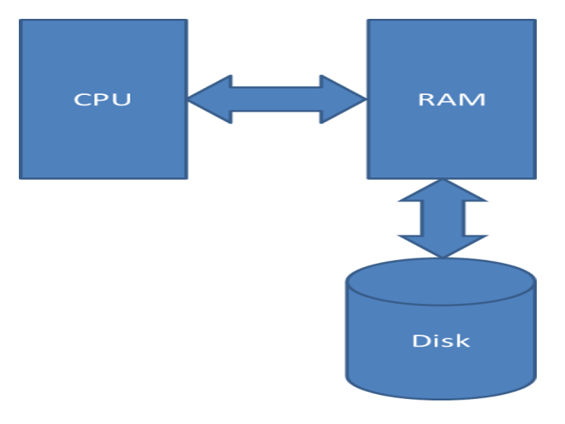
>Programlama dillerinde değişkenler RAM'de tutulur. İşlemler CPU'da yapılır. Örneğin:

```java
a = b + c;
```

>ifadesinde a, b ve c RAM'dedir. Fakat toplama ve atama işlemi CPU tarafından yapılır. CPU RAM'e erişir oradan b'yi ve c'yi alır. Bunu elekrik devreleriyle toplar ve sonucu da a'ya atar. CPU'da işlemlerin yapılması için bulundurulan komutlara **makine komutları (instruction set)** denilmektedir. 
>
>Dosyalar diskte bulunurlar. Bilgisayarı kapattığımızda dosyalar kaybolmazlar. İşletim sistemlerinin dosya işlemleri ile uğraşan bölümüne **dosya sistemi (file system)** denir.
>
>RAM byte'lardan oluşur. 

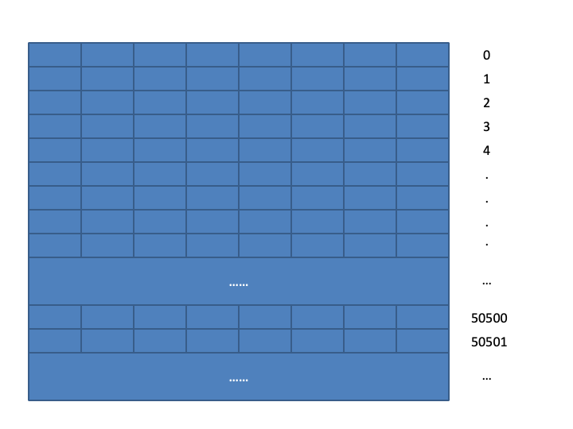
Bellekteki her bir byte'a ilki sıfır olmak üzere artan sırada bir sayı karşılık getirilmiştir. Bu sayılara ilgili 1 byte'lık bölgenin **adresi (address)** denilmektedir. Değişkenler bellekte olduğuna göre onların da birer adresi vardır. Örneğin:

```java
byte a;
```

>Burada a, 1 byte yer kaplayan bir değişkendir. a'nın da bir adresi vardır. Örneğin:

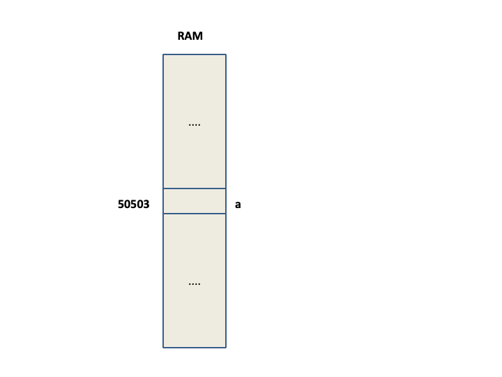
>Burada a'nın adresi 50503'dür. Bir byte'tan daha uzun olan değişkenler için peşpeşe yer ayrılır. Bir byte'tan daha uzun olan değişkenlerin adresleri onların yalnızca en düşük numaralı adresleriyle ifade edilir. Örneğin:

```java
int a;
```

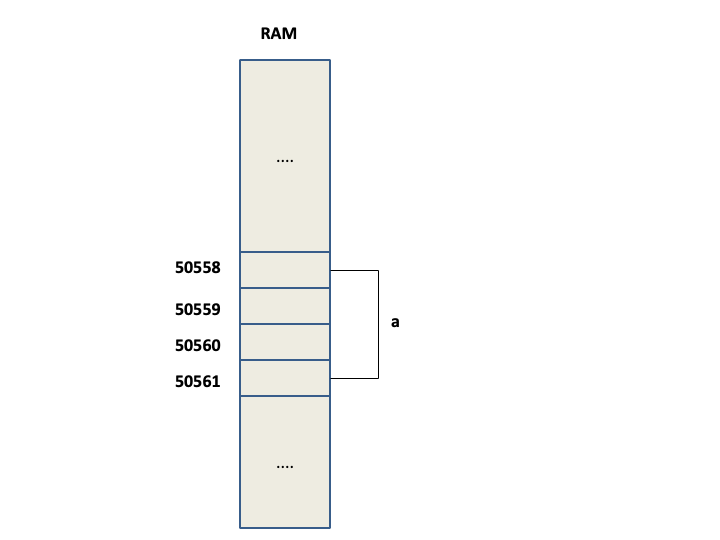
>Burada a 4 byte uzunluğundadır ve a'nın adresi 50558'dir. Bu anlamda bir değişkenin adresi iki bileşenli olarak düşünülebilir: **sayısal değeri**, **türü**. Sayısal değer, değişken için ayrılan bögenin en düşük numaralı adresidir. Türü ise ilgili adresten itibaren ne kadarlık bir alanın ayrılmış olduğunu belirtir. Buna göre örneğimizde `int` türden `a` değişkenin adresinin sayısal değeri `50558`, türü ise `int` dir. Bu durumda bu değişken için ayrılan bölgeye ilişkin byte'ların indeksleri şunlardır: `50558, 50559, 50560, 50561`. 

>Peki bir sistemde en büyük adres numarası kaç olabilir? Bu işlemcinin kaç bit olduğu ile ilişkilidir. Örneğin 32 bit işlemcilerde toplam `2^32` tane adres kullanılabilir, 64 bit sistemlerde toplam `2^64` tane adres kullanılabilir. Bu durumda son byte'ın indeks numarası 32 bit bir sistemde `2^32 - 1`, 64 bit bir sistemde `2^64 - 1`'dir. Bu durumda sistemin fiziksel belleği, programları çalıştırmak için yetersiz bir alana sahipse (ki neredeyse her zaman böyledir) işletim sistemleri belirli bir disk alanını da programların bellek alanı olarak kullanır. İşletim sistemlerinin disk ile birlikte RAM'i kullanmasına **Sanal Bellek (Virtual Memory)** denilmektedir. Burada disk ile RAM arasındaki değişimler (swap) çeşitli algoritmalar kullanılarak yapılmaktadır. Detaylar burada ele alınmayacaktır.

##### Little Endian ve Big Endian Kavramları

>Birden fazla byte ile tutulan tamsayı değişkenler için ilgili değerin byte'larının nasıl tutulduğu sistemden sisteme değişebilmektedir. Bu kavrama **byte order** da denilmektedir. Buna göre **little-endian** sistemlerde değerin düşük anlamlı byte'ı düşük numaralı adreste, yüksek anlamlı byte'ı yüksek numaralı adreste tutulur, **big-endian** sistemlerde ise değerin düşük anlamlı byte'ı yüksek numaralı adreste, yüksek anlamlı byte'ı düşük numaralı adreste tutulur. Bazı işlemciler `little-endian`, bazı işlemciler `big-endian`, bazı işlemciler ise konfigürasyona göre ister `little-endian` ister `big-endian` olarak çalışabilmektedir. 

>Örneğin

```java
short a;

a = 0x000A; //10
```

>Burada `a = 0x000A` atamasında little-endian bir sistemde değerin tutulması aşağıdaki gibidir.


>Big endian bir sistemde ise değerin tutulması aşağıdaki gibidir:

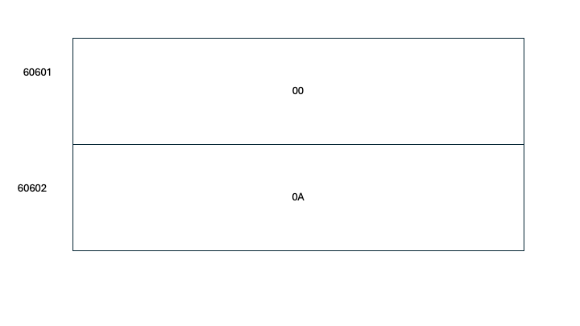

**Anahtar Notlar:** Bu kavramlar oldukça detaylıdır. Burada bir özet biçiminde anlatılmıştır. `Dosya işlemleri` konusunda ayrıca detaylandırılacaktır.

**Anahtar Notlar:** Bu kavramlar yalnızca değişkenlerin bellekte tutulmasıyla ilgili değildir. Network işlemlerinde de verinin iletilmesi noktasında özellikle `IP` protokol ailesinde kullanılmaktadır. Bu konuya ilişkin detaylar `Java ile Uygulama Geliştirme 1 ve 2` ve `Android Programlama` kurslarında ele alınmaktadır. 

##### Değişkenlerin Ömürleri

>Bir değişkenin bellekte yaratılmasıyla yani o değişken için bellekte yer ayrılmasıyla yok edilmesi o bellek alanının artık o değişken için kullanılmaması (mantıksal olarak değişkenin bellekten atılması da denebilir) arasındaki süreye **ömür (storage duration)** denir. 

>Çalıştırılabilen (executable) bir dosya diskte bulunur. Çalıştırılmak istendiğinde diskten alınarak belleğe yüklenir. Programın çalışması bittiğinde program için yüklenenler bellekten boşaltılır. 

>Peki, bir değişken için ayrılan bellek bölgesi neresidir? Bir Java uygulaması çalıştırıldığında, o uygulama için tipik olarak iki tane bellek alanı ayrılır: **stack alanı (stack memory)** ya da kısaca **stack**, **heap alanı (heap memory)** ya da kısaca **heap.** Aslında başka bellek alanları da ayrılır. Şu aşamada bu alanların önemi yoktur. Stack ve heap RAM'de organize edilir. Program çalıştırılırken, bu alanların uzunlukları belirlenebilir. Her hangi bir belirleme yapılmazsa bu alanlar için default değerler kullanılır. Default uzunluklar sistemden sisteme değişiklik gösterebilir.

**Anahtar Notlar:** Veri yapısı (data structure), genel olarak birbiri ile ilişkili olan verilerin bir arada ve bir takım algoritmalar kullanılarak tutulmasını sağlayan ve istenildiğinde bu verilere erişilebilen yapıladır. Örneğin dizi, elemanları aynı türden olan ve bellekte peş peşe olarak yaratılan bir veri yapısıdır. **Stack**, **LIFO (Last In First Out)** kuyruk (queue) biçiminde çalışan bir veri yapısıdır. Tipik olarak editör programlarınının `undo-redo` mekanizmaları bu şekilde implemente edilir. Stack veri yapısına ekleme yapma işlemine **push**, eleman silme (bazı yaklaşımlara göre hem elemanı silme hem de elemanı elde etme) işlemine **pop** denilmektedir. Uygulama için ayrılan `stack`alanında yer ayrılması stack veri yapısı biçiminde yapıldığından bu alana `stack alanı`denilmektedir. Stack alanında yaratma ve yok etme işlemi (tipik olarak push ve pop işlemi) çok hızlı bir biçimde gerçekleşmektedir.

>**Yerel değişkenler ve parametre değişkenleri stack alanında yaratılırlar.** Stack alanı doldur-boşalt biçiminde çalışan bellek alanıdır. Böylece programın çalışma zamanı boyunca, toplamda stack alanının uzunluğundan daha fazla değişken için yer ayrılabilir.
>
>Bir değişken, akış kod bakımından bildirim noktasına geldiğinde yaratılır, bildirildiği blok sonunda yok edilir. Bir yerel değişkenin yaratılması `push` komutu ile, yok edilmesi ise `pop` komutu ile aşağı seviyede yapılır. Peş peşe bildirilen yani çalışma zamanında peş peşe yaratılan (peş peşe push edilen) yarel değişkenlerin yok edilmesi (pop edilmesi) ters sırada yapılır. Buna göre faaliyer alanı (scope) ve ömür (storage duration) arasında dolaylı bir ilişki vardır. Yine de unutulmamalıdır ki faaliyet alanı derleme zamanına, ömür çalışma zamanına ilişkin kavramlardır. Yani, yerel bir değişkenin bildirildiği blok sonunda yok edilmesi dolayısıyla faaliyet alanı da bildirildiği yerden bildirildiği bloğun sonuna kadardır.

>Aşağıdaki demo örneği inceleyiniz

```java
package csd;

class App {
	public static void main(String[] args) 
	{
		Sample.foo(); 
		//foo içerisindeki a yok edildi (pop a)
	}
}

class Sample {
	public static void foo()
	{
		int a; //a yaratılıdı (push a)
		
		{
			float x; //x yaratıldı (push x)
			double y; // y yaratıldı (push y)
			
			//...
			
			
		} // y yok edildi (pop y) -> x yok edildi (pop x)
	}
}
```

>Bir parametre değişkeni ait olduğu metot çağrıldığında yaratılır, metot çağrısı bittiğinde yok edilir. 

>Aşağıdaki demo örneği inceleyiniz

```java
package csd;

class App {
	public static void main(String[] args) 
	{
		Sample.foo(10, 3.4);// x yaratıldı (push x) <-> y yaratıldı (push y) -> a yaratıldı (push a) -> b yaratıldı (push b)		
		// x yok edildi (pop x) <-> y yok edildi (push y) -> b yok edildi (pop b) -> a yok edildi (pop y)
		
		//...
		
		Sample.foo(20, 13.4);// x yaratıldı (push x) <-> y yaratıldı (push y) -> a yaratıldı (push a) -> b yaratıldı (push b)		
		// x yok edildi (pop x) <-> y yok edildi (push y) -> b yok edildi (pop b) -> a yok edildi (pop y)		
		
	}
}

class Sample {
	public static void foo(int x, double y)
	{
		int a; 
		float b;
		
		//...	
	}
}
```

##### Sınıfların Veri Elemanları

>Sınıf içerisinde, tüm metotların dışında. bildirilen değişkenlere **sınıf veri elemanı (data member, field, member variable)** denir. Sınıf veri elemanları da metotlarda olduğu gibi erişim belirleyiciye (public, protected, no-modifier, private) sahip olabilirler. Metotlarda olduğu gibi, ilgili konuya gelene kadar veri elemanlarımızı `public` olarak bildireceğiz. Sınıf veri elemanları da metotlarda olduğu gibi static ya da non-static olabilirler. static anahtar sözcüğü ile bildirilen bir elemanı static, bildirilmeyen veri elemanları non-static olur.


>Sınıf içerisindeki bildirimlere sınıfın **elemanları (members)** denir. Bu anlamda veri elemanları ve metotlar sınıfın elemanlarıdır. Sınıfın bunlar dışında da  elemanları olabilmektedir, konular içerisinde ayrıca ele alınacaktır.

>Sınıf veri elemanlarının faaliyet alanı (scope) ve ömrü (storage duration) konu içerisinde ele alınacaktır. Sınıf veri elemanları aynı türdense, aynı erişim belirleyiciye sahipse ve static veya non-static olma bakımında aynı ise virgül ile ayrılarak bildirilebilir. Bir sınıfta aynı isimde birden fazla veri elemanı bildirimi geçersizdir. 

>Aşağıdaki demo inceleyiniz

```java
class Sample {
	public int x;
	private double y;
	
	public static void foo()
	{
		//...
	}
	
	int z;
	
	public static void bar()
	{
		//...
	}
	
	protected static float t, u;
}
```

>Java'da sınıf dışında değişken bildirimi geçersizdir ya da başka bir deyişle bir değişkenin bir sınıfın içerisinde yani ya sınıf veri elemanı olarak ya paremetre değişkeni olarak ya da sınıf veri elemanı olarak bildirilmiş olması gerekir. 

```java
package csd;


int a; //error
```

>Sınıf bildirimi aslında bir tür bildirimidir. Sınıflar dışında da tür bildirimleri söz konusudur. Bu şekilde programcının bildirdiği türlere **user defined type (UDT)** denir. Sınıf dışındaki UDT'lern konular içerisinde ele alınacaktır.

>Aşağıdaki demo örneği inceleyiniz

```java
class Person {
	//...
}

class TCPServer {
	//...
}

class UDPServer {
	//...
}

class Sensor {
	//...
}

class Student {
	//...
}
```

>Madem ki sınıf bildirimi bir tür bildirimidir, o zaman sınıf türünden değişkenler bildirilebilir

>Aşağıdaki demo örneği inceleyiniz

```java
package csd;


class App {
	public static void main(String[] args) 
	{
		Person p;
		TCPServer tcpServer;
		UDPServer udpServer;
		Sensor sensor1, sensor2;
		Student student;
		
		//...
	}
}


class Person {
	//...
}

class TCPServer {
	//...
}

class UDPServer {
	//...
}

class Sensor {
	//...
}

class Student {
	//...
}
```

>Java'da türler kategori olarak iki gruba ayrılır: **değer türleri (value types), referans türleri (reference types).**
>T bir tür ismi olmak üzere, **T türden bir değişken içerisinde bir adres tutuluyorsa ya da başka bir deyişle T türden bir değişkenin içerisinde değer bir adres ise T bir referans türüdür, değilse değer türüdür.** Java'da temel türler değer türü kategorisindedir. Yani teml türden bir değişken içerisinde adres tutulmaz. Java'da bir sınıf referans türüdür. Öyleyse bir sınıf türünden değişkenin içerisinde adres tutulur. Java'da temel türler dışında kaln tüm türler yani UDT'ler referans türü kategorisindedir.

>Bir UDT türünden değişkene **referans değişken (reference variable)** ya da kısaca **referans (reference)** denir. Java'da `adres (address)` terimi yerine de `referans (reference)` terimi kullanılmaktadır. Referans dendiğinde, ya adres ya da referans değişken denmiş olur. Buna göre örneğin bir cümlede, `reference to an object` ya da benzeri bir içerik söz konusu ise, burada `reference` adres anlamındadır, cümle içerisinde `address of an object is assigned to a reference` gibi bir cümle söz konusu ise, buradaki referans `reference variable` anlamındadır. Bu içerik `reference of an object is assigned to a reference` biçiminde olsaydı, ilk `reference` adres, ikinci `reference`, değişken anlamında olurdu.


>Aşağıdaki demo örneği inceleyiniz

```java
package csd;

class App {
	public static void main(String[] args) 
	{
		Person p; //p reference (variable) 
		TCPServer t; //t reference (variable)
		UDPServer u; //u reference (variable)
		Sensor s; //s reference (variable)
		
		//...
	}
}


class Person {
	//...
}

class TCPServer {
	//...
}

class UDPServer {
	//...
}

class Sensor {
	//...
}

```

>**Tüm bu anlatılanlara göre, bir referans değişkene değer olarak verilecek adresi nasıl elde edeceğiz?** Bu sorunun cevabı konu içerisinde ele alınacaklır.

>**Sınıf, Referans ve Nesne Kavramları:** Sınıf ve nesne kavramlarına ilişkin aşağıdaki `çok önemli` maddeler bir temel oluşturmaktadır:
>
>1. Sınıf türünden bellekte ayrılan (yaratılan) bir alana o sınıf türünden **nesne (object)** denir.
>
>2. Nesneler heap'de yaratılır. Java'da stack'de nesne yaratılamaz. 
>
>3. Java'da bir nesnenin kendisi bir değişkende tutulamaz, adresi tutulabilir. Bu adres ilgili sınıf türünden bir referans değişkende tutulabilir.
>
>4. Java'da nesne yaratılması **new** operatörü ile yapılır. new operatörünün kullanımına ilişkin genel biçimi şu şekildedir:

```java
new <sınıf ismi>([argümanlar]);
```

>Bu operatör özel amaçlı, tek operandlı ve önek durumundadır. Operatör, yaratılmış olan nesnenin adresini üretir. Bu operatörün yan etkisi yoktur. Bir nesne ve referans değişken için bellekte ne kadar ayrıldığı yani uzunluk bilgisi konu içerisinde ayrıca ele alınacaktır.

>Aşağıdaki demo örnekte `p, t, u ve s` birer nesne **DEĞİLDİR**, ilgili türden nesnelerin adreslerini tutabilen referans değişkenlerdir. Örnekte, `1, 2, 3 ve 4` ile belirtilen deyimlerde ilgili türden nesneler yaratılmış ve adresleri ilgili türden referanslara atanmıştır. Buna göre, bir referans değişkene bir nesnenin adresi verildiğinde, o referans değişken o nesneyi **gösteriyor (reference to)** duruma gelmiş olur.

```java
package csd;

class App {
	public static void main(String[] args) 
	{
		Person p; //p reference (variable) 
		TCPServer t; //t reference (variable)
		UDPServer u; //u reference (variable)
		Sensor s; //s reference (variable)
		
		
		p = new Person(); //1
		t = new TCPServer(); //2
		u = new UDPServer(); //3
		s = new Sensor(); //4
		//...
	}
}


class Person {
	//...
}

class TCPServer {
	//...
}

class UDPServer {
	//...
}

class Sensor {
	//...
}
```

>Bu örnekte yaratılan, `1, 2, 3 ve 4` numara ile belirtilen nesneler ve ilgili referanslara atanması sonucunda belleğin temsili durumu aşağıdaki gibidir:

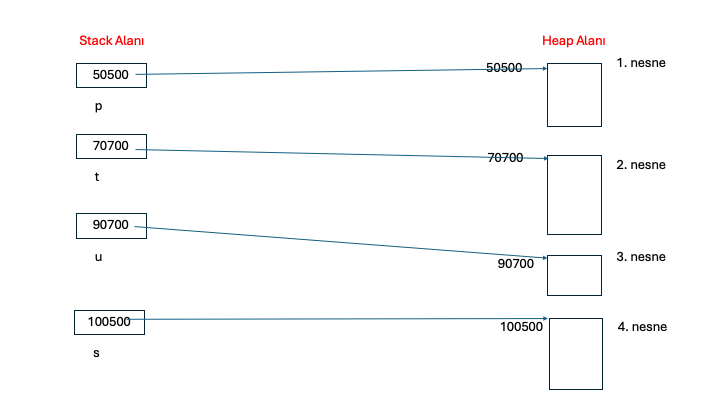

>Buradaki adresin sayısal değerleri temsili olarak yazılmıştır.

>5. Bir nesne aslında ilgili sınıf türünden bir örnektir. Bu sebeple nesne için **instance** terimi de kullanılmaktadır. Bu anlamda nesne yaratma işlemi için **create** ve **instantiate** filleri kullanılmaktadır.
>
>6. Referans ve nesne ayrı kavramlardır. Referans bir nesneyi gösterir ancak nesnenin kendisi değildir.
>
>7. Her new işlemi yeni bir nesne yaratmak demektir. 

>Aşağıdaki demo örneğe ilişkin belleğin temsili durumu şu şekildedir:

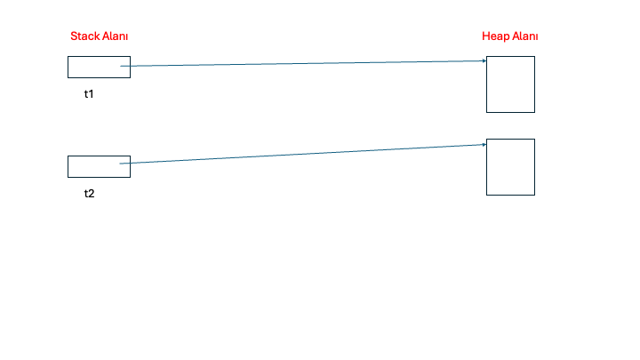

```java
package csd;

class App {
	public static void main(String[] args) 
	{
		TCPServer t1, t2;
		//...
		
		t1 = new TCPServer();
		t2 = new TCPServer();
	}
}

class TCPServer {
	//...
}
```

###### Sınıfın Non-static Veri Elemanları

>Sınıfın non-static veri elemanına **sınıf dışından (yani başka bir sınıfın içinden)** referans ve nokta operatörü ile erişilir. Nokta operatörü, özel amaçlı, iki operandlı ve araek durumundadır. Bu operatörün birinci operandı bir referans, ikinci operandı non-static bir veri elemanı ise bu durumda o veri elemanına ilişkin değişkeni üretir.

>**Sınıfın non-static bir veri elemanı her nesne yaratıldığında o nesnenin içerisinde yaratılır. Yani, sınıfın non-static veri elemanları nesneye özgüdür ya da başka bir deyişle her nesne ayrıca yaratılır.** Bu durumda referans ile non-static bir veri elemanına erişmek aslında o referansın gösterdiği nesnenin içerisindeki yani ilgili nesneye ait veri elemanına erişmek anlamına gelir.

>Aşağıdaki demo örneğe ilişkin belleğin temsili durumu şu şekildedir:

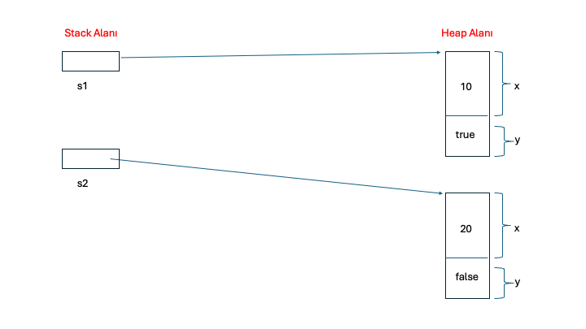

```java
package csd;

class App {
	public static void main(String[] args) 
	{
		Sample s1, s2;
		
		s1 = new Sample();
		s2 = new Sample();
		
		s1.x = 10;
		s1.y = true;
		s2.x = 20;
		s2.y = false;
		
		System.out.printf("s1.x = %d, s1.y = %b%n", s1.x, s1.y);
		System.out.printf("s2.x = %d, s2.y = %b%n", s2.x, s2.y);
	}
}

class Sample {
	public int x;
	public boolean y;
	
	//...
}
```

>Bir nesne yaratıldığında nesneye ait non-static veri elemanlarına **varsayılan değer (default/zero value)** verilir. Varsayılan değer, türe özgü mantıksal sıfır değeridir. Yani örneğin `int` türü için `0`, `double` türü için `0.0`, `boolean` türü için `false`değeri verilir. 

>Aşağıdaki demo örneği inceleyiniz

```java
package csd;

class App {
	public static void main(String[] args) 
	{
		Sample s1, s2;
		
		s1 = new Sample();
		s2 = new Sample();
		
		System.out.println("----------------------------------------");
		System.out.printf("s1.x = %d, s1.y = %b%n", s1.x, s1.y);
		System.out.printf("s2.x = %d, s2.y = %b%n", s2.x, s2.y);
		System.out.println("----------------------------------------");
		
		s1.x = 10;
		s1.y = true;
		s2.x = 20;
		s2.y = false;
		
		System.out.println("----------------------------------------");
		System.out.printf("s1.x = %d, s1.y = %b%n", s1.x, s1.y);
		System.out.printf("s2.x = %d, s2.y = %b%n", s2.x, s2.y);
		System.out.println("----------------------------------------");
	}
}

class Sample {
	public int x;
	public boolean y;
	
	//...
}
```

>Aşağıdaki demo örnekte, s referansına değer verilmediği için error oluşur

```java
package csd;

class App {
	public static void main(String[] args) 
	{		
		Sample s;
		
		s.x = 10; //error		
	}
}

class Sample {
	public int x;
	public boolean y;
	
	//...
}
```
>Sınıfın non-static bir veri elemanı, nesneye özgü olduğundan, nesneye ilişkin kavramın yani programlamada sınıfın **karakteristiği (characterics)** ya da **öz niteliği (attribute)** denir. Aslında bir sınıf non-static veri elemanları ile birlikte bir **bileşik türdür (compund type).** Aynı zamanda bir sınıf bir **veri yapısı (data structure)** olarak da düşünülebilir. Örneğin, 2 boyutlu analitik düzlemde bir nokta apsis (axis) ve ordinatı (ordinate) ile birlikte bir nokta (koordinat) belirtir. Sadece apsis, bir noktayı belirtmez. Bu durumda programlama açısından noktayı temsil eden `Point` isimli bir sınıf düşündüğümüzde, bir noktaya (yani her nokta için kendisine ait olan) apsis ve ordinat bilgileri sınıfın birer non-static veri elemanları olarak bildirilirler. Dikkat edilirse sınıfın ismi, veri elemanları vb. bilgiler sınıfın ait olduğu `domain` içerisinde (başka bir deyişle sınıfın senaryosu ile) temsil ettiği kavrama göre belirlenir.
>
>Peki, non-static bir veri elemanının ömrü (storage duration) nedir? Non-static bir veri elemanı nesne yaratıldığından yaratılır, nesne yok edildiğinde yok edilir. Yani, non-static bir veri elemanının ömrü ait olduğu nesnenin bellekte kalma süresi kadardır. Nesne için de buna ömür diyebiliriz. Nesne, genel olarak akış new operatörüne geldiğinde yaratılır. Java'da nesneler `çöp toplayıcı (garbage collector)` tarafından yok edilir. Bir nesnenin yok edilmesine ilişkin detaylar ve çöp toplayıcı ileri ele alınacaktır.


###### Sınıfın static Veri Elemanları

>Sınıfın static veri elemanları nesne içerisinde yaratılmaz. Sınıfın static bir veri elemanına sınıf dıışından sınıf ismi ve nokta operatörü ile erişilebilir. Nokta operatörü sınıfı ismi ve static bir veri elemanı ile kullanıldığında, static veri elemanına ilişkin değişkeni üretir. Sınıfın static veri elemanlarının hepsi, ilgili sınıfın bir elemanı (member) ilk kez kullanıldığında yaratılır ve program sonuna kadar yaşarlar. Bu durumda static veri elemanları stack alanında **yaratıl(a)mazlar.** Static veri elemanlarının nerede yaratıldığına ilişkin bazı detaylar söz konusu olsa da şu aşamada dolaylı olarak heap alanında yaratıldığı var sayılabilir. Bu durumda static bir veri elemanından toplamda bir tane yaratılmış olur. Bu sebeple static bir veri elemanına erişmek için nesne yaratılmış olması gerekmez, dolayısıyla static bir veri elemanı mantıksal olarak, nesneye özgü değil, türe özgü olarak düşünülebilir. Static veri elamanlarında yaratıldıklarında varsayılan değerler verilir.

>Aşağıkdaki demo örneği inceleyiniz

```java
package csd;

class App {
	public static void main(String[] args) 
	{
		System.out.printf("Sample.x = %d, Sample.y = %b%n", Sample.x, Sample.y);
		Sample.x = 10;
		Sample.y = true;
		System.out.printf("Sample.x = %d, Sample.y = %b%n", Sample.x, Sample.y);
	}
}

class Sample {
	public static int x;
	public static boolean y;
	
	//...
}
```
>Aşağıdaki demo örnekte sayaçlar, sınıfları kullanan programcı tarafından tutulmuş ve gereketiğinde artırılmıştır. Bu durumda sınıfları kullanan programcı artırma işlemini unutabilir ya da başka türler içinde sayaç tutulması söz konusu olduğunda hem isimlendirme hem de kod yükü açısından maliyet getirebilecektir. Buradaki maliyet geliştirme zamanı maliyeti olarak düşünülebilir. Üstelik örnek bir demodur ve gerçek üründe pek çok algoritmik detay da söz konusu olacaktır

```java
package csd;

class App {
	public static void main(String[] args) 
	{
		DemoSpaceWarApp.run();
	}
}

class DemoSpaceWarApp {
	public static void run()
	{
		int aliensCount = 0;
		int soldiersCount = 0;
		//...
		
		for (int i = 0; i < 30; ++i) {
			Alien alien = new Alien();
			
			//...
			
			++aliensCount;
		}

		//...
		
		for (int i = 0; i < 40; ++i) {
			Soldier soldier = new Soldier();
			
			//...
			
			++soldiersCount;
		}

		//...
		
		System.out.printf("Number of aliens:%d%n", aliensCount);
		System.out.printf("Number of soldiers:%d%n", soldiersCount);
		//...
	}
}


class Alien {
	public int headsCount;
	public int armsCount;
	//...
}

class Soldier {
	public int title;
	public int gunCount;
	//...
}

class Civilian {
	//...
}

class Animal {
	//...
}

class Building {
	//...
}

class Tree {
	//...
}
```

>Yukarıdaki demo örnekte sınıfların static `count` veri elemanları ile anlatılan problemler çözülebilir. Örnekte, `**` ve `***` belirtilen kodlar şu aşamada önemsizdir. Burada sayacın her nesne yaratıldığında artırıldığı kavramına odaklanınız Detaylar ileride ele alınacaktır.

```java
package csd;

class App {
	public static void main(String[] args) 
	{
		DemoSpaceWarApp.run();
	}
}

class DemoSpaceWarApp {
	public static void run()
	{
		//...		
		for (int i = 0; i < 30; ++i) {
			Alien alien = new Alien();
			
			//...
		}
		
		for (int i = 0; i < 40; ++i) {
			Soldier soldier = new Soldier();
			
			//...
		}
		
		System.out.printf("Number of aliens:%d%n", Alien.count);
		System.out.printf("Number of soldiers:%d%n", Soldier.count);
		//...
	}
}


class Alien {
	public static int count;
	public int headsCount;
	public int armsCount;
	//...
	
	public Alien() //**
	{
		++count;
	}
}

class Soldier {
	public static int count;
	public int title;
	public int gunCount;
	
	public Soldier() //***
	{
		++count;
	}
	//...
}

class Civilian {
	//...
}

class Animal {
	//...
}

class Building {
	//...
}

class Tree {
	//...
}
```

>Sınıfın non-static bir veri elemanına, sınıf ismi ve nokta operatörü ile erişilemez. Çünkü, non-static veri elemanı nesneye özgüdür, dolayısıyla sınıf ismi ile erişim yapıldığında hangi nesneye ait olduğu anlaşılamaz.

>Aşağıdaki demo örneği inceleyiniz

```java
package csd;

class App {
	public static void main(String[] args) 
	{
		Sample.x = 120; //error
	}
}

class Sample {
	public int x;
	public boolean y;
	
	//...
}
```
>Java'da static bir veri elemanına referans ve nokta operatörü ile de erişilebilir. Bu erişimin sınıf ismi ve nokta operatörü ile erişmekten farkı yoktur. Dilin formal anlatımı gereği bu sentaks geçerlidir ancak Java programcısının static bir veri elemanına referans ile erişmesi **kesinlikle tavsiye edilmez.** Bu durum Java programcısı açısından error olarak değerlendirilmeli ve kesinlikle bu şekilde kullanılmamalıdır. Zaten static kod analizi araçlarının hemen hepsi bu şekilde kullanım durumunda uyarı vermektedir. Bu şekilde kullanımın kodun okunabilirliğini/algılanabilirliğini olumsuz olarak etkilediğine dikkat ediniz.

>Aşağıdaki demo örneği inceleyiniz

```java
package csd;

class App {
	public static void main(String[] args) 
	{
		Sample s = new Sample();
		
		s.x = 10; //Gönlümüzün error'u
		s.y = true; //Gönlümüzün error'u
		
		System.out.printf("%d, %b%n", Sample.x, Sample.y);
	}
}

class Sample {
	public static int x;
	public static boolean y;
	
	//...
}
```
###### Sınıfın non-static metotları

>Sınıfın non-static bir metoduna sınıf dışından referans ve nokta operatörü ile erişilebilir. Sınıfın non-static metotlarının nesne ile ilişkisi ileride ele alınacaktır.

>Aşağıdaki demo örneği inceleyiniz

```java
package csd;

class App {
	public static void main(String[] args) 
	{
		Sample s = new Sample();
		
		s.foo();
	}
}

class Sample {
	
	//...
	
	public void foo()
	{
		System.out.println("foo");
	}
}
```

>Sınıfın non-static bir metoduna sınıf ismi ile erişilemez

```java
package csd;

class App {
	public static void main(String[] args) 
	{
		Sample.foo(); //error
	}
}

class Sample {
	
	//...
	
	public void foo()
	{
		System.out.println("foo");
	}
}
```

**Anatar Notlar:** non-static metotlar nesne içerisinde tutulmazlar. Aslında metotlar (aşağı seviyede fonksiyonlar) genel olarak ismine `code section` denilen bir bölümde tutulurlar. Bu bölüme ilişkin detaylar ve Java düzeyindeki karşılığı burada ele alınmayacaktır. Bu durumda metotlar ne stack alanında ne de heap alanında tutulurlar.

###### Sınıfın static metotları

>Sınıfın static bir metoduna sınıf dışından sınıf ismi ve nokta operatörü ile erişilebilir. static veri elemanlarında olduğu gibi referans ve nokta operatörü ile de erişilebilir ancak Java programcısı açısından yine tavsiye edilmeyen bir durumdur. Çünkü sınıf ismi ile erişmekten farkı yoktur. Sınfın static netotlarının tür ile ilişkisi ileride ele alınacaktır.

>Aşağıdaki demo örneği inceleyiniz

```java
package csd;

class App {
	public static void main(String[] args) 
	{
		Sample.foo();
	}
}

class Sample {
	
	//...
	
	public static void foo()
	{
		System.out.println("foo");
	}
}
```
>Aşağıdaki demo örneği inceleyiniz

```java
package csd;

class App {
	public static void main(String[] args) 
	{
		Sample s = new Sample();
		
		s.foo(); //Gönlümüzün error'u
	}
}

class Sample {
	
	//...
	
	public static void foo()
	{
		System.out.println("foo");
	}
}
```


###### Nesnenin Uzunluğu ve Referansın Uzunluğu

>Nesne ve referans değişken her ne kadar biribirlerin yakın kavramlar olsa da aynı değildirler. Nesnenin uzunluğu **en az non-static veri elemanlarının toplam uzunluğu kadardır.** Bir referansın uzunluğu **sistemin kaç bit olduğuna bağlıdır. 32 bit bir sistemde, 32 bit (4 byte) uzunlukta, 64 bit bir sitemde, 64 bit (8 byte) uzunluktadır.**

>**Buna göre türü ne olursa olsun tüm referansların uzunlukları aynıdır. Aynı türden nesnelerin uzunlukları aynıdır. Farklı türden nesnelerin non-static veri elemanlarına göre uzunlukları farklı olabilmektedir.**


##### Referansların Birbirine Atanması

>Java'da farklı türden referanslar tür dönüştürme operatörü ile (explicit/casting) bile birbirlerine atanamazlar. Aynı türden iki referans birbirine doğrudan (implicit) atanabilir.

>Aşağıdaki demo örneği inceleyiniz

```java
package csd;

class App {
	public static void main(String[] args) 
	{
		Sample s = new Sample();
		Mample m;
		
		m = (Mample)s; //error
	}
}


class Sample {
	//...
}

class Mample {
	//...
}
```

>Aynı türden iki referansın birbirine atanması durumunda her iki referans da aynı nesneyi gösterir duruma gelir. Bu durumda hangi referans ile nesneye erişildiğinin bir önemi yoktur. Çünkü her iki referans da aynı nesneyi göstermektedir. 

>Aşağıdaki demo örnek için belleği temsil eden şekli ve kodları inceleyiniz


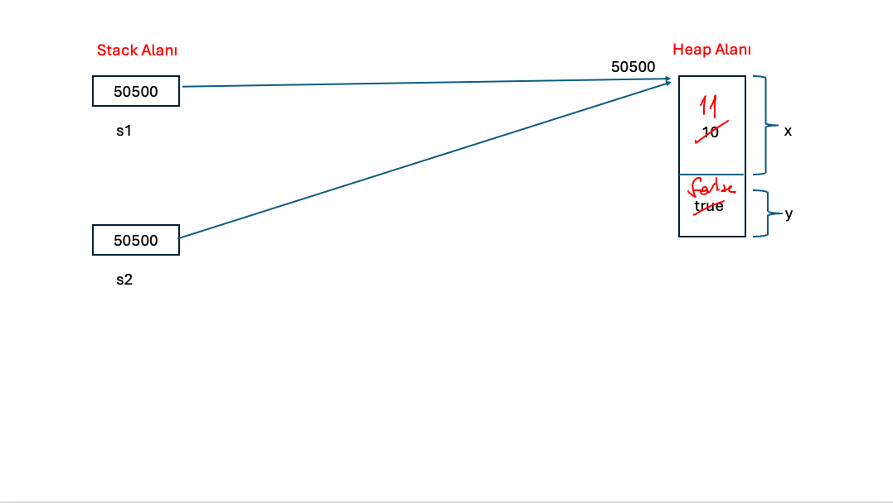

```java
package csd;

class App {
	public static void main(String[] args) 
	{
		Sample s1, s2;
		
		s1 = new Sample();
		s1.x = 10;
		s1.y = true;
		
		s2 = s1;
		
		System.out.printf("s1.x = %d, s1.y = %b%n", s1.x, s1.y);
		System.out.printf("s2.x = %d, s2.y = %b%n", s2.x, s2.y);		
		System.out.println("----------------------------------------------");
		
		++s1.x;
		s2.y = false;
		
		System.out.printf("s1.x = %d, s1.y = %b%n", s1.x, s1.y);
		System.out.printf("s2.x = %d, s2.y = %b%n", s2.x, s2.y);		
		System.out.println("----------------------------------------------");
	}
}


class Sample {
	public int x;
	public boolean y;
	
	//...
}
```

>Aşağıdaki demo örnek için belleği temsil eden şekli ve kodları inceleyiniz


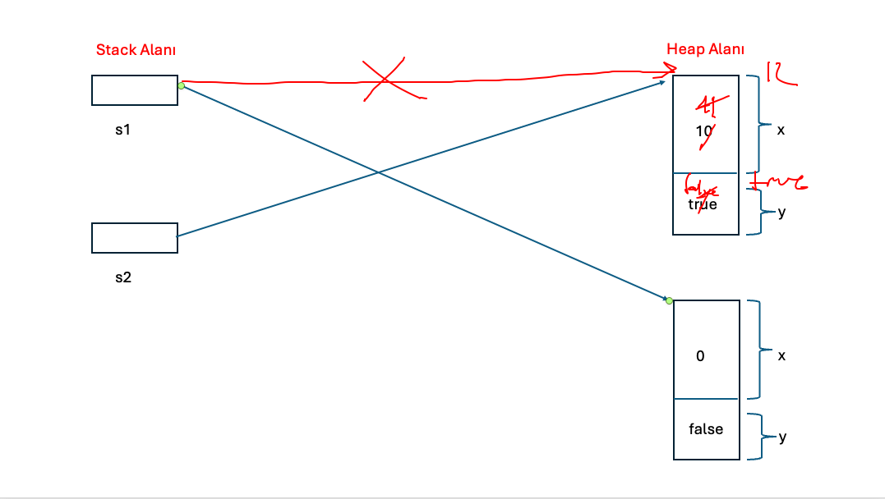


```java
package csd;

class App {
	public static void main(String[] args) 
	{			
		Sample s1, s2;
		
		s1 = new Sample();
		s1.x = 10;
		s1.y = true;
		
		s2 = s1;
		
		System.out.printf("s1.x = %d, s1.y = %b%n", s1.x, s1.y);
		System.out.printf("s2.x = %d, s2.y = %b%n", s2.x, s2.y);		
		System.out.println("----------------------------------------------");
		
		++s1.x;
		s2.y = false;
		
		System.out.printf("s1.x = %d, s1.y = %b%n", s1.x, s1.y);
		System.out.printf("s2.x = %d, s2.y = %b%n", s2.x, s2.y);		
		System.out.println("----------------------------------------------");
		
		
		s1 = new Sample();
		
		System.out.printf("s1.x = %d, s1.y = %b%n", s1.x, s1.y);
		System.out.printf("s2.x = %d, s2.y = %b%n", s2.x, s2.y);		
		System.out.println("----------------------------------------------");
		
		++s2.x;
		s2.y = true;
		
		System.out.printf("s1.x = %d, s1.y = %b%n", s1.x, s1.y);
		System.out.printf("s2.x = %d, s2.y = %b%n", s2.x, s2.y);		
		System.out.println("----------------------------------------------");		
	}
}


class Sample {
	public int x;
	public boolean y;
	
	//...
}
```

>Anımsanacağı gibi Java'da 3 yerde atama işlemi söz konusudur.
>1. Atama operatörü (operatörleri).
>2. Argümanlardan parametrelere aktarım.
>3. Metodun geri dönüş değerinin geçici değişkene atanması. 


>Bir metodun parametresi bir referans olabilir. Bu durumda metot aynı türden bir referans ile çağrılabilir. Referans parametreli bir metot çağrıldığında, parametre değişkeni olan referans ile argümana ilişkin referans aynı nesneyi gösterir duruma gelir. Bu çağrı ile metot içerisinde de aynı nesneye erişilebilir. Hatta metot içerisinde nesnede değişiklik de yapılabilir.


>Bir metodun geri dönüş değeri bir referans türünden olabilir. Bu durumde metodun geri dönüş değerine ilişkin return deyimindeki ifade aynı türden bir adres olabilir.


>Aşağıdaki demo örnekte `*` ile `**` arasındaki işlemler için belleği temsil eden şekli ve kodları inceleyiniz.

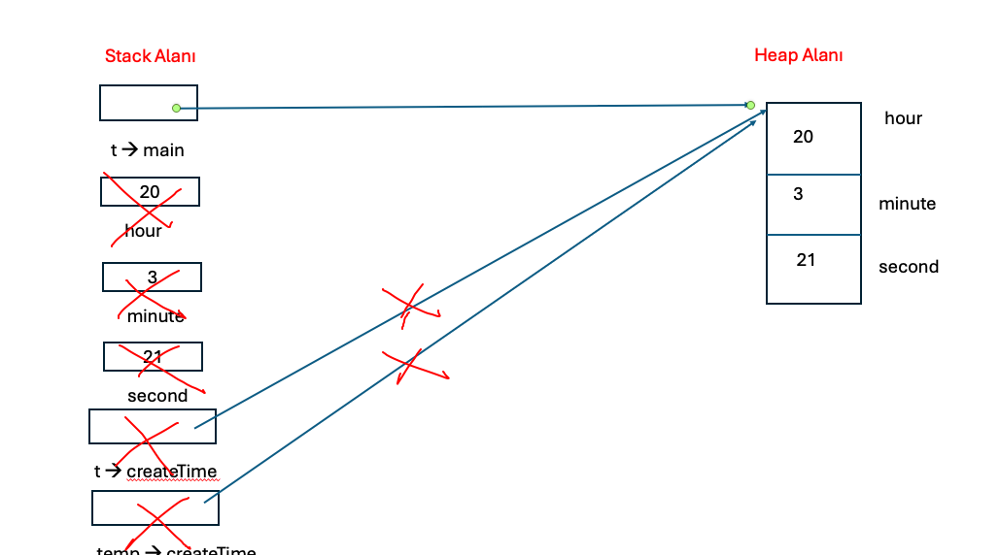

>Demo örnekte akış `***` ile belirtilen noktaya geldiğinde belleğin temsili şu şekildedir:

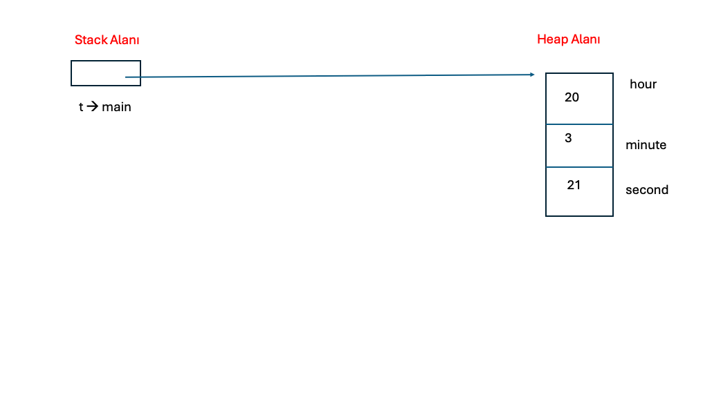

>printTime metodu çağrıldığında belleğin temsili şu şekildedir:

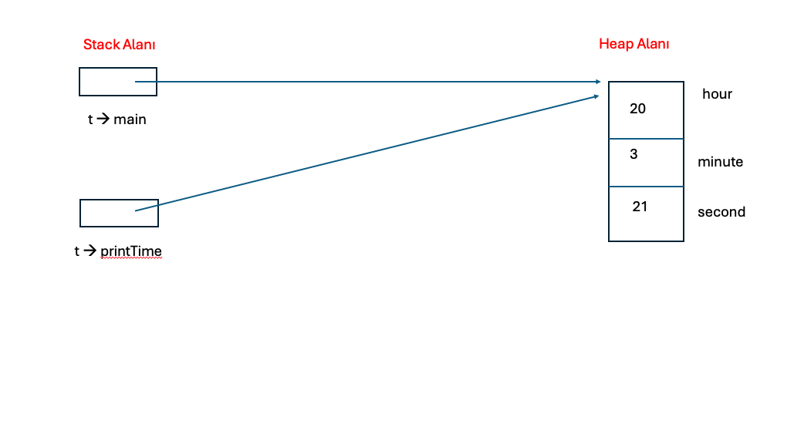

>`****` ile belirtilen noktada metot çağrısı ile belleğin temsili şu şekildedir:

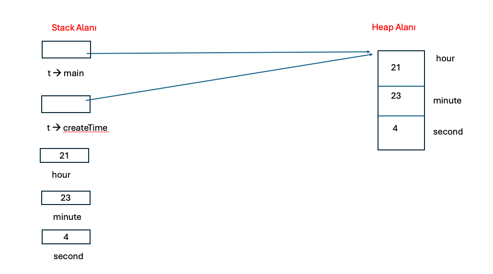

>changeTime çağrısı sonlandığında belleğin temsili şu şekildedir:


>prinTime metodu çağrısı yukarıda ele alınmıştı

```java
package csd;

class App {
	public static void main(String[] args) 
	{			
		Time t; //*
		
		t = TimeUtil.createTime(20, 3, 21);	//**
		TimeUtil.printTime(t); //***
		TimeUtil.changeTime(t, 21, 23, 4);//****
		TimeUtil.printTime(t);
	}
}


class TimeUtil {
	public static void changeTime(Time t, int hour, int minute, int second)
	{
		//...
		
		t.hour = hour;
		t.minute = minute;
		t.second = second;		
	}
	
	
	public static Time createTime(int hour, int minute, int second)
	{
		//...
		Time t;
		
		t = new Time();
		
		t.hour = hour;
		t.minute = minute;
		t.second = second;
		
		return t;
	}
	
	public static void printTime(Time t)
	{
		System.out.printf("%02d:%02d:%02d%n", t.hour, t.minute, t.second);
	}
}


class Time {
	public int hour;
	public int minute;
	public int second;
	
	//...
}
```
>Aşağıdaki demo örnekte foor metodunun, main içerisinde bildirilen a'nın değerini değiştiremeyeceğine dikkat ediniz

```java
package csd;

class App {
	public static void main(String[] args) 
	{
		int a = 10;
		
		Sample.foo(a);
		
		System.out.printf("main -> a = %d%n", a);
	}
}


class Sample {
	public static void foo(int a)
	{
		System.out.printf("foo -> a = %d%n", a);
		++a;
		System.out.printf("foo -> a = %d%n", a);
	}
}
```

Aşağıdaki örnekte sınıf kullanılarak mantıksal olarak birden fazla değere geri dönülmüştür. Java'da bir metot yalnızca tek bir değere geri dönebilir. Buradaki dönülen tek değer bir nesnenin adresidir

```java
package csd;

class App {
	public static void main(String [] args) 
	{		
		QuadraticEquationSolverApp.run();
	}
}

class QuadraticEquationSolverApp {
	public static void run()
	{
		java.util.Scanner kb = new java.util.Scanner(System.in);
		
		System.out.print("Input coefficients:");
		double a = kb.nextDouble();
		double b = kb.nextDouble();
		double c = kb.nextDouble();
		
		QuadraticEquationRootsInfo rootsInfo = EquationUtil.findQuadraticEquationRoots(a, b, c);
		
		if (rootsInfo.exists)
			System.out.printf("x1 = %f, x2 = %f%n", rootsInfo.x1, rootsInfo.x2);
		else
			System.out.println("No real root");
	}
}

class QuadraticEquationRootsInfo {
	public boolean exists;
	public double x1;
	public double x2;
}

class EquationUtil {
	public static QuadraticEquationRootsInfo findQuadraticEquationRoots(double a, double b, double c)
	{
		QuadraticEquationRootsInfo rootsInfo = new QuadraticEquationRootsInfo();
		double delta = b * b - 4 * a * c;	
		
		if (delta > 0) {
			double sqrtDelta = Math.sqrt(delta);
			
			rootsInfo.x1 = (-b + sqrtDelta) / (2 * a);
			rootsInfo.x2 = (-b - sqrtDelta) / (2 * a);
			rootsInfo.exists = true;
		}
		else if (delta == 0) {
			rootsInfo.x1 = rootsInfo.x2 = -b / (2 * a);
			rootsInfo.exists = true;
		}
		
		return rootsInfo;
	}
}
```

##### Sınıf Elemanlarına Sınıf İçerisinden Erişim

>Bu bölümde sınıfın bir elemanına sınıf içerisinde **doğrudan** erişme kuralları ele alınacaktır. Doğrudan erişim nokta operatörü kullanmadan erişim demektir. Şüphesiz sınıf dışından, sınıfın bir elemanına doğrudan erişim yapılamaz. İlgili kurallar şunlardır:
>
>- Sınıfın non-static bir metodu içerisinde, aynı sınıfın non-static bir veri elemanına doğrudan erişilebilir. Doğrudan erişilen bu eleman, non-static metodun çağrıldığı referansın gösterdiği nesnenin veri elemanıdır. 

>Aşağıdaki demo örneği inceleyiniz

```java
package csd;

class App {
	public static void main(String [] args) 
	{		
		Sample s1, s2;
		
		s1 = new Sample();
		s2 = new Sample();
		
		s1.foo(20);
		s2.foo(30);
		
		System.out.printf("s1.x = %d, s2.x = %d%n", s1.x, s2.x);
	}
}

class Sample {
	public int x;
	
	public void foo(int a)
	{
		x = a;
	}
}
```

>- Sınıfın non-static bir metodu içerisinde, aynı sınıfın non-static bir metodu doğrudan çağrılabilir. Doğrudan çağrılan metot, çağıran metodun çağrıldığı referans ile çağrılmış olur.

>Aşağıdaki demo örneği inceleyiniz

```java
package csd;

class App {
	public static void main(String [] args) 
	{		
		Sample s1, s2;
		
		s1 = new Sample();
		s2 = new Sample();
		
		s1.foo(20);
		s2.foo(30);
		
		System.out.printf("s1.x = %d, s2.x = %d%n", s1.x, s2.x);
	}
}

class Sample {
	public int x;
	
	public void foo(int a)
	{
		bar(a);
	}
	
	public void bar(int a)
	{
		x = a;
	}
}
```

>Yukarıdaki son iki maddenin özeti olarak şu söylenebilir: **Sınıfın non-static bir metodu içerisinde, aynı sınıfın non-static elemanlarına (members) doğrudan erişilebilir.**
>
>- Sınıfın non-static bir metou içerisinde, aynı sınıfın static bir veri elemanına doğrudan erişebilir.

>Aşağıdaki demo örneği inceleyiniz

```java
package csd;

class App {
	public static void main(String [] args) 
	{		
		Sample s1, s2;
		
		s1 = new Sample();
		s2 = new Sample();
		
		s1.foo(20);
		System.out.printf("Sample.x = %d%n", Sample.x);
		s2.foo(30);		
		System.out.printf("Sample.x = %d%n", Sample.x);
	}
}

class Sample {
	public static int x;
	//...
	
	public void foo(int a)
	{
		x = a;
	}
}

```

>- Sınıfın non-static bir metou içerisinde, aynı sınıfın static bir metodu doğrudan çağrılabilir.

>Aşağıdaki demo örneği inceleyiniz

```java
package csd;

class App {
	public static void main(String [] args) 
	{		
		Sample s1, s2;
		
		s1 = new Sample();
		s2 = new Sample();
		
		s1.foo(20);
		System.out.printf("Sample.x = %d%n", Sample.x);
		s2.foo(30);		
		System.out.printf("Sample.x = %d%n", Sample.x);
	}
}

class Sample {
	public static int x;
	//...
	
	public void foo(int a)
	{
		bar(a);
	}
	
	
	public static void bar(int a)
	{
		x = a;
	}
}
```

>Yukarıdaki son iki maddenin özeti olarak şu söylenebilir: **Sınıfın non-static bir metodu içerisinde, aynı sınıfın static elemanlarına (members) doğrudan erişilebilir.**
>
>Yukarıdaki son dört maddenin özeti olarak şu söylenebilir: **Sınıfın non-static bir metodu içerisinde, aynı sınıfın static veya non-static bakımdan tüm elemanlarına doğrudan erişilebilir.**
>
>- Sınıfın static bir metodu içerisinde, aynı sınıfın non-static bir veri elemanına doğrudan erişilemez.

>Aşağıdaki demo örneği inceleyiniz

```java
class Sample {
	public int x;
	//...
	
	public static void foo(int a)
	{
		x = a; //error
	}
}
```

>- Sınıfın static bir metodu içerisinde, aynı sınıfın non-static bir metodu doğrudan çağrılamaz

>Aşağıdaki demo örneği inceleyiniz

```java
class Sample {
	//...
	
	public static void foo(int a)
	{
		bar(); //error
	}
	
	public void bar()
	{
		//...
	}
}
```
>Yukarıdaki son iki maddenin özeti olarak şu söylenebilir: **Sınıfın static bir metodu içerisinde, aynı sınıfın non-static elemanlarına (members) doğrudan erişilemez.**
>
>- Sınıfın static bir metodu içerisinde aynı sınıfın static bir veri elemanına doğrudan erişilebilir.

>Aşağıdaki demo örneği inceleyiniz

```java
package csd;

class App {
	public static void main(String [] args) 
	{		
		Sample.foo(10);
		System.out.printf("Sample.x = %d%n", Sample.x);
		Sample.foo(20);
		System.out.printf("Sample.x = %d%n", Sample.x);
	}
}

class Sample {
	public static int x;
	
	//...
	
	public static void foo(int a)
	{
		x = a;				
	}
}
```
>- Sınıfın static bir metodu içerisinde aynı sınıfın static bir metodu doğrudan çağrılabilir

>Aşağıdaki demo örneği inceleyiniz

```java
package csd;

class App {
	public static void main(String [] args) 
	{		
		Sample.foo(10);
		System.out.printf("Sample.x = %d%n", Sample.x);
		Sample.foo(20);
		System.out.printf("Sample.x = %d%n", Sample.x);
	}
}

class Sample {
	public static int x;
	
	//...
	
	public static void foo(int a)
	{
		bar(a);				
	}
	
	public static void bar(int a)
	{
		x = a;				
	}
}
```

>Yukarıdaki son iki maddenin özeti olarak şu söylenebilir: **Sınıfın static bir metodu içerisinde, aynı sınıfın static elemanlarına (members) doğrudan erişilembilir**
>
>Yukarıdaki son dört maddenin özeti olarak şu söylenebilir: **Sınıfın static bir metodu içerisinde, aynı sınıfın yalnızca static elemanlarına doğrudan erişilebilir.**

>Yukarıdaki son sekiz maddenin özeti olarak şu söylenebilir: **Sınıfın non-static bir metodu içerisinde, aynı sınıfın tüm elemanlarına doğrudan erişilebilirken, sınıfın static bir metodu içerisinde, aynı sınıfın yalnızca static elemanlarına doğrudan erişilebilir.**

>Peki, bir metodu ne zaman static, ne zaman non-static yapılmalıdır? Java programcısı buna nasıl karar verecektir?Bir metot ait olduğu sınıfın non-static bir elemanına doğrudan erişecekse zaten non-static olmalıdır ancak bir metot ait olduğu sınıfın hiç bir non-static elemanına erişmeyecekse, non-static yapılabilse de static yapılmalıdır. Bu durumda, bu metodu çağırırken bir referansa (dolayısıyla nesneye) ihtiyaç olmaz ayrıca bir metodun static yapılması okunabilirliği/algılanabilirliği artırır yani bu durumda bir metot non-static ise sınıfın non-static en az bir elemanına kesinlikle erişiyordur algısı oluşur. Bu bir convention'dır ve programcılar bu convention'a uyarlar (uymalıdırlar).


>Aşağıdaki, analitik düzlemde (cartesian plane) bir noktayı temsil `Point` sınıfını ve test kodlarını inceleyiniz

```java
package csd;

class App {
	public static void main(String [] args) 
	{		
		PointPrintTest.run();				
	}
}

class PointPrintTest {
	public static void run()
	{		
		Point p1, p2;
		
		p1 = new Point();
		p2 = new Point();
		
		p1.x = 345.67;
		p1.y = 34.89;		
		p2.x = -45;
		p2.y = 37;
		
		p1.print();
		p2.print();
	}
}
```

```java
package csd;

class App {
	public static void main(String [] args) 
	{		
		PointOffsetTest.run();				
	}
}

class PointOffsetTest {
	public static void run()
	{		
		Point p1, p2;
		
		p1 = new Point();
		p2 = new Point();
		
		p1.x = 345.67;
		p1.y = 34.89;		
		p2.x = -45;
		p2.y = 37;
		
		p1.print();
		p2.print();
		System.out.println("------------------------------");
		
		p1.offset(-30, 40);
		p2.offset(34, -10);		
		
		p1.print();
		p2.print();
		System.out.println("------------------------------");

		p1.offset(-30);
		p2.offset(34);		
		
		p1.print();
		p2.print();
		System.out.println("------------------------------");
	}
}

```

```java
package csd;

class App {
	public static void main(String [] args) 
	{		
		PointDistanceTest.run();				
	}
}

class PointDistanceTest {
	public static void run()
	{		
		Point p1, p2;
		
		p1 = new Point();
		p2 = new Point();
		
		p1.x = 200;
		p1.y = 100;		
		p2.x = 196;
		p2.y = 103;
		
		p1.print();
		p2.print();
		System.out.println("------------------------------");
		
		double result = p1.euclideanDistance(p2);
		
		System.out.printf("Distance:%f%n", result);
		
		result = p1.euclideanDistance(196, 103);
		
		System.out.printf("Distance:%f%n", result);
		
		result = p1.euclideanDistance();
		
		System.out.printf("Distance to origin:%f%n", result);
	}
}
```

```java
class Point {
	public double x, y;

	public double euclideanDistance()
	{
		return euclideanDistance(0, 0);
	}
	
	public double euclideanDistance(double a, double b)
	{
		return Math.sqrt(Math.pow(x - a, 2) + Math.pow(y - b, 2));
	}
	
	public double euclideanDistance(Point other)
	{
		return euclideanDistance(other.x, other.y);
	}	
	
	public void offset(double dxy)
	{
		offset(dxy, dxy);
	}
	
	public void offset(double dx, double dy)
	{
		x += dx;
		y += dy;
	}
	
	public void print()
	{
		System.out.printf("(%f, %f)%n", x, y);
	}
}

```


>Aşağıdaki, bir karmaşık sayıyı (complex number) temsil eden `Complex`sınıfını ve test kodlarını inceleyiniz.
>**Açıklamalar:** a ve b gerçek sayılar olmak üzere, $z = a + i * b$, $z_1 = a_1 + i * b_1$, $z_2 = a_2 + i * b_2$ karmaşık sayıları için aşağıdaki kurallar tanımlıdır:
>- $\sqrt{-1} = i$
>- a gerçek (real) kısım, b sanal (imaginary) kısım
>- $\bar{z} = a - i * b$ `->` eşlenik (conjugate)
>- $|z| = \sqrt{a^2 + b^2}$ `->` Uzunluğu norm (length)  
>- $z_1 \pm z_2 = (a_1 \pm a_2) + i * (b_1 \pm b2)$
>- $z_1z_2 = (a_1 * a_2 - b_1 * b_2) + i * (a_1 * b_2 + a_2 * b_1)$
>- $z_1 / z_2 =  (1 / |\bar{z_2}|) * (z_1 * \bar{z_2})$ 

```java
package csd;

class App {
	public static void main(String [] args) 
	{		
		ComplexGetConjugateTest.run();						
	}
}

class ComplexGetConjugateTest {
	public static void run()
	{
		Complex z1 = new Complex();
		Complex z2 = new Complex();
		
		z1.real = 3.4;
		z1.imag = 4.5;
		z2.real = 9.3;
		z2.imag = -6.4;
		
		z1.print();
		z2.print();
		
		Complex z1c = z1.getConjugate();
		Complex z2c = z2.getConjugate();
		
		z1c.print();
		z2c.print();		
	}
}
```

```java
package csd;

class App {
	public static void main(String [] args) 
	{		
		ComplexGetLengthTest.run();						
	}
}

class ComplexGetLengthTest {
	public static void run()
	{
		Complex z1 = new Complex();
		Complex z2 = new Complex();
		
		z1.real = 3.4;
		z1.imag = 4.5;
		z2.real = 9.3;
		z2.imag = -6.4;
		
		z1.print();
		z2.print();
		
		System.out.printf("Length of z1:%f%n", z1.getLength());
		System.out.printf("Length of z2:%f%n", z2.getNorm());
	}
}
```
```java
package csd;

class App {
	public static void main(String [] args) 
	{		
		ComplexAddTest.run();						
	}
}

class ComplexAddTest {
	public static void run()
	{
		Complex z1 = new Complex();
		Complex z2 = new Complex();
		
		z1.real = 3.4;
		z1.imag = 4.5;
		z2.real = 9.3;
		z2.imag = -6.4;
		
		z1.print();
		z2.print();
		
		Complex z;
		
		z = z1.add(z2); // z1 + z2
		z.print();
		
		z = z1.add(2.3); // z1 + 2.3
		z.print();
		
		z = Complex.add(2.3, z1); // 2.3 + z1
		
		z.print();
	}
}
```
```java
package csd;

class App {
	public static void main(String [] args) 
	{		
		ComplexSubtractTest.run();						
	}
}

class ComplexSubtractTest {
	public static void run()
	{
		Complex z1 = new Complex();
		Complex z2 = new Complex();
		
		z1.real = 3.4;
		z1.imag = 4.5;
		z2.real = 9.3;
		z2.imag = -6.4;
		
		z1.print();
		z2.print();
		
		Complex z;
		
		z = z1.subtract(z2); // z1 - z2
		z.print();
		
		z = z1.subtract(2.3); // z1 - 2.3
		z.print();
		
		z = Complex.subtract(2.3, z1); // 2.3 - z1
		
		z.print();
	}
}
```


```java
package csd;

class App {
	public static void main(String [] args) 
	{		
		ComplexMultiplTest.run();						
	}
}

class ComplexMultiplTest {
	public static void run()
	{
		Complex z1 = new Complex();
		Complex z2 = new Complex();
		
		z1.real = 3.4;
		z1.imag = 4.5;
		z2.real = 9.3;
		z2.imag = -6.4;
		
		z1.print();
		z2.print();
		
		Complex z;
		
		z = z1.multiply(z2); // z1 * z2
		z.print();
		
		z = z1.multiply(2.3); // z1 * 2.3
		z.print();
		
		z = Complex.multiply(2.3, z1); // 2.3 * z1
		
		z.print();
	}
}
```


```java
package csd;

class App {
	public static void main(String [] args) 
	{		
		ComplexDivideTest.run();						
	}
}

class ComplexDivideTest {
	public static void run()
	{
		Complex z1 = new Complex();
		Complex z2 = new Complex();
		
		z1.real = 3.4;
		z1.imag = 4.5;
		z2.real = 9.3;
		z2.imag = -6.4;
		
		z1.print();
		z2.print();
		
		Complex z;
		
		z = z1.divide(z2); // z1 / z2
		z.print();
		
		z = z1.divide(2.3); // z1 / 2.3
		z.print();
		
		z = Complex.divide(2.3, z1); // 2.3 / z1
		
		z.print();
	}
}
```

```java
class Complex {
	public double real;
	public double imag;
	
	public static Complex add(double a1, double b1, double a2, double b2) //İleride gizleyeceğiz
	{
		Complex z = new Complex();
		
		z.real = a1 + a2;
		z.imag = b1 + b2;
		
		return z;
	}
	
	public static Complex subtract(double a1, double b1, double a2, double b2) //İleride gizleyeceğiz
	{
		return add(a1, b1, -a2, -b2);
	}
	
	public static Complex multiply(double a1, double b1, double a2, double b2) //İleride gizleyeceğiz
	{
		Complex z = new Complex();
		
		z.real = a1 * a2 - b1 * b2;
		z.imag = a1 * b2 + a2 * b1;
		
		return z;		
	}
	
	public static Complex divide(double a1, double b1, double a2, double b2) //İleride gizleyeceğiz
	{
		double val = 1 / getNorm(a2, -b2);
		Complex z = multiply(a1, b1, a2, -b2);
		
		return multiply(val, z);		
	}
	

	public static double getNorm(double a, double b) //İleride bunu gizleyeceğiz
	{
		return Math.sqrt(a * a + b * b);
	}
	
	public double getLength()
	{
		return getNorm();
	}
	
	public double getNorm()
	{
		return getNorm(real, imag);
	}
	
	public Complex getConjugate()
	{
		Complex z = new Complex();
		
		z.real = real;
		z.imag = -imag;
		
		return z;
	}
	
	public Complex add(Complex other)
	{
		return add(real, imag, other.real, other.imag);
	}
	
	public Complex add(double val)
	{
		return add(real, imag, val, 0);
	}
	
	public static Complex add(double val, Complex z)
	{
		return add(val, 0, z.real, z.imag);
	}
	
	public Complex subtract(Complex other)
	{
		return subtract(real, imag, other.real, other.imag);
	}
	
	public Complex subtract(double val)
	{
		return subtract(real, imag, val, 0);
	}
	
	public static Complex subtract(double val, Complex z)
	{
		return subtract(val, 0, z.real, z.imag);
	}
	
	public Complex multiply(Complex other)
	{
		return multiply(real, imag, other.real, other.imag);
	}
	
	public Complex multiply(double val)
	{
		return multiply(real, imag, val, 0);
	}
	
	public static Complex multiply(double val, Complex z)
	{
		return multiply(val, 0, z.real, z.imag);
	}

	public Complex divide(Complex other)
	{
		return divide(real, imag, other.real, other.imag);
	}
	
	public Complex divide(double val)
	{
		return divide(real, imag, val, 0);
	}
	
	public static Complex divide(double val, Complex z)
	{
		return divide(val, 0, z.real, z.imag);
	}
	
	public void print()
	{
		System.out.printf("(%f, %f)%n", real, imag);
	}
}
```

##### Sınıfın Constructor Elemanı

>Çalışma zamanında bir nesnenin yaratılma adımları sırasıyla şunlar:
>
>1. Bellekte yer ayrılır.
>
>2. Non-static olan (ancak final olmayan) veri elemanlarına default değerler verilir.
>
>3. Constructor (ctor) çağrılır.

> **Bu 3 adım tamamlandığında nesne yaratılmış olur. Herhangi bir adımda bir problem oluştuğunda nesnenin yaratılması tamamlanMAmış olur.** Buna ilişkin detaylar konular içerisinde ele alınacaktır.


**Anahtar Notlar:** final veri elemanları ileride ele alınacaktır.

>ctor aşağıdaki özelliklere sahip bir metottur:
>
>- ctor nesnenin yaratılması aşamasında çağrılır.
>
>- ctor overload edilebilir. Buna **constructor overloading** denir.
>
>- Programcı tarafından her hangi bir ctor bildirilmemişse **parametresi ctor (default ctor)** derleyici tarafından içi boş ve public olarak yazılır. Programcı sınıf içerisinde en az bir tane ctor bildirmişse derleyici artık default ctor'u yazmaz.
>
>- ctor, **ait olduğu sınıf ile aynı isimde olan ve geri dönüş değeri kavramı olmayan** metottur. Burada, geri dönüş değeri kavramı olmaması, geri dönüş değeri olmaması anlamına gelmez. ctor için geri dönüş bilgisi yerine her hangi bir bilgi yazılmaz. Hatta sınıf içerisinde sınıf ismi ile aynı isimde olan ve geri dönüş değeri bilgisi yazılmış olan bir metot bildirimi geçerlidir ancak hiç bir programcı böylesi bir metot bildirimi yapmaz, yapmaya da ihtiyaç duymaz. Çünkü bu metot ctor anlamına gelmez. 
>
>- ctor non-static bir metottur.
>
>- Hangi ctor'un çağrılacağı new operatöründe geçilen argümanlara göre klasik `method overload resolution` kuralları ile belirlenir. 
>
>- ctor, programcı tarafından çağrılamaz. Programcı, nesne yaratılması sırasında hangi ctor'un çağrılacağının belirlendiği kodu yazar.
>
>- Nesne yaratılması adımlarından da anlaşılacağı gibi ctor çağrılmadan önce non-static olan (ancak final olmayan) veri elemanlarına default değerleri verilmiş olur.
>
>- ctor, geri dönüş değeri kavramı olmayan bir metot olsa da, void bir metot gibi istenirse return deyimi ctor'u sonlandırmak için kullanılabilir. Buradaki sonlandırma normal bir sonlandırmadır yani nesne yaratılmış olur. 
>
>Aşağıdaki demo örnekte Sample sınıfında default ctor da dahil 4 tane ctor overload edilmiştir. Mample sınıfında herhangi bir ctor bildirilmediğinden derleyici default ctor'u public ve içi boş olarak yazar

```java
package csd;

class App {
	public static void main(String [] args) 
	{		
		Sample s1, s2, s3, s4;
		Mample m;
		
		s1 = new Sample(); //Sample()
		s2 = new Sample(10); //Sample(int)
		s3 = new Sample(3.4); // Sample(double)
		s4 = new Sample(20, true); //Sample(int, boolean)
		m = new Mample(); //Mample()
		
		//...
	}
}


class Sample {
	public int x;
	public boolean y;
	
	//...
	
	public Sample()
	{
		System.out.println("I am a default ctor");
	}
	
	public Sample(int a)
	{
		System.out.println("I am a ctor with parameter type: int");
	}
	
	
	public Sample(double a)
	{
		System.out.println("I am a ctor with parameter type: double");
	}
	
	public Sample(int a, boolean b)
	{
		System.out.println("I am a ctor with parameter types: int, boolean");
	}
	
	//...
}


class Mample {
	//...
}
```

>Aşağıdaki demo örnekte Sample sınıfının default ctor'u artık derleyici tarafınfan otomatik olarak yazılmaz. Çünkü, Sample sınıfını yazan programcı bir ctor bildirimi yapmıştır. Bu durumda Sample sınıfı için default ctor gerekiyorsa artık programcı yazmalıdır.

```java
package csd;

class App {
	public static void main(String [] args) 
	{		
		Sample s;
		
		s = new Sample(); //error
	}
}


class Sample {
	public int x;
	public boolean y;
	
	//...
	
	public Sample(int a)
	{
		System.out.println("I am a ctor with parameter type: int");
	}	
	
	//...
}
```

>Aşağıdaki demo örnekte ctor çağrısından önce non-static veri elemanlarına default değerler verildiğini gözlemleyiniz

```java
package csd;

class App {
	public static void main(String [] args) 
	{		
		Sample s1, s2, s3, s4;
		
		s1 = new Sample();
		
		System.out.println("------------------------------");
		s2 = new Sample(10);
		System.out.println("------------------------------");
		s3 = new Sample(3.4);
		System.out.println("------------------------------");
		s4 = new Sample(20, true);
		System.out.println("------------------------------");
		
		//...
	}
}


class Sample {
	public int x;
	public boolean y;
	
	//...
	
	public Sample()
	{
		System.out.printf("x = %d, y = %b%n", x, y);
		System.out.println("I am a default ctor");
	}
	
	public Sample(int a)
	{
		System.out.printf("x = %d, y = %b%n", x, y);;
		System.out.println("I am a ctor with parameter type: int");
	}
	
	
	public Sample(double a)
	{
		System.out.printf("x = %d, y = %b%n", x, y);
		System.out.println("I am a ctor with parameter type: double");
	}
	
	public Sample(int a, boolean b)
	{
		System.out.printf("x = %d, y = %b%n", x, y);
		System.out.println("I am a ctor with parameter types: int, boolean");
	}
	
	//...
}
```

>Aşağıdaki demo örnekte Sample sınıfının parametresiz `Sample` isimli metodu bildirilmiştir. Bu durumda bu sınıfı yazan programcı hiç bir ctor yazmadığından derleyici default ctor'u otomatik olarak (içi boş ve public) yazar

```java
package csd;

class App {
	public static void main(String [] args) 
	{		
		Sample s = new Sample();
		
		//...
	}
}


class Sample {
	public int x;
	public boolean y;
	
	//...
	
	public void Sample() //Dikkat ctor değil
	{
		System.out.printf("x = %d, y = %b%n", x, y);
		System.out.println("Sample()");
	}
	
	
	
	//...
}
```

>Aşağıdaki demo örnekte derleyici artık default ctor'u yazmayacaktır

```java
package csd;

class App {
	public static void main(String [] args) 
	{		
		Sample s = new Sample(); //error
		
		//...
	}
}


class Sample {
	public int x;
	public boolean y;
	
	//...
	
	public void Sample() //Dikkat ctor değil
	{
		System.out.printf("x = %d, y = %b%n", x, y);
		System.out.println("Sample()");
	}
	
	public Sample(int x)
	{
		System.out.println("I am ctor with parameter type: int");
	}	
	
	//...
}
```

>Sınıf ismi ile aynı isimde bir metot yazılması tavsiye edilmez.

>Aşağıdaki örnekte ctor içerisinde return deyimiş kullanılmıştır

```java
package csd;

class App {
	public static void main(String [] args) 
	{		
		Sample s1 = new Sample(10, true);
		Sample s2 = new Sample(-10, true);
		
		System.out.printf("s1.x = %d, s1.y = %b%n", s1.x, s1.y);
		System.out.printf("s2.x = %d, s2.y = %b%n", s2.x, s2.y);
		
		//...
	}
}


class Sample {
	public int x;
	public boolean y;
	
	//...	
	
	public Sample(int a, boolean b)
	{
		if (a >= 0)
			return;
		
		x = a;
		y = b;
	}	
	
	//...
}
```

>Peki, ctor ne işe yarar? Ctor, nesne yaratılmadan önce bir takım ilk işlemlerin yapılması amacıyla kullanılır. Bu işlemlerden en tipik olanı non-static veri elemanlarında değer verilmesidir (set fields). Sınıfın ilgili ctor'unda parametre değişkenleri kullanılarak veri elemanlarına değer verilebilir. Bu durum sınıfın domain'ine bağlıdır. Örneğin, zaman işlemi yapan bir `Time` sınıfı, saat, dakika, saniye bilgilerini ctor ile alıp kontrol ederek ilgili veri elemanlarına değer verebilir ya da örneğin bir sınıf ağ üzerinde başka bir uygulama ile habeleşebilmek için bağlantı işlemini ctor içerisinde yapabilir. Bu durumda nesne yaratıldığında ilgili işlemler hazırlanmış olur. 

>Point sınfının ctor'ları ve test kodları

```java
package csd;

class App {
	public static void main(String [] args) 
	{		
		PointCtorsTest.run();
	}
}

class PointCtorsTest {
	public static void run()
	{
		Point p1 = new Point(100.4, 67.4);
		Point p2 = new Point(345.6);
		Point p3 = new Point();
		
		p1.print();
		p2.print();
		p3.print();
	}
}

```

```java
class Point {
	public double x, y;
	
	public Point()
	{		
	}
	
	public Point(double a)
	{
		x = a;
	}
	
	public Point(double a, double b)
	{
		x = a;
		y = b;
	}

	public double euclideanDistance()
	{
		return euclideanDistance(0, 0);
	}
	
	public double euclideanDistance(double a, double b)
	{
		return Math.sqrt(Math.pow(x - a, 2) + Math.pow(y - b, 2));
	}
	
	public double euclideanDistance(Point other)
	{
		return euclideanDistance(other.x, other.y);
	}	
	
	public void offset(double dxy)
	{
		offset(dxy, dxy);
	}
	
	public void offset(double dx, double dy)
	{
		x += dx;
		y += dy;
	}
	
	public void print()
	{
		System.out.printf("(%f, %f)%n", x, y);
	}
}
```
>Complex sınfının ctor'ları ve test kodları

```java
package csd;

class App {
	public static void main(String [] args) 
	{		
		ComplexCtorsTest.run();
	}
}

class ComplexCtorsTest {
	public static void run()
	{
		Complex z1 = new Complex(2.3, 7.8);
		Complex z2 = new Complex(2.3);
		Complex z3 = new Complex();
		
		z1.print();
		z2.print();
		z3.print();
	}
}
```

```java

class Complex {
	public double real;
	public double imag;
	
	public static Complex add(double a1, double b1, double a2, double b2) //İleride gizleyeceğiz
	{
		return new Complex(a1 + a2, b1 + b2);
	}
	
	public static Complex subtract(double a1, double b1, double a2, double b2) //İleride gizleyeceğiz
	{
		return add(a1, b1, -a2, -b2);
	}
	
	public static Complex multiply(double a1, double b1, double a2, double b2) //İleride gizleyeceğiz
	{
		return new Complex(a1 * a2 - b1 * b2, a1 * b2 + a2 * b1);		
	}
	
	public static Complex divide(double a1, double b1, double a2, double b2) //İleride gizleyeceğiz
	{
		double val = 1 / getNorm(a2, -b2);
		Complex z = multiply(a1, b1, a2, -b2);
		
		return multiply(val, z);		
	}
	
	public Complex()
	{
		
	}
	
	public Complex(double a)
	{
		real = a;
	}
	
	public Complex(double a, double b)
	{
		real = a;
		imag = b;
	}

	public static double getNorm(double a, double b) //İleride bunu gizleyeceğiz
	{
		return Math.sqrt(a * a + b * b);
	}
	
	public double getLength()
	{
		return getNorm();
	}
	
	public double getNorm()
	{
		return getNorm(real, imag);
	}
	
	public Complex getConjugate()
	{
		Complex z = new Complex();
		
		z.real = real;
		z.imag = -imag;
		
		return z;
	}
	
	public Complex add(Complex other)
	{
		return add(real, imag, other.real, other.imag);
	}
	
	public Complex add(double val)
	{
		return add(real, imag, val, 0);
	}
	
	public static Complex add(double val, Complex z)
	{
		return add(val, 0, z.real, z.imag);
	}

	public Complex subtract(Complex other)
	{
		return subtract(real, imag, other.real, other.imag);
	}
	
	public Complex subtract(double val)
	{
		return subtract(real, imag, val, 0);
	}
	
	public static Complex subtract(double val, Complex z)
	{
		return subtract(val, 0, z.real, z.imag);
	}
	
	public Complex multiply(Complex other)
	{
		return multiply(real, imag, other.real, other.imag);
	}
	
	public Complex multiply(double val)
	{
		return multiply(real, imag, val, 0);
	}
	
	public static Complex multiply(double val, Complex z)
	{
		return multiply(val, 0, z.real, z.imag);
	}

	public Complex divide(Complex other)
	{
		return divide(real, imag, other.real, other.imag);
	}
	
	public Complex divide(double val)
	{
		return divide(real, imag, val, 0);
	}
	
	public static Complex divide(double val, Complex z)
	{
		return divide(val, 0, z.real, z.imag);
	}
	
	public void print()
	{
		System.out.printf("(%f, %f)%n", real, imag);
	}
}
```

##### Rassal Sayı Üretimi

>Rassal (random) sayı üretimi bilgisayar dünyasında çok fazla kullanılmaktadır. Örneğin, bir simülasyon uygulamasında değerler rassal olarak üretilerek simülasyon gerçekleştirilebilir. Geçek hayattaki rassallık yazılımda gerçekleştirilemez. Bu anlamda bilgisayar dünyasında rassal sayılar deterministik olarak üretilir. Bu sebeple bilgisayar dünyasında üretilen rassal sayılara **pseudo random numbers** da denilmektedir. 
>
>Yazılımda rassal sayı üretiminin kalitesi söz konusudur. Rassal sayı üretimine ilişkin işlemler bir mantık çerçevesinde algoritmik olarak karmaşıklaştıkça genel olarak kalite artar ancak bu durumda yapılan işlemlere ilişkin bir maliyet de söz konusu olabilmektedir. Bu anlamda bilgisayar dünyasında rassal sayı üretiminin kelitesine ilişkin bilimsel çalışmalar halen devam etmektedir.
>
>Java'da rassal sayı üretimine ilişkin pek çok sınıf bulunmaktadır. Özellikle `Java 17`ile birlikte çeşitli rassal sayı üretme algoritmalarının kullanılabilmesine yönelik eklentiler de yapılmıştır. Java'da rassal sayı üretimine ilişkin en temel sınıf `java.util` paketi içerisindeki **Random** sınıfıdır. Bu sınıfın rassal sayı üretimi orta kalitededir. Çoğu zaman yeterli olmaktadır. Zaten yeterli olmadığında programcı diğer algoritmalara yönelir. Java 17'den itibaren `java.util.Random` sınıfına ilişkin rassal sayı üretimine **legacy random** da denilmektedir. Bu sınıf `Donald Knuth`'un `The Art of Computer Programming` kitaplar serisinin ikinci cildinde, `Seminumerical Algorithms` kategorisindeki algoritmayı kullanmaktadır (Section 3.2.1). Kursumuzda, rassal sayı üretimine ilişkin yalnızca Random sınıfı ele alınacaktır. Diğer sınıflar ve algoritmalar `Java ile Uygulama Geliştirme` kurslarında ele alınacaktır. 

>Bilgisayar dünyasında rassal sayı üretimi genel olarak **tohum değeri (seed value)** kullanılarak yapılır. Aslında rassal sayı üretimi bu değer ile başlar ve her üretimde bir işleme sokularak güncellenir. Üretim işlemi bu şekilde devam eder. Yani tohum ilgili rassal sayı üretim algoritmasında kullanılır. Bu durumda tohum değerinin hep aynı verilmesi, aynı dizilimin elde edilmesine yol açar. Farklı dizilimler elde etmek için tohum değerinin farklı verilmesi gerekir. 
>
>Random sınıfının default ctor'u ile nesne yaratıldığında tohum değeri, o uygulana içerisinde daha önce yine default ctor kullanılarak yaratılmış olan nesnelere ilişkin tohum değerlerinden mümkün olduğunca farklı olma eğilimindedir. 

**Anahtar Notlar:** Random sınıfındadoğrudan belirtilmese de farklı tohum değerleri genel olarak hep değişme eğilimde olan zaman ya da süre gibi değerler kullanılarak yapılır. Örneğin, her durumda işlemcinin ürettiği nano saniye mertebesindeki `tick` sayısı kullanılarak tohum değeri verilebilir. Şüphesiz bu Random sınıfının implementasyonuna bağlıdır, bir standardı yoktur. Bu tip içsel olarak nasıl yapıldığı standart olarak belirtilmeyen yani yazanlara bırakılan durumlara programlamada `implementation defined/dependent` denilmektedir.
>
>Random sınıfının `nextXXX` metotları ile rasaal sayı elde edilebilir. Bu metotlar dışında da çeşitli metotlar bulunur. Bazı metotlar konular içerisinde ayrıca ele alınacaktır.
>
>Random sınıfının parametresiz `nextInt` metodu int türü sınırları içerisinde rasaal olarak üretilmiş bir değere geri döner.

>Aşağıdaki demo örneği inceleyiniz

```java
package csd;

class App {
	public static void main(String [] args) 
	{		
		java.util.Random r = new java.util.Random();
		java.util.Scanner kb = new java.util.Scanner(System.in);
		
		System.out.print("Input count:");
		int n = kb.nextInt();
		
		for (int i = 0; i < n; ++i)
			System.out.println(r.nextInt());		
	}
}
```

>Random sınıfının `bound` `nextInt` metodu `[0, bound)` aralığı içerisinde rassal olarak üretilmiş bir değere geri döner.

>Aşağıdaki demo örneği inceleyiniz

```java
package csd;

class App {
	public static void main(String [] args) 
	{		
		java.util.Random r = new java.util.Random();
		java.util.Scanner kb = new java.util.Scanner(System.in);
		
		System.out.print("Input count:");
		int n = kb.nextInt();
		
		for (int i = 0; i < n; ++i)
			System.out.printf("%d ", r.nextInt(100)); //[0, 100)
		
		System.out.println();
	}
}

```

>Random sınıfına Java 17 ile birlikte `origin` ve `bound` parametreli `nextInt` metodu `dolaylı olarak eklenmiştir`. Bu metot `[origin, bound)` aralığı içerisinde rassal olarak üretilmiş bir değere geri döner.

**Anahtar Notlar:** Burada `dolaylı olarak `dolaylı olarak eklenmiştir` cümleinin detayları ileride ele alınacaktır. 

>Aşağıdaki demo örneği inceleyiniz

```java
package csd;

class App {
	public static void main(String [] args) 
	{		
		java.util.Random r = new java.util.Random();
		java.util.Scanner kb = new java.util.Scanner(System.in);
		
		System.out.print("Input count:");
		int n = kb.nextInt();
		
		for (int i = 0; i < n; ++i)
			System.out.printf("%d ", r.nextInt(10, 21)); //[10, 21)
		
		System.out.println();
	}
}
```

>Java 17 öncesinde belirli bir aralıkta int türden rassal sayı üretmek için pek çok yöntem kullanılabilir. Bunlardan görece basit olan bir tanesi şu şekilde formülüze edilebilir: `[origin, bound)` aralığı içerisinde int türden rassal bir değer 

```java
r.nextInt(bound - origin) + origin
```

şeklinde üretilebilir.

>Aşağıdaki demo örneği inceleyiniz

```java
package csd;

class App {
	public static void main(String [] args) 
	{		
		java.util.Random r = new java.util.Random();
		java.util.Scanner kb = new java.util.Scanner(System.in);
		
		System.out.print("Input count:");
		int n = kb.nextInt();
		
		for (int i = 0; i < n; ++i)
			System.out.printf("%d ", r.nextInt(21 - 10) + 10); //[10, 21)
		
		System.out.println();
	}
}
```

>Random sınıfının parametresiz `nextLong` metodu long türü sınırları içerisinde rassal olarak üretilmiş bir değere geri döner. Java 17 ile birlikte bir ve iki parametreli `nextLong` metotları dolaylı olarak eklenmiştir. Bu metotlar sırasıyla `[0, bound)` ve `[origin, bound)` sınırları içerisinde rassal olarak üretilmiş bir değere geri dönerler.

>Aşağıdaki demo örneği inceleyiniz

```java
package csd;

class App {
	public static void main(String [] args) 
	{		
		java.util.Random r = new java.util.Random();
		java.util.Scanner kb = new java.util.Scanner(System.in);
		
		System.out.print("Input count:");
		int n = kb.nextInt();
		
		for (int i = 0; i < n; ++i)
			System.out.printf("%d%n", r.nextLong());
	}
}
```

>Aşağıdaki demo örneği inceleyiniz

```java
package csd;

class App {
	public static void main(String [] args) 
	{		
		java.util.Random r = new java.util.Random();
		java.util.Scanner kb = new java.util.Scanner(System.in);
		
		System.out.print("Input count:");
		int n = kb.nextInt();
		
		for (int i = 0; i < n; ++i)
			System.out.printf("%d%n", r.nextLong(5_000_000_000L));
	}
}
```

>Aşağıdaki demo örneği inceleyiniz

```java
package csd;

class App {
	public static void main(String [] args) 
	{		
		java.util.Random r = new java.util.Random();
		java.util.Scanner kb = new java.util.Scanner(System.in);
		
		System.out.print("Input count:");
		int n = kb.nextInt();
		
		for (int i = 0; i < n; ++i)
			System.out.printf("%d%n", r.nextLong(-5_000_000_000L, 5_000_000_000L));
	}
}
```

>Random sınıfının parametresiz `nextDouble` metodu `[0, 1)` aralığında double türden rassal olarak üretilmiş bir değere geri döner. Java 17 ile birlikte bir ve iki parametreli `nextDouble` metotları dolaylı olarak eklenmiştir. Bu metotlar sırasıyla `[0, bound)` ve `[origin, bound)` sınırlar içerisinde rassal olarak üretilmiş bir değere geri dönerler.

>Aşağıdaki demo örneği inceleyiniz

```java
package csd;

class App {
	public static void main(String [] args) 
	{		
		java.util.Random r = new java.util.Random();
		java.util.Scanner kb = new java.util.Scanner(System.in);
		
		System.out.print("Input count:");
		int n = kb.nextInt();
		
		for (int i = 0; i < n; ++i)
			System.out.printf("%f%n", r.nextDouble());
	}
}
```

>Aşağıdaki demo örneği inceleyiniz

```java
package csd;

class App {
	public static void main(String [] args) 
	{		
		java.util.Random r = new java.util.Random();
		java.util.Scanner kb = new java.util.Scanner(System.in);
		
		System.out.print("Input count:");
		int n = kb.nextInt();
		
		for (int i = 0; i < n; ++i)
			System.out.printf("%f%n", r.nextDouble(3.456));
	}
}
```

>Aşağıdaki demo örneği inceleyiniz

```java
package csd;

class App {
	public static void main(String [] args) 
	{		
		java.util.Random r = new java.util.Random();
		java.util.Scanner kb = new java.util.Scanner(System.in);
		
		System.out.print("Input count:");
		int n = kb.nextInt();
		
		for (int i = 0; i < n; ++i)
			System.out.printf("%f%n", r.nextDouble(3.455, 3.456));
	}
}
```

>Random sınıfının `nextBoolean` rassal üretilmiş boolean türden bir değere geri döner.

>Aşağıdaki demo örneği inceleyiniz

```java
package csd;

class App {
	public static void main(String [] args) 
	{		
		java.util.Random r = new java.util.Random();
		java.util.Scanner kb = new java.util.Scanner(System.in);
		
		System.out.print("Input count:");
		int n = kb.nextInt();
		
		for (int i = 0; i < n; ++i)
			System.out.printf("%b%n", r.nextBoolean());
	}
}
```

>**Sınıf Çalışması:** Hilesiz bir paranın yazı gelmesi olasılığını yaklaşık olarak hesaplayan basit bir simülasyon programını yazınız

>**Çözüm-1:** İleride daha iyisi yazılabilecektir.

```java
package csd;

class App {
	public static void main(String [] args) 
	{		
		CoinTailSimulationApp.run();
	}
}


class CoinTailSimulationApp {
	public static void run()
	{
		java.util.Scanner kb = new java.util.Scanner(System.in);
		
		System.out.print("Input throw count:");
		int n = kb.nextInt();
		
		CoinTailSimulation cts = new CoinTailSimulation(n);
		
	
		cts.run();
		
		System.out.printf("Throw Count:%d%n", cts.n);
		System.out.printf("Number of tails:%d%n", cts.nTails);
		System.out.printf("p = %f%n", cts.p);
	}
}


class CoinTailSimulation {
	public double p;
	public int n;
	public int nTails;
	
	public CoinTailSimulation(int count)
	{
		n = count;
	}
	
	public void run()
	{
		java.util.Random r = new java.util.Random();
		
		for (int i = 0; i < n; ++i)
			nTails += r.nextInt(2);
		
		p = (double)nTails / n;
	}
}
```

>**Çözüm-2:** İleride daha iyisi yazılabilecektir.

```java
package csd;

class App {
	public static void main(String [] args) 
	{		
		CoinTailSimulationApp.run();
	}
}


class CoinTailSimulationApp {
	public static void run()
	{
		java.util.Scanner kb = new java.util.Scanner(System.in);
		
		System.out.print("Input throw count:");
		int n = kb.nextInt();
		
		CoinTailSimulation cts = new CoinTailSimulation(n);
		
	
		cts.run();
		
		System.out.printf("Throw Count:%d%n", cts.n);
		System.out.printf("Number of tails:%d%n", cts.nTails);
		System.out.printf("p = %f%n", cts.p);
	}
}


class CoinTailSimulation {
	public double p;
	public int n;
	public int nTails;
	
	public CoinTailSimulation(int count)
	{
		n = count;
	}
	
	public void run()
	{
		java.util.Random r = new java.util.Random();
		
		for (int i = 0; i < n; ++i)
			if (r.nextBoolean())
				++nTails;
		
		p = (double)nTails / n;
	}
}
```

>**Sınıf Çalışması:** Hilesiz iki zarın atılması oyununda çift (ikisinin de aynı) gelme olasılığını yaklaşık olarak hesaplayan basit simülasyon programını yazınız.


>**Çözüm:** İleride daha iyisi yazılabilecektir.

```java
package csd;

class App {
	public static void main(String [] args) 
	{		
		SameDiceSimulationApp.run();
	}
}


class SameDiceSimulationApp {
	public static void run()
	{
		java.util.Scanner kb = new java.util.Scanner(System.in);
		
		System.out.print("Input throw count:");
		int n = kb.nextInt();
		
		SameDiceSimulation sds = new SameDiceSimulation(n);
		
	
		sds.run();
		
		System.out.printf("Throw Count:%d%n", sds.n);
		System.out.printf("Number of tails:%d%n", sds.nSameDice);
		System.out.printf("p = %f%n", sds.p);
	}
}


class SameDiceSimulation {
	public double p;
	public int n;
	public int nSameDice;
	
	public SameDiceSimulation(int count)
	{
		n = count;
	}
	
	public static boolean areSame(java.util.Random r)
	{
		return r.nextInt(1, 7) == r.nextInt(1, 7);
	}
	
	
	public void run()
	{
		java.util.Random r = new java.util.Random();
		
		for (int i = 0; i < n; ++i)
			if (areSame(r))
				++nSameDice;
		
		p = (double)nSameDice / n;
	}
}
```

>Tohum değeri her üretimde bir algoritmaya göre güncellendiğinden aynı üretim, aynı tohum başlatılırsa, aynı dizilim elde edilir. Örneğin bir programda 10 tane `[1, 99]` aralığı içerisinde rassal olarak tamsayı üretiliyorsa program aynı tohum değeri için aynı sayıları aynı dizilimde (yani aynı sırada) üretir. Randam sınıfının tohum değeri alan parametreli ctor'u ile rassal sayı üretimine ilişkin tohum değeri verilebilir. Ayrıca Random sınıfının setSeed metodu ile de tohum değeri belirlenebilir. Random sınıfında tohum değeri long türden verilebilmektedir. Pek çok uygulama tohum değerinin her nesne için mümkün olduğunca farklı olması istense de bazı uygulamalarda tohum değerinin belirlenmesi gerekebilir. Örneğin, bir resim içerisine, resme gözle bakıldığında değişikliklerin algılanamayacağı biçimde bir yazı gizlemek için yazının bitleri rassal olarak belirlenen pixel'lere yazılabilir. Bu durumda resimde gizlenmiş olan yazının elde edilebilmesi için aynı pixel'lerin üretilmesi gerekir yani aynı tohum değeri ile yazı resimden elde edilebilir. Yazının gizlenme detaylarını bir tarafa bırakırsak böyle bir senaryoda Random sınıfı tohum değeri verilecek biçimde kullanılmalıdır. Aksi durumda aynı pixel'ler üretilemeyeceğinden gizlenen yazı resimden elde edilemez. 


>Aşağıdaki demo örneği inceleyiniz

```java
package csd;

class App {
	public static void main(String [] args) 
	{		
		java.util.Scanner kb = new java.util.Scanner(System.in);
		
		System.out.print("Input seed value:");
		long seed = kb.nextLong();
		
		java.util.Random r = new java.util.Random(seed);
		
		for (int i = 0; i < 10; ++i)
			System.out.printf("%d ", r.nextInt(100));
		
		System.out.println();	
	}
}
```

>Aşağıdaki demo örneği inceleyiniz

```java
package csd;

class App {
	public static void main(String [] args) 
	{		
		DemoRandomPointGeneratorApp.run();
	}
}


class DemoRandomPointGeneratorApp {
	public static void run()
	{
		java.util.Scanner kb = new java.util.Scanner(System.in);
		java.util.Random r = new java.util.Random();
		
		System.out.print("Input count and seed value:");		
		int count = kb.nextInt();
		long seed = kb.nextLong();
		
		r.setSeed(seed);
		
		while (count-- > 0) {
			Point p = PointUtil.createRandomPoint(r, -100, 100);
			
			p.print();
		}		
	}
}

class PointUtil {
	public static Point createRandomPoint(java.util.Random r, double origin, double bound)
	{
		return new Point(r.nextDouble(origin, bound), r.nextDouble(origin, bound));
	}
}

class Point {
	public double x, y;
	
	public Point()
	{		
	}
	
	public Point(double a)
	{
		x = a;
	}
	
	public Point(double a, double b)
	{
		x = a;
		y = b;
	}

	public double euclideanDistance()
	{
		return euclideanDistance(0, 0);
	}
	
	public double euclideanDistance(double a, double b)
	{
		return Math.sqrt(Math.pow(x - a, 2) + Math.pow(y - b, 2));
	}
	
	public double euclideanDistance(Point other)
	{
		return euclideanDistance(other.x, other.y);
	}	
	
	public void offset(double dxy)
	{
		offset(dxy, dxy);
	}
	
	public void offset(double dx, double dy)
	{
		x += dx;
		y += dy;
	}
	
	public void print()
	{
		System.out.printf("(%f, %f)%n", x, y);
	}
}
```

>Random sınıfının diğer önemli bazı metotları konular içerisinde ele alınacaktır.

##### Immutable Sınıflar

>Bir nesnenin içerisi yani genel olarak non-static veri elemanları, nesne yaratıldıktan sonra sınıfı kullanan programcı tarafından değiştirilemiyor ise başka bir deyişle bir nesneye ilişkin non-static veri elemanları bir kez değer alabiliyor ise, bu tarz nesnelerin yaratıldığı sınıflara **immutable classes** denir. Pek çok immutable sınıfın non-static veri elemanları içsel olarak da bir kez değer alırlar. Bir sınıfın immutable olarak nasıl yazılabileceği ileride ele alınacaktır. Genel olarak bir sınıfın dokümantasyonunda sınıfın immutable olduğu belirtilir, belirtilmeyen sınıflar yine genel olarak immutable değildir ya da sınıfın elemanlarında immutable olup olmadığı anlaşılabilir.

##### Yazılarla İşlemler

>Yazılarla işlemler programlamada çok fazla yapılmaktadır. İrili ufaklı pek çok program içerisinde bir şekilde yazılar kullanılmaktadır. Programlamada, karakterlerden oluşan bir topluluğa ya da genel olarak yazılara **string** terimi karşılık getirilmektedir. Java'da yazı işlemlerinde kullanılabilen en temel sınıf `java.lang.String` isimli sınıftır. JavaSE'de yazılarla işlem yapan başka sınıflar da vardır ancak bunların hemen hepsi String sınıfına yardımcı sınıflardır. 

**Anahtar Notlar:** `java.lang` paketi içerisinde bulunan bir UDT ismi, herhangi bir bildirim yapmadan doğrudan kullanılabilir. Örneğin, `String, System` gibi sınıflar bu paket içerisinde bulunduklarından isimleri doğrudan kullanılabilmektedir. Ancak örneğin Random sınıfı `java.util` paketi içerisinde olduğundan isminin doğrudan kullanılabilmesi yani deleyici tarafından bulunabilmesi için ileride detaylı olarak ele alacağımız bazı bildirimlerin yapılmış olması gerekir. Aksi durumda paket ismi ile erişilmelidir.

>Derleyici bir string literal gördüğünde ve bu string literal'ı ilk kez gürüyorsa şu şekilde kod üretir: **String türden bir nesne yarat ve string literal içerisindeki karakterleri bu String nesnesi ile tutulabilecek duruma getir ve String nesnesinin adresini (referansını) ver.** `print` ve `println` metotlarının `String` parametreli overload'ları aldıkları `String` referansına ilişkin yazıyı ekrana basarlar. `printf` metodu `s` format karakteri ile (yani `%s` yer tutucusu kullanılarak) karşılık geldiği `String` referansına ilişkin yazıyı ekranam basar.

>Aşağıdaki demo örneği inceleyiniz

```java
package csd;


class App {
	public static void main(String [] args) 
	{		
		String s = "zonguldak";
		
		System.out.println(s);
		System.out.printf("City:%s%n", s);
	}
}
```

>`Scanner` sınıfının `nextLine` isimli metodu klavyeden `enter` girilene kadar alınan yazı için (enter hariç) bir `String` nesnesi yaratır ve onun referansına geri döner.

>Aşağıdaki demo örneği inceleyiniz

```java
package csd;


class App {
	public static void main(String [] args) 
	{		
		java.util.Scanner kb = new java.util.Scanner(System.in);
		
		System.out.print("Input a text:");
		String s = kb.nextLine();
	
		System.out.printf("Text:%s%n", s);
	}
}
```

>Bir `String` nesnesine ilişkin yazının her bir karakterinin ilki sıfır olmak üzere birer indeks numarası vardır. String sınıfının `charAt` isimli metodu parametresi ile aldığı indeks numarasındaki karaktere geri döner (yani geri dönüş değeri char türdendir). Metoda pozitif ya da negatif bakımdan sınırlar dışında bir indeks numarası verildiğinde exception oluşur. Programlamada yazının karakterlerinin sayısına yani kaç karakterden oluştuğu bilgisine yazının **uzunluğu (length)** denir. Yazının uzunluğu sınıfın `length` metodu ile elde edilebilir.

>Aşağıdaki demo örneği inceleyiniz

```java
package csd;


class App {
	public static void main(String [] args) 
	{		
		java.util.Scanner kb = new java.util.Scanner(System.in);
		
		System.out.print("Input a text:");
		String s = kb.nextLine();
	
		System.out.printf("Length:%d%n", s.length());
		
		for (int i = 0; i < s.length(); ++i)
			System.out.printf("%c ", s.charAt(i));
		
		System.out.println();
	}
}
```

>Aşağıdaki demo örneği inceleyiniz

```java
package csd;


class App {
	public static void main(String [] args) 
	{		
		java.util.Scanner kb = new java.util.Scanner(System.in);
		
		System.out.print("Input a text:");
		String s = kb.nextLine();
	
		System.out.printf("Length:%d%n", s.length());
		
		char ch = s.charAt(5);
		
		System.out.printf("ch = %c%n", ch);
	}
}
```

>String sınıfı `immutable` bir sınıftır. Yani, bir String nesnesine ilişkin yazı değiştirilemez. Sınıfın, yazıda değişiklik yapan metotları, değiştirilmiş yazıya ilişkin yeni bir String nesnesinin referansına geri dönerler. Örneğin `toLowerCase` metodu yazının tüm karakterlerini küçük harf yapmak (yani küçültmek) için kullanılır. Bu metot değiştirilmiş yazıya ilişkin yeni bir String nesnesinin referansına geri döner.

>Aşağıdaki demo örneği inceleyiniz

```java
package csd;


class App {
	public static void main(String [] args) 
	{		
		java.util.Scanner kb = new java.util.Scanner(System.in);
		
		System.out.print("Input a text:");
		String s = kb.nextLine();
		String lower;
		
		lower = s.toLowerCase();
		
		System.out.printf("Text:%s%n", s);
		System.out.printf("Lower Text:%s%n", lower);
	}
}
```
>String sınıfının `toUpperCase` metodu yazının tüm karakterlerini büyütür.

>Aşağıdaki demo örneği inceleyiniz

```java
package csd;


class App {
	public static void main(String [] args) 
	{		
		java.util.Scanner kb = new java.util.Scanner(System.in);
		
		System.out.print("Input a text:");
		String s = kb.nextLine();
		String upper;
		
		upper = s.toUpperCase();
		
		System.out.printf("Text:%s%n", s);
		System.out.printf("Upper Text:%s%n", upper);
	}
}
```
>Aşağıdaki demo örnekte girilen yazı `MANTIKSAL` olarak küçültülmüştür. Şüphesiz aslında teknik olarak s referansı ilgili nesneden kopartılıp yeni nesneyi gösterir duruma getirilmiştir.

```java
package csd;


class App {
	public static void main(String [] args) 
	{		
		java.util.Scanner kb = new java.util.Scanner(System.in);
		
		System.out.print("Input a text:");
		String s = kb.nextLine();
		
		
		s = s.toLowerCase();
		
		System.out.printf("Text:%s%n", s);
	}
}
```

**Anahtar Notlar:** toLowerCase ve toUpperCase metotlarının parametreli overload'ları bu bölümde ele alınmayacaktır.

>Peki, bir String nesnesi ilgili yazıyı nasıl tutar? Öncelikle yazının karakterleri (yani kendisi) String nesnesinin içerisinde tutulamaz. Aynı türden nesnelerin uzunluklarının aynı olduğunu anımsanyınız. Aslında bir String nesnesi içerisinde yazıya ilişkin alanın adresi tutulur. Yaılara ilişkin alanların nerede yaratıldığı sistem sisteme değişiklik göstermektedir. Bu anlamda String sınıfı yazı işlemlerini daha aşağı seviyede (native) yapmaktadır. Bu durumda yazıya ilişkin alan içsel olarak sistemden sisteme farklı olabilecek şekilde (ve bölgede) yaratılır. Bir yazının tutuluşuna ilişkin 

```java
String s1 = "zongudak";
String s2 = "ankara";
```

yazıları ve `s1, s2` yerel referans değişkenleri için belleğin temsili durumu aşağıdaki gibidir:

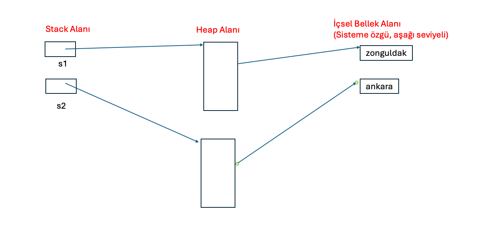

>Burada `içsel bellek alanı` sistemden sisteme farklı olabilmektedir.


>Aynı türden referanslar `==` ve `!=` operatörleri ile karşılaştırma işlemine sokulabilir. Farklı türden referanslar bu operatörler ile işleme sokulduğunda error oluşur. Aynı türden referansların bu operatörler ile işleme sokulması aynı nesneyi gösterip göstermediğinin karşılaştırılmasıdır. Yani, bu operatörler ile karşılaştırma nesne içeriklerinin karşılaştırılması değil, adres karşılaştırmasıdır

>Aşağıdaki demo örneği inceleyiniz

```java
package csd;


class App {
	public static void main(String [] args) 
	{		
		Sample s1;
		Sample s2; 
		
		s1 = new Sample(10);
		s2 = s1; //new Sample(10);
		
		System.out.println(s1 == s2 ? "Aynı nesne" : "Farklı nesneler");
		System.out.println(s1 != s2 ? "Farklı nesneler" : "Aynı nesne");
	}
}

class Sample {
	public int x;
	
	public Sample(int a)
	{
		x = a;
	}
	//...
}
```

>Aşağıdaki demo örnekte iki yazının özdeşlik (yani karşılıklı tüm karakterlerinin aynı olması) karşılaştırması değil, referans karşılaştırması yapılmıştır. Bu durumda hangi yazılar girilirse girilsin `==` operatörü `false` değerini üretecektir

```java
package csd;


class App {
	public static void main(String [] args) 
	{		
		java.util.Scanner kb = new java.util.Scanner(System.in);
		
		System.out.print("Input first text:");
		String s1 = kb.nextLine();
		
		System.out.print("Input second text:");
		String s2 = kb.nextLine();
		
		System.out.println(s1 == s2 ? "Same" : "Different");
	}
}
```

>İki yazının özdeğişlik karşılaştırması String sınıfının `equals` metodu ile yapılabilir. Bu metot `case-sensitive` karşılaştırma yapar.

>Aşağıdaki demo örneği inceleyiniz

```java
package csd;


class App {
	public static void main(String [] args) 
	{		
		java.util.Scanner kb = new java.util.Scanner(System.in);
		
		System.out.print("Input first text:");
		String s1 = kb.nextLine();
		
		System.out.print("Input second text:");
		String s2 = kb.nextLine();
		
		System.out.println(s1.equals(s2) ? "Same" : "Different");
	}
}

```

**Anahtar Notlar:** equals metodunun parametresi `java.lang.Object` türündendir. Bu tür ve bu türe `String` bir referansın nasıl argüman olarak verilebildiği, başka bir deyişle nasıl atanabildiği ileride ele alınacaktır.

>İki yazının `case-insensitive` olarak özedeşlik karşılaştırması `equalsIgnoreCase` metodu ile yapılabilir.

>>Aşağıdaki demo örneği inceleyiniz

```java
package csd;


class App {
	public static void main(String [] args) 
	{		
		java.util.Scanner kb = new java.util.Scanner(System.in);
		
		System.out.print("Input first text:");
		String s1 = kb.nextLine();
		
		System.out.print("Input second text:");
		String s2 = kb.nextLine();
		
		System.out.println(s1.equalsIgnoreCase(s2) ? "Same" : "Different");
	}
}

```

>Derleyici, özdeş string literall'lar için aynı adresin verileceği kodları üretir. Yani, özdeş string literal'lar için bir tane nesne yaratılmış olur.

>Aşağıdaki demo örnekte `s1 == s2` karşılaştırması sonucunda true değeri üretilir

```java
package csd;


class App {
	public static void main(String [] args) 
	{		
		String s1 = "ankara";
		String s2 = "ankara";
		
		System.out.println(s1 == s2 ? "Same object" : "Different objects");
	}
}

```

>String sınıfının `concat` metodu ile yazı birleştimesi (concatenation) yapılabilir.

>Aşağıdaki demo örneği inceleyiniz

```java
package csd;


class App {
	public static void main(String [] args) 
	{		
		java.util.Scanner kb = new java.util.Scanner(System.in);
		
		while (true) {
			System.out.print("Input first text:");
			String s1 = kb.nextLine();
			
			if ("exit".equals(s1))
				break;
			
			System.out.print("Input second text:");
			String s2 = kb.nextLine();
			
			String s = s1.concat(s2);
			
			System.out.printf("Full text:%s%n", s);			
		}
		
		System.out.println("C and System Programmers Association");
	}
}
```

>Aşağıdaki demo örneği inceleyiniz

```java
package csd;


class App {
	public static void main(String [] args) 
	{		
		java.util.Scanner kb = new java.util.Scanner(System.in);
		
		while (true) {
			System.out.print("Input first text:");
			String s1 = kb.nextLine();
			
			if ("exit".equals(s1))
				break;
			
			System.out.print("Input second text:");
			String s2 = kb.nextLine();
			
			String s = s1.concat(" ".concat(s2));
			
			System.out.printf("Full text:%s%n", s);			
		}
		
		System.out.println("C and System Programmers Association");
	}
}

```

>Aşağıdaki demo örneği inceleyiniz

```java
package csd;


class App {
	public static void main(String [] args) 
	{		
		java.util.Scanner kb = new java.util.Scanner(System.in);
		
		while (true) {
			System.out.print("Input first text:");
			String s1 = kb.nextLine();
			
			if ("exit".equals(s1))
				break;
			
			System.out.print("Input second text:");
			String s2 = kb.nextLine();
			
			String s = s1.concat(" ").concat(s2);
			
			System.out.printf("Full text:%s%n", s);			
		}
		
		System.out.println("C and System Programmers Association");
	}
}

```

>`+` operatörünün operandları String türündense, bu durumda yazı birleştirmesi yapılır, birleştirilmiş yazıya ilişkin String referansı üretilir

```java
package csd;


class App {
	public static void main(String [] args) 
	{		
		java.util.Scanner kb = new java.util.Scanner(System.in);
		
		while (true) {
			System.out.print("Input first text:");
			String s1 = kb.nextLine();
			
			if ("exit".equals(s1))
				break;
			
			System.out.print("Input second text:");
			String s2 = kb.nextLine();
			
			String s = s1 + " " + s2;
			
			System.out.printf("Full text:%s%n", s);			
		}
		
		System.out.println("C and System Programmers Association");
	}
}

```

>`+` operatörünün bir operandı String türündense (diğeri farklı bir türdense), diğer operandın yazı karşıığı elde edilerek birleştirme işlemi yapılır. String türden olmayan operandının yazı karşılığının nasıl elde edildiği yani derleyicinin ürettiği kod ileride ele alınacaktır. Yazı karşılığı tür dönüştürme operatörü ile elde edilemez.

>Aşağıdaki demo örneği inceleyiniz

```java
package csd;


class App {
	public static void main(String [] args) 
	{		
		java.util.Scanner kb = new java.util.Scanner(System.in);
		
		while (true) {
			System.out.print("Input station name:");
			String name = kb.nextLine();
			
			if ("exit".equals(name))
				break;
			
			System.out.print("Input degree:");
			double degree = Double.parseDouble(kb.nextLine());
			
			String message;
			
			message = name + ": " + degree;
			
			System.out.println(message);			
		}
		
		System.out.println("C and System Programmers Association");
	}
}

```

>**Soru:** Aşağıdaki kodda ekran çıktısı nedir:

```java
package csd;


class App {
	public static void main(String [] args) 
	{		
		System.out.println("Java" + 2 + 1); 
		System.out.println(2 + 1 + "Java");
	}
}

```

**Ekran çıktısı:**

```
Java21
3Java
```

>Uzunluğu sıfır olan yani hiç bir karakter içermeyen bir yazıya **boş string(empty string)** denir. Boş string oluşturmak için en kolay yol iki tane iki tırnağın yan yana getirilmesiyle oluşan string literal'ı yazmaktır

```java
package csd;


class App {
	public static void main(String [] args) 
	{		
		String s = "";
		
		System.out.printf("Length:%d%n", s.length());
	}
}

```

>Bir string'in boş olup olmadığı çeşitli biçimlerde anlaşılabilir. Örneğin, uzunluk bilgisine bakılabilir ya da örneğin `""` ile özdeşlik kontrolü (equals metodu ile) yapılabilir. Pratikte çok kullanıldığından String sınıfında yazının boş string olup olmadığını test eden `isEmpty` isimli bir metot bulunur. Bu durumda hem okunabilirlirlik/algılanabilirlik hem de kolay yazım açısından boş string kontrolü `isEmpty`ile yapılmalıdır.

>Aşağıdaki demo örneği inceleyiniz

```java
package csd;


class App {
	public static void main(String [] args) 
	{		
		java.util.Scanner kb = new java.util.Scanner(System.in);
		
		while (true) {
			System.out.print("Input text:");
			String s = kb.nextLine();
			
			if ("exit".equals(s))
				break;
			
			if (!s.isEmpty())
				System.out.printf("Text:[%s]%n", s);
			else
				System.out.println("You can not input empty string!...");
		}
		
		System.out.println("C and System Programmers Association");
	}
}
```

>String sınıfının `substring` metotları yazının belli bir kısmını elde etmek için kullanılır. Bu metodun tek parametreli overload'u aldığı indeks numarasından itibaren yazının sonuna kadar olan yazıya geri döner, iki parametreli overload'u `[beginIndex, endIndex)` aralığındaki yazıya geri döner. 

```java
package csd;


class App {
	public static void main(String [] args) 
	{		
		String s = "ankara";
		
		System.out.println(s.substring(2)); //kara
		System.out.println(s.substring(2, 5)); //kar
	}
}
```

>substring metodunun tek parametreli overloasd'una yazının uzunluğu indeks olarak verildiğinde boş string'e geri döner. Yazının sınırları dışında kalan tüm diğer indeks numaraları için exception oluşur. substring metodunun iki parametreli overload'una yazı sınırları içerisinde olması koşuşuyla beginIndex ve endIndex değerleri aynı verildiğinde boş string'e geri döner. Verilen indeks değeri yazı sınırları içerisinde değilse (uzunluğu eşit olabilir) exception oluşur.

```java
package csd;


class App {
	public static void main(String [] args) 
	{		
		java.util.Scanner kb = new java.util.Scanner(System.in);
		
		System.out.print("Input a text:");
		String s = kb.nextLine();
		
		System.out.printf("Text:%s%n", s);		
		System.out.println(s.substring(s.length()).isEmpty() ? "Empty string" : "Non-empty string");
		System.out.println(s.substring(s.length(), s.length()).isEmpty() ? "Empty string" : "Non-empty string");
	}
}

```
>**Sınıf Çalışması:** Klavyeden `exit` girilene kadar alınan yazıları aralarında `:` karakteri olacak şekilde birleştirilmiş yeni bir yazı elde eden programı aşağıdaki açıklamalara göre yazınız
>
>**Açıklamalar:** 
>- Programda dizi kullanılmayacaktır. Zaten gerek de yoktur.
>- Boş string yazıya dahil edilemeyecektir.
>- `:` karakteri elde edilen yazıda yalnızca girilmiş olan yazıların arasında bulunacaktır, başında veya sonunda bulunmayacaktır.
>**Not:** İleride daha iyisi yazılacaktır.

>**Çözüm-1:**
```java
package csd;


class App {
	public static void main(String [] args) 
	{		
		JoinWithColonApp.run();
	}
}

class JoinWithColonApp {
	public static void run()
	{
		java.util.Scanner kb = new java.util.Scanner(System.in);
		String str = "";
		
		while (true) {
			System.out.print("Input text:");
			String s = kb.nextLine();
			
			if ("exit".equals(s))
				break;
			
			if (s.isEmpty())
				continue;
			
			if (!str.isEmpty())
				str += ":";
			
			str += s;
		}
		
		System.out.printf("[%s]%n", str);	
	}
}

```

>**Çözüm-2:** İlk çözüme göre daha efektif sayılabilir.

```java
package csd;


class App {
	public static void main(String [] args) 
	{		
		JoinWithColonApp.run();
	}
}

class JoinWithColonApp {
	public static void run()
	{
		java.util.Scanner kb = new java.util.Scanner(System.in);
		String str = "";
		
		while (true) {
			System.out.print("Input text:");
			String s = kb.nextLine();
			
			if ("exit".equals(s))
				break;
			
			if (s.isEmpty())
				continue;
		
			str += s + ':';
		}
		
		if (!str.isEmpty())
			str = str.substring(0, str.length() - 1);
		
		System.out.printf("[%s]%n", str);	
	}
}

```
>String sınıfının bir yazı içerisinde bir karakteri ya da bir yazıyı aramak için kullanılan `indexOf` metotları bulunur. Bu metotlar ilk bulduklarının indeks numarasına geri dönerler, bulamazlarsa -1 değerine geri dönerler. Bu metotlar ve özet açıklamaları şu şekildedir:
>**1. indexOf(int ch):** Yazı içerisinde parametresi ile aldığı karakteri arar, ilk bulduğunun indeks numarasına geri döner.
>
>**2. indexOf(int ch, int fromIndex):** Yazı içerisinde parametresi ile aldığı karakteri, ikinci parametresi ile aldığı karakterden itibaren arar ve ilk bulduğunun indeks numarasına geri döner.1

>**3. indexOf(String str):** Yazı içerisinde parametresi ile aldığı yazıyı arar, ilk bulduğunun ilk karakterinin indeks numarasına geri döner.
>
>**4. indexOf(String str, int fromIndex):** Yazı içerisinde parametresi ile aldığı yazıyı, ikinci parametresi ile aldığı karakterden itibaren arar ve ilk bulduğunun ilk karakterinin indeks numarasına geri döner.

>Aşağıdaki demo örneği inceleyiniz

```java
package csd;

class App {
    public static void main(String[] args)
    {
        String s = "Bugün hava çok güzel, çok çok güzel";
        
        System.out.printf("Indeks: %d%n", s.indexOf('ç'));
        System.out.printf("Indeks: %d%n", s.indexOf('ç', 12));
        System.out.printf("Indeks: %d%n", s.indexOf('ç', 27));
        
        System.out.printf("Indeks: %d%n", s.indexOf("çok"));
        System.out.printf("Indeks: %d%n", s.indexOf("çok", 12));
        System.out.printf("Indeks: %d%n", s.indexOf("çok", 27));
    }
}
```

>Sınıfın `lastIndexOf` metotları aramayı sondan itibaren yaparak, sondan ilk bulduklarına ilişkin indeks numarasına geri dönerler. Bulamadıkları durumda -1 değerine geri dönerler.

>Aşağıdaki demo örneği inceleyiniz

```java
package csd;

class App {
    public static void main(String[] args)
    {
        String s = "Bugün hava çok güzel, çok çok güzel";
        
        System.out.printf("Indeks: %d%n", s.lastIndexOf('ç'));
        System.out.printf("Indeks: %d%n", s.lastIndexOf('ç', 12));
        System.out.printf("Indeks: %d%n", s.lastIndexOf('ç', 27));
        
        System.out.printf("Indeks: %d%n", s.lastIndexOf("çok"));
        System.out.printf("Indeks: %d%n", s.lastIndexOf("çok", 12));
        System.out.printf("Indeks: %d%n", s.lastIndexOf("çok", 27));
    }
}

```

>**Sınıf Çalışması:** Parametresi ile ile aldığı yol ifadesine (path) ilişkin dosya ismini verelen getFileName metodunu FileUtil isimli sınıf içerisinde aşağıdaki açıklamalara göre yazınız.

>**Açıklamalar:**
>- Dosya yol ifadesi, işletim sistemine göre `\` ya da `/` ile ayrılan yazıların birleşimdir.
>
>- Metoda geçilen argümalar ve elde edilecek isimlere ilişkin bazı örnekler şunlardı:
`C:\windows\test\default.json` yol ifadesinde `default.json` ismine geri dönecektir.

`default.json` yol ifadesinde `default.json` ismine geri dönecektir.

`/home/study/default.json` yol ifadesinde `default.json` ismine geri dönecektir.

>**Not:** İleride daha iyisi yazılacaktır.

>**Çözüm:**

```java
package csd;

class App {
    public static void main(String[] args)
    {
    	FileUtilGetFilenameTest.run();
    }
}


class FileUtilGetFilenameTest {
	public static void run()
	{
		System.out.println(FileUtil.getFilename("C:\\windows\\test\\default.json"));
		System.out.println(FileUtil.getFilename("default.json"));
		System.out.println(FileUtil.getFilename("/home/study/default.json"));
	}
}


class FileUtil {
	public static String getFilename(String path)
	{
		int idx = path.lastIndexOf('/');
		
		if (idx != -1)
			return path.substring(idx + 1);
		
		idx = path.lastIndexOf('\\');
		
		return path.substring(idx + 1);
	}
}
```

>**Sınıf Çalışması:** Parametresi ile aldığı iki yazıdan birinci içerisinde ikincisinden kaç tane olduğu bilgisine geri dönen (yoksa sıfır değerine geri dönecektir) `countString` isimli metodu `StringUtil` sınıfı içerisinde yazınız ve test ediniz. 
>**Açıklamalar:**
>
>- Metot, örneğin `Bugün hava çok güzel, çok çok güzel` yazısından `çok` yazısı aranıyorsa 3 değerine geri dönecektir.
>
>- Metot case-sensitive olarak işlem yapacaktır.  
>
>**Not:** İleride daha iyisi yazılabilecektir.

>**Çözüm-1:**

```java
package csd;

class App {
    public static void main(String[] args)
    {
    	StringUtilCountStringTest.run();
    }
}


class StringUtilCountStringTest {
	public static void run()
	{
		System.out.println(StringUtil.countString("Bugün hava çok güzel, çok çok güzel", "çok") == 3);
		System.out.println(StringUtil.countString("Bugün hava çok güzel, çok çok güzel", "Çok") == 0);
		System.out.println(StringUtil.countString("aaa", "aa") == 2);
	}
}


class StringUtil {
	public static int countString(String s1, String s2)
	{
		int count = 0;
		int idx = 0;
		
		while ((idx = s1.indexOf(s2, idx)) != -1) {
			++count;
			++idx;
		}
		
		
		return count;
	}
}
```


>**Çözüm-2:**

```java
package csd;

class App {
    public static void main(String[] args)
    {
    	StringUtilCountStringTest.run();
    }
}


class StringUtilCountStringTest {
	public static void run()
	{
		System.out.println(StringUtil.countString("Bugün hava çok güzel, çok çok güzel", "çok") == 3);
		System.out.println(StringUtil.countString("Bugün hava çok güzel, çok çok güzel", "Çok") == 0);
		System.out.println(StringUtil.countString("aaa", "aa") == 2);
	}
}


class StringUtil {
	public static int countString(String s1, String s2)
	{
		int count = 0;
		int idx = -1;
		
		while ((idx = s1.indexOf(s2, idx + 1)) != -1)
			++count;
		
		return count;
	}
}
```

>**Çözüm-3:**

```java
package csd;

class App {
    public static void main(String[] args)
    {
    	StringUtilCountStringTest.run();
    }
}


class StringUtilCountStringTest {
	public static void run()
	{
		System.out.println(StringUtil.countString("Bugün hava çok güzel, çok çok güzel", "çok") == 3);
		System.out.println(StringUtil.countString("Bugün hava çok güzel, çok çok güzel", "Çok") == 0);
		System.out.println(StringUtil.countString("aaa", "aa") == 2);
	}
}


class StringUtil {
	public static int countString(String s1, String s2)
	{
		int count = 0;
		
		for (int idx = 0; (idx = s1.indexOf(s2, idx)) != -1; ++count, ++idx)
			;
		
		return count;
	}
}

```
>**Çözüm-4:**

```java
package csd;

class App {
    public static void main(String[] args)
    {
    	StringUtilCountStringTest.run();
    }
}


class StringUtilCountStringTest {
	public static void run()
	{
		System.out.println(StringUtil.countString("Bugün hava çok güzel, çok çok güzel", "çok") == 3);
		System.out.println(StringUtil.countString("Bugün hava çok güzel, çok çok güzel", "Çok") == 0);
		System.out.println(StringUtil.countString("aaa", "aa") == 2);
	}
}


class StringUtil {
	public static int countString(String s1, String s2)
	{
		int count = 0;
		
		for (int idx = -1; (idx = s1.indexOf(s2, idx + 1)) != -1; ++count)
			;
		
		return count;
	}
}
```

**Soru:**
>**IntegerDecimalOccurence:** String pattern matching in decimal representations of ints.
>
>**Task description:**
>Two integers A and B are given. We are interested in positions at which decimal representation of A occurs as a substring in the decimal representation of B (counting from 0) For example:
>
>- 53 occurs in 1953786 at position 2.
>- 78 occurs in 1953786786 at positions 4 and 7
>- 57 does not occur in 153786.
>
>Decimal representations are assumed to be big-endian and without leading zeros (the only exception being the number 0, whose decimal representation is "0")
>
>Write function

```java
class Solution { public int solution(int A, int B); }	
```

>that, given two integers A and B, returns the leftmost position at which A occurs in B the function should return -1 if A does not occur in B.
>
>For example, given A = 53 and B = 195378653, the function should return 2, as explained above.
>Assume that:	
>- A and B are integers within the range `[0..999,999,999]`
>
>In your solution, focus on correctness. The performance of your solution will not be the focus of the assessment.

>**Solution:**

```java
package csd;

class App {
    public static void main(String[] args)
    {
    	SolutionTest.run();
    }
}


class SolutionTest {
	public static void run()
	{
		Solution s = new Solution();
		
		System.out.printf("Index: %d%n", s.solution(53, 195378653));
		System.out.printf("Index: %d%n", s.solution(54, 195378653));
	}
}

class Solution {
	public int solution(int A, int B)
	{
		return (B + "").indexOf(A + "");
	}
}
```

>Java'da aşağıdaki koşullardan birini sağlayan bir karakter `whitespace` karakterdir. Tersine whitespace bir karakter aşağıdaki koşullardan birini sağlar (if and only if):
>  	
>- Karakter "Unicode space" karakter ve "Non-breaking space" olmayan karakterlerdendir. Unicode space karakterler şunlardır:  Space Separator, Line Separator, Paragraph Separator. Bu karakterler UNICODE'da çeşitli kategorilerdir. Detaylar burada ele alınmayacaktır. Bu karakterlere `Character` sınıfının SPACE_SEPERATOR, LINE_SEPARATOR, PARAGRAPH_SEPARATOR isimli static veri elemanları ile elde edilebilir. non-breaking space karakterler şunlardır: `\u00A0`, `\u2007`, `\u202F`
>- `\t` 		horizontal tabulation
>- `\n` 		line feed (LF)
>- `\u000B` 	vertical tabulation
>- `\f` 		form tabulation
>- `\r` 		carriage return (CR)
>- `\u001C` 	file separator
>- `\u001D` 	group separator
>- `\u001E` 	record separator
>- `\u001F` 	unit separator


>`java.lang`paketi içerisinde `Character` isimli sınıfın bir karakter ile çeşitli işlemler yapabilen yararlı metotları bulunur. Bu sınıfın bu tarz metotları özellikle String sınıfına yardımcı olarak düşünülebilir. Bu metotların bir grubu `isXXX` biçiminde boolean türüne geri dönen metotlardır, bir grubu `toXXX` biçiminde genel olarak dönüştürme yapan metotlardır. Bu sınıfın elemanları oldukça fazladır. Bu metotlaran bazıları şunlardır:
>
- `isWhiteSpace:` Karakterin whitespace karakter olup olmadığını test eder.
> 
- `isDigit`: Karakterin bir rakam karakteri olup olmadığını test eder.
>
- `isLetter`: Karakterin alfabetik bir karakter olup olmadığını test eder. 
>
- `isUpperCase`: Karakterin büyük harf olup olmadığını test eder.
>
- `isLowerCase`: Karakterin küçük harf olup olmadığını test eder. 
>
- `toLowerCase`: Karakterin varsa küçük karşılığını döndürür, yoksa karakterin kendisine geri döner.
>
- `toUpperCase`: Karakterin varsa büyük karşılığını döndürür, yoksa karakterin kendisine geri döner.

>Bu sınıfa ait bir metodun genel olarak hem int hem de char parametreli overload'ları bulunur. Bu durumda int parametreli overload'lar sıra numarası (code point) 65535 (`U + FFFF`)'den büyük olan karakterler ile de kullanılabilmektedir. Sıra numarası 65535 (`U + FFFF`)'den büyük olan karaktelere **supplementary characters** denilmektedir. 

>**Sınıf Çalışması:** Parametresi ile aldığı yazıyı ilk karakteri büyük geri kalan karalterleri küçük olarak şekilde çeviren ve bu yazıya geri dönen `capitalize` isimli metodu `StringUtil` sınıfı içerisinde yazınız ve test ediniz.

>**Çözüm:**

```java
package csd;

class App {
    public static void main(String[] args)
    {
    	StringUtilCapitalizeTest.run();
    }
}

class StringUtilCapitalizeTest {
	public static void run()
	{
		System.out.println(StringUtil.capitalize("bugün Hava Çok Güzel").equals("Bugün hava çok güzel"));
		System.out.println(StringUtil.capitalize("a").equals("A"));
		System.out.println(StringUtil.capitalize("").isEmpty());		
		System.out.println(StringUtil.capitalize(" bugün Hava Çok Güzel").equals(" bugün hava çok güzel"));
		System.out.println(StringUtil.capitalize(":bugün Hava Çok Güzel").equals(":bugün hava çok güzel"));
	}
}

class StringUtil {
	public static String capitalize(String s)
	{
		return s.isEmpty() ? s : Character.toUpperCase(s.charAt(0)) + s.substring(1).toLowerCase();
	}
}
```

>**Sınıf Çalışması:** Parametresi ile aldığı bir yazının Türkçe pangram olup olmadığını test eden `isPangramTR` ve İngilizce pangram olup olmadığını test eden `isPangramEN` isimli metotları StringUtil sınıfı içerisinde aşağıdaki açıklamalara göre yazınız ve test ediniz.

>**Açıklamalar:**
>- İlgili dilin alfabesindeki tüm karakterler kullanılarak elde edilen ve içerisinde hiç özel isim geçmeyen anlamlı cümlelere pangram denir. Örneğin, İngilizce'de tipik olarak `The quick brown fox jumps over the lazy dog`, Türkçe'de tipik olarak `Pijamalı hasta yağız şoföre çabucak güvendi.` 
>
>- Metotlar cümlenin anlamlı olmasına ve özel isim içerip içermediğine bakmayacaktır, dolayısıyla yalnızca alfabetik karakterlerle ilgilenecektir. 

>**Çözüm:**

```java
package csd;

class App {
    public static void main(String[] args)
    {
    	StringUtilIsPangramTest.run();
    }
}

class StringUtilIsPangramTest {
	public static void run()
	{
		StringUtilIsPangramTRTest.run();
		StringUtilIsPangramENTest.run();
	}
}

class StringUtilIsPangramTRTest {
	public static void run()
	{
		System.out.println(StringUtil.isPangramTR("Pijamalı hasta yağız şoföre çabucak güvendi"));
		System.out.println(!StringUtil.isPangramTR("Pijamalı hasta yağız şföre çabucak güvendi"));
	}
}

class StringUtilIsPangramENTest {
	public static void run()
	{
		System.out.println(StringUtil.isPangramEN("The quick brown fox jumps over the lazy dog"));
		System.out.println(!StringUtil.isPangramEN("The quick brown fo jumps over the lazy dog"));
	}
}

class StringUtil {
	public static boolean isPangramTR(String s)
	{
		return isPangram(s.toLowerCase(), "abcçdefgğhıijklmnoöprsştuüvyz");
	}
	
	public static boolean isPangramEN(String s)
	{
		return isPangram(s.toLowerCase(), "abcdefghijklmnopqrstuwxvyz");
	}
	
	public static boolean isPangram(String s, String alphabet)
	{
		for (int i = 0; i < alphabet.length(); ++i)
			if (s.indexOf(alphabet.charAt(i)) == -1)
				return false;
		
		return true;
	}
}

```

>Yukarıdaki örnekte yalnızca `isPangramEN` sorulsaydı şu çözümler de mümkün olabilirdi:

>**Çözüm-1:**
```java
package csd;

class App {
    public static void main(String[] args)
    {
    	StringUtilIsPangramENTest.run();
    }
}

class StringUtilIsPangramENTest {
	public static void run()
	{
		System.out.println(StringUtil.isPangramEN("The quick brown fox jumps over the lazy dog"));
		System.out.println(!StringUtil.isPangramEN("The quick brown fo jumps over the lazy dog"));
	}
}

class StringUtil {
	public static boolean isPangramEN(String s)
	{
		s = s.toLowerCase();
		for (char c = 'a'; c <= 'z'; ++c)
			if (s.indexOf(c) == -1)
				return false;
		
		return true;
	}
}

```

>**Çözüm-2:**

```java
package csd;

class App {
    public static void main(String[] args)
    {
    	StringUtilIsPangramENTest.run();
    }
}

class StringUtilIsPangramENTest {
	public static void run()
	{
		System.out.println(StringUtil.isPangramEN("The quick brown fox jumps over the lazy dog"));
		System.out.println(!StringUtil.isPangramEN("The quick brown fo jumps over the lazy dog"));
	}
}

class StringUtil {
	public static boolean isPangramEN(String s)
	{
		s = s.toLowerCase();
		for (int i = 0; i < 26; ++i)
			if (s.indexOf('a'+ i) == -1)
				return false;
		
		return true;
	}
}

```

>String sınıfının `trim` metodu yazının başındaki (leading) ve sonundaki (trailing) boşluk karakterlerini (whitespaces) siler.  Bu metot, `[\u0000, \u0020]` aralığındaki boşluk karakleri için çalışır. Diğer boşluk karakterlerini silmez. Java 11 ile birlikte tüm boşluk karakterleri için çalışan `strip` metodu String sınıfına eklenmiştir. Java 11 ile birlikte String sınıfına `stripLeading` ve `stripTrailing` isimli, sırasıyla yalnızca baştaki boşluk karakterini ve yalnızca sondaki boşluk karakterlerini silen metotlar eklenmiştir. Bu metotlar aradaki boşluk karakterlerine dokunmazlar. Java 11 öncesi için tüm boşluk karakterleri ile çalışan `strip` tarzı metotlar bulunmadığından programcılar gerekirse bunu kendisi yazmalıdır. Java 11+ için `trim` metodu işimizi görse de `strip` metodunun çağrılması iyi bir tekniktir. 

>Aşağıdaki demo örneği inceleyiniz

```java
package csd;

class App {
    public static void main(String[] args)
    {
    	java.util.Scanner kb = new java.util.Scanner(System.in);
    	
    	while (true) {
    		System.out.print("Input text:");
    		String s = kb.nextLine();
    		
    		System.out.printf("{%s}%n", s.trim());
    		System.out.printf("{%s}%n", s.strip());
    		System.out.printf("{%s}%n", s.stripLeading());
    		System.out.printf("{%s}%n", s.stripTrailing());
    		
    		
    		if ("quit".equals(s))
    			break;
    	}
    }
}
```

>**Sınıf Çalışması:** Aşağıda prototipleri verilen metotları açıklamalara göre yazınız

```java
public static String trim(String s);
public static String trimLeading(String s);
public static String trimTrailing(String s);
```

>**Açıklamalar:**
>
>- Metotlar Java 11 öncesi için yazılacaktır
>
>- Metotlar sırasıyla başındaki ve sonundaki, yalnızca başındaki ve yalnızxa sonundaki boşluk karakterlerini silecektir
>
>- Metotlar tüm boşluk karakterleri için çalışacaktır.
>
>- Metotlar `StringUtil` sınıfı içeriisnde yazılacaktır.

>**Çözüm:**

```java
package csd;

class App {
    public static void main(String[] args)
    {
    	StringUtilTrimsTest.run();
    }
}

class StringUtilTrimsTest {
	public static void run()
	{
		java.util.Scanner kb = new java.util.Scanner(System.in);
    	
    	while (true) {
    		System.out.print("Input text:");
    		String s = kb.nextLine();
    		
    		System.out.printf("{%s}%n", StringUtil.trim(s));
    		System.out.printf("{%s}%n", StringUtil.trimLeading(s));
    		System.out.printf("{%s}%n", StringUtil.trimTrailing(s));
    		
    		
    		if ("quit".equals(s))
    			break;
    	}
	}
}

class StringUtil {
	public static String trim(String s)
	{
		return trimLeading(trimTrailing(s));
	}
	
	public static String trimLeading(String s)
	{
		int i = 0;
		
		
		for (; i < s.length() && Character.isWhitespace(s.charAt(i)); ++i)
			;
			
		return s.substring(i);
	}
	
	public static String trimTrailing(String s)
	{
		int i = s.length() - 1;
		
		for (; i >= 0 && Character.isWhitespace(s.charAt(i)); --i)
			;
		
		return s.substring(0, i + 1);
	}
}
```

>String sınıfının immutable özelliğinin maliyetli olması durumunda string işlemleri için String sınıfına yardımcı, `java.lang` paketi içerisinde bulunan `StringBuilder` sınıfı kullanılabilir. Bu sınıf immutable değildir. StringBuilder sınıfının yazı üzerinde değişiklkik yapabilen pek çok yararlı metodu bulunur. StringBuilder sınıfı String sınıfına bir alternatif olarak düşünülmemelidir. Bu sınıf yardımcı bir sınıftır ve String sınıfının immutable özelliğinin dezavantaj oluşturduğu durumlarda tercih edilmelidir. Örneğin bir yazının tersini döndüren reverse metodu aşağıdaki gibi kolay bir biçimde yazılabilir:

```java
public static String reverse(String s)
{
	String str = "";
	
	for (int i = s.length() - 1; i >= 0; --i)
		str += s.charAt(i);
	
	return str;
}
```

>Burada dikkat edilirse her adımda bir String nesnesi yaratılmakta ve yaratılmış olan nesne bir sonraki adımda ilgili referanstan kopartılıp kullanılamaz duruma gelmektedir. Bu durumda, yaklaşık olarak metoda verilen yazının uzunluğu kadar String nesnesi yaratıldığından göre maliyetli olma eğilimindedir. İşte StringBuilder sınıfı ile bu maliyet ortadan kaldırılabilir.

**Anahtar Notlar:** StringBuilder sınıfının pek çok metodu, çağıran StringBuilder referansına geri döner. Bu şekildeki sınıflar ve metotları, ileride ele alacağımız `fluent pattern` kavramına uygun olarak yazılmışlardır.

>StringBuilder sınıfının String parametreki ctor'u ile bir String'in karakterlerinden oluşan bir StringBuilder nesnesi yaratılabilir. Sınıfın toString metodu StringBuilder nesnesine ilişkin yazının karakterlerine ilişkin bir String referansına geri döner. StringBuilder sınıfının `reverse` metodu ile yazı ters-yüz edilebilir. Bu durumda yukarıda maliyetli olarak implemente edilmiş `reverse` metodu aşağıdaki gibi en az maliyetle yazılabilir:

```java
public static String reverse(String s)
{
	return new StringBuilder(s).reverse().toString();
}
```

>StringBuilder sınıfının `append` metotları yazıya ekleme yapmak için kullanılır. StringBuilder sınıfının default ctor'u ile length'i sıfır olan bir yazıya ilişkin bir StringBuilder nesnesi yaratılır, String parametreli ctor'u ile yazının karakterlerinden oluşan bir StringBuilder nesnesi yaratılmış olur. StringBuilder sınıfının da String sınıfındaki gibi substring metotları bulunmaktadır. String sınıfının toString metodu ile yazıya ilişkin String nesnesi referansı elde edilebilir. StringBuilder sınıfının `length` ve `isEmpty` metotları da bulundurulmuştur. StringBuilder sınıfının `charAt` metodu vardır ayrıca verilen bir indeksteki karakteri set eden `setCharAt` isimli bir metodu da vardır.


>**Sınıf Çalışması:** Klavyeden `exit` girilene kadar alınan yazıları aralarında `:` karakteri olacak şekilde birleştirilmiş yeni bir yazı elde eden programı aşağıdaki açıklamalara göre yazınız
>
>**Açıklamalar:** 
>- Programda dizi kullanılmayacaktır. Zaten gerek de yoktur.
>- Boş string yazıya dahil edilemeyecektir.
>- `:` karakteri elde edilen yazıda yalnızca girilmiş olan yazıların arasında bulunacaktır, başında veya sonunda bulunmayacaktır.
>**Not:** İleride daha iyisi yazılacaktır.

>**Çözüm:** 

```java
package csd;

class App {
	public static void main(String [] args) 
	{		
		JoinWithColonApp.run();
	}
}

class JoinWithColonApp {
	public static void run()
	{
		java.util.Scanner kb = new java.util.Scanner(System.in);
		StringBuilder sb = new StringBuilder();
		
		while (true) {
			System.out.print("Input text:");
			String s = kb.nextLine();
			
			if ("exit".equals(s))
				break;
			
			if (s.isEmpty())
				continue;
			
			sb.append(s).append(':');		
			
		}
		
		String str = sb.isEmpty() ? "" : sb.substring(0, sb.length() - 1);
		
		System.out.printf("[%s]%n", str);	
	}
}
```


>StringBuilder sınıfının burada ele alınmayan pek çok metodu vardır. Burada, `Java ile Uygulama Geliştirme I-II` ve `Android Programlama` kurslarında kullanıldıkça öğrenilecektir.

>**Sınıf Çalışması:** Parametresi ile aldığı bir yazının büyük harflerini küçük, küçük harflerini büyük yapan `changeCase` isimli metodu `StringUtil` sınıfı içerisinde yazınız ve test ediniz. Metot alfabetik olmayan karakterleri aynı şekilde bırakacaktır.


>**Test Kodu:**
```java
class StringUtilChangeCaseTest {
	public static void run()
	{
		System.out.println(StringUtil.changeCase("AnKaRa").equals("aNkArA"));
		System.out.println(StringUtil.changeCase("AnKaRa 06").equals("aNkArA 06"));
	}
}
```
>**Yavaş/Kötü Çözüm:** Kesinlikle tavsiye edilmez. Durumu anlatmak için yazılmıştır

```java
class StringUtil {
	public static String changeCase(String s)
	{
		String str = "";
		
		for (int i = 0; i < s.length(); ++i) {
			char c = s.charAt(i);
			
			str += Character.isUpperCase(c) ? Character.toLowerCase(c) : Character.toUpperCase(c);
		}
		
		
		return str;
	}
}
```

>**Çözüm-1:**

```java
class StringUtil {
	public static String changeCase(String s)
	{
		StringBuilder sb = new StringBuilder();
		
		for (int i = 0; i < s.length(); ++i) {
			char c = s.charAt(i);
			
			sb.append(Character.isUpperCase(c) ? Character.toLowerCase(c) : Character.toUpperCase(c));
		}		
		
		return sb.toString();
	}
}
```

>**Çözüm-2:**

```java
class StringUtil {
	public static String changeCase(String s)
	{
		StringBuilder sb = new StringBuilder(s);
		
		for (int i = 0; i < s.length(); ++i) {
			char c = sb.charAt(i);
			
			sb.setCharAt(i, Character.isUpperCase(c) ? Character.toLowerCase(c) : Character.toUpperCase(c));
		}		
		
		return sb.toString();
	}
}
```

>String sınıfına Java 11 ile birlikte `repeat`isimli bir metot eklenmiştir. Bu metot ilgili yazıyı parametresi ile aldığı değer kadar çoklar ve çoklanmış yazıya geri döner.

>Aşağıdaki demo örneği inceleyiniz

```java
package csd;

class App {
	public static void main(String [] args) 
	{		
		System.out.println("ali".repeat(4));
		System.out.println("ali veli".repeat(3));
	}
}

```

>**Sınıf Çalışması:** Aşağıda prototipleri verilen metotları açıklamalara göre `StringUtil` sınıfı içerisinde yazınız ve test ediniz.

```java
public static String padLeading(String s, int n, char ch);
public static String padLeading(String s, int n);
public static String padTrailing(String s, int n, char ch);
public static String padTrailing(String s, int n);
```

>**Açıklamalar:**
>- `padLeading` metodunun 3 parametreli overload'u aldığı yazıyı ikinci parametresi ile aldığı uzunluk kadar baştan üçüncü parametresi ile aldığı karakter ile besleyecektir. İkinci parametresi ile aldığı uzunluk bilgisi yazının uzunluğundann küçük veya eşit ise aynı yazıya geri dönecektir. Örneğin:

```java
padLeading("csd", 6, 'x');
```

çağrısı ile `xxxcsd` yazısı elde edilecektir, yada örneğin

```java
padLeading("csd", 3, 'x');
```

çağrısı ile `csd` yazısı elde edilecektir.
>
>- padLeading metodunun iki parametreli overload'u gerekirse yazıyı baştan space karakteri ile besleyecektir. 
>
>- padTrailing metotları `padLeading` metodunun yazıyı sondan besleyen versiyonları olarak yazılacaktır.
>
>- Metotları Java 11 öncesi ve Java 11+ için ayrıca yazınız.

>**Test Kodları:**

```java
class StringUtilPadLeadingTrailingTest {
	public static void run()
	{
		System.out.println(StringUtil.padLeading("csd", 6, 'x').equals("xxxcsd"));
		System.out.println(StringUtil.padLeading("csd", 3, 'x').equals("csd"));
		System.out.println(StringUtil.padLeading("csd", 6).equals("   csd"));
		System.out.println(StringUtil.padLeading("csd", 3).equals("csd"));
		
		System.out.println(StringUtil.padTrailing("csd", 6, 'x').equals("csdxxx"));
		System.out.println(StringUtil.padTrailing("csd", 3, 'x').equals("csd"));
		System.out.println(StringUtil.padTrailing("csd", 6).equals("csd   "));
		System.out.println(StringUtil.padTrailing("csd", 3).equals("csd"));
	}
}
```

>**Çözüm:** Java 11 öncesi için

```java
class StringUtil {
	public static String padLeading(String s, int n, char ch)
	{
		int len = s.length();
		
		return len < n ? repeat(ch, n - len) + s : s; 
	}
	
	public static String padLeading(String s, int n)
	{
		return padLeading(s, n, ' ');
	}
	
	public static String padTrailing(String s, int n, char ch)
	{
		int len = s.length();
		
		return len < n ? s + repeat(ch, n - len) : s;
	}
	
	public static String padTrailing(String s, int n)
	{
		return padTrailing(s, n, ' ');
	}
	
	public static String repeat(char ch, int n)
	{
		StringBuilder sb = new StringBuilder();
		
		while (n-- > 0)
			sb.append(ch);
		
		return sb.toString();
		
	}
}
```

>**Çözüm:** Java 11+ için

```java
class StringUtil {
	public static String padLeading(String s, int n, char ch)
	{
		int len = s.length();
		
		return len < n ? (ch + "").repeat(n - len) + s : s; 
	}
	
	public static String padLeading(String s, int n)
	{
		return padLeading(s, n, ' ');
	}
	
	public static String padTrailing(String s, int n, char ch)
	{
		int len = s.length();
		
		return len < n ? s + (ch + "").repeat(n - len) : s;
	}
	
	public static String padTrailing(String s, int n)
	{
		return padTrailing(s, n, ' ');
	}
}
```

>String sınıfına Java 11 ile birlikte `isBlank` metodu eklenmiştir. Bu metot yazının tamamnının whitespace karakterlerden oluşup oluşmadığını test eder. 

>Aşağıdaki demo örneği inceleyiniz

```java
package csd;

class App {
	public static void main(String [] args) 
	{		
		System.out.println("      \t\n".isBlank()); //System.out.println("      \t\n".strip().isEmpty()); 
		System.out.println("".isBlank());
	}
}
```

>Burada 

```java
"      \t\n".trim().isEmpty()
```

çağrısı `isBlank` ile aynı anlamda değildir. Anımsanacağı gibi trim metodu tüm whitespace karakterler için çalışmaz. `isBlank` metodu ise tüm whitespace karakterler için çalışır. Bu durumda Java 11 öncesi için `isBlank` metodunun bir implementasyonu şu şekilde olabilir:

```java
public static boolean isBlank(String s)
{
	for (int i = 0; i < s.length(); ++i)
		if (!Character.isWhitespace(s.charAt(i)))
			return false;
	
	return true;
}
```

>Şüphesiz bu metot farklı şekilde de yazılabilir.

>Aldığı parametrelere göre bir nesnenin referansına geri dönen metotlara **factory methods** denir. Bu metotlar genel olarak static metotlar biçiminde yazılır. Bu metotlar ile genel nesnenin yaratılma aşamaları programcıdan soyutlanmış olur. String sınıfının `valueOf` isimli factory metotları vardır. JavaSE'de bazı sınıfların factory metotları bulunur. Java 8 öncesinde bu tarz metotların isimleri genel olarak **valueOf** biçimindedir. Java 8+ ile birlikte bu tarz factory metotlar **of** biçiminde isimlendirilmektedir. String sınıfının temel türlerden parametreli overload'ları ilgili değerin yazı karşılığını elde etmek için kullanılır.

>**Sınıf Çalışması:** Aşağıda prototipleri verilen metotları açıklamalara göre `StringUtil` sınıfı içerisinde yazınız ve test ediniz.

```java
public static String padLeading(String s, int n, char ch);
public static String padLeading(String s, int n);
public static String padTrailing(String s, int n, char ch);
public static String padTrailing(String s, int n);
```

>**Açıklamalar:**
>- `padLeading` metodunun 3 parametreli overload'u aldığı yazıyı ikinci parametresi ile aldığı uzunluk kadar baştan üçüncü parametresi ile aldığı karakter ile besleyecektir. İkinci parametresi ile aldığı uzunluk bilgisi yazının uzunluğundann küçük veya eşit ise aynı yazıya geri dönecektir. Örneğin:

```java
padLeading("csd", 6, 'x');
```

çağrısı ile `xxxcsd` yazısı elde edilecektir, yada örneğin

```java
padLeading("csd", 3, 'x');
```

çağrısı ile `csd` yazısı elde edilecektir.
>
>- padLeading metodunun iki parametreli overload'u gerekirse yazıyı baştan space karakteri ile besleyecektir. 
>
>- padTrailing metotları `padLeading` metodunun yazıyı sondan besleyen versiyonları olarak yazılacaktır.
>

>**Test Kodları:**

```java
class StringUtilPadLeadingTrailingTest {
	public static void run()
	{
		System.out.println(StringUtil.padLeading("csd", 6, 'x').equals("xxxcsd"));
		System.out.println(StringUtil.padLeading("csd", 3, 'x').equals("csd"));
		System.out.println(StringUtil.padLeading("csd", 6).equals("   csd"));
		System.out.println(StringUtil.padLeading("csd", 3).equals("csd"));
		
		System.out.println(StringUtil.padTrailing("csd", 6, 'x').equals("csdxxx"));
		System.out.println(StringUtil.padTrailing("csd", 3, 'x').equals("csd"));
		System.out.println(StringUtil.padTrailing("csd", 6).equals("csd   "));
		System.out.println(StringUtil.padTrailing("csd", 3).equals("csd"));
	}
}
```
>**Çözüm:**

```java
class StringUtil {
	public static String padLeading(String s, int n, char ch)
	{
		int len = s.length();
		
		return len < n ? String.valueOf(ch).repeat(n - len) + s : s; 
	}
	
	public static String padLeading(String s, int n)
	{
		return padLeading(s, n, ' ');
	}
	
	public static String padTrailing(String s, int n, char ch)
	{
		int len = s.length();
		
		return len < n ? s + String.valueOf(ch).repeat(n - len) : s;
	}
	
	public static String padTrailing(String s, int n)
	{
		return padTrailing(s, n, ' ');
	}
}
```

>String sınıfının `contains` metodu yazı içerisinde parametresi ile aldığı yazının olup olmadığını test etmek için kullanılır. 

**Anahtar Notlar:** contains metodunun parametresi `CharSequence` türündendir. Bu tür ileride ele alınacaktır. CharSequence türüne String ya da StringBuilder türünden bir referans doğrudan atanabilir. 


>Aşağıdaki demo örneği inceleyiniz

```java
package csd;

class App {
    public static void main(String[] args)
    {
    	StringUtilIsPangramTest.run();
    }
}

class StringUtilIsPangramTest {
	public static void run()
	{
		StringUtilIsPangramTRTest.run();
		StringUtilIsPangramENTest.run();
	}
}

class StringUtilIsPangramTRTest {
	public static void run()
	{
		System.out.println(StringUtil.isPangramTR("Pijamalı hasta yağız şoföre çabucak güvendi"));
		System.out.println(!StringUtil.isPangramTR("Pijamalı hasta yağız şföre çabucak güvendi"));
	}
}

class StringUtilIsPangramENTest {
	public static void run()
	{
		System.out.println(StringUtil.isPangramEN("The quick brown fox jumps over the lazy dog"));
		System.out.println(!StringUtil.isPangramEN("The quick brown fo jumps over the lazy dog"));
	}
}

class StringUtil {
	public static boolean isPangramTR(String s)
	{
		return isPangram(s.toLowerCase(), "abcçdefgğhıijklmnoöprsştuüvyz");
	}
	
	public static boolean isPangramEN(String s)
	{
		return isPangram(s.toLowerCase(), "abcdefghijklmnopqrstuwxvyz");
	}
	
	public static boolean isPangram(String s, String alphabet)
	{
		for (int i = 0; i < alphabet.length(); ++i)
			if (!s.contains(String.valueOf(alphabet.charAt(i))))
				return false;
		
		return true;
	}
}
```

>`Integer` sınıfının `parseInt`, `Long` sınıfının `parseLong`, `Short` sınıfının `parseShort`, `Byte` sınıfının `parseByte`, `Double` sınıfının `parseDouble`, `Float` sınıfının `parseFloat` ve `Boolean` sınıfının `parseBoolean` metotları bir yazıyı ilgili türe çevirmek için kullanılır. `parseBoolean` dışında kalan tüm `parseXXX` metotları yazıyı çeviremedikleri durumda exception oluşur. `parseBoolean` metodu yazıyı çeviremediği durumda `false` değerine geri döner yani exception oluşmaz. Aslında `parseBoolean` metodu case-insensitive olarak `true` yazısı dışında kalan tüm yazılar için `false` değerine geri döner. 

>Aşağıdaki demo örneği inceleyiniz

```java
package csd;

class App {
    public static void main(String[] args)
    {
    	java.util.Scanner kb = new java.util.Scanner(System.in);
    	
    	System.out.print("Input a number:");
    	int a = Integer.parseInt(kb.nextLine());
    	
    	System.out.printf("a = %d%n", a);
    }
}
```

>Aşağıdaki demo örneği inceleyiniz

```java
package csd;

class App {
    public static void main(String[] args)
    {
    	java.util.Scanner kb = new java.util.Scanner(System.in);
    	
    	System.out.print("Input a status:");
    	boolean status = Boolean.parseBoolean(kb.nextLine());
    	
    	System.out.printf("Status:%s%n", status ? "Open" : "Closed");
    }
}
```

>`java.util.Scanner` sınıfının çalışma sistemi gereği, bazı sistemlerde `nextLine` metodu ve temel türlere ilişkin `nextXXX` aynı nesnenin referansı ile peş peşe kullanılmamalıdır. Bu aslında Scanner sınıfı açısından bir problem değildir, sınıfın içsel algoritması ile ilgilidir. Detayının şu aşamada önemi yoktur. Şu aşamada birlikte kullanmamaya odakalanılmalıdır. Programcı böylesş durumlarda nextLine ile birlikte `parseXXX` metotlarını kullanmalıdır.

>Aşağıdaki demo örnek bazı sistemlerde istenildiği gibi çalışmayacaktır

```java
package csd;

class App {
    public static void main(String[] args)
    {
    	java.util.Scanner kb = new java.util.Scanner(System.in);
    	
    	while (true) {
    		System.out.print("Input device name:");
    		String deviceName = kb.nextLine();
    		
    		if ("quit".equals(deviceName))
    			break;
    		
    		System.out.print("Input device number:");
    		int deviceNumber = kb.nextInt();
    		
    		System.out.printf("%s, %d%n", deviceName, deviceNumber);
    	}
    }
}

```

>Yukarıdaki örnek aşağıdaki gibi yapılabilir

```java
package csd;

class App {
    public static void main(String[] args)
    {
    	java.util.Scanner kb = new java.util.Scanner(System.in);
    	
    	while (true) {
    		System.out.print("Input device name:");
    		String deviceName = kb.nextLine();
    		
    		if ("quit".equals(deviceName))
    			break;
    		
    		System.out.print("Input device number:");
    		int deviceNumber = Integer.parseInt(kb.nextLine());
    		
    		System.out.printf("%s, %d%n", deviceName, deviceNumber);
    	}
    }
}
```

>Demo örnek için farklı çözümler de söz konusudur. Diğerleri burada ele alınmayacaktır.

>String sınfının `format` static metodu yazıyı formatlamak için kullanılır. Bu metodun parametrik yapısı ve kullanılan format karakterleri (format specifiers) `printf` ile aynıdır. format metodu formatlanmış yazıyı ekrana basmaz, yazıya ilişkin String referansına geri döner. 

>Aşağıdaki demo örneği inceleyiniz

```java
package csd;

class App {
    public static void main(String[] args)
    {
    	java.util.Scanner kb = new java.util.Scanner(System.in);
    	
    	while (true) {
    		System.out.print("Input device name:");
    		String deviceName = kb.nextLine();
    		
    		if ("quit".equals(deviceName))
    			break;
    		
    		System.out.print("Input device number:");
    		int deviceNumber = Integer.parseInt(kb.nextLine());
    		
    		String text = String.format("%s, %d", deviceName, deviceNumber);
    		
    		//...
    		
    		System.out.println(text);
    	}
    }
}
```

>Point sınfının toString metodu ve test kodu

```java
package csd;

class App {
    public static void main(String[] args)
    {
    	PointToStringTest.run();
    }
}
```

```java
class PointToStringTest {
	public static void run()
	{
		Point p1 = new Point(20.4, -5);
		Point p2 = new Point(45);
		
		System.out.println(p1.toString());
		System.out.println(p2.toString());
	}
}

```
```java
class Point {
	public double x, y;
	
	public Point()
	{		
	}
	
	public Point(double a)
	{
		x = a;
	}
	
	public Point(double a, double b)
	{
		x = a;
		y = b;
	}

	public double euclideanDistance()
	{
		return euclideanDistance(0, 0);
	}
	
	public double euclideanDistance(double a, double b)
	{
		return Math.sqrt(Math.pow(x - a, 2) + Math.pow(y - b, 2));
	}
	
	public double euclideanDistance(Point other)
	{
		return euclideanDistance(other.x, other.y);
	}	
	
	public void offset(double dxy)
	{
		offset(dxy, dxy);
	}
	
	public void offset(double dx, double dy)
	{
		x += dx;
		y += dy;
	}
	
	public String toString()
	{
		return String.format("(%f, %f)", x, y);
	}
}
```
>Complex sınfının toString ve test kodu

```java
package csd;

class App {
    public static void main(String[] args)
    {
    	ComplexToStringTest.run();
    }
}

```

```java
class ComplexToStringTest {
	public static void run()
	{
		Complex z1 = new Complex(20.4, -5);
		Complex z2 = new Complex(20.4);
		
		System.out.println(z1.toString());
		System.out.println(z2.toString());
	}
}
```

```java
class Complex {
	public double real;
	public double imag;
	
	public static Complex add(double a1, double b1, double a2, double b2) //İleride gizleyeceğiz
	{
		return new Complex(a1 + a2, b1 + b2);
	}
	
	public static Complex subtract(double a1, double b1, double a2, double b2) //İleride gizleyeceğiz
	{
		return add(a1, b1, -a2, -b2);
	}
	
	public static Complex multiply(double a1, double b1, double a2, double b2) //İleride gizleyeceğiz
	{
		return new Complex(a1 * a2 - b1 * b2, a1 * b2 + a2 * b1);		
	}
	
	public static Complex divide(double a1, double b1, double a2, double b2) //İleride gizleyeceğiz
	{
		double val = 1 / getNorm(a2, -b2);
		Complex z = multiply(a1, b1, a2, -b2);
		
		return multiply(val, z);		
	}
	
	public Complex()
	{
		
	}
	
	public Complex(double a)
	{
		real = a;
	}
	
	public Complex(double a, double b)
	{
		real = a;
		imag = b;
	}

	public static double getNorm(double a, double b) //İleride bunu gizleyeceğiz
	{
		return Math.sqrt(a * a + b * b);
	}
	
	public double getLength()
	{
		return getNorm();
	}
	
	public double getNorm()
	{
		return getNorm(real, imag);
	}
	
	public Complex getConjugate()
	{
		Complex z = new Complex();
		
		z.real = real;
		z.imag = -imag;
		
		return z;
	}
	
	public Complex add(Complex other)
	{
		return add(real, imag, other.real, other.imag);
	}
	
	public Complex add(double val)
	{
		return add(real, imag, val, 0);
	}
	
	public static Complex add(double val, Complex z)
	{
		return add(val, 0, z.real, z.imag);
	}

	public Complex subtract(Complex other)
	{
		return subtract(real, imag, other.real, other.imag);
	}
	
	public Complex subtract(double val)
	{
		return subtract(real, imag, val, 0);
	}
	
	public static Complex subtract(double val, Complex z)
	{
		return subtract(val, 0, z.real, z.imag);
	}
	
	public Complex multiply(Complex other)
	{
		return multiply(real, imag, other.real, other.imag);
	}
	
	public Complex multiply(double val)
	{
		return multiply(real, imag, val, 0);
	}
	
	public static Complex multiply(double val, Complex z)
	{
		return multiply(val, 0, z.real, z.imag);
	}

	public Complex divide(Complex other)
	{
		return divide(real, imag, other.real, other.imag);
	}
	
	public Complex divide(double val)
	{
		return divide(real, imag, val, 0);
	}
	
	public static Complex divide(double val, Complex z)
	{
		return divide(val, 0, z.real, z.imag);
	}
	
	public String toString()
	{
		return String.format("(%f, %f)", real, imag);
	}
}
```

>Java 15 ile birlikte String sınıfına `formatted` isimli non-static bir metot eklenmiştir. Bu metot format metodunun non-static versiyonu olarak düşünülmelidir. Programcının, Java 15+ yani ticari olarak Java 17+ ile çalışması durumunda format metodu yerine formatted metodunun kullanılması önerilir. 


>Point sınfının toString metodu ve test kodu

```java
package csd;

class App {
    public static void main(String[] args)
    {
    	PointToStringTest.run();
    }
}
```

```java
class PointToStringTest {
	public static void run()
	{
		Point p1 = new Point(20.4, -5);
		Point p2 = new Point(45);
		
		System.out.println(p1.toString());
		System.out.println(p2.toString());
	}
}

```
```java
class Point {
	public double x, y;
	
	public Point()
	{		
	}
	
	public Point(double a)
	{
		x = a;
	}
	
	public Point(double a, double b)
	{
		x = a;
		y = b;
	}

	public double euclideanDistance()
	{
		return euclideanDistance(0, 0);
	}
	
	public double euclideanDistance(double a, double b)
	{
		return Math.sqrt(Math.pow(x - a, 2) + Math.pow(y - b, 2));
	}
	
	public double euclideanDistance(Point other)
	{
		return euclideanDistance(other.x, other.y);
	}	
	
	public void offset(double dxy)
	{
		offset(dxy, dxy);
	}
	
	public void offset(double dx, double dy)
	{
		x += dx;
		y += dy;
	}
	
	public String toString()
	{
		return "(%f, %f)".formatted(x, y);
	}
}
```
>Complex sınfının toString ve test kodu

```java
package csd;

class App {
    public static void main(String[] args)
    {
    	ComplexToStringTest.run();
    }
}

```

```java
class ComplexToStringTest {
	public static void run()
	{
		Complex z1 = new Complex(20.4, -5);
		Complex z2 = new Complex(20.4);
		
		System.out.println(z1.toString());
		System.out.println(z2.toString());
	}
}
```

```java
class Complex {
	public double real;
	public double imag;
	
	public static Complex add(double a1, double b1, double a2, double b2) //İleride gizleyeceğiz
	{
		return new Complex(a1 + a2, b1 + b2);
	}
	
	public static Complex subtract(double a1, double b1, double a2, double b2) //İleride gizleyeceğiz
	{
		return add(a1, b1, -a2, -b2);
	}
	
	public static Complex multiply(double a1, double b1, double a2, double b2) //İleride gizleyeceğiz
	{
		return new Complex(a1 * a2 - b1 * b2, a1 * b2 + a2 * b1);		
	}
	
	public static Complex divide(double a1, double b1, double a2, double b2) //İleride gizleyeceğiz
	{
		double val = 1 / getNorm(a2, -b2);
		Complex z = multiply(a1, b1, a2, -b2);
		
		return multiply(val, z);		
	}
	
	public Complex()
	{
		
	}
	
	public Complex(double a)
	{
		real = a;
	}
	
	public Complex(double a, double b)
	{
		real = a;
		imag = b;
	}

	public static double getNorm(double a, double b) //İleride bunu gizleyeceğiz
	{
		return Math.sqrt(a * a + b * b);
	}
	
	public double getLength()
	{
		return getNorm();
	}
	
	public double getNorm()
	{
		return getNorm(real, imag);
	}
	
	public Complex getConjugate()
	{
		Complex z = new Complex();
		
		z.real = real;
		z.imag = -imag;
		
		return z;
	}
	
	public Complex add(Complex other)
	{
		return add(real, imag, other.real, other.imag);
	}
	
	public Complex add(double val)
	{
		return add(real, imag, val, 0);
	}
	
	public static Complex add(double val, Complex z)
	{
		return add(val, 0, z.real, z.imag);
	}

	public Complex subtract(Complex other)
	{
		return subtract(real, imag, other.real, other.imag);
	}
	
	public Complex subtract(double val)
	{
		return subtract(real, imag, val, 0);
	}
	
	public static Complex subtract(double val, Complex z)
	{
		return subtract(val, 0, z.real, z.imag);
	}
	
	public Complex multiply(Complex other)
	{
		return multiply(real, imag, other.real, other.imag);
	}
	
	public Complex multiply(double val)
	{
		return multiply(real, imag, val, 0);
	}
	
	public static Complex multiply(double val, Complex z)
	{
		return multiply(val, 0, z.real, z.imag);
	}

	public Complex divide(Complex other)
	{
		return divide(real, imag, other.real, other.imag);
	}
	
	public Complex divide(double val)
	{
		return divide(real, imag, val, 0);
	}
	
	public static Complex divide(double val, Complex z)
	{
		return divide(val, 0, z.real, z.imag);
	}
	
	public String toString()
	{
		return "(%f, %f)".formatted(real, imag);
	}
}
```

>String sınfının replace metotları String içerisindeki bir karakterin ya da bir yazının hepsini başka bir karakter ya da yazı iler değiştirir.

>Aşağıdaki demo örneği inceleyiniz

```java

```

>Aşağıdaki demo örneği inceleyiniz

```java
package csd;

class App {
    public static void main(String[] args)
    {
    	String s = "Bugün hava çok güzel, çok çok güzel";
    	String str;
    	
    	str = s.replace('ç', 'x');
    	
    	System.out.println(str);
    	
    	str = s.replace("güzel", "kötü");
    	
    	System.out.println(str);
    }
}
```

>**Soru:** Aşağıda prototipi verilen metodu açıklamalara göre yazınız

```java
public static String repeat(int n, char c);
```
>
>**Açıklamalar:**
>- Metot parametresi ile aldığı n değeri kadar çoklanmış ch karakterlerinden oluşan yazıya geri dönecektir. 
>
>- Metot Java 11 öncesi için yazılacaktır yani String sınıfının repeat metodu kullanılmayacaktır.
>
>- Metot döngü kullanmadan yazılacaktır.

>**Çözüm-1:**
```java
package csd;

class App {
    public static void main(String[] args)
    {
    	StringUtilRepeatTest.run();
    }
}

class StringUtilRepeatTest {
	public static void run()
	{
		System.out.println(StringUtil.repeat(4, 'x'));
		System.out.println(StringUtil.repeat(5, 'c'));
	}
}

class StringUtil {
	public static String repeat(int n, char ch)
	{
		return String.format("%0" + n + "d", 0).replace('0', ch);
	}
}
```

>**Çözüm-2:**
```java
package csd;

class App {
    public static void main(String[] args)
    {
    	StringUtilRepeatTest.run();
    }
}

class StringUtilRepeatTest {
	public static void run()
	{
		System.out.println(StringUtil.repeat(4, 'x'));
		System.out.println(StringUtil.repeat(5, 'c'));
	}
}

class StringUtil {
	public static String repeat(int n, char ch)
	{
		return String.format("%" + n + "c", ' ').replace(' ', ch);
	}
}
```


>**Sınıf Çalışması:** Parametresi ile aldığı bir yazının palindrom olmadığına geri dönen `isPalindrome` isimli metodu `StringUtil` sınıfı içerisinde yazınız ve test ediniz.

>**Açıklamalar:** 
>
>- Yalnızca alfabetik karakterlerinin tersten okunuşu (yazılışı da) aynı ise yazı bir palndromdur. Örneğin, `Ey Edip Adana'da pide ye.`, `Anastas mum satsana`, `Ali Papila`.
>
>- Palindrom case-insensitive olarak belirlenecektir.
>
>- Çözümünüzün görece hızlı olması beklenmektedir. Çözümde çağrılan metotlar da dahil tek bir döngü olması gerektir. 
>
>**Not** İleride daha iyisi yazılacaktır.
>
>**Not:** Bu problemin çok daha efektif çözümleri vardır. Java ile Uygulama Geliştirme kurslarında ele alınacaktır.

>**Çözüm:**

```java
package csd;

class App {
    public static void main(String[] args)
    {
    	StringUtilIsPalindromeTest.run();
    }
}

class StringUtilIsPalindromeTest {
    public static void run()
    {
        System.err.println(StringUtil.isPalindrome("Ey Edip Adana'da pide ye."));
        System.err.println(StringUtil.isPalindrome("Anastas mum satsana!"));
        System.err.println(StringUtil.isPalindrome("Ali Papila"));
        System.err.println(!StringUtil.isPalindrome("Anastas mum satsan!"));
        System.err.println(!StringUtil.isPalindrome("li papila"));
    }
}

class StringUtil {
    public static boolean isPalindrome(String s)
    {
        int left = 0;
        int right = s.length() - 1;

        while (left < right) {
            char cLeft = s.charAt(left);
            
            if (!Character.isLetter(cLeft)) {
                ++left;
                continue;
            }
            
            char cRight = s.charAt(right);

            if (!Character.isLetter(cRight)) {
                --right;
                continue;
            }

            if (Character.toLowerCase(cLeft) != Character.toLowerCase(cRight))
                return false;
            
            ++left;
            --right;
        }

        return true;
    }
}
```

>String sınıfının `compareTo` metodu aşağıdaki kurallara göre karşılaştırma işlemi yapar:

```java
result = s1.compareTo(S2);
```

>çağrısı için şu şekilde çalışır.

>- `result > 0 <=> s1 yazısı, s2 yazısından sonra gelir.`
>
>- `result < 0 <=> s1 yazısı, s2 yazısından önce gelir.`
>
>- `result = 0 <=> s1 yazısı yazısı s2 yazısı ile özdeştir.`
>
> Buradaki karşılaştırma detaylar göz ardı edilirse `lexicographically` olarak karakter tablosundaki sıraya göre yapılır. Bu metot case-sensitive olarak karşılaştırma yapar.

>Aşağıdaki demo örneği inceleyiniz

```java
package csd;

class App {
    public static void main(String[] args)
    {
    	System.out.println("oguz".compareTo("ozan"));
        System.out.println("ozan".compareTo("oguz"));
        System.out.println("Ozan".compareTo("oguz"));
        System.out.println("oğuz".compareTo("ozan"));
    }
}

```

>String sınıfında case-insensitive karşılaştırma yapan `cpmpareToIgnoreCase` metodu bulunur

>Aşağıdaki demo örneği inceleyiniz

```java
package csd;

class App {
    public static void main(String[] args)
    {    
        System.out.println("ozan".compareToIgnoreCase("oguz"));
        System.out.println("Ozan".compareToIgnoreCase("oguz"));
    }
}

```
>String sınıfının `startsWith` ve `endsWith` metotları sırasıyla yazı, parametresi ile aldığı yazı ile başlıyorsa ve bitiyorsa true değerine, aksi durumda false değerine geri dönerler.

>Aşağıdaki demo örneği inceleyiniz

```java
package csd;

class App {
    public static void main(String[] args)
    {    
        java.util.Scanner kb = new java.util.Scanner(System.in);

        System.out.print("Input url:");
        String url = kb.nextLine();

        if (!url.startsWith("https://"))
            url = "https://" + url;

        System.out.println(url);
    }
}

```

>Aşağıdaki demo örneği inceleyiniz

```java
package csd;

class App {
    public static void main(String[] args)
    {    
        java.util.Scanner kb = new java.util.Scanner(System.in);

        System.out.print("Input email:");
        String email = kb.nextLine();
        int atIndex = email.indexOf('@');

        if (atIndex != -1 && atIndex != email.length() - 1) {
            int doIndex = email.indexOf('.', atIndex + 1);

            if (doIndex == -1)
                email += ".com";

            System.out.println(email);
        } 
        else {
            System.out.println("Invalid email address!...");
        }        
    }
}
```

>**Sınıf Çalışması:** Parametresi ile aldığı bir yazının içerisindeki sayısal karakterlerden oluşan yazıya geri dönen `digits` isimli metodu `StringUtil` sınıfı içerisinde içerisinde yazınız ve test ediniz.

>**Çözüm:**

```java
package csd;

class App {
    public static void main(String[] args)
    {    
        StringUtilDigitsTest.run();
    }
}

class StringUtilDigitsTest {
    public static void run() 
    {
        System.out.println(StringUtil.digits("abc123def._456").equals("123456"));
        System.out.println(StringUtil.digits("abcxyz.?&").isEmpty());
    }
}

class StringUtil {
    public static String digits(String s)
    {
        StringBuilder sb = new StringBuilder();

        for (int i = 0; i < s.length(); ++i) {
            char c = s.charAt(i);

            if (Character.isDigit(c))
                sb.append(c);
        }

        return sb.toString();
    }
}
```

>**Sınıf Çalışması:** Parametresi ile aldığı bir yazının içerisindeki alfabetik karakterlerden oluşan yazıya geri dönen `letters` isimli metodu `StringUtil` sınıfı içerisinde içerisinde yazınız ve test ediniz.

>**Çözüm:**

```java
package csd;

class App {
    public static void main(String[] args)
    {    
        StringUtilLettersTest.run();
    }
}

class StringUtilLettersTest {
    public static void run() 
    {
        System.out.println(StringUtil.letters("a1234.?_bcd").equals("abcd"));
        System.out.println(StringUtil.letters("12345.?&67").isEmpty());
    }
}

class StringUtil {
    public static String letters(String s)
    {
        StringBuilder sb = new StringBuilder();

        for (int i = 0; i < s.length(); ++i) {
            char c = s.charAt(i);

            if (Character.isLetter(c))
                sb.append(c);
        }

        return sb.toString();
    }
}

```
>**Sınıf Çalışması:** Parametresi ile aldığı bir yazının içerisindeki tüm boşluk (whitespace) kadakterleri silen `removeWhitespaces` metodunu `StringUtil` sınıfı içerisinde yazınız ve test ediniz.

>**Çözüm:**

```java
package csd;

class App {
    public static void main(String[] args)
    {    
        StringUtilRemoveWhitespacesTest.run();
    }
}

class StringUtilRemoveWhitespacesTest {
    public static void run() 
    {
        System.out.println(StringUtil.removeWhitespaces("Bugün hava çok güzel.  ").equals("Bugünhavaçokgüzel."));
        System.out.println(StringUtil.removeWhitespaces("\t     ").isEmpty());
    }
}

class StringUtil {
    public static String removeWhitespaces(String s)
    {
        StringBuilder sb = new StringBuilder();

        for (int i = 0; i < s.length(); ++i) {
            char c = s.charAt(i);

            if (!Character.isWhitespace(c))
                sb.append(c);
        }

        return sb.toString();
    }
}
```

**Anahtar Notlar:** String sınıfının diğer metotları konular içerisinde ele alınacaktır.

**Anahtar Notlar:** Java 13 ile birlikte (yani pratikte Java 17 ile kullanılabilen) `Text Block` konusu ileride ayrı bir bölüm olarak ele alınacaktır.

##### Paketler

>Java kodlarını içeren ve genel olarak `.java` uzantılı dosyalara **derleme birimi (translation/compilation unit)** denir. Java'da her bir UDT ayrı bir derleme birimi olarak düşünülebilir.
>
>Paketlere ilişkin detaylar şunlardır:
>- `javac` her UDT için bir `.class` uzantılı dosya üretir. İşte bu dosyalara `byte code (BC)` denir. 
>
>- UDT'ler aynı dosyada bildirilse bile herbiri için farklı BC üretilir.
>
>- Bir UDT herhangi bir pakette olabilir. Bir proje içerisindeki UDT'lerin aynı paket içerisinde olması gerekmez.
>
>- Bir UDT'nin ismine bulunduğu paket dışından (başka bir paketin içinden) paket ismi ve nokta operatörü ile erişilebilir. Bir UDT'ye ait olduğu paket dışından erişlebilmesi için `public` olarak bildirilmesi gerekir. public olarak bildirilmeyen UDT'lere yalnızca ait olduğu paketteki diğer UDT'lerden erişilebilir. public olarak bildirilmeyen UDT'ler için **friendly** ya da **internal** terimi de kullanılmaktadır.
>
>- Bir UDT'nin başka bir derleme biriminden kullanılabilmesi için, UDT'nin .class uzantılı dosyasının ait olduğu paketle aynı isimde bir dizinde (directory) olması gerekir. Java'da kullanılan tipik IDE'ler bu işlemi otomatik olarak yaparlar. Yani, BC'leri uygun yerlerinde üretirler. Derleme birimleri için böyle bir zorunluluk yoktur. Yani derleme işlemi herhangi bir dizin içerisinde yapılabilir ancak IDE'lerde genel olarak derleme birimleri için de pakete ilişkin dizinde olma zorunludur.
>
>- Farklı paketlerde bulunan UDT'lerin BC'lerinin bulunduğu pakete ilişkin dizinlerin uygulamanın çalışmaya başladığı yerde olması gerekir. Bu durumda tüm paketlerin uygulamanın çalışmaya başladığı dizinde olması gerekir. Uygulamanın çalışmaya başladığı dizin `java` programının çalıştırıldığı dizindir. java programı default olarak JavaSE'de bulunan sınıflar için BC'lerin bulunduğu yerlere de bakar. Bunlar `Java ile Uygulama Geliştirme` kurslarında ayrıca ele alınacaktır. 
>
>- Uygulamada kullanılan sınıflar içerisinde bir tane main metodu olmak zorunda değildir. java programına verilen sınıfın uygun main metodu çalıştırılır. main metodunun prototipi kesinlikle aşağıdaki gibi olmalıdır:

```java
public static void main(String[] args)
```
>Bu prototipte uygunluğu bozmayacak tek değişiklik parametre ismidir. java programına verilen sınıfın uygun main metodu olmaması durumunda exception oluşur. Akışın başladığı main metoduna **entry point** dendiğini anımsayınız. Entry point olarak belirlenen main metodunun ait olduğu UDT'nin sınıf olması zorunludur. `Java 21` birlikte entry point olarak belirlenen main metodunun prototipine ilişkin bazı esnek kullanımlar söz konusu olmaktadır. Bunlar ileride ele alınacaktır.
>
>- public olarak bildirilen bir UDT, ismi ile aynı isimde olan bir `.java` uzantılı dosyada bulunmalıdır. Tersine bir `.java` dosyasında public olarak bildirilen bir UDT, dosya ismi ile aynı isimde olabilir. Aksi durumda error oluşur.
> 
>- Bir java dosyasında, dosya ile aynı isimde bir UDT olmak zorunda değildir. Ancak pratikte kullanımı tavsiye edilmez.
>
>- Paket bildirimi, kaynak kod içerisinde tüm bildirimlerden önce olmalıdır. Dolayısıyla bir java dosyasında birden fazla paket bildirimi geçersizdir. Bu durumda iki UDT farklı pakette ise kesinlikle farklı java dosyalarında bildirilmelidir.
>
>- Birden fazla java dosyasında aynı isimde paket bildirimi geçerlidir. Bu durumda bu dosyalardaki UDT'ler aynı pakette bildirilmiş olur.
>
>- Bir paket içerisinde aynı isimde birden fazla UDT bildirimi geçersizdir. 
>
>- **Farklı** paketler içerisinde aynı isimde UDT bildirimleri geçerlidir. Bu UDT'lerin isimleri aynı olsa da (hatta kodları birebir aynı bile olsa) farklı türlerdir.
>
>- Bir paketin **alt paketleri (sub-packages)** olabilir. Alt paket bildiriminin genel biçimi şu şekildedir:

```java
package <paket ismi>[.<alt paket ismi>.<alt paket ismi>...];
```
>Örneğin 
```java
package csd.util;
```
>Burada util paketi csd paketinin bir alt paketidir. Alt paket içerisindeki bir UDT'nin BC'si paket hiyerarşisinde uygun alt dizinde olmalıdır. IDE'ler üretilen kodları uygun yerlerinde konuşlandırırlar.
>
>- Paketler iç içe bile olsa farklı paketlerdir. Yani örneğin `csd`paketi içerisinde `SerialPort` isimli bir sınıf varken, `csd.util` paketi içerisinde de `SerialPort` isimli bir sınıf olabilir. Çünkü bunlar farklı paketlerdir.
>
>- Paketler aslında isim çakışmasını egellemek için düşünülmüştür.
>
>- Paket isimleri genel olarak, bir firmaya özgü tekil (unique) bir bilgi olan domain isimleri kullanılarak belirlenir. Örneğin, CSD'nin paketleri, domain ismi `csystem.org` olduğundan **org.csystem** ile başlatılır. Yani CSD'nin tüm UDT'leri org.csystem paketi altındaki paketlerde bildirilir. Bu bir convention'dır ve profesyonel programcılar bu convention'a uyarlar. Pratikte domain isminden türetilen paket altında doğrudan UDT bildirilmez. Bir UDT en az bu paket altındaki bir alt paket içerisinde bildirilir. Yani aslında domain isminden türetilen bir paket ismi **taban paket (base package)** olarak düşünülebilir. Programcının okunabilir/algılanabilir olması ve isim çakışması oluşmaması açısından bir UDT'yi uygun isimde bir paket hiyerarşisi altına koyması gerekir. Bu anlamda alt paketlerin fazla olması bir sorun oluşturmaz. Paket isimlendirmede programcı anlamlı olacak şekilde cömert davranmalıdır.
>- Paket isimleri bir convention olarak tamamı küçük harf olacak şekilde bildrilir. Birden fazla kelimeden oluşuyorsa bitişik olarak yazılır. Örneğin:

```java
	org.csystem.math.geometry
	org.springframework.data.annotation
```
>
>- JavaSE içerisindeki tüm paketler ve UDT'ler `java` isimli bir paket altından bildirilmiştir. Bu anlamda programcının java paketi içerisinde bildirim yapması iyi bir teknik değildir. Zaten, domain isminden paket ismi üretme convention'ını kullanan bir programcı (ki kesin kullanmalıdır), java paketi paketi içerisinde bildirim yapmayı düşünmez.
>
>- `java.lang` paketi içersisindeki UDT'ler her yerden görülebilirdir. Yani bu paket içerisindeki bir UDT ismi herhangi bir bildirim yapmadan ya da paket ismi yazmadan doğrudan kullanılabilir. Örneğin, `String, Integer, System, Character, Double` sınıfları `java.lang` paketi içerisinde bildirilmişlerdir.
>
>- Hiç bir paket altında bildirilmeyen bir UDT **isimsiz paket (unnamed package)** içerisinde bildirilmiş olur. Pratikte bir uygulama içerisinde isimsiz paket altında bir UDT bildirimi yapılmaz. Bunun nedeni ileride anlaşılacaktır.


>Aşağıdaki sınıfları inceleyiniz

```java
package org.csystem.math.geometry;

public class Point {
	public double x, y;
	
	public Point()
	{		
	}
	
	public Point(double a)
	{
		x = a;
	}
	
	public Point(double a, double b)
	{
		x = a;
		y = b;
	}

	public double euclideanDistance()
	{
		return euclideanDistance(0, 0);
	}
	
	public double euclideanDistance(double a, double b)
	{
		return Math.sqrt(Math.pow(x - a, 2) + Math.pow(y - b, 2));
	}
	
	public double euclideanDistance(Point other)
	{
		return euclideanDistance(other.x, other.y);
	}	
	
	public void offset(double dxy)
	{
		offset(dxy, dxy);
	}
	
	public void offset(double dx, double dy)
	{
		x += dx;
		y += dy;
	}
	
	public String toString()
	{
		return String.format("(%f, %f)", x, y);
	}
}
```

```java
package org.csystem.math;

public class Complex {
	public double real;
	public double imag;
	
	public static Complex add(double a1, double b1, double a2, double b2) //İleride gizleyeceğiz
	{
		return new Complex(a1 + a2, b1 + b2);
	}
	
	public static Complex subtract(double a1, double b1, double a2, double b2) //İleride gizleyeceğiz
	{
		return add(a1, b1, -a2, -b2);
	}
	
	public static Complex multiply(double a1, double b1, double a2, double b2) //İleride gizleyeceğiz
	{
		return new Complex(a1 * a2 - b1 * b2, a1 * b2 + a2 * b1);		
	}
	
	public static Complex divide(double a1, double b1, double a2, double b2) //İleride gizleyeceğiz
	{
		double val = 1 / getNorm(a2, -b2);
		Complex z = multiply(a1, b1, a2, -b2);
		
		return multiply(val, z);		
	}
	
	public Complex()
	{
		
	}
	
	public Complex(double a)
	{
		real = a;
	}
	
	public Complex(double a, double b)
	{
		real = a;
		imag = b;
	}

	public static double getNorm(double a, double b) //İleride bunu gizleyeceğiz
	{
		return Math.sqrt(a * a + b * b);
	}
	
	public double getLength()
	{
		return getNorm();
	}
	
	public double getNorm()
	{
		return getNorm(real, imag);
	}
	
	public Complex getConjugate()
	{
		Complex z = new Complex();
		
		z.real = real;
		z.imag = -imag;
		
		return z;
	}
	
	public Complex add(Complex other)
	{
		return add(real, imag, other.real, other.imag);
	}
	
	public Complex add(double val)
	{
		return add(real, imag, val, 0);
	}
	
	public static Complex add(double val, Complex z)
	{
		return add(val, 0, z.real, z.imag);
	}

	public Complex subtract(Complex other)
	{
		return subtract(real, imag, other.real, other.imag);
	}
	
	public Complex subtract(double val)
	{
		return subtract(real, imag, val, 0);
	}
	
	public static Complex subtract(double val, Complex z)
	{
		return subtract(val, 0, z.real, z.imag);
	}
	
	public Complex multiply(Complex other)
	{
		return multiply(real, imag, other.real, other.imag);
	}
	
	public Complex multiply(double val)
	{
		return multiply(real, imag, val, 0);
	}
	
	public static Complex multiply(double val, Complex z)
	{
		return multiply(val, 0, z.real, z.imag);
	}

	public Complex divide(Complex other)
	{
		return divide(real, imag, other.real, other.imag);
	}
	
	public Complex divide(double val)
	{
		return divide(real, imag, val, 0);
	}
	
	public static Complex divide(double val, Complex z)
	{
		return divide(val, 0, z.real, z.imag);
	}
	
	public String toString()
	{
		return String.format("(%f, %f)", real, imag);
	}
}
```

```java
package org.csystem.util.numeric;

public class NumberUtil {
    public static int getDigitsPowSum(int a) 
    {
        int n = countDigits(a);
        int total = 0;
        while (a != 0) {
            total += Math.pow(a % 10, n);
            a /= 10;
        }
        return total;
    }

    public static int countDigits(int a)
    {
        return countDigits((long)a);
    }

    public static int countDigits(long a) 
    {
        return a != 0 ? (int) Math.log10(Math.abs(a)) + 1 : 1;
    }

    public static int factorial(int n) 
    {
        int result = 1;

        for (; n >= 1; --n)
            result *= n;

        return result;
    }

    public static int fibonacciNumber(int n) 
    {
        if (n <= 2)
            return n - 1;

        int prev1 = 1, prev2, result = 1;

        for (int i = 3; i < n; ++i) {
            prev2 = prev1;
            prev1 = result;
            result = prev1 + prev2;
        }

        return result;
    }
    

    public static boolean isArmstrong(int a) 
    {
        return a >= 0 && getDigitsPowSum(a) == a;
    }

    public static boolean isEven(int a) 
    {
        return a % 2 == 0;
    }

    public static boolean isOdd(int a) 
    {
        return !isEven(a);
    }

    public static boolean isPalindrome(int a) 
    {
        return a == reverse(a);
    }

    public static boolean isPrime(long a) 
    {
        if (a <= 1)
            return false;

        if (a % 2 == 0)
            return a == 2;

        if (a % 3 == 0)
            return a == 3;

        if (a % 5 == 0)
            return a == 5;

        if (a % 7 == 0)
            return a == 7;

        for (long i = 11; i * i <= a; i += 2)
            if (a % i == 0)
                return false;

        return true;
    }

    public static int nextFibonacciNumber(int a) 
    {
        if (a < 0)
            return 0;

        int prev1 = 1, prev2 = 0, next;

        while (true) {
            next = prev1 + prev2;
            if (next > a)
                return next;

            prev2 = prev1;
            prev1 = next;
        }
    }

    public static long nextPrime(int a) 
    {
        long i;

        for (i = a + 1; !isPrime(i); ++i)
            ;

        return i;
    }

    public static long nthPrime(int n) 
    {
        long result = 2;
        int count = 0;

        for (long i = 2; count < n; ++i)
            if (isPrime(i)) {
                ++count;
                result = i;
            }

        return result;
    }

    public static int reverse(int a) 
    {
        int result = 0;

        while (a != 0) {
            result = result * 10 + a % 10;
            a /= 10;
        }

        return result;
    }

    public static int square(int a) 
    {
        return a * a;
    }

    public static int sumDigits(int a) 
    {
        return sumDigits((long)a);
    }

    public static int sumDigits(long a) 
    {
        int total = 0;

        while (a != 0) {
            total += a % 10;
            a /= 10;
        }

        return Math.abs(total);
    }
}
```

```java
package org.csystem.util.string;

public class StringUtil {
    public static String capitalize(String s)
    {
        return s.isEmpty() ? s : Character.toUpperCase(s.charAt(0)) + s.substring(1).toLowerCase();
    }

    public static String changeCase(String s) 
    {
        StringBuilder sb = new StringBuilder(s);

        for (int i = 0; i < s.length(); ++i) {
            char c = sb.charAt(i);

            sb.setCharAt(i, Character.isUpperCase(c) ? Character.toLowerCase(c) : Character.toUpperCase(c));
        }

        return sb.toString();
    }

    public static int countString(String s1, String s2) 
    {
        int count = 0;

        for (int idx = -1; (idx = s1.indexOf(s2, idx + 1)) != -1; ++count)
            ;

        return count;
    }

    public static String digits(String s) 
    {
        StringBuilder sb = new StringBuilder();

        for (int i = 0; i < s.length(); ++i) {
            char c = s.charAt(i);

            if (Character.isDigit(c))
                sb.append(c);
        }

        return sb.toString();
    }

    public static boolean isPalindrome(String s) 
    {
        int left = 0;
        int right = s.length() - 1;

        while (left < right) {
            char cLeft = s.charAt(left);

            if (!Character.isLetter(cLeft)) {
                ++left;
                continue;
            }
            char cRight = s.charAt(right);

            if (!Character.isLetter(cRight)) {
                --right;
                continue;
            }
            if (Character.toLowerCase(cLeft) != Character.toLowerCase(cRight))
                return false;

            ++left;
            --right;
        }

        return true;
    }

    public static boolean isPangram(String s, String alphabet)
    {
        for (int i = 0; i < alphabet.length(); ++i)
            if (!s.contains(String.valueOf(alphabet.charAt(i))))
                return false;

        return true;
    }

    public static boolean isPangramEN(String s) {
        return isPangram(s.toLowerCase(), "abcdefghijklmnopqrstuwxvyz");
    }

    public static boolean isPangramTR(String s) 
    {
        return isPangram(s.toLowerCase(), "abcçdefgğhıijklmnoöprsştuüvyz");
    }

    public static String letters(String s) {
        StringBuilder sb = new StringBuilder();

        for (int i = 0; i < s.length(); ++i) {
            char c = s.charAt(i);

            if (Character.isLetter(c))
                sb.append(c);
        }

        return sb.toString();
    }

    public static String padLeading(String s, int n) 
    {
        return padLeading(s, n, ' ');
    }

    public static String padLeading(String s, int n, char ch) 
    {
        int len = s.length();

        return len < n ? String.valueOf(ch).repeat(n - len) + s : s;
    }

    public static String padTrailing(String s, int n) 
    {
        return padTrailing(s, n, ' ');
    }

    public static String padTrailing(String s, int n, char ch) 
    {
        int len = s.length();

        return len < n ? s + String.valueOf(ch).repeat(n - len) : s;
    }

    public static String removeWhitespaces(String s) 
    {
        StringBuilder sb = new StringBuilder();

        for (int i = 0; i < s.length(); ++i) {
            char c = s.charAt(i);

            if (!Character.isWhitespace(c))
                sb.append(c);
        }
        return sb.toString();
    }
}
```

##### İsim Arama

>Derleyici kod içerisinde bir ismin kullanıldığını gördüğünde, bildirimini arar. Buna **isim arama (name lookup)** denir. Derleyici bir ismi bildirim noktasında aramaz. Derleyici ismi bulduktan sonra, o ismin geçerli olarak kullanılıp kullanılmadığına bakar. Eğer derleyici kullanılan bir ismi bulamazsa veya bulunan bir ismin kullanımı geçersizse error oluşur. Bu error'lar farklıdır. Yani aslında derleyici kullanılan bir ismi önce arar, bulursa erişim (geçerli kullanılıp kullanılmadığı) kontrolü yapar.

>Aşağıdaki demo örnekte `*` ve `**` ile belirtilen yerlerde a ve b isimleri aranmaz. `***` ve `*****` ile belirtilen hatalar isimlerin bulunup geçersiz kullanılmasından dolayı oluşurke, `****` ile belirtilen yerde isim bulunamamasından dolayı hata oluşur

```java
package org.csystem.app;

class App {
    public static void main(String [] args) 
    {
       int a; //*
       boolean b = true; //**

       ++a; //error:***
       ++x; //error:****
       ++b; //error:*****
    }
}
```

>Kod içerisinde bir isim iki şekilde kullanılabilir: **nitelikli (qualified), niteliksiz (unqualified).**

>Bir isim nokta operatörünün sağında kalıyorsa nitelikli, kalmıyorsa niteliksiz kullanılmış olur. Bu durumda niteliksiz kullanım ya nokta operatörünün solunda kalmak (sağında kalmamak) ya da doğrudan kullanmak (nokta operatörü olmadan) biçimindedir.

>Nitelikli kullanılan bir isim `nitelikli isim arama kurallarına göre,` niteliksiz kullanılan bir isim `nitelikli isim arama kurallarına göre` aranır. Bu bölümde önce genel sonra da özel kurallar ele alınacaktır.

**Anahtar Notlar:** Buradaki **qualified** ve **unqualified** terimleri algısal olarak olumlu ya da olumsuz birer anlam ifade etmemektedir. Tamamen kullanım biçimlerine ilişkin terimlerdir. 

>Aşağıdaki demo örneği inceleyiniz

```java
package org.csystem.app;

class App { // App aranmaz
    public static void main(String [] args) //main aranmaz, String niteliksiz aranır, args aranmaz
    {
        Sample s; //Sample niteliksiz aranır. s aranmaz

        s = new Sample(10); //s niteliksiz aranır, Sample niteliksiz aranır

        s.foo(20); //s niteliksiz, foo nitelikli aranır

        System.out.printf("s.x = %d%n", s.x); //System niteliksiz, out ve printf nitelikli aranır, s niteliksiz, x nitelikli aranır
    }
}

class Sample { //Sample aranmaz
    public int x; //x aranmaz

    public Sample(int a) //Sample aranmaz, a aranmaz
    {
        x = a; //x ve a niteliksiz aranır
    }
    public void foo(int a) //foo ve a aranmaz
    {
        System.out.printf("a = %d%n", a); //System niteliksiz, out ve printf nitelikli aranır, a niteliksiz aranır
        x = a; //x ve a niteliksiz aranır
        System.out.printf("x = %d%n", x);//System niteliksiz, out ve printf nitelikli aranır, f niteliksiz aranır
    }
}

```

###### Niteliksiz İsim Arama Genel Kuralları

>Niteliksiz isim arama genel kuralları sırasıyla şunlardır: (else-if biçiminde değerlendiriniz yani bulunursa bir sonraki adıma geçilmez.)

>1. İsim metot içerisinde kullanılmışsa, kullanılan noktadan sola ve yukarıya doğru metot içerisinden aranır. Bu aramaya parametre değişkenleri de dahildir.

>Aşağıdaki demo örneği inceleyiniz

```java
class Sample {
    //...
    public void foo(int a) 
    {
        int x;

        x = a;
    }
}
```

>2. İsim, sınıf içerisinde, tüm metotların ve ctor'ların dışında her yerde aranır. Bulunamazsa taban sınıflara (super class) da bulununcaya ya da bulunamayıncaya kadar bakılır. Taban sınıf kavramı türetme (inheritance) konusunda ele alınacaktır.

>Aşağıdaki demo örneği inceleyiniz

```java
class Sample {
    //...
    
    public void foo(int a) 
    {
        y = a;
        bar();
    }

    public int y;

    public void bar()
    {
        //...
    }
}
```
>Yukarıdaki iki maddenin sonucu olarak, bir metodun parametre değişkeni veya bir yerel değişkeni ile ait olduğu sınıfın aynı isimde bir veri elemanı olabilir. Bu durumda ilgili metot içerisinde veri elemanı ismi `gölgelenmiş/maskelenmiş (shadowing/masking)` olur. Bu durumda veri elemanına ilgili metot içerisinde nasıl erişilebileceği ileride ele alınacaktır.

>Aşağıdaki demo örneği inceleyiniz

```java
package org.csystem.app;

class App { 
    public static void main(String [] args)
    {
        Sample s = new Sample();

        s.foo(30);

        System.out.printf("s.x = %d%n", s.x); //s.x = 0
    }
}

class Sample {
    public int x;

    //...

    public void foo(int x) 
    {
        x = 10;
    }
}
```

>3. İsim, kullanılan metodun ait olduğu UDT'nin ait olduğu paket içerisinde aranır. Burada bulunamazsa alt ve/veya üst paketlere bakılmaz.
>
>Aşağıdaki demo örneği inceleyiniz


```java
package org.csystem.app;  
  
class App {  
    public static void main(String [] args)  
    {  
        Sample s;  
  
        //...  
    }  
}  
  
class Sample {  
    public int x;  
  
    //...  
  
    public void foo(int x)  
    {  
        x = 10;  
    }  
}
```

>Aşağıdaki demo örnekte Sample ismi üst paketlerde aranmaz

```java
package org.csystem.app;  
  
class App {  
    public static void main(String [] args)  
    {  
        Sample s; //error  
  
        //...    }  
}
```

```java
package org.csystem;  
  
public class Sample {  
    public int x;  
  
    //...  
  
    public void foo(int x)  
    {  
        x = 10;  
    }  
}
```

>Aşağıdaki demo örnekte Sample ismi alt paketlerde aranmaz

```java
package org.csystem.app;  
  
class App {  
    public static void main(String [] args)  
    {  
        Sample s; //error  
  
        //...    }  
}
```

```java
package org.csystem.app.sample;  
  
public class Sample {  
    public int x;  
  
    //...  
  
    public void foo(int x)  
    {  
        x = 10;  
    }  
}
```

>4. İsim, `import on demand declaration` olarak belirtilen paketlerin hepsinde aranır. Buna ilişkin detaylar ileride ele alınacaktır.

>Yukarıdaki 4 adımın sonunda ilgili isim bulunamazsa, `bulunamamasından` dolayı error oluşur. 

>Paket isimleri niteliksiz isim aramaya dahil değildir. Yani, bir paket içerisinde niteliksiz isim arama yapılırken paket isimleri dikkate alınmaz. 

>Aşağıdaki demo örneği inceleyiniz

```java
package org.csystem.app;  
  
class App {  
    public static void main(String [] args)  
    {  
        sample.Sample s; //error  
    }  
}
```

```java
package org.csystem.app.sample;  
  
public class Sample {  
    public int x;  
  
    //...  
  
    public void foo(int x)  
    {  
        x = 10;  
    }  
}
```

>Aşağıdaki demo örnekte `sample` paketi herhangi bir paketin alt paketi olmadığında niteliksiz olarak kullanılmıştır yani bulunmuştur

```java
package org.csystem.app;  
  
class App {  
    public static void main(String [] args)  
    {  
        sample.Sample s;  
    }  
}
```


```java
package sample;  
  
public class Sample {  
    public int x;  
  
    //...  
  
    public void foo(int x)  
    {  
        x = 10;  
    }  
}
```

###### Nitelikli İsim Arama Genel Kuralları

>Nitelikli isim arama genel kuralları sırasıyla şunlardır: (else-if biçiminde değerlendiriniz yani bulunursa bir sonraki adıma geçilmez.)

>1. Aranan ismin solunda bir UDT ismi varsa, isim o UDT içerisinde aranır, bulunamazsa taban sınıflara bulununcaya ya da bulamayıncaya kadar bakılır.

>Aşağıdaki demo örneği inceleyiniz
```java
package org.csystem.app;  
  
class App {  
    public static void main(String [] args)  
    {  
        Sample.foo(20);  
  
        System.out.printf("Sample.x = %d%n", Sample.x);  
    }  
}  
  
class Sample {  
    public static int x;  
    //...  
  
    public static void foo(int a)  
    {  
        x = a;  
    }  
}
```

>2. Aranan ismin solunda bir referans değişken ismi varsa, isim referansın türüne ilişkin UDT içerisinde aranır, bulunamazsa taban sınıflara bulununcaya ya da bulamayıncaya kadar bakılır.

>Aşağıdaki demo örneği inceleyiniz

```java
package org.csystem.app;  
  
class App {  
    public static void main(String [] args)  
    {  
        Sample s  = new Sample();  
  
        s.foo(20);  
  
        System.out.printf("s.x = %d%n", s.x);  
    }  
}  
  
class Sample {  
    public int x;  
    //...  
  
    public void foo(int a)  
    {  
        x = a;  
    }  
}
```

>3. Aranan ismin solunda bir paket ismi varsa, isim o paket içerisinde aranır, bulunamazsa alt ya da üst paketlere bakılmaz.

>Aşağıdaki demo örneği inceleyiniz

```java
package org.csystem.app;  
  
class App {  
    public static void main(String [] args)  
    {  
        org.csystem.math.geometry.Point p;  
          
        //...  
    }  
}
```

>Yukarıda ele alınan nitelikli ve niteliksiz isim arama genel kurallarına göre isimsiz paket altından bildirilen bir UDT'ye başka bir paketten erişilemez. Bu durumda isimsiz paket içerisinde bildirilen bir UDT yalnızca isimsiz paket altında bildirilen başka bir UDT tarafından erişilebilirdir, bu sebeple pratikte isimsiz paket içerisinde bir UDT bildirimi yapılmaz ve dolayısıyla tavsiye edilmez.

###### import Bildirimleri

>import bildirimleri niteliklendirmeyi azaltmak ve dolayısıyla kodun daha yalın olarak yazılabilmesini sağlamak için düşünülmüştür. import bildirimlerinin UDT ismi bakımından genel olarak iki kullanımı söz konusudur: **import on demand declaration, import single name declaration.**

>import bildirimlerine ilişkin ortak özellikler şunlardır:
>- import bildirimleri bir derleme biriminde paket bildiriminden sonra, tüm diğer bildirimlerden önce bulunmalıdır. Aksi durumda error oluşur.
>- Bir derleme biriminde birden fazla import bildirimi olabilir. Bu bildirimlerin sırasının önemi yoktur.
>- import bildirimleri niteliksiz kullanılan isimler için (yani niteliksizi kullanılan isimlerin aranması için) geçerlidir. Nitelikli isimlerin aranmasında etkisi yoktur.
>- Bir import bildirimi yalnızca bildirildiği derleme biriminde geçerlidir.

**Anahtar Notlar:** import bildirimi bir kütüphaneyi projeye dahil etmek **DEĞİLDİR.** Bir kütüphaneyi projeye dahil etmek için çeşitli yöntemler kullanılmaktadır. Bu yöntemler `Java ile Uygulama Geliştirme I` kursunda ele alınacaktır.

**import on demand declaration:** Bu bildirimin genel biçimi şu şekildedir:

```java
import <paket ismi>[.<alt paket listesi>].*;
```

>Niteliksiz isim arama genel kurallarına göre isim paket içerisinde bulunamazsa bu şekilde bildirilmiş olan **tüm paketlerde aranır.** Burada da yin alt veya üst paketlere bakılmaz. Bu bildirimi ile adeta bir paket, isim arama anlamında derleme birimine ilişkin pakete dahil (inject) edilmiş olur. 

>Aşağıdaki demo örneği inceleyiniz

```java
package org.csystem.app;  
  
import java.util.*;  
import org.csystem.math.*;  
import org.csystem.math.geometry.*;  
  
class App {  
    public static void main(String [] args)  
    {  
        Scanner kb = new Scanner(System.in);  
        Random r = new Random();  
  
        System.out.print("How many complex numbers and points do you want to generate?");  
        int n = kb.nextInt();  
  
        for (int i = 0; i < n; ++i) {  
            Complex z = new Complex(r.nextDouble(-10, 11), r.nextDouble(10, 11));  
            Point p = new Point(r.nextDouble(-100, 101), r.nextDouble(-100, 101));  
  
            System.out.println("-----------------------------------------");  
            System.out.printf("Complex number: %s\n", z.toString());  
            System.out.printf("Point:%s%n", p.toString());  
            System.out.println("-----------------------------------------");  
        }  
    }  
}
```

>Arama import on demand declaration'a ilişkin tüm paketlerde yapıldığından birden fazla pakette aynı ismin bulunması durumunda error oluşur (ambiguity error).

>Aşağıdaki demo örneği inceleyiniz

```java
package org.csystem.app;  
  
import com.bekeozturk.math.*;  
import com.ozberkdirik.math.*;  
  
class App {  
    public static void main(String [] args)  
    {  
        Fraction f; //error: Fraction is ambiguous  
    }  
}
```

```java
package com.bekeozturk.math;  
  
public class Fraction {  
    //...  
}
```

```java
package com.ozberkdirik.math;  
  
public class Fraction {  
    //...  
}
```

>Aşağıdaki demo örneği inceleyiniz

```java
package org.csystem.app;  
  
import com.bekeozturk.math.*;  
import com.ozberkdirik.math.*;  
  
class App {  
    public static void main(String [] args)  
    {  
        Fraction f;
        
        //...
    }  
}
```

```java
package com.bekeozturk.math;  
  
public class Fraction {  
    //...  
}
```

```java
package com.ozberkdirik.math;  
  
class Fraction {  
    //...  
}
```

>Aşağıdaki metotları ve test kodlarını inceleyiniz

```java
package org.csystem.string;

import java.util.*;

public class StringUtil {
	//...
	public static String randomText(Random random, int count, String source)  
	{  
	    StringBuilder sb = new StringBuilder();  
	  
	    for (int i = 0; i < count; ++i)  
	        sb.append(source.charAt(random.nextInt(source.length())));  
	  
	    return sb.toString();  
	}  
	  
	public static String randomTextTR(Random random, int count)  
	{  
	    return randomText(random, count, "abcçdefgğhıijklmnoöprsştuüvyzABCÇDEFGĞHIİJKLMNOÖPRSŞTUÜVYZ");  
	}  
	  
	public static String randomTextEN(Random random, int count)  
	{  
	  
	    return randomText(random, count, "abcdefghijklmnopqrstuwxvyzABCDEFGHIKLMNOPQRSTUWXYZ");  
	}
	//...
}
```

```java
package org.csystem.util.string.test;  
  
import org.csystem.util.string.*;  
  
import java.util.*;  
  
public class StringUtilRandomTextTRENTest {  
    public static void run()  
    {  
        Scanner kb = new Scanner(System.in);  
        Random r = new Random();  
  
        System.out.print("Input count:");  
        int count = kb.nextInt();  
  
        System.out.println(StringUtil.randomTextTR(r, count));  
        System.out.println(StringUtil.randomTextEN(r, count));  
    }  
  
    public static void main(String[] args)  
    {  
        run();  
    }  
}
```

>**import single name declaration:** Bu bildirimin UDT isimleri için (import single type declaration) genel biçimi şu şekildedir.

```java
import <paket ismi>[.<alt paket listesi>].<UDT ismi>;
```

>Bu bildirimle belirtilen UDT ismi derleme birimi boyunca her yerde niteliksiz olarak kullanılabilir (visible) ya da başka bir deyişle buradaki bildirim, ilgili ismin derleme birimi boyunca kullanılabileceğini yani bu isim için niteliksiz isim arama genel kurallarının uygulanmayacağını belirtir. 

>Aşağıdaki demo örneği inceleyiniz

```java
package org.csystem.app;  
  
import java.util.Scanner;  
import java.util.Random;  
import org.csystem.math.Complex;  
import org.csystem.math.geometry.Point;  
  
class App {  
    public static void main(String [] args)  
    {  
        Scanner kb = new Scanner(System.in);  
        Random r = new Random();  
  
        System.out.print("How many complex numbers and points do you want to generate?");  
        int n = kb.nextInt();  
  
        for (int i = 0; i < n; ++i) {  
            Complex z = new Complex(r.nextDouble(-10, 11), r.nextDouble(10, 11));  
            Point p = new Point(r.nextDouble(-100, 101), r.nextDouble(-100, 101));  
  
            System.out.println("-----------------------------------------");  
            System.out.printf("Complex number: %s\n", z.toString());  
            System.out.printf("Point:%s%n", p.toString());  
            System.out.println("-----------------------------------------");  
        }  
    }  
}
```

>Aşağıdaki metotları ve test kodlarını inceleyiniz

```java
package org.csystem.string;

import java.util.Random;

public class StringUtil {
	//...
	public static String randomText(Random random, int count, String source)  
	{  
	    StringBuilder sb = new StringBuilder();  
	  
	    for (int i = 0; i < count; ++i)  
	        sb.append(source.charAt(random.nextInt(source.length())));  
	  
	    return sb.toString();  
	}  
	  
	public static String randomTextTR(Random random, int count)  
	{  
	    return randomText(random, count, "abcçdefgğhıijklmnoöprsştuüvyzABCÇDEFGĞHIİJKLMNOÖPRSŞTUÜVYZ");  
	}  
	  
	public static String randomTextEN(Random random, int count)  
	{  
	  
	    return randomText(random, count, "abcdefghijklmnopqrstuwxvyzABCDEFGHIKLMNOPQRSTUWXYZ");  
	}
	//...
}
```

```java
package org.csystem.util.string.test;  
  
import org.csystem.util.string.StringUtil;  
import java.util.Random;  
import java.util.Scanner;
  
public class StringUtilRandomTextTRENTest {  
    public static void run()  
    {  
        Scanner kb = new Scanner(System.in);  
        Random r = new Random();  
  
        System.out.print("Input count:");  
        int count = kb.nextInt();  
  
        System.out.println(StringUtil.randomTextTR(r, count));  
        System.out.println(StringUtil.randomTextEN(r, count));  
    }  
  
    public static void main(String[] args)  
    {  
        run();  
    }  
}
```

>import single name declaration'da aynı ismin birden fazka paketten bildirimi error oluşturur. Çünkü bu bildirim ile bir isim artık niteliksiz kullanılabilmektedir. Bu durumda aynı ismin birden fazla bildirimi error oluşturur. 

```java
package org.csystem.app;  
  
import com.bekeozturk.math.Fraction;  
import com.ozberkdirik.math.Fraction; //error  
  
class App {  
    public static void main(String [] args)  
    {  
        
    }  
}
```

```java
package com.bekeozturk.math;  
  
public class Fraction {  
    //...  
}
```

```java
package com.ozberkdirik.math;  
  
public class Fraction {  
    //...  
}
```

>Programcı mümkün olduğunca import single name declaration tercih etmelidir. Aslında bu bildirim ile artık ismin kullanımında iki anlamlılık (ambiguity) oluşmayacağından kullanılması tavsiye edilir. 

>Aşağıdaki demo örnekte `Fraction` ismi için niteliksiz isim arama genel kuralları uygulanacağından `org.csystem.app` paketi içerisindeki `Fraction` bulunacaktır

```java
package org.csystem.app;  
  
import com.bekeozturk.math.*;  
  
class App {  
    public static void main(String [] args)  
    {  
        Fraction.foo();  
    }  
}
```

```java
package com.bekeozturk.math;  
  
public class Fraction {  
    //...  
  
    public static void foo()  
    {  
        System.out.println("com.bekeozturk.math.Fraction foo");  
    }  
}
```

```java
package org.csystem.app;  
  
public class Fraction {  
    //...  
    public static void foo()  
    {  
        System.out.println("org.csystem.app.Fraction foo");  
    }  
}
```

>Aşağıdaki demo örnekte `Fraction` ismi için niteliksiz isim arama genel kuralları uygulanmayacağından `com.berkeozturk.math` paketi içerisindeki `Fraction` bulunmuş olacaktır

```java
package org.csystem.app;  
  
import com.bekeozturk.math.Fraction;  
  
class App {  
    public static void main(String [] args)  
    {  
        Fraction.foo();  
    }  
}
```

```java
package com.bekeozturk.math;  
  
public class Fraction {  
    //...  
  
    public static void foo()  
    {  
        System.out.println("com.bekeozturk.math.Fraction foo");  
    }  
}
```

```java
package org.csystem.app;  
  
public class Fraction {  
    //...  
    public static void foo()  
    {  
        System.out.println("org.csystem.app.Fraction foo");  
    }  
}
```

>Aşağıdaki demo örnekte `com.berkeozturk.math.Fraction` sınıfı public olmadığından import bildirimi noktasında error oluşur. Aslında burada isim bulunmuştur ancak geçerli olarak kullanılmamıştır

```java
package org.csystem.app;  
  
import com.bekeozturk.math.Fraction; //error  
  
class App {  
    public static void main(String [] args)  
    {  
  
    }  
}
```

```java
package com.bekeozturk.math;  
  
class Fraction {  
    //...  
  
    public static void foo()  
    {  
        System.out.println("com.bekeozturk.math.Fraction foo");  
    }  
}
```

```java
package org.csystem.app;  
  
public class Fraction {  
    //...  
    public static void foo()  
    {  
        System.out.println("org.csystem.app.Fraction foo");  
    }  
}
```

>Aşağıdaki demo örnekte `org.csystem.app.Fraction` sınıfı friendly bir sınıf olduğundan error oluşmaz

```java
package org.csystem.app;  
  
import com.bekeozturk.math.*;  
  
class App {  
    public static void main(String [] args)  
    {  
        Fraction.foo();  
    }  
}
```

```java
package com.bekeozturk.math;  
  
public class Fraction {  
    //...  
  
    public static void foo()  
    {  
        System.out.println("com.bekeozturk.math.Fraction foo");  
    }  
}
```

```java
package org.csystem.app;  
  
class Fraction {  
    //...  
    public static void foo()  
    {  
        System.out.println("org.csystem.app.Fraction foo");  
    }  
}
```

>Aşağıdaki demo örnekte Fraction sınıfı aynı derleme biriminde de olduğundan, farklı paketteki diğer `Fraction` sınıfı import single name declaration olarak yazılamaz Burada hatanın hangisinde olduğunun önemsizdir. Bu da özel durumlardan biridir

```java
package org.csystem.app;  
  
import com.bekeozturk.math.Fraction;  
  
class App {  
    public static void main(String [] args)  
    {  
        Fraction.foo();  
    }  
}  
  
class Fraction { //error  
    //...    public static void foo()  
    {  
        System.out.println("org.csystem.app.Fraction foo");  
    }  
}
```

```java
package com.bekeozturk.math;  
  
public class Fraction {  
    //...  
  
    public static void foo()  
    {  
        System.out.println("com.bekeozturk.math.Fraction foo");  
    }  
}
```

###### import static Bildirimleri

>import static bildirimleri static elemanların kullanımındaki niteliklendirmeyi azaltmak düşünülmüştür. import static bildirimleri `Java 5` ile dile eklenmiştir. Bu bildirimler iki biçime ayrılır: **import static on demand declaration, import static single member (name) declaration.**
>
>import bildirimleri için yazılan ortak özellikler bu bildirimler için de geçerlidir. 

>**import static on demand declaration**: Bu bildirimin genel biçimi şu şekildedir:

```java
import static <paket ismi>[.<alt paket listesi].<UDT ismi>.*;
```

>Bu bildirim ile niteliksiz kullanılan bir isim, niteliksiz isim arama genel kurallarına göre ilgili pakette de bulunamazsa import static on demand olarak belirtilmiş UDT içerisinde de aranır. 

>Aşağıdaki demo örneği inceleyiniz

```java
package org.csystem.app;  
  
import java.util.Random;  
import java.util.Scanner;  
  
import static java.lang.Math.*;  
  
class App {  
    public static void main(String [] args)  
    {  
        Scanner kb = new Scanner(System.in);  
        Random r = new Random();  
  
        System.out.print("Input count:");  
        int count = kb.nextInt();  
  
        while (count-- > 0) {  
            double val = r.nextDouble(100.7);  
  
            System.out.printf("%f -> sqrt(%f)%n", val, sqrt(val));  
        }  
  
        System.out.printf("PI:%f%n", PI);  
    }  
}
```

>Point sınıfı

```java
package org.csystem.math.geometry;  
  
import static java.lang.Math.*;  
  
  public class Point {  
    public double x, y;  
      
    public Point()  
    {  
    }  
      
    public Point(double a)  
    {  
       x = a;  
    }  
      
    public Point(double a, double b)  
    {  
       x = a;  
       y = b;  
    }  
  
    public double euclideanDistance()  
    {  
       return euclideanDistance(0, 0);  
    }  
      
    public double euclideanDistance(double a, double b)  
    {  
       return sqrt(pow(x - a, 2) + pow(y - b, 2));  
    }  
      
    public double euclideanDistance(Point other)  
    {  
       return euclideanDistance(other.x, other.y);  
    }    
      
    public void offset(double dxy)  
    {  
       offset(dxy, dxy);  
    }  
      
    public void offset(double dx, double dy)  
    {  
       x += dx;  
       y += dy;  
    }  
      
    public String toString()  
    {  
       return String.format("(%f, %f)", x, y);  
    }  
}
```

>**import static single member (name) declaration:** Bu bildirimin genel biçimi şu şekildedir:

```java
import static <paket ismi>[.<alt paket listesi].<UDT ismi>.<static eleman>;
```

>Bu bildirim ile ilgili static eleman tüm derleme birimi boyunca niteliksiz olarak kullanılabilir.

>Aşağıdaki demo örneği inceleyiniz

```java
package org.csystem.app;  
  
import java.util.Random;  
import java.util.Scanner;  
  
import static java.lang.Math.PI;  
import static java.lang.Math.sqrt;  
  
class App {  
    public static void main(String [] args)  
    {  
        Scanner kb = new Scanner(System.in);  
        Random r = new Random();  
  
        System.out.print("Input count:");  
        int count = kb.nextInt();  
  
        while (count-- > 0) {  
            double val = r.nextDouble(100.7);  
  
            System.out.printf("%f -> sqrt(%f)%n", val, sqrt(val));  
        }  
  
        System.out.printf("PI:%f%n", PI);  
    }  
}
```

>Point sınıfı

```java
package org.csystem.math.geometry;  
  
import static java.lang.Math.pow;  
import static java.lang.Math.sqrt;  

public class Point {  
    public double x, y;  
      
    public Point()  
    {  
    }  
      
    public Point(double a)  
    {  
       x = a;  
    }  
      
    public Point(double a, double b)  
    {  
       x = a;  
       y = b;  
    }  
  
    public double euclideanDistance()  
    {  
       return euclideanDistance(0, 0);  
    }  
      
    public double euclideanDistance(double a, double b)  
    {  
       return sqrt(pow(x - a, 2) + pow(y - b, 2));  
    }  
      
    public double euclideanDistance(Point other)  
    {  
       return euclideanDistance(other.x, other.y);  
    }    
      
    public void offset(double dxy)  
    {  
       offset(dxy, dxy);  
    }  
      
    public void offset(double dx, double dy)  
    {  
       x += dx;  
       y += dy;  
    }  
      
    public String toString()  
    {  
       return String.format("(%f, %f)", x, y);  
    }  
}
```

**Anahtar Notlar:** Paketler ve isim arma konularına ilişkin bazı ele alınmayan kurallar ya konular içerisinde ele alınacaktır ya da pratikte kullanılmadığından ele alınmayacaktır.

##### Diziler

>Elemanları **aynı türden** olan ve bellekte **peş peşe** olacak şekilde yaratılan veri yapısına **dizi (array)** denir. Diziler programlamada en temel veri yapılarıdır. Hatta önemli bazı veri yapıları duruma göre dizi kullanılarak implemente edilirler. 
>
>Diziler Java'da sınıfsal olarak temsil edilmişlerdir. Dolayısıyla, Java'da diziler heap'de yaratılırlar. Java'da stack'de dizi yaratılamaz. T bir tür ismi olmak üzere bir dizi referansı iki şekilde bildirilebilir:

```java
T [] a; //1
T b[]; //2
```

>Burada a ve b referans değişkenlerdir. **Henüz daha dizi (nesnesi) yaratılmamıştır.** İkinci biçime **C stili dizi referansı bildirimi (C style array reference declaration)** denir. Java programcısının birinci biçimi kullanması tavsiye edilir. Hatta bazı statik kod analizi araçlarının default konfigürasyonunda ikinci biçimin kullanımı durumunda uyarı mesajı verilebilmektedir. Biz de kursumuzda ve projelerimizde ikinci biçimi kullanacağız. T tüden bir dizi her bir elemanı T türünden olan dizi denmektir. Örneğin

```java
int [] a;  
int b[];
```

>Burada a ve b referansları int türden bir dizinin adresini tutarlar. Birinci biçim ile ikinci biçimin tek farkı virgül ile değişken bildirimlerinde ortaya çıkmaktadır:

```java
int []a, b, c; //a, b ve c int türden dizi referanslarıdır
int x[], y, z; // x int türden bir dizi referansı, y ve z int türden değişkenlerdir
```

>Dizi (nesnesi) yaratmak içim yine `new` operatörü kullanılır. Dizi yaratmak için new operatörü kullanımının genel biçimi şu şekildedir:

```java
new <tür ismi>[<değeri int türüne doğrudan dönüşeblşen bir ifade>];
```

>Burada `[]` içerisinde verilen ifadenin değerine dizinin **uzunluğu (length)** denir. Uzunluk dizinin eleman sayısıdır bellekte kapladığı alanın uzunluğu değildir. Java'da dizi uzunluğunun sabit ifadesi (constant expression) olması gerekmez. **Dizi yaratıldıktan sonra uzunluğu değiştirilemez.** Dizi uzunluğunun negatif bir değer olarak verilmesi durumunda exception oluşur. Dizinin uzunluğuna `length` veri elemanı ile erişilebilir. `length` veri elemanı `read only` biçimindedir, değerinin değiştirilmeye çalışılması durumunda error oluşur. Dizi elemanlarına erişmek için **`[]` operatörü (subscription operator)** kullanılır. Bu operatör, özel amaçlı, iki operandlı ve ara ek durumundadır. Operatör, öncelik tablosunun birinci seviyesindedir. Operatörün birinci operandı bir dizi referansı, ikinci operandı ise  int türüne doğrudan dönüşebilen bir ifade olmalıdır. İkinci operanda ilişkin ifadeye **indeks (index)** denilmektedir. Dizinin ilk elemanına sıfır numaralı indeks değeri ile erişilebilir. Yani bu durumda dizinin elemanlarına erişmek için kullanılan indeks değerleri `[0, length)` aralığında olmalıdır aksi durumda yani bu aralık dışında kalan değerler için exception oluşur. Operatör, dizinin verilen indeks numarasındaki elemanına ilişkin değişkeni üretir. Bu durumda atama operatörünün solunda (left value) kullanılabilir. Dizi yaratıldığında elemanların her birine default değerler verilir. 

>Aşağıdaki demo örneği inceleyiniz

```java
package org.csystem.app;  
  
import java.util.Random;  
import java.util.Scanner;  
  
class App {  
    public static void main(String [] args)  
    {  
        Random r = new Random();  
        Scanner kb = new Scanner(System.in);  
  
        System.out.print("Input count:");  
        int n = kb.nextInt();  
  
        int [] a;  
        boolean [] b;  
  
        a = new int[n];  
        b = new boolean[n];  
  
        System.out.printf("Length of a is %d%n", a.length);  
        System.out.printf("Length of b is %d%n", b.length);  
  
        for (int i = 0; i < a.length; ++i)  
            System.out.printf("%d ", a[i]);  
        System.out.println();  
  
        for (int i = 0; i < b.length; ++i)  
            System.out.printf("%b ", b[i]);  
        System.out.println();  
  
        for (int i = 0; i < a.length; ++i) {  
            a[i] = r.nextInt(100);  
            b[i] = r.nextBoolean();  
        }  
  
        for (int i = 0; i < a.length; ++i)  
            System.out.printf("%d ", a[i]);  
        System.out.println();  
  
        for (int i = 0; i < b.length; ++i)  
            System.out.printf("%b ", b[i]);  
        System.out.println();  
    }  
}
```

>Aşağıdaki demo örneği inceleyiniz

```java
package org.csystem.app;  
  
import java.util.Random;  
import java.util.Scanner;  
  
class App {  
    public static void main(String [] args)  
    {  
        Random r = new Random();  
        Scanner kb = new Scanner(System.in);  
  
        System.out.print("Input count:");  
        int n = kb.nextInt();  
        int [] a = new int[n];  
  
        a[6] = 30;  
  
        for (int i = 0; i < a.length; ++i)  
            System.out.printf("%d ", a[i]);  
        System.out.println();  
    }  
}
```

>Bir diziye ilk değer verme (initialization), dizi (nesnesi) yaratılırken elemanlar için verilen değerlere denir. Diziye ilk değer verme `{}` ile yapılır. `{}` içerisindeki ifadeler (yani elemanlar için verilen değerlere ilişkin ifadeler) virgül ile ayrılırlar. Bu durumda dizinin eleman sayısı verilen ifadelerin sayısı kadardır. Buna göre diziye ilk değer verme ile dizi nesnesi yaratılır ve elemanlarının değerleri karşılık geldikleri ifadelerin değeri olur. İlk değer verme sentaksında yine `new` operatörü ile birlikte `[]` kullanılır ancak `[]` içerisi boş bırakılır. İlk değer verme sentaksında `[]` içerisininin boş bırakılmaması durumunda error oluşur. 

>Aşağıdaki demo örneği inceleyiniz

```java
package org.csystem.app;  
  
class App {  
    public static void main(String [] args)  
    {  
        int [] a;  
  
        a = new int[] {1, 2, 3, 4, 5};  
  
        for (int i = 0; i < a.length; ++i)  
            System.out.printf("%d ", a[i]);  
  
        System.out.println();  
    }  
}
```

>Diziye ilk değer verilirken aynı zamanda elde edilen adresi tutan referansa da ilk değer veriliyorsa new operatörü kullanmadan doğrudan `{}` ile değerler verilebilir. 

>Aşağıdaki demo örnekte diziye ilk değer verilirken elde edilen adresi tutacak olan referansa  da ilk değer verildiğinden new operatörü kullanılmayabilir


```java
package org.csystem.app;  
  
class App {  
    public static void main(String [] args)  
    {  
        int [] a = {1, 2, 3, 4, 5};  
  
        for (int i = 0; i < a.length; ++i)  
            System.out.printf("%d ", a[i]);  
  
        System.out.println();  
    }  
}
```

>Aşağıdaki demo örnekte diziye ilk değer verilirken elde edilen adresi tutacak olan referansa ilk değer verilmediğinden new operatörü kullanılmalıdır
```java
package org.csystem.app;  
  
class App {  
    public static void main(String [] args)  
    {  
        int [] a;  
  
        a = {1, 2, 3, 4, 5}; //error  
  
        for (int i = 0; i < a.length; ++i)  
            System.out.printf("%d ", a[i]);  
  
        System.out.println();  
    }  
}
```

>Diziye ilk değer verme sentaksında, son elemandan sonra bir tane virgül geçerlidir. Buna **trailing comma** denilmektedir. Bu virgülü yazmakla yazmamak arasında bir fark yoktur.

>Aşağıdaki demo örneği inceleyiniz

```java
package org.csystem.app;  
  
class App {  
    public static void main(String [] args)  
    {  
        int [] a = {1, 2, 3, 4, 5,};  
  
        for (int i = 0; i < a.length; ++i)  
            System.out.printf("%d ", a[i]);  
  
        System.out.println();  
    }  
}
```

>Trailing comma'nın programcının yaklaşımına göre şu durumlarda kullanımı söz konusu olabilmektedir: Programcı henüz ilk değerleri kod içerisinde tamamlamadığını belirtmek isteyebilir. Örneğin, ekleyeceği bazı değerler olabilir, henüz eklememiştir ya da örneğin verilen ilk değerlerin yerlerinin değiştirilmesi çok kolay bir biçimde yapılabilmektedir. 

>Bir metodun parametre değişkeni bir dizi referansı olabilir.

```java
package org.csystem.app;  
  
import org.csystem.util.array.ArrayUtil;  
  
class App {  
    public static void main(String [] args)  
    {  
        int [] a = {1, 2, 5, 4, 3,};  
  
        ArrayUtil.print(a);  
    }  
}
```

```java
package org.csystem.util.array;  
  
public class ArrayUtil {  
	//...
    public static void print(int [] a)  
    {  
        print(a, " ", "\n");  
    }  
  
    public static void print(int [] a, String sep, String end)  
    {  
        for (int i = 0; i < a.length; ++i)  
            System.out.printf("%d%s", a[i], sep);  
  
        System.out.print(end);  
    }  
    
    //...
}
```

>Bir metodun geri dönüş değeri bir referans olabilir.

```java
package org.csystem.app;  
  
import java.util.Random;  
  
import static org.csystem.util.array.ArrayUtil.print;  
import static org.csystem.util.array.ArrayUtil.randomArray;  
  
class App {  
    public static void main(String [] args)  
    {  
        Random random = new Random();  
        int [] a = randomArray(random, 10, 0, 100);  
  
        print(a);  
    }  
}
```

>**Sınıf Çalışması:** Parametresi ile aldığı int türden bir dizinin elemanlarının toplamına geri dönen `sum` ve ortalamasına geri dönen `average` isimli metotları `ArrayUtil` sınıfı içerisinde yazınız ve test ediniz. Metotların prototipleri şu şekildedir:

```java
public static long sum(int [] a);
public static double average(int [] a);
```

>**Çözüm:**

```java
package org.csystem.util.array;  
  
import java.util.Random;  
  
public class ArrayUtil {  
	//...
    public static double average(int [] a)  
    {  
        return (double)sum(a) / a.length;  
    }
      
    public static long sum(int [] a)  
    {  
        long total = 0;  
  
        for (int i = 0; i < a.length; ++i)  
            total += a[i];  
  
        return total;  
    }  
    
    //...
}
```


>**Test Kodları:**

```java
package org.csystem.util.array.test;  
  
import org.csystem.util.array.ArrayUtil;  
  
public class ArrayUtilSumTest {  
    public static void run()  
    {  
        int [] a = {1, 2, 3, 4, 5, 6, 7};  
        long expected = 28;  
  
        System.out.println(ArrayUtil.sum(a) == expected);  
    }  
  
    public static void main()  
    {  
        run();  
    }  
}
```

```java
package org.csystem.util.array.test;  
  
import org.csystem.util.array.ArrayUtil;  
  
public class ArrayUtilAverageTest {  
    public static void run()  
    {  
        int [] a = {1, 2, 3, 4};  
        double expected = 2.5;  
        double delta = 0.00001;  
  
        System.out.println(ArrayUtil.average(a) - expected < delta);  
    }  
  
    public static void main()  
    {  
        run();  
    }  
}
```

>**Sınıf Çalışması:** Parametresi ile aldığı int türden bir dizinin en büyük elemanına geri dönen `max` ve en küçük elemanına geri dönen `min` isimli metotları `ArrayUtil` sınıfı içerisinde yazınız ve test ediniz. Metotların prototipleri şu şekildedir:

```java
public static int max(int [] a);
public static int max(int [] a);
```

>**Çözüm:**

```java
package org.csystem.util.array;  
  
import java.util.Random;  
  
public class ArrayUtil {  
	//...
	
    public static int max(int [] a)  
    {  
        int result = a[0];  
  
        for (int i = 1; i < a.length; ++i)  
            result = Math.max(result, a[i]);  
  
        return result;  
    }  
  
    public static int min(int [] a)  
    {  
        int result = a[0];  
  
        for (int i = 1; i < a.length; ++i)  
            result = Math.min(result, a[i]);  
  
        return result;  
    }  
  
    //...
}
```

>**Test Kodları:**

```java
package org.csystem.util.array.test;  
  
import org.csystem.util.array.ArrayUtil;  
  
public class ArrayUtilMaxTest {  
    public static void run()  
    {  
        int [] a = {1, 2, 3, 4, -2, 10, 5, 6};  
        long expected = 10;  
  
        System.out.println(ArrayUtil.max(a) == expected);  
    }  
  
    public static void main()  
    {  
        run();  
    }  
}
```

```java
package org.csystem.util.array.test;  
  
import org.csystem.util.array.ArrayUtil;  
  
public class ArrayUtilMinTest {  
    public static void run()  
    {  
        int [] a = {1, 2, 3, 4, -2, 10, 5, 6};  
        long expected = -2;  
  
        System.out.println(ArrayUtil.min(a) == expected);  
    }  
  
    public static void main()  
    {  
        run();  
    }  
}
```

>**Sınıf Çalışması:** Parametresi ile aldığı int türden diziyi ters-yüz eden `reverse` isimli metodu `ArrayUtil` içerisinde yazınız ve test ediniz. Metodun prototipi şu şekildedir:

```java
public static void reverse(int [] a);
```

>**Açıklamalar:** Metodu ikinci bir dizi kullanmadan yazınız.

>**Çözüm:**

```java
public class ArrayUtil {
	//...
	public static void reverse(int[] a)  
	{  
	    for (int i = 0; i < a.length / 2; ++i)  
	        swap(a, i, a.length - 1 - i);  
	}  
	//...
}
```


```java
public class ArrayUtil {
	//...
	public static void reverse(int[] a)  
	{  
		int first = 0;  
		int last = a.length - 1;  
  
		while (first < last)  
		    swap(a, first++, last--);
	}
			  
	public static void swap(int [] a, int i, int k)  
	{  
	    int temp = a[i];  
	  
	    a[i] = a[k];  
	    a[k] = temp;  
	}
	
	//...
}
```

>**Test Kodları:**

```java
package org.csystem.util.array.test;  
  
import org.csystem.util.array.ArrayUtil;  
  
public class ArrayUtilReverseTest {  
    public static void run()  
    {  
        int [] a = {1, 2, 3, 4, 5};  
        int [] b = {1, 2, 3, 4};  
        int [] expected1 = {5, 4, 3, 2, 1};  
        int [] expected2 = {4, 3, 2, 1};  
  
        ArrayUtil.reverse(a);  
        ArrayUtil.reverse(b);  
  
        System.out.println(ArrayUtil.equals(a, expected1));  
        System.out.println(ArrayUtil.equals(b, expected2));  
    }  
  
    public static void main()  
    {  
        run();  
    }  
}
```

>**Sınıf Çalışması:** Parametresi ile aldığı int türden dizi için ters-yüz edilmiş  yeni bir diziye geri dönen `reversed` isimli metodu `ArrayUtil` içerisinde yazınız ve test ediniz. Metodun prototipi şu şekildedir:

```java
public static int [] reversed(int [] a);
```

>**Çözüm:**

```java
public class ArrayUtil {
	//...
	public static int [] reversed(int[] a)  
	{  
	    int [] result = new int [a.length];  
	  
	    for (int i = a.length - 1; i >= 0; --i)  
	        result[result.length - 1 - i] = a[i];  
	  
	    return result;  
	}
	
	public static void swap(int [] a, int i, int k)  
	{  
	    int temp = a[i];  
	  
	    a[i] = a[k];  
	    a[k] = temp;  
	}
	//...
}
```

>**Test Kodları:**

```java
package org.csystem.util.array.test;  
  
import org.csystem.util.array.ArrayUtil;  
  
public class ArrayUtilReversedTest {  
    public static void run()  
    {  
        int [] a = {1, 2, 3, 4, 5};  
        int [] b = {1, 2, 3, 4};  
        int [] expected1 = {1, 2, 3, 4, 5};  
        int [] expected2 = {1, 2, 3, 4};  
        int [] expectedReversed1 = {5, 4, 3, 2, 1};  
        int [] expectedReversed2 = {4, 3, 2, 1};  
  
        int [] ar = ArrayUtil.reversed(a);  
        int [] br = ArrayUtil.reversed(b);  
  
        System.out.println(ArrayUtil.equals(a, expected1));  
        System.out.println(ArrayUtil.equals(b, expected2));  
        System.out.println(ArrayUtil.equals(ar, expectedReversed1));  
        System.out.println(ArrayUtil.equals(br, expectedReversed2));  
    }  
  
    public static void main()  
    {  
        run();  
    }  
}
```


>Uzunluğu sıfır olan bir dizi yaratılabilir. Bu durumda bu dizi içerisinde herhangi bir değer tutulamaz ancak dizi (nesnesi) yaratılmış olur. Uzunluğu sıfır olan dizilere **boş dizi (empty array)** de denilmektedir. Boş diziler bazı durumlarda kontrol amaçlı kullanılabilmektedir. Örneğin bir metot bir takım değerlere göre bir dizi yaratıp döncek olsun. Metoda geçilen parametrelere ilişkin argümanların geçersiz olması durumunda metot boş dizi referansına geri dönebilir. Bu durumda metodu çağıran programcı geri dönen dizinin eleman saysını kontrol ederek geçerlilik testi yapabilir. Boş dizi yaratmanın sentaks olarak yöntemleri şunlardır:

```java
int [] a = new int[0];

a = new int[]{};
a = new int[]{,};

int [] b = {};
int [] c = {,};

```

Aşağıdaki demo örneği inceleyiniz

```java
package org.csystem.app;  
  
class App {  
    public static void main(String [] args)  
    {  
        int [] a = new int[0];  
  
        System.out.printf("Length: %d\n", a.length);  
  
        a = new int[]{};  
  
        System.out.printf("Length: %d\n", a.length);  
        a = new int[]{,};  
        System.out.printf("Length: %d\n", a.length);  
  
        int [] b = {};  
        System.out.printf("Length: %d\n", b.length);  
        int [] c = {,};  
  
        System.out.printf("Length: %d\n", c.length);  
    }  
}
```

>**Sınıf Çalışması:** Sayısal loto kuponu üreten programı yazınız
>
>**Açıklamalar:** 
>- Bir sayısal loto kuponu içerisinde `[1, 49]`aralığında birbirinden farklı 6 tane sayı bulunur. 
>- Sayılar, artan sırada (ascending) yani küçükten büyüğe olacak şekilde sıralanmalıdır.
>- Programı mümkün olduğunda NYPT kullanarak yazınız. Bunun için `NumericLottery` isimli bir sınıf ile üretim yapma işlemini temsil edebilirsiniz.

>**Not:** İleride daha iyisi yazılacaktır.

>**Çözüm:**

```java
package org.csystem.app.lottery;  
  
import org.csystem.generator.random.lottery.NumericLottery;  
import org.csystem.util.array.ArrayUtil;  
  
import java.util.Scanner;  
  
public class NumericLotteryApp {  
    public static void main(String[] args)  
    {  
        run();  
    }  
  
    public static void run()  
    {  
        Scanner kb = new Scanner(System.in);  
  
        System.out.print("Input count:");  
        int count = kb.nextInt();  
        NumericLottery lottery = new NumericLottery();  
  
        for (int i = 0; i <= count; ++i)  
            ArrayUtil.print(lottery.numbers(), 2);  
    }  
}
```

>NumericLottery sınıfının bir implementasyonu

```java
package org.csystem.generator.random.lottery;  
  
import java.util.Arrays;  
import java.util.Random;  
  
public class NumericLottery {  
    public Random random;  
  
    public NumericLottery()  
    {  
        random = new Random();  
    }  
  
    public int [] numbers()  
    {  
        int [] a = new int[6];  
  
        for (int i = 0; i < 6; ++i) {  
            boolean repeat;  
  
            do {  
                repeat = false;  
                a[i] = random.nextInt(1, 50);  
                for (int k = 0; k < i; ++k) {  
                    if (a[i] == a[k]) {  
                        repeat = true;  
                        break;  
                    }  
                }
            } while (repeat);  
        }  
        Arrays.sort(a);  
  
        return a;  
    }  
}
```

>Burada `Arrays` sınıfının `sort` metodu sayıların artan sırada (ascending) elde edilmesi için kullanılmıştır. `Arrays` sınıfının ve `sort` metodunun detaylarının şu aşamada önemli yoktur.

>NumericLottery sınıfı aşağıdaki gibi öncekine göre göre daha iyi bir yaklaşımla çözülmüştür

```java
package org.csystem.generator.random.lottery;  
  
import java.util.Random;  
  
public class NumericLottery {  
    public Random random;  
  
    public static int [] numbers(boolean [] flags)  
    {  
        int [] a = new int[6];  
        int idx = 0;  
  
        for (int i = 1; i < flags.length; ++i)  
            if (flags[i])  
                a[idx++] = i;  
  
        return a;  
    }  
  
    public boolean[] getFlags()  
    {  
        boolean[] flags = new boolean[50];  
  
        for(int i = 0; i < 6; ++i) {  
            int val;  
  
            while (true) {  
                val = random.nextInt(1, 50);  
                if (!flags[val])  
                    break;  
            }  
  
            flags[val] = true;  
        }  
  
        return flags;  
    }  
  
    public NumericLottery()  
    {  
        random = new Random();  
    }  
  
    public int [] numbers()  
    {  
        return numbers(getFlags());  
    }  
}
```

>Burada kullanılan algoritma (yaklaşım) genel olarak düşünülmelidir, sayısal loto örnek olarak verilmiştir. Yani bu yaklaşım başka problemlerin çözümlerinde de kullanılabilmektedir.


>**Sınıf Çalışması:** Parametresi ile aldığı long türden bir sayının basamaklarından oluşan int türden diziye geri dönen `digits` isimli metodu `NumberUtil` sınıfı içerisinde yazınız ve test ediniz. Sayı negatifse basamaklar pozitif olarak elde edilecektir. Metodun prototipi şu şekilde olmalıdır:

```java
public static int [] digits(long a);
```

>**Çözüm:**

```java
package org.csystem.util.numeric.test;  
  
import org.csystem.util.array.ArrayUtil;  
import org.csystem.util.numeric.NumberUtil;  
  
public class NumberUtilDigitsTest {  
    public static void run()  
    {  
        long a = 12345678912L;  
        long b = 0;  
        long c = -12345678912L;  
        int [] expectedDigitsAC = {1, 2, 3, 4, 5, 6, 7, 8, 9, 1, 2};  
        int [] expectedDigitsB = {0};  
  
        System.out.println(ArrayUtil.equals(NumberUtil.digits(a), expectedDigitsAC));  
        System.out.println(ArrayUtil.equals(NumberUtil.digits(c), expectedDigitsAC));  
        System.out.println(ArrayUtil.equals(NumberUtil.digits(b), expectedDigitsB));  
    }  
  
    public static void main(String[] args)  
    {  
        run();  
    }  
}
```

```java
package org.csystem.util.numeric;

public class NumberUtil {
	//...
	public static int [] digits(long a)  
	{  
	    int [] d = new int[countDigits(a)];  
	  
	    a = Math.abs(a);  
	    for (int i = d.length - 1; a != 0; d[i--] = (int)(a % 10), a /= 10)  
	        ;  
	  
	    return d;  
	}
	//...
}
```


>**Sınıf Çalışması:** Aşağıda prototipi verilen metodu açıklamalara göre `ArrayUtil` sınıfı içerisinde yazınız ve test ediniz:

```java
public static int [] histogramData(int [] a, int n);
```

>**Açıklamalar**
>- Metodun parametresi ile aldığı dizi içerisinde `[0, n]` aralığında değerler bulunacaktır.
>- Metot, parametresi ile aldığı dizi içerisindeki sayılar için her birinden kaç tane (sıklık sayısı) olduğu bilgisine geri dönecektir.
>- Metot, dizinin elemanlarının aralıkta olup olmadığı, n sayısının pozitif olup olmadığı gibi geçerlilik kontrolleri yapmayacaktır.

>**Çözüm:**

```java
package org.csystem.util.array.test;  
  
import org.csystem.util.array.ArrayUtil;  
  
import static org.csystem.util.array.ArrayUtil.histogramData;  
  
public class ArrayUtilHistogramDataTest {  
    public static void run()  
    {  
        int [] a = {2, 3, 2, 1, 5, 5, 1, 3, 0, 2, 5, 1, 5, 3, 0, 3, 2};  
        int [] expected = {2, 3, 4, 4, 0, 4};  
  
        System.out.println(ArrayUtil.equals(histogramData(a, 5),  expected));  
    }  
  
    public static void main()  
    {  
        run();  
    }  
}
```

```java
package org.csystem.util.array;

public class ArrayUtil {
	//...
	public static int [] histogramData(int [] a, int n)  
	{  
	    int [] counts = new int[n + 1];  
	  
	    for (int i = 0; i < a.length; ++i)  
	        ++counts[a[i]];  
	  
	    return counts;  
	}
	//...
}
```

> **Bölümleme Algoritması (Partition Algorithm):** Burada amaç bir dizinin belirli bir koşula uyan elemanlarının dizinin başına, koşula uymayanların ise dizinin sonuna getirilmesidir. Bu algoritma başka bir dizi kullanmadan gerçekleştirilebilir. Dizi bölümlendikten sonra ilk koşula uymayan elemanın indeks değerine **bölümleme indeksi (partition index)** denir. Bu durumda dizinin tüm elemanları koşula uyuyorsa bölümleme indeksi dizinin uzunluğudur, hiç bir eleman koşulan uymuyorsa bölümleme indeksi sıfır değerindedir. Bu algoritma tipik olarak şu şekildedir: Önce dizinin koşula uymayan ilk elemanı bulunur. Daha sonra ikinci bir indeks, koşula uymayan ilk elemandan sonraki elemana konumlandırılır. İkinci indeksteki eleman koşula uyuyorsa, birinci indeksteki eleman ile yer değiştirilir. İkinci indeksteki eleman koşula uymuyorsa herhangi bir değiştirme işlemi yapılmaz, yalnızca ikinci indeks bir sonraki elemana konumlandırılır. Böylece ilerlenir. Bu durumda ikinci indeks ile dizinin son elemanı da kontrol edilip ilgili işlemler yapıldıktan sonra birinci indeks artık bölümleme indeksi olur.
>
>Örneğin
>
>3, 9, -5, 6, 7, -4, 2, 6, 9, 11, -56, 17, 11, 2 dizisi için 6 sayısından küçük olan elemanların bölümlenmesi şu şekilde yapılabilir:
>1.indeks (i1): 1
>2.indekİ (i2): 2
>3 -5 9 6 7 -4 2 6 9 11 -56 17 11 2
>i1:2
>i2:3
>3 -5 9 6 7 -4 2 6 9 11 -56 17 11 2
>i1:2
>i2:4
>3 -5 9 6 7 -4 2 6 9 11 -56 17 11 2
>i1:2
>i2:5
>3 -5 -4 6 7 9 2 6 9 11 -56 17 11 2
>i1:3
>i2:6
>3 -5 -4 2 7 9 6 6 9 11 -56 17 11 2
>i1:4
>i2:7
>. . .

>Aşağıdaki partition metotlarını ve test kodlarını inceleyiniz

```java
package org.csystem.util.array.test;  
  
import org.csystem.util.array.ArrayUtil;  
  
import static org.csystem.util.array.ArrayUtil.partitionByLess;  
  
public class ArrayUtilPartitionByLessTest {  
    public static void run()  
    {  
        int [] a = {3, 9, -5, 6, 7, -4, 2, 6, 9, 11, -56, 17, 11, 2};  
        int [] expected = {3, -5, -4, 2, -56, 2, 6, 6, 9, 11, 7, 17, 11, 9};  
        int expectedIndex = 6;  
  
        int pi = partitionByLess(a, 6);  
  
        System.out.println(pi == expectedIndex);  
        System.out.println(ArrayUtil.equals(a,  expected));  
    }  
  
    public static void main()  
    {  
        run();  
    }  
}
```


```java
package org.csystem.util.array.test;  
  
import org.csystem.util.array.ArrayUtil;  
  
import static org.csystem.util.array.ArrayUtil.partitionByGreater;  
  
public class ArrayUtilPartitionByGreaterTest {  
    public static void run()  
    {  
        int [] a = {3, 9, -5, 6, 7, -4, 2, 6, 9, 11, -56, 17, 11, 2};  
        int [] expected = {9, 7, 9, 11, 17, 11, 2, 6, -5, 6, -56, 3, -4, 2};  
        int expectedIndex = 6;  
  
        int pi = partitionByGreater(a, 6);  
  
        System.out.println(pi == expectedIndex);  
        System.out.println(ArrayUtil.equals(a,  expected));  
    }  
  
    public static void main()  
    {  
        run();  
    }  
}
```


```java
package org.csystem.util.array.test;  
  
import org.csystem.util.array.ArrayUtil;  
  
import static org.csystem.util.array.ArrayUtil.partitionByEven;  
  
public class ArrayUtilPartitionByEvenTest {  
    public static void run()  
    {  
        int [] a = {3, 9, -5, 6, 7, -4, 2, 6, 9, 11, -56, 17, 11, 2};  
        int [] expected = {6, -4, 2, 6, -56, 2, -5, 3, 9, 11, 7, 17, 11, 9};  
        int expectedIndex = 6;  
  
        int pi = partitionByEven(a);  
  
        System.out.println(pi == expectedIndex);  
        System.out.println(ArrayUtil.equals(a,  expected));  
    }  
  
    public static void main()  
    {  
        run();  
    }  
}
```


```java
package org.csystem.util.array;

public class ArrayUtil {
	//...
	
	public static int partitionByLess(int [] a, int threshold)  
	{  
	    int pi = 0;  
	  
	    while (pi != a.length && a[pi] < threshold)  
	        ++pi;  
	  
	    if (pi == a.length)  
	        return pi;  
	  
	    for (int i = pi + 1; i < a.length; ++i)  
	        if (a[i] < threshold)  
	            swap(a, i, pi++);  
	  
	    return pi;  
	}  
  
	public static int partitionByGreater(int [] a, int threshold)
	{  
	    int pi = 0;  
	  
	    while (pi != a.length && threshold < a[pi])  
	        ++pi;  
	  
	    if (pi == a.length)  
	        return pi;  
	  
	    for (int i = pi + 1; i < a.length; ++i)  
	        if (threshold < a[i])  
	            swap(a, i, pi++);  
	  
	    return pi;  
	}  
	  
	public static int partitionByEven(int [] a)  
	{  
	    int pi = 0;  
	  
	    while (pi != a.length && a[pi] % 2 == 0)  
	        ++pi;  
	  
	    if (pi == a.length)  
	        return pi;  
	  
	    for (int i = pi + 1; i < a.length; ++i)  
	        if (a[i] % 2 == 0)  
	            swap(a, i, pi++);  
	  
	    return pi;  
	}
	
	public static void swap(int [] a, int i, int k)  
	{  
	    int temp = a[i];  
	  
	    a[i] = a[k];  
	    a[k] = temp;  
	}
	
	//...
}
```

**Anahtar Notlar:** Yukarıdaki metotlar aslında tek bir metot olarak genellenebilir. Buna ilişkin detaylar `Java ile Uygulama Geliştirme I` kursunda ele alınacaktır.

###### Dizilerin Sıraya Dizilmesi

>Dizilerin sıraya dizilmesine (sorting) yönelik pek çok algoritma bulunmaktadır. Sıralama işleminin artan sırada (ascending order) ya da başka bir deyişle küçükten büyüğe (mantıksal) yapılmasına **doğal sıralama (natural sort order)** denir. Azalan sırada ya da başka bir deyişle büyükten küçüğe (mantıksal) sıralama işlemine `descending order` denilmektedir. Bu bölümde **kabarcık sıralama (bubble sort)** ve **seçerek sıralama (selection sort)** algoritmaları ele alınacaktır. Bu algoritmalar doğal sıralayacak biçimde anlatılacaktır ancak hem ascending hem de descending order biçimleri implemente edilecektir.

**Anahtar Notlar:** Algoritmaların karşılaştırılmasına yönelik iki ölçüt kullanılır: **hız (speed)**, **kaynak kullanımı (resource usage)**. Burada ele alınacak olan sıralama algoritmaları bu anlamda karşılaştırılmayacaktır. `Temel Algoritma Analizi` konusu içerisinde buradaki sıralama algoritmalarının da karşılaştırması ayrıca yapılacaktır.

>**Kabarcık Sıralama (Bubble Sort) Algoritması:** Bu algoritmada dizinin yan yana iki elemanı karşılaştırılır, duruma göre yer değiştirilir. Her yinelemede en büyük eleman daraltılmış dizinin sonuna gider. Böylece her yinelemede bir geriye kadar gidilmiştir. 
>
>Örneğin
>22 8 67 -7 34 -6 17 21 69 45 -12 4 16
>
>8 22 -7 34 -6 17 21 67 45 -12 4 16 **69**
>
>8 -7 22 -6 17 21 34 45 -12 4 16 **67 69**
>
>-7 8 -6 17 21 22 34 -12 4 16 **45 67 69**
>
>`...`

>Aşağıdaki bubbleSort metotlarını ve test kodlarını inceleyiniz

```java
package org.csystem.util.array.test;  
  
import org.csystem.util.array.ArrayUtil;  
  
public class ArrayUtilBubbleSortAscendingTest {  
    public static void run()  
    {  
        int [] a = {4, -5, 7, -4, 3, 8, 6, 9, 5, -6, 5};  
        int [] expected = {-6, -5, -4, 3, 4, 5, 5, 6, 7, 8, 9};  
  
        ArrayUtil.bubbleSort(a);  
  
        System.out.println(ArrayUtil.equals(a,  expected));  
    }  
  
    public static void main()  
    {  
        run();  
    }  
}
```

```java
package org.csystem.util.array.test;  
  
import org.csystem.util.array.ArrayUtil;  
  
public class ArrayUtilBubbleSortDescendingTest {  
    public static void run()  
    {  
        int [] a = {4, -5, 7, -4, 3, 8, 6, 9, 5, -6, 5};  
        int [] expected = {9, 8, 7, 6, 5, 5, 4, 3, -4, -5, -6};  
  
        ArrayUtil.bubbleSort(a, true);  
  
        System.out.println(ArrayUtil.equals(a,  expected));  
    }  
  
    public static void main()  
    {  
        run();  
    }  
}
```


```java
package org.csystem.util.array;

public class ArrayUtil {
	//...
	public static void bubbleSortAscending(int [] a) //ileride gizlenecektir  
	{  
	    for (int i = 0; i < a.length - 1; ++i)  
	        for (int k = 0; k < a.length -1 - i; ++k)  
	            if (a[k + 1] < a[k])  
	                swap(a, k, k + 1);  
	}  
	  
	public static void bubbleSortDescending(int [] a) //ileride gizlenecektir  
	{  
	    for (int i = 0; i < a.length - 1; ++i)  
	        for (int k = 0; k < a.length -1 - i; ++k)  
	            if (a[k] < a[k + 1])  
	                swap(a, k, k + 1);  
	}
	
	public static void bubbleSort(int [] a)  
	{  
	    bubbleSort(a, false);  
	}  
	  
	public static void bubbleSort(int [] a, boolean descending)  
	{  
	    if (descending)  
	        bubbleSortDescending(a);  
	    else  
	        bubbleSortAscending(a);  
	}
	//...
}
```

>**Seçerek Sıralama (Selection Sort) Algoritması:** Bu algoritmada dizinin en küçük elemanı bulunur, ilk eleman ile yer değiştirilir. Dizi daraltılır. Aynı işlem daraltılmış dizi için yapılır. Böylece ilerlenir.
>
>Örneğin
>22 8 67 -7 34 -6 17 21 69 45 -12 4 16
>
>**-12** 8 67 -7 34 -6 17 21 69 45 22 4 16
>
>**-12 -7** 67  8 34 -6 17 21 69 45 22 4 16
>
>**-12 -7 -6*** 8 34 67 17 21 69 45 22 4 16
>
>`...`


>Aşağıdaki selectionSort metotlarını ve test kodlarını inceleyiniz

```java
package org.csystem.util.array.test;  
  
import org.csystem.util.array.ArrayUtil;  
  
public class ArrayUtilSelectionSortAscendingTest {  
    public static void run()  
    {  
        int [] a = {4, -5, 7, -4, 3, 8, 6, 9, 5, -6, 5};  
        int [] expected = {-6, -5, -4, 3, 4, 5, 5, 6, 7, 8, 9};  
  
        ArrayUtil.selectionSort(a);  
  
        System.out.println(ArrayUtil.equals(a,  expected));  
    }  
  
    public static void main()  
    {  
        run();  
    }  
}
```

```java
package org.csystem.util.array.test;  
  
import org.csystem.util.array.ArrayUtil;  
  
public class ArrayUtilSelectionSortDescendingTest {  
    public static void run()  
    {  
        int [] a = {4, -5, 7, -4, 3, 8, 6, 9, 5, -6, 5};  
        int [] expected = {9, 8, 7, 6, 5, 5, 4, 3, -4, -5, -6};  
  
        ArrayUtil.selectionSort(a, true);  
  
        System.out.println(ArrayUtil.equals(a,  expected));  
    }  
  
    public static void main()  
    {  
        run();  
    }  
}
```

```java
package org.csystem.util.array;

public class ArrayUtil {
	//...
	public static void selectionSortAscending(int [] a) //ileride gizlenecektir  
	{  
	    int min, minIndex;  
	  
	    for (int i = 0; i < a.length - 1; ++i) {  
	        min = a[i];  
	        minIndex = i;  
	  
	        for (int k = i + 1; k < a.length; ++k)  
	            if (a[k] < min) {  
	                min = a[k];  
	                minIndex = k;  
	            }  
	        a[minIndex] = a[i];  
	        a[i] = min;  
	    }  
	}  
	  
	public static void selectionSortDescending(int [] a) //ileride gizlenecektir  
	{  
	    int max, maxIndex;  
	  
	    for (int i = 0; i < a.length - 1; ++i) {  
	        max = a[i];  
	        maxIndex = i;  
	  
	        for (int k = i + 1; k < a.length; ++k)  
	            if (max < a[k]) {  
	                max = a[k];  
	                maxIndex = k;  
	            }  
	        a[maxIndex] = a[i];  
	        a[i] = max;  
	    }  
	}
	
	public static void selectionSort(int [] a)  
	{
	    selectionSort(a, false);  
	}  
	  
	public static void selectionSort(int [] a, boolean descending)  
	{  
	    if (descending)  
	        selectionSortDescending(a);  
	    else  
	        selectionSortAscending(a);  
	}
	//...
}
```

```java
package org.csystem.util.array;

public class ArrayUtil {
	//...
	public static void selectionSortAscending(int [] a) //ileride gizlenecektir  
	{  
	    for (int i = 0; i < a.length - 1; ++i) {  
	        int idx = minIndex(a, i);  
	  
	        if (a[idx] < a[i])  
	            swap(a, i, idx);  
	    }  
	}  
	  
	public static void selectionSortDescending(int [] a) //ileride gizlenecektir 
	{  
	    for (int i = 0; i < a.length - 1; ++i) {  
	        int idx = maxIndex(a, i);  
	  
	        if (a[i] < a[idx])  
	            swap(a, i, idx);  
	    }  
	}
	
	public static int maxIndex(int [] a, int start)  
	{  
	    int idx = start;  
	  
	    for (int i = start + 1; i < a.length; ++i)  
	        if (a[idx] < a[i])  
	            idx = i;  
	  
	    return idx;  
	}
	
	public static int minIndex(int [] a, int start)  
	{  
	    int idx = start;  
	  
	    for (int i = start + 1; i < a.length; ++i)  
	        if (a[i] < a[idx])  
	            idx = i;  
	  
	    return idx;  
	}
	
	public static void selectionSort(int [] a)  
	{  
	    selectionSort(a, false);  
	}  
	  
	public static void selectionSort(int [] a, boolean descending)  
	{  
	    if (descending)  
	        selectionSortDescending(a);  
	    else  
	        selectionSortAscending(a);  
	}
	//...
}
```

###### char Türden Diziler

>char türden diziler `String` sınıfına benzetilebilir. char türden diziler (aslında tüm diziler) immutable değildir. Bu anlamda char türden diziler String sınıfına yardımcı olarak da kullanılabilir. Örneğin String sınıfının immutable olmasından dolayı oluşabilecek maliyetli bir durum için char türden bir dizi kullanılabilir. Şüphesiz böyle bir durumda `StringBuilder` sınıfı da String sınıfına yardımcı olarak tercih edilebilir. Aslında StringBuilder sınıfı da içsel olarak char türden dizi kullanılarak yazılabilir. String sınıfının `toCharArray` metodu, yazıya ilişkin karakterlerden oluşan char türden bir dizi referansına geri döner. Bu metot her çağrıda yeni bir dizi yaratır. String sınıfının `char []` parametreli ctor'ları ile char türden dizi içerisindeki karakterleri tutan bir String nesnesi elde edilebilir. String sınıfının `char []` parametresi alan 3 parametreli ctor'u ikinci parametresi ile aldığı indeksten itibaren, 3. parametresi ile aldığı sayı kadar karakterden oluşan bir String nesnesi yaratılmasını sağlar. Ayrıca String sınıfının `char []` parametresi alan `valueOf` factory metotları da tek parametreli ve 3 parametreli olarak bulunmaktadır. Bu metotlar ile char türden diziden String nesnesi elde edilebilir. 

>Aşağıdaki reverse metodu her adımda yeni bir String nesnesi yaratılması dolayısıyla efektif olarak yazılmamıştır

```java
package org.csystem.util.string;

public class StringUtil {
	//...
	public static String reverse(String s)  
	{  
	    String str = "";  
	  
	    for (int i = s.length() - 1; i >= 0; --i)  
	        str += s.charAt(i);  
	  
	    return str;  
	}
	//...
}
```

>Bu metot char türden dizi kullanarak daha efektif bir biçimde aşağıdaki gibi yazılabilir

```java
package org.csystem.util.string;

public class StringUtil {
	//...
	public static String reverse(String s)  
	{  
	    char [] c = s.toCharArray();  
	  
	    ArrayUtil.reverse(c);  
	  
	    return new String(c);  
	}
	//...
}
```

>Bu metot içerisinde String sınıfının valueOf factory metodu kullanılarak da yazıya çevirme işlemi yapılabilir

```java
package org.csystem.util.string;

public class StringUtil {
	//...
	public static String reverse(String s)  
	{  
	    char [] c = s.toCharArray();  
	  
	    ArrayUtil.reverse(c);  
	  
	    return String.valueOf(c);  
	}
	//...
}
```

>Şüphesiz bu metot StringBuilder sınıfı kullanılarak da aşağıdaki gibi yapılabilir

```java
package org.csystem.util.string;

public class StringUtil {
	//...
	public static String reverse(String s)  
	{  
	    return new StringBuilder(s).reverse().toString();  
	}
	//...
}
```

>Bu metoda ilişkin basit bir test kodu şu şekilde yazılabilir

```java
package org.csystem.util.string.test;  
  
import org.csystem.util.string.StringUtil;  
import java.util.Random;  
import java.util.Scanner;  
  
public class StringUtilReverseTest {  
    public static void run()  
    {  
        String s = "ankara";  
        String expected = "arakna";  
  
        System.out.println(StringUtil.reverse(s).equals(expected));  
    }  
  
    public static void main(String[] args)  
    {  
        run();  
    }  
}
```


>StringUtil içerisinde daha önce StringBuilder kullanarak yazmış olduğumuz `letters` metodu char türden dizi kullanılarak aşağıdaki gibi yazılabilir

```java
package org.csystem.util.string;

public class StringUtil {
	//...
	public static String letters(String s)  
	{  
	    char [] c = new char[s.length()];  
	    int idx = 0;  
	  
	    for (int i = 0; i < s.length(); ++i) {  
	        char ch =  s.charAt(i);  
	  
	        if (Character.isLetter(ch))  
	            c[idx++] = ch;  
	    }  
	  
	    return String.valueOf(c, 0, idx);  
	}
	//...
}
```

>Bu metoda ilişkin basit bir test kodu şu şekilde yazılabilir

```java
package org.csystem.util.string.test;  
  
import org.csystem.util.string.StringUtil;  
  
public class StringUtilLettersTest {  
    public static void run()  
    {  
        String s = "ankara06istanbul34";  
        String expected = "ankaraistanbul";  
  
        System.out.println(StringUtil.letters(s).equals(expected));  
    }  
  
    public static void main(String[] args)  
    {  
        run();  
    }  
}
```


>Peki yukarıdaki metotlar için hangisini kullanmak daha iyidir? Aslında StringBuilder veya char türden dizinin kullanılması maliyet açısından neredeyse aynıdır. Yani iki yaklaşım da efektiftir denebilir. Bununla birlikte StringBuilder kullanımı hem kolaylık açısından hem de hata yapma olasılığını azaltmak açısından tercih edilebilir. Ayrıca bazı mülakatlarda böylesi problemlerde hem efektif olması istenir hem de StringBuilder kullanılması istenmezse char türden dizi yaklaşımı tercih edilebilir. Her iki yaklaşımın da String sınıfının immutable özelliğinin performans ve verim açısından dezavantaj oluşturduğu durumda tercih edilebildiğine yani String sınıfına yardımcı olarak kullanıldığına dikkat ediniz.

###### Referans Dizileri

>Her bir elemanı bir referans olan dizilere **referans dizileri (reference arrays)** denir. Bu durumda dizinin her bir elemanı ilgili türden bir adres tutar. Bu durumda bir referans dizisinin yaratılması, elemanı olan her bir referansın gösterdiği nesnenin yaratılması anlamına gelmez. Yani bir referans dizisi yaratıldıktan sonra, dizinin elemanları olan referanslar kullanılmadan önce uygun adreslerin verilmesi gerekir. Bir referans dizisi ilk değer verilmeden yaratıldığında her bir elemanına `null` değeri verilmiş olur. 

**Anahtar Notlar:** Programlamda kullanılmayan adrese **null adres (null address/pointer)** denir. Java'da null adres (Java düzeyinde `null reference` da denebilir) `null` isimli bir sabit ile temsil edilir. `null` aynı zamanda bir anahtar sözcüktür. null bir referansın default değeri olarak atanır. null adrese ilişkin diğer detaylar ileride ayrı bir bölüm olarak ele alınacaktır. 

>İçerisinde null olan bir referans kullanılarak non-static elemanlara erişmeye çalışıldığında exception oluşur.

>Aşağıdaki demo örnekte referans dizisi yaratılmış ancak dizinin elemanları olan referanslar içerisinde null olduğundan nesne varmışcasına erişmeye çalışıldığı için exception oluşur

```java
package org.csystem.app;  
  
import java.util.Scanner;  
  
class App {  
    public static void main(String [] args)  
    {  
        Scanner kb = new Scanner(System.in);  
  
        System.out.print("Input count:");  
        int n = kb.nextInt();  
        Sample [] samples = new Sample[n];  
  
        System.out.println("Fill array:");  
        for (int i = 0; i < n; ++i)  
            samples[i].a = i +  10;  
  
        System.out.println("Print array:");  
        for (int i = 0; i < n; ++i)  
            System.out.printf("%d ", samples[i].a);  
  
        System.out.println();  
    }  
}  
  
class Sample {  
    public int a;  
  
    //...  
  
    public Sample(int x)  
    {  
        a = x;  
    }  
  
    //...  
}
```

>Yukarıdaki örnek aşağıdaki gibi, her bir referansa yeni yaratılmış bir nesnenin adresi verilerek yapılabilir. Referans dizilerinin elemanları olan referanslara verilecek olan adresler senaryoya göre daha önceden yaratılmış olan nesnelerin de adresleri olabilir. Buradaki çözüm duruma anlatmak için yapılmıştır

```java
package org.csystem.app;  
  
import java.util.Scanner;  
  
class App {  
    public static void main(String [] args)  
    {  
        Scanner kb = new Scanner(System.in);  
  
        System.out.print("Input count:");  
        int n = kb.nextInt();  
        Sample [] samples = new Sample[n];  
  
        System.out.println("Fill array:");  
        for (int i = 0; i < n; ++i)  
            samples[i] = new Sample(i + 10);  
  
        System.out.println("Print array:");  
        for (int i = 0; i < n; ++i)  
            System.out.printf("%d ", samples[i].a);  
  
        System.out.println();  
    }  
}  
  
class Sample {  
    public int a;  
  
    //...  
  
    public Sample(int x)  
    {  
        a = x;  
    }  
  
    //...  
}
```

>Referans dizilerinde ilk değer verilmesi aslında referans dizisinin elemanları olan referanslara uygun adreslerin verilmesi demektir.

>Aşağıdaki demo örneği inceleyiniz

```java
package org.csystem.app;  
  
import java.util.Scanner;  
  
class App {  
    public static void main(String [] args)  
    {  
        Sample s1 = new Sample(67);  
        Sample s2 = new Sample(34);  
  
        Sample [] samples = {new Sample(10), s1, s2, new Sample(20), s1, new Sample(30), s2};  
  
        System.out.println("Print array:");  
        for (int i = 0; i < samples.length; ++i)  
            System.out.printf("%d ", samples[i].a);  
  
        System.out.println();  
    }  
}  
  
class Sample {  
    public int a;  
  
    //...  
  
    public Sample(int x)  
    {  
        a = x;  
    }  
  
    //...  
}
```

>Pratikte String türden diziler çok fazla kullanılmaktadır. String türden bir diziye ilk değer olarak String literal'lar da verilebilir.

>Aşağıdaki demo örneği inceleyiniz

```java
package org.csystem.app;  
  
class App {  
    public static void main(String [] args)  
    {  
        String [] cities = {"ankara", "istanbul", "izmir", "zonguldak", "bolu", "kastamonu"};  
  
        for (int i = 0; i < cities.length; ++i)  
            System.out.println(cities[i].toUpperCase());  
    }  
}
```


>**Sınıf Çalışması:** Parametresi ile aldığı gün, ay ve yıl bilgilerine ilişkin tarihin yılın hangi günü olduğu bilgisine geri dönen `getDayOfWeek` isimli metodu aşağıdaki açıklamalara göre DateUtil sınıfı içerisinde yazınız ve test ediniz
>
>**Açıklamalar:** 
>- Metot geçersiz bir tarih için `-1` değerine geri dönecektir.
>- Tarihin haftanın hangi gününe geldiği aşağıdaki yöntemle belirlenecektir:
> 01.01.1900 ile ilgili tarih arasındaki toplam gün sayısı hesaplanır ve 7 değerine göre modu alınır. Bu durumda elde edilen değer 0 ise Pazar, 1 ise Pazartesi, ..., 6 ise Cumartesi gününe ilişkindir.
>- Metot yukarıdaki metotlar kullanılarak yazılabilir.
>- 01.01.1900 öncesindeki tarihler geçersiz kabul edilecektir.

>**Not:** İleride daha iyisi yazılacaktır.

>**Çözüm:**

```java
package org.csystem.app.date.test;  
  
import org.csystem.app.date.DateUtil;  
  
import java.util.Scanner;  
  
public class DateUtilGetDayOfWeekTest {  
    public static void run()  
    {  
       Scanner kb = new Scanner(System.in);  
         
       while (true) {  
          System.out.print("Input day, month and year:");  
          int day = kb.nextInt();  
          int month = kb.nextInt();  
          int year = kb.nextInt();  
            
          if (day == 0 && month == 0 && year == 0)  
             break;  
            
          DateUtil.printDateEN(day, month, year);  
       }  
    }  
  
    public static void main()  
    {  
       run();  
    }  
}
```

```java
package org.csystem.app.date;  
  
public class DateUtil {  
    public static int [] monthDays = {31, 28, 31, 30, 31, 30, 31, 31, 30, 31, 30, 31};  
    public static String [] weekDays = {"Sunday", "Monday", "Tuesday", "Wednesday", "Thursday", "Friday", "Saturday"};  
    public static String [] months = {"January", "February", "March", "April", "May", "June",  
          "July", "August", "September", "October", "November", "December"};  
  
    public static void printDateEN(int day, int month, int year)  
    {  
       int dayOfWeek = getDayOfWeek(day, month, year);  
  
       System.out.println(dayOfWeek != -1 ? "%d%s %s %d %s".formatted(day, getDaySuffix(day), months[month - 1], year, weekDays[dayOfWeek]) : "Invalid date values!...");  
    }  
      
    public static int getDayOfWeek(int day, int month, int year)  
    {  
       int totalDays;  
         
       if (year < 1900 || (totalDays = getDayOfYear(day, month, year)) == -1)  
          return -1;  
         
       for (int y = 1900; y < year; ++y) {  
          totalDays += 365;  
          if (isLeapYear(y))  
             ++totalDays;  
       }  
         
       return totalDays % 7;             
    }  
      
    public static int getDayOfYear(int day, int month, int year)  
    {  
       if (isValidDate(day, month, year))  
          return getDayOfYearValue(day, month, year);  
         
       return -1;  
    }  
      
    public static int getDayOfYearValue(int day, int month, int year)  
    {  
       int dayOfYear = day;  
  
       for (int m = month - 1; m >= 1; --m)  
          dayOfYear += getMonthDays(m, year);  
  
       return dayOfYear;  
    }  
  
    public static String getDaySuffix(int day)  
    {  
       return switch (day) {  
          case 1, 21, 31 -> "st";  
          case 2, 22 -> "nd";  
          case 3, 23 -> "rd";  
          default -> "th";  
       };  
    }  
      
    public static boolean isValidDate(int day, int month, int year)  
    {  
       return 1 <= day && day <= 31 && 1 <= month && month <= 12 && day <= getMonthDays(month, year);  
    }  
      
    public static int getMonthDays(int month, int year)  
    {  
       return month == 2 && isLeapYear(year) ? 29 : monthDays[month - 1];  
    }  
      
    public static boolean isLeapYear(int year)  
    {  
       return year % 4 == 0 && year % 100 != 0 || year % 400 == 0;  
    }  
}
```

>**Sınıf Çalışması:** Aşağıda prototipleri verilen metotları açıklamalara göre StringUtil sınıfı içerisinde yazınız

```java
public static String [] randomTextsEN(Random random, int n, int origin, int bound);
public static String [] randomTextsTR(Random random, int n, int origin, int bound);
```

>**Açıklamalar:** 
>
>- randomTextsEN metodu parametresi ile aldığı n sayısı uzunlukta her bir elemanı `[origin, bound)` aralığında rassal olarak üretilmiş bir sayı kadar, rassal olarak üretilmiş İngilizce karakterlerden oluşan bir String dizisine geri dönecektir.
>- randomTextsTR metodu parametresi ile aldığı n sayısı uzunlukta her bir elemanı `[origin, bound)` aralığında rassal olarak üretilmiş bir sayı kadar, rassal olarak üretilmiş Türkçe karakterlerden oluşan bir String dizisine geri dönecektir.


>**Çözüm:**


```java
package org.csystem.util.string.test;  
  
import org.csystem.util.string.StringUtil;  
import java.util.Random;  
import java.util.Scanner;  
  
public class StringUtilRandomTextsTRENTest {  
    public static void run()  
    {  
        Scanner kb = new Scanner(System.in);  
        Random r = new Random();  
  
        System.out.print("Input count:");  
        int count = kb.nextInt();  
  
        String [] strEN = StringUtil.randomTextsEN(r, count, 5, 15);  
        String [] strTR = StringUtil.randomTextsTR(r, count, 5, 15);  
  
        System.out.println("English Texts:");  
        for (int i = 0; i < strEN.length; ++i)  
            System.out.println(strEN[i]);  
  
        System.out.println("Turkish Texts:");  
        for (int i = 0; i < strTR.length; ++i)  
            System.out.println(strTR[i]);  
    }  
  
    public static void main(String[] args)  
    {  
        run();  
    }  
}
```

```java
package org.csystem.util.string;

public class StringUtil {
	//...
	public static String randomTextTR(Random random, int count)  
	{  
	    return randomText(random, count, "abcçdefgğhıijklmnoöprsştuüvyzABCÇDEFGĞHIİJKLMNOÖPRSŞTUÜVYZ");  
	}  
  
	public static String randomTextEN(Random random, int count)  
	{  
	    return randomText(random, count, "abcdefghijklmnopqrstuwxvyzABCDEFGHIKLMNOPQRSTUWXYZ");  
	}  
	  
	public static String [] randomTexts(Random random, int n, int origin, int bound, String source)  
	{  
	    String [] str = new String[n];  
	  
	    for (int i = 0; i < n; ++i)  
	        str[i] = randomText(random, random.nextInt(origin, bound), source);  
	  
	    return str;  
	}  
	  
	public static String [] randomTextsEN(Random random, int n, int origin, int bound)  
	{  
	    return randomTexts(random, n, origin, bound, "abcdefghijklmnopqrstuwxvyzABCDEFGHIKLMNOPQRSTUWXYZ");  
	}  
	  
	public static String [] randomTextsTR(Random random, int n, int origin, int bound)  
	{  
	    return randomTexts(random, n, origin, bound, "abcçdefgğhıijklmnoöprsştuüvyzABCÇDEFGĞHIİJKLMNOÖPRSŞTUÜVYZ");  
	}
	//...
}
```


>**Sınıf Çalışması:** Parametresi ile aldığı en fazla üç basamaklı bir sayının Türkçe okunuşunu döndüren `numToStr3DigitsTR` isimli metodu `NumberUtil` sınıfı içerisinde yazınız.
>
>**Açıklamalar:** 
>- Metot sayının 3 basamaktan büyük olması kontrolünü yapmayacaktır.
>
>- Metot pozitifsayılar için çalışacak, sayının pozitif olup olmaması kontrolünü yapmayacaktır.

>**Çözüm:**

```java
package org.csystem.util.numeric.test;  
  
import org.csystem.util.numeric.NumberUtil;  
  
public class NumberUtilNumToStr3DigitsTRTest {  
    public static void run()  
    {  
        int a = 1;  
        String expectedA = "bir";  
        int b = 100;  
        String expectedB = "yüz";  
        int c = 102;  
        String expectedC = "yüziki";  
        int d = 110;  
        String expectedD = "yüzon";  
        int e = 497;  
        String expectedE = "dörtyüzdoksanyedi";  
  
        System.out.println(NumberUtil.numToStr3DigitsTR(a).equals(expectedA));  
        System.out.println(NumberUtil.numToStr3DigitsTR(b).equals(expectedB));  
        System.out.println(NumberUtil.numToStr3DigitsTR(c).equals(expectedC));  
        System.out.println(NumberUtil.numToStr3DigitsTR(d).equals(expectedD));  
        System.out.println(NumberUtil.numToStr3DigitsTR(e).equals(expectedE));  
    }  
  
    public static void main(String[] args)  
    {  
        run();  
    }  
}
```
```java
package org.csystem.util.numeric;

public class NumberUtil {
	//...
	public static String [] ones = {"", "bir", "iki", "üç", "dört", "beş", "altı", "yedi", "sekiz", "dokuz"};  
	public static String [] tens = {"", "on", "yirmi", "otuz", "kırk", "elli", "altmış", "yetmiş", "seksen", "doksan"};  
  
	public static String numToStr3DigitsTR(int val)  
	{  
	    int a = val / 100;  
	    int b = val / 10 % 10;  
	    int c = val % 10;  
	  
	    StringBuilder sb = new StringBuilder();  
	  
	    if (a != 1)  
	        sb.append(ones[a]);  
	  
	    if (a != 0)  
	        sb.append("yüz");  
	  
	    sb.append(tens[b]);  
	    sb.append(ones[c]);  
	  
	    return sb.toString();  
	}
	//...
}
```

>**Sınıf Çalışması:** Aşağıda prototipi verilen metotları `StringUtil` sınıfı içerisinde açıklamalara göre yazınız.

```java
public static String join(String [] s)
public static String join(String [] s, String delimiter)
public static String join(String [] s,  char delimiter)
public static String join(String [] s, boolean ignoreBlanks)
public static String join(String [] s, String delimiter, boolean ignoreBlanks)
public static String join(String [] s, char delimiter, boolean ignoreBlanks)
```

>**Açıklamalar:** 
>- Birinci metot, birinci parametresi ile aldığı String dizisi ile tutulan yazıları ikinci parametresi ile aldığı ayraç ile birleştirilmiş bir yazıya geri dönecektir.
>- Metotlar parametre geçerlilik kontrolü yapmayacaktır.
>- Aslında JavaSE'de bu işlemi yapmanın yolları vardır. Bunlar **kullanılmayacaktır.**
>- Metotların delimiter almadığında doğrudan birleştirme yapan overload'unu yazınız.
>- Metodun ignoreBlanks parametreli overload'ları dizi içerisindeki blank string'lerin birleştirilip birleştirilmeyeceğine yönelik flag değeridir. Değerin true olması durumunda blank String'ler birleştirilmeyecektir.
>- Metotların delimiter'ı char olarak alan oveload'ları da  yazılacaktır.

>**Çözüm:**

```java
package org.csystem.util.string.test;  
  
import org.csystem.util.string.StringUtil;  
  
public class StringUtilJoinTest {  
    public static void run()  
    {  
        String [] str = {"ankara", "istanbul", "izmir", "  ", "zonguldak"};  
  
        System.out.println(StringUtil.join(str, "--", true).equals("ankara--istanbul--izmir--zonguldak"));  
        System.out.println(StringUtil.join(str, "--", false).equals("ankara--istanbul--izmir--  --zonguldak"));  
        System.out.println(StringUtil.join(str, "--").equals("ankara--istanbul--izmir--  --zonguldak"));  
    }  
  
    public static void main(String[] args)  
    {  
        run();  
    }  
}
```

```java
package org.csystem.util.string;

public class StringUtil {
	//...
	public static String join(String [] s)  
	{  
	    return join(s, "");  
	}  
	  
	public static String join(String [] s, String delimiter)  
	{  
	    return join(s, delimiter, false);  
	}  
	  
	public static String join(String [] s,  char delimiter)  
	{  
	    return join(s, String.valueOf(delimiter));  
	}  
	  
	public static String join(String [] s, boolean ignoreBlanks)  
	{  
	    return join(s, "",  ignoreBlanks);  
	}  
	  
	public static String join(String [] s, String delimiter, boolean ignoreBlanks)  
	{  
	    StringBuilder sb = new StringBuilder();  
	  
	    for (int i = 0; i < s.length; ++i) {  
	        if (ignoreBlanks && s[i].isBlank())  
	            continue;  
	  
	        sb.append(s[i]).append(delimiter);  
	    }  
	  
	    return sb.substring(0, sb.length() - delimiter.length());  
	}
	//...
}
```
###### Programın Komut Satırı Argümanları

>Program çalıştırılırken, programa geçilen yazılara **komut satırı argümanları (command line arguments)** denir. Komut satırı argümanları ilgili işletim sistemin `console/terminal/shell/command-prompt` üzerinden boşluk (whitespace) karakterleri ile ayrılacak şekilde verilebilmektedir. Komut satırı argümanları kullanıcı arayüzü içeren (GUI) işletim sistemlerinde de programa verilebilmektedir. Bir java programı çalıştırıldığında komut satırı argümanlarından oluşan bir `String` dizisi yaratılır ve dizinin referansı ilgili `main` metoduna argüman olarak verilir. Yani, ilgili main metodu JVM tarafından komut satırı argümanlarından oluşan dizi referansı ile çağrılır. Program çalıştırılırken hiç komut satırı argümanı verilmemişse main, sıfır elemanlı bir dizi referansı ile çağrılır. Bu durumda programcı komut satırılı argümanlarını alarak ilgili işlemleri yapar. Komut satırı argümanları işletim sistemi tarafından programa aktarılır. Şüphesiz bir Java programı için komut satırı argümanları işletim sistemi tarafından JVM'e aktarılır, JVM ilgili diziyi yaratarak ilgili main metodunu bu dizi referansı ile çağırır. Modern pek çok işletim sisteminde program ismi de komut satırı argümanı olarak geçilir. Java'da hangi işletim sisteminden çalışıldığının önemi olmaksızın main metoduna yalnızca komut satırı argümanlarından oluşan dizinin referansı geçilir. Yani bir Java uygulamasından main metodunun parametresi olan dizinin içerisinde yalnızca komut satırı argümanları bulunur. Programın komut satırı argümanlarının anlamı programın senaryosuna özgüdür. Dolayısıyla bazı durumlarda programın komut satırı argümanlarının sayısı da önemli olabilmektedir. Bu durumda programcı main metoduna geçilen dizinin uzunluğuna bakarak komut satırı argümanlarına ilişkin işlem yapar.

**Anahtar Notlar:** Boşluk (white space) içeren bir yazının tamamının bir komut satırı argümanı olarak verilebilmesi işletim sistemine göre değişkenlik gösterebilir. Örneğin pek çok işletim sisteminde ilgili argümanı `""` içerisinde vermek tek bir argüman olarak geçmek anlamındadır. 

>Aşağıdaki demo örneği çeşitli komut satır argümanları ile çalıştırarak sonuçları gözlemleyiniz

```java
package org.csystem.app;  
  
class App {  
    public static void main(String [] args)  
    {  
        System.out.printf("Length of command line arguments:%d%n", args.length);  
  
        if (args.length != 0) {  
            System.out.println("Command line arguments:");  
            for (int i = 0; i < args.length; ++i)  
                System.out.println(args[i]);  
        }  
    }  
}
```

**Anahtar Notlar:** Programlara hata mesajlarını genellikle **standard error (stderr)** isimli bir dosyaya yazarlar. Java'da stderr dosyasına yazma yapmak için `System` sınıfının `err` referansı kullanılabilir. `stdin, stdout ve stderr`dosyalarına ilişkin detaylar ileride ele alınacaktır.

>Aşağıdaki demo örnekte komut satırı argümanlarının sayısı kontrol edilmiş ve geçersiz sayıda olması durumunda stderr dosyasına yazma yapılarak program sonlandırılmıştır. Örnekte oluşabilecek exception durumları ele alınmamıştır

```java
package org.csystem.app;  
  
import org.csystem.util.string.StringUtil;  
  
import java.util.Random;  
  
class App {  
    public static void main(String [] args)  
    {  
        if (args.length != 3) {  
            System.err.println("usage: java org.csystem.app.App <count> <origin> <bound>");  
            System.exit(1);  
        }  
  
        Random random = new Random();  
        long count = Long.parseLong(args[0]);  
        int origin = Integer.parseInt(args[1]);  
        int bound = Integer.parseInt(args[2]);  
  
        while (count-- > 0)  
            System.out.println(StringUtil.randomTextEN(random, random.nextInt(origin, bound)));  
    }  
}
```

>Aşağıdaki demo örneği ve CommandLineArgs sınıfını inceleyiniz

```java
package org.csystem.app;  
  
import org.csystem.util.string.StringUtil;  
  
import java.util.Random;  
  
import static org.csystem.util.console.commandline.CommandLineArgsUtil.checkLengthEquals;  
  
class App {  
    public static void main(String [] args)  
    {  
        checkLengthEquals(3, args.length, "usage: java org.csystem.app.App <count> <origin> <bound>");  
        Random random = new Random();  
        long count = Long.parseLong(args[0]);  
        int origin = Integer.parseInt(args[1]);  
        int bound = Integer.parseInt(args[2]);  
  
        while (count-- > 0)  
            System.out.println(StringUtil.randomTextEN(random, random.nextInt(origin, bound)));  
    }  
}
```

```java
package org.csystem.util.console.commandline;  
  
public class CommandLineArgsUtil {  
	//...
    public static void checkLengthEquals(int length, int argsLength, String errMessage)  
    {  
        checkLengthEquals(length, argsLength, errMessage, 1);  
    }  
  
    public static void checkLengthEquals(int length, int argsLength, String errMessage, int exitCode)  
    {  
        if (length != argsLength) {  
            System.err.println(errMessage);  
            System.exit(exitCode);  
        }  
    }  
  
    public static void checkLengthGreater(int length, int argsLength, String errMessage)  
    {  
        checkLengthGreater(length, argsLength, errMessage, 1);  
    }  
  
    public static void checkLengthGreater(int length, int argsLength, String errMessage, int exitCode)  
    {  
        if (argsLength <= length) {  
            System.err.println(errMessage);  
            System.exit(exitCode);  
        }  
    }  
  
    //...  
}
```

###### String sınıfının split metodu

>String sınıfının `split` isimli metodu ile bir yazı ayraç (delimiter/separator) ya da ayraçlara göre parçalanabilir. Bu metot parametresi ile ayraç veya ayraçlara ilişkin bir yazı alır. Bu metot ayraç veya ayraçlara ilişkin yazıyı bir `düzenli ifade (regular expression)` pattern'i olarak alır.

**Anahtar Notlar:** Bir yazı içerisinde belirli örüntülere (pattern) uygun yazıları aramak için düzenli ifade motorları (regular expression engines/regex engines) kullanılır. Örneğin bir yazı içerisinde sayıların bulunması isteniyorsa ya da örneğin bir yazı içerisinde `gg/aa/yyyy` formatındaki tarih bilgileri bulunması isteniyorsa ya da örneğin bir yazı içerisinde a ile başlayan ve z biten ve içerisinde rakamların olmadığı yazılar bulunmak isteniyorsa düzenli ifadeler kullanılır. Düzenli ifadeler `Java ile Uygulama Geliştirme` kurslarında detaylı olarak ele alınacaktır.

>Aşağıdaki demo örnekte yazı SPACE karakteri ayraç olacak şekilde parçalanmıştır

```java
package org.csystem.app;  
  
class App {  
    public static void main(String [] args)  
    {  
        String s = "Bugün hava çok güzel. Bu güzel havada denize mi gitsek?";  
        String [] str = s.split(" ");  
  
        for (int i = 0; i < str.length; ++i)  
            System.out.println(str[i]);  
    }  
}
```


>**Burada split metodunun kullanımında en çok karşılaşılan regex pattern'leri ele alınacaktır. Pattern'lere ilişkin detayların bilinmesine şu aşamada gerek yoktur. Birer kalıp olarak hatırlanması önerilir.**
>
>split metodunda ayraçların `[` ve `]` arasında yazılması önerilir. Bazı karakterlerin regex için özel anlamları vardır ve tek başına split metoduna verildiklerinde doğrudan ayraç olarak ele alınmaz. İlgili karakterin ayraç olarak ele alınması için `[` ve `]` arasında yazılması gerekir. Bazı programcılar özel karakter olup olmamasına bakmazsınız her karakteri `[` ve `]` arasında verme eğiliminde olabilirler.

>Aşağıdaki demo örnekte `.` karakterini `[` ve `]` arasında olmadan da vererek programı çalıştırıp sonuçları gözlemleyiniz

```java
package org.csystem.app;  
  
class App {  
    public static void main(String [] args)  
    {  
        String s = "Bugün hava çok güzel. Bu güzel havada denize mi gitsek?";  
        String [] str = s.split("[.]");  
  
        for (int i = 0; i < str.length; ++i)  
            System.out.println(str[i]);  
    }  
}
```

>split metoduna birden fazla ayraç verilecekse bu durumda ayraçların bitişik olarak `[` ve `]` arasında yazılması gerekir.

>Aşağıdaki demo örnekte SPACE ve `.` karakterleri ayraç olarak verilmiştir
```java
package org.csystem.app;  
  
class App {  
    public static void main(String [] args)  
    {  
        String s = "Bugün hava çok güzel. Bu güzel havada denize mi gitsek?";  
        String [] str = s.split("[ .]");  
  
        for (int i = 0; i < str.length; ++i)  
            System.out.println(str[i]);  
    }  
}
```

>Buradaki örüntüde `[` ve `]`  kalan karakterler yazıda yan yana bulunurlarsa aralarındaki `boş string` de diziye dahil edilir. Ayraçların yazı içerisinde bir ya da birden fazlasının yan yana bulunması durumunda da ayraç kabul edilmesi, başka bir deyişle aralarındaki boş string'in diziye dahil edilmemesi için `]` karakterine bitişik olarak `+` işaretinin konması gerekir. `+` işareti burada `bir ya da daha fazlası` anlamına gelir. 


>Aşağıdaki demo örneği inceleyiniz

```java
package org.csystem.app;  
  
class App {  
    public static void main(String [] args)  
    {  
        String s = "Bugün hava çok   güzel. Bu güzel havada denize mi gitsek?";  
        String [] str = s.split("[ .]+");  
  
        for (int i = 0; i < str.length; ++i)  
            System.out.println(str[i]);  
    }  
}
```

>Eğer `[` veya `]` ayraç olarak kullanılacaksa ters bölü ile yazılmalıdır.

>Aşağıdaki demo örneği inceleyiniz

```java
package org.csystem.app;  
  
class App {  
    public static void main(String [] args)  
    {  
        String s = "Bugün hava [çok] güzel. Bu [güzel] havada denize mi gitsek?";  
        String [] str = s.split("[ \\]\\[.]+");  
  
        for (int i = 0; i < str.length; ++i)  
            System.out.println(str[i]);  
    }  
}
```

**Anahtar Notlar:** Buradaki kullanımların istisna durumları olabilmektedir ancak pratikte buradaki kullanımlar çoğu zaman ihtiyacımızı karşılar.

>**Sınıf Çalışması:** Aşağıda prototipi verilen metotları açıklamalara göre `StringUtil` sınıfı içerisinde yazınız ve test ediniz.

```java
public static String [] split(String s, String separators);
public static String [] split(String s, String separators, boolean removeEmpties);
```

>**Açıklamalar:**
>- Metotlar birinci parametresi ile aldığı yazıyı ikinci parametresi ile belirtilen ayraçlara göre parçalayacaktır.
>- İki parametreli split metodu ayraçların yan yana olması durumunda aralarındaki boş string'leri de diziye dahil edecektir.
>- Üç parametreli split metodu üçüncü parametresi ile aldığı flag değerine göre, true geçilirse ayraçların yan yana olması durumunda aralarındaki boş string'leri diziye dahil etmeyecektir, false geçilirse dahil edecektir.

**Çözüm:**

**Test Kodları**
```java
package org.csystem.util.string.test;  
  
import org.csystem.util.string.StringUtil;  
  
import java.util.Arrays;  
  
public class StringUtilSplitTest {  
    public static void runTestRemoveEmpties1()  
    {  
        String s = "Bugün hava çok  güzel. Bu güzel havada denize mi gitsek?";  
        String [] expected = {"Bugün", "hava", "çok", "güzel", "Bu", "güzel", "havada", "denize", "mi", "gitsek?"};  
        String separators = " .";  
  
        System.out.println(Arrays.equals(StringUtil.split(s, separators, true), expected));  
    }  
  
    public static void runTestRemoveEmpties2()  
    {  
        String s = "Bugün hava [çok] güzel. Bu [güzel] havada denize mi gitsek?";  
        String [] expected = {"Bugün", "hava", "çok", "güzel", "Bu", "güzel", "havada", "denize", "mi", "gitsek?"};  
        String separators = " ][.";  
  
        System.out.println(Arrays.equals(StringUtil.split(s, separators, true), expected));  
    }  
  
    public static void runTestNotRemoveEmpties1()  
    {  
        String s = "Bugün hava çok  güzel. Bu güzel havada denize mi gitsek?";  
        String [] expected = {"Bugün", "hava", "çok","", "güzel", "", "Bu", "güzel", "havada", "denize", "mi", "gitsek?"};  
        String separators = " .";  
  
        System.out.println(Arrays.equals(StringUtil.split(s, separators), expected));  
    }  
  
    public static void runTestNotRemoveEmpties2()  
    {  
        String s = "Bugün hava [çok] güzel. Bu [güzel] havada denize mi gitsek?";  
        String [] expected = {"Bugün", "hava", "", "çok", "", "güzel", "", "Bu", "", "güzel", "", "havada", "denize", "mi", "gitsek?"};  
        String separators = " ][.";  
  
        System.out.println(Arrays.equals(StringUtil.split(s, separators), expected));  
    }  
  
    public static void main(String[] args)  
    {  
        runTestRemoveEmpties1();  
        runTestRemoveEmpties2();  
        runTestNotRemoveEmpties1();  
        runTestNotRemoveEmpties2();  
    }  
}
```


```java
package org.csystem.util.string;

public class StringUtil {
	//...
	public static String [] split(String s, String separators)  
	{  
	    return split(s, separators, false);  
	}  
	  
	public static String [] split(String s, String separators, boolean removeEmpties)  
	{  
	    StringBuilder patternBuilder = new StringBuilder("[");  
	  
	    for (int i = 0; i < separators.length(); ++i) {  
	        char sep =  separators.charAt(i);  
	  
	        if (sep == '[' || sep == ']')  
	            patternBuilder.append('\\');  
	  
	        patternBuilder.append(sep);  
	    }  
	  
	    patternBuilder.append(']');  
	  
	    if (removeEmpties)  
	        patternBuilder.append('+');  
	  
	    return s.split(patternBuilder.toString());  
	}
	//...
}
```


>**Sınıf Çalışması:** Klavyeden aşağıdaki formatta girilen yazıyı açıklamalara göre ayrıştırınız:
>`<student number>:<fullname>:<birth date>:<lecture name>:<midterm grade>:<final grade>`
>
>**Açıklamalar:**
>- Yazıya ilişkin, format geçerlilik kontrolü yapılmayacaktır.
>- Yazıya ilişkin bir örnek şu şekildedir: `12345:Oğuz Karan:1976-09-10:Mathematics:67:90`
>- Öğrenci numarası sayıya çevrilmeyecektir.
>- Doğum tarihi `yyyy-mm-dd` biçiminde olacaktır.
>- Vize ve final notları int türden olacaktır.
>- Yazının bilgilerinin alınmasından (parse) sonra `vize * %40 + final * %60` formülüne göre en az notu `50` olanın geçebildiği bir sistemde aşağıdaki gibi bir çıktı üretilecektir.

```java
Student Information:
Number: 12345
Name: Oğuz Karan
Birth Date: 10th September 1976 Friday
Lecture Name: Mathematics
Midterm Grade:67
Final Grade:90
Grade: 80.8
Status: Success
```

>- Geçme notu (Grade) noktadan sonra tek basamak olacak şekilde yuvarlanacaktır.
>- Doğum tarihi için JavaSE'de veya başka bir kütüphanede bulunan sınıflar ya da metotlar **kullanılmayacaktır.** Bunun için DateUtil sınıfını kullanabilirsiniz. Gerekirse DateUtil sınıfına eklemeler de yapabilirsiniz.
>- Durum (Status) bilgisi `Success veya Failure` biçiminde yazdırılacaktır.

**Çözüm:**

```java
package org.csystem.app.grade;  
  
import java.util.Scanner;  
  
public class StudentGradeApp {  
    public static void printStudentInfo(StudentInfo studentInfo)  
    {  
        System.out.println("Student Information:");  
        System.out.printf("Number: %s%n", studentInfo.studentNumber);  
        System.out.printf("Name: %s%n", studentInfo.studentName);  
        System.out.printf("Birth Date: %s%n", studentInfo.studentBirthDateStr);  
        System.out.printf("Lecture Name: %s%n", studentInfo.lectureName);  
        System.out.printf("Midterm Grade: %d%n", studentInfo.midtermGrade);  
        System.out.printf("Final Grade: %d%n", studentInfo.finalGrade);  
  
        double grade = studentInfo.getGrade();  
  
        System.out.printf("Grade: %.1f%n", grade);  
        System.out.printf("Status: %s%n", grade >= 50 ? "Success" : "Failure");  
    }  
  
    public static void run()  
    {  
        Scanner kb = new Scanner(System.in);  
  
        System.out.print("Input student info pattern in '<student number>:<full name>:<birth date (yyyy-mm-dd)>:<lecture name>:<midterm grade>:<final grade>' format:");  
        String str = kb.nextLine();  
  
        StudentInfo studentInfo = StudentInfo.of(str);  
  
        printStudentInfo(studentInfo);  
    }  
  
    public static void main(String [] args)  
    {  
        run();  
    }  
}
```

```java
package org.csystem.app.grade;  
  
import org.csystem.app.date.DateUtil;  
  
public class StudentInfo {  
    public String studentNumber;  
    public String studentName;  
    public String studentBirthDateStr;  
    public String lectureName;  
    public int midtermGrade;  
    public int finalGrade;  
  
    //...  
  
    public static StudentInfo of(String str)  
    {  
        StudentInfo studentInfo = new StudentInfo();  
  
        String [] info = str.split("[:]");  
        String [] birtDateInfo = info[2].split("[-]");  
  
        studentInfo.studentNumber = info[0];  
        studentInfo.studentName = info[1];  
        studentInfo.studentBirthDateStr = DateUtil.toDateStringEN(Integer.parseInt(birtDateInfo[2]), Integer.parseInt(birtDateInfo[1]), Integer.parseInt(birtDateInfo[0]));  
        studentInfo.lectureName = info[3];  
        studentInfo.midtermGrade = Integer.parseInt(info[4]);  
        studentInfo.finalGrade = Integer.parseInt(info[5]);  
  
        return studentInfo;  
    }  
  
    public double getGrade()  
    {  
        return midtermGrade * 0.4 + finalGrade * 0.6;  
    }  
}
```


Örnekte, StringUtil sınıfında yazdığımız split metodu da aşağıdaki gibi kullanılabilir

```java
package org.csystem.app.grade;  
  
import org.csystem.app.date.DateUtil;  
import org.csystem.util.string.StringUtil;  
  
public class StudentInfo {  
    public String studentNumber;  
    public String studentName;  
    public String studentBirthDateStr;  
    public String lectureName;  
    public int midtermGrade;  
    public int finalGrade;  
  
    //...  
  
    public static StudentInfo of(String str)  
    {  
        StudentInfo studentInfo = new StudentInfo();  
  
        String [] info = StringUtil.split(str, ":");  
        String [] birtDateInfo = StringUtil.split(info[2], "-");  
  
        studentInfo.studentNumber = info[0];  
        studentInfo.studentName = info[1];  
        studentInfo.studentBirthDateStr = DateUtil.toDateStringEN(Integer.parseInt(birtDateInfo[2]), Integer.parseInt(birtDateInfo[1]), Integer.parseInt(birtDateInfo[0]));  
        studentInfo.lectureName = info[3];  
        studentInfo.midtermGrade = Integer.parseInt(info[4]);  
        studentInfo.finalGrade = Integer.parseInt(info[5]);  
  
        return studentInfo;  
    }  
  
    public double getGrade()  
    {  
        return midtermGrade * 0.4 + finalGrade * 0.6;  
    }  
}
```

###### Dizi Dizleri ve Matrisler

>Bir dizinin her bir elemanı yine bir dizi referansı ise bu durumda bu diziye artık **dizi dizisi (array of array)** denir. Programlamada dizi dizisi için **jagged array** terimi de kullanılmaktadır. Örneğin, `int[][] a;` bildiriminde a referansı her bir elemanı `int []` türünden olan bir dizi türündendir. Yani aslında bu bir referans dizisidir. Dizi dizisi yaratılırken new operatörü ile birlikte iki tane `[]` kullanılmalıdır. Bu durumda ilk köşeli parantez ana dizinin uzunluğunu belirtir. Dizi yaratılırken ikinci köşeli parantezin içerisi boş bırakılabilir. İlk köşeli parantezin içerisinin boş bırakılması ilk değer verme sentaksı dışında error oluşturur. Bu durumda dizinin her bir elemanı olan referanslara default değer yani null değeri atanır. Bir dizi dizisinin her bir elemanı olan referansların gösterdiği dizilerinde her birinin uzunluğu aynı ise bu dizi artık bir matrisi temsil edebilir. Yani örneğin ana dizinin uzunluğu `m`, elemanı olan her bir dizinin uzunlukları `n` ise bu dizi dizisi `m * n'lik` bir matris olarak kullanılabilir. 

**Anahtar Notlar:** Java'da çok boyutlu dizi (multi dimensional array) yoktur. Yani Java'da `matris iki boyutlu bir dizidir` demek teknik olarak **doğru değildir**. Teknik olarak matris de bir dizi dizisidir. 

>Aşağıdaki demo örneği inceleyiniz

```java
package org.csystem.app;  
  
import java.util.Random;  
import java.util.Scanner;  
  
class App {  
    public static void main(String [] args)  
    {  
        Scanner kb = new Scanner(System.in);  
        Random random = new Random();  
  
        System.out.print("Input row and column of a matrix:");  
        int m = kb.nextInt();  
        int n = kb.nextInt();  
  
        int[][] a;  
  
        a = new int[m][];  
  
        for (int i = 0; i < m; ++i) {  
            a[i] = new int[n];  
            for (int j = 0; j < n; ++j)  
                a[i][j] = random.nextInt(1, 100);  
        }  
  
        for (int i = 0; i < m; ++i) {  
            for (int j = 0; j < n; ++j)  
                System.out.printf("%02d ", a[i][j]);  
  
            System.out.println();  
        }  
    }  
}
```

>Bir dizi dizisinin yaratılması sırasında ana dizi dışında kalan köşeli parantezlerin içerisinde uzunluk ifadesi yazılırsa ilgili diziler default değerleri ile otomatik olarak belirtilen uzunlukta yaratılır. Bu özellik Java 1.5 ile dile eklenmiştir. Bu durumda yukarıdaki örnek aşağıdaki gibi yazılabilir

```java
package org.csystem.app;  
  
import java.util.Random;  
import java.util.Scanner;  
  
class App {  
    public static void main(String [] args)  
    {  
        Scanner kb = new Scanner(System.in);  
        Random random = new Random();  
  
        System.out.print("Input row and column of a matrix:");  
        int m = kb.nextInt();  
        int n = kb.nextInt();  
  
        int[][] a;  
  
        a = new int[m][n];  
  
        for (int i = 0; i < m; ++i)  
            for (int j = 0; j < n; ++j)  
                a[i][j] = random.nextInt(1, 100);  
  
        for (int i = 0; i < m; ++i) {  
            for (int j = 0; j < n; ++j)  
                System.out.printf("%02d ", a[i][j]);  
  
            System.out.println();  
        }  
    }  
}
```

>Aşağıdaki örnekte dizi dizisi yaratılırken ikinci köşeli parantez içerisinde n ifadesinin yazılması gereksiz olurdu. Çünkü, her bir dizi referansına `ArrayUtil` sınıfının `randomArray` metodunun geri dönüş değeri olan dizi referansları verilmektedir

```java
package org.csystem.app;  
  
import org.csystem.util.array.ArrayUtil;  
  
import java.util.Random;  
import java.util.Scanner;  
  
class App {  
    public static void main(String [] args)  
    {  
        Scanner kb = new Scanner(System.in);  
        Random random = new Random();  
  
        System.out.print("Input row and column of a matrix:");  
        int m = kb.nextInt();  
        int n = kb.nextInt();  
  
        int[][] a;  
  
        a = new int[m][];  
  
        for (int i = 0; i < m; ++i)  
            a[i] = ArrayUtil.randomArray(random, n, 1, 100);  
  
        for (int i = 0; i < m; ++i) {  
            for (int j = 0; j < n; ++j)  
                System.out.printf("%02d ", a[i][j]);  
  
            System.out.println();  
        }  
    }  
}
```

>Dizi dizilerine ilk değer iç içe küme parantezleri ile verilebilir

```java
package org.csystem.app;  
  
import org.csystem.util.array.ArrayUtil;  
  
class App {  
    public static void main(String [] args)  
    {  
        int [][] a = {{1, 2, 3}, {4, 5, 6}, {7, 8, 9}, {0, 1, 2}};  
        int [][] b = {{1, 2, 3, 4}, {5, 6}, {7, 8, 9, 5}, {0, 1, 2}};  
  
        ArrayUtil.print(a);  
        System.out.println();  
        ArrayUtil.print(b);  
    }  
}
```

>Burada dizi dizisinin elemanları olan diziler için new operatörünün hiç bir durumda kullanımı gerekmez. 

>**Sınıf Çalışması:** Parametresi ile aldığı int türden bir dizi dizisi referansının matris olup olmadığını test eden `isMatrix` isimli metodu `MatrixUtil` sınıfı içerisinde yazınız ve test ediniz.

>**Çözüm:**

>**Test Kodları:**

```java
package org.csystem.util.matrix.test;  
  
import org.csystem.util.matrix.MatrixUtil;  
  
public class MatrixUtilIsMatrixTest {  
    public static void run()  
    {  
        int [][] a = {{1, 2, 3}, {4, 5, 6}, {7, 8, 9}, {10, 11, 12}};  
        int [][] b = {{1, 2, 3}, {4, 5, 6}, {7, 8, 9, -1}, {10, 11, 12}};  
  
        System.out.println(MatrixUtil.isMatrix(a));  
        System.out.println(!MatrixUtil.isMatrix(b));  
    }  
    public static void main(String [] args)  
    {  
        run();  
    }  
}
```

>**Sınıf Çalışması:** Parametresi ile aldığı int türden bir dizi dizisi referansının kare matris olup olmadığını test eden `isSquareMatrix` isimli metodu `MatrixUtil` sınıfı içerisinde yazınız ve test ediniz.

>**Çözüm:**

>**Test Kodları:**

```java
package org.csystem.util.matrix.test;  
  
import org.csystem.util.matrix.MatrixUtil;  
  
public class MatrixUtilIsSquareMatrixTest {  
    public static void run()  
    {  
        int [][] a = {{1, 2, 3}, {4, 5, 6}, {7, 8, 9}};  
        int [][] b = {{1, 2, 3}, {4, 5, 6}, {7, 8, 9}, {10, 11, 12}};  
        int [][] c = {{1, 2, 3}, {4, 5, 6}, {7, 8, 9, -1}, {10, 11, 12}};  
  
        System.out.println(MatrixUtil.isSquareMatrix(a));  
        System.out.println(!MatrixUtil.isSquareMatrix(b));  
        System.out.println(!MatrixUtil.isSquareMatrix(c));  
    }  
    public static void main(String [] args)  
    {  
        run();  
    }  
}
```


```java
package org.csystem.util.matrix;  
  
public class MatrixUtil {  
	//...
    public static boolean isMatrix(int [][] a)  
    {  
        for (int i = 1; i < a.length; ++i)  
            if (a[i].length != a[0].length)  
                return false;  
  
        return true;  
    }  
  
    public static boolean isSquareMatrix(int [][] a)  
    {  
        return isMatrix(a) && a[0].length == a.length;  
    }  
    //...
}
```

>**Sınıf Çalışması:** Parametresi ile aldığı int türden iki matrisin eşit olup olmadıklarını test eden `equals` isimli metodu `MatrixUtil` sınıfı içerisinde yazınız ve test ediniz.
>
>**Açıklamalar:** 
>- Metot matris olup olmama kontrolü yapmayacaktır.
>- İki matrisin eşit olabilmesi için gerek ve yeter koşul satır ve sütun sayılarının ve karşılıklı elemanlarının aynı olması gerekir.

>**Çözüm:**

>**Test Kodları:**

```java
package org.csystem.util.matrix.test;  
  
import org.csystem.util.matrix.MatrixUtil;  
  
public class MatrixUtilEqualsTest {  
    public static void run()  
    {  
        int [][] a = {{1, 2, 3}, {4, 5, 6}, {7, 8, 9}, {10, 11, 12}};  
        int [][] b = {{1, 2, 3}, {4, 5, 6}, {7, 8, 9}, {10, 11, 12}};  
        int [][] c = {{1, 2, 3}, {4, 5, 6}, {7, 8, -9}, {10, 11, 12}};  
        int [][] d = {{1, 2, 3}, {4, 5, 6}, {7, 8, 9}, {10, 11, 12}};  
  
        System.out.println(MatrixUtil.equals(a, b));  
        System.out.println(!MatrixUtil.equals(c, d));  
    }  
    public static void main(String [] args)  
    {  
        run();  
    }  
}
```

```java
package org.csystem.util.matrix;  
  
  
public class MatrixUtil {  
	//...
    public static boolean equals(int[][] a, int[][] b)  
    {  
        if (a.length != b.length || a[0].length != b[0].length)  
            return false;  
  
        int row =  a.length;  
        int col = a[0].length;  
  
        for (int i = 0; i < row; ++i)  
            for (int j = 0; j < col; ++j)  
                if (a[i][j] != b[i][j])  
                    return false;  
        return true;  
    }  
  
    //...
}
```

>**Sınıf Çalışması:** Parametresi ile aldığı int türden iki matrisin toplamından oluşan matrise geri dönen `add` isimli metodu `MatrixUtil` sınıfı içerisinde yazınız ve test ediniz.
>
>**Açıklamalar:** 
>- Metot matris olup olmama kontrolü yapmayacaktır.
>- İki matrisin toplamı karşılıklı elemanların toplamından elde edilen yeni bir matristir.
>- Metot matrislerin toplanıp toplanamayacağını kontrol etmeyecektir.

>**Çözüm:**

>**Test Kodları:**

```java
package org.csystem.util.matrix.test;  
  
import org.csystem.util.matrix.MatrixUtil;  
  
public class MatrixUtilAddTest {  
    public static void run()  
    {  
        int [][] a = {{1, 2, 3}, {4, 5, 6}};  
        int [][] b = {{7, 8, 9}, {5, 8, 9}};  
        int [][] r = {{8, 10, 12}, {9, 13, 15}};  
  
        System.out.println(MatrixUtil.equals(MatrixUtil.add(a, b), r));  
    }  
  
    public static void main(String [] args)  
    {  
        run();  
    }  
}
```

>**Sınıf Çalışması:** Parametresi ile aldığı int türden iki matrisin farkından oluşan matrise geri dönen `subtract` isimli metodu `MatrixUtil` sınıfı içerisinde yazınız ve test ediniz.
>
>**Açıklamalar:** 
>- Metot matris olup olmama kontrolü yapmayacaktır.
>- Metot matrislerin farkının alınıp alınamayacağını kontrol etmeyecektir.
>- İki matrisin farkı karşılıklı elemanların farkından elde edilen yeni bir matristir.

>**Çözüm:**

>**Test Kodları:**

```java
package org.csystem.util.matrix.test;  
  
import org.csystem.util.matrix.MatrixUtil;  
  
public class MatrixUtilSubtractTest {  
    public static void run()  
    {  
        int [][] a = {{1, 2, 3}, {4, 5, 6}};  
        int [][] b = {{7, 8, 9}, {5, 8, 9}};  
        int [][] r = {{-6, -6, -6}, {-1, -3, -3}};  
  
        System.out.println(MatrixUtil.equals(MatrixUtil.subtract(a, b), r));  
    }  
  
    public static void main(String [] args)  
    {  
        run();  
    }  
}
```

> **Sınıf Çalışması:** Parametresi ile aldığı int türden iki matrisin çarpımından oluşan matrisi döndüren `multiply` isimli metodu MatrixUtil içerisinde yazınız ve test ediniz.
> 
> **Açıklamalar:**
> - Metot matris olup olmama kontrolü yapmayacaktır.
> - Metot matrislerin çarpılıp çarpılmayacağını kontrol etmeyecektir.
> - Matris çarpımına ilişkin formülü şu link'den elde edebilirsiniz:  https://en.wikipedia.org/wiki/Matrix_multiplication

>**Çözüm:**

>**Test Kodları:**

```java
package org.csystem.util.matrix.test;  
  
import org.csystem.util.matrix.MatrixUtil;  
  
public class MatrixUtilMultiplyTest {  
    public static void run()  
    {  
        int [][] a = {{1, 0, 1}, {2, 1, 1}, {0, 1, 1}, {1, 1, 2}};  
        int [][] b = {{1, 2, 1}, {2, 3, 1}, {4, 2, 2}};  
        int [][] r = {{5, 4, 3}, {8, 9, 5}, {6, 5, 3}, {11, 9, 6}};  
  
        System.out.println(MatrixUtil.equals(MatrixUtil.multiply(a, b), r));  
    }  
  
    public static void main(String [] args)  
    {  
        run();  
    }  
}
```

>**Sınıf Çalışması:** Parametresi ile aldığı int türden bir matris ile, ikinci parametresi ile aldığı int türden bir sayıyı toplayan ve matrisi buna göre değiştiren `addBy` isimli metodu yazınız ve test ediniz.
>
>**Açıklamalar:** 
>- Metot matris olup olmama kontrolü yapmayacaktır.
>- Bir matrisin bir sayı (scaler) ile toplamı tüm elemanların o sayı ile toplanmasıdır.


>**Çözüm:**

>**Test Kodları:**

```java
package org.csystem.util.matrix.test;  
  
import org.csystem.util.matrix.MatrixUtil;  
  
public class MatrixUtilAddByTest {  
    public static void run()  
    {  
        int [][] a = {{1, 2, 3}, {4, 5, 6}};  
        int value = 2;  
        int [][] r = {{3, 4, 5}, {6, 7, 8}};  
  
        MatrixUtil.addBy(a, value);  
        System.out.println(MatrixUtil.equals(a, r));  
    }  
  
    public static void main(String [] args)  
    {  
        run();  
    }  
}
```

>**Sınıf Çalışması:** Parametresi ile aldığı int türden bir matristen, ikinci parametresi ile aldığı int türden bir sayıyı çıkartan ve matrisi buna göre değiştiren `subtractBy` isimli metodu yazınız ve test ediniz.
>
>**Açıklamalar:** 
>- Metot matris olup olmama kontrolü yapmayacaktır.
>- Bir matrisin bir sayı (scaler) ile farkı tüm elemanların o sayı ile farkıdır.


>**Çözüm:**

>**Test Kodları:**

```java
package org.csystem.util.matrix.test;  
  
import org.csystem.util.matrix.MatrixUtil;  
  
public class MatrixUtilSubtractByTest {  
    public static void run()  
    {  
        int [][] a = {{1, 2, 3}, {4, 5, 6}};  
        int value = 2;  
        int [][] r = {{-1, -0, 1}, {2, 3, 4}};  
  
        MatrixUtil.subtractBy(a, value);  
        System.out.println(MatrixUtil.equals(a, r));  
    }  
  
    public static void main(String [] args)  
    {  
        run();  
    }  
}
```

>**Sınıf Çalışması:** Parametresi ile aldığı int türden bir matris ile, ikinci parametresi ile aldığı int türden bir sayıyı çarpan ve matrisi buna göre değiştiren `multiplyBy` isimli metodu yazınız ve test ediniz.
>
>**Açıklamalar:** 
>- Metot matris olup olmama kontrolü yapmayacaktır.
>- Bir matrisin bir sayı (scaler) ile çarpımı tüm elemanların o sayı ile çarpmaktır.


>**Çözüm:**

>**Test Kodları:**

```java
package org.csystem.util.matrix.test;  
  
import org.csystem.util.matrix.MatrixUtil;  
  
public class MatrixUtilMultiplyByTest {  
    public static void run()  
    {  
        int [][] a = {{1, 2, 3}, {4, 5, 6}};  
        int value = 2;  
        int [][] r = {{2, 4, 6}, {8, 10, 12}};  
  
        MatrixUtil.multiplyBy(a, value);  
        System.out.println(MatrixUtil.equals(a, r));  
    }  
  
    public static void main(String [] args)  
    {  
        run();  
    }  
}
```

>**Sınıf Çalışması:** Parametresi ile aldığı int türden bir kare matrisin esas köşegeni (diagonal) üzerinde elemanların toplamına geri dönen `sumDiagonal` isimli metodu `MatrixUtil` isimli sınıfın içerisinde yazınız ve test ediniz.
>
>**Açıklamalar:** 
>- Metot kare matris olup olmama kontrolü yapmayacaktır.
>- `n * n'lik` bir matrisin esas köşegeni üzerindeki elemanlar `a[0][0], a[1][1], ..., a[n - 1][n - 1]`
>- Metot long türüne geri dönecektir.


>**Çözüm:**

>**Test Kodları:**

```java
package org.csystem.util.matrix.test;  
  
import org.csystem.util.matrix.MatrixUtil;  
  
public class MatrixUtilSumDiagonalTest {  
    public static void run()  
    {  
        int [][] a = {{1, 2, 3}, {4, 5, 6}, {7, 8, 9}};  
  
        System.out.println(MatrixUtil.sumDiagonal(a) == 15L);  
    }  
  
    public static void main(String [] args)  
    {  
        run();  
    }  
}
```

>**Sınıf Çalışması:** Parametresi ile aldığı int türden bir matrisin `devriğine (transpose)` geri dönen `transpose` isimli metodu MatrixUtil sınıfı içerisinde yazınız ve test ediniz.
>
>**Açıklamalar:**
>- Metot matris olup olmama kontrolü yapmayacaktır.
>- Bir matrisin devriği satırların sütun sütunların yapılmış halidir.


>**Çözüm:**

>**Test Kodları:**

```java
package org.csystem.util.matrix.test;  
  
import org.csystem.util.matrix.MatrixUtil;  
  
public class MatrixUtilTransposeTest {  
    public static void run()  
    {  
        int [][] a = {{1, 2, 3}, {4, 5, 6}};  
        int [][] t = {{1, 4}, {2, 5}, {3, 6}};  
  
        System.out.println(MatrixUtil.equals(MatrixUtil.transpose(a), t));  
        System.out.println(MatrixUtil.equals(MatrixUtil.transpose(t), a));  
    }  
  
    public static void main(String [] args)  
    {  
        run();  
    }  
}
```

```java
package org.csystem.util.matrix;  
  
public class MatrixUtil { 
	//... 
    public static int [][] add(int [][] a, int[][] b)  
    {  
        int row = a.length;  
        int col = a[0].length;  
        int [][] r = new int[row][col];  
  
        for (int i = 0; i < row; ++i)  
            for (int j = 0; j < col; ++j)  
                r[i][j] = a[i][j] + b[i][j];  
  
        return r;  
    }  
  
    public static void addBy(int [][] a, int val)  
    {  
        int row = a.length;  
        int col = a[0].length;  
  
        for (int i = 0; i < row; ++i)  
            for (int j = 0; j < col; ++j)  
                a[i][j] += val;  
    }  
  
    public static int [][] multiply(int [][] a, int[][] b)  
    {  
        int m = a.length;  
        int n = a[0].length;  
        int p = b[0].length;  
        int [][] r = new int[m][p];  
  
        for (int i = 0; i < m; ++i)  
            for (int j = 0; j < n; ++j)  
                for (int k = 0; k < p; ++k)  
                    r[i][k] += a[i][j] * b[j][k];  
        return r;  
    }  
  
    public static void multiplyBy(int [][] a, int val)  
    {  
        int row = a.length;  
        int col = a[0].length;  
  
        for (int i = 0; i < row; ++i)  
            for (int j = 0; j < col; ++j)  
                a[i][j] *= val;  
    }  
  
    public static int [][] subtract(int [][] a, int[][] b)  
    {  
        int row = a.length;  
        int col = a[0].length;  
        int [][] r = new int[row][col];  
  
        for (int i = 0; i < row; ++i)  
            for (int j = 0; j < col; ++j)  
                r[i][j] = a[i][j] - b[i][j];  
  
        return r;  
    }  
  
    public static void subtractBy(int [][] a, int val)  
    {  
        int row = a.length;  
        int col = a[0].length;  
  
        for (int i = 0; i < row; ++i)  
            for (int j = 0; j < col; ++j)  
                a[i][j] -= val;  
    }  
  
    public static boolean equals(int[][] a, int[][] b)  
    {  
        if (a.length != b.length || a[0].length != b[0].length)  
            return false;  
  
        int row =  a.length;  
        int col = a[0].length;  
  
        for (int i = 0; i < row; ++i)  
            for (int j = 0; j < col; ++j)  
                if (a[i][j] != b[i][j])  
                    return false;  
        return true;  
    }
      
    public static long sumDiagonal(int[][] a)  
    {  
        long total = 0;  
  
        for (int i = 0; i < a.length; ++i)  
            total += a[i][i];  
  
        return total;  
    }  
  
    public static int [][] transpose(int [][] a)  
    {  
        int row = a.length;  
        int col = a[0].length;  
        int [][] r = new int[col][row];  
  
        for (int i = 0; i < row; ++i)  
            for (int j = 0; j < col; ++j)  
                r[j][i] = a[i][j];  
  
        return r;  
    }  
    //...
}
```

>**Sınıf Çalışması:** Parametresi ile aldığı long türden bir sayının 3'erli basamaklarından oluşan diziye geri dönen `digitsInThrees` isimli metodu ve 2'şerli basamaklarından oluşan diziye geri dönen `digitsInTwos` isimli metodu `NumberUtil` sınıfı içerisinde yazınız ve test ediniz.
>
>**Açıklamalar**
>- Örneğin 1234567890 sayısı için `digitsInThrees` metodu sırasıyla 1, 234, 567, 890 elemanlarından oluşan diziye `digitsInTwos` metodu 12, 34, 56, 78, 90 elemanlarından oluşan diziye geri dönecektir.
>- Sayı negatif ise pozitif olacak şekilde dizi elde edilecektir.


>**Çözüm:**

>**Test Kodları:**

```java
package org.csystem.util.numeric.test;  
  
import org.csystem.util.array.ArrayUtil;  
  
import static org.csystem.util.numeric.NumberUtil.digitsInThrees;  
  
public class NumberUtilDigitsInThreesTest {  
    public static void run()    
    {    
        long a = 12_345_678_901_234L;  
        int [] ad = {12, 345, 678, 901, 234};  
        long b = -12345678901234L;    
    
        System.out.println(ArrayUtil.equals(digitsInThrees(a), ad));  
        System.out.println(ArrayUtil.equals(digitsInThrees(b), ad));  
    
        a = 0;    
        ad = new int[1];    
        System.out.println(ArrayUtil.equals(digitsInThrees(a), ad));  
    }    
    
    public static void main(String[] args)    
    {    
        run();    
    }    
}
```

```java
package org.csystem.util.numeric.test;    
    
import org.csystem.util.array.ArrayUtil;    
    
import static org.csystem.util.numeric.NumberUtil.digitsInTwos;    
    
public class NumberUtilDigitsInTwosTest {    
    public static void run()    
    {    
        long a = 12345678901234L;    
        int [] ad = {12, 34, 56, 78, 90, 12, 34};    
        long b = -12345678901234L;    
    
        System.out.println(ArrayUtil.equals(digitsInTwos(a), ad));    
        System.out.println(ArrayUtil.equals(digitsInTwos(b), ad));    
    
        a = 0;    
        ad = new int[1];    
        System.out.println(ArrayUtil.equals(digitsInTwos(a), ad));    
    }    
    
    public static void main(String[] args)    
    {    
        run();    
    }    
}
```

```java
package org.csystem.util.numeric;  
  
public class NumberUtil {
    //...
  
    public static int [] digits(long a, int n)  
    {  
        a = Math.abs(a);  
        int [] d = new int[a != 0 ? (int)(Math.log10(a) / n) + 1 : 1];  
        int divider = (int)(Math.pow(10, n));  
  
  
        for (int i = d.length - 1; a != 0; d[i--] = (int)(a % divider), a /= divider)  
            ;  
  
        return d;  
    }  
    
    //...
  
    public static int [] digits(long a)  
    {  
        return digits(a, 1);  
    }  
  
    public static int[] digitsInThrees(long a)  
    {  
        return digits(a, 3);  
    }  
  
    public static int[] digitsInTwos(long a)  
    {  
        return digits(a, 2);  
    }
    //...
}
```

##### for-each Döngü Deyimi

>for-each döngü deyimi Java 1.5 ile dile eklenmiştir. Bu döngü deyimi **dolaşılabilir (iterable)** türler ile kullanılabilmektedir. Diziler, Java'da dolaşılabilir türlerdir, dolayısıyla bu döngü deyimi diziler ile de kullanılabilmektedir. İleride dolaşılabilir olan başka sınıflar da incelenecektir. for-each döngü deyimi için **enhanced for loop** ya da **range based loop** ya da **special for loop** terimleri de kullanılmaktadır.

**Anahtar Notlar:** Bir sınıfın dolaşılabilir olarak bildirimi yani bir sınıf ile for-each döngü deyiminin kullanılabilir duruma getirilmesi `Java ile Uygulama Geliştirme I` kursunda ele alınacaktır.

>**Java programcısı for-each döngü deyiminin kullanılabildiği VE okunabilirliği/algılanabilirliği olumsuz etkilemediği her durumda KESİNLİKLE bu döngü deyimini kullanmalıdır.**

>for-each döngü deyiminin genel biçimi şu şekildedir:

```java
for (<tür> <değişken> : <dolaşılabilir türden referans>)
	<deyim>
```

>Burada, döngü değişkeni dolaşılabilir türün her bir elemanının doğrudan atanabildiği (implicit conversion) türden olmalıdır. Akdi durumda error oluşur. Bu döngünün her adımında, dolaşılabilir türün ilgili elemanı (o sıradaki elemanı) döngü değişkenine atanır. Yani aslında dolaşılabilir tür baştan sonra dolaşılmış olur. Örneğin, dolaşılabilir tür bir dizi ise her adımda dizinin ilgili indeksteki elemanı döngü değişkenine atanmış olur. Bu döngü deyiminde dizinin her adımda elemanına indeks değeri ile erişilmediğine dikkat ediniz.


>Aşağıdaki demo örneği inceleyiniz

```java
package org.csystem.app;  
  
class App {  
    public static void main(String [] args)  
    {  
        int [] a = {6, 10, 9, 21, 11, 76, 7};  
  
        for (int v : a)  
            System.out.printf("%d ", v);  
  
        System.out.println();  
    }  
}
```

>for-each deyiminde döngü değişkene atama işlemi doğrudan (implicit) yapıldığında aşağıdaki demo örnekte error oluşur

```java
package org.csystem.app;  
  
class App {  
    public static void main(String [] args)  
    {  
        int [] a = {6, 10, 9, 21, 11, 76, 7};  
  
        for (short v : a) //error  
            System.out.printf("%d ", v);  
  
        System.out.println();  
    }  
}
```
>for-each deyiminde döngü değişkene atama işlemi doğrudan (implicit) yapıldığında aşağıdaki demo örnek geçerlidir


```java
package org.csystem.app;  
  
class App {  
    public static void main(String [] args)  
    {  
        int [] a = {6, 10, 9, 21, 11, 76, 7};  
  
        for (long v : a)  
            System.out.printf("%d ", v);  
  
        System.out.println();  
    }  
}
```

>Aşağıdaki demo örnekte dizinin elemanları değiştirilemez değil mi?

```java
package org.csystem.app;  
  
class App {  
    public static void main(String [] args)  
    {  
        int [] a = {6, 10, 9, 21, 11, 76, 7};  
  
        for (long v : a)  
            v *= 2;  
          
        for (long v : a)  
            System.out.printf("%d ", v);  
  
        System.out.println();  
    }  
}
```

>Aslında for-each döngü deyimi for döngü deyimi yerine dolaylı da olsa kullanılabilir. Bir dizinin elemanlarına atama yapmak için indeks değeri gerekir.  Programcı  bu işlemi for-each döngü deyimi ile ayrı bir indeks değişkeni belirleyerek de yapabilir ancak bu durum okunabilirlik/algılanabilirlik açısından olumsuz bir durum oluşturur. Bu durumda programcı klasik for döngü deyimini tercih etmelidir. 


>Aşağıdaki demo örnekte dizinin elemanlarının her biri iki katına çıkartılmıştır. Klasik for döngüsü kullanılsaydı daha okunabilir/algılanabilir olurdu değil mi?

```java
package org.csystem.app;  
  
class App {  
    public static void main(String [] args)  
    {  
        int [] a = {6, 10, 9, 21, 11, 76, 7};  
  
        int i = 0;  
  
        for (int v : a)  
            a[i++] *= 2;  
  
        for (int v : a)  
            System.out.printf("%d ", v);  
  
        System.out.println();  
    }  
}
```

>Buna göre for-each döngü deyimi ne zaman tercih edilmemelidir? Bu sorunun yanıtı oldukça basittir. Ne zaman indeks numarası gerekirse o zaman kullanılmamalıdır. Başka bir deyişle indeks gerekmediği her durumda for-each döngü deyimi kullanılmalıdır.

>for-each döngü deyiminde `:` atomundan sonraki ifade bir kez yapılır.

>Aşağıdaki demo örneği inceleyiniz

```java
package org.csystem.app;  
  
class App {  
    public static void main(String [] args)  
    {  
        for (int v : Sample.getIntArray())  
            System.out.printf("%d ", v);  
  
        System.out.println();  
    }  
}  
  
class Sample {  
    public static int [] getIntArray()  
    {  
        System.out.println("getIntArray method invoked");  
  
        return new int[]{6, 10, 9, 21, 11, 76, 7};  
    }  
}
```

>Java'da String sınıfı dolaşılabilir (iterable) olmadığında for-each döngüsüyle aşağıdaki gibi dolaşılamaz

```java
package org.csystem.app;  
  
class App {  
    public static void main(String [] args)  
    {  
        String s = "Bugün hava çok güzel";  
  
        for (char c : s) //error  
            System.out.printf("%c ", c);  
  
        System.out.println();  
    }  
}
```

>Aşağıdaki demo örnekte String sınıfının toCharArray metodu çağrılarak char türden dizi dolaşılmıştır

```java
package org.csystem.app;  
  
class App {  
    public static void main(String [] args)  
    {  
        String s = "Bugün hava çok güzel";  
  
        for (char c : s.toCharArray())  
            System.out.printf("%c ", c);  
  
        System.out.println();  
    }  
}
```

>Aşağıdaki demo örneği inceleyiniz

```java
package org.csystem.app;  
  
class App {  
    public static void main(String [] args)  
    {  
        String [] weekDays = {"Sunday", "Monday", "Tuesday", "Wednesday", "Thursday", "Friday", "Saturday"};  
  
        for (String wd : weekDays)  
            System.out.printf("%s ", wd);  
  
        System.out.println();  
    }  
}
```

>for-each döngü deyimiyle bir dizi dizisi aşağıdaki gibi dolaşılabilir

```java
package org.csystem.app;  
  
class App {  
    public static void main(String [] args)  
    {  
        int [][] a = {{1, 2, 3}, {4, 5, 6}, {7, 8, 9}, {10, 11, 12}};  
          
        for (int [] array : a) {  
            for (int v : array)  
                System.out.printf("%02d ", v);  
  
            System.out.println();  
        }  
  
        System.out.println();  
    }  
}
```

>ArrayUtil sınıfı

```java
package org.csystem.util.array;  
  
import java.util.Random;  
  
public class ArrayUtil {  
    public static void bubbleSortAscending(int [] a) //ileride gizlenecektir  
    {  
        for (int i = 0; i < a.length - 1; ++i)  
            for (int k = 0; k < a.length -1 - i; ++k)  
                if (a[k + 1] < a[k])  
                    swap(a, k, k + 1);  
    }  
  
    public static void bubbleSortDescending(int [] a) //ileride gizlenecektir  
    {  
        for (int i = 0; i < a.length - 1; ++i)  
            for (int k = 0; k < a.length -1 - i; ++k)  
                if (a[k] < a[k + 1])  
                    swap(a, k, k + 1);  
    }  
  
    public static void selectionSortAscending(int [] a) //ileride gizlenecektir  
    {  
        for (int i = 0; i < a.length - 1; ++i) {  
            int idx = minIndex(a, i);  
  
            if (a[idx] < a[i])  
                swap(a, i, idx);  
        }  
    }  
  
    public static void selectionSortDescending(int [] a) //ileride gizlenecektir  
    {  
        for (int i = 0; i < a.length - 1; ++i) {  
            int idx = maxIndex(a, i);  
  
            if (a[i] < a[idx])  
                swap(a, i, idx);  
        }  
    }  
  
    public static double average(int [] a)  
    {  
        return (double)sum(a) / a.length;  
    }  
  
    public static void bubbleSort(int [] a)  
    {  
        bubbleSort(a, false);  
    }  
  
    public static void bubbleSort(int [] a, boolean descending)  
    {  
        if (descending)  
            bubbleSortDescending(a);  
        else  
            bubbleSortAscending(a);  
    }  
  
    public static boolean equals(int [] a, int [] b)  
    {  
        if (a.length != b.length)  
            return false;  
  
        for (int i = 0; i < a.length; i++)  
            if (a[i] != b[i])  
                return false;  
  
        return true;  
    }  
  
    public static boolean hasLength(int [] a)  
    {  
        return !isEmpty(a);  
    }  
  
    public static int [] histogramData(int [] a, int n)  
    {  
        int [] counts = new int[n + 1];  
  
        for (int v : a)  
            ++counts[v];  
  
        return counts;  
    }  
  
    public static boolean isEmpty(int [] a)  
    {  
        return a.length == 0;  
    }  
  
    public static int max(int [] a)  
    {  
        return max(a, 0);  
    }  
  
    public static int max(int [] a, int start)  
    {  
        int result = a[start];  
  
        for (int i = start + 1; i < a.length; ++i)  
            result = Math.max(result, a[i]);  
  
        return result;  
    }  
  
    public static int maxIndex(int [] a)  
    {  
        return maxIndex(a, 0);  
    }  
  
    public static int maxIndex(int [] a, int start)  
    {  
        int idx = start;  
  
        for (int i = start + 1; i < a.length; ++i)  
            if (a[idx] < a[i])  
                idx = i;  
  
        return idx;  
    }  
  
    public static int min(int [] a)  
    {  
        return  min(a, 0);  
    }  
  
    public static int min(int [] a, int start)  
    {  
        int result = a[start];  
  
        for (int i = start + 1; i < a.length; ++i)  
            result = Math.min(result, a[i]);  
  
        return result;  
    }  
  
    public static int minIndex(int [] a)  
    {  
        return minIndex(a, 0);  
    }  
  
    public static int minIndex(int [] a, int start)  
    {  
        int idx = start;  
  
        for (int i = start + 1; i < a.length; ++i)  
            if (a[i] < a[idx])  
                idx = i;  
  
        return idx;  
    }  
  
    public static int partitionByLess(int [] a, int threshold)  
    {  
        int pi = 0;  
  
        while (pi != a.length && a[pi] < threshold)  
            ++pi;  
  
        if (pi == a.length)  
            return pi;  
  
        for (int i = pi + 1; i < a.length; ++i)  
            if (a[i] < threshold)  
                swap(a, i, pi++);  
  
        return pi;  
    }  
  
    public static int partitionByGreater(int [] a, int threshold)  
    {  
        int pi = 0;  
  
        while (pi != a.length && threshold < a[pi])  
            ++pi;  
  
        if (pi == a.length)  
            return pi;  
  
        for (int i = pi + 1; i < a.length; ++i)  
            if (threshold < a[i])  
                swap(a, i, pi++);  
  
        return pi;  
    }  
  
    public static int partitionByEven(int [] a)  
    {  
        int pi = 0;  
  
        while (pi != a.length && a[pi] % 2 == 0)  
            ++pi;  
  
        if (pi == a.length)  
            return pi;  
  
        for (int i = pi + 1; i < a.length; ++i)  
            if (a[i] % 2 == 0)  
                swap(a, i, pi++);  
  
        return pi;  
    }  
  
    public static void print(int [] a)  
    {  
        print(a, " ", "\n");  
    }  
  
    public static void print(int [] a, int n)  
    {  
        print(a, n, " ", "\n");  
    }  
  
    public static void print(int [] a, int n, String sep, String end)  
    {  
        String fmt = "%%0%dd%s".formatted(n, sep);  
  
        for (int v : a)  
            System.out.printf(fmt, v, sep);  
  
        System.out.print(end);  
    }  
  
    public static void print(int [] a, String sep, String end)  
    {  
        for (int v : a)  
            System.out.printf("%d%s", v, sep);  
  
        System.out.print(end);  
    }  
  
    public static void print(int [][] a)  
    {  
        for (int[] ints : a)  
            print(ints);  
    }  
  
    public static int [] randomArray(Random random, int n, int origin, int bound)  
    {  
        int [] a = new int [n];  
  
        for (int i = 0; i < n; ++i)  
            a[i] = random.nextInt(origin, bound);  
  
        return a;  
    }  
  
    public static void reverse(int[] a)  
    {  
        int first = 0;  
        int last = a.length - 1;  
  
        while (first < last)  
            swap(a, first++, last--);  
    }  
  
    public static void reverse(char[] a)  
    {  
        int first = 0;  
        int last = a.length - 1;  
  
        while (first < last)  
            swap(a, first++, last--);  
    }  
  
    public static int [] reversed(int[] a)  
    {  
        int [] result = new int [a.length];  
  
        for (int i = a.length - 1; i >= 0; --i)  
            result[result.length - 1 - i] = a[i];  
  
        return result;  
    }  
  
    public static void selectionSort(int [] a)  
    {  
        selectionSort(a, false);  
    }  
  
    public static void selectionSort(int [] a, boolean descending)  
    {  
        if (descending)  
            selectionSortDescending(a);  
        else  
            selectionSortAscending(a);  
    }  
  
    public static long sum(int [] a)  
    {  
        long total = 0;  
  
        for (int v : a)  
            total += v;  
  
        return total;  
    }  
  
    public static void swap(int [] a, int i, int k)  
    {  
        int temp = a[i];  
  
        a[i] = a[k];  
        a[k] = temp;  
    }  
  
    public static void swap(long [] a, int i, int k)  
    {  
        long temp = a[i];  
  
        a[i] = a[k];  
        a[k] = temp;  
    }  
  
    public static void swap(double [] a, int i, int k)  
    {  
        double temp = a[i];  
  
        a[i] = a[k];  
        a[k] = temp;  
    }  
  
    public static void swap(char [] a, int i, int k)  
    {  
        char temp = a[i];  
  
        a[i] = a[k];  
        a[k] = temp;  
    }  
}
```

>StringUtil sınıfı

```java
package org.csystem.util.string;  
  
import java.util.Random;  
  
public class StringUtil {  
    public static String capitalize(String s)  
    {  
        return s.isEmpty() ? s : Character.toUpperCase(s.charAt(0)) + s.substring(1).toLowerCase();  
    }  
  
    public static String changeCase(String s)   
    {  
        StringBuilder sb = new StringBuilder(s);  
  
        for (int i = 0; i < s.length(); ++i) {  
            char c = sb.charAt(i);  
  
            sb.setCharAt(i, Character.isUpperCase(c) ? Character.toLowerCase(c) : Character.toUpperCase(c));  
        }  
  
        return sb.toString();  
    }  
  
    public static int countString(String s1, String s2)   
    {  
        int count = 0;  
  
        for (int idx = -1; (idx = s1.indexOf(s2, idx + 1)) != -1; ++count)  
            ;  
  
        return count;  
    }  
  
    public static String digits(String s)   
    {  
        StringBuilder sb = new StringBuilder();  
  
        for (int i = 0; i < s.length(); ++i) {  
            char c = s.charAt(i);  
  
            if (Character.isDigit(c))  
                sb.append(c);  
        }  
  
        return sb.toString();  
    }  
  
    public static boolean isPalindrome(String s)   
    {  
        int left = 0;  
        int right = s.length() - 1;  
  
        while (left < right) {  
            char cLeft = s.charAt(left);  
  
            if (!Character.isLetter(cLeft)) {  
                ++left;  
                continue;  
            }  
            char cRight = s.charAt(right);  
  
            if (!Character.isLetter(cRight)) {  
                --right;  
                continue;  
            }  
            if (Character.toLowerCase(cLeft) != Character.toLowerCase(cRight))  
                return false;  
  
            ++left;  
            --right;  
        }  
  
        return true;  
    }  
  
    public static boolean isPangram(String s, String alphabet)  
    {  
        for (int i = 0; i < alphabet.length(); ++i)  
            if (!s.contains(String.valueOf(alphabet.charAt(i))))  
                return false;  
  
        return true;  
    }  
  
    public static boolean isPangramEN(String s) {  
        return isPangram(s.toLowerCase(), "abcdefghijklmnopqrstuwxvyz");  
    }  
  
    public static boolean isPangramTR(String s)   
    {  
        return isPangram(s.toLowerCase(), "abcçdefgğhıijklmnoöprsştuüvyz");  
    }  
  
    public static String join(String [] s)  
    {  
        return join(s, "");  
    }  
  
    public static String join(String [] s, String delimiter)  
    {  
        return join(s, delimiter, false);  
    }  
  
    public static String join(String [] s,  char delimiter)  
    {  
        return join(s, String.valueOf(delimiter));  
    }  
  
    public static String join(String [] s, boolean ignoreBlanks)  
    {  
        return join(s, "",  ignoreBlanks);  
    }  
  
    public static String join(String [] s, String delimiter, boolean ignoreBlanks)  
    {  
        StringBuilder sb = new StringBuilder();  
  
        for (String str : s) {  
            if (ignoreBlanks && str.isBlank())  
                continue;  
  
            sb.append(str).append(delimiter);  
        }  
  
        return sb.substring(0, sb.length() - delimiter.length());  
    }  
  
    public static String join(String [] s, char delimiter, boolean ignoreBlanks)  
    {  
        return join(s, String.valueOf(delimiter), ignoreBlanks);  
    }  
  
    public static String letters(String s) {  
        StringBuilder sb = new StringBuilder();  
  
        for (int i = 0; i < s.length(); ++i) {  
            char c = s.charAt(i);  
  
            if (Character.isLetter(c))  
                sb.append(c);  
        }  
  
        return sb.toString();  
    }  
  
    public static String padLeading(String s, int n)   
    {  
        return padLeading(s, n, ' ');  
    }  
  
    public static String padLeading(String s, int n, char ch)   
    {  
        int len = s.length();  
  
        return len < n ? String.valueOf(ch).repeat(n - len) + s : s;  
    }  
  
    public static String padTrailing(String s, int n)   
    {  
        return padTrailing(s, n, ' ');  
    }  
  
    public static String padTrailing(String s, int n, char ch)   
    {  
        int len = s.length();  
  
        return len < n ? s + String.valueOf(ch).repeat(n - len) : s;  
    }  
  
    public static String randomText(Random random, int count, String source)  
    {  
        StringBuilder sb = new StringBuilder();  
  
        for (int i = 0; i < count; ++i)  
            sb.append(source.charAt(random.nextInt(source.length())));  
  
        return sb.toString();  
    }  
  
    public static String randomTextTR(Random random, int count)  
    {  
        return randomText(random, count, "abcçdefgğhıijklmnoöprsştuüvyzABCÇDEFGĞHIİJKLMNOÖPRSŞTUÜVYZ");  
    }  
  
    public static String randomTextEN(Random random, int count)  
    {  
        return randomText(random, count, "abcdefghijklmnopqrstuwxvyzABCDEFGHIKLMNOPQRSTUWXYZ");  
    }  
  
    public static String [] randomTexts(Random random, int n, int origin, int bound, String source)  
    {  
        String [] str = new String[n];  
  
        for (int i = 0; i < n; ++i)  
            str[i] = randomText(random, random.nextInt(origin, bound), source);  
  
        return str;  
    }  
  
    public static String [] randomTextsEN(Random random, int n, int origin, int bound)  
    {  
        return randomTexts(random, n, origin, bound, "abcdefghijklmnopqrstuwxvyzABCDEFGHIKLMNOPQRSTUWXYZ");  
    }  
  
    public static String [] randomTextsTR(Random random, int n, int origin, int bound)  
    {  
        return randomTexts(random, n, origin, bound, "abcçdefgğhıijklmnoöprsştuüvyzABCÇDEFGĞHIİJKLMNOÖPRSŞTUÜVYZ");  
    }  
  
    public static String removeWhitespaces(String s)  
    {  
        StringBuilder sb = new StringBuilder();  
  
        for (int i = 0; i < s.length(); ++i) {  
            char c = s.charAt(i);  
  
            if (!Character.isWhitespace(c))  
                sb.append(c);  
        }  
        return sb.toString();  
    }  
  
    public static String reverse(String s)  
    {  
        return new StringBuilder(s).reverse().toString();  
    }  
  
    public static String [] split(String s, String separators)  
    {  
        return split(s, separators, false);  
    }  
  
    public static String [] split(String s, String separators, boolean removeEmpties)  
    {  
        StringBuilder patternBuilder = new StringBuilder("[");  
  
        for (int i = 0; i < separators.length(); ++i) {  
            char sep =  separators.charAt(i);  
  
            if (sep == '[' || sep == ']')  
                patternBuilder.append('\\');  
  
            patternBuilder.append(sep);  
        }  
  
        patternBuilder.append(']');  
  
        if (removeEmpties)  
            patternBuilder.append('+');  
  
        return s.split(patternBuilder.toString());  
    }  
}
```

##### Sınıf Elemanlarının Temel Erişim Belirleyicileri

>Bir sınıf elemanı (member) şu **erişim belirleyicilerinden (access modifiers)** yalnızca bir tanesine sahip olabilir: **public, no-modifier, protected, private.** Burada `no-modifier` bildirimde her hangi bir erişim belirleyicisi yazmamak demektir. Java'da no-modifier'ın anlamı diğerlerinden farklıdır. Bu bölümde öncelikle erişim belirleyicilerin sentaks ve semantik kuralları ele alınacak, sonrasında NYPT'de kullanımı anlatılacaktır.

**Anahtar Notlar:** Bazı programlama dillerinde no-modifier erişim belirleyicisi diğer erişim belirleyicilerden birisi anlamına gelebilmektedir. Örneğin, C++ programlama dilinde bir yapı elemanı no-modifier bildirilmişse public, bir sınıf elemanı no-modifier bildirilmişse private anlamına gelir. Bu tarz programlama dillerinde no-modifier erişime default erişim de denilmektedir. Java'da ise no-modifier diğerlerden farklı bir anlama gelir. Buna göre Java'da default access modifier yoktur denebilir.

>Aslında bir sınıf, erişim belirleyiciler açısından 4(dört) bölümden oluşur: public, no-modifier, protected, private. Bir eleman hangi erişim belirleyici ile bildirilmişse o bölüme eklenmiş olur. Sentaks açısında bölümlere ait elemanlar sınıf içerisinde istenildiği yerde bildirilebilir. Şüphesiz programcı okunabilirlik/algılanabilirlik açısından bildirimleri belirli bir düzende yapmalıdır. public ve private bölümlerin anlamları aynı paketteki diğer UDT'ler (friendly) veya farklı paketteki diğer UDT'ler için değişiklik göstermez. Bununla birlikte, no-modifier ve protected bölümlere friendly UDT'lerin ve friendly olmayan UDT'lerin erişim kuralları aynı değildir. **Erişim belirleyiciler, sınıf dışından erişimlerde geçerlidir. Sınıf içerisinde her bölüme erişilebilir.** 

>Sınıfın **public** bölümüne aynı paketteki ya da farklı paketteki tüm UDT'lerden erişilebilir.

```java
package test;  
  
public class A {  
    public int a;  
    public A()  
    {  
        //...  
    }  
  
    public void foo()  
    {  
        //...  
    }  
  
    //...  
}
```

```java
package test;  
  
public class B {  
    public void bar()  
    {  
        A a = new A();  
  
        a.a = 10;  
        a.foo();  
    }  
}
```

```java
package mest;  
  
import test.A;  
  
public class C {  
    public void bar()  
    {  
        A a = new A();  
  
        a.a = 10;  
        a.foo();  
    }  
}
```

>Sınıfın **private** bölümüne aynı paketteki ya da farklı paketteki tüm UDT'lerden erişilemez.

```java
package test;  
  
public class A {  
    private int a;  
    private A()  
    {  
        //...  
    }  
  
    private void foo()  
    {  
        //...  
    }  
  
    //...  
}
```

```java
package test;  
  
public class B {  
    public void bar()  
    {  
        A a = new A(); //error  
  
        a.a = 10; //error  
        a.foo(); //error  
    }  
}
```

```java
package mest;  
  
import test.A;  
  
public class C {  
    public void bar()  
    {  
        A a = new A(); //error  
  
        a.a = 10; //error  
        a.foo(); //error  
    }  
}
```

>Sınıfın **no-modifier** bölümüne aynı paketteki  UDT'lerden erişilebilir farklı paketteki UDT'lerden erişilemez. Yani, no-modifier bölüm friendly UDT'ler için public anlamında, friendly olmayan UDT'ler için private anlamındadır denebilir. Sınıfın no-modifier bölümü için **package private** terimi de kullanılabilmektedir.

```java
package test;  
  
public class A {  
    int a;  
    A()  
    {  
        //...  
    }  
  
    void foo()  
    {  
        //...  
    }  
  
    //...  
}
```

```java
package test;  
  
public class B {  
    public void bar()  
    {  
        A a = new A();  
  
        a.a = 10;  
        a.foo();  
    }  
}
```

```java
package mest;  
  
import test.A;  
  
public class C {  
    public void bar()  
    {  
        A a = new A(); //error  
  
        a.a = 10; //error  
        a.foo(); //error  
    }  
}
```

>Sınıfın **protected** bölümüne aynı paketteki  UDT'lerden erişilebilir. Türetme (inheritance) söz konusu değilse farklı paketteki UDT'lerden erişilemez. Türemiş sınıf (sub/derived/child class) kendisine ait protected bölüme erişebilir. protected bölüm ve türemiş sınıf kavramına ilişkin detaylar `inheritance` konusunda ele alınacaktır.

```java
package test;  
  
public class A {  
    protected int a;  
    protected A()  
    {  
        //...  
    }  
  
    protected void foo()  
    {  
        //...  
    }  
  
    //...  
}
```


```java
package test;  
  
public class B {  
    public void bar()  
    {  
        A a = new A();  
  
        a.a = 10;  
        a.foo();  
    }  
}
```

```java
package mest;  
  
import test.A;  
  
public class C {  
    public void bar()  
    {  
        A a = new A(); //error  
  
        a.a = 10; //error  
        a.foo(); //error  
    }  
}
```

>Sınıf içerisinde her bölüme erişilebilir.

```java
package test;  
  
public class A {  
    private int a;  
    public A(int x)  
    {  
        //...  
        a = x * x;  
    }  
  
    protected void foo(int x)  
    {  
        //...  
        a = x;  
    }  
  
    //...  
}
```

>Erişim belirleyicilere ilişkin aşağıdaki tabloyu inceleyiniz.

| Erişim Belirleyici | Aynı Sınıf | Aynı Paket | Farklı Paket | Türemiş Sınıf |
| ------------------ | ---------- | ---------- | ------------ | ------------- |
| **public**         | D          | D          | D            | D             |
| **protected**      | D          | D          | Y            | D             |
| **no-modifier**    | D          | D          | Y            | Y             |
| **private**        | D          | Y          | Y            | Y             |
##### Encapsulation

>NYPT'de özellikle veri elemanlarının gizlenmesine **encapsulation** denir. Bu anlamda bu kavrama **data/information hiding** de denilmektedir. Bu kavram aslında gerçek hayattan programlamaya alınmıştır. Örneğin, araba kullanan bir kişi vites değişimi yaparken içsel olarak vites değişiminin ne anlama geldiğini bilmek durumunda değildir. Yani, bunu bilmesi ya da bilmemesi vites değiştirmesini etkilemez. Bu durumda, vites değişiminin içsel detayları araba kullanandan gizlenmiştir. Bununla birlikte, arabanın şanzıman sistemini üretenlerin bu detayları bilmesi gerekir. 
>
>Bir sınıf için iki bakış açısı söz konusudur: **yazan bakış açısı, kullanan bakış açısı.** Sınıfı yazan, sınıfa ilişkin tüm detayları kullanan bakış açısı ile birlikte bilmelidir. Sınıfı kullanan ise detayları bilmek zorunda değildir. Bu anlamda sınıf bildirimine hizmet veren anlamında **server codes**, kullanan kodlara ise hizmet alan anlamında **client codes** da denilmektedir. Aslında tüm bu kavramlar programlamada geneldir. Sınıf elemanlarının gizlenmesi ile NYPT'de kullanılmaktadır. 
>
>Bir veri elemanı gizlendiğinde, dışarıdan değerinin değiştirilmesi ve/veya değerinin elde edilmesi gerekebilir. Bunun için ilgili veri elemanına erişen public metotların yazılması gerekir. Gizlenmiş bir veri elemanın değerini değiştirmek için yazılan metoda **set metodu (setter/mutator)** denir ve bir convention olarak ismi genelde **set** öneki ile başlatılır. Gizlenmiş bir veri elemanının değerini elde etmek için yazılan metoda **get metodu (getter/accessor)** denir ve bir convention olarak ismi genelde **get** öneki ile başlatılır. Veri elemanı boolean türdense tipik olarak get metodu **is** ile başlatılır. Gizlenen bir veri elemanı için accessor ve/veya mutator metotların yazılıp yazılmayacağı sınıfa yani domain'e bağlıdır. Bazı veri elemanları için hiç biri yazılmayabilirken, bazı veri elemanları için bir tanesi, bazı veri elemanları içinse iksi birden yazılabilir.
>
>Bir sınıfın public ve protected bölümleri client code'lar için dökumante edilir. private ve no-modifier bölümleri client code'lar için dökumante edilmez.

>Değişken atom isimlendirmede bazı notasyonlar kullanılmaktadır. 
>1. **Unix style (snake case):** Bu isimlendirmede karakterlerin tamamı küçük harfle yazılır, kelimeler alttire karakteri ile ayrılır. Örneğin: `number_of_devices` `find_file`. Bu isimlendirme Java'da doğrudan tercih edilmez.
>2. **Lower Camel Case:** Bu isimlendirmede kelimeler bitişik yazılır. İlk kelimenin baş harfi küçük, diğer kelimelerin baş harfi büyük olur. Diğer tüm karakterler de küçük harfle yazılır. Örneğin: `numberOfDevices`, `nextInt`, `findFile`. Bu isimlendirme genel olarak Java'da metot isimlerinde, yerel değişken isimlerinde, parametre değişkeni, sınıf elemanı isimlerinde tercih edilir.
>3. **Upper Camel Case:** Bu isimlendirmede kelimeler bitişik yazılır. Tüm kelimelerin baş harfleri büyük, geri kalan tüm karakterler küçük harfle yazılır. Örneğin: `ArrayUtil`, `ReflectionUtils`. Bu isimlerde Java'da genel olarak UDT isimlerinde tercih edilir. Bazı kaynaklarda, bu notasyona `Pascal notation/case` de denilmektedir.
>
> İsimlendirmede bunlardan biri yada birden fazlası kullanılabilir. Hatta bunlardan biri kullanılmak zorunda bile değildir. Örneğin Java'da paket isimlerinin tamamı küçük harf ve kelimeler bitişik olacak şekilde yazılır. Örneğin: `java.util`, `org.csystem.util.array`, `org.sprinframework.boot`.
> 
> Burada anlatılan teknikler tamamen geneldir ve bunlara isimler verilmiştir. Hatta bazen isimlendirmede bir ya da birden fazla teknik biraz değiştirilerek kullanılabilmektedir. Bu notasyonlar dışında da isimlendirme yapılabilir:

 **Anahtar Notlar:** Programcılar genel olarak programlama dilinin ve standart kütüphanesinin doğasına uygun olacak şekilde isimlendirme yaparlar. Örneğin Java'da metot isimleri lower camel case kullanılarak isimlendirildiğinden, Java programcısı da kendi yazdığı metotlarda aynı notasyonu kullanır.
 
 **Anahtar Notlar:** Bazı programcılar özellikle private veri elemanların isimlendirmesinde bazı ön ekler (prefix) kullanabilmektedir. Örneğin `m_`, `d_`, `m` ön ekleri tercih edilebilmektedir. Bazı programcılar hiç bir ön ek koymamayı tercih edebilirler. **Bu tür yaklaşımların iyisi kötüsü yoktur.** Geliştirici ekip tarafından belirlenen teknik kullanılır. Biz convention olarak, sınıfların non-static ve private veri elemanları için `m_` önekini, sınıfın static ve private veri elemanları için `ms_` önekini kullanacağız.

>Aşağıdaki demo `Date` sınıfını inceleyiniz.

```java
package org.csystem.app;  
  
class App {  
    public static void main(String[] args)  
    {  
       Date birthDate = new Date(10, 9, 1976);  
  
       System.out.printf("%02d/%02d/%04d%n", birthDate.getDay(), birthDate.getMonthValue(), birthDate.getYear());
       birthDate.setDay(11);  
       birthDate.setMonth(7);  
       birthDate.setYear(1983);  
       System.out.printf("%02d/%02d/%04d%n", birthDate.getDay(), birthDate.getMonthValue(), birthDate.getYear());  
    }  
}  
  
class Date {  
    private int m_day, m_month, m_year;  
  
    public Date(int day, int month, int year)  
    {  
       //...  
       m_day = day;  
       m_month = month;  
       m_year = year;  
    }  
  
    public int getDay() //accessor/getter  
    {  
       return m_day;  
    }  
  
    public void setDay(int val) // mutator/setter  
    {  
       //...  
       m_day = val;  
    }  
  
    public int getMonthValue() //accessor/getter  
    {  
       return m_month;  
    }  
  
    public void setMonth(int month) // mutator/setter  
    {  
       //...  
       m_month = month;  
    }  
  
    public int getYear() //accessor/getter  
    {  
       return m_year;  
    }  
  
    public void setYear(int year) // mutator/setter  
    {  
       //...  
       m_year = year;  
    }  
  
    //...  
}
```

>Aşağıdaki durumlardan en az bir tanesi varsa ilgili veri elemanı gizlenmelidir:
>- Sınıfların versiyonları ilerledikçe, yani sınıfın kodlarında değişiklik ya da eklentiler yapıldıkça veri elemanlarının isimlerinin hatta türlerinin değiştirilmesi ile çok fazla karşılaşılır. Bu durumda eski kodların yeni değişikliklerden etkilenmemesi için veri elemanları gizlenir. Örneğin, tarihi temsil eden `Date` sınıfında ilgili veri elemanlarının isimleri hatta türleri değiştirilebilir.
>- Bir veri elemanının sınır değerleri olabilir. Bu durumda sınırlar dışında değer verilmemsi için veri elemanı gizlenir. Örneğin, bir üçgeni temsil eden `Triangle` isimli sınıfın kenarları üçgen olma koşullarına uygun olmalıdır. Bu durumda kontrol edilebilmesi kenarlara ilişkin veri elemanları gizlenir.
>- Bir veri elemanın değeri, başka bir veri elemanının değerine bağlı olarak hesaplanıyor olabilir. Bu durumda ilgili veri elemanı gizlenir. Örneğin, bir üçgeni temsil eden `Triangle` isimli sınıfın alanı, kenar değerlere göre hesaplanır. Bu durumda alana ilişkin veri elemanı gizlenir ve kenalarının değiştirilmesi durumunda yeniden hesaplanır.
>- Bir veri elemanının değişen değerine göre bir işlem yapılması gerekebilir. Örneğin, bir veritabanı bağlantısına yönelik bir bilginin değişmesi durumunda eski bağlantının kopartılıp yeni bağlantının sağlanması gerekebilir. Bu durumda ilgili veri elemanı gizlenir.
>
>Bir veri elemanı için yukarıdaki durumlardan hiç birisi yoksa pratikte %3 - %5 arasında olur) ilgili veri elemanı public yapılabilir.

>Aşağıdaki demo `Date` sınıfının kodları değişmiş olmasına rağmen, değişiklik yapılmadan önce yazılan client code'ların etkilenmediğine dikkat ediniz

```java
package org.csystem.app;  
  
class App {  
    public static void main(String[] args)  
    {  
       Date birthDate = new Date(10, 9, 1976);  
  
       System.out.printf("%02d/%02d/%04d%n", birthDate.getDay(), birthDate.getMonthValue(), birthDate.getYear());  
       birthDate.setDay(11);  
       birthDate.setMonth(7);  
       birthDate.setYear(1983);  
       System.out.printf("%02d/%02d/%04d%n", birthDate.getDay(), birthDate.getMonthValue(), birthDate.getYear());  
    }  
}  
  
class Date {  
    private String m_date;  
  
    public Date(int day, int month, int year)  
    {  
       //...  
       m_date = "%02d/%02d/%04d".formatted(day, month, year);  
    }  
  
    public int getDay() //accessor/getter  
    {  
       return Integer.parseInt(m_date.substring(0, 2));  
    }  
  
    public void setDay(int val) // mutator/setter  
    {  
       //...  
       m_date = "%02d/%02d/%04d".formatted(val, getMonthValue(), getYear());  
    }  
  
    public int getMonthValue() //accessor/getter  
    {  
       return Integer.parseInt(m_date.substring(3, 5));  
    }  
  
    public void setMonth(int val) // mutator/setter  
    {  
       //...  
       m_date = "%02d/%02d/%04d".formatted(getDay(), val, getYear());  
    }  
  
    public int getYear() //accessor/getter  
    {  
       return Integer.parseInt(m_date.substring(6));  
    }  
  
    public void setYear(int val) // mutator/setter  
    {  
       //...  
       m_date = "%02d/%02d/%04d".formatted(getDay(), getMonthValue(), val);  
    }  
  
    //...  
}
```

>Bazı durumlarda sınıfın public bölümünde de değişiklik yapılması gerekebilir. Bu durumda değişik değişikliği doğrudan yapmak yerine, eskisi korunup **deprecated** yapılabilir. Şüphesiz bu durum sınıfın domain'ine bağlıdır. Daha radikal değişiklikler için özellikle kütüphane (library) tasarımlarında versiyonlama (versioning) kullanılır. Bu kavramlar `Java ile Uygulama Geliştirme 1` kursunda detaylı olarak ele alınacaktır.

>Bir metodun sınıf dışından çağrılması istenmiyorsa yani genel olarak dışarıdan çağrılması anlamsızsa bu durumda ilgili metot gizlenir.

```java
package org.csystem.math;

public class Complex {  
    public double real;  
    public double imag;  
      
    private static Complex add(double re1, double im1, double re2, double im2)  
    {    
       return new Complex(re1 + re2, im1 + im2);  
    }  
      
    private static Complex subtract(double re1, double im1, double re2, double im2)  
    {  
       return add(re1, im1, -re2, -im2);  
    }  
      
    private static Complex multiply(double re1, double im1, double re2, double im2)  
    {  
       return new Complex(re1 * re2 - im1 * im2, re1 * im2 + re2 * im1);  
    }  
      
    public Complex()  
    {       
    }  
      
    public Complex(double a)  
    {  
       real = a;  
    }  
      
    public Complex(double a, double b)  
    {  
       real = a;  
       imag = b;  
    }  
      
    public static Complex add(double value, Complex z)  
    {  
       return add(value, 0, z.real, z.imag);  
    }  
      
    public Complex add(double value)  
    {  
       return add(real, imag, value, 0);  
    }  
      
    public Complex add(Complex other)  
    {  
       return add(real, imag, other.real, other.imag);  
    }  
      
    public static Complex subtract(double value, Complex z)  
    {  
       return subtract(value, 0, z.real, z.imag);  
    }  
      
    public Complex subtract(double value)  
    {  
       return subtract(real, imag, value, 0);  
    }  
      
    public Complex subtract(Complex other)  
    {  
       return subtract(real, imag, other.real, other.imag);  
    }  
      
    public static Complex multiply(double value, Complex z)  
    {  
       return multiply(value, 0, z.real, z.imag);  
    }  
      
    public Complex multiply(double value)  
    {  
       return multiply(real, imag, value, 0);  
    }  
      
    public Complex multiply(Complex other)  
    {  
       return multiply(real, imag, other.real, other.imag);  
    }  
  
    //...  
    public Complex getConjugate()  
    {  
       return new Complex(real, -imag);  
    }  
      
    public double getNorm()  
    {  
       return Math.sqrt(real * real + imag * imag);  
    }  
      
    public double getLength()  
    {  
       return getNorm();  
    }  
      
    public String toString()  
    {  
       return "|(%f, %f)| = %.3f".formatted(real, imag, getLength());  
    }  
}
```


>Aşağıdaki demo `Circle` sınıfını inceleyiniz.


```java
package org.csystem.math.geometry;  
  
public class Circle {  
    private double m_radius;  
    private double m_area, m_circumference;  
  
    private void calculateArea()  
    {  
        m_area = Math.PI * m_radius * m_radius;  
    }  
  
    private void calculateCircumference()  
    {  
        m_circumference = 2 * Math.PI * m_radius;  
    }  
  
    public Circle()  
    {  
    }  
  
    public Circle(double radius)  
    {  
        setRadius(radius);  
    }  
  
    public double getRadius()  
    {  
        return m_radius;  
    }  
  
    public void setRadius(double radius)  
    {  
        m_radius = Math.abs(radius);  
        calculateArea();  
        calculateCircumference();  
    }  
  
    public double getArea()  
    {  
        return m_area;  
    }  
  
    public double getCircumference()  
    {  
        return m_circumference;  
    }  
  
    public String toString()  
    {  
        return "Radius:%.2f, Area:%.2f, Circumference:%.2f".formatted(m_radius, m_area, m_circumference);  
    }  
}
```

>Bazı durumlarda accessor/getter bir metot bir veri elemanının değerini doğrudan döndürmüyor, diğer veri elemanları kullanılarak hesaplanmış değerlere geri dönüyor olabilir. Sınıfın client code'ları açısından yine bunlar yine accessor metotlardır. 

>Aşağıdaki demo `Circle` sınıfını inceleyiniz.

```java
package org.csystem.math.geometry;  
  
public class Circle {  
    private double m_radius;  
  
    public Circle()  
    {  
    }  
  
    public Circle(double radius)  
    {  
        setRadius(radius);  
    }  
  
    public double getRadius()  
    {  
        return m_radius;  
    }  
  
    public void setRadius(double radius)  
    {  
        m_radius = Math.abs(radius);  
    }  
  
    public double getArea()  
    {  
        return Math.PI * m_radius * m_radius;  
    }  
  
    public double getCircumference()  
    {  
        return 2 * Math.PI * m_radius;  
    }  
  
    public String toString()  
    {  
        return "Radius:%.2f, Area:%.2f, Circumference:%.2f".formatted(m_radius, getArea(), getCircumference());  
    }  
}
```

>Aşağıdaki `NumberUtil` sınıfını inceleyiniz

```java
package org.csystem.util.numeric;  
  
public class NumberUtil {  
    private static String [] ms_onesTR = {"", "bir", "iki", "üç", "dört", "beş", "altı", "yedi", "sekiz", "dokuz"};  
    private static String [] ms_tensTR = {"", "on", "yirmi", "otuz", "kırk", "elli", "altmış", "yetmiş", "seksen", "doksan"};  
  
    private static String [] ms_onesEN = {"", "one", "two", "three", "four", "five", "six", "seven", "eight", "nine"};  
    private static String [] ms_tensEN = {"", "ten", "twenty", "thirty", "forty", "fifty", "sixty", "seventy", "eighty", "ninety"};  
  
    private static int [] digits(long a, int n)  
    {  
        a = Math.abs(a);  
        int divider = (int)Math.pow(10, n);  
        int [] result = new int[(a != 0) ? ((int)Math.log10(Math.abs(a)) / n + 1) : 1];  
  
        for (int i = result.length - 1; i >= 0; result[i--] = (int)(a % divider), a /= divider)  
            ;  
  
        return result;  
    }  
  
    private static String numToStr3DigitTR(int val)  
    {  
        if (val == 0)  
            return "sıfır";  
  
        StringBuilder sb = new StringBuilder(val < 0 ? "eksi" : "");  
  
        val = Math.abs(val);  
        int a = val / 100;  
        int b = val / 10 % 10;  
        int c = val % 10;  
  
        if (a != 0) {  
            if (a != 1)  
                sb.append(ms_onesTR[a]);  
  
            sb.append("yüz");  
        }  
  
        sb.append(ms_tensTR[b]);  
        sb.append(ms_onesTR[c]);  
  
        return sb.toString();  
    }  
  
    private static long calculateDigitsPowSum(long a)  
    {  
        long result = 0;  
        int n = countDigits(a);  
  
        while (a != 0) {  
            result += (long) Math.pow(a % 10, n);  
            a /= 10;  
        }  
  
        return result;  
    }  
  
    public static int countHardyRamanujan(int n)  
    {  
        int count = 0;  
  
        EXIT_LOOP:  
        for (int x = 1; x * x * x < n; ++x)  
            for (int y = x + 1; x * x * x + y * y * y <= n; ++y) {  
                if (x * x * x + y * y * y == n) {  
                    if (++count == 2)  
                        break EXIT_LOOP;  
  
                    ++x;  
                }  
            }  
  
        return count;  
    }  
  
    public static int sumFactorialOfDigits(int n)  
    {  
        int total = 0;  
  
        while (n != 0) {  
            total += factorial(n % 10);  
            n /= 10;  
        }  
  
        return total;  
    }  
  
    public static int countDigits(long a)  
    {  
        return (a != 0) ? ((int)Math.log10(Math.abs(a)) + 1) : 1;  
    }  
  
    public static int [] digits(long a)  
    {  
        return digits(a, 1);  
    }  
  
    public static int [] digitsInTwos(long a)  
    {  
        return digits(a, 2);  
    }  
  
    public static int [] digitsInThrees(long a)  
    {  
        return digits(a, 3);  
    }  
  
    public static int factorial(int n)  
    {  
        int result = 1;  
  
        for (int i = 2; i <= n; ++i)  
            result *= i;  
  
        return result;  
    }  
  
    public static int fibonacciNumber(int n)  
    {  
        if (n <= 2)  
            return n - 1;  
  
        int prev1 = 1, prev2 = 0, result = 1;  
  
        for (int i = 3; i < n; ++i) {  
            prev2 = prev1;  
            prev1 = result;  
            result = prev1 + prev2;  
        }  
  
        return result;  
    }  
  
    public static int indexOfPrime(long a)  
    {  
        int i = 1;  
        long val = 2;  
  
        while (true) {  
            if (val == a)  
                return i;  
  
            if (isPrime(val))  
                ++i;  
  
            ++val;  
        }  
    }  
  
    public static boolean isArmstrong(long a)  
    {  
        return a >= 0 && calculateDigitsPowSum(a) == a;  
    }  
  
    public static boolean isDecimalHarshad(int a)  
    {  
        return a > 0 && a % sumDigits(a) == 0;  
    }  
  
    public static boolean isEven(int a)  
    {  
        return a % 2 == 0;  
    }  
  
    public static boolean isFactorian(int n)  
    {  
        return n > 0 && sumFactorialOfDigits(n) == n;  
    }  
  
    public static boolean isHardyRamanujan(int n)  
    {  
        return n > 0 && countHardyRamanujan(n) == 2;  
    }  
  
    public static boolean isOdd(int a)  
    {  
        return !isEven(a);  
    }  
  
    public static boolean isPrime(long a)  
    {  
        if (a <= 1)  
            return false;  
  
        if (a % 2 == 0)  
            return a == 2;  
  
        if (a % 3 == 0)  
            return a == 3;  
  
        if (a % 5 == 0)  
            return a == 5;  
  
        if (a % 7 == 0)  
            return a == 7;  
  
        for (long i = 11; i * i <= a; i += 2)  
            if (a % i == 0)  
                return false;  
  
        return true;  
    }  
  
    public static boolean isPrimeX(long a)  
    {  
        long sum = a;  
        boolean result;  
  
        while ((result = isPrime(sum)) && sum > 9)  
            sum = sumDigits(sum);  
  
        return result;  
    }  
  
    public static boolean isSuperPrime(long a)  
    {  
        return isPrime(a) && isPrime(indexOfPrime(a));  
    }  
  
    public static int mid(int a, int b, int c)  
    {  
        int result = c;  
  
        if (a <= b && b <= c || c <= b && b <= a)  
            result = b;  
        else if (b <= a && a <= c || c <= a && a <= b)  
            result = a;  
  
        return result;  
    }  
  
    public static int nextClosestFibonacciNumber(int a)  
    {  
        if (a < 0)  
            return 0;  
  
        int prev1 = 1, prev2 = 0, next;  
  
        while (true) {  
            next = prev1 + prev2;  
            if (next > a)  
                break;  
  
            prev2 = prev1;  
            prev1 = next;  
        }  
  
        return next;  
    }  
  
    public static long nextClosestPrime(int a)  
    {  
        if (a < 2)  
            return 2;  
  
        long i;  
  
        for (i = a + 1; !isPrime(i); ++i)  
            ;  
  
        return i;  
    }  
  
    public static String numToStrTR(int val)  
    {  
        //...  
  
        return numToStr3DigitTR(val);  
    }  
  
    public static long nthPrime(int n)  
    {  
        long val = 2;  
        int count = 0;  
  
        for (long i = 2; count < n; ++i)  
            if (isPrime(i)) {  
                ++count;  
                val = i;  
            }  
  
        return val;  
    }  
  
    public static int reverse(int a)  
    {  
        int result = 0;  
  
        while (a != 0) {  
            result = result * 10 + a % 10;  
            a /= 10;  
        }  
  
        return result;  
    }  
  
    public static int sumDigits(long a)  
    {  
        int total = 0;  
  
        while (a != 0) {  
            total += a % 10;  
            a /= 10;  
        }  
  
        return Math.abs(total);  
    }  
}
```


>Aşağıdaki `ArrayUtil` sınıfını inceleyiniz

```java
package org.csystem.util.array;  
  
import java.util.Random;  
  
public class ArrayUtil {  
  
    private static void bubbleSortAscending(int [] a)  
    {  
        for (int i = 0; i < a.length - 1; ++i)  
            for (int k = 0; k < a.length - 1 - i; ++k)  
                if (a[k + 1] < a[k])  
                    swap(a, k, k + 1);  
    }  
  
    private static void bubbleSortDescending(int [] a)  
    {  
        for (int i = 0; i < a.length - 1; ++i)  
            for (int k = 0; k < a.length - 1 - i; ++k)  
                if (a[k] < a[k + 1])  
                    swap(a, k, k + 1);  
    }  
  
    private static void selectionSortAscending(int [] a)  
    {  
        int min, minIndex;  
  
        for (int i = 0; i < a.length - 1; ++i) {  
            min = a[i];  
            minIndex = i;  
  
            for (int k = i + 1; k < a.length; ++k)  
                if (a[k] < min) {  
                    min = a[k];  
                    minIndex = k;  
                }  
  
            a[minIndex] = a[i];  
            a[i] = min;  
        }  
    }  
  
    private static void selectionSortDescending(int [] a)  
    {  
        int max, maxIndex;  
  
        for (int i = 0; i < a.length - 1; ++i) {  
            max = a[i];  
            maxIndex = i;  
  
            for (int k = i + 1; k < a.length; ++k)  
                if (max < a[k]) {  
                    max = a[k];  
                    maxIndex = k;  
                }  
  
            a[maxIndex] = a[i];  
            a[i] = max;  
        }  
    }  
  
    public static void add(int [] a, int val)  
    {  
        for (int i = 0; i < a.length; ++i)  
            a[i] += val;  
    }  
  
    public static void addBy(int [][] a, int value)  
    {  
        for (int i = 0; i < a.length; ++i)  
            for (int j = 0; j < a[i].length; ++j)  
                a[i][j] += value;  
    }  
  
    public static double average(int [] a)  
    {  
        return (double) sum(a) / a.length;  
    }  
  
    public static void bubbleSort(int [] a)  
    {  
        bubbleSort(a, false);  
    }  
  
  
    public static void bubbleSort(int [] a, boolean descending)  
    {  
        if (descending)  
            bubbleSortDescending(a);  
        else  
            bubbleSortAscending(a);  
    }  
  
    public static boolean equals(int [] a, int [] b)  
    {  
        if (a.length != b.length)  
            return false;  
  
        for (int i = 0; i < a.length; ++i)  
            if (a[i] != b[i])  
                return false;  
  
        return true;  
    }  
  
    public static boolean equals(int [][] a, int [][] b)  
    {  
        if (a.length != b.length)  
            return false;  
  
        int len = a.length;  
  
        for (int i = 0; i < len; ++i)  
            if (!equals(a[i], b[i]))  
                return false;  
  
        return true;  
    }  
  
    public static boolean equals(String [] a, String [] b)  
    {  
        if (a.length != b.length)  
            return false;  
  
        for (int i = 0; i < a.length; ++i)  
            if (!a[i].equals(b[i]))  
                return false;  
  
        return true;  
    }  
  
    public static boolean equalsIgnoreCase(String [] a, String [] b)  
    {  
        if (a.length != b.length)  
            return false;  
  
        for (int i = 0; i < a.length; ++i)  
            if (!a[i].equalsIgnoreCase(b[i]))  
                return false;  
  
        return true;  
    }  
  
    public static void fillRandomArray(int [][] a, Random random, int min, int bound)  
    {  
        for (int i = 0; i < a.length; ++i)  
            for (int j = 0; j < a[i].length; ++j)  
                a[i][j] = random.nextInt(min, bound);  
    }  
  
    public static void fillRandomArray(int [] a, Random random, int min, int bound)  
    {  
        for (int i = 0; i < a.length; ++i)  
            a[i] = random.nextInt(min, bound);  
    }  
  
    public static int [] randomArray(Random random, int count, int min, int bound)  
    {  
        int [] a = new int[count];  
  
        fillRandomArray(a, random, min, bound);  
  
        return a;  
    }  
  
    public static int [] histogramData(int [] a, int n)  
    {  
        int [] counts = new int[n + 1];  
  
        for (int val : a)  
            ++counts[val];  
  
        return counts;  
    }  
  
    public static int max(int [] a)  
    {  
        int result = a[0];  
  
        for (int i = 1; i < a.length; ++i)  
            result = Math.max(result, a[i]);  
  
        return result;  
    }  
  
    public static int min(int [] a)  
    {  
        int result = a[0];  
  
        for (int i = 1; i < a.length; ++i)  
            result = Math.min(result, a[i]);  
  
        return result;  
    }  
    public static void multiply(int [] a, int val)  
    {  
        for (int i = 0; i < a.length; ++i)  
            a[i] *= val;  
    }  
  
    public static void multiplyBy(int [][] a, int value)  
    {  
        for (int i = 0; i < a.length; ++i)  
            for (int j = 0; j < a[i].length; ++j)  
                a[i][j] *= value;  
    }  
  
    public static int partition(int [] a, int threshold)  
    {  
        int pi = 0;  
  
        while (pi != a.length && a[pi] < threshold)  
            ++pi;  
  
        if (pi == a.length)  
            return pi;  
  
        for (int i = pi + 1; i < a.length; ++i)  
            if (a[i] < threshold)  
                swap(a, i, pi++);  
  
        return pi;  
    }  
  
    public static int partitionByEven(int [] a)  
    {  
        int pi = 0;  
  
        while (pi != a.length && a[pi] % 2 == 0)  
            ++pi;  
  
        if (pi == a.length)  
            return pi;  
  
        for (int i = pi + 1; i < a.length; ++i)  
            if (a[i] % 2 == 0)  
                swap(a, i, pi++);  
  
        return pi;  
    }  
  
    public static void print(int [] a, int n, String sep, String end)  
    {  
        String fmt = "%%0%dd%%s".formatted(n);  
        for (int i = 0; i < a.length - 1; ++i)  
            System.out.printf(fmt, a[i], sep);  
  
        System.out.printf(fmt, a[a.length - 1], end);  
    }  
  
    public static void print(int [] a, String sep, String end)  
    {  
        print(a, 1, sep, end);  
    }  
  
    public static void print(int [] a)  
    {  
        print(a, " ", "\n");  
    }  
    public static void print(int [] a, int n)  
    {  
        print(a, n, " ", "\n");  
    }  
  
  
    public static void print(int [][] a, int n)  
    {  
        for (int [] array : a)  
            print(array, n);  
    }  
  
    public static void print(int [][] a)  
    {  
        print(a, 1);  
    }  
  
    public static void reverse(int [] a)  
    {  
        int first = 0;  
        int last = a.length - 1;  
  
        while (first < last)  
            swap(a, first++, last--);  
    }  
  
    public static void reverse(char [] a)  
    {  
        int first = 0;  
        int last = a.length - 1;  
  
        while (first < last)  
            swap(a, first++, last--);  
    }  
  
    public static int [] reversed(int [] a)  
    {  
        int [] result = new int[a.length];  
        int len = a.length;  
  
        for (int i = len - 1; i >= 0; --i)  
            result[len - 1 - i] = a[i];  
  
        return result;  
    }  
  
    public static void selectionSort(int [] a)  
    {  
        selectionSort(a, false);  
    }  
  
  
    public static void selectionSort(int [] a, boolean descending)  
    {  
        if (descending)  
            selectionSortDescending(a);  
        else  
            selectionSortAscending(a);  
    }  
  
    public static void subtract(int [] a, int val)  
    {  
        add(a, -val);  
    }  
  
    public static void subtractBy(int [][] a, int value)  
    {  
        addBy(a, -value);  
    }  
  
    public static long sum(int [] a)  
    {  
        long total = 0;  
  
        for (int val : a)  
            total += val;  
  
        return total;  
    }  
  
    public static void swap(int [] a, int i, int k)  
    {  
        int temp = a[i];  
  
        a[i] = a[k];  
        a[k] = temp;  
    }  
  
    public static void swap(char [] a, int i, int k)  
    {  
        char temp = a[i];  
  
        a[i] = a[k];  
        a[k] = temp;  
    }  
}
```


>Aşağıdaki demo örneği inceleyiniz

```java
package org.csystem.app.game.banner.ballfall;  
  
import org.csystem.game.banner.ballfall.BallFall;  
  
class BallFallApp {  
    public static void run()  
    {  
       java.util.Scanner kb = new java.util.Scanner(System.in);  
  
       BallFall ballFall = new BallFall();  
  
       while (true) {  
          System.out.print("Input width and height:");  
          int width = kb.nextInt();  
          int height = kb.nextInt();  
            
          if (width == 0 || height == 0)  
             break;  
            
          ballFall.play(width, height);  
  
          System.out.println(ballFall.getShape());  
       }  
    }  
  
    public static void main(String[] args)  
    {  
       run();  
    }  
}
```


```java
package org.csystem.game.banner.ballfall;  
  
public class BallFall {  
    private String m_shape;  
  
    private static void writeSpaces(StringBuilder sb, int begin, int end)  
    {  
        sb.append(" ".repeat(Math.max(0, end - begin)));  
    }  
      
    private static void writeBall(StringBuilder sb, int ballIndex, int end)  
    {  
       writeSpaces(sb, 0, ballIndex);  
       sb.append('*');  
       writeSpaces(sb, ballIndex + 1, end);  
    }  
      
    private static boolean updateRightFlag(boolean isRight, int ballIndex, int width)  
    {  
       if (ballIndex == 0)  
          return true;  
         
       if (ballIndex == width - 1)  
          return false;  
         
       return isRight;  
    }  
      
    private static int updateBallIndex(boolean isRight, int ballIndex)  
    {  
       if (isRight)  
          return ballIndex + 1;  
         
       return ballIndex - 1;  
    }  
  
    public String getShape()  
    {  
       return m_shape;  
    }  
  
    public void play(int width, int height)  
    {  
       StringBuilder sb = new StringBuilder();  
       int ballIndex = 0;  
       boolean isRight = false;  
         
       for (int i = 1; i <= height; ++i) {  
          sb.append('|');  
          writeBall(sb, ballIndex, width);  
          if (width != 1) {  
             isRight = updateRightFlag(isRight, ballIndex, width);  
             ballIndex = updateBallIndex(isRight, ballIndex);  
          }  
          sb.append('|').append("\r\n");  
       }  
  
       m_shape = sb.toString();  
    }  
}
```

>Aşağıdaki demo örneği inceleyiniz

```java
package org.csystem.app.school.grade;  
  
import org.csystem.app.datetime.DateUtil;  
import org.csystem.util.string.StringUtil;  
  
import java.util.Scanner;  
  
public class GradeCalculatorApp {  
    public static void printGradeInfo(GradeInfo gi)  
    {  
        String [] birthDateInfo = StringUtil.split(gi.getBirthDate(), "-");  
        String birthDateStr = DateUtil.getLongDateEN(Integer.parseInt(birthDateInfo[2]),  
                Integer.parseInt(birthDateInfo[1]), Integer.parseInt(birthDateInfo[0]));  
  
        System.out.println("Student Information:");  
        System.out.printf("Number: %s%n", gi.getStudentNumber());  
        System.out.printf("Name: %s%n", gi.getStudentName());  
        System.out.printf("Birth Date: %s%n", birthDateStr);  
        System.out.printf("Lecture Name: %s%n", gi.getLectureName());  
        System.out.printf("Midterm Grade: %d%n", gi.getMidTermGrade());  
        System.out.printf("Final Grade: %d%n", gi.getFinalGrade());  
        System.out.printf("Grade: %.1f%n", gi.getGrade());  
        System.out.printf("Status: %s%n", gi.isSuccess() ? "Success" : "Fail");  
    }  
  
    public static void run()  
    {  
        Scanner kb = new Scanner(System.in);  
  
        System.out.print("Input data:");  
        GradeCalculator gc = new GradeCalculator(kb.nextLine());  
  
        GradeInfo gi = gc.getGradeInfo();  
  
        printGradeInfo(gi);  
    }  
  
    public static void main(String[] args)  
    {  
        run();  
    }  
}
```

```java
package org.csystem.app.school.grade;  
  
import org.csystem.util.string.StringUtil;  
  
public class GradeCalculator {  
    private String m_dataStr;  
  
    public GradeCalculator(String str)  
    {  
        //...  
        m_dataStr = str;  
    }  
  
    public GradeInfo getGradeInfo()  
    {  
        String [] gradeInfo = StringUtil.split(m_dataStr, ":");  
  
        GradeInfo gi = new GradeInfo();  
  
        gi.setStudentNumber(gradeInfo[0]);  
        gi.setStudentName(gradeInfo[1]);  
        gi.setBirthDate(gradeInfo[2]);  
        gi.setLectureName(gradeInfo[3]);  
        gi.setMidTermGrade(Integer.parseInt(gradeInfo[4]));  
        gi.setFinalGrade(Integer.parseInt(gradeInfo[5]));  
  
        return gi;  
    }  
}
```

```java
package org.csystem.app.school.grade;  
  
public class GradeInfo {  
    private String m_studentNumber;  
    private String m_studentName;  
    private String m_birthDate;  
    private String m_lectureName;  
    private int m_midTermGrade;  
    private int m_finalGrade;  
  
    public String getStudentNumber()  
    {  
        return m_studentNumber;  
    }  
  
    public void setStudentNumber(String studentNumber)  
    {  
        m_studentNumber = studentNumber;  
    }  
  
    public String getStudentName()  
    {  
        return m_studentName;  
    }  
  
    public void setStudentName(String studentName)  
    {  
        m_studentName = studentName;  
    }  
  
    public String getBirthDate()  
    {  
        return m_birthDate;  
    }  
  
    public void setBirthDate(String birthDate)  
    {  
        m_birthDate = birthDate;  
    }  
  
    public String getLectureName()  
    {  
        return m_lectureName;  
    }  
  
    public void setLectureName(String lectureName)  
    {  
        m_lectureName = lectureName;  
    }  
  
    public int getMidTermGrade()  
    {  
        return m_midTermGrade;  
    }  
  
    public void setMidTermGrade(int midTermGrade)  
    {  
        m_midTermGrade = midTermGrade;  
    }  
  
    public int getFinalGrade()  
    {  
        return m_finalGrade;  
    }  
  
    public void setFinalGrade(int finalGrade)  
    {  
        m_finalGrade = finalGrade;  
    }  
  
    public double getGrade()  
    {  
        return m_midTermGrade * 0.4 + m_finalGrade * 0.6;  
    }  
  
    public boolean isSuccess()  
    {  
        return getGrade() >= 50;  
    }  
}
```
##### Nesne Yönelimli Tasarım İlkeleri

>NYPT'de bir takım ilkeler söz konusudur. Bu ilkelere literatürde **Object Oriented Design Principles** da denilmektedir. Aslında bu ilkeler yalnızca NYPT'ye özgü değildir. NYPT için de uygulanabilir. Bu ilkeler kısaca **SOLID** olarak adlandırılır. Bu ilkeler şulardır:
>- **S**ingle Responsibility Principle (SRP)
>- **O**pen Closed Principle (OCP)
>- **L**iskov Substitution Principle (LSP)
>- **I**nterface Segregation Principle (ISP)
>- **D**ependency Inversion Principle (DIP)
>
>Bu ilkeler birbirlerinden ayrı olarak düşünülmemelidir
>Bu ilkelede ilişkin detaylar bu kurs ve uygulama geliştirme kurslarında çeşitli konularla birlikte ele alınacaktır.

###### Single Responsibility Principle

> Bu ilkeye göre bir sınıfn tek bir sorumluluğu olmalıdır. Bu anlamda bir sınıf birbirinden bağımsız birden fazla iş yapacak şekilde tasarlanmamalıdır. Bu ilkeye ilişkin iki temel motto söylenir:
>
>- A class should have only one reason to change.
>- A module should be responsible to one, and only one, actor
>
>Burada ilk motto NYPT açısından daha belirgindir.

##### Tasarım Kalıpları

>Özellikle NYPT ilerledikçe bazı programcılar bir takım problemlere genel çözümler üretme çabasına girmişlerdir. Bu anlamda **Gang of Four (GoF)** olarak anılan 4 bilim insanı (Eric Gamma, Richard Helm,  Ralph Johnson , John Vlissides) bir grup genel problemi kategorize etmişlerdir. Bu tip genel çözümlere **tasarım kalıpları (design patterns)** denir. GoF'un kalıplarına ise **GoF Patterns** da denilmektedir. GoF kalıpları dışında başka tasarım kalıpları da vardır. Bu kurs ve uygulama kursları içerisinde GoF kalıpları ve pek çok kalıp konular içerisinde ele alınacaktır.

##### Singleton Tasarım Kalıbı

>Singleton, GoF'un `nesne yaratan (creational)` kalıplarından biridir. Problemin tanımı şu şekilde yazılabilir: **Öyle bir sınıf olsun ki, o sınıf türünden program boyunca yalnızca bir tane nesne yaratılabilsin ve istenildiği zaman o nesnenin referansı elde edilebilsin.** 

**Anahtar Notlar:** Burada Singleton kalıbının pratikte nerelerde kullanılabileceği yani buna yönelik örnekler ele alınmayacaktır. 

**Anahtar Notlar:** Singleton kalıbının pek çok implementasyonu söz konusudur. Zaman içerisinde bunlar ele alınacaktır. 

>Singleton implementasyonunda tipik olarak sınıfı kullanan programcıların (client) nesne yaratmasını engellemek için ctor private yapılır. Bu durumda yaratılacak olan **tek** nesnenin bir factory metot kullanarak verilmesi uygun olabilir. Yaratılan tek nesne ise static bir veri elemanında tutularak istenildiğinde verilebilmektedir. Aşağıdaki implementasyonda `getInstance` factory metodu program boyunca hiç çağrılmazsa tek olan nesne hiç yaratılmamış olur. Bu sebeple bu implementasyona **lazy implementation** da denilmektedir. 

```java
package org.csystem.app;  
  
class App {  
    public static void main(String[] args)  
    {  
       Singleton s1 = Singleton.getInstance();  
       Singleton s2 = Singleton.getInstance();  
  
       System.out.println(s1 == s2);  
    
       //...  
    }  
}  
  
class Singleton {  
    private static Singleton ms_instance;  
    private int m_x;  
  
    private Singleton()  
    {}  
  
    public static Singleton getInstance()  
    {  
       if (ms_instance == null)  
          ms_instance = new Singleton();  
  
       return ms_instance;  
    }  
  
    public int getX()  
    {  
       return m_x;  
    }  
  
    public void setX(int x)  
    {  
       m_x = x;  
    }  
  
    //...  
}
```

>Tüm elemanları static olarak bildirilmiş olan sınıflar (tipik olarak utility sınıflar) nesne özelliği göstermediğinden bir `convention` olarak ctor'ları private yapılır. JavaSE'de de bu convention'a uyulmuştur. Örneğin `Math` sınıfının default ctor'u private'dır. Bu durumda Java programcısı bu tarz sınıfların ctor'unu private yapar/yapmalıdır.

```java
package org.csystem.app;  
  
import org.csystem.util.array.ArrayUtil;  
import org.csystem.util.numeric.NumberUtil;  
  
class App {  
    public static void main(String[] args)  
    {  
       Math m = new Math() //error  
       ArrayUtil au = new ArrayUtil(); //error  
       NumberUtil nu = new NumberUtil(); //error  
    }  
}
```

```java
package org.csystem.util.array;  
  
import java.util.Random;  
  
public class ArrayUtil {  
    private ArrayUtil()  
    {  
    }  
  
    private static void bubbleSortAscending(int [] a)  
    {  
        for (int i = 0; i < a.length - 1; ++i)  
            for (int k = 0; k < a.length - 1 - i; ++k)  
                if (a[k + 1] < a[k])  
                    swap(a, k, k + 1);  
    }  
  
    private static void bubbleSortDescending(int [] a)  
    {  
        for (int i = 0; i < a.length - 1; ++i)  
            for (int k = 0; k < a.length - 1 - i; ++k)  
                if (a[k] < a[k + 1])  
                    swap(a, k, k + 1);  
    }  
  
    private static void selectionSortAscending(int [] a)  
    {  
        int min, minIndex;  
  
        for (int i = 0; i < a.length - 1; ++i) {  
            min = a[i];  
            minIndex = i;  
  
            for (int k = i + 1; k < a.length; ++k)  
                if (a[k] < min) {  
                    min = a[k];  
                    minIndex = k;  
                }  
  
            a[minIndex] = a[i];  
            a[i] = min;  
        }  
    }  
  
    private static void selectionSortDescending(int [] a)  
    {  
        int max, maxIndex;  
  
        for (int i = 0; i < a.length - 1; ++i) {  
            max = a[i];  
            maxIndex = i;  
  
            for (int k = i + 1; k < a.length; ++k)  
                if (max < a[k]) {  
                    max = a[k];  
                    maxIndex = k;  
                }  
  
            a[maxIndex] = a[i];  
            a[i] = max;  
        }  
    }  
  
    public static void add(int [] a, int val)  
    {  
        for (int i = 0; i < a.length; ++i)  
            a[i] += val;  
    }  
  
    public static void addBy(int [][] a, int value)  
    {  
        for (int i = 0; i < a.length; ++i)  
            for (int j = 0; j < a[i].length; ++j)  
                a[i][j] += value;  
    }  
  
    public static double average(int [] a)  
    {  
        return (double) sum(a) / a.length;  
    }  
  
    public static void bubbleSort(int [] a)  
    {  
        bubbleSort(a, false);  
    }  
  
  
    public static void bubbleSort(int [] a, boolean descending)  
    {  
        if (descending)  
            bubbleSortDescending(a);  
        else  
            bubbleSortAscending(a);  
    }  
  
    public static boolean equals(int [] a, int [] b)  
    {  
        if (a.length != b.length)  
            return false;  
  
        for (int i = 0; i < a.length; ++i)  
            if (a[i] != b[i])  
                return false;  
  
        return true;  
    }  
  
    public static boolean equals(int [][] a, int [][] b)  
    {  
        if (a.length != b.length)  
            return false;  
  
        int len = a.length;  
  
        for (int i = 0; i < len; ++i)  
            if (!equals(a[i], b[i]))  
                return false;  
  
        return true;  
    }  
  
    public static boolean equals(String [] a, String [] b)  
    {  
        if (a.length != b.length)  
            return false;  
  
        for (int i = 0; i < a.length; ++i)  
            if (!a[i].equals(b[i]))  
                return false;  
  
        return true;  
    }  
  
    public static boolean equalsIgnoreCase(String [] a, String [] b)  
    {  
        if (a.length != b.length)  
            return false;  
  
        for (int i = 0; i < a.length; ++i)  
            if (!a[i].equalsIgnoreCase(b[i]))  
                return false;  
  
        return true;  
    }  
  
    public static void fillRandomArray(int [][] a, Random random, int min, int bound)  
    {  
        for (int i = 0; i < a.length; ++i)  
            for (int j = 0; j < a[i].length; ++j)  
                a[i][j] = random.nextInt(min, bound);  
    }  
  
    public static void fillRandomArray(int [] a, Random random, int min, int bound)  
    {  
        for (int i = 0; i < a.length; ++i)  
            a[i] = random.nextInt(min, bound);  
    }  
  
    public static int [] randomArray(Random random, int count, int min, int bound)  
    {  
        int [] a = new int[count];  
  
        fillRandomArray(a, random, min, bound);  
  
        return a;  
    }  
  
    public static int [] histogramData(int [] a, int n)  
    {  
        int [] counts = new int[n + 1];  
  
        for (int val : a)  
            ++counts[val];  
  
        return counts;  
    }  
  
    public static int max(int [] a)  
    {  
        int result = a[0];  
  
        for (int i = 1; i < a.length; ++i)  
            result = Math.max(result, a[i]);  
  
        return result;  
    }  
  
    public static int min(int [] a)  
    {  
        int result = a[0];  
  
        for (int i = 1; i < a.length; ++i)  
            result = Math.min(result, a[i]);  
  
        return result;  
    }  
    public static void multiply(int [] a, int val)  
    {  
        for (int i = 0; i < a.length; ++i)  
            a[i] *= val;  
    }  
  
    public static void multiplyBy(int [][] a, int value)  
    {  
        for (int i = 0; i < a.length; ++i)  
            for (int j = 0; j < a[i].length; ++j)  
                a[i][j] *= value;  
    }  
  
    public static int partition(int [] a, int threshold)  
    {  
        int pi = 0;  
  
        while (pi != a.length && a[pi] < threshold)  
            ++pi;  
  
        if (pi == a.length)  
            return pi;  
  
        for (int i = pi + 1; i < a.length; ++i)  
            if (a[i] < threshold)  
                swap(a, i, pi++);  
  
        return pi;  
    }  
  
    public static int partitionByEven(int [] a)  
    {  
        int pi = 0;  
  
        while (pi != a.length && a[pi] % 2 == 0)  
            ++pi;  
  
        if (pi == a.length)  
            return pi;  
  
        for (int i = pi + 1; i < a.length; ++i)  
            if (a[i] % 2 == 0)  
                swap(a, i, pi++);  
  
        return pi;  
    }  
  
    public static void print(int [] a, int n, String sep, String end)  
    {  
        String fmt = "%%0%dd%%s".formatted(n);  
        for (int i = 0; i < a.length - 1; ++i)  
            System.out.printf(fmt, a[i], sep);  
  
        System.out.printf(fmt, a[a.length - 1], end);  
    }  
  
    public static void print(int [] a, String sep, String end)  
    {  
        print(a, 1, sep, end);  
    }  
  
    public static void print(int [] a)  
    {  
        print(a, " ", "\n");  
    }  
    public static void print(int [] a, int n)  
    {  
        print(a, n, " ", "\n");  
    }  
  
  
    public static void print(int [][] a, int n)  
    {  
        for (int [] array : a)  
            print(array, n);  
    }  
  
    public static void print(int [][] a)  
    {  
        print(a, 1);  
    }  
  
    public static void reverse(int [] a)  
    {  
        int first = 0;  
        int last = a.length - 1;  
  
        while (first < last)  
            swap(a, first++, last--);  
    }  
  
    public static void reverse(char [] a)  
    {  
        int first = 0;  
        int last = a.length - 1;  
  
        while (first < last)  
            swap(a, first++, last--);  
    }  
  
    public static int [] reversed(int [] a)  
    {  
        int [] result = new int[a.length];  
        int len = a.length;  
  
        for (int i = len - 1; i >= 0; --i)  
            result[len - 1 - i] = a[i];  
  
        return result;  
    }  
  
    public static void selectionSort(int [] a)  
    {  
        selectionSort(a, false);  
    }  
  
  
    public static void selectionSort(int [] a, boolean descending)  
    {  
        if (descending)  
            selectionSortDescending(a);  
        else  
            selectionSortAscending(a);  
    }  
  
    public static void subtract(int [] a, int val)  
    {  
        add(a, -val);  
    }  
  
    public static void subtractBy(int [][] a, int value)  
    {  
        addBy(a, -value);  
    }  
  
    public static long sum(int [] a)  
    {  
        long total = 0;  
  
        for (int val : a)  
            total += val;  
  
        return total;  
    }  
  
    public static void swap(int [] a, int i, int k)  
    {  
        int temp = a[i];  
  
        a[i] = a[k];  
        a[k] = temp;  
    }  
  
    public static void swap(char [] a, int i, int k)  
    {  
        char temp = a[i];  
  
        a[i] = a[k];  
        a[k] = temp;  
    }  
}
```

>Geliştirmiş olduğumuz `Point` sınıfını **kutupsal koordinatlar (polar coordinates)** da kullanılarak nesne yaratabilecek şekilde güncellemek isteyelim. Bu durumda `Point` sınıfı yine kartezyen koordinat sisteminde bir noktayı temsil etmeye yani kartezyen düzlemdeki bileşenleri tutmaya devam edecektir. Kutupsal koordinat bilgilerini tutmayacaktır ancak kutupsal koordinat bilgilerinden kartezyen koordinat bilgilerini set edecektir. 

>Sınıfımıza double türden yarıçap ve yine double türden açı parametreli bir ctor eklemek istediğimizde aynı imzaya sahip birden fazla ctor bulunmasından dolayı error oluşur. Dolayısıyla bu şekildeki bir ctor ile, x ve y değerlerini parametre olarak alan bir ctor olması gerektiği durumda çözülemez. Bu durumda `Point` sınıfına aşağıdaki gibi 3 parametreli bir ctor eklenebilir.

```java
package org.csystem.math.geometry;  
  
import static java.lang.Math.sqrt;  
  
public class Point {  
    public double x, y;  
      
    public Point()  
    {  
    }
      
    public Point(double a)  
    {  
       x = a;  
    }  
      
    public Point(double a, double b)  
    {  
       x = a;  
       y = b;  
    }  
  
    public Point(double a, double b, boolean polar)  
    {  
       if (polar) {  
          x = a * Math.cos(b);  
          y = b * Math.sin(b);  
       }  
       else {  
          x = a;  
          y = b;  
       }  
    }  
  
    public double euclideanDistance()  
    {  
       return euclideanDistance(0, 0);  
    }  
  
    public double euclideanDistance(Point other)  
    {  
       return euclideanDistance(other.x, other.y);  
    }  
      
    public double euclideanDistance(double a, double b)  
    {  
       return sqrt((x - a) * (x - a) + (y - b) * (y - b));  
    }  
      
    public void offset(double dxy)  
    {  
       offset(dxy, dxy);  
    }  
      
    public void offset(double dx, double dy)  
    {  
       x += dx;  
       y += dy;  
    }  
      
    public String toString()  
    {  
       return "(%f, %f)".formatted(x, y);  
    }  
}
```


>Bu sınıfın basit bir kullanımı şu şekildedir:

```java
package org.csystem.app;  
  
import org.csystem.math.geometry.Point;  
  
class App {  
    public static void main(String[] args)  
    {  
       Point p1 = new Point(100, 100);  
       Point p2 = new Point(100, 100, true);  
  
       System.out.println(p1.toString());  
       System.out.println(p2.toString());  
    }  
}
```

>Yeni eklenmiş olan ctor ile istenen sağlanmaktadır ancak genel olarak sınıfın kullanımı karmaşıklaşmaya başlamış ve okunabilirlik/algılanabilirlik görece azalmıştır. Bu durumda public bölüme yeni bir ctor eklemek yerine diğer ctor'lar korunarak bir factory method yardımıyla nesne yaratılması sağlanabilir:

```java
package org.csystem.math.geometry;  
  
import static java.lang.Math.sqrt;

public class Point {  
    public double m_x, m_y;  
  
    public Point()  
    {  
    }  
      
    public Point(double x)  
    {  
       m_x = x;  
    }  
      
    public Point(double x, double y)  
    {  
       m_x = x;  
       m_y = y;  
    }  
  
    public static Point createPolar(double radius, double theta)  
    {  
       return new Point(radius * Math.cos(theta), radius * Math.sin(theta));  
    }  
  
    public double getX()  
    {  
       return m_x;  
    }  
  
    public void setX(double x)  
    {  
       m_x = x;  
    }  
  
    public double getY()  
    {  
       return m_y;  
    }  
  
    public void setY(double y)  
    {  
       m_y = y;  
    }  
  
    public double euclideanDistance()  
    {  
       return euclideanDistance(0, 0);  
    }  
  
    public double euclideanDistance(Point other)  
    {  
       return euclideanDistance(other.m_x, other.m_y);  
    }  
      
    public double euclideanDistance(double a, double b)  
    {  
       return sqrt((m_x - a) * (m_x - a) + (m_y - b) * (m_y - b));  
    }  
      
    public void offset(double dxy)  
    {  
       offset(dxy, dxy);  
    }  
      
    public void offset(double dx, double dy)  
    {  
       m_x += dx;  
       m_y += dy;  
    }  
      
    public String toString()  
    {  
       return "(%f, %f)".formatted(m_x, m_y);  
    }  
}
```


>Bu sınıfın basit bir kullanımı şu şekildedir:

```java
package org.csystem.app;  
  
import org.csystem.math.geometry.Point;  
  
class App {  
    public static void main(String[] args)  
    {  
       Point p1 = new Point(100, 100);  
       Point p2 = Point.createPolar(100, 100);  
  
       System.out.println(p1.toString());  
       System.out.println(p2.toString());  
    }  
}
```

>Yukarıdaki factory method yaklaşımı kartezyen koordinatlar için de uygulanabilir. Bu durumda gereksiz olması dolayısıyla ctor gizlenebilir:

```java
package org.csystem.math.geometry;  
  
import static java.lang.Math.sqrt;  
  
public class Point {  
    public double m_x, m_y;  
  
    private Point(double x, double y)  
    {  
       m_x = x;  
       m_y = y;  
    }  
  
    public static Point createCartesian()  
    {  
       return createCartesian(0);  
    }  
  
    public static Point createCartesian(double x)  
    {  
       return createCartesian(x, 0);  
    }  
  
    public static Point createCartesian(double x, double y)  
    {  
       return new Point(x, y);  
    }  
  
    public static Point createPolar(double radius, double theta)  
    {  
       return new Point(radius * Math.cos(theta), radius * Math.sin(theta));  
    }  
  
    public double getX()  
    {  
       return m_x;  
    }  
  
    public void setX(double x)  
    {  
       m_x = x;  
    }  
  
    public double getY()  
    {  
       return m_y;  
    }  
  
    public void setY(double y)  
    {  
       m_y = y;  
    }  
  
    public double euclideanDistance()  
    {  
       return euclideanDistance(0, 0);  
    }  
  
    public double euclideanDistance(Point other)  
    {  
       return euclideanDistance(other.m_x, other.m_y);  
    }  
      
    public double euclideanDistance(double a, double b)  
    {  
       return sqrt((m_x - a) * (m_x - a) + (m_y - b) * (m_y - b));  
    }  
      
    public void offset(double dxy)  
    {  
       offset(dxy, dxy);  
    }  
      
    public void offset(double dx, double dy)  
    {  
       m_x += dx;  
       m_y += dy;  
    }  
      
    public String toString()  
    {  
       return "(%f, %f)".formatted(m_x, m_y);  
    }  
}
```


Bu sınıfın basit bir kullanımı şu şekildedir:

```java
package org.csystem.app;  
  
import org.csystem.math.geometry.Point;  
  
class App {  
    public static void main(String[] args)  
    {  
       Point p1 = Point.createCartesian(100, 100);  
       Point p2 = Point.createPolar(100, 100);  
       Point p3 = Point.createCartesian(100);  
       Point p4 = Point.createCartesian();  
  
       System.out.println(p1.toString());  
       System.out.println(p2.toString());  
       System.out.println(p3.toString());  
       System.out.println(p4.toString());  
    }  
}
```

>Yukarıdaki son iki yaklaşımın ilk yaklaşıma göre daha okunabilir/algılanabilir olduğu söylenebilir. Ancak ikisi arasında okunabilirlik/algılanabilirlik açısında çok bir fark olduğu söylenemez. Dikkat edilirse sınıfın yeni tasarımlarında `Tek sorumluluk ilkesi (SRP)` delinmemiştir. Yani sınıf yine kartezyen koordinat sisteminde bir noktayı temsil etmektedir. Şüphesiz başka yaklaşımlar da söz konusu olabilir.


**Anahtar Notlar:** Kutupsal koordinat bilgilerinden kartezyen koordinat bilgilerinin elde edilmesi basit olarak şu formüllerle yapılabilir:

$$
\theta, r 
$$
kutupsal koordinat bilgileri için

$$
x = r * cos(\theta)
$$
$$
y = r * sin(\theta)
$$

biçimindedir. Daha detaylı bilgiye[ buradan](https://en.wikipedia.org/wiki/Polar_coordinate_system) ulaşabilirsiniz.

##### `final` Anahtar Sözcüğü

>`final`, aşağıdaki bildirimlerde kullanılan önemli bir anahtar sözcüktür:,
>- Değişken bildirimi (final variables)
>- Sınıf bildiriminde (final classes)
>- Metot bildirimlerinde (final methods)

##### `final` Değişkenler

>Anımsanacağı gibi Java'da 3 çeşit değişken vardır: **local variables, parameter variables, member variables.** Değişkenler final olarak bildirilebilir. Bir değişkenin final olması durumunda, o değişkene faaliyet alanı (scope) içerisinde bir kez değer verilebilir. Yani değişkenin değeri değiştirilemez, değiştirilmeye çalışılması error oluşturur. 
>
>Bazı değişkenler final anahtar sözcüğü ile bildirilmese bile belirli koşullar altında final etkisinde olabilmektedir. Bu kavrama **effectively final** denir. Bu kavram ileride ele alınacaktır. Java 8 ile birlikte yerel değişkenlerin ve parametre değişkenlerinin final olarak bildirilmesi gerekliliği ortadan kalkmıştır. Bu konuya ilişkin detaylar `Java ile Uygulama Geliştirme 1` kursunda ele alınacaktır. Ancak veri elemanlarının final olarak bildirilmesi Java'da oldukça önemlidir.
>
>final bir yerel değişkene faaliyet alanı içerisinde ya ilk değer vererek (initialization) VEYA atama yapılarak değer verilebilir. Bir metodun parametre değişkeni final olarak bildirildiğinde metot içerisinde o parametre değişkeninin değeri değiştirilemez.

>Aşağıdaki demo örneği inceleyiniz

```java
package org.csystem.app;  
  
class App {  
    public static void main(String[] args)  
    {  
       Sample.foo(10, 20);  
       final int a;  
       final int b = 20;  
  
       a = 10;  
  
       ++a; //error  
       b = 45; //error  
    }  
}  
  
class Sample {  
    public static void foo(final int x, int y)  
    {  
       --x; //error  
       ++y;  
    }  
}
```

>Bir veri elemanı final olarak bildirildiğinde default değerler otomatik olarak verilmez.

```java
class Sample {  
    public static final int a; //error  
    public final int b; //error  
}
```

**Anahtar Notlar:** Sınıf veri elemanı bildiriminde `public, static ve final` anahtar sözcükleri aynı sentaks seviyesinden olduklarından istenilen sırada peş peşe yazılabilirler. Ancak okunabilirlik/algılanabilirlik açısından bildirimde aşağıdaki sıra ile yazılması uygundur:

```java
[erişim belirleyici] [static] [final] <tür> <isim>;
```

>Sınıfın `non-static ve final` olarak bildirilmiş bir veri elemanına değeri aşağıdaki 3 yerden birinde verilebilir:
>- Bildirim noktasında (initialization)
>- Tüm ctor'lar içerisinde
>- non-static initializer içerisinde
>
>Sınıfın `static ve final` olarak bildirilmiş bir veri elemanına değeri aşağıdaki 2 yerden birinde verilebilir:
>- Bildirim noktasında
>- static initializer içerisinde
>
>static ve non-static initializer elemanları ileride ele alınacaktır.

```java
class Sample {  
    public static final int a = 23; //error  
    public final int b = 10;  
}  
  
class Mample {  
    public final int x;  
  
    public Mample()  
    {  
       x = 0;  
    }  
  
    public Mample(int a)  
    {  
       x = a;  
    }  
}
```

>`non-static ve final` olarak bildirilmiş bir veri elemanına ctor dışında değer verilmemişse tüm ctor'lar içerisinde değer verilmelidir. Aksi durumda error oluşur.

```java
class Sample {  
    public final int a; //error  
}  
  
class Mample {  
    public final int x; //error  
  
    public Mample()  
    {  
       x = 0;  
    }  
  
    public Mample(int a)  
    {  
  
    }  
}
```

>final bir değişkene sabit ifadesi (constant expression) ile değer verilmesi zorunlu değildir. Özellikle sınıfın `static ve final` olarak bildirilmiş bir veri elemanına sabit ifadesi ile ilk değer verildiğinde o veri elemanı sabit ifadesi olarak kullanılabilir. Sınıfın public, static ve final olarak bildirilmiş bir veri elemanı sabit ifadesi ile değerlendiğinde bir convention olarak tamamı büyük harflerden oluşacak şekilde ve birden fazla kelimeden oluşuyorsa alttire karakteri ile ayrılacak şekilde isimlendirilir. 

>StringUtil sınıfının aşağıdaki implementasyonunu inceleyiniz

```java
package org.csystem.util.string;  
  
import java.util.Random;  

public class StringUtil {  
    private static final String LETTERS_TR = "abcçdefgğhıijklmnoöprsştuüvyz";  
    private static final String LETTERS_EN = "abcdefghijklmnopqrstuvwxyz";  
    private static final String CAPITAL_LETTERS_TR = "ABCÇDEFGĞHIİJKLMOÖPRSŞTUÜVYZ";  
    private static final String CAPITAL_LETTERS_EN = "ABCDEFGHIJKLMOPQRSTUVWXYZ";  
    private static final String ALL_LETTERS_TR = LETTERS_TR + CAPITAL_LETTERS_TR;  
    private static final String ALL_LETTERS_EN = LETTERS_EN + CAPITAL_LETTERS_EN;  
  
    private StringUtil()  
    {  
    }  
  
    public static String capitalize(String s)  
    {  
        return s.isEmpty() ? s : Character.toUpperCase(s.charAt(0)) + s.substring(1).toLowerCase();  
    }  
  
    public static String changeCase(String s)  
    {  
        StringBuilder sb = new StringBuilder(s);  
  
        for (int i = 0; i < sb.length(); ++i) {  
            char c = sb.charAt(i);  
  
            sb.setCharAt(i, Character.isLowerCase(c) ? Character.toUpperCase(c) : Character.toLowerCase(c));  
        }  
  
        return sb.toString();  
    }  
  
    public static int countString(String s1, String s2)  
    {  
        int count = 0;  
  
        for (int i = -1; (i = s1.indexOf(s2, i + 1)) != -1; ++count)  
            ;  
  
        return count;  
    }  
  
    public static String digits(String s)  
    {  
        StringBuilder sb = new StringBuilder();  
  
        for (int i = 0; i < s.length(); ++i) {  
            char c = s.charAt(i);  
  
            if (Character.isDigit(c))  
                sb.append(c);  
        }  
  
        return sb.toString();  
    }  
  
    public static boolean isPalindrome(String s)  
    {  
        int left = 0;  
        int right = s.length() - 1;  
  
        while (left < right) {  
            char cLeft = s.charAt(left);  
  
            if (!Character.isLetter(cLeft)) {  
                ++left;  
                continue;  
            }  
  
            char cRight = s.charAt(right);  
  
            if (!Character.isLetter(cRight)) {  
                --right;  
                continue;  
            }  
  
            if (Character.toLowerCase(cLeft) != Character.toLowerCase(cRight))  
                return false;  
  
            ++left;  
            --right;  
        }  
  
        return true;  
    }  
  
    public static boolean isPangram(String s, String alphabet)  
    {  
        for (int i = 0; i < alphabet.length(); ++i)  
            if (s.indexOf(alphabet.charAt(i)) == -1)  
                return false;  
  
        return true;  
    }  
  
    public static boolean isPangramEN(String s)  
    {  
        return isPangram(s.toLowerCase(), LETTERS_EN);  
    }  
  
    public static boolean isPangramTR(String s)  
    {  
        return isPangram(s.toLowerCase(), LETTERS_TR);  
    }  
  
    public static String join(String [] s)  
    {  
        return join(s, "");  
    }  
  
    public static String join(String [] s, char delimiter)  
    {  
        return join(s, String.valueOf(delimiter));  
    }  
  
    public static String join(String [] str, String delimiter)  
    {  
        StringBuilder sb = new StringBuilder();  
  
        for (String s : str)  
            sb.append(s).append(delimiter);  
  
        return sb.substring(0, sb.length() - delimiter.length());  
    }  
  
    public static String join(String [] s, char delimiter, boolean ignoreEmpties)  
    {  
        return join(s, String.valueOf(delimiter), ignoreEmpties);  
    }  
  
    public static String join(String [] str, String delimiter, boolean ignoreEmpties)  
    {  
        StringBuilder sb = new StringBuilder();  
  
        for (String s : str) {  
            if (ignoreEmpties) {  
                if (!s.isEmpty())  
                    sb.append(s).append(delimiter);  
            }  
            else  
                sb.append(s).append(delimiter);  
        }  
  
        return sb.substring(0, sb.length() - delimiter.length());  
    }  
  
    public static String join(String [] s, char delimiter, int ignoreStatus)  
    {  
        return join(s, String.valueOf(delimiter), ignoreStatus);  
    }  
  
    public static String join(String [] str, String delimiter, int ignoreStatus)  
    {  
        StringBuilder sb = new StringBuilder();  
  
        for (String s : str) {  
            if (ignoreStatus == 1) {  
                if (!s.isEmpty())  
                    sb.append(s).append(delimiter);  
            }  
            else if (ignoreStatus == 2) {  
                if (!s.isBlank())  
                    sb.append(s).append(delimiter);  
            }  
            else  
                sb.append(s).append(delimiter);  
        }  
  
        return sb.substring(0, sb.length() - delimiter.length());  
    }  
  
    public static String letters(String s)  
    {  
        StringBuilder sb = new StringBuilder();  
  
        for (int i = 0; i < s.length(); ++i) {  
            char c = s.charAt(i);  
  
            if (Character.isLetter(c))  
                sb.append(c);  
        }  
  
        return sb.toString();  
    }  
  
    public static String padLeading(String s, int n, char ch)  
    {  
        int len = s.length();  
  
        return len < n ? String.valueOf(ch).repeat(n - len) + s : s;  
    }  
  
    public static String padLeading(String s, int n)  
    {  
        return padLeading(s, n, ' ');  
    }  
  
    public static String padTrailing(String s, int n, char ch)  
    {  
        int len = s.length();  
  
        return len < n ? s + String.valueOf(ch).repeat(n - len) : s;  
    }  
  
    public static String padTrailing(String s, int n)  
    {  
        return padTrailing(s, n, ' ');  
    }  
  
    public static String randomText(Random random, int count, String sourceText)  
    {  
        StringBuilder sb = new StringBuilder(count);  
  
        for (int i = 0; i < count; ++i)  
            sb.append(sourceText.charAt(random.nextInt(sourceText.length())));  
  
        return sb.toString();  
    }  
  
    public static String randomTextTR(Random random, int count)  
    {  
        return randomText(random, count, ALL_LETTERS_TR);  
    }  
  
    public static String randomTextEN(Random random, int count)  
    {  
        return randomText(random, count, ALL_LETTERS_EN);  
    }  
  
    public static String [] randomTexts(Random random, int count, int min, int bound, String sourceText)  
    {  
        String [] texts = new String[count];  
  
        for (int i = 0; i < count; ++i)  
            texts[i] = randomText(random, random.nextInt(min, bound), sourceText);  
  
        return texts;  
    }  
  
    public static String [] randomTextsTR(Random random, int count, int min, int bound)  
    {  
        return randomTexts(random, count, min, bound, ALL_LETTERS_TR);  
    }  
  
    public static String [] randomTextsEN(Random random, int count, int min, int bound)  
    {  
        return randomTexts(random, count, min, bound, ALL_LETTERS_EN);  
    }  
  
    public static String [] randomTexts(Random random, int count, int n, String sourceText)  
    {  
        String [] texts = new String[count];  
  
        for (int i = 0; i < count; ++i)  
            texts[i] = randomText(random, n, sourceText);  
  
        return texts;  
    }  
  
    public static String [] randomTextsTR(Random random, int count, int n)  
    {  
        return randomTexts(random, count, n, ALL_LETTERS_TR);  
    }  
  
    public static String [] randomTextsEN(Random random, int count, int n)  
    {  
        return randomTexts(random, count, n, ALL_LETTERS_EN);  
    }  
  
    public static String reverse(String s)  
    {  
        return new StringBuilder(s).reverse().toString();  
    }  
  
    public static String [] split(String s, String delimiters)  
    {  
        return split(s, delimiters, false);  
    }  
  
    public static String [] split(String s, String delimiters, boolean removeEmpties)  
    {  
        StringBuilder sbRegex = new StringBuilder("[");  
  
        for (int i = 0; i < delimiters.length(); ++i) {  
            char c = delimiters.charAt(i);  
  
            if (c == ']' || c == '[')  
                sbRegex.append('\\');  
  
            sbRegex.append(c);  
        }  
  
        sbRegex.append(']');  
  
        if (removeEmpties)  
            sbRegex.append('+');  
  
        return s.split(sbRegex.toString());  
    }  
  
    public static String trim(String s)  
    {  
        return trimLeading(trimTrailing(s));  
    }  
  
    public static String trimLeading(String s)  
    {  
        int i = 0;  
  
        for (; i < s.length() && Character.isWhitespace(s.charAt(i)); ++i)  
            ;  
  
        return s.substring(i);  
    }  
  
    public static String trimTrailing(String s)  
    {  
        int i = s.length() - 1;  
  
        for (; i >= 0 && Character.isWhitespace(s.charAt(i)); --i)  
            ;  
  
        return s.substring(0, i + 1);  
    }  
}
```

>Aşağıdaki demo örnekte FileMode sınıfının static veri elemanlarının final olması ve sabit ifadesi ile ilk değerlenmiş olması dolayısıyla switch ifadesinin case bölümünde kullanılabilir olduğuna dikkat ediniz

```java
class FileOperations {  
    public static void doWork(String filename, int mode)  
    {  
       //...  
  
       switch (mode) {  
          case FileMode.WRITE -> System.out.println("Write");  
          case FileMode.READ -> System.out.println("Read");  
          case FileMode.READ_WRITE -> System.out.println("Read/Write");  
       }  
    }  
}  
  
class FileMode {  
    public static final int WRITE = 1;  
    public static final int READ = 2;  
    public static final int READ_WRITE = 3;  
    //...  
}
```

>final bir referans ile değişkenin gösterdiği nesnesinin içeriği değiştirilebilir. Bu durumda referans değişkenin içeriği değiştirilemez. Bir nesnenin içeriğinin değiştirilip değiştirilememesi sınıfın immutable olarak yazılıp yazılmadığı ile ilgilidir. Bu anlamda `final nesne (final object)` şeklinde bir kavram yoktur.

```java
package org.csystem.app;  
  
class App {  
    public static void main(String[] args)  
    {  
       Mample m = new Mample(20);  
  
       System.out.printf("Value:%d%n", m.getX());  
       m.setX(10);  
       System.out.printf("Value:%d%n", m.getX());  
    }  
}  
  
class Mample {  
    private final Sample m_sample;  
  
    public Mample(int x)  
    {  
       m_sample = new Sample(x);  
    }  
  
    public void setX(int x)  
    {  
       m_sample.setX(x);  
    }  
  
    public int getX()  
    {  
       return m_sample.getX();  
    }  
}  
  
class Sample {  
    private int x;  
  
    public Sample(int a)  
    {  
       x = a;  
    }  
  
    public int getX()  
    {  
       return x;  
    }  
  
    public void setX(int x)  
    {  
       this.x = x;  
    }  
}
```

>Aşağıdaki `RandomStringArrayGenerator` sınıfınsa `m_texts` veri elemanı gizlenmiştir. Hatta bu anlamda final olarak da bildirilmiştir. `m_texts`  veri elemanın değeri dışarıya `getTexts` isimli bir metot ile dışarıya verildiğinden bu referansı elde eden bir kod içerisinde dizide değişiklik yapılmıştır. Yani bu anlamda `RandomStringArrayGenerator`sınıfı immutable olarak yazıl(a)mamıştır. Anımsanacağı gibi diziler immutable değildir.

```java
package org.csystem.app;  
  
import org.csystem.random.generator.RandomStringArrayGenerator;  
  
import java.util.Random;  
  
class App {  
    public static void main(String[] args)  
    {  
       RandomStringArrayGenerator rsag = new RandomStringArrayGenerator(new Random(), 5, 10, 16);  
  
       for (String s : rsag.getTexts())  
          System.out.println(s);  
  
       System.out.println("//////////////////////////////////////////////////////");  
  
       for (String s : rsag.getTexts())  
          System.out.println(s);  
  
       String [] str = rsag.getTexts();  
  
       str[0] = "Hüseyin";  
  
       System.out.println("//////////////////////////////////////////////////////");  
       for (String s : rsag.getTexts())  
          System.out.println(s);  
    }  
}
```

```java
package org.csystem.random.generator;  
  
import org.csystem.util.string.StringUtil;  
  
import java.util.Random;  
  
public class RandomStringArrayGenerator {  
    private final String [] m_texts;  
  
    public RandomStringArrayGenerator(Random random, int count, int origin, int bound)  
    {  
        m_texts = StringUtil.randomTextsEN(random, count, origin, bound);  
    }  
  
    public String [] getTexts()  
    {  
        return m_texts;  
    }  
}
```

>Peki, yukarıdaki `RandomStringArrayGenerator` sınıfı immutable nasıl yapılabilir? Şüphesiz pek çok yaklaşım söz konusu olabilir. Örneğin, üretilmiş dizinin bir kopyasının referansı her `getTexts` çağırmada verilebilir. 

**Anahtar Notlar:** `Arrays` sınıfının `copyOf` metodu birinci parametresi ile aldığı dizinin, ikinci parametresi ile aldığı uzunluk kadar elemanından oluşan yeni bir dizi (newly allocated) referansına geri döner. Bu durumda ikinci parametreye dizinin uzunluğu geçildiğinde dizinin tamamının kopyası çıkartılmış olur.

```java
package org.csystem.app;  
  
import org.csystem.random.generator.RandomStringArrayGenerator;  
  
import java.util.Random;  
  
class App {  
    public static void main(String[] args)  
    {  
       RandomStringArrayGenerator rsag = new RandomStringArrayGenerator(new Random(), 5, 10, 16);  
  
       for (String s : rsag.getTexts())  
          System.out.println(s);  
  
       System.out.println("//////////////////////////////////////////////////////");  
  
       for (String s : rsag.getTexts())  
          System.out.println(s);  
  
       String [] str = rsag.getTexts();  
  
       str[0] = "Hüseyin";  
  
       System.out.println("//////////////////////////////////////////////////////");  
  
       for (String s : rsag.getTexts())  
          System.out.println(s);  
    }  
}
```

```java
package org.csystem.random.generator;  
  
import org.csystem.util.string.StringUtil;  
  
import java.util.Arrays;  
import java.util.Random;  
  
public class RandomStringArrayGenerator {  
    private final String [] m_texts;  
  
    public RandomStringArrayGenerator(Random random, int count, int origin, int bound)  
    {  
        m_texts = StringUtil.randomTextsEN(random, count, origin, bound);  
    }  
  
    public String [] getTexts()  
    {  
        return Arrays.copyOf(m_texts, m_texts.length);  
    }  
}
```

>Bu sınıf başka bir yaklaşım da şu şekilde olabilir: Sınıf dışına hiç dizi referansı verilmez. Indeks numarasına ilgili elemana geri dönen bir `accessor/getter` metot verilebilir. Hatta bu durumda içsel olarak bir dizi tutulup tutulmadığı da sınıfı kullanan programcı tarafından doğrudan bilinmez. 

```java
package org.csystem.app;  
  
import org.csystem.random.generator.RandomStringArrayGenerator;  
  
import java.util.Random;  
  
class App {  
    public static void main(String[] args)  
    {  
       RandomStringArrayGenerator rsag = new RandomStringArrayGenerator(new Random(), 5, 10, 16);  
  
       for (int i = 0; i < rsag.count(); ++i)  
          System.out.println(rsag.get(i));  
    }  
}
```

```java
package org.csystem.random.generator;  
  
import org.csystem.util.string.StringUtil;  
  
import java.util.Random;  
  
public class RandomStringArrayGenerator {  
    private final String [] m_texts;  
  
    public RandomStringArrayGenerator(Random random, int count, int origin, int bound)  
    {  
        m_texts = StringUtil.randomTextsEN(random, count, origin, bound);  
    }  
  
    public int count()  
    {  
        return m_texts.length;  
    }  
  
    public String get(int i)  
    {  
        return m_texts[i];  
    }  
}
```

>Bir veri elemanının final olması algoritmik açıdan kodu değiştirmiyorsa ve final yapılması sentaks olarak bir error oluşturmuyorsa, final olarak bildirilmesi her zaman iyi bir tekniktir. Pek çok static kod analizi aracı da default konfigürasyonda bu durumda final yapmayı önermektedir. Java programcısının herhangi static kod analizi olmaksızın bu durumu düşünüp uygun şekilde final olarak bildirmesi gerekir. final olarak bildirilmesi uygun olan bir veri elemanının final olması durumunun olası önemli bazı yararları şunlardır:
>- Derleyicinin bazı optimizasyonları yapabilmesini sağlar.
>- Programcının ilgili veri elemanına yanlışlıkla değer vermesini engeller.
>- Okunabilirliği/algılanabilirliği artırır.


>Aşağıdaki `NumberUtil` sınıfını inceleyiniz.

```java
package org.csystem.util.numeric;  
  
public class NumberUtil {  
    private static final String [] ONES_TR = {"", "bir", "iki", "üç", "dört", "beş", "altı", "yedi", "sekiz", "dokuz"};  
    private static final String [] TENS_TR = {"", "on", "yirmi", "otuz", "kırk", "elli", "altmış", "yetmiş", "seksen", "doksan"};  
  
    private static final String [] ONES_EN = {"", "one", "two", "three", "four", "five", "six", "seven", "eight", "nine"};  
    private static final String [] TENS_EN = {"", "ten", "twenty", "thirty", "forty", "fifty", "sixty", "seventy", "eighty", "ninety"};  
  
    private NumberUtil()  
    {  
    }  
  
    private static int [] digits(long a, int n)  
    {  
        a = Math.abs(a);  
        int divider = (int)Math.pow(10, n);  
        int [] result = new int[(a != 0) ? ((int)Math.log10(Math.abs(a)) / n + 1) : 1];  
  
        for (int i = result.length - 1; i >= 0; result[i--] = (int)(a % divider), a /= divider)  
            ;  
  
        return result;  
    }  
  
    private static String numToStr3DigitTR(int val)  
    {  
        if (val == 0)  
            return "sıfır";  
  
        StringBuilder sb = new StringBuilder(val < 0 ? "eksi" : "");  
  
        val = Math.abs(val);  
        int a = val / 100;  
        int b = val / 10 % 10;  
        int c = val % 10;  
  
        if (a != 0) {  
            if (a != 1)  
                sb.append(ONES_TR[a]);  
  
            sb.append("yüz");  
        }  
  
        sb.append(TENS_TR[b]);  
        sb.append(ONES_TR[c]);  
  
        return sb.toString();  
    }  
  
    private static long calculateDigitsPowSum(long a)  
    {  
        long result = 0;  
        int n = countDigits(a);  
  
        while (a != 0) {  
            result += (long) Math.pow(a % 10, n);  
            a /= 10;  
        }  
  
        return result;  
    }  
  
    public static int countHardyRamanujan(int n)  
    {  
        int count = 0;  
  
        EXIT_LOOP:  
        for (int x = 1; x * x * x < n; ++x)  
            for (int y = x + 1; x * x * x + y * y * y <= n; ++y) {  
                if (x * x * x + y * y * y == n) {  
                    if (++count == 2)  
                        break EXIT_LOOP;  
  
                    ++x;  
                }  
            }  
  
        return count;  
    }  
  
    public static int sumFactorialOfDigits(int n)  
    {  
        int total = 0;  
  
        while (n != 0) {  
            total += factorial(n % 10);  
            n /= 10;  
        }  
  
        return total;  
    }  
  
    public static int countDigits(long a)  
    {  
        return (a != 0) ? ((int)Math.log10(Math.abs(a)) + 1) : 1;  
    }  
  
    public static int [] digits(long a)  
    {  
        return digits(a, 1);  
    }  
  
    public static int [] digitsInTwos(long a)  
    {  
        return digits(a, 2);  
    }  
  
    public static int [] digitsInThrees(long a)  
    {  
        return digits(a, 3);  
    }  
  
    public static int factorial(int n)  
    {  
        int result = 1;  
  
        for (int i = 2; i <= n; ++i)  
            result *= i;  
  
        return result;  
    }  
  
    public static int fibonacciNumber(int n)  
    {  
        if (n <= 2)  
            return n - 1;  
  
        int prev1 = 1, prev2 = 0, result = 1;  
  
        for (int i = 3; i < n; ++i) {  
            prev2 = prev1;  
            prev1 = result;  
            result = prev1 + prev2;  
        }  
  
        return result;  
    }  
  
    public static int indexOfPrime(long a)  
    {  
        int i = 1;  
        long val = 2;  
  
        while (true) {  
            if (val == a)  
                return i;  
  
            if (isPrime(val))  
                ++i;  
  
            ++val;  
        }  
    }  
  
    public static boolean isArmstrong(long a)  
    {  
        return a >= 0 && calculateDigitsPowSum(a) == a;  
    }  
  
    public static boolean isDecimalHarshad(int a)  
    {  
        return a > 0 && a % sumDigits(a) == 0;  
    }  
  
    public static boolean isEven(int a)  
    {  
        return a % 2 == 0;  
    }  
  
    public static boolean isFactorian(int n)  
    {  
        return n > 0 && sumFactorialOfDigits(n) == n;  
    }  
  
    public static boolean isHardyRamanujan(int n)  
    {  
        return n > 0 && countHardyRamanujan(n) == 2;  
    }  
  
    public static boolean isOdd(int a)  
    {  
        return !isEven(a);  
    }  
  
    public static boolean isPrime(long a)  
    {  
        if (a <= 1)  
            return false;  
  
        if (a % 2 == 0)  
            return a == 2;  
  
        if (a % 3 == 0)  
            return a == 3;  
  
        if (a % 5 == 0)  
            return a == 5;  
  
        if (a % 7 == 0)  
            return a == 7;  
  
        for (long i = 11; i * i <= a; i += 2)  
            if (a % i == 0)  
                return false;  
  
        return true;  
    }  
  
    public static boolean isPrimeX(long a)  
    {  
        long sum = a;  
        boolean result;  
  
        while ((result = isPrime(sum)) && sum > 9)  
            sum = sumDigits(sum);  
  
        return result;  
    }  
  
    public static boolean isSuperPrime(long a)  
    {  
        return isPrime(a) && isPrime(indexOfPrime(a));  
    }  
  
    public static int mid(int a, int b, int c)  
    {  
        int result = c;  
  
        if (a <= b && b <= c || c <= b && b <= a)  
            result = b;  
        else if (b <= a && a <= c || c <= a && a <= b)  
            result = a;  
  
        return result;  
    }  
  
    public static int nextClosestFibonacciNumber(int a)  
    {  
        if (a < 0)  
            return 0;  
  
        int prev1 = 1, prev2 = 0, next;  
  
        while (true) {  
            next = prev1 + prev2;  
            if (next > a)  
                break;  
  
            prev2 = prev1;  
            prev1 = next;  
        }  
  
        return next;  
    }  
  
    public static long nextClosestPrime(int a)  
    {  
        if (a < 2)  
            return 2;  
  
        long i;  
  
        for (i = a + 1; !isPrime(i); ++i)  
            ;  
  
        return i;  
    }  
  
    public static String numToStrTR(int val)  
    {  
        //...  
  
        return numToStr3DigitTR(val);  
    }  
  
    public static long nthPrime(int n)  
    {  
        long val = 2;  
        int count = 0;  
  
        for (long i = 2; count < n; ++i)  
            if (isPrime(i)) {  
                ++count;  
                val = i;  
            }  
  
        return val;  
    }  
  
    public static int reverse(int a)  
    {  
        int result = 0;  
  
        while (a != 0) {  
            result = result * 10 + a % 10;  
            a /= 10;  
        }  
  
        return result;  
    }  
  
    public static int sumDigits(long a)  
    {  
        int total = 0;  
  
        while (a != 0) {  
            total += a % 10;  
            a /= 10;  
        }  
  
        return Math.abs(total);  
    }  
}
```


>**Sınıf Çalışması:** Bir okulda ortak olarak Matematik sınavı yapılıyor olsun. Sınav n tane şube için yapılsın. n sayısını klavyeden isteyiniz. Her bir şubedeki öğrenci sayısını da klavyeden isteyiniz. Bu sınavdan alınan notları rassal olarak belirleyiniz. Bu işlemlerden sonra ilgili notlara göre her bir şubenin ayrı ayrı Matematik dersi ortalaması ve okulun Matematik dersi ortalamasını hesaplayan simülasyonu yazınız.
> **Açıklamalar:**
> - Bir öğrencinin notu `[0, 10]` aralığında bir tamsayı olabilir.
> - Programı mümkün olduğunca nesne yönelimli olarak ve genel olarak tasarlayınız.
> **Çözüm:**

```java
package org.csystem.app.simulation.exam;  
  
public class ExamSimulationApp {  
    public static void main(String[] args)  
    {  
        ExamSimulation.run();  
    }  
}
```

```java
package org.csystem.app.simulation.exam;  
  
import java.util.Random;  
import java.util.Scanner;  
  
public class ExamSimulation {  
    public static void set(ExamInfo examInfo, Scanner kb)  
    {  
        Random random = new Random();  
  
        for (int i = 0; i < examInfo.getNumberOfClasses(); ++i) {  
            System.out.printf("Input number of student of class %d:", i + 1);  
            examInfo.setNumberOfStudents(i, Integer.parseInt(kb.nextLine()));  
  
            for (int k = 0; k < examInfo.getNumberOfStudents(i); ++k)  
                examInfo.setGrade(i, k, random.nextInt(0, 11));  
        }  
    }  
  
    public static void printGrades(ExamInfo examInfo)  
    {  
        for (int i = 0; i < examInfo.getNumberOfClasses(); ++i) {  
            int numberOfStudents = examInfo.getNumberOfStudents(i);  
            System.out.printf("Class %d (%d student) -> ", i + 1, numberOfStudents);  
            for (int k = 0; k < numberOfStudents; ++k)  
                System.out.printf("%02d ", examInfo.getGrade(i, k));  
  
            System.out.println();  
        }  
    }  
  
    public static void printReport(ExamInfo examInfo)  
    {  
        System.out.printf("Report of '%s':%n", examInfo.getLectureName());  
        printGrades(examInfo);  
        examInfo.run();  
        for (int i = 0; i < examInfo.getNumberOfClasses(); ++i)  
            System.out.printf("Average of Class is %f%n", examInfo.getAverage(i));  
  
        System.out.printf("Total average is %f%n", examInfo.getTotalAverage());  
    }  
  
    public static void run()  
    {  
        System.out.print("Input number of classes:");  
        Scanner kb = new Scanner(System.in);  
        ExamInfo examInfo = new ExamInfo("Mathematics", Integer.parseInt(kb.nextLine()));  
  
        set(examInfo, kb);  
        printReport(examInfo);  
    }  
}
```


```java
package org.csystem.app.simulation.exam;  
  
import org.csystem.util.array.ArrayUtil;  
  
public class ExamInfo {  
    private final String m_lectureName;  
    private final int [][] m_grades;  
    private final double [] m_averages;  
    private double m_totalAverage;  
  
    public ExamInfo(String lectureName, int n)  
    {  
        m_lectureName = lectureName;  
        m_grades = new int[n][];  
        m_averages = new double[n];  
    }  
  
    public String getLectureName()  
    {  
        return m_lectureName;  
    }  
  
    public int getNumberOfClasses()  
    {  
        return m_grades.length;  
    }  
  
    public int getNumberOfStudents(int i)  
    {  
        return m_grades[i].length;  
    }  
  
    public void setNumberOfStudents(int i, int count)  
    {  
        m_grades[i] = new int[count];  
    }  
  
    public int getGrade(int i, int k)  
    {  
        return m_grades[i][k];  
    }  
  
    public void setGrade(int i, int k, int grade)  
    {  
        m_grades[i][k] = grade;  
    }  
  
    public double getTotalAverage()  
    {  
        return m_totalAverage;  
    }  
  
    public double getAverage(int i)  
    {  
        return m_averages[i];  
    }  
  
    public void run()  
    {  
        int totalNumberOfStudents = 0;  
        int totalGrades = 0;  
  
        for (int i = 0; i < m_grades.length; ++i) {  
            int total = (int)ArrayUtil.sum(m_grades[i]);  
  
            m_averages[i] = (double)total / m_grades[i].length;  
            totalNumberOfStudents += m_grades[i].length;  
            totalGrades += total;  
        }  
  
        m_totalAverage = (double)totalGrades / totalNumberOfStudents;  
    }  
}
```

**Sınıf Çalışması:** Aşağıda açıklanan `IntValue` isimli sınıfı yazınız.
>**Açıklamalar:** 
>- Sınıf int türden bir değeri sarmalayacaktır (wrapping).
>- Sınıf immutable olarak yazılacaktır. Yani sınıf içerisinde tutulan veri elemanı değiştirilemeyecektir.
>- Sınıf `[-128, 127]` aralığındaki değerler için bir ön bellek (cache) kullanacaktır. Bu aralıktaki bir değer için ilk sarmalamada nesne yaratılacak ve aynı değer tekrar sarmalanmak istendiğinde daha önce yaratılmış olan nesnenin referansı verilecektir.
>- Sınıf `[-128, 127]` aralığı dışında kalan değerleri ön bellekte tutmayacaktır.
>
>**Anahtar Notlar:** Ön bellek (cache) genel bir kavramdır ve etkinlik açısından tercih edilir. Bu örnekte sınıf immutable olduğundan belirli aralıktaki değerler için ayrı ayrı nesnelerin yaratılması engellenmiştir. Bu durumda bellek te etkin kullanılmış olur aynı zamanda sarmalama da hızlı yapılmış olur. Daha fazla değere ilişkin nesnelerin saklanmaması yine etkinlik açısından düşünülmüştür. Eğer çok fazla değer saklanırsa belleğin etkin kullanımı azalmış olur.
>
>**Anahtar Notlar:** Aslında JavaSE'de örnekteki gibi int türden bir değeri immutable olarak sarmalayan ve `[-128, 127]` aralığındaki değerler için bir ön bellek kullanan sınıf vardır. Bu sınıf ileride ele alınacaktır. Örneğin amacı, programalama açısından böyle bir sınıfın nasıl yazılabileceğini göstermektedir. 
>
>**Anahtar Notlar:**  Bir değerin sarmalanması (wrapping) o değerin bir nesne içerisinde tutulması anlamındadır. Temel türden bir değerin sarmalanması da aslında o değerin heap'de tutulması anlamına gelir. Temel türden bir değerin sarmalanmasına genel olarak **boxing** denilmektedir. Sarmalanan temel türden bir değerin elde edilmesine ise **unboxing** denilmektedir. Bu kavramlar ileride daha detaylı olarak ele alınacaktır.
>
>**Anahtar Notlar:** Bu örnekte yazılan sınıfta `[-128, 127]` aralığında kalan bir değer için nesne ilk kez sarmalandığında yaratılıp aynı değerin tekrar sarmalanması durumunda aynı nesne kullanıldığından Gof'un **flyweight** tasarım kalıbı kullanılmıştır. Kalıbın detayları şu an için önemsizdir.
>
>**Anahtar Notlar:** Bazı sınıflarda Java 8 öncesinde `valueOf` biçiminde isimlendirilen factory metotlar bulundurulmuştur. Java 8 ile birlike yeni eklenen sınıflarda `valueOf` yerine `of` ismi tercih edilmektedir. Bu isimlendirme Java'da genel bir convention niteliğindedir.

>**Çözüm:**

>Test kod:

```java
package org.csystem.wrapper.test;  
  
import org.csystem.wrapper.IntValue;  
  
public class IntValueCacheTest {  
    public static void run()  
    {  
        IntValue i1 = IntValue.of(67);  
        IntValue i2 = IntValue.of(67);  
        IntValue i3 = IntValue.of(128);  
        IntValue i4 = IntValue.of(128);  
  
        System.out.println(i1 == i2);  
        System.out.println(i3 != i4);  
    }  
  
    public static void main(String[] args)  
    {  
        run();  
    }  
}
```

```java
package org.csystem.wrapper;  
  
public class IntValue {  
    private static final int CACHE_MIN = -128;  
    private static final int CACHE_MAX = 127;  
    private static final int INDEX_DIFF = -CACHE_MIN;  
    private static final IntValue [] CACHE = new IntValue[CACHE_MAX - CACHE_MIN + 1];  
    private final int m_value;  
  
    private IntValue(int value)  
    {  
        m_value = value;  
    }  
  
    public static IntValue of(int value)  
    {  
        if (value < CACHE_MIN || value > CACHE_MAX)  
            return new IntValue(value);  
  
        if (CACHE[value + INDEX_DIFF] == null)  
            CACHE[value + INDEX_DIFF] = new IntValue(value);  
  
        return CACHE[value + INDEX_DIFF];  
    }  
  
    public int getValue()  
    {  
        return m_value;  
    }  
  
    public String toString()  
    {  
        return String.valueOf(m_value);  
    }  
}
```

>Bazı sınıfların domain'e göre hem mutable hem de immutable versiyonları bulundurulabilir. Şüphesiz bu durum tüm sınıflar için geçerli değildir. Yani ilgili domain'e göre bir sınıf mutable yazılabilir VEYA immutable yazılabilir VEYA hem immutable hem de mutable olacak şekilde iki ayrı sınıf yazılabilir. Her iki biçiminin de yazılması durumunda bir convention olarak immutable olan doğrudan, mutable olan ise `Mutable` öneki ile isimlendirilir. Örneğin, `Point` sınıfının hem immutable hem de mutable versiyonu yazılacaksa, immutable olana `Point`, mutable olana ise `MutablePoint` ismi verilir. 

>Aşağıdaki `Point, MutablePoint ve PointCommon` sınıflarını inceleyiniz

```java
package org.csystem.math.geometry;  
  
import static java.lang.Math.sqrt;  
  
class PointCommon {  
    private PointCommon()  
    {  
    }  
  
    static double euclideanDistance(double x1, double y1, double x2, double y2)  
    {  
        return sqrt((x1 - x2) * (x1 - x2) + (y1 - y2) * (y1 - y2));  
    }  
  
    static String toString(double x, double y)  
    {  
        return "(%f, %f)".formatted(x, y);  
    }  
  
    static double getXByPolar(double radius, double theta)  
    {  
        return radius * Math.cos(theta);  
    }  
  
    static double getYByPolar(double radius, double theta)  
    {  
        return radius * Math.sin(theta);  
    }  
}
```

```java
package org.csystem.math.geometry;  
  
public class Point {  
    public final double m_x, m_y;  
  
    private Point(double x, double y)  
    {  
       m_x = x;  
       m_y = y;  
    }  
  
    public static Point createCartesian()  
    {  
       return createCartesian(0);  
    }  
  
    public static Point createCartesian(double x)  
    {  
       return createCartesian(x, 0);  
    }  
  
    public static Point createCartesian(double x, double y)  
    {  
       return new Point(x, y);  
    }  
  
    public static Point createPolar(double radius, double theta)  
    {  
       return new Point(PointCommon.getXByPolar(radius, theta), PointCommon.getYByPolar(radius, theta));  
    }  
  
    public double getX()  
    {  
       return m_x;  
    }  
    public double getY()  
    {  
       return m_y;  
    }  
  
    public double euclideanDistance()  
    {  
       return euclideanDistance(0, 0);  
    }  
  
    public double euclideanDistance(Point other)  
    {  
       return euclideanDistance(other.m_x, other.m_y);  
    }  
      
    public double euclideanDistance(double x, double y)  
    {  
       return PointCommon.euclideanDistance(m_x, m_y, x, y);  
    }  
      
    public String toString()  
    {  
       return PointCommon.toString(m_x, m_y);  
    }  
}
```

```java
package org.csystem.math.geometry;

public class MutablePoint {  
    public double m_x, m_y;  
  
    private MutablePoint(double x, double y)  
    {  
       m_x = x;  
       m_y = y;  
    }  
  
    public static MutablePoint createCartesian()  
    {  
       return createCartesian(0);  
    }  
  
    public static MutablePoint createCartesian(double x)  
    {  
       return createCartesian(x, 0);  
    }  
  
    public static MutablePoint createCartesian(double x, double y)  
    {  
       return new MutablePoint(x, y);  
    }  
  
    public static MutablePoint createPolar(double radius, double theta)  
    {  
       return new MutablePoint(PointCommon.getXByPolar(radius, theta), PointCommon.getYByPolar(radius, theta));  
    }  
  
    public double getX()  
    {  
       return m_x;  
    }  
  
    public void setX(double x)  
    {  
       m_x = x;  
    }  
  
    public double getY()  
    {  
       return m_y;  
    }  
  
    public void setY(double y)  
    {  
       m_y = y;  
    }  
  
    public double euclideanDistance()  
    {  
       return euclideanDistance(0, 0);  
    }  
  
    public double euclideanDistance(MutablePoint other)  
    {  
       return euclideanDistance(other.m_x, other.m_y);  
    }  
      
    public double euclideanDistance(double x, double y)  
    {  
       return PointCommon.euclideanDistance(m_x, m_y, x, y);  
    }  
      
    public void offset(double dxy)  
    {  
       offset(dxy, dxy);  
    }  
      
    public void offset(double dx, double dy)  
    {  
       m_x += dx;  
       m_y += dy;  
    }  
      
    public String toString()  
    {  
       return PointCommon.toString(m_x, m_y);  
    }  
}
```
##### enum Sınıfları

>Enum sınıfları (enum/enumeration classes) bir UDT'dir. Aslında genel olarak bakıldığında kendine ait özellikleri olan bir sınıftır. Kendine ait özellikleri dışında normal bir sınıf ile tamamen aynı özelliklere sahiptir. Enum sınıfları `Java 5` ile dile eklenmiştir. 
>
>Bu bölümde öncelikle, enum sınıflarının okunabilirlik/algılanabilirlik açısından gerekliliği üzerinde durulacak, sonrasında özellikleri ele alınacaktır. 
>
>Aşağıdaki demo örnekte `PlaneGameObject` sınıfının ctor'u ve `move` metodu sırasıyla almış oldukları renk ve yön bilgisine değerler ile ilgili fikir vermemektedir. Parametre isimleri fikir verse de değerler yine anlaşılamamaktadır. Şüphesiz, bu değerler ilgili dökumanlardan öğrenilebilir. Ayrıca bu ctor'un ve `move` metodunun kullanıldığı yerlerde geçilen argümanlar da yine fikir vermemektedir. Sonuçta, renk ve yön açısından kod okunabilir/algılanabilir değildir. Kodlar doğru çalışsa da okunabilirlik/algılanabilirlik açısından iyi tasarlanmadığı söylenebilir

```java
package org.csystem.app;  
  
import org.csystem.util.thread.ThreadUtil;  
  
import java.util.Random;  
  
class App {  
    public static void main(String[] args)  
    {  
       PlaneCombatGameApp.run();  
    }  
}  
  
class PlaneCombatGameApp {  
    public static void run()  
    {  
       //...  
       Random random = new Random();  
       PlaneGameObject planeGameObject = new PlaneGameObject(random.nextInt(1, 6));  
  
       while (true) {  
          //...  
          System.out.println("---------------------------");  
          int direction = random.nextInt(1, 6);  
  
          planeGameObject.move(direction);  
  
          //...  
          
          System.out.println("---------------------------");  
          ThreadUtil.sleep(1000);  
       }  
  
       //...  
    }  
}  
  
class PlaneGameObject {  
    private final int m_color;  
    //...  
  
    private void displayColor()  
    {  
       switch (m_color) {  
          case 1 -> System.out.println("Red");  
          case 2 -> System.out.println("Green");  
          case 3 -> System.out.println("Blue");  
          case 4 -> System.out.println("Black");  
          case 5 -> System.out.println("White");  
          default -> System.out.println("Invalid color");  
       }  
    }  
  
    public PlaneGameObject(int color)  
    {  
       m_color = color;  
    }  
  
    public void move(int direction)  
    {  
       displayColor();  
       //...  
       switch (direction) {  
          case 1 -> System.out.println("Right");  
          case 2 -> System.out.println("Top");  
          case 3 -> System.out.println("Left");  
          case 4 -> System.out.println("Bottom");  
          default -> System.out.println("Invalid direction");  
       }  
    }  
    //...  
}
```

>Yukarıdaki demo örnek aşağıdaki gibi String kullanılarak yazıldığında geçilen değerler anlamında okunabilirlik artmıştır. Ancak parametre değişkenleri hala değerlerle ilgili bir fikir vermemektedir. Üstelik, yazıların karşılaştırılması sayıların karşılaştırılmasından daha maliyetlidir, bu da uygulamayı etkileyebilir. Bununla birlikte programcı ilgili yazıları kullanırken hata yapabilir

```java
package org.csystem.app;  
  
import org.csystem.util.thread.ThreadUtil;  
  
import java.util.Random;  
  
class App {  
    public static void main(String[] args)  
    {  
       PlaneCombatGameApp.run();  
    }  
}  
  
class PlaneCombatGameApp {  
    public static void run()  
    {  
       String [] colors = {"", "RED", "GREEN", "BLUE", "BLACK", "WHITE"};  
       String [] directions = {"", "RIGHT", "TOP", "LEFT", "BOTTOM", ""};  
       //...  
       Random random = new Random();  
       PlaneGameObject planeGameObject = new PlaneGameObject(colors[random.nextInt(1, 6)]);  
  
       while (true) {  
          //...  
          System.out.println("---------------------------");  
          int direction = random.nextInt(1, 6);  
  
          System.out.printf("Direction value:%d%n", direction);  
  
          planeGameObject.move(directions[direction]);  
  
          //...  
          System.out.println("---------------------------");  
          ThreadUtil.sleep(1000);  
       }  
  
       //...  
    }  
}  
  
class PlaneGameObject {  
    private final String m_color;  
    //...  
  
    private void displayColor()  
    {  
       switch (m_color) {  
          case "RED" -> System.out.println("Red");  
          case "GREEN" -> System.out.println("Green");  
          case "BLUE" -> System.out.println("Blue");  
          case "BLACK" -> System.out.println("Black");  
          case "WHITE" -> System.out.println("White");  
          default -> System.out.println("Invalid color");  
       }  
    }  
  
    public PlaneGameObject(String color)  
    {  
       m_color = color;  
    }  
  
    public void move(String direction)  
    {  
       displayColor();  
       //...  
       switch (direction) {  
          case "RIGHT" -> System.out.println("Right");  
          case "TOP" -> System.out.println("Top");  
          case "LEFT" -> System.out.println("Left");  
          case "BOTTOM" -> System.out.println("Bottom");  
          default -> System.out.println("Invalid direction");  
       }  
    }  
    //...  
}
```

>Yukarıdaki demo örnekte aşağıdaki final olarak bildirilmiş int türden değerler kullanıldığında okunabilirlik/algılanabilirlik görece artmıştır. Ancak hala parametre değişkenleri tür anlamında bir fikir vermemektedir

```java
package org.csystem.app;  
  
import org.csystem.util.thread.ThreadUtil;  
  
import java.util.Random;  
  
class App {  
    public static void main(String[] args)  
    {  
       PlaneCombatGameApp.run();  
    }  
}  
  
class PlaneCombatGameApp {  
    public static void run()  
    {  
       //...  
       Random random = new Random();  
       PlaneGameObject planeGameObject = new PlaneGameObject(random.nextInt(1, 6));  
  
       while (true) {  
          //...  
          System.out.println("---------------------------");  
          int direction = random.nextInt(1, 6);  
  
          System.out.printf("Direction value:%d%n", direction);  
  
          planeGameObject.move(direction);  
  
          //...  
          System.out.println("---------------------------");  
          ThreadUtil.sleep(1000);  
       }  
  
       //...  
    }  
}  
  
  
class Color {  
    public static final int RED = 1;  
    public static final int GREEN = 2;  
    public static final int BLUE = 3;  
    public static final int BLACK = 4;  
    public static final int WHITE = 5;  
}  
  
class Direction {  
    public static final int RIGHT = 1;  
    public static final int TOP = 2;  
    public static final int LEFT = 3;  
    public static final int BOTTOM = 4;  
}  
  
class PlaneGameObject {  
    private final int m_color;  
    //...  
  
    private void displayColor()  
    {  
       switch (m_color) {  
          case Color.RED -> System.out.println("Red");  
          case Color.GREEN -> System.out.println("Green");  
          case Color.BLUE -> System.out.println("Blue");  
          case Color.BLACK -> System.out.println("Black");  
          case Color.WHITE -> System.out.println("White");  
          default -> System.out.println("Invalid color");  
       }  
    }  
  
    public PlaneGameObject(int color)  
    {  
       m_color = color;  
    }  
  
    public void move(int direction)  
    {  
       displayColor();  
       //...  
       switch (direction) {  
          case Direction.RIGHT -> System.out.println("Right");  
          case Direction.TOP -> System.out.println("Top");  
          case Direction.LEFT -> System.out.println("Left");  
          case Direction.BOTTOM -> System.out.println("Bottom");  
          default -> System.out.println("Invalid direction");  
       }  
    }  
    //...  
}
```


>`Direction` ve `Color` sınıfları aşağıdaki gibi yazılırsa okunabilirlik/algılanabilirlik artırılmış olur

```java
package org.csystem.app;  
  
import org.csystem.util.thread.ThreadUtil;  
  
import java.util.Arrays;  
import java.util.Random;  
  
class App {  
    public static void main(String[] args)  
    {  
       PlaneCombatGameApp.run();  
    }  
}  
  
class PlaneCombatGameApp {  
    public static void run()  
    {  
       Color [] colors = Color.values();  
       Direction [] directions = Direction.values();  
       //...  
       Random random = new Random();  
       PlaneGameObject planeGameObject = new PlaneGameObject(colors[random.nextInt(0, 5)]);  
  
       while (true) {  
          //...  
          System.out.println("---------------------------");  
          int direction = random.nextInt(0, 4);  
  
          System.out.printf("Direction value:%d%n", direction);  
  
          planeGameObject.move(directions[direction]);  
  
          //...  
          System.out.println("---------------------------");  
          ThreadUtil.sleep(1000);  
       }  
  
       //...  
    }  
}  
  
class Color {  
    private final int m_ordinal;  
    private static final Color [] ms_values = {new Color(0), new Color(1), new Color(2), new Color(3), new Color(4)};  
  
    private Color(int ordinal)  
    {  
       m_ordinal = ordinal;  
    }  
  
    public static final Color RED = ms_values[0];  
    public static final Color GREEN = ms_values[1];  
    public static final Color BLUE = ms_values[2];  
    public static final Color BLACK = ms_values[3];  
    public static final Color WHITE = ms_values[4];  
  
    public int ordinal()  
    {  
       return m_ordinal;  
    }  
  
    public static Color [] values()  
    {  
       return Arrays.copyOf(ms_values, ms_values.length);  
    }  
}  
  
class Direction {  
    private final int m_ordinal;  
    private static final Direction [] ms_values = {new Direction(0), new Direction(1), new Direction(2), new Direction(3)};  
  
    private Direction(int ordinal)  
    {  
       m_ordinal = ordinal;  
    }  
  
    public static final Direction RIGHT = ms_values[0];  
    public static final Direction TOP = ms_values[1];  
    public static final Direction LEFT = ms_values[2];  
    public static final Direction BOTTOM = ms_values[3];  
  
    public int ordinal()  
    {  
       return m_ordinal;  
    }  
  
    public static Direction [] values()  
    {  
       return Arrays.copyOf(ms_values, ms_values.length);  
    }  
}  
  
class PlaneGameObject {  
    private final Color m_color;  
    //...  
  
    private void displayColor()  
    {  
       if (m_color == Color.RED)  
          System.out.println("Red");  
       else if (m_color == Color.GREEN)  
          System.out.println("GREEN");  
       else if (m_color == Color.BLUE)  
          System.out.println("BLUE");  
       else if (m_color == Color.BLACK)  
          System.out.println("BLACK");  
       else if (m_color == Color.WHITE)  
          System.out.println("WHITE");  
    }  
  
    public PlaneGameObject(Color color)  
    {  
       System.out.printf("Ordinal value of color:%d%n", color.ordinal());  
       m_color = color;  
    }  
  
    public void move(Direction direction)  
    {  
       displayColor();  
       //...  
  
       System.out.printf("Ordinal value of direction:%d%n", direction.ordinal());  
  
       if (direction == Direction.RIGHT)  
          System.out.println("Right");  
       else if (direction == Direction.TOP)  
          System.out.println("Top");  
       else if (direction == Direction.LEFT)  
          System.out.println("Left");  
       else if (direction == Direction.BOTTOM)  
          System.out.println("Bottom");  
    }  
    //...  
}
```

>Yukarıdaki örnekte `Direction` ve `Color` türleri `enum class` olarak bildirildiklerinde, hem daha kolay hem de daha yetenekli sınıflar olarak bildirilmiş olur. Bu iki sınıf `enum class` olarak bildirildiğinde yukarıdaki özelliklere (hatta daha da fazlasına) sahip olur. Detaylar konu içerisinde ele alınacaktır

```java
package org.csystem.app;  
  
import org.csystem.util.thread.ThreadUtil;  
  
import java.util.Random;  
  
class App {  
    public static void main(String[] args)  
    {  
       PlaneCombatGameApp.run();  
    }  
}  
  
class PlaneCombatGameApp {  
    public static void run()  
    {  
       Color [] colors = Color.values();  
       Direction [] directions = Direction.values();  
       //...  
       Random random = new Random();  
       PlaneGameObject planeGameObject = new PlaneGameObject(colors[random.nextInt(0, 5)]);  
  
       while (true) {  
          //...  
          System.out.println("---------------------------");  
          int direction = random.nextInt(0, 4);  
  
          System.out.printf("Direction value:%d%n", direction);  
  
          planeGameObject.move(directions[direction]);  
  
          //...  
          System.out.println("---------------------------");  
          ThreadUtil.sleep(1000);  
       }  
  
       //...  
    }  
}  
  
enum Color {  
    RED, GREEN, BLUE, BLACK, WHITE  
}  
  
enum Direction {  
    RIGHT, TOP, LEFT, BOTTOM  
}  
  
class PlaneGameObject {  
    private final Color m_color;  
    //...  
  
    private void displayColor()  
    {  
       if (m_color == Color.RED)  
          System.out.println("Red");  
       else if (m_color == Color.GREEN)  
          System.out.println("GREEN");  
       else if (m_color == Color.BLUE)  
          System.out.println("BLUE");  
       else if (m_color == Color.BLACK)  
          System.out.println("BLACK");  
       else if (m_color == Color.WHITE)  
          System.out.println("WHITE");  
    }  
  
    public PlaneGameObject(Color color)  
    {  
       System.out.printf("Ordinal value of color:%d%n", color.ordinal());  
       m_color = color;  
    }  
  
    public void move(Direction direction)  
    {  
       displayColor();  
       //...  
  
       System.out.printf("Ordinal value of direction:%d%n", direction.ordinal());  
  
       if (direction == Direction.RIGHT)  
          System.out.println("Right");  
       else if (direction == Direction.TOP)  
          System.out.println("Top");  
       else if (direction == Direction.LEFT)  
          System.out.println("Left");  
       else if (direction == Direction.BOTTOM)  
          System.out.println("Bottom");  
    }  
    //...  
}
```

>Bir enum sınıfı **enum** anahtar sözcüğü ile bildirilir. Bir enum sınıfı içerisinde, aralarına virgül konularak bildirilen isimlere **enum sabitleri (enum literals/constants)** denir. enum sabitlerinin her biri, `public, static ve final` olarak bildirilmiş ait olduğu enum sınıfı türünden referans değişkenlerdir ve bu değişkenler yaratıldıklarında her biri, ait olduğu enum sınıfı türünden nesneyi gösterir duruma gelir. enum sabitleri için, `public, static, final` veya tür bilgisi yazılması geçersizdir. Son enum sabitinden sonra noktalı virgül konabilir. Eğer enum sınıfı içerisinde yalnızca enum sabitleri bildirilecekse noktalı virgül zorunlu değildir. Enum sınıfına, enum sabiti dışında elemanlar eklenmesi durumunda noktalı virgül zorunludur. Bir enum sınıfına enum sabitleri dışında eleman eklenmesine ilişkin detaylar ileride ele alınacaktır.

>Aşağıdaki örnek enum sınıflarını inceleyiniz

```java
enum Color {  
    RED, GREEN, BLUE, BLACK, WHITE  
}  
  
enum Direction {  
    RIGHT, TOP, LEFT, BOTTOM  
}  
  
enum DayOfWeek {  
    SUN, MON, TUE, WED, THU, FRI, SAT  
}  
  
enum Month {  
    JANUARY, FEBRUARY, MARCH, APRIL, MAY, JUNE, JULY, AUGUST, SEPTEMBER, OCTOBER, NOVEMBER, DECEMBER  
}  
  
enum MaritalStatus {  
    SINGLE, MARRIED, DIVORCED  
}  
  
  
enum CardType {  
    SPADE, CLUB, HEART, DIAMOND  
}  
  
enum CardValue {  
    TWO, THREE, FOUR, FIVE, SIX, SEVEN, EIGHT, NINE, TEN, KNAVE, QUEEN, KING, ACE  
}  
  
enum Visibility {  
    VISIBLE, INVISIBLE, GONE  
}  
  
  
enum DeviceStatus {  
    OPEN, CLOSED, INDETERMINATE  
}  
  
enum LogSeverity {  
    DEBUG, ERROR, INFO, WARNING  
}
```

>Bir enum sabitinin, enum içerisindeki sırasına ilişkin int türden değere **ordinal** değeri denir. Bu değer, enum sınıfının `ordinal` isimli non-static metodu ile elde edilebilir. Bir enum sınıfının static olarak bildirilmiş `values` metodu sabitlere ilişkin referansların ordinal numarası sırasıyla tutulduğu ilgili enum türünden dizi referansına geri döner. `values` metodu her çağrıldığında yeni bir dizi referansı elde edilir. enum sınıfının `toString`metodu, ilgili referansın karşılık geldiği sabit ismine geri döner.

```java
package org.csystem.app;  
  
import org.csystem.game.card.Card;  
import org.csystem.game.card.CardType;  
import org.csystem.game.card.CardValue;  
import org.csystem.game.card.RandomCardGenerator;  
  
import java.util.Random;  
import java.util.Scanner;  
  
class App {  
    public static void main(String[] args)  
    {  
       Random random = new Random();  
       RandomCardGenerator randomCardGenerator = new RandomCardGenerator(random);  
       Scanner kb = new Scanner(System.in);  
  
       System.out.print("Input number of cards to crete randomly:");  
       int n = kb.nextInt();  
         
       while (n-- > 0) {  
          System.out.println("-------------------------------------");  
          Card card = randomCardGenerator.createCard();  
  
          CardType cardType = card.getCardType();  
          CardValue cardValue = card.getCardValue();  
  
          System.out.printf("Card -> %s%n", card.toString());  
          System.out.printf("Ordinal of %s is %d%nOrdinal of %s is %d%n", cardType.toString(), cardType.ordinal(), cardValue.toString(), cardValue.ordinal());  
          System.out.println("-------------------------------------");  
       }  
    }  
}
```

```java
package org.csystem.game.card;  
  
public class Card {  
    private CardType m_cardType;  
    private CardValue m_cardValue;  
  
    public Card(CardType cardType, CardValue cardValue)  
    {  
        m_cardType = cardType;  
        m_cardValue = cardValue;  
    }  
  
    public CardType getCardType()  
    {  
        return m_cardType;  
    }  
  
    public void setCardType(CardType cardType)  
    {  
        m_cardType = cardType;  
    }  
  
    public CardValue getCardValue()  
    {  
        return m_cardValue;  
    }  
  
    public void setCardValue(CardValue cardValue)  
    {  
        m_cardValue = cardValue;  
    }  
  
    public String toString()  
    {  
        return "%s-%s".formatted(m_cardType.toString(), m_cardValue.toString());  
    }  
}
```


```java
package org.csystem.game.card;  
  
public enum CardType {  
    SPADE, CLUB, HEART, DIAMOND  
}
```

```java
package org.csystem.game.card;  
  
public enum CardValue {  
    TWO, THREE, FOUR, FIVE, SIX, SEVEN, EIGHT, NINE, TEN, KNAVE, QUEEN, KING, ACE  
}
```

>Bir enum sınıfına sabitler dışında da elemanlar eklenebilir. Bir enum sınıfına sabit dışında bir eleman ekleyebilmek için son sabitten sonra noktalı virgül konmalıdır. Bir enum sınıfına klasik sınıflarda olduğu gibi veri elemanı, ctor ve metot eklenebilir. Bir enum sınıfına programcı tarafından hiç ctor yazılmamışsa default ctor derleyici tarafından içi boş olarak yazılır ancak public olarak yazılmaz. Zaten bir enum sınıfına programcı tarafından da public ya da protected bir ctor yazılması geçersizdir. Yani kısacası, bir enum sınıfının ctor'u public ya da protected olamaz. public ya da protected olarak bildirilmeye çalışması durumunda error oluşur. Programcı, bir enum sınıfına istediği kadar `private` ya da `no-modifier` ctor yazabilir. Bir enum sınıfında bir ctor'un no-modifier ya da private olarak bildirilmesi aynı anlamdadır. Bir convention olarak programcılar bir enum sınıfına ctor eklediklerinde no-modifier bildirmeyi tercih ederler. Erişim belirleyici ile ilgili anlatılan bu durum yalnızca bir enum'un ctor'una özgüdür. Diğer elemanlar için erişim belirleyiciler klasik sınıflarda olduğu gibidir. Aslında bir enum sınıfı için ctor erişim anlamında private'ın da ötesindedir çünkü enum türünden bir nesne enum sınıfı içerisinde de new operatörü ile yaratılamaz. Bir enum'a ait ctor ile ilgili anlatılanların bir sonucu olarak şu söylenebilir: Bir enum türünden nesne sayısı, o enum türünün sabit sayısı kadardır. 
>
>Bir enum sınıfında sabiti doğrudan bildirmek ile sabit isminden sonra `()` şeklinde içi boş parantezler koymak aynıdır ve sabite ilişkin referansın gösterdiği nesnenin default ctor çağrılarak yaratılacağı anlamına gelir.

>Aşağıdaki demo örneği inceleyiniz ayrıca sabitlere ilişkin static veri elemanlarının yaratılması duruma dikkat ediniz

```java
package org.csystem.app;  
  
import java.util.Random;  
import java.util.Scanner;  
  
class App {  
    public static void main(String[] args)  
    {  
       Random random = new Random();  
       Scanner kb = new Scanner(System.in);  
  
       System.out.print("Input count:");  
       int count = kb.nextInt();  
  
       while (count-- > 0) {  
          System.out.println("-----------------------------------------");  
          Color color = Color.randomColor(random);  
          Month month = Month.randomMonth(random);  
  
          System.out.printf("Color:%s%n", color.toString());  
          System.out.printf("Month:%s%n", month.toString());  
  
          System.out.println("-----------------------------------------");  
       }  
    }  
}  
  
enum Color {  
    RED(), GREEN(), BLUE(), BLACK(), WHITE();  
    private static final Color [] COLORS = values();  
  
    Color()  
    {  
       System.out.println("I am a default ctor of Color");  
    }  
  
    public static Color randomColor(Random random)  
    {  
       return COLORS[random.nextInt(COLORS.length)];  
    }  
}  
  
enum Month {  
    JANUARY, FEBRUARY, MARCH, APRIL, MAY, JUNE, JULY, AUGUST, SEPTEMBER, OCTOBER, NOVEMBER, DECEMBER;  
    private static final Month [] MONTHS = values();  
  
    Month()  
    {  
       System.out.println("I am a default ctor of Month");  
    }  
  
    public static Month randomMonth(Random random)  
    {  
       return MONTHS[random.nextInt(MONTHS.length)];  
    }  
}
```

>Bir enum sınıfına ctor eklenmesi mantıksal olarak ilgili enum'a ilişkin nesneye bir ya da birden fazla değerin `iliştirilmesi (attachment)` anlamına gelir.

>Aşağıdaki demo örneği inceleyiniz

```java
package org.csystem.app;  
  
import java.util.Random;  
import java.util.Scanner;  
  
class App {  
    public static void main(String[] args)  
    {  
       Random random = new Random();  
       Scanner kb = new Scanner(System.in);  
  
       System.out.print("Input count:");  
       int count = kb.nextInt();  
  
       while (count-- > 0) {  
          System.out.println("-----------------------------------------");  
          Color color = Color.randomColor(random);  
          Month month = Month.randomMonth(random);  
          int year = random.nextInt(1970, 2101);  
  
          System.out.printf("%s -> (r = %d, g = %d, b = %d)%n", color.toString(), color.r, color.g, color.b);  
          System.out.printf("Month:%s -> %d days in %d%n", month.toString(), month.getDays(year), year);  
  
          System.out.println("-----------------------------------------");  
       }  
    }  
}  
  
enum Color {  
    RED(255, 0, 0), GREEN(0, 255, 0), BLUE(0, 0, 255), BLACK(0, 0, 0), WHITE(255, 255, 255);  
    private static final Color [] COLORS = values();  
    public final int r, g, b;  
  
    Color(int x, int y, int z)  
    {  
       r = x;  
       g = y;  
       b = z;  
    }  
  
    public static Color randomColor(Random random)  
    {  
       return COLORS[random.nextInt(COLORS.length)];  
    }  
}  
  
enum Month {  
    JANUARY(31), FEBRUARY(28), MARCH(31), APRIL(30), MAY(31), JUNE(30),  
    JULY(31), AUGUST(31), SEPTEMBER(30), OCTOBER(31), NOVEMBER(30), DECEMBER(31);  
    private static final Month [] MONTHS = values();  
    private final int m_days;  
  
    Month(int days)  
    {  
       m_days = days;  
    }  
  
    private static boolean isLeapYear(int year)  
    {  
       return year % 4 == 0 && year % 100 != 0 || year % 400 == 0;  
    }  
  
    public static Month randomMonth(Random random)  
    {  
       return MONTHS[random.nextInt(MONTHS.length)];  
    }  
  
    public int getDays(int year)  
    {  
       return isLeapYear(year) && ordinal() == 1 ? 29 : m_days;  
    }  
}
```

>Enum sınıfının `valueOf` static parametresi ile aldığı yazı ile aynı isimde bir enum sabiti varsa o sabite ilişkin referansa geri döner. Aksi durumda exception oluşur.

>Aşağıdaki demo örneği inceleyiniz

```java
package org.csystem.app;  
  
import java.util.Scanner;  
  
class App {  
    public static void main(String[] args)  
    {  
       Scanner kb = new Scanner(System.in);  
  
       System.out.print("Input marital status as single, married or divorced:");  
       String str = kb.nextLine();  
  
       MaritalStatus maritalStatus = MaritalStatus.valueOf(str.toUpperCase());  
  
       System.out.printf("Marital status:%s%n", maritalStatus.toString());  
    }  
}  
  
enum MaritalStatus {  
    SINGLE, MARRIED, DIVORCED  
}
```
###### enum Referanslarının Karşılaştırılması

>enum referanslarının eşitlik karşılaştırması `==` operatörüyle yapılabilir. Bu işlem `equals` metodu ile de yapılabilir. Zaten, enum türünden sayısı ilgili sabitleri kadar olduğundan referans karşılaştırması ile nesne karşılaştırması (yani mantıksal eşitilik karşılaştırması) aynı anlamdadır.

>Aşağıdaki demo örneği inceleyiniz

```java
package org.csystem.app;  
  
import org.csystem.datetime.Month;  
import org.csystem.util.datetime.DateTimeUtil;  
  
import java.util.Random;  
import java.util.Scanner;  
  
class App {  
    public static void main(String[] args)  
    {  
        Random random = new Random();  
        Scanner kb = new Scanner(System.in);  
  
        System.out.print("Input count:");  
        int count = kb.nextInt();  
  
        while (count-- > 0) {  
            System.out.println("-----------------------------------------");  
            Month m1 = DateTimeUtil.randomMonth(random);  
            Month m2 = DateTimeUtil.randomMonth(random);  
  
            System.out.printf("%s, %s%n", m1.toString(), m2.toString());  
            System.out.println(m1 == m2 ? "Same months" : "Different months"); //System.out.println(m1.equals(m2) ? "Same months" : "Different months");  
        }  
    }  
}
```

```java
package org.csystem.datetime;  
  
public enum Month {  
    JANUARY(31), FEBRUARY(28), MARCH(31), APRIL(30), MAY(31), JUNE(30),  
    JULY(31), AUGUST(31), SEPTEMBER(30), OCTOBER(31), NOVEMBER(30), DECEMBER(31);  
    private final int m_days;  
  
    Month(int days)  
    {  
        m_days = days;  
    }  
  
    static boolean isLeapYear(int year)  
    {  
        return year % 4 == 0 && year % 100 != 0 || year % 400 == 0;  
    }  
  
    public int getDays(int year)  
    {  
        return isLeapYear(year) && ordinal() == 1 ? 29 : m_days;  
    }  
}
```

>Bir enum sınıfının `compareTo` metodu

```java
a.compareTo(b)
```

>çağrısı için `a.ordinal() - b.ordinal()` değerine geri döner. Bu durumda a referansının gösterdiği nesneye ilişkin sabit b referansının gösterdiği nesneye ilişkin sabitten önce bildirilmişse sonuç negatif, sonra bildirilmişse sonuç pozitif, aynı ise sıfır değerine geri döner. Bu gerek koşul, aynı zaman da yeter de koşuldur. Ayrıca dikkat edilirse bu metodun döndürdüğü ilgili sabitleri (yani a referansının ve b referansının gösterdiği nesnelere ilişkin sabitlerin) aralarındaki enum sabit sayısının 1 eksiğidir. Bir başka deyişle mantıksal olarak aralarındaki uzaklıktır.  


>Aşağıdaki demo örneği inceleyiniz

```java
package org.csystem.app;  
  
import org.csystem.datetime.Month;  
import org.csystem.util.datetime.DateTimeUtil;  
  
import java.util.Random;  
import java.util.Scanner;  
  
class App {  
    public static void main(String[] args)  
    {  
        Random random = new Random();  
        Scanner kb = new Scanner(System.in);  
  
        System.out.print("Input count:");  
        int count = kb.nextInt();  
  
        while (count-- > 0) {  
            System.out.println("-----------------------------------------");  
            Month m1 = DateTimeUtil.randomMonth(random);  
            Month m2 = DateTimeUtil.randomMonth(random);  
  
            System.out.printf("%s, %s%n", m1.toString(), m2.toString());  
            int diff = m1.compareTo(m2);  
  
            if (diff < 0)  
                System.out.printf("%d month%s between %s and %s%n", -diff, -diff == 1 ? "" : "s", m1.toString(), m2.toString());  
            else if (diff > 0)  
                System.out.printf("%d month%s between %s and %s%n", diff, diff == 1 ? "" : "s", m2.toString(), m1.toString());  
            else  
                System.out.printf("Months are same:%s%n", m1.toString());  
        }  
    }  
}
```

>Yukarıdaki iki örnekte kullanılan `Month` enum sınıfı

```java
package org.csystem.datetime;  
  
public enum Month {  
    JANUARY(31), FEBRUARY(28), MARCH(31), APRIL(30), MAY(31), JUNE(30),  
    JULY(31), AUGUST(31), SEPTEMBER(30), OCTOBER(31), NOVEMBER(30), DECEMBER(31);  
    private final int m_days;  
  
    Month(int days)  
    {  
        m_days = days;  
    }  
  
    static boolean isLeapYear(int year)  
    {  
        return year % 4 == 0 && year % 100 != 0 || year % 400 == 0;  
    }  
  
    public int getDays(int year)  
    {  
        return isLeapYear(year) && ordinal() == 1 ? 29 : m_days;  
    }  
}
```

>enum sabitleri `sabit ifadesi (constant expression)` olarak ele alınır. Dolayısıyla enum sınıfları ve sabitleri `switch statement ve switch expression` ile de kullanılabilir:

```java
package org.csystem.app;  
  
import org.csystem.util.thread.ThreadUtil;  
  
import java.util.Random;  
  
class App {  
    public static void main(String[] args)  
    {  
        PlaneCombatGameApp.run();  
    }  
}  
  
class PlaneCombatGameApp {  
    public static void run()  
    {  
        Color [] colors = Color.values();  
        Direction [] directions = Direction.values();  
        //...  
        Random random = new Random();  
        PlaneGameObject planeGameObject = new PlaneGameObject(colors[random.nextInt(0, 5)]);  
  
        while (true) {  
            //...  
            System.out.println("---------------------------");  
            int direction = random.nextInt(0, 4);  
  
            System.out.printf("Direction value:%d%n", direction);  
  
            planeGameObject.move(directions[direction]);  
  
            //...  
            System.out.println("---------------------------");  
            ThreadUtil.sleep(1000);  
        }  
  
        //...  
    }  
}  
  
enum Color {  
    RED, GREEN, BLUE, BLACK, WHITE  
}  
  
enum Direction {  
    RIGHT, TOP, LEFT, BOTTOM  
}  
  
class PlaneGameObject {  
    private final Color m_color;  
    //...  
  
    private void displayColor()  
    {  
        switch (m_color) {  
            case RED -> System.out.println("Red");  
            case GREEN -> System.out.println("GREEN");  
            case BLUE -> System.out.println("BLUE");  
            case BLACK -> System.out.println("BLACK");  
            case WHITE -> System.out.println("WHITE");  
        }  
    }  
  
    public PlaneGameObject(Color color)  
    {  
        System.out.printf("Ordinal value of color:%d%n", color.ordinal());  
        m_color = color;  
    }  
  
    public void move(Direction direction)  
    {  
        displayColor();  
        //...  
  
        System.out.printf("Ordinal value of direction:%d%n", direction.ordinal());  
  
        switch (direction) {  
            case RIGHT -> System.out.println("Right");  
            case TOP -> System.out.println("Top");  
            case LEFT -> System.out.println("Left");  
            case BOTTOM -> System.out.println("Bottom");  
        }  
    }  
    //...  
}
```

>switch statement ve expression'da case bölümlerindeki enum sabitlerinin enum ismi ile nitelikli kullanılması geçersizdir. Ayrıca switch expression'da bir sınıf türünden referansın kullanılamayacağına da dikkat ediniz.

>Singleton bir sınıfın `eager` implementasyonu enum sınıfı kullanılarak daha basit ve etkin bir biçimde yazılabilir

```java
package org.csystem.app;  
  
class App {  
    public static void main(String[] args)  
    {  
        Singleton s1 = Singleton.INSTANCE;  
        Singleton s2 = Singleton.INSTANCE;  
  
        System.out.println(s1 == s2);  
  
        //...  
    }  
}  
  
enum Singleton {  
    INSTANCE;  
    private int m_x;  
  
    public int getX()  
    {  
        return m_x;  
    }  
  
    public void setX(int x)  
    {  
        m_x = x;  
    }  
  
    //...  
}
```

>enum sınıfı kullanmadan eager implementasyon aşağıdaki gibi yapılabilir

```java
package org.csystem.app;  
  
class App {  
    public static void main(String[] args)  
    {  
        Singleton s1 = Singleton.INSTANCE;  
        Singleton s2 = Singleton.INSTANCE;  
  
        System.out.println(s1 == s2);  
  
        //...  
    }  
}  
  
class Singleton {  
    public static final Singleton INSTANCE = new Singleton();  
    private int m_x;  
  
    private Singleton()  
    {  
    }  
  
    public int getX()  
    {  
        return m_x;  
    }  
  
    public void setX(int x)  
    {  
        m_x = x;  
    }  
  
    //...  
}
```

>Bu durumda lazy implementation gerekmedikçe, Singleton bir sınıfın Java'da enum class ile yapılması en etkin, en basit ve en iyi çözümdür.

**Anahtar Notlar:** Dikkat edilirse enum sabitleri ve gösterdikleri nesneler yaratıldıktan sonra program sonlanana kadar yaşarlar. Bu durum nadir de olsa önemli bazı uygulamalarda bellek açısından dezavantajlı olabilmektedir. Örneğin çok güçlü olmayan (limited) bir Android cihazın bellek kapasitesi de kullanımına göre sınırlı olabilir ve yaratılan nesnelerin sürekli yaşamaması gerekebilir. Böylesi nadir ama önemli durumlarda enum sınıfı kullanmak yerine int türden değerler kullanmak daha uygun olabilmektedir. Bu durumda performans açısından okunabilirlikten/algılanabilirlikten vazgeçilmiş olur.

>**Soru:** Aşağıda implementasyonu verilen sınıfı açıklamalara göre güncelleyiniz:

```java
class Fighter {  
    private String m_name;  
    private int m_health;  
    private int m_agility;  
    private int m_strength;  
  
    //...  
  
    public String getName()  
    {  
        return m_name;  
    }  
  
    public void setName(String name)  
    {  
        m_name = name;  
    }  
  
    public int getHealth()  
    {  
        return m_health;  
    }  
  
    public void setHealth(int health)  
    {  
        m_health = health;  
    }  
  
    public int getAgility()  
    {  
        return m_agility;  
    }  
  
    public void setAgility(int agility)  
    {  
        m_agility = agility;  
    }  
  
    public int getStrength()  
    {  
        return m_strength;  
    }  
  
    public void setStrength(int strength)  
    {  
        m_strength = strength;  
    }  
  
    public int totalOfAbilities()  
    {  
        return m_health + m_agility + m_strength;  
    }  
  
    public double averageOfAbilities()  
    {  
        return totalOfAbilities() / 3.;  
    }  
}
```

>**Açıklamalar:** 
>- Sınıfa int türden yeni yetenekler (abilities) ekelenebilecektir.
>- Bir yetenek eklendiğinde `averageOfAbilities`ve `totalOfAbilities`metotlarının değiştirilmesi gerekmeyecektir.

>**Çözüm-1:**

```java
class Fighter {  
    private static final int HEALTH = 0;  
    private static final int AGILITY = 1;  
    private static final int STRENGTH = 2;  
    private static final int RANGE = 3;  
    private static final int COUNT = 4;  
    private String m_name;  
    private final int [] m_abilities = new int[COUNT];  
  
    //...  
  
    public String getName()  
    {  
        return m_name;  
    }  
  
    public void setName(String name)  
    {  
        m_name = name;  
    }  
  
    public int getHealth()  
    {  
        return m_abilities[HEALTH];  
    }  
  
    public void setHealth(int health)  
    {  
        m_abilities[HEALTH] = health;  
    }  
  
    public int getAgility()  
    {  
        return m_abilities[AGILITY];  
    }  
  
    public void setAgility(int agility)  
    {  
        m_abilities[AGILITY] = agility;  
    }  
  
    public int getStrength()  
    {  
        return m_abilities[STRENGTH];  
    }  
  
    public void setStrength(int strength)  
    {  
        m_abilities[STRENGTH] = strength;  
    }  
  
    public int getRange()  
    {  
        return m_abilities[RANGE];  
    }  
  
    public void setRange(int strength)  
    {  
        m_abilities[RANGE] = strength;  
    }  
  
    public int totalOfAbilities()  
    {  
        return (int)ArrayUtil.sum(m_abilities);  
    }  
  
    public double averageOfAbilities()  
    {  
        return totalOfAbilities() / (double)m_abilities.length;  
    }  
}
```

>**Çözüm-2:**

```java
class Fighter {  
    private enum Ability {HEALTH, AGILITY, STRENGTH, RANGE, COUNT}  
    private String m_name;  
    private final int [] m_abilities = new int[Ability.COUNT.ordinal()];  
  
    //...  
  
    public String getName()  
    {  
        return m_name;  
    }  
  
    public void setName(String name)  
    {  
        m_name = name;  
    }  
  
    public int getHealth()  
    {  
        return m_abilities[Ability.HEALTH.ordinal()];  
    }  
  
    public void setHealth(int health)  
    {  
        m_abilities[Ability.HEALTH.ordinal()] = health;  
    }  
  
    public int getAgility()  
    {  
        return m_abilities[Ability.AGILITY.ordinal()];  
    }  
  
    public void setAgility(int agility)  
    {  
        m_abilities[Ability.AGILITY.ordinal()] = agility;  
    }  
  
    public int getStrength()  
    {  
        return m_abilities[Ability.STRENGTH.ordinal()];  
    }  
  
    public void setStrength(int strength)  
    {  
        m_abilities[Ability.STRENGTH.ordinal()] = strength;  
    }  
  
    public int getRange()  
    {  
        return m_abilities[Ability.RANGE.ordinal()];  
    }  
  
    public void setRange(int strength)  
    {  
        m_abilities[Ability.RANGE.ordinal()] = strength;  
    }  
  
  
    public int totalOfAbilities()  
    {  
        return (int)ArrayUtil.sum(m_abilities);  
    }  
  
    public double averageOfAbilities()  
    {  
        return totalOfAbilities() / (double)m_abilities.length;  
    }  
}
```

>Şüphesiz başka çözümler de söz konusudur.

**Anahtar Notlar:** Yukarıdaki sınıfta `Ability` enum sınıfı `inner` olarak bildirilmiştir. `inner types` konusuna ilişkin detaylar `Java ile Uygulama Geliştirme 1` kursunda ele alınacaktır.
##### Sınıflar Arası İlişkiler

>Bir projenin kodlama aşamasında `NYPT` kullanılacaksa, ilk olarak o domain'e ilişkin varlıklara karşılık gelen sınıflar sonra aralarındaki ilişkiler belirlenir. Buna **transformation** da denilmektedir. Sonrasında kodlaması yapılır. Örneğin bir ödeme sistemine ilişkin bir uygulamada müşteri, kart, ödeme ürün gibi kavramlar sınıflar olarak belirlenir. Aslında ilişkiler nesneler arasında düşünülür ve sınıflar olarak implemente edilir.
>
>Bir uygulamanın isterlerinin belirlenmesinden (requirement analysis) teslimine (deployment) kadar geçen süreci (process) şemalarla ifade etmeye yarayan **UML (Unified Modeling Language)** denilen bir dil proje geliştirmede kullanılabilmektedir. UML'in programıyı doğrudan ilgilendiren önemli şemalarından biri **sınıf şeması (class diagram)** olarak adlandırılan şemadır. Bu şema ile sınıflar (aslında UDT'ler) ve aralarındaki ilişkiler bir standart olarak gösterilebilmektedir.

**Anahtar Notlar:** UML oldukça geniştir. teorik olarak bakıldığında UML ile bir projenin tüm aşamaları belirlenebilir. Ancak pratikte her projede tüm detaylarıyla kullanılmaz. Hatta bazı durumlarda kodlama aşamasından sonra da şemalarda değişiklikler yapılabilmektedir. Bu durum UML'in hedefine aykırı değildir. UML projenin süreçlerini anlatır, dolayısıyla değişiklikler yapıldığında şemaların da değişmesi oldukça normal durumdur. 

>Bir kodun yazılabilmesi için (Java anlamında derlenebilmesi için biçiminde de söylenebilir) gereken kodların olması durumuna **bağımlılık (dependency)** denir. Örneğin, bir metodu yazabilmek için başka bir metodun gerekmesi durumudur. NYPT açısından dependency sınıflar (aslında UDT'ler) için de söz konusudur. Örneğin, bir sınıfın başka bir sınıf türünden veri elemanı durumu aslında bir dependency'dir. 

**Anahtar Notlar:** Modelleme yapılırken kavramın ya da kavramların özel durumları değil genel durumları düşünülür. Özel durumlar da düşünülürse hiç bir şey modellenemez. Örneğin araba nesnesi ile ona ait olan motor nesnesi arasındaki ilişki (adının şu an için önemi yok) genel olarak aşağıdaki iki koşulu birden sağlar:
- Bir araba nesnesine ait motor nesnesi başka bir nesne tarafından kullanılamaz.
- Bir araba nesnesine ait motor nesnesi ömrüne hemen hemen araba ile başlar ve ömrü hemen hemen araba ile son bulur.
Buradaki örnekte özel bir durum olan arabanın motorunun değişmesi bu modeli etkilemez. Çünkü genel olarak karşılaşılan bir durum değildir. 

>İki sınıf arasında aşağıdaki ilişkilerden ya birisi vardır ya da hiç birisi yoktur:
>
>- Composition (içerme)
>- Aggregation (toplaşma/birleşme)
>- Association (çağrışım)
>- Inheritance (türetme/kalıtım)

**Anahtar Notlar:** Yukarıdaki `inheritance` ilişkisi dışında kalan diğer ilişkiler, Java sentaks ve semantik kuralları ile ilişkinin kuralları doğrultusunda implemente edilebilir. Inheritance ilişkisi için Java'da ayrı sentaks semantik kurallar bulunmaktadır.

**Anahtar Notlar:** Yukarıdaki ilişkiler dışında da sınıfların aralarında bağımlılık söz konusu olabilir. Bu durum genellikle sınıfların implementasyonlarından kaynaklanır. Buna ilişkin örnekler ileride ele alınacaktır.

###### Composition

>Bu ilişkiye **has a** ilişkisi de denilmektedir. Buna göre, `A has a B` ilişkisinde aşağıdaki iki koşulun gerçeklenmesi gerek ve yeterdir:
>
>- A nesnesine ait B nesnesi başka bir nesne tarafından kullanılmayacak.
>- A nesnesine ait B nesnesinin ömrü hemen hemen A nesnesi ile başlayacak ve ömrü hemen hemen A nesnesi son bulduğunda son bulacak.
>Burada, B nesnesi ait olduğu A nesnesi tarafından gerektiğinde (istenildiği zaman) kullanılabilecektir. Bu tarz kullanıma `bütünsel kullanım (whole usage)` denir. `A has a B` ilişkisinin sınıf şeması şu şekildedir:
>


>A ile B arasındaki composition ilişkisinin genel bir implementasyonu aşağıdaki gibi yapılabilir

```java
package org.csystem.app;  
  
class App {  
    public static void main(String[] args)  
    {  
        A a = new A(/*...*/);  
  
        a.doSomething1();  
        a.doSomething2();  
    }  
}  
  
class A {  
    private B m_b;  
    //...  
  
    public A(/*...*/)  
    {  
        m_b = new B(/**/);  
        //...  
    }  
  
    public void doSomething1()  
    {  
        //...  
        m_b.doWork();  
        //...  
    }  
  
    public void doSomething2()  
    {  
        //...  
        m_b.doWork();  
        //...  
    }  
}  
  
class B {  
    //...  
    public void doWork()  
    {  
        //...  
    }  
}
```

###### Aggregation

>Bu ilişkiye **holds a** ilişkisi de denilmektedir. Bu ilişki, `composition` ilişkisinin en az bir özelliğinin genel olarak gerçeklenmediği bütünsel kullanım ilişkisidir. `A holds a B` ilişkisinin sınıf şeması şu şekildedir:


>A ile B arasındaki aggregation ilişkisinin genel bir implementasyonu aşağıdaki gibi yapılabilir

```java
package org.csystem.app;  
  
class App {  
    public static void main(String[] args)  
    {  
        B b1 = new B(/*...*/);  
        B b2 = new B(/*...*/);  
        A a = new A(b1/*, ...*/);  
  
        a.doSomething1();  
        a.doSomething2();  
        a.setB(b2);  
        a.doSomething1();  
        a.doSomething2();  
    }  
}  
  
class A {  
    private B m_b;  
    //...  
  
    public A(B b/*,...*/)  
    {  
        //...  
        m_b = b;  
    }  
  
    public B getB()  
    {  
        return m_b;  
    }  
  
    public void setB(B b)  
    {  
        m_b = b;  
    }  
  
    public void doSomething1()  
    {  
        //...  
        m_b.doWork();  
        //...  
    }  
  
    public void doSomething2()  
    {  
        //...  
        m_b.doWork();  
        //...  
    }  
}  
  
class B {  
    //...  
    public void doWork()  
    {  
        //...  
    }  
}
```

###### Association

>A nesnesinin B nesnesini ihtiyacı olduğunda kullanması yani bütünsel kullanmaması ilişkisidir. Buradaki kullanım **parçalı kullanım (partial usage)** biçimindedir. Bu ilişkinin sınıf şeması şu şekildedir:


>A ile B arasındaki association ilişkisinin genel bir implementasyonu aşağıdaki gibi yapılabilir:

```java
package org.csystem.app;  
  
class App {  
    public static void main(String[] args)  
    {  
        B b = new B(/*...*/);  
        A a = new A(/*...*/);  
  
        a.doSomething1(b);  
        a.doSomething2(b);  
    }  
}  
  
class A {  
    public void doSomething1(B b)  
    {  
        //...  
        b.doWork();  
        //...  
    }  
  
    public void doSomething2(B b)  
    {  
        //...  
        b.doWork();  
        //...  
    }  
}  
  
class B {  
    //...  
    public void doWork()  
    {  
        //...  
    }  
}
```

>Aşağıdaki demo örneği sınıf şeması doğrultusunda inceleyiniz. Sınıf şemasında ctor'lar eklenmemiştir. Bu anlamda esnek bırakılmış olarak düşünebilirsiniz


```java
package org.csystem.app;  
  
class App {  
    public static void main(String[] args)  
    {  
        DemoRaceApp.run();  
    }  
}  
  
class DemoRaceApp {  
    public static void run()  
    {  
        Driver driver = new Driver("Güray Sönmez", 100);  
        Car car = new Car(driver/*...*/);  
  
        car.run();  
  
        System.out.println("--------------------------");  
  
        Pilot [] pilots = {new Pilot(1, "Kaan Aslan", 10000), new Pilot(2, "Oğuz Karan", 7000), new Pilot(3,"Serdar Başokutan", 5000)};  
        Plane plane = new Plane(4, pilots/*...*/);  
  
        plane.fly();  
    }  
}  
  
class Plane {  
    private final Engine [] m_engines;  
    private final Pilot [] m_pilots;  
  
    private void startEngines()  
    {  
        for (Engine e : m_engines)  
            e.startEngine();  
    }  
  
    private void stopEngines()  
    {  
        for (Engine e : m_engines)  
            e.stopEngine();  
    }  
  
    private void accelerateEngines()  
    {  
        for (Engine e : m_engines)  
            e.accelerateEngine();  
    }  
  
    private void slowEngines()  
    {  
        for (Engine e : m_engines)  
            e.slowEngine();  
    }  
  
    public Plane(int engineCount, Pilot [] pilots/*...*/)  
    {  
        m_pilots = pilots;  
        m_engines = new Engine[engineCount];  
        for (int i = 0; i < engineCount; ++i)  
            m_engines[i] = new Engine(/*...*/);  
    }  
  
    public void fly()  
    {  
        System.out.println("Pilots:");  
        for (Pilot p : m_pilots)  
            System.out.printf("%d, %s, %d%n", p.getTitle(), p.getName(), p.getFlightDuration());  
  
        startEngines();  
        accelerateEngines();  
        System.out.println("flying");  
        slowEngines();  
        stopEngines();  
    }  
}  
  
class Car {  
    private final Engine m_engine;  
    private Driver m_driver;  
  
    public Car(Driver driver/*, ...*/)  
    {  
        m_engine = new Engine(/*...*/);  
        setDriver(driver);  
    }  
  
    public Engine getEngine()  
    {  
        return m_engine;  
    }  
  
    public Driver getDriver()  
    {  
        return m_driver;  
    }  
  
    public void setDriver(Driver driver)  
    {  
        //...  
        m_driver = driver;  
    }  
  
    public void brake()  
    {  
        System.out.println("braking");  
        m_engine.slowEngine();  
    }  
  
    public void run()  
    {  
        System.out.printf("Driver:%s, %d%n", m_driver.getName(), m_driver.getRating());  
        m_engine.startEngine();  
        m_engine.accelerateEngine();  
  
        System.out.println("running");  
        brake();  
        m_engine.stopEngine();  
    }  
}  
  
class Pilot {  
    private int m_title;  
    private String m_name;  
    private int m_flightDuration;  
  
    public Pilot(int title, String name, int flightDuration)  
    {  
        m_title = title;  
        m_name = name;  
        m_flightDuration = flightDuration;  
    }  
  
    public int getTitle()  
    {  
        return m_title;  
    }  
  
    public void setTitle(int title)  
    {  
        m_title = title;  
    }  
  
    public String getName()  
    {  
        return m_name;  
    }  
  
    public void setName(String name)  
    {  
        m_name = name;  
    }  
  
    public int getFlightDuration()  
    {  
        return m_flightDuration;  
    }  
  
    public void setFlightDuration(int flightDuration)  
    {  
        m_flightDuration = flightDuration;  
    }  
  
    //...  
}  
  
class Driver {  
    private String m_name;  
    private int m_rating;  
  
    public Driver(String name, int rating)  
    {  
        m_name = name;  
        m_rating = rating;  
    }  
  
    public String getName()  
    {  
        return m_name;  
    }  
  
    public void setName(String name)  
    {  
        m_name = name;  
    }  
  
    public int getRating()  
    {  
        return m_rating;  
    }  
  
    public void setRating(int rating)  
    {  
        m_rating = rating;  
    }  
  
    //...  
}  
  
class Engine {  
    //...  
    public void startEngine()  
    {  
        System.out.println("Start Engine");  
    }  
  
    public void stopEngine()  
    {  
        System.out.println("Stop Engine");  
    }  
  
    public void accelerateEngine()  
    {  
        System.out.println("Accelerate Engine");  
    }  
  
    public void slowEngine()  
    {  
        System.out.println("Slow Engine");  
    }  
  
    //...  
}
```


>Aşağıdaki demo örneği sınıf şeması doğrultusunda inceleyiniz. Sınıf şemasında ctor'lar eklenmemiştir. Bu anlamda esnek bırakılmış olarak düşünebilirsiniz


```java
package org.csystem.app;  
  
class App {  
    public static void main(String[] args)  
    {  
        DemoTaxiAutomationApp.run();  
    }  
}  
  
class DemoTaxiAutomationApp {  
    public static void run()  
    {  
        Driver driver = new Driver("Güray Sönmez", 67);  
        Taxi taxi = new Taxi(driver/*...*/);  
  
        Client client1 = new Client("ahmet", "Ahmet Arslan");  
  
        taxi.take(client1);  
  
        Client client2 = new Client("huseyin", "Hüseyin Yılmaz");  
  
        taxi.take(client2);  
  
        Client client3 = new Client("ilker", "İlker Deveci");  
  
        taxi.take(client2);  
    }  
}  
  
  
class Taxi {  
    private Driver m_driver;  
  
    //...  
  
    public Taxi(Driver driver/*...*/)  
    {  
        m_driver = driver;  
    }  
  
    public Driver getDriver()  
    {  
        return m_driver;  
    }  
  
    public void setDriver(Driver driver)  
    {  
        m_driver = driver;  
    }  
  
    public void take(Client client)  
    {  
        System.out.printf("Driver:%s, %d%n", m_driver.getName(), m_driver.getRating());  
        System.out.printf("takes client '%s, %s' to location%n", client.getUsername(), client.getName());  
    }  
  
    //...  
}  
  
class Client {  
    private String m_username;  
    private String m_name;  
  
    public Client(String username, String name)  
    {  
        m_username = username;  
        m_name = name;  
    }  
  
    public String getUsername()  
    {  
        return m_username;  
    }  
  
    public void setUsername(String username)  
    {  
        m_username = username;  
    }  
  
    public String getName()  
    {  
        return m_name;  
    }  
  
    public void setName(String name)  
    {  
        m_name = name;  
    }  
  
    //...  
}  
  
class Driver {  
    private String m_name;  
    private int m_rating;  
  
    public Driver(String name, int rating)  
    {  
        m_name = name;  
        m_rating = rating;  
    }  
  
    public String getName()  
    {  
        return m_name;  
    }  
  
    public void setName(String name)  
    {  
        m_name = name;  
    }  
  
    public int getRating()  
    {  
        return m_rating;  
    }  
  
    public void setRating(int rating)  
    {  
        m_rating = rating;  
    }  
  
    //...  
}
```

###### Inheritance

>Bu kavram programlamaya Biyoloji'den aktarılmıştır. Biyoloji'de inheritance `ebeveynin (parent) özelliklerinin çocuğuna (child) aktarımı` olarak tanımlanabilir. Bu ilişkiye programlamada (özellikle NYPT'de) `is a` ilişkisi de denir. Bu ilişki ile varolan bir sınıfın kodlarına dokunmadan (kodları elimizde olabilir ya da olmayabilir) **genişletme (extension)** yapılabilir. Bu ilişkiye aynı zamanda **generalization** da denilmektedir. Bu ilişkiye Türkçe olarak **türetme/kalıtım** ilişkisi diyeceğiz. Örneğin `analitik düzlemde` bir çemberi (ve daireyi) temsil eden (yarıçap, alan, çevre, merkez koordinatları vb bilgilerle) bir sınıf yazacak olalım. Anımsanacağı gibi daha önce yazdığımız Circle sınıfı `sentetik geometride` bir çemberi (ve daireyi) temsil etmektedir. Yani, elimizde daha önceden yazılmış ve test edilmiş bir sınıf bulunmaktadır. Analitik düzlemde bir çember de analitik özellikleri dışında bir çember olduğundan `(Analytical circle is a circle)`, `AnalyticalCircle` isimli bir sınıf `Circle` sınıfından türetilebilir. Bu anlamda bu ilişki `SOLID` ilkelerinden `Open Closed Principle`'ın mottosu olan **open for extension closed for modification** cümlesi ile de uyumludur.
>
>A sınıfından B sınıfı türetilmiş olsun (B is an A). Bu durumda A sınıfına, B sınıfının. **taban sınıfı (base class)**, B'ye A sınıfının bir **türemiş sınıfı (derived class)** denir. Java'da `base class` yerine **super class**, `derived class` yerine ise **sub class** terimleri kullanılır. Bu terimlerle birlikte NYPT'de `base class` yerine **parent class**, `derived class` yerine **child class** terimleri de kullanılabilmektedir. `B is an A` ilişkisinin sınıf şeması şu şekildedir. 


>Bir dizi türetme söz konusu olabilir:


>Burada C'nin taban sınıfı (super class) dendiğinde **doğrudan taban sınıfı (direct super class)** anlaşılır. Yani bu örnekte C'nin taban sınıfı. B'dir. Burada A, C'nin **dolaylı taban sınıflarından (indirect super class)** biridir. Burada `C'nin taban sınıflarında biri A'dır (One of the super class of C is A` ya da `A, C'nin taban sınıfıdır (A is the super class C` cümleleri teknik olarak YANLIŞTIR. Bu cümlelerin doğrusu `C'nin dolaylı taban sınıflarından bir A'dır (One of the indirect super class of C is A` biçimindedir.

>Örneğin, `Vehicle` kavramı taşıma özelliğine sahip olsun. Bu domain'de bir `MarineVehicle`, deniz'e ilişkin özelliklerinin yanında taşıma özelliğine de sahip olduğunda `Marine vehicle is a vehicle` cümlesi geçerlidir. Benzer durum `GroundVehicle` ve `AeroVehicle` için de söz konusudur. Bu hiyerarşide `Ship` bir `marine vehicle` olarak nitelendirilebilir. Bu hiyerarşiye ilişkin örnek bir sınıf şeması şu şekilde olabilir:


>Bu hiyerarşide dikkat edilirse `Vehicle`'dan aşağıya doğru inildikçe bir **özelleşme (specialization)**, `Vehicle`'a doğru çıkıldıkça bir **genelleşme (generalization)** söz konusu olmaktadır. Bir sınıfın birden fazla taban sınıfı olması durumuna **çoklu türetme (multiple inheritance)** denir. Java'da multiple inheritance yoktur. Yani bir sınıfın yalnızca bir tane taban sınıfı olabilir. Aslında çoklu türetmenin programlamada da doğrudan bir domain karşılığı yoktur. Bu anlamda Java'da ileride göreceğimiz `arayüzler (interface)` ile çoklu türetme belirli bir ölçüde (pratikteki gerekliliği karşılacayacak kadar) desteklemektedir. Yani, Java'da çoklu türetmenin olmaması bir eksiklik oluşturmaz. Örneğin, bu hiyerarşide `deniz uçağı (float plane)` hem `marine vehicle` hem de `aero vehicle` değildir. Deniz uçağı aslında bir hava aracıdır. Bu anlamda deniz uçağı için çoklu türetme söz konusu olmaz. 
>
>Bir sınıf kendisinden doğrudan ya da dolaylı olarak türetilemez yani türetme ilişkisinde döngüsellik söz konusu değildir.
>
>Java'da türetme **extends** anahtar sözcüğü ile yapılır. Türetme işleminde taban sınıfın elamanları türemiş sınıfa aktarılmış olur. Örneğin taban sınıfın bir metodu türemiş sınıfa da aktarılır. Benzer şekilde veri lemanları da türemiş sınıfa aktarılır. Yani bu elemanlara türemiş sınıf türünden referans ile de erişilebilir. 

>Aşağıdaki demo örneği inceleyiniz

```java
package org.csystem.app;  
  
import org.csystem.util.console.Console;  
  
class App {  
    public static void main(String[] args)  
    {  
        A x = new A();  
        B y = new B();  
        C z = new C();  
  
        x.a = 10;  
        x.foo();  
        y.a = 20;  
        y.b = 30;  
        y.foo();  
        y.bar();  
        z.a = 10;  
        z.b = 34;  
        z.c = 20;  
        z.foo();  
        z.bar();  
        z.tar();  
    }  
}  
  
class C extends B {  
    public int c;  
  
    public void tar()  
    {  
        Console.writeLine("C.tar");  
    }  
}  
  
class B extends A {  
    public int b;  
  
    public void bar()  
    {  
        Console.writeLine("B.bar");  
    }  
}  
  
class A {  
    public int a;  
  
    public void foo()  
    {  
        Console.writeLine("A.foo");  
    }  
}
```

>Türetme ilişkisinde nesnesel kapsama söz konusudur. Bu ilişkide türemiş sınıf nesnesi içerisinde taban sınıf nesnesi kadarlık bir bölüm de bulunur. Yani türemiş sınıf nesnesi yaratıldığında nesnesel olarak kapsadığı taban sınıf nesnesi de yaratılmış olur. Bu anlamda bakıldığında türemiş sınıf, eklenmiş veri elemanları ile aslında taban sınıfının genişletilmişi (extension) olur. Bu durumda türemiş sınıf nesnesinin uzunluğu **en az, taban sınıf nesnesinin uzunluğu + türemiş sınıfa eklenen non-static veri elemanlarının toplam uzunluğu kadardır.** Aslında türemiş sınıfa eklenen non-static veri elemanları ile nesne genişletilmiş (extension) olur. Yukarıdaki demo örneğin sınıf şeması detaylar gözardı edildiğinde şu şekildedir:


>Yukarıdaki demo örnekte sınıflara ilişkin nesnelerin bellekteki yerleşimleri aşağıdaki biçimde gösterilebilir:


>Burada türemiş sınıfa eklenen veri elemanlarının düşük numaralı adreste veya yüksek numaralı adrese yerleştirilmesinin bir standardı yoktur, Java programcısı açısından önemi de yoktur.


>Anımsanacağı gibi bir nesnenin yaratılmasının tamamlanması için en son aşamada ilgili ctor'unun çağrılmış olması gerekir. Bu durumda türemiş sınıf nesnesi yaratıldığında içerisinde taban sınıf nesnesi için de ctor'un çağrılması gerekir. **Türemiş sınıf ctor'undan önce, türemiş sınıf ctor'unda her hangi bir belirtme yapılmamışsa, taban sınıfının default ctor'u çağrılır.**  Yani aslında derleyici türemiş sınıf ctor'unun hemen başında taban sınıf ctor çağrısı kodunu gizlice yerleştirir.

>Aşağıdaki demo örneği inceleyiniz

```java
package org.csystem.app;  
  
import org.csystem.util.console.Console;  
  
class App {  
    public static void main(String[] args)  
    {  
        B b1 = new B();  
        Console.writeLine("---------------------------------");  
        B b2 = new B(10);  
        Console.writeLine("---------------------------------");  
        C c1 = new C();  
        Console.writeLine("---------------------------------");  
        C c2 = new C(10, 3.4);  
    }  
}  
  
class C extends B {  
    public C()  
    {  
        Console.writeLine("I am a default ctor of C");  
    }  
  
    public C(int a, double b)  
    {  
        Console.writeLine("I am a ctor of C with parameter types int, double");  
    }  
}  
  
class B extends A {  
    public B()  
    {  
        Console.writeLine("I am a default ctor of B");  
    }  
  
    public B(int a)  
    {  
        Console.writeLine("I am a ctor of B with a parameter type int");  
    }  
}  
  
class A {  
    public A()  
    {  
        Console.writeLine("I am a default ctor of A");  
    }  
  
    public A(int a)  
    {  
        Console.writeLine("I am a ctor of A with a parameter type int");  
    }  
}
```

###### super Constructor Syntax

>Taban sınıfın  default ctor'u yoksa ya da var ama erişilemiyorsa ya da türemiş sınıfı yazan programcı domain gereği türemiş sınıfın ctor'undan önce taban sınıfın default ctor'u yerine başka bir ctor'unun çağrılmasını isterse bu durumda hangi ctor'un çağrılacağının açıkça belirtilmesi gerekir. Bu belirtme işlemi **super ctor syntax (SCS)** kullanılarak yapılır. SCS için **super** anahtar sözcüğü kullanılır. SCS'nin genel biçimi şu şekildedir:

```java
super([argümanlar]);
```

SCS, türemiş sınıf ctor'unun başına programcı tarafından yerleştirilir. SCS'den önce her hangi bir deyimin yazılmaması gerekir. SCS yalnızca ctor'da kullanılabilir. SCS'de hangi ctor'un çağrılacağı `method overload resolution` kurallarına göre belirlenir. SCS'nin `super()` biçiminde yazılması yazılmaması ile aynı anlamdadır. 

>Aşağıdaki demo örneği inceleyiniz

```java
package org.csystem.app;  
  
import org.csystem.util.console.Console;  
  
class App {  
    public static void main(String[] args)  
    {  
        B b1 = new B();  
        Console.writeLine("---------------------------------");  
        B b2 = new B(10);  
        Console.writeLine("---------------------------------");  
        C c1 = new C();  
        Console.writeLine("---------------------------------");  
        C c2 = new C(10, 3.4);  
    }  
}  
  
class C extends B {  
    public C()  
    {  
        super(); //yazılması ya da yazılmaması aynı anlamdadır  
        Console.writeLine("I am a default ctor of C");  
    }  
  
    public C(int a, double b)  
    {  
        super(a);  
        Console.writeLine("I am a ctor of C with parameter types int, double");  
    }  
}  
  
class B extends A {  
    public B()  
    {  
        super(0);  
        Console.writeLine("I am a default ctor of B");  
    }  
  
    public B(int a)  
    {  
        super(a);  
        Console.writeLine("I am a ctor of B with a parameter type int");  
    }  
}  
  
class A {  
    public A(int a)  
    {  
        Console.writeLine("I am a ctor of A with a parameter type int");  
    }  
}
```

>Aşağıdaki demo örnekte SCS'den önce bir deyim yazıldığından yani SCS ctor'un ilk deyimi olmadığından error oluşur.

```java
class B extends A {  
    public B()  
    {  
        Console.writeLine("I am a default ctor of B");  
        super(0); //error          
	}  
  
    public B(int a)  
    {  
        super(a);  
        Console.writeLine("I am a ctor of B with a parameter type int");  
    }  
}  
  
class A {  
    public A(int a)  
    {  
        Console.writeLine("I am a ctor of A with a parameter type int");  
    }  
}
```

**Anahtar Notlar:** SCS'nin ctor'un ilk deyimi olma zorunluluğuna ilişkin Java 21 ile birlikte bazı değişiklikler söz konusudur. Bu detaylae `Java ile Uygulama Geliştirme 1` kursunda ele alınacaktır. 

>Aşağıdaki demo örnekte SCS bir metot içerisinde kullanıldığından error oluşur.

```java
class B extends A {  
    public B(int a)  
    {  
        super(a);  
        Console.writeLine("I am a ctor of B with a parameter type int");  
    }  
  
    //...  
  
    public void foo(int a)  
    {  
        super(a);  
    }  
}  
  
class A {  
    public A(int a)  
    {  
        Console.writeLine("I am a ctor of A with a parameter type int");  
    }  
}
```

###### this Constructor Syntax

>Bir sınıfın bir ctor'undan önce, o sınıfın başka bir ctor'unun çağrılmasını sağlamak mümkündür. Bu, **this ctor syntax (TCS)** ile yapılır. TCS, **this** anahtar sözcüğü ile yapılır. TCS, ctor'un ilk deyimi olmalıdır. TCS yalnızca ctor içerisinde kullanılabilir. TCS'nin genel biçimi şu şekildedir:

```java
this([argümanlar]);
```

>TCS'de hangi ctor'un çağrılacağı `method overload resolution` kurallarına göre belirlenir. Bir ctor'un başından `this()` yazılması, yazılmaması ile aynı anlamda değildir. `this()` yazılması default ctor çağrısının yapılması anlamına gelir. TCS hiç yazılmazsa ilgili ctor'dan önce herhangi bir ctor çağrılmaz. TCS'de döngüsel durum yani ctor'un kendisini çağırması durumu error oluşturur. 

>Aşağıdaki demo örneği inceleyiniz

```java
package org.csystem.app;  
  
import org.csystem.util.console.Console;  
  
class App {  
    public static void main(String[] args)  
    {  
        A a1 = new A();  
        Console.writeLine("--------------------------------------");  
        A a2 = new A(10);  
        Console.writeLine("--------------------------------------");  
        A a3 = new A("ankara");  
    }  
}  
  
class A {  
    public A()  
    {  
        this("");  
        Console.writeLine("I am a default ctor of A");  
    }  
  
    public A(int a)  
    {  
        this();  
        Console.writeLine("I am a ctor of A with a parameter type int");  
    }  
  
    public A(String s)  
    {  
        Console.writeLine("I am a ctor of A with a parameter type String");  
    }  
}
```

>Aşağıdaki demo örnekte TCS ctor'un ilk deyimi olmadığından error oluşur

```java
class A {  
    public A()  
    {  
        Console.writeLine("I am a default ctor of A");  
        this("");//error          
	}  
  
    public A(int a)  
    {  
        this();  
        Console.writeLine("I am a ctor of A with a parameter type int");  
    }  
  
    public A(String s)  
    {  
        Console.writeLine("I am a ctor of A with a parameter type String");  
    }  
}
```

>Aşağıdaki demo örnekte TCS bir metot içerisinde kullanıldığından error oluşur

```java
class A {  
    public A()  
    {  
        this("");  
        Console.writeLine("I am a default ctor of A");  
    }  
  
    public A(int a)  
    {  
        this();  
        Console.writeLine("I am a ctor of A with a parameter type int");  
    }  
  
    public A(String s)  
    {  
        Console.writeLine("I am a ctor of A with a parameter type String");  
    }  
  
    public void foo(int a)  
    {  
        this(a); //error  
    }  
}
```

>Aşağıdaki demo örnekte TCS ile döngüsel durum yani cto'un kendisini çağırma durumu oluştuğundan error oluşur

```java
class A {  
    public A()  
    {  
        this(); //error  
        Console.writeLine("I am a default ctor of A");  
    }  
  
    public A(int a)  
    {  
        this();  
        Console.writeLine("I am a ctor of A with a parameter type int");  
    }  
  
    public A(String s)  
    {  
        Console.writeLine("I am a ctor of A with a parameter type String");  
    }  
  
}
```

>Aşağıdaki demo örnekte TCS ile döngüsel durum yani cto'un kendisini çağırma durumu oluştuğundan error oluşur.

```java
class A {  
    public A()  
    {  
        this("");  //error
        Console.writeLine("I am a default ctor of A");  
    }  
  
    public A(int a)  
    {  
        this();  //error
        Console.writeLine("I am a ctor of A with a parameter type int");  
    }  
  
    public A(String s)  
    {  
        this(0); //error
        Console.writeLine("I am a ctor of A with a parameter type String");  
    }  
}
```

>SCS ile TCS aynı ctor'da kullanılamaz. Çünkü her ikisinin de ctor'un ilk deyimi olması zorunludur. Aslında programcının böylesi bir duruma ihtiyaç duymamsı gerekir. İyi bir tasarım ve dolayısıyla ona yönelik bir implementasyon durumunda programcı hiç bir zaman böylesi bir kullanıma ihtiyaç duymaz. Programcı böyle bir durumla karşılaştığında tasarımını ve implementasyonunu sorgulamalıdır.
###### Object Sınıfı

>Bir sınıf extends anahtar sözcüğü ile hiç bir sınıftan türetilmemişse de **java.lang.Object** isimli sınıftan türetilmiş olur. Bu durumda, `Object` sınıfı her sınıfın doğrudan ya da dolaylı olarak taban sınıfıdır. Böyle bir tasarımın yani `Object` sınıfının varlığı ve anlamı ileride ele alınacaktır. Object sınıfından türetme açıkça yazılabilse de Java programcısı tarafından tercih edilmez.

```java
class A {  
    //...  
}  
  
class B extends Object {  
    //...  
}
```

>Bu durumda taban sınıf Java'da taban sınıfı olmayan tek sınıf `Object` sınıfıdır.

###### protected Bölümün Anlamı

>Anımsanacağı gibi sınıfın protected bölümü friendly sınıflar için `public`, farklı paketteki diğer sınıflar için türetme söz konusu değilse `private` anlamındadır. Türetme söz konusuysa bile türemiş sınıf taban sınıfın protected bölümüne aşağıdaki gibi erişemez.

```java
package y;  
  
import x.A;  
  
public class B extends A {  
    public void bar()  
    {  
        A x = new A(); //error  
  
        x.foo(); //error  
        x.a = 10; //error  
    }  
}
```

```java
package x;    
    
public class A {    
    protected int a;    
    
    protected A(/*...*/)    
    {    
        //...    
	}    
    
    protected void foo()    
    {    
        //...    
	}    
    
}
```

>Bir sınıf farklı paketteki bir sınıftan türetilmişse, taban sınıfının `mantıksal olarak taban sınıfının, kendisine ait olan protected bölümüne` erişebilir. Yani aslında protected bölümdeki elemanlara doğrudan erişebilir. 

>Aşağıdaki demo örneği inceleyiniz

```java
package x;    
    
public class A {    
    protected int a;    
    
    protected A(/*...*/)    
    {    
        //...    
	}    
    
    protected void foo()    
    {    
        //...    
	}    
}
```

```java
package y;  
  
import x.A;  
  
public class B extends A {  
    public B(/*...*/)  
    {  
        super(/*...*/);  
    }  
    public void bar()  
    {  
        foo();  
        a = 10;  
    }  
}
```

###### İsim Arama ve Türetme

>Anımsanacağı gibi nitelikli ve niteliksiz isim arama genel kurallarında bir isim sınıf içerisinde aranıyorsa ve bulunamazsa taban sınıfa, yoksa onun taban sınıfına, yoksa ... bakılır. Hiç birinde yoksa bu adımda bulunamamış olur. 

>Aşağıdaki demo örneği inceleyiniz

```java
package org.csystem.app;  
  
import org.csystem.util.console.Console;  
  
class App {  
    public static void main(String[] args)  
    {  
        C c = new C();  
  
        c.x = 20;  
        c.y = 45;  
        ++c.z;  
        c.foo();  
        c.bar();  
        c.tar();  
    }  
}  
  
class C extends B {  
    public int z;  
  
    public void tar()  
    {  
        x = 23;  
        y = ++x;  
        z = y--;  
    }  
}  
  
class B extends A {  
    public int y;  
  
    public void bar()  
    {  
        Console.writeLine("B.bar");  
    }  
}  
  
class A {  
    public int x;  
  
    public void foo()  
    {  
        Console.writeLine("A.foo");  
    }  
}
```


###### AnalyticalCircle Sınıfı

>Kartezyen düzlemde bir çemberi (aynı zamanda daireyi) temsil eden bir sınıf yazacak olalım. Kartezyen düzlemdeki bu çember (analitik çember) aynı zamanda bir sentetik çember de olduğuna göre (çünkü yarıçapı, alanı çevresi var) daha önceden yazmış olduğumuz `Circle` sınıfının özelliklerini de barındırır. Bu durumda sınıf, `Circle` sınıfından türetilebilir. Analitik çemberde ek (extension) olarak bulunan merkez koordinatı da daha önce yazmış olduğumuz `MutablePoint` sınıfı composition ilişkisi olarak modellenebilir. Yani, şu cümle bu sınıf için geçerlidir: `Analytical circle is a circle and has a center point`. Buna göre detayları gözardı edilmiş sınıf şeması aşağıdaki gibi olabilir:


>AnalyticalCircle sınıfı ve test kodlarını inceleyiniz

```java
package org.csystem.math.geometry.test;  
  
import org.csystem.math.geometry.AnalyticalCircle;  
import org.csystem.util.console.Console;  
  
public class AnalyticalCircleCenterTest {  
    private static final double DELTA = 0.000001;
    
    public static void run()  
    {  
        AnalyticalCircle ac = new AnalyticalCircle(3.4, -100.8, 100.9);  
  
        Console.writeLine(Math.abs(ac.getX() - -100.8) < DELTA);  
        Console.writeLine(Math.abs(ac.getY() - 100.9) < DELTA);  
  
        ac.offset(-30, 20);  
  
        Console.writeLine(Math.abs(ac.getX() - -130.8) < DELTA);  
        Console.writeLine(Math.abs(ac.getY() - 120.9) < DELTA);  
  
    }  
  
    public static void main(String[] args)  
    {  
        run();  
    }  
}
```

```java
package org.csystem.math.geometry.test;  
  
import org.csystem.math.geometry.AnalyticalCircle;  
import org.csystem.util.console.Console;  
  
public class AnalyticalCircleCenterDistanceTest {  
    private static final double DELTA = 0.000001;  
  
    public static void run()  
    {  
        AnalyticalCircle ac1 = new AnalyticalCircle(3.4, -100, 200);  
        AnalyticalCircle ac2 = new AnalyticalCircle(6.7, -103, 196);  
        double expected = 5;  
  
        Console.writeLine(Math.abs(ac1.centerDistance(ac2) - expected) < DELTA);  
    }  
  
    public static void main(String[] args)  
    {  
        run();  
    }  
}
```

```java
package org.csystem.math.geometry.test;  
  
import org.csystem.math.geometry.AnalyticalCircle;  
import org.csystem.util.console.Console;  
  
public class AnalyticalCircleIsTangentTest {  
    public static void run()  
    {  
        AnalyticalCircle ac1 = new AnalyticalCircle(3, -100, 200);  
        AnalyticalCircle ac2 = new AnalyticalCircle(2, -103, 196);  
  
        Console.writeLine(ac1.isTangent(ac2));  
    }  
  
    public static void main(String[] args)  
    {  
        run();  
    }  
}
```

```java
package org.csystem.math.geometry;  

public class AnalyticalCircle extends Circle {  
    private static final double DELTA = 0.000001;  
  
    private final MutablePoint m_center;  
  
    public AnalyticalCircle()  
    {  
        this(0);  
    }  
  
    public AnalyticalCircle(double radius)  
    {  
        this(radius, 0, 0);  
    }  
  
    public AnalyticalCircle(double x, double y)  
    {  
        this(0, x, y);  
    }  
  
    public AnalyticalCircle(double radius, double x, double y)  
    {  
        super(radius);  
        m_center = MutablePoint.createCartesian(x, y);  
    }  
  
    public double getX()  
    {  
        return m_center.getX();  
    }  
  
    public void setX(double x)  
    {  
        m_center.setX(x);  
    }  
  
    public double getY()  
    {  
        return m_center.getY();  
    }  
  
    public void setY(double y)  
    {  
        m_center.setY(y);  
    }  
  
    public double centerDistance(AnalyticalCircle other)  
    {  
        return m_center.euclideanDistance(other.m_center);  
    }  
  
    public boolean isTangent(AnalyticalCircle other)  
    {  
        return Math.abs(getRadius() + other.getRadius() - centerDistance(other)) < DELTA;  
    }  
  
    public void offset(double dxy)  
    {  
        offset(dxy, dxy);  
    }  
  
    public void offset(double dx, double dy)  
    {  
        m_center.offset(dx, dy);  
    }  
  
    //...  
}
```

```java
package org.csystem.math.geometry;  
  
public class Circle {  
    private double m_radius;  
  
    public Circle()  
    {  
    }  
  
    public Circle(double radius)  
    {  
        setRadius(radius);  
    }  
  
    public double getRadius()  
    {  
        return m_radius;  
    }  
  
    public void setRadius(double radius)  
    {  
        m_radius = Math.abs(radius);  
    }  
  
    public double getArea()  
    {  
        return Math.PI * m_radius * m_radius;  
    }  
  
    public double getCircumference()  
    {  
        return 2 * Math.PI * m_radius;  
    }  
  
    public String toString()  
    {  
        return "Radius:%.2f, Area:%.2f, Circumference:%.2f".formatted(m_radius, getArea(), getCircumference());  
    }  
}
```

```java
package org.csystem.math.geometry;  
 
public class MutablePoint {  
    public double m_x, m_y;  
  
    private MutablePoint(double x, double y)  
    {  
       m_x = x;  
       m_y = y;  
    }  
  
    public static MutablePoint createCartesian()  
    {  
       return createCartesian(0);  
    }  
  
    public static MutablePoint createCartesian(double x)  
    {  
       return createCartesian(x, 0);  
    }  
  
    public static MutablePoint createCartesian(double x, double y)  
    {  
       return new MutablePoint(x, y);  
    }  
  
    public static MutablePoint createPolar(double radius, double theta)  
    {  
       return new MutablePoint(PointCommon.getXByPolar(radius, theta), PointCommon.getYByPolar(radius, theta));  
    }  
  
    public double getX()  
    {  
       return m_x;  
    }  
  
    public void setX(double x)  
    {  
       m_x = x;  
    }  
  
    public double getY()  
    {  
       return m_y;  
    }  
  
    public void setY(double y)  
    {  
       m_y = y;  
    }  
  
    public double euclideanDistance()  
    {  
       return euclideanDistance(0, 0);  
    }  
  
    public double euclideanDistance(MutablePoint other)  
    {  
       return euclideanDistance(other.m_x, other.m_y);  
    }  
      
    public double euclideanDistance(double x, double y)  
    {  
       return PointCommon.euclideanDistance(m_x, m_y, x, y);  
    }  
      
    public void offset(double dxy)  
    {  
       offset(dxy, dxy);  
    }  
      
    public void offset(double dx, double dy)  
    {  
       m_x += dx;  
       m_y += dy;  
    }  
      
    public String toString()  
    {  
       return PointCommon.toString(m_x, m_y);  
    }  
}
```

>Dikkat edilirse `AnalyticalCircle` sınıfının 3 parametreli ctor'u tüm diğer ctor'lardan önce doğrudan ya da dolaylı olarak çağrılmaktadır. Çünkü, diğer ctor'ların doğrudan ya da dolaylı olarak 3 parametreli ctor'un yaptığı işi de yapmaktadır. Bir sınıf içerisinde tüm diğer ctor'larında doğrudan ya da dolaylı olarak çağrılan ctor'lara genel olarak **primary ctor** ya da **core ctor** da denilmektedir. 
>
>Bir sınıf, gizlediği bir referansın türüne ilişkin sınıfın bir metodunu, türemiş sınıfta genel olarak aynı isimde ve aynı parametrik yapıda ve aynı geri dönüş değerine sahip olarak dışarıya veriyorsa (genel olarak public yapıyorsa), türemiş sınıftaki yazılan metoda **delegate method** denir. Bazı kaynaklarda **pass through method** ya da **forwarding method** olarak kullanılmaktadır. Yukarıdaki `AnalyticalCircle` sınıfında `offset, getX, setX, getY, setY` metotları delegate metotlardır. Şüphesiz `getX, getY` ve `setX, setY` metotları sırasıyla accessor (getter) ve mutator (setter) metotlardır. 

###### Bir Sınıfın Türetmeye Kapatılması

>Bir sınıfın türetmeye kapatılması demek, o sınıftan türetme yapılmasının geçersiz olması demektir. Java'da bir sınıf default olarak türetmeye açıktır. **final** anahtar sözcüğü ile bildirilen bir sınıftan türetme yapılamaz. Bu anlamda final olarak bildirilmiş sınıflara **final classes** denilmektedir. 

```java
class B extends A { //error  
    //...}  
  
final class A {  
    //...  
}
```

>
>Bir sınıfın final olup olmayacağı şüphesiz domain'e bağlıdır. Bir convention olarak tüm elemanları static olarak bildirilmiş sınıflar (tipik olarak `utility classess`) final olarak bildirilmelidir. Örneğin, `Math` sınıfı final olarak bildirilmiştir. 

>Aşağıdaki utility sınıfları inceleyiniz

>ArrayUtil sınıfı

```java
package org.csystem.util.array;  
  
import java.util.Random;  
  
public final class ArrayUtil {  
    private ArrayUtil()  
    {  
    }  
  
    private static void bubbleSortAscending(int [] a)  
    {  
        for (int i = 0; i < a.length - 1; ++i)  
            for (int k = 0; k < a.length - 1 - i; ++k)  
                if (a[k + 1] < a[k])  
                    swap(a, k, k + 1);  
    }  
  
    private static void bubbleSortDescending(int [] a)  
    {  
        for (int i = 0; i < a.length - 1; ++i)  
            for (int k = 0; k < a.length - 1 - i; ++k)  
                if (a[k] < a[k + 1])  
                    swap(a, k, k + 1);  
    }  
  
    private static void selectionSortAscending(int [] a)  
    {  
        int min, minIndex;  
  
        for (int i = 0; i < a.length - 1; ++i) {  
            min = a[i];  
            minIndex = i;  
  
            for (int k = i + 1; k < a.length; ++k)  
                if (a[k] < min) {  
                    min = a[k];  
                    minIndex = k;  
                }  
  
            a[minIndex] = a[i];  
            a[i] = min;  
        }  
    }  
  
    private static void selectionSortDescending(int [] a)  
    {  
        int max, maxIndex;  
  
        for (int i = 0; i < a.length - 1; ++i) {  
            max = a[i];  
            maxIndex = i;  
  
            for (int k = i + 1; k < a.length; ++k)  
                if (max < a[k]) {  
                    max = a[k];  
                    maxIndex = k;  
                }  
  
            a[maxIndex] = a[i];  
            a[i] = max;  
        }  
    }  
  
    public static void add(int [] a, int val)  
    {  
        for (int i = 0; i < a.length; ++i)  
            a[i] += val;  
    }  
  
    public static void addBy(int [][] a, int value)  
    {  
        for (int i = 0; i < a.length; ++i)  
            for (int j = 0; j < a[i].length; ++j)  
                a[i][j] += value;  
    }  
  
    public static double average(int [] a)  
    {  
        return (double) sum(a) / a.length;  
    }  
  
    public static void bubbleSort(int [] a)  
    {  
        bubbleSort(a, false);  
    }  
  
  
    public static void bubbleSort(int [] a, boolean descending)  
    {  
        if (descending)  
            bubbleSortDescending(a);  
        else  
            bubbleSortAscending(a);  
    }  
  
    public static boolean equals(int [] a, int [] b)  
    {  
        if (a.length != b.length)  
            return false;  
  
        for (int i = 0; i < a.length; ++i)  
            if (a[i] != b[i])  
                return false;  
  
        return true;  
    }  
  
    public static boolean equals(int [][] a, int [][] b)  
    {  
        if (a.length != b.length)  
            return false;  
  
        int len = a.length;  
  
        for (int i = 0; i < len; ++i)  
            if (!equals(a[i], b[i]))  
                return false;  
  
        return true;  
    }  
  
    public static boolean equals(String [] a, String [] b)  
    {  
        if (a.length != b.length)  
            return false;  
  
        for (int i = 0; i < a.length; ++i)  
            if (!a[i].equals(b[i]))  
                return false;  
  
        return true;  
    }  
  
    public static boolean equalsIgnoreCase(String [] a, String [] b)  
    {  
        if (a.length != b.length)  
            return false;  
  
        for (int i = 0; i < a.length; ++i)  
            if (!a[i].equalsIgnoreCase(b[i]))  
                return false;  
  
        return true;  
    }  
  
    public static void fillRandomArray(int [][] a, Random random, int min, int bound)  
    {  
        for (int i = 0; i < a.length; ++i)  
            for (int j = 0; j < a[i].length; ++j)  
                a[i][j] = random.nextInt(min, bound);  
    }  
  
    public static void fillRandomArray(int [] a, Random random, int min, int bound)  
    {  
        for (int i = 0; i < a.length; ++i)  
            a[i] = random.nextInt(min, bound);  
    }  
  
    public static int [] randomArray(Random random, int count, int min, int bound)  
    {  
        int [] a = new int[count];  
  
        fillRandomArray(a, random, min, bound);  
  
        return a;  
    }  
  
    public static int [] histogramData(int [] a, int n)  
    {  
        int [] counts = new int[n + 1];  
  
        for (int val : a)  
            ++counts[val];  
  
        return counts;  
    }  
  
    public static int max(int [] a)  
    {  
        int result = a[0];  
  
        for (int i = 1; i < a.length; ++i)  
            result = Math.max(result, a[i]);  
  
        return result;  
    }  
  
    public static int min(int [] a)  
    {  
        int result = a[0];  
  
        for (int i = 1; i < a.length; ++i)  
            result = Math.min(result, a[i]);  
  
        return result;  
    }  
    public static void multiply(int [] a, int val)  
    {  
        for (int i = 0; i < a.length; ++i)  
            a[i] *= val;  
    }  
  
    public static void multiplyBy(int [][] a, int value)  
    {  
        for (int i = 0; i < a.length; ++i)  
            for (int j = 0; j < a[i].length; ++j)  
                a[i][j] *= value;  
    }  
  
    public static int partition(int [] a, int threshold)  
    {  
        int pi = 0;  
  
        while (pi != a.length && a[pi] < threshold)  
            ++pi;  
  
        if (pi == a.length)  
            return pi;  
  
        for (int i = pi + 1; i < a.length; ++i)  
            if (a[i] < threshold)  
                swap(a, i, pi++);  
  
        return pi;  
    }  
  
    public static int partitionByEven(int [] a)  
    {  
        int pi = 0;  
  
        while (pi != a.length && a[pi] % 2 == 0)  
            ++pi;  
  
        if (pi == a.length)  
            return pi;  
  
        for (int i = pi + 1; i < a.length; ++i)  
            if (a[i] % 2 == 0)  
                swap(a, i, pi++);  
  
        return pi;  
    }  
  
    public static void print(int [] a, int n, String sep, String end)  
    {  
        String fmt = "%%0%dd%%s".formatted(n);  
        for (int i = 0; i < a.length - 1; ++i)  
            System.out.printf(fmt, a[i], sep);  
  
        System.out.printf(fmt, a[a.length - 1], end);  
    }  
  
    public static void print(int [] a, String sep, String end)  
    {  
        print(a, 1, sep, end);  
    }  
  
    public static void print(int [] a)  
    {  
        print(a, " ", "\n");  
    }  
    public static void print(int [] a, int n)  
    {  
        print(a, n, " ", "\n");  
    }  
  
  
    public static void print(int [][] a, int n)  
    {  
        for (int [] array : a)  
            print(array, n);  
    }  
  
    public static void print(int [][] a)  
    {  
        print(a, 1);  
    }  
  
    public static void reverse(int [] a)  
    {  
        int first = 0;  
        int last = a.length - 1;  
  
        while (first < last)  
            swap(a, first++, last--);  
    }  
  
    public static void reverse(char [] a)  
    {  
        int first = 0;  
        int last = a.length - 1;  
  
        while (first < last)  
            swap(a, first++, last--);  
    }  
  
    public static int [] reversed(int [] a)  
    {  
        int [] result = new int[a.length];  
        int len = a.length;  
  
        for (int i = len - 1; i >= 0; --i)  
            result[len - 1 - i] = a[i];  
  
        return result;  
    }  
  
    public static void selectionSort(int [] a)  
    {  
        selectionSort(a, false);  
    }  
  
  
    public static void selectionSort(int [] a, boolean descending)  
    {  
        if (descending)  
            selectionSortDescending(a);  
        else  
            selectionSortAscending(a);  
    }  
  
    public static void subtract(int [] a, int val)  
    {  
        add(a, -val);  
    }  
  
    public static void subtractBy(int [][] a, int value)  
    {  
        addBy(a, -value);  
    }  
  
    public static long sum(int [] a)  
    {  
        long total = 0;  
  
        for (int val : a)  
            total += val;  
  
        return total;  
    }  
  
    public static void swap(int [] a, int i, int k)  
    {  
        int temp = a[i];  
  
        a[i] = a[k];  
        a[k] = temp;  
    }  
  
    public static void swap(char [] a, int i, int k)  
    {  
        char temp = a[i];  
  
        a[i] = a[k];  
        a[k] = temp;  
    }  
}
```

>MatrixUtil sınıfı

```java
package org.csystem.util.matrix;  
  
import org.csystem.util.array.ArrayUtil;  
  
import java.util.Random;  
  
public final class MatrixUtil {  
    private MatrixUtil()  
    {  
    }  
  
    public static int [][] add(int [][] a, int [][] b)  
    {  
        int row = a.length;  
        int col = a[0].length;  
  
        int [][] r = new int[row][col];  
  
        for (int i = 0; i < row; ++i)  
            for (int j = 0; j < col; ++j)  
                r[i][j] = a[i][j] + b[i][j];  
  
        return r;  
    }  
  
    public static void addBy(int [][] a, int value)  
    {  
        ArrayUtil.addBy(a, value);  
    }  
  
    public static boolean equals(int [][] a, int [][] b)  
    {  
        return isMatrix(a) && isMatrix(b) && ArrayUtil.equals(a, b);  
    }  
  
    public static void fillRandomMatrix(int [][] a, Random random, int min, int bound)  
    {  
        ArrayUtil.fillRandomArray(a, random, min, bound);  
    }  
  
    public static boolean isMatrix(int [][] a)  
    {  
        for (int i = 1; i < a.length; ++i)  
            if (a[i].length != a[0].length)  
                return false;  
  
        return true;  
    }  
  
    public static boolean isSquareMatrix(int [][] a)  
    {  
        return isMatrix(a) && a[0].length == a.length;  
    }  
  
    public static int [][] multiply(int [][] a, int [][] b)  
    {  
        int m = a.length;  
        int n = a[0].length;  
        int p = b[0].length;  
        int [][] r = new int[m][p];  
  
        for (int i = 0; i < m; ++i)  
            for (int j = 0; j < n; ++j)  
                for (int k = 0; k < p; ++k)  
                    r[i][k] += a[i][j] * b[j][k];  
  
        return r;  
    }  
  
    public static void multiplyBy(int [][] a, int value)  
    {  
        ArrayUtil.multiplyBy(a, value);  
    }  
  
    public static int [][] randomMatrix(Random random, int m, int n, int min, int bound)  
    {  
        int [][] a = new int[m][n];  
  
        fillRandomMatrix(a, random, min, bound);  
  
        return a;  
    }  
  
    public static int [][] subtract(int [][] a, int [][] b)  
    {  
        int row = a.length;  
        int col = a[0].length;  
  
        int [][] r = new int[row][col];  
  
        for (int i = 0; i < row; ++i)  
            for (int j = 0; j < col; ++j)  
                r[i][j] = a[i][j] - b[i][j];  
  
        return r;  
    }  
  
    public static void subtractBy(int [][] a, int value)  
    {  
        addBy(a, -value);  
    }  
  
    public static long sumDiagonal(int [][] a)  
    {  
        long total = 0;  
  
        for (int i = 0; i < a.length; ++i)  
            total += a[i][i];  
  
        return total;  
    }  
  
    public static int [][] transpose(int [][] a)  
    {  
        int row = a.length;  
        int col = a[0].length;  
        int [][] t = new int[col][row];  
  
        for (int i = 0; i < row; ++i)  
            for (int j = 0; j < col; ++j)  
                t[j][i] = a[i][j];  
  
        return t;  
    }  
}
```

>NumberUtil sınıfı

```java
package org.csystem.util.numeric;  
  
public final class NumberUtil {  
    private static final String [] ONES_TR = {"", "bir", "iki", "üç", "dört", "beş", "altı", "yedi", "sekiz", "dokuz"};  
    private static final String [] TENS_TR = {"", "on", "yirmi", "otuz", "kırk", "elli", "altmış", "yetmiş", "seksen", "doksan"};  
  
    private static final String [] ONES_EN = {"", "one", "two", "three", "four", "five", "six", "seven", "eight", "nine"};  
    private static final String [] TENS_EN = {"", "ten", "twenty", "thirty", "forty", "fifty", "sixty", "seventy", "eighty", "ninety"};  
  
    private NumberUtil()  
    {  
    }  
  
    private static int [] digits(long a, int n)  
    {  
        a = Math.abs(a);  
        int divider = (int)Math.pow(10, n);  
        int [] result = new int[(a != 0) ? ((int)Math.log10(Math.abs(a)) / n + 1) : 1];  
  
        for (int i = result.length - 1; i >= 0; result[i--] = (int)(a % divider), a /= divider)  
            ;  
  
        return result;  
    }  
  
    private static String numToStr3DigitTR(int val)  
    {  
        if (val == 0)  
            return "sıfır";  
  
        StringBuilder sb = new StringBuilder(val < 0 ? "eksi" : "");  
  
        val = Math.abs(val);  
        int a = val / 100;  
        int b = val / 10 % 10;  
        int c = val % 10;  
  
        if (a != 0) {  
            if (a != 1)  
                sb.append(ONES_TR[a]);  
  
            sb.append("yüz");  
        }  
  
        sb.append(TENS_TR[b]);  
        sb.append(ONES_TR[c]);  
  
        return sb.toString();  
    }  
  
    private static long calculateDigitsPowSum(long a)  
    {  
        long result = 0;  
        int n = countDigits(a);  
  
        while (a != 0) {  
            result += (long) Math.pow(a % 10, n);  
            a /= 10;  
        }  
  
        return result;  
    }  
  
    public static int countHardyRamanujan(int n)  
    {  
        int count = 0;  
  
        EXIT_LOOP:  
        for (int x = 1; x * x * x < n; ++x)  
            for (int y = x + 1; x * x * x + y * y * y <= n; ++y) {  
                if (x * x * x + y * y * y == n) {  
                    if (++count == 2)  
                        break EXIT_LOOP;  
  
                    ++x;  
                }  
            }  
  
        return count;  
    }  
  
    public static int sumFactorialOfDigits(int n)  
    {  
        int total = 0;  
  
        while (n != 0) {  
            total += factorial(n % 10);  
            n /= 10;  
        }  
  
        return total;  
    }  
  
    public static int countDigits(long a)  
    {  
        return (a != 0) ? ((int)Math.log10(Math.abs(a)) + 1) : 1;  
    }  
  
    public static int [] digits(long a)  
    {  
        return digits(a, 1);  
    }  
  
    public static int [] digitsInTwos(long a)  
    {  
        return digits(a, 2);  
    }  
  
    public static int [] digitsInThrees(long a)  
    {  
        return digits(a, 3);  
    }  
  
    public static int factorial(int n)  
    {  
        int result = 1;  
  
        for (int i = 2; i <= n; ++i)  
            result *= i;  
  
        return result;  
    }  
  
    public static int fibonacciNumber(int n)  
    {  
        if (n <= 2)  
            return n - 1;  
  
        int prev1 = 1, prev2 = 0, result = 1;  
  
        for (int i = 3; i < n; ++i) {  
            prev2 = prev1;  
            prev1 = result;  
            result = prev1 + prev2;  
        }  
  
        return result;  
    }  
  
    public static int indexOfPrime(long a)  
    {  
        int i = 1;  
        long val = 2;  
  
        while (true) {  
            if (val == a)  
                return i;  
  
            if (isPrime(val))  
                ++i;  
  
            ++val;  
        }  
    }  
  
    public static boolean isArmstrong(long a)  
    {  
        return a >= 0 && calculateDigitsPowSum(a) == a;  
    }  
  
    public static boolean isDecimalHarshad(int a)  
    {  
        return a > 0 && a % sumDigits(a) == 0;  
    }  
  
    public static boolean isEven(int a)  
    {  
        return a % 2 == 0;  
    }  
  
    public static boolean isFactorian(int n)  
    {  
        return n > 0 && sumFactorialOfDigits(n) == n;  
    }  
  
    public static boolean isHardyRamanujan(int n)  
    {  
        return n > 0 && countHardyRamanujan(n) == 2;  
    }  
  
    public static boolean isOdd(int a)  
    {  
        return !isEven(a);  
    }  
  
    public static boolean isPrime(long a)  
    {  
        if (a <= 1)  
            return false;  
  
        if (a % 2 == 0)  
            return a == 2;  
  
        if (a % 3 == 0)  
            return a == 3;  
  
        if (a % 5 == 0)  
            return a == 5;  
  
        if (a % 7 == 0)  
            return a == 7;  
  
        for (long i = 11; i * i <= a; i += 2)  
            if (a % i == 0)  
                return false;  
  
        return true;  
    }  
  
    public static boolean isPrimeX(long a)  
    {  
        long sum = a;  
        boolean result;  
  
        while ((result = isPrime(sum)) && sum > 9)  
            sum = sumDigits(sum);  
  
        return result;  
    }  
  
    public static boolean isSuperPrime(long a)  
    {  
        return isPrime(a) && isPrime(indexOfPrime(a));  
    }  
  
    public static int mid(int a, int b, int c)  
    {  
        int result = c;  
  
        if (a <= b && b <= c || c <= b && b <= a)  
            result = b;  
        else if (b <= a && a <= c || c <= a && a <= b)  
            result = a;  
  
        return result;  
    }  
  
    public static int nextClosestFibonacciNumber(int a)  
    {  
        if (a < 0)  
            return 0;  
  
        int prev1 = 1, prev2 = 0, next;  
  
        while (true) {  
            next = prev1 + prev2;  
            if (next > a)  
                break;  
  
            prev2 = prev1;  
            prev1 = next;  
        }  
  
        return next;  
    }  
  
    public static long nextClosestPrime(int a)  
    {  
        if (a < 2)  
            return 2;  
  
        long i;  
  
        for (i = a + 1; !isPrime(i); ++i)  
            ;  
  
        return i;  
    }  
  
    public static String numToStrTR(int val)  
    {  
        //...  
  
        return numToStr3DigitTR(val);  
    }  
  
    public static long nthPrime(int n)  
    {  
        long val = 2;  
        int count = 0;  
  
        for (long i = 2; count < n; ++i)  
            if (isPrime(i)) {  
                ++count;  
                val = i;  
            }  
  
        return val;  
    }  
  
    public static int reverse(int a)  
    {  
        int result = 0;  
  
        while (a != 0) {  
            result = result * 10 + a % 10;  
            a /= 10;  
        }  
  
        return result;  
    }  
  
    public static int sumDigits(long a)  
    {  
        int total = 0;  
  
        while (a != 0) {  
            total += a % 10;  
            a /= 10;  
        }  
  
        return Math.abs(total);  
    }  
}
```


>StringUtil sınıfı

```java
package org.csystem.util.string;  
  
import java.util.Random;  

public final class StringUtil {  
    private static final String LETTERS_TR = "abcçdefgğhıijklmnoöprsştuüvyz";  
    private static final String LETTERS_EN = "abcdefghijklmnopqrstuvwxyz";  
    private static final String CAPITAL_LETTERS_TR = "ABCÇDEFGĞHIİJKLMOÖPRSŞTUÜVYZ";  
    private static final String CAPITAL_LETTERS_EN = "ABCDEFGHIJKLMOPQRSTUVWXYZ";  
    private static final String ALL_LETTERS_TR = LETTERS_TR + CAPITAL_LETTERS_TR;  
    private static final String ALL_LETTERS_EN = LETTERS_EN + CAPITAL_LETTERS_EN;  
  
    private StringUtil()  
    {  
    }  
  
    public static String capitalize(String s)  
    {  
        return s.isEmpty() ? s : Character.toUpperCase(s.charAt(0)) + s.substring(1).toLowerCase();  
    }  
  
    public static String changeCase(String s)  
    {  
        StringBuilder sb = new StringBuilder(s);  
  
        for (int i = 0; i < sb.length(); ++i) {  
            char c = sb.charAt(i);  
  
            sb.setCharAt(i, Character.isLowerCase(c) ? Character.toUpperCase(c) : Character.toLowerCase(c));  
        }  
  
        return sb.toString();  
    }  
  
    public static int countString(String s1, String s2)  
    {  
        int count = 0;  
  
        for (int i = -1; (i = s1.indexOf(s2, i + 1)) != -1; ++count)  
            ;  
  
        return count;  
    }  
  
    public static String digits(String s)  
    {  
        StringBuilder sb = new StringBuilder();  
  
        for (int i = 0; i < s.length(); ++i) {  
            char c = s.charAt(i);  
  
            if (Character.isDigit(c))  
                sb.append(c);  
        }  
  
        return sb.toString();  
    }  
  
    public static boolean isPalindrome(String s)  
    {  
        int left = 0;  
        int right = s.length() - 1;  
  
        while (left < right) {  
            char cLeft = s.charAt(left);  
  
            if (!Character.isLetter(cLeft)) {  
                ++left;  
                continue;  
            }  
  
            char cRight = s.charAt(right);  
  
            if (!Character.isLetter(cRight)) {  
                --right;  
                continue;  
            }  
  
            if (Character.toLowerCase(cLeft) != Character.toLowerCase(cRight))  
                return false;  
  
            ++left;  
            --right;  
        }  
  
        return true;  
    }  
  
    public static boolean isPangram(String s, String alphabet)  
    {  
        for (int i = 0; i < alphabet.length(); ++i)  
            if (s.indexOf(alphabet.charAt(i)) == -1)  
                return false;  
  
        return true;  
    }  
  
    public static boolean isPangramEN(String s)  
    {  
        return isPangram(s.toLowerCase(), LETTERS_EN);  
    }  
  
    public static boolean isPangramTR(String s)  
    {  
        return isPangram(s.toLowerCase(), LETTERS_TR);  
    }  
  
    public static String join(String [] s)  
    {  
        return join(s, "");  
    }  
  
    public static String join(String [] s, char delimiter)  
    {  
        return join(s, String.valueOf(delimiter));  
    }  
  
    public static String join(String [] str, String delimiter)  
    {  
        StringBuilder sb = new StringBuilder();  
  
        for (String s : str)  
            sb.append(s).append(delimiter);  
  
        return sb.substring(0, sb.length() - delimiter.length());  
    }  
  
    public static String join(String [] s, char delimiter, boolean ignoreEmpties)  
    {  
        return join(s, String.valueOf(delimiter), ignoreEmpties);  
    }  
  
    public static String join(String [] str, String delimiter, boolean ignoreEmpties)  
    {  
        StringBuilder sb = new StringBuilder();  
  
        for (String s : str) {  
            if (ignoreEmpties) {  
                if (!s.isEmpty())  
                    sb.append(s).append(delimiter);  
            }  
            else  
                sb.append(s).append(delimiter);  
        }  
  
        return sb.substring(0, sb.length() - delimiter.length());  
    }  
  
    public static String join(String [] s, char delimiter, int ignoreStatus)  
    {  
        return join(s, String.valueOf(delimiter), ignoreStatus);  
    }  
  
    public static String join(String [] str, String delimiter, int ignoreStatus)  
    {  
        StringBuilder sb = new StringBuilder();  
  
        for (String s : str) {  
            if (ignoreStatus == 1) {  
                if (!s.isEmpty())  
                    sb.append(s).append(delimiter);  
            }  
            else if (ignoreStatus == 2) {  
                if (!s.isBlank())  
                    sb.append(s).append(delimiter);  
            }  
            else  
                sb.append(s).append(delimiter);  
        }  
  
        return sb.substring(0, sb.length() - delimiter.length());  
    }  
  
    public static String letters(String s)  
    {  
        StringBuilder sb = new StringBuilder();  
  
        for (int i = 0; i < s.length(); ++i) {  
            char c = s.charAt(i);  
  
            if (Character.isLetter(c))  
                sb.append(c);  
        }  
  
        return sb.toString();  
    }  
  
    public static String padLeading(String s, int n, char ch)  
    {  
        int len = s.length();  
  
        return len < n ? String.valueOf(ch).repeat(n - len) + s : s;  
    }  
  
    public static String padLeading(String s, int n)  
    {  
        return padLeading(s, n, ' ');  
    }  
  
    public static String padTrailing(String s, int n, char ch)  
    {  
        int len = s.length();  
  
        return len < n ? s + String.valueOf(ch).repeat(n - len) : s;  
    }  
  
    public static String padTrailing(String s, int n)  
    {  
        return padTrailing(s, n, ' ');  
    }  
  
    public static String randomText(Random random, int count, String sourceText)  
    {  
        StringBuilder sb = new StringBuilder(count);  
  
        for (int i = 0; i < count; ++i)  
            sb.append(sourceText.charAt(random.nextInt(sourceText.length())));  
  
        return sb.toString();  
    }  
  
    public static String randomTextTR(Random random, int count)  
    {  
        return randomText(random, count, ALL_LETTERS_TR);  
    }  
  
    public static String randomTextEN(Random random, int count)  
    {  
        return randomText(random, count, ALL_LETTERS_EN);  
    }  
  
    public static String [] randomTexts(Random random, int count, int min, int bound, String sourceText)  
    {  
        String [] texts = new String[count];  
  
        for (int i = 0; i < count; ++i)  
            texts[i] = randomText(random, random.nextInt(min, bound), sourceText);  
  
        return texts;  
    }  
  
    public static String [] randomTextsTR(Random random, int count, int min, int bound)  
    {  
        return randomTexts(random, count, min, bound, ALL_LETTERS_TR);  
    }  
  
    public static String [] randomTextsEN(Random random, int count, int min, int bound)  
    {  
        return randomTexts(random, count, min, bound, ALL_LETTERS_EN);  
    }  
  
    public static String [] randomTexts(Random random, int count, int n, String sourceText)  
    {  
        String [] texts = new String[count];  
  
        for (int i = 0; i < count; ++i)  
            texts[i] = randomText(random, n, sourceText);  
  
        return texts;  
    }  
  
    public static String [] randomTextsTR(Random random, int count, int n)  
    {  
        return randomTexts(random, count, n, ALL_LETTERS_TR);  
    }  
  
    public static String [] randomTextsEN(Random random, int count, int n)  
    {  
        return randomTexts(random, count, n, ALL_LETTERS_EN);  
    }  
  
    public static String reverse(String s)  
    {  
        return new StringBuilder(s).reverse().toString();  
    }  
  
    public static String [] split(String s, String delimiters)  
    {  
        return split(s, delimiters, false);  
    }  
  
    public static String [] split(String s, String delimiters, boolean removeEmpties)  
    {  
        StringBuilder sbRegex = new StringBuilder("[");  
  
        for (int i = 0; i < delimiters.length(); ++i) {  
            char c = delimiters.charAt(i);  
  
            if (c == ']' || c == '[')  
                sbRegex.append('\\');  
  
            sbRegex.append(c);  
        }  
  
        sbRegex.append(']');  
  
        if (removeEmpties)  
            sbRegex.append('+');  
  
        return s.split(sbRegex.toString());  
    }  
  
    public static String trim(String s)  
    {  
        return trimLeading(trimTrailing(s));  
    }  
  
    public static String trimLeading(String s)  
    {  
        int i = 0;  
  
        for (; i < s.length() && Character.isWhitespace(s.charAt(i)); ++i)  
            ;  
  
        return s.substring(i);  
    }  
  
    public static String trimTrailing(String s)  
    {  
        int i = s.length() - 1;  
  
        for (; i >= 0 && Character.isWhitespace(s.charAt(i)); --i)  
            ;  
  
        return s.substring(0, i + 1);  
    }  
}
```

>Sınıf bildiriminde kullanılan public anahtar sözcüğü ile final anahtar sözcüğü aynı sentaks seviyesinde olduğundan herhangi bir sırada kullanılabilirler. Okunabilirlik/algılanabilirlik açısından final anahtar sözcüğünü public anahtar sözcüğünden sonra kullanmayı tercih edeceğiz.
>
>Bir enum class başka bir sınıftan türetilemez aynı zamanda bir enum class türetmeye kapalıdır. enum class'ın final olarak bildirilmesi error oluşturur. 


```java
class A extends Sample { //error  
    //...
}  
  
enum Sample extends X { error  
    //...  
}  
  
class X {  
    //...  
}
```


>**Soru:** `final` anahtar sözcüğü olmasaydı bir sınıfı türetmeye nasıl kapatırdınız?
>
>**Cevap:** Şüphesiz, bir sınıfı türetmeye kapatmak için pratikte final anahtar sözcüğü kullanılır. Bir sınıf final anahtar sözcüğü kullanmadan doğrudan türetmeye kapatılamaz. Bu durumda türetmeyi engellemek için sınıfın ctor'unun private yapılması gerekir. Ancak bu durumda ilgili sınıfın müşteri kodları da nesne yaratamaz duruma gelir. Bu sınıf türünden nesnenin dışarıdan yaratılabilmesi ilgili sınıfa bir factory method eklenebilir.

>Aşağıdaki demo örneği inceleyiniz

```java
class B extends A { //error  
    //...}  
  
class A {  
    //...  
    private A()  
    {  
        //...  
    }  
  
    public static A create()  
    {  
        return new A();  
    }  
}
```


###### Taban Sınıf ve Türemiş Sınıf Arasındaki Dönüşümler

>Farklı türden referanslar tür dönüştürme operatörü ile (explicit) bile birbirine dönüştürülemezler. 

```java
package org.csystem.app;  
  
class App {  
    public static void main(String[] args)  
    {  
         B b = new B();  
         A a;  
  
         a = (A)b; //error  
  
    }  
}  
  
  
class B {  
    //...  
}  
  
class A {  
    //...  
}
```


>İki sınıf arasında türetme ilişkisi varsa bu durumda aşağıdaki maddeler geçerlidir:
>
>- Türemiş sınıf türünden bir referans taban sınıf türünden bir referansa doğrudan (implicit) dönüştürülebilir. Bu dönüşüme **upcasting** denir. 
>
>- Taban sınıf türünden bir referans türemiş sınıf türünden bir referansa doğrudan (implicit) dönüştürülemez. Bu dönüşüm explicit olarak yapılabilir. Bu dönüşme **downcasting** denir.

>Aşağıdaki demo örneği inceleyiniz

```java
package org.csystem.app;  
  
class App {  
    public static void main(String[] args)  
    {  
         B b = new B();  
         A a;  
  
         a = b;  
    }  
}  
  
  
class B extends A {  
    //...  
}  
  
class A {  
    //...  
}
```

>Aşağıdaki demo örneği inceleyiniz

```java
package org.csystem.app;  
  
class App {  
    public static void main(String[] args)  
    {  
         A a = new A();  
         B b;  
           
         b = a; //error   
}  
}  
  
class B extends A {  
    //...  
}  
  
class A {  
    //...  
}
```

>Aşağıdaki demo örneği inceleyiniz

```java
package org.csystem.app;  
  
class App {  
    public static void main(String[] args)  
    {  
         A a = new A();  
         B b;  
  
         b = (B)a;  
    }  
}  
  
class B extends A {  
    //...  
}  
  
class A {  
    //...  
}
```

###### Yukarıya Doğru Dönüşüm (Upcasting)

>Bu dönüşüm yapıldığında **türemiş sınıf nesnesinin taban sınıf kısmının adresi, taban sınıf referansına atamış olur.**

>Aşağıdaki demo örneği inceleyiniz

```java
package org.csystem.app;  
  
import org.csystem.util.console.Console;  
  
class App {  
    public static void main(String[] args)  
    {  
  
        B x = new B();  
        A y;  
  
        x.a = 10;  
        x.b = 20;  
        y = x; //upcasting  
  
        Console.writeLine("x.a = %d, x.b = %d", x.a, x.b);  
        Console.writeLine("y.a = %d", y.a);  
        Console.writeLine("-----------------------------------");  
  
        ++y.a;  
  
        Console.writeLine("x.a = %d, x.b = %d", x.a, x.b);  
        Console.writeLine("y.a = %d", y.a);  
        Console.writeLine("-----------------------------------");  
  
        ++x.a;  
  
        Console.writeLine("x.a = %d, x.b = %d", x.a, x.b);  
        Console.writeLine("y.a = %d", y.a);  
        Console.writeLine("-----------------------------------");  
    }  
}  
  
class C extends B {  
    public int c;  
  
   //...  
}  
  
class B extends A {  
    public int b;  
  
    //..  
}  
  
class A {  
    public int a;  
  
    //...  
}
```

>Yukarıdaki demo örneğin sınıf şeması detaylar gözardı edilerek şu şekildedir:


>Yukarıdaki demo örneğe ilişkin sınıflar türünden nesnelerin bellekteki durumları şu şekilde gösterilebilir:


>Upcasting argümandan parametre aktarım ve metodun geri dönüş değerinin geçici değişkene atanması durumunlarında da geçerlidir.


>Upcasting ile özellikle türden bağımsız (type independent) kodlar yazılabilmektedir. Aşağıdaki demo örnekte A hiyerarşisine yeni bir sınıf eklendiğinde yani A'dan doğrudan ya da dolaylı olarak yeni bir sınıf türetildiğinde Sample sınıfının doWork metodunda ve DemoApp sınıfında değişiklik yapılması gerekmez. Demo örnekte `Sample sınıfının doWork metodu ve DemoApp sınıfı A'dan türeyen sınıflardan bağımsız yazılmıştır`. Başka bir deyişle `Sample sınıfının doWork metodu ve DemoApp sınıfı A hiyerarşisinde yalnızda A sınıfına bağlıdır (dependency). 

```java
package org.csystem.app;  
  
import org.csystem.util.console.Console;  
import org.csystem.util.thread.ThreadUtil;  
  
import java.util.Random;  
  
class App {  
    public static void main(String[] args)  
    {  
        DemoApp.run();  
    }  
}  
  
class DemoApp {  
    public static void run()  
    {  
        AFactory factory = new AFactory();  
  
        while (true) {  
            Console.writeLine("--------------------------------");  
            A x = factory.create();  
  
            Sample.doWork(x);  
            Console.writeLine("--------------------------------");  
            ThreadUtil.sleep(1000);  
        }  
    }  
}  
  
class Sample {  
    public static void doWork(A x)  
    {  
        Console.writeLine("a = %d", x.a);  
    }  
    //...  
}  
  
  
class AFactory {  
    private final Random m_random = new Random();  
  
    public A create()  
    {  
        return switch (m_random.nextInt(7)) {  
            case 1 -> new B();  
            case 2 -> new C();  
            case 3 -> new D();  
            case 4 -> new E();  
            case 5 -> new F();  
            case 6 -> new G();  
            default -> new A();  
        };  
    }  
}  
  
class G extends D {  
    public int g;  
  
    public G()  
    {  
        Console.writeLine("G");  
    }  
    //...  
}  
  
class F extends A {  
    public int f;  
  
    public F()  
    {  
        Console.writeLine("F");  
    }  
  
    //...  
}  
  
class E extends C {  
    public int e;  
  
    public E()  
    {  
        Console.writeLine("E");  
    }  
  
    //...  
}  
  
class D extends B {  
    public int d;  
  
    public D()  
    {  
        Console.writeLine("D");  
    }  
  
    //...  
}  
  
  
class C extends B {  
    public int c;  
  
    public C()  
    {  
        Console.writeLine("C");  
    }  
  
   //...  
}  
  
  
  
class B extends A {  
    public int b;  
    public B()  
    {  
        Console.writeLine("B");  
    }  
  
    //..  
}  
  
class A {  
    public int a;  
  
    public A()  
    {  
        Console.writeLine("A");  
    }  
    //...  
}
```

>Object sınıfı, her sınıfın doğrudan ya da dolaylı olarak taban sınıfı olduğuna göre, her türden referans Object türden referansa doğrudan atanabilir/dönüşebilir. Object sınıfına herhangi bir türden referansın atanabilmesinin anlamı ileride ele alınacaktır.

>Aşağıdaki demo örneği inceleyiniz

```java
package org.csystem.app;  
  
import org.csystem.math.Complex;  
import org.csystem.math.geometry.AnalyticalCircle;  
import org.csystem.math.geometry.Point;  
import org.csystem.wrapper.IntValue;  
  
import java.util.Random;  
  
class App {  
    public static void main(String[] args)  
    {  
        Object oi = IntValue.of(199);  
        Object or = new Random();  
        Object os = "ankara";  
        Object op = Point.createCartesian(100, 2334);  
        Object oac = new AnalyticalCircle(2.3, 100, 567);  
        Object oz = new Complex(3, 4);  
  
        //...  
    }  
}
```

###### Statik ve Dinamik Türler

>Bir referansın iki tane türü vardır: **statik tür (static type), dinamik tür (dynamic type).** Referansın bildirildiği türe **statik tür (static type)** denir. Derleme zamanına ilişkindir ve değişkenin faaliyet boyunca değişmez. Referansın türü dendiğinde statik tür anlaşılır. Referansın gösterdiği nesnenin gerçek türüne **dinamik tür (dynamic type)** denir. Çalışma zamanına ilişkindir, değişebilir.

**Anahtar Notlar:** Bir referansın dinamik türünün nitelikli ismine (fully qualified name) ilişkin String referansı aşağıdaki genel biçimde elde edilebilir:

```java

<referans>.getClass().getName()
```

Bu kalıbın detayları şu aşamada önemsidir.

>Aşağıdaki demo örneği inceliyiniz

```java
package org.csystem.app;  
  
import org.csystem.util.console.Console;  
import org.csystem.util.thread.ThreadUtil;  
  
import java.util.Random;  
  
class App {  
    public static void main(String[] args)  
    {  
        DemoApp.run();  
    }  
}  
  
class DemoApp {  
    public static void run()  
    {  
        AFactory factory = new AFactory();  
  
        A x;  
  
  
        while (true) {  
            Console.writeLine("--------------------------------");  
            x = factory.create();  
  
            Console.writeLine("Dynamic typeof x is '%s'", x.getClass().getName());  
  
            Sample.doWork(x);  
            Console.writeLine("--------------------------------");  
            ThreadUtil.sleep(1000);  
        }  
  
        //...  
    }  
}  
  
class Sample {  
    public static void doWork(A x)  
    {  
        Console.writeLine("a = %d", x.a);  
    }  
    //...  
}  
  
  
class AFactory {  
    private final Random m_random = new Random();  
  
    public A create()  
    {  
        return switch (m_random.nextInt(7)) {  
            case 1 -> new B();  
            case 2 -> new C();  
            case 3 -> new D();  
            case 4 -> new E();  
            case 5 -> new F();  
            case 6 -> new G();  
            default -> new A();  
        };  
    }  
}  
  
class G extends D {  
    public int g;  
  
    //...  
}  
  
class F extends A {  
    public int f;  
    //...  
}  
  
class E extends C {  
    public int e;  
    //...  
}  
  
class D extends B {  
    public int d;  
    //...  
}  
  
  
class C extends B {  
    public int c;  
  
    //...  
}  
  
  
  
class B extends A {  
    public int b;  
  
    //..  
}  
  
class A {  
    public int a;  
  
    //...  
}
```

##### Aşağıya Doğru Dönüşüm (Downcasting)

>Bu dönüşüm doğrudan yapılamaz, tür dönüştürme operatörü ile yapılabilir. Aslında tür dönüştürme operatörü derlemenin başarılı olması içindir. Çalışma zamanında kaynak referansın yani türemiş sınıf türünden referansın dinamik türüne bakılır, dinamik tür hedef türü (tür dönüştürme operatörüne yazılan türü) kapsıyorsa **haklı dönüşüm (valid casting)** olarak ele alınır ve akış devam eder. Kapsamıyorsa **haksız dönüşüm (invalid casting)** olarak ele alınır ve exception oluşur. Buradaki kapsamanın nesnesel kapsama olduğunu anımsayınız. 

>Aşağıdaki demo örneği çalıştırıp dinamik türe göre akışı gözlemleyiniz

```java
package org.csystem.app;  
  
import org.csystem.util.console.Console;  
import org.csystem.util.thread.ThreadUtil;  
  
import java.util.Random;  
  
class App {  
    public static void main(String[] args)  
    {  
        DemoApp.run();  
    }  
}  
  
class DemoApp {  
    public static void run()  
    {  
        AFactory factory = new AFactory();  
  
        A x;  
  
        while (true) {  
            Console.writeLine("--------------------------------");  
            x = factory.create();  
  
            Console.writeLine("Dynamic typeof x is '%s'", x.getClass().getName());  
  
            D y = (D)x;  
            
	        y.d = 20;
  
            Sample.doWork(x);  
            Console.writeLine("--------------------------------");  
            ThreadUtil.sleep(1000);  
        }  
  
        //...  
    }  
}  
  
class Sample {  
    public static void doWork(A x)  
    {  
        Console.writeLine("a = %d", x.a);  
    }  
    //...  
}  
  
  
class AFactory {  
    private final Random m_random = new Random();  
  
    public A create()  
    {  
        return switch (m_random.nextInt(7)) {  
            case 1 -> new B();  
            case 2 -> new C();  
            case 3 -> new D();  
            case 4 -> new E();  
            case 5 -> new F();  
            case 6 -> new G();  
            default -> new A();  
        };  
    }  
}  
  
class G extends D {  
    public int g;  
  
    //...  
}  
  
class F extends A {  
    public int f;  
    //...  
}  
  
class E extends C {  
    public int e;  
    //...  
}  
  
class D extends B {  
    public int d;  
    //...  
}  
  
  
class C extends B {  
    public int c;  
  
    //...  
}  
  
class B extends A {  
    public int b;  
    //..  
}  
  
class A {  
    public int a;  
  
    //...  
}
```

###### instanceof Operatörü

>Bir referansın dinamik türünü test etmek için **instanceof** operatörü kullanılır. Bu operatör özel amaçlı (special purpose), iki operandlı (binary), ara ek (infix) durumundadır. Bu operatörün birinci operandı bir referans olmalıdır. İkinci operandı ise bir referans türü olmalıdır. Bu operatör `<, >, <=, >=` operatörleri ile aynı öncelik grubundadır. Operatör birinci operandına ilişkin referansın türü ikinci operandına ilişkin türü kapsıyorsa true, kapsamıyorsa false değerini üretir. Bu operatör tipik olarak downcasting işleminin, haksız dönüşümden dolayı exception oluşmayacak şekilde yapılabilmesi için kullanılır.

>Aşağıdaki demo örneği inceleyiniz

```java
package org.csystem.app;  
  
import org.csystem.util.console.Console;  
import org.csystem.util.thread.ThreadUtil;  
  
import java.util.Random;  
  
class App {  
    public static void main(String[] args)  
    {  
        DemoApp.run();  
    }  
}  
  
class DemoApp {  
    public static void run()  
    {  
        AFactory factory = new AFactory();  
  
        A x;  
  
        while (true) {  
            Console.writeLine("--------------------------------");  
            x = factory.create();  
  
            Console.writeLine("Dynamic typeof x is '%s'", x.getClass().getName());  
  
            if (x instanceof D) {  
                Console.writeLine("valid casting");  
                D y = (D)x;  
  
                y.d = 20;  
            }  
            else {  
                Console.writeLine("invalid casting");  
            }  
  
            Sample.doWork(x);  
            Console.writeLine("--------------------------------");  
            ThreadUtil.sleep(1000);  
        }  
  
        //...  
    }  
}  
  
class Sample {  
    public static void doWork(A x)  
    {  
        Console.writeLine("a = %d", x.a);  
    }  
    //...  
}  
  
class AFactory {  
    private final Random m_random = new Random();  
  
    public A create()  
    {  
        return switch (m_random.nextInt(8)) {  
            case 1 -> new B();  
            case 2 -> new C();  
            case 3 -> new D();  
            case 4 -> new E();  
            case 5 -> new F();  
            case 6 -> new G();  
            case 7 -> new H();  
            default -> new A();  
        };  
    }  
}  
  
class H extends G {  
    //...  
}  
  
class G extends D {  
    public int g;  
  
    //...  
}  
  
class F extends A {  
    public int f;  
    //...  
}  
  
class E extends C {  
    public int e;  
    //...  
}  
  
class D extends B {  
    public int d;  
    //...  
}  
  
  
class C extends B {  
    public int c;  
  
    //...  
}  
  
class B extends A {  
    public int b;  
    //..  
}  
  
class A {  
    public int a;  
  
    //...  
}
```

>Java 14 ile birlikte **pattern matching with instanceof** dile eklenerek instanceof operatörü ile birlikte downcasting işlemi otomatik olarak yapılır duruma gelmiş, dolayısıyla kullanımı basitleştirilmiştir. Bu durumda ilgili downcasting işlemine ilişkin kodu derleyici üretir.

>Yukarıdaki demo örnek aşağıdaki gibi yapılabilir

```java
package org.csystem.app;  
  
import org.csystem.util.console.Console;  
import org.csystem.util.thread.ThreadUtil;  
  
import java.util.Random;  
  
class App {  
    public static void main(String[] args)  
    {  
        DemoApp.run();  
    }  
}  
  
class DemoApp {  
    public static void run()  
    {  
        AFactory factory = new AFactory();  
  
        A x;  
  
        while (true) {  
            Console.writeLine("--------------------------------");  
            x = factory.create();  
  
            Console.writeLine("Dynamic typeof x is '%s'", x.getClass().getName());  
  
            if (x instanceof D y) {  
                Console.writeLine("valid casting");  
                y.d = 20;  
            }  
            else {  
                Console.writeLine("invalid casting");  
            }  
  
            Sample.doWork(x);  
            Console.writeLine("--------------------------------");  
            ThreadUtil.sleep(1000);  
        }  
  
        //...  
    }  
}  
  
class Sample {  
    public static void doWork(A x)  
    {  
        Console.writeLine("a = %d", x.a);  
    }  
    //...  
}  
  
class AFactory {  
    private final Random m_random = new Random();  
  
    public A create()  
    {  
        return switch (m_random.nextInt(8)) {  
            case 1 -> new B();  
            case 2 -> new C();  
            case 3 -> new D();  
            case 4 -> new E();  
            case 5 -> new F();  
            case 6 -> new G();  
            case 7 -> new H();  
            default -> new A();  
        };  
    }  
}  
  
class H extends G {  
    //...  
}  
  
class G extends D {  
    public int g;  
  
    //...  
}  
  
class F extends A {  
    public int f;  
    //...  
}  
  
class E extends C {  
    public int e;  
    //...  
}  
  
class D extends B {  
    public int d;  
    //...  
}  
  
  
class C extends B {  
    public int c;  
  
    //...  
}  
  
class B extends A {  
    public int b;  
    //..  
}  
  
class A {  
    public int a;  
  
    //...  
}
```

>Burada pattern olarak bildirilen değişken yalnızca ilgili if deyiminin doğru kısmında görülebilirdir. 


>Aşağıdaki demo örneği inceleyiniz

```java
package org.csystem.app.generator;  
  
import org.csystem.math.Complex;  
import org.csystem.math.geometry.Circle;  
import org.csystem.math.geometry.Point;  
import org.csystem.random.generator.ObjectArrayGenerator;  
import org.csystem.util.console.Console;  
  
import java.util.Random;  
  
public class DemoObjectArrayGeneratorApp {  
    public  static void run()  
    {  
        int count = Console.readInt("Input count:");  
  
        ObjectArrayGenerator generator = new ObjectArrayGenerator();  
  
        for (Object o : generator.createObjectArray(count)) {  
            Console.writeLine("----------------------------------------------------");  
            Console.writeLine("Dynamic type: %s", o.getClass().getName());  
  
            if (o instanceof Point p)  
                Console.writeLine("Distance to origin of %s is %f", p.toString(), p.euclideanDistance());  
            else if (o instanceof Complex c)  
                Console.writeLine("Norm of %s is %f", c.toString(), c.getNorm());  
            else if (o instanceof Circle c)  
                Console.writeLine("Radius:%f, Area:%f", c.getRadius(), c.getArea());  
            else if (o instanceof String s)  
                Console.writeLine("Text:%s, Upper:%s", s, s.toUpperCase());  
            else {  
                Random random = (Random) o;  
  
                Console.writeLine("Random number:%d", random.nextInt());  
            }  
  
            Console.writeLine("----------------------------------------------------");  
        }  
    }  
  
    public static void main(String[] args)  
    {  
        run();  
    }  
}
```

>Java 17 ile birlikte **pattern matching with switch expression** dile `preview` eklenmiştir. Daha sonraki sürümlerde doğrudan kullanılabilir duruma gelmiştir. Java programcısı açısında pratikte Java 21 ile kullanılabilirdir. Bu expression ile bir referansın dinamik türünün bir türü kapsayıp kapsamadığı case bölümlerinde kontrol edilip işlem yapılabilir. Switch expression'ın bu kullanımı instanceof operatörüne alternatif yeni bir sentakstır.

>Yukarıdaki örnek aşağıdaki gibi yapılabilir

```java
package org.csystem.app.generator;  
  
import org.csystem.math.Complex;  
import org.csystem.math.geometry.Circle;  
import org.csystem.math.geometry.Point;  
import org.csystem.random.generator.ObjectArrayGenerator;  
import org.csystem.util.console.Console;  
  
import java.util.Random;  
  
public class DemoObjectArrayGeneratorApp {  
    public  static void run()  
    {  
        int count = Console.readInt("Input count:");  
  
        ObjectArrayGenerator generator = new ObjectArrayGenerator();  
  
        for (Object o : generator.createObjectArray(count)) {  
            Console.writeLine("----------------------------------------------------");  
            Console.writeLine("Dynamic type: %s", o.getClass().getName());  
  
            switch (o) {  
                case Point p -> Console.writeLine("Distance to origin of %s is %f", p.toString(), p.euclideanDistance());  
                case Complex c -> Console.writeLine("Norm of %s is %f", c.toString(), c.getNorm());  
                case Circle c -> Console.writeLine("Radius:%f, Area:%f", c.getRadius(), c.getArea());  
                case String s -> Console.writeLine("Text:%s, Upper:%s", s, s.toUpperCase());  
                default -> {Random random = (Random) o; Console.writeLine("Random number:%d", random.nextInt()); }  
            }  
  
            Console.writeLine("----------------------------------------------------");  
        }  
    }  
  
    public static void main(String[] args)  
    {  
        run();  
    }  
}
```


>`ObjectArrayGenerator` sınıfı

```java
package org.csystem.random.generator;  
  
import org.csystem.math.Complex;  
import org.csystem.math.geometry.AnalyticalCircle;  
import org.csystem.math.geometry.Circle;  
import org.csystem.math.geometry.Point;  
import org.csystem.util.string.StringUtil;  
  
import java.util.Random;  
  
public class ObjectArrayGenerator {  
    private final Random m_random = new Random();  
  
  
    private Object createObject()  
    {  
        return switch (m_random.nextInt(0, 6)) {  
            case 0 -> Point.createCartesian(m_random.nextDouble(-100, 100), m_random.nextDouble(-100, 100));  
            case 1 -> new Complex(m_random.nextDouble(-10, 10), m_random.nextDouble(-10, 10));  
            case 2 -> new Circle(m_random.nextInt(-10, 10));  
            case 3 -> new AnalyticalCircle(m_random.nextInt(-10, 10), m_random.nextInt(-100, 100), m_random.nextInt(-100, 100));  
            case 4 -> StringUtil.randomTextEN(m_random, m_random.nextInt(5, 16));  
            default -> new Random();  
        };  
    }  
  
    public Object [] createObjectArray(int count)  
    {  
        Object [] objects = new Object[count];  
  
        for (int i = 0; i < count; ++i)  
            objects[i] = createObject();  
  
        return objects;  
    }  
}
```

**Anahtar Notlar:** Programlamada, dilin de desteği olması koşuluyla çalışma zamanında tür bilgisinin elde edilmesine genel olarak **Runtime Type Information (RTTI)** denilmektedir.

##### Sarmalayan Sınıflar (Wrapper Classes)

>JavaSE'de her temel türe karşılık gelen bir sınıf vardır. Bu sınıflara **sarmalayan sınıflar (wrapper classes)** denir. Sarmalayan sınıflar ve ilişkin oldukları temel türler şu şekildedir:

| Temel Tür | Sarmalayan Sınıf |
| --------- | ---------------- |
| short     | Short            |
| int       | Integer          |
| long      | Long             |
| byte      | Byte             |
| float     | Float            |
| double    | Double           |
| char      | Character        |
| boolean   | Boolean          |

>Bu sınıfların sarmalama dışında ilgili temel türe ilişkin pek çok yararlı elemanı bulunur. Anımsanacağı gibi `Character`sınıfı dışında kalan diğer sınıfların `parseXXX` metotları aldıkları yazıyı ilgili temel türe çevirmek için kullanılırlar. 

###### Sarmalayan Sınıfların Temel Özellikleri

>Sarmalayan sınıfların temel özellikleri şunlardır:
>
>- Bu sınıflar `java.lang` paketi içerisindedir. 
>
>- Tamsayı ve gerçek sayı türlerine ilişkin sarmalayan sınıflar (Short, Integer, Long, Byte, Float, Double) `java.lang` paketi içerisinde bulunan `Number` isimli sınıftan türetilmişlerdir. Character ve Boolean sınıfları, Object sınıfından türetilmişlerdir. 
>
>- Tamsayı ve gerçek sayı türlerine ilişkin sarmalayan sınıflara (Short, Integer, Long, Byte, Float, Double) **numeric classes** da denilmektedir. 
>
>- Sarmalayan sınıfların ctor'ları `Java 9` ile birlikte `deprecated` olmuştur ve aynı zamanda ilerleyen sürümlerde silineceği (yani artık olmayacağı) belirtilmiştir. Zaten, ileride göreceğimiz nedenlerden dolayı `Java 5` ile birlikte bu sınıfların ctor'ları ile nesne yaratılması önerilmemektedir. Dolayısıyla, `Java 5` ile birlikte programcılar tarafından da kullanılmamaktadır.
>
>- Sarmalayan sınıflar, temel türden bir değerin heap'de tutulması için kullanılırlar. Anımsanacağı gibi, temel türden değerin heap'de tutulmasına **kutulama (boxing)**, heap'de tutulan temel türden bir değerin elde edilmesine ise **kutu açma (unboxing)** denilmektedir.
>
>- Sarmalayan sınıflar immutable'dır. Yani kutuladıkları değer değiştirilemez.
>
>- Bu sınıflar, kutuladıkları değerlere ilişkin **ön bellek (cache)** kullanarak daha etkin bir bellek kullanımı ve zaman kullanımı  sağlarlar.
>
>- Sarmalayan sınıflara **platform classes** denilmektedir.


###### Sarmalayan Sınıfların Bazı Yararlı Elemanları

>Boolean sınıfı dışında kalan sarmalayan sınıfların **BYTES** ve **SIZE** public static ve final veri elemanları sırasıyla ilgili temel türe ilişkin `byte` ve `bit` cinsinden uzunluk bilgisidir.

```java
package org.csystem.app;  
  
import org.csystem.util.console.Console;  
  
class App {  
    public static void main(String[] args)  
    {  
        Console.writeLine("short -> %d/%d bytes/bits", Short.BYTES, Short.SIZE);  
        Console.writeLine("int -> %d/%d bytes/bits", Integer.BYTES, Integer.SIZE);  
        Console.writeLine("long -> %d/%d bytes/bits", Long.BYTES, Long.SIZE);  
        Console.writeLine("byte -> %d/%d byte/bits", Byte.BYTES, Byte.SIZE);  
        Console.writeLine("double -> %d/%d bytes/bits", Double.BYTES, Double.SIZE);  
        Console.writeLine("float -> %d/%d bytes/bits", Float.BYTES, Float.SIZE);  
        Console.writeLine("char -> %d/%d bytes/bits", Character.BYTES, Character.SIZE);  
    }  
}
```

>Boolean sınıfı dışında kalan sarmalayan sınıfların **MIN_VALUE** ve **MAX_VALUE** public static ve final veri elemanları sırasıyla ilgili temel türe ilişkin `en küçük` ve `en büyük` değer bilgisidir. Float ve Double sınıflarının MIN_VALUE ve MAX_VALUE değerleri pozitiftir. Gerçek sayıların tutuluş formatında (IEEE 754) bu değerlerin negatif olanları da sınır değerleridir.

```java
package org.csystem.app;  
  
import org.csystem.util.console.Console;  
  
class App {  
    public static void main(String[] args)  
    {  
        Console.writeLine("short -> [%d, %d]", Short.MIN_VALUE, Short.MAX_VALUE);  
        Console.writeLine("int -> [%d, %d]", Integer.MIN_VALUE, Integer.MAX_VALUE);  
        Console.writeLine("long -> [%d, %d]", Long.MIN_VALUE, Long.MAX_VALUE);  
        Console.writeLine("byte -> [%d, %d]", Byte.MIN_VALUE, Byte.MAX_VALUE);  
        Console.writeLine("double -> [-+" + Double.MIN_VALUE + ", -+" + Double.MAX_VALUE + "]");  
        Console.writeLine("float -> [-+" + Float.MIN_VALUE + ", -+" + Float.MAX_VALUE + "]");  
        Console.writeLine("char -> [%d, %d]", (int) Character.MIN_VALUE, (int)Character.MAX_VALUE);  
    }  
}
```

>Tamsayı türlerine ilişkin sarmalayan sınıfların (Short, Integer, Long, Byte) `sayı sistemi (radix)` parametreli `parseXXX` metotları ilgili yazıyı aldığı sayı sistemine göre ilgili yazıya çevirmeye çalışır. Çeviremezlerse exception oluşur. 

>Aşağıdaki demo örneği inceleyiniz
```java
package org.csystem.app;  

import java.util.Scanner;  
  
class App {  
    public static void main(String[] args)  
    {  
        Scanner kb = new Scanner(System.in);  
  
        System.out.print("Input a hex number:");  
        int a = Integer.parseInt(kb.nextLine(), 16);  
          
        System.out.printf("a = %d%n", a);  
    }  
}
```

>Aşağıdaki demo örneği inceleyiniz

```java
package org.csystem.app;  
  
import java.util.Scanner;  
  
class App {  
    public static void main(String[] args)  
    {  
        Scanner kb = new Scanner(System.in);  
  
        System.out.print("Input a binary number:");  
        int a = Integer.parseInt(kb.nextLine(), 2);  
  
        System.out.printf("a = %d%n", a);  
    }  
}
```

>Sarmalayan sınıfların bunlar dışında da pek çok yararlı elemanı bulunur. Bu elemanlar ihtiyaca incelenebilir.
###### Sarmalama İşlemi

>Boolean sınıfına `Java 4` ile, diğer sarmalayan sınıflara `Java 5` ile birlikte ilgili temel türden parametreli **valueOf** factory metotları eklenmiştir. **valueOf** metotları ön bellek kullanırlar. Tamsayı türlerine ilişkin sarmalayan sınıfların valueOf metotları `[-128, 127]` aralığındaki değerler için ön bellek tutarlar. Bu aralıktaki bir değer için ilgili nesne, değer ilk kez sarmalandığında yaratılır, diğer sarmalamalarda aynı nesnenin referansına geri dönülür. Bu sınırlar dışında kalan değerler için ön bellek tutulup tutulmayacağı derleyiciyi yazanlara bırakılmıştır (implementation defined). Character sınıfının `valueOf` metodu `['\u0000', '\u007F']` aralığındakİ değerler için bir ön bellek tutar.  Bu sınırlar dışında kalan değerler için ön bellek tutulup tutulmayacağı derleyici yazanlar bırakılmıştır. Gerçek sayı türlerine ilişkin sarmalayan sınıflarının (Float, Double) `valueOf` metotları tutuluş formatına uygun olacak şekilde ön bellek tutarlar. Bu sınıfların ön bellek kullanmasındaki temel amaç şu şekilde özetlenmiştir: **to yield significantly better space and time performance** içindir. Bu durumda sarmalayan sınıflar ile kutulama (boxing) yapmak için `valueOf` metotları kullanılmalıdır. Zaten bu sebeple bu sınıfların ctor'ları Java 5'den itibaren kullanılmamaktadır ve Java 9 ile birlikte ileride silinecek şekilde (for removal) deprecated yapılmıştır.

**Anahtar Notlar:** Daha önce yazmış olduğumuz `IntValue` sınıfını inceleyiniz

>Aşağıdaki demo örneği inceleyiniz.
>**Not:** Örnekte static kod analizi araçlarının valueOf için verebileceği uyarıları şu aşamada dikkate almayınız

```java
package org.csystem.app;  
  
import org.csystem.util.console.Console;  
  
class App {  
    public static void main(String[] args)  
    {  
        Integer iVal1 = Integer.valueOf(127);  
        Integer iVal2 = Integer.valueOf(127);  
        Integer iVal3 = Integer.valueOf(128);  
        Integer iVal4 = Integer.valueOf(128);  
  
        Console.writeLine(iVal1 == iVal2 ? "Aynı nesne" : "Farklı nesneleer");  
        Console.writeLine(iVal3 == iVal4 ? "Aynı nesne" : "Farklı nesneleer");  
    }  
}
```


>Aşağıdaki demo örneği inceleyiniz.
>**Not:** Örnekte static kod analizi araçlarının valueOf için verebileceği uyarıları şu aşamada dikkate almayınız


```java
package org.csystem.app;  
  
import org.csystem.util.console.Console;  
  
class App {  
    public static void main(String[] args)  
    {  
        Character c1 = Character.valueOf('D');  
        Character c2 = Character.valueOf('D');  
        Character c3 = Character.valueOf('Ğ');  
        Character c4 = Character.valueOf('Ğ');  
  
        Console.writeLine(c1 == c2 ? "Aynı nesne" : "Farklı nesneleer");  
        Console.writeLine(c3 == c4 ? "Aynı nesne" : "Farklı nesneleer");  
    }  
}
```

>Kutulanan değerleri elde etmek için (unboxing) sarmalayan sınıfların `xxxValue` metotları kullanılır. Nümerik sınıfların `xxxValue` metotları `Number` sınıfından gelir.


>Aşağıdaki demo örneği inceleyiniz.
>**Not:** Örnekte static kod analizi araçlarının valueOf ve intValue için verebileceği uyarıları şu aşamada dikkate almayınız


```java
package org.csystem.app;  
  
import org.csystem.util.console.Console;  
  
class App {  
    public static void main(String[] args)  
    {  
        Integer iVal = Integer.valueOf(127); //boxing  
        int val = iVal.intValue();  //unboxing
  
        Console.writeLine("val = %d", val);  
    }  
}
```

>Aşağıdaki demo örneği inceleyiniz.
>**Not:** Örnekte static kod analizi araçlarının valueOf ve charValue için verebileceği uyarıları şu aşamada dikkate almayınız

```java
package org.csystem.app;  
  
import org.csystem.util.console.Console;  
  
class App {  
    public static void main(String[] args)  
    {  
        Character c = Character.valueOf('D');  //boxing
        char ch = c.charValue();  //unboxing
  
        Console.writeLine("ch = %c", ch);  
    }  
}
```

>Aşağıdaki demo örneği inceleyiniz.
>**Not:** Örnekte static kod analizi araçlarının valueOf ve booleanValue için verebileceği uyarıları şu aşamada dikkate almayınız

```java
package org.csystem.app;  
  
import org.csystem.util.console.Console;  
  
class App {  
    public static void main(String[] args)  
    {  
        Boolean b = Boolean.valueOf(true);  //boxing
        boolean flag = b.booleanValue();  //unboxing
  
        Console.writeLine("flag = %b", flag);  
    }  
}
```

>Kutulama ve kutu açma ile temel türden değerler de mantıksal olarak Object referansı ile tutulabilirler. Aslında kutulamanın temel amacı budur.

>Aşağıdaki demo örneği inceleyiniz

```java
package org.csystem.app.generator;  
  
import org.csystem.math.Complex;  
import org.csystem.math.geometry.Circle;  
import org.csystem.math.geometry.Point;  
import org.csystem.random.generator.ObjectArrayGenerator;  
import org.csystem.util.console.Console;  
  
import java.util.Random;  
  
public class DemoObjectArrayGeneratorApp {  
    public  static void run()  
    {  
        int count = Console.readInt("Input count:");  
  
        ObjectArrayGenerator generator = new ObjectArrayGenerator();  
  
        for (Object o : generator.createObjectArray(count)) {  
            Console.writeLine("----------------------------------------------------");  
            Console.writeLine("Dynamic type: %s", o.getClass().getName());  
  
            switch (o) {  
                case Point p -> Console.writeLine("Distance to origin of %s is %f", p.toString(), p.euclideanDistance());  
                case Complex c -> Console.writeLine("Norm of %s is %f", c.toString(), c.getNorm());  
                case Circle c -> Console.writeLine("Radius:%f, Area:%f", c.getRadius(), c.getArea());  
                case String s -> Console.writeLine("Text:%s, Upper:%s", s, s.toUpperCase());  
                case Integer i -> {int a = i.intValue(); Console.writeLine("%d * %d = %d", a, a, a * a);}  
                case Character c -> {char ch = c.charValue(); Console.writeLine("ch = %c, lower: %c", ch, Character.toLowerCase(ch));}  
                case Double d -> {double a = d.doubleValue(); Console.writeLine("%f + %f = %f", a, a, a + a);}  
                case Boolean b -> {boolean flag = b.booleanValue(); Console.writeLine("flag = %b, !flag = %b", flag, !flag);}  
                default -> {Random random = (Random) o; Console.writeLine("Random number:%d", random.nextInt()); }  
            }  
  
            Console.writeLine("----------------------------------------------------");  
        }  
    }  
  
    public static void main(String[] args)  
    {  
        run();  
    }  
}
```


```java
package org.csystem.random.generator;  
  
import org.csystem.math.Complex;  
import org.csystem.math.geometry.AnalyticalCircle;  
import org.csystem.math.geometry.Circle;  
import org.csystem.math.geometry.Point;  
import org.csystem.util.string.StringUtil;  
  
import java.util.Random;  
  
public class ObjectArrayGenerator {  
    private final Random m_random = new Random();  
  
  
    private Object createObject()  
    {  
        return switch (m_random.nextInt(0, 10)) {  
            case 0 -> Point.createCartesian(m_random.nextDouble(-100, 100), m_random.nextDouble(-100, 100));  
            case 1 -> new Complex(m_random.nextDouble(-10, 10), m_random.nextDouble(-10, 10));  
            case 2 -> new Circle(m_random.nextInt(-10, 10));  
            case 3 -> new AnalyticalCircle(m_random.nextInt(-10, 10), m_random.nextInt(-100, 100), m_random.nextInt(-100, 100));  
            case 4 -> StringUtil.randomTextEN(m_random, m_random.nextInt(5, 16));  
            case 5 -> Integer.valueOf(m_random.nextInt(-128, 128));  
            case 6 -> Character.valueOf((char)((m_random.nextBoolean() ? 'A' : 'a') + m_random.nextInt(26)));  
            case 7 -> Double.valueOf(m_random.nextDouble());  
            case 8 -> Boolean.valueOf(m_random.nextBoolean());  
            default -> new Random();  
        };  
    }  
  
    public Object [] createObjectArray(int count)  
    {  
        Object [] objects = new Object[count];  
  
        for (int i = 0; i < count; ++i)  
            objects[i] = createObject();  
  
        return objects;  
    }  
}
```

###### Auto-boxing ve Auto-unboxing Kavramları

>Java 5 ile birlikte **otomatik kutulama (auto-boxing)** ve **otomatik kutu açma (auto-unboxing)** kavramları dile eklenmiştir. Bunda göre temel türden bir ifade ilişkin olduğu  sarmalayan sınıf türünden bir referansa veya Object referansına doğrudan atanabilir. Bu durumda derleyici `valueOf` metodunu çağıran kodu yaklaşık olarak üretir. Buna **auto-boxing** denir.

>Aşağıdaki demo örneği inceleyiniz

```java
package org.csystem.app;  
  
import org.csystem.util.console.Console;  
  
class App {  
    public static void main(String[] args)  
    {  
        Integer iVal1 = 127; //auto-boxing: Integer.valueOf(127)  
        Integer iVal2 = 127; //auto-boxing: Integer.valueOf(127)  
        Integer iVal3 = 128; //auto-boxing: Integer.valueOf(128)  
        Integer iVal4 = 128; //auto-boxing: Integer.valueOf(128)  
  
        Console.writeLine(iVal1 == iVal2 ? "Aynı nesne" : "Farklı nesneleer");  
        Console.writeLine(iVal3 == iVal4 ? "Aynı nesne" : "Farklı nesneleer");  
    }  
}
```

>Aşağıdaki demo örneği inceleyiniz


```java
package org.csystem.app;  
  
import org.csystem.util.console.Console;  
  
class App {  
    public static void main(String[] args)  
    {  
        Object o1 = 127; //auto-boxing: Integer.valueOf(127)  
        Object o2 = 127; //auto-boxing: Integer.valueOf(127)  
        Object o3 = 128; //auto-boxing: Integer.valueOf(128)  
        Object o4 = 128; //auto-boxing: Integer.valueOf(128)  
  
        Console.writeLine(o1 == o2 ? "Aynı nesne" : "Farklı nesneleer");  
        Console.writeLine(o3 == o4 ? "Aynı nesne" : "Farklı nesneleer");  
    }  
}
```


>Aşağıdaki demo örneği inceleyiniz

```java
package org.csystem.app;  
  
import org.csystem.util.console.Console;  
  
class App {  
    public static void main(String[] args)  
    {  
        Character c1 = 'D';  
        Character c2 = 'D';  
        Character c3 = 'Ğ';  
        Character c4 = 'Ğ';  
  
        Console.writeLine(c1 == c2 ? "Aynı nesne" : "Farklı nesneleer");  
        Console.writeLine(c3 == c4 ? "Aynı nesne" : "Farklı nesneleer");  
    }  
}
```

>Aşağıdaki demo örneği inceleyiniz

```java
package org.csystem.app;  
  
import org.csystem.util.console.Console;  
  
class App {  
    public static void main(String[] args)  
    {  
        Object o1 = 'D';  
        Object o2 = 'D';  
        Object o3 = 'Ğ';  
        Object o4 = 'Ğ';  
  
        Console.writeLine(o1 == o2 ? "Aynı nesne" : "Farklı nesneleer");  
        Console.writeLine(o3 == o4 ? "Aynı nesne" : "Farklı nesneleer");  
    }  
}
```

>Sarmalayan sınıf türünden bir referans, ilişkin olduğu temel türden değişkene doğrudan atanabilir. Bu durumda derleyici ilgili `xxxValue` metodunu çağıran yaklaşık kodu üretir. Buna da **auto-boxing** denir. Auto-boxing, Object türünden bir referansdan ilgili temel türe explicit olarak yapılabilir. Bu durumda derleyici önce dinamik türe ilişkin sarmalayan sınıf türüne `downcasting` yapan ve sonrasında ilgili `xxxValue` metodunu çağıran yaklaşık kodu üretir. 

>Aşağıdaki demo örneği inceleyiniz

```java
package org.csystem.app;  
  
import org.csystem.util.console.Console;  
  
class App {  
    public static void main(String[] args)  
    {  
        Integer iVal = 127; //auto-boxing: Integer.valueOf(127)  
        int val = iVal; //auto-unboxing: iVal.intValue()  
  
        Console.writeLine("val = %d", val);  
    }  
}
```

>Aşağıdaki demo örneği inceleyiniz

```java
package org.csystem.app;  
  
import org.csystem.util.console.Console;  
  
class App {  
    public static void main(String[] args)  
    {  
        Object o = 127; //auto-boxing: Integer.valueOf(127)  
        int val = (int)o; //auto-unboxing: ((Integer)o).intValue()  
  
        Console.writeLine("val = %d", val);  
    }  
}
```

>Aşağıdaki demo örneği inceleyiniz

```java
package org.csystem.app;  
  
import org.csystem.util.console.Console;  
  
class App {  
    public static void main(String[] args)  
    {  
        Character c = 'D';  //auto-boxing: Character.valueOf('D')  
        char ch = c;  //auto-unboxing: c.charValue()  
  
        Console.writeLine("ch = %c", ch);  
    }  
}
```

>Aşağıdaki demo örneği inceleyiniz

```java
package org.csystem.app;  
  
import org.csystem.util.console.Console;  
  
class App {  
    public static void main(String[] args)  
    {  
        Object o = 'D';  //auto-boxing: Character.valueOf('D')  
        char ch = (char)o;  //auto-unboxing: ((Character)o).charValue()  
  
        Console.writeLine("ch = %c", ch);  
    }  
}
```

>Aşağıdaki demo örnekte auto-unboxing yapılırken referansın dinamik Integer olduğundan ve tür dönüştürme operatörüne yazılan türün long olması dolayısıyla, downcasting `Long` sınıfına yapılmaya çalışıldığından haksız dönüşümdür, exception oluşur

```java
package org.csystem.app;  
  
import org.csystem.util.console.Console;  
  
class App {  
    public static void main(String[] args)  
    {  
        Object o = 12; //Integer.valueOf(12)  
        long val;  
  
        val = (long)o; //((Long)o).longValue();  
  
        Console.writeLine("val = %d", val);  
    }  
}
```

>Aşağıdaki demo örneği inceleyiniz. Örnekte tür dönüştürme operatörünün `right associative` olmasından yararlanıldığına dikkat ediniz.

```java
package org.csystem.app;  
  
import org.csystem.util.console.Console;  
  
class App {  
    public static void main(String[] args)  
    {  
        Object o = 12; //Integer.valueOf(12)  
        short val;  
  
        val = (short)(int)o; //(short)((Integer)o).longValue();  
  
        Console.writeLine("val = %d", val);  
    }  
}
```

>Aşağıdaki demo örneği inceleyiniz

```java
package org.csystem.app.generator;  
  
import org.csystem.math.Complex;  
import org.csystem.math.geometry.Circle;  
import org.csystem.math.geometry.Point;  
import org.csystem.random.generator.ObjectArrayGenerator;  
import org.csystem.util.console.Console;  
  
import java.util.Random;  
  
public class DemoObjectArrayGeneratorApp {  
    public  static void run()  
    {  
        int count = Console.readInt("Input count:");  
  
        ObjectArrayGenerator generator = new ObjectArrayGenerator();  
  
        for (Object o : generator.createObjectArray(count)) {  
            Console.writeLine("----------------------------------------------------");  
            Console.writeLine("Dynamic type: %s", o.getClass().getName());  
  
            switch (o) {  
                case Point p -> Console.writeLine("Distance to origin of %s is %f", p.toString(), p.euclideanDistance());  
                case Complex c -> Console.writeLine("Norm of %s is %f", c.toString(), c.getNorm());  
                case Circle c -> Console.writeLine("Radius:%f, Area:%f", c.getRadius(), c.getArea());  
                case String s -> Console.writeLine("Text:%s, Upper:%s", s, s.toUpperCase());  
                case Integer i -> {int a = i; Console.writeLine("%d * %d = %d", a, a, a * a);}  
                case Character c -> {char ch = c; Console.writeLine("ch = %c, lower: %c", ch, Character.toLowerCase(ch));}  
                case Double d -> {double a = d; Console.writeLine("%f + %f = %f", a, a, a + a);}  
                case Boolean b -> {boolean flag = b; Console.writeLine("flag = %b, !flag = %b", flag, !flag);}  
                default -> {Random random = (Random) o; Console.writeLine("Random number:%d", random.nextInt()); }  
            }  
  
            Console.writeLine("----------------------------------------------------");  
        }  
    }  
  
    public static void main(String[] args)  
    {  
        run();  
    }  
}
```

```java
package org.csystem.random.generator;  
  
import org.csystem.math.Complex;  
import org.csystem.math.geometry.AnalyticalCircle;  
import org.csystem.math.geometry.Circle;  
import org.csystem.math.geometry.Point;  
import org.csystem.util.string.StringUtil;  
  
import java.util.Random;  
  
public class ObjectArrayGenerator {  
    private final Random m_random = new Random();  
  
  
    private Object createObject()  
    {  
        return switch (m_random.nextInt(0, 10)) {  
            case 0 -> Point.createCartesian(m_random.nextDouble(-100, 100), m_random.nextDouble(-100, 100));  
            case 1 -> new Complex(m_random.nextDouble(-10, 10), m_random.nextDouble(-10, 10));  
            case 2 -> new Circle(m_random.nextInt(-10, 10));  
            case 3 -> new AnalyticalCircle(m_random.nextInt(-10, 10), m_random.nextInt(-100, 100), m_random.nextInt(-100, 100));  
            case 4 -> StringUtil.randomTextEN(m_random, m_random.nextInt(5, 16));  
            case 5 -> m_random.nextInt(-128, 128);  
            case 6 -> (char)((m_random.nextBoolean() ? 'A' : 'a') + m_random.nextInt(26));  
            case 7 -> m_random.nextDouble();  
            case 8 -> m_random.nextBoolean();  
            default -> new Random();  
        };  
    }  
  
    public Object [] createObjectArray(int count)  
    {  
        Object [] objects = new Object[count];  
  
        for (int i = 0; i < count; ++i)  
            objects[i] = createObject();  
  
        return objects;  
    }  
}
```

>`Number` sınıfının `xxxValue` metotları sarmalayan sınıflar için temel türler arasındaki tür dönüştürme kurallarına göre işlem yaparlar. Yani örneğin, `Long` türden bir referans ile `intValue` metodu çağrıldığında long türünden int türüne explicit dönüşüm kuralları uygulanır. Yani değerin yüksek anlamlı 4 byte'ı atılır, elde edilen değere geri dönülür.

>Aşağıdaki demo örneği inceleyiniz

```java
package org.csystem.app;  
  
import org.csystem.util.console.Console;  
  
class App {  
    public static void main(String[] args)  
    {  
       Long lVal = 3_000_000_000L;  
       long val = 3_000_000_000L;  
       int a, b;  
  
       a = lVal.intValue();  
       b = (int)val;  
  
       Console.writeLine("%016X", 3_000_000_000L);  
       Console.writeLine("a = %d, b = %d", a, b);  
       Console.writeLine("a = %08X, b = %08X", a, b);  
    }  
}
```

##### Çöp Toplayıcı (Garbage Collector)

>Programlamada, heap'de tahsis edilen nesnelere genel olarak `dinamik ömürlü nesneler` denir. Bu anlamda hep'de yapılan tahsisatlara **dynamic memory allocation** denir. Stack'de tahsis edilen değişkenlere **otomatik ömürlü (auto storage duration)** değişkenler denir. Static veri elemanlara ise yaratıldıktan sonra program sonuna kadar yaşadıklarından **static ömürlü (static storage duration)** değişkenlerdir. 

>Dinamik olarak tahsis edilen alanlar (Java'da nesneler) artık kullanılmaz duruma geldiklerinden başka nesneler için de tahsisat yapılabilsin diye yok edilmeleri gerekir. Çünkü bu alanlar otomatik olarak yok edilmezler. Bu yok etme işlemine **free** ya da **delete** denir. Heap'de yaratılan nesneler, stack'deki otomatik olarak yok edilmezler. Bazı programlama dillerinde dinamik tahsis edilmiş bir alanın delete edilmesi programcının sorumluluğundadır. Java'da dinamik olarak tahsis edilen alanların delete edilme işlemi (dolayısıyla nesnelerin yok edilmesi) **çöp toplayıcı (garbage collector) (GC)** isimli ayrı bir akış tarafından yapılır. Java programcısı açısından, bu işlem de otomatik olarak yapılır ancak unutulmamalıdır ki stack'deki gibi doğal değildir. Bu durumda GC için şu sorular ve cevapları çok önemlidir:
>
>**Soru 1:** GC, yok edilmesi gereken bir alanı nasıl anlar? Bir nesneyi gösteren hiç bir referans kalmadığında nesne **seçilebilir (eligible/garbage collected)** duruma gelir. Bir nesneyi gösteren referansların çalışma zamanında takip edilmesine yönelik pek çok algoritma kullanılır. Örneğin, **referans sayma (reference counting)** algoritması ile her bir nesne için bir sayaç tutulur ve nesnenin adresi bir referansa atandığında sayaç 1(bir) artırılır, nesne bir referanstan kopartıldığında sayaç 1(bir) azaltılır. Bu durumda sayaç sıfır olduğunda artık o nesneyi gösteren hiç bir referans kalmamış olur ve nesne eligible duruma gelir. 

>Aşağıdaki demo örnekte referansların takibi `reference counting` yöntemi kullanılıyor varsayımı ile gösterilmiştir

```java
package org.csystem.app;  
  
class App {  
    public static void main(String[] args)  
    {  
        Sample s;  
  
        s = new Sample(); //rc1: 1  
  
        Mample.foo(s); //rc1:2 -> 3  
        //rc1:1        Mample.foo(s); //rc1:2 -> 3  
        //rc1:1  
        s = new Sample(); //rc1:0 (eligible), rc2:1  
  
        //...    
    }  
}  
  
class Mample {  
    public static void foo(Sample s)  
    {  
        Sample k;  
  
        k = s;  
  
        //...  
    }  
}  
  
class Sample {  
	//...
}
```

>Aşağıdaki demo örnekte referansların takibi `reference counting` yöntemi kullanılıyor varsayımı ile gösterilmiştir
```java
package org.csystem.app;  
  
class App {  
    public static void main(String[] args)  
    {  
        Sample s;  
  
        s = new Sample(); //rc1: 1  
  
        Mample.foo(s); //rc1:2 -> 3  
        //rc1:1        Mample.foo(s); //rc1:2 -> 3  
        //rc1:1  
        Sample k = s;  //rc1:2
        s = null; //rc1:1
  
        //...
    }  
}  
  
class Mample {  
    public static void foo(Sample s)  
    {  
        Sample k;  
  
        k = s;  
  
        //...  
    }  
}  
  
class Sample {  
  
}
```

>**Soru 2:** Programcı, dinamik olarak tahsis edilen bir alanı (yani bir nesneyi) kendisi yok edebilir mi? Hayır. Programcı herhangi bir anda dinamik olarak tahsis edilmiş bir alanı yok edemez. Programcı akış içerisinde nesneyi eligible duruma getirebilir.
>
>**Soru 3:** Bir nesne yok edilebilir duruma geldiğinde, GC hemen devreye girip bu alanı yok eder mi? GC'nin ne zaman devreye gireceği yazanlara bırakılmıştır (implementation defined). Bu durumda bir nesne eligible olur olmaz GC'nin devreye gireceği garanti olmadığından nesnenin eligible olur olmaz yok edileceği de garanti değildir. Bu anlamda GC'nin etkinliğine güvenilir. 

**Anahtar Notlar:** Program terimi teknik olarak `çalışabilen dosya (executable file)` için verilen bir isimdir. Java bakış açısıyla program, ürüne ilişkin byte code'lar topluluğudur. Çalışan program içn **process** terimi kullanılır.

>Process sonlandığında, ayrılan bellek alanı da yok edildiğinden tüm nesneler de yok edilmiş olur. 

>Programcı isterse GC'nin devreye girmesini sağlayabilir. Bunu yapmanın birden fazla yöntemi olsa da `System` sınıfının `gc` isimli static metodu çağrılabilir. Bununla birlikte, GC'nin programcı tarafından devreye sokulması neredeyse hiç gerekmez. Bu anlamda GC'nin etkinliğine güvenilir. GC'nin sürekli ya da gereksiz yer devreye sokulması da performansı olumsuz etkileyebilir. GC'nin de runtime içerisinde ayrı bir akış olduğu unutulmamalıdır.

>Aşağıdaki demo örneği inceleyiniz

```java
package org.csystem.app;  
  
class App {  
    public static void main(String[] args)  
    {  
        Sample s;  
  
        s = new Sample(); //rc1: 1  
  
        Mample.foo(s); //rc1:2 -> 3  
        //rc1:1        Mample.foo(s); //rc1:2 -> 3  
        //rc1:1        s = null; //rc1:0 (eligible)  
  
        System.gc();  
        //...  
    }  
}  
  
class Mample {  
    public static void foo(Sample s)  
    {  
        Sample k;  
  
        k = s;  
  
        //...  
    }  
}  
  
class Sample {  
  
}
```

##### null Address

>Anımsanacağı gibi programlamada **null address** belleğin kullanılamayan adresi için kullanılan bir terimdir. Java'da null address, **null** sabiti ile temsil edilir. null, türü olmayan bir adrestir, dolayısıyla her hangi bir referans değişkene atanabilir. Temel türden bir değişkene atanamaz. İçerisinde null address bulunun bir referans ile sanki nesne gösteriyormuş gibi erişim yapılması durumunda exception oluşur. null adresi kullanımına ilişkin tipik durumlar şunlardır:
>
>- Kontrol amaçlı kullanılır. Örneğin bir referansın null olması durumuna göre işlem yapılabilir. Singleton sınıfının lazy implementasyonunu tekrar inceleyiniz.

```java
class Singleton {  
    private static Singleton ms_instance;  
    private int m_x;  
  
    private Singleton()  
    {}  
  
    public static Singleton getInstance()  
    {  
       if (ms_instance == null)  
          ms_instance = new Singleton();  
  
       return ms_instance;  
    }  
  
    public int getX()  
    {  
       return m_x;  
    }  
  
    public void setX(int x)  
    {  
       m_x = x;  
    }  
  
    //...  
}
```

>
>- Bir metodun geri dönüş değeri bir referans ise ve metot akışı içerisinde bir hata oluşursa yani geri dönüş değerine ilişkin bir nesne yaratılamıyorsa null adrese geri dönülebilir. Aşağıdaki örnek metodun parametrelerine verilen argümanların geçersiz olması durumunda null adrese dönülmektedir.

```java
public static Point createRandomPoint(Random random, double origin, double bound)  
{  
    return (random != null && origin < bound) ? (Point.createCartesian(random.nextDouble(origin, bound), random.nextDouble(origin, bound))) : (null);  
}
```

>- Bir referansa derleyici açısından değer verilmesi gerekiyorsa ancak o türden bir nesnenin adresi henüz verilemiyorsa, null adres verilebilir. Aşağıdaki demo örnekte `***` ile belirtilen noktada p referansına bir değer verilmezse  `****` ile belirtilen noktada error oluşur. Çünkü anımsanacağı gibi Java'da içerisinde değer verilmemiş bir değişkenin kullanımı error oluşturur. Yerel değişkenlere kullanmadan önce değer verilmesi programcının sorumluluğudur. Örnekte derleyici de switch expression'da akışın case bölümlerinden hiç bir tanesine gelememesi durumuna karşılık p'nin değer alamayacağını düşünerek error verir. Halbuki örnekte algoritmik açıdan böyle bir şey mümkün değildir ancak derleyicilerin algoritmayı bilmek gibi bir sorumluluğu olmadığını unutmamak gerekir. Bu p'ye null değeri verilerek derleyicinin error oluşturması engellenmiş olur. Şüphesiz, örnek farklı biçimlerde de yazılabilir. Burada özellikle null referansın kullanımına odaklanınız.

```java
package org.csystem.app;  
  
import org.csystem.math.Complex;  
import org.csystem.math.geometry.Point;  
import org.csystem.util.console.Console;  
  
class App {  
    public static void main(String[] args)  
    {  
        DemoApp.run();  
    }  
}  
  
class DemoApp {  
    public static void run()  
    {  
        int val = Console.readInt("Input a number:");  
  
        if (val < 3 || val > 5) {  
            Console.writeLine("Invalid value!...");  
            System.exit(1);  
        }  
  
        Point p = null;  //***
  
        switch (val) {  
            case 3 -> p = Point.createCartesian(100, 100);  
            case 4 -> p = Point.createPolar(200, Math.PI / 4);  
            case 5 -> p = Point.createCartesian();  
        }  
  
        Console.writeLine("Point -> %s", p.toString());  //****
    }  
}
```

##### this Referansı

>Aşağı seviyede non-static metot kavramı yoktur. Tüm metotlar adeta static metotmuş gibi (aslında global fonksiyonlar olarak) ele alınır. Bu durumda non-static bir metodun aşağı seviyede ele alınabilmesi için o metodu çağıran referansın da o metoda geçilmesi gerekir. İşte bu işlem ilgili metoda ait olduğu UDT türünden +1 tane daha parametre eklenerek yapılır. Non-static bir metot çağrısı da aşağı seviyede metodun çağrılmasında kullanılan referansın, metodun aşağı seviyedeki karşılığına argüman olarak (gizlice) geçilmesi biçiminde ele alınır. Anımsanacağı gibi  ctor da non-static bir metottur. Aşağı seviyede ctor'lar da global fonksiyonlar olarak ele alınırlar. Byte code içerisinde ctor' için belirlenen metodun ismi genel olarak `init` biçimindedir.

>Aşağıdaki demo örnekte non-static metotların bildirimlerinin ve çağrılarının aşağı seviyedeki yaklaşık karşılıkları gösterilmiştir
```java
package org.csystem.app;  
  
import org.csystem.util.console.Console;  
  
class App {  
    public static void main(String[] args)  
    {  
        Sample s = new Sample(10);  
  
        Console.writeLine("Value:%d", s.getA());  
  
        //Yukarıdaki getA çağrısının aşağı seviyedeki yaklaşık karşılığı  
        Console.writeLine("Value:%d", Sample.getA(s));  
  
        s.setA(20);  
  
        Console.writeLine("Value:%d", s.getA());  
  
        //Yukarıdaki setA çağrısının aşağı seviyedeki yaklaşık karşılığı  
        Sample.setA(s, 30);  
  
        Console.writeLine("Value:%d", Sample.getA(s));  
    }  
}  
  
class Sample {  
    private int m_a;  
  
    public Sample(int a)  
    {  
        m_a = a;  
    }  
  
    public int getA()  
    {  
        return m_a;  
    }  
  
    //getA metodunun aşağı seviyedeki yaklaşık karşılığı  
    public static int getA(final Sample s)  
    {  
        return s.m_a;  
    }  
  
    public void setA(int a)  
    {  
        m_a = a;  
    }  
  
    //setA metodunun aşağı seviyedeki yaklaşık karşılığı  
    public static void setA(final Sample s, int a)  
    {  
        s.m_a = a;  
    }  
}
```


>Non-static bir metodun çağrılmasında kullanılan referansa yani aşağı seviyede gizlice geçirilen referansa, ilgili metot içerisinde **this** referansı ile erişilebilir. Buna göre, non-static bir metot içerisinde kullanılan this referansı, o metodun çağrılmasında kullanılan nesnenin adresidir. Bu durumda this referansının türü nedir? Hangi non-static metot içerisinde kullanılmışsa, o metodun ait olduğu UDT türündendir. Bu anlamda non-static bir metodu **this geçirilir (passing this)** denilmektedir. 

>Aşağıdaki demo örneği inceleyiniz

```java
class Sample {  
    private int m_a;  
  
    public Sample(int a)  
    {  
        this.m_a = a;  
    }  
  
    public int getA()  
    {  
        return this.m_a;  
    }  
    public void setA(int a)  
    {  
        this.m_a = a;  
    }
}
```

>static metotlara this geçirilmez. static bir metot içerisinde this referansı kullanımı error oluşturur.

```java
class Sample {  
    private int m_a;  
  
    public static void setA(int a)  
    {  
        this.m_a = a; //error  
    }  
}
```

>this bir sabittir. Değişken olmadığı için atama operatörünün solunda kullanılamaz

```java
class Sample {  
    private int m_a;  
  
    public void setA(int a)  
    {  
        this.m_a = a;  
  
        this = new Sample();  //error
    }  
}
```


>Java'ya, örnek aldığı bazı dillerden aktarılan ancak pratikte kullanılmayan bir sentaks vardır. Buna göre, non-static bir metodun birinci parametresi ilgili UDT türünden ve ismi this olan bir referans olarak da bildirilebilir. Bu referansın olması ile olmamsı aradında bir fark yoktur.

>Aşağıdaki demo örneği inceleyiniz. **Anlamını biliniz ancak pratikte kullanmayınız.**


```java
class Sample {  
    private int m_a;  
  
    public Sample(int a)  
    {  
        this.m_a = a;  
    }  
  
    public int getA(Sample this)  
    {  
        return m_a;  
    }  
  
    public void setA(Sample this, int a)  
    {  
        m_a = a;  
    }  
}
```

>Peki, this referansının kullanılması gerekli durumlar var mıdır? Ya da başka bir deyişle this referansını hangi durumda kullanacağız? Biz genel olarak okunabilirliği/algılanabilirliği etkilemediği sürece zorunlu durumlar dışında kullanmayacağız. Ancak bazı durumlarda this referansının kullanılması gerekli olabilmektedir. 

>Bazı programcılar sınıfın veri elemanları private bölümde olsa bile isimlendirmede bir ön ek ya da son ek kullanmazlar, doğrudan `lower camel case` biçiminde isimlendirirler. Biz de sınıfın private olmayan veri elemanları için herhangi bir ön ek ya da son ek kullanmamaktayız. Örneğin, ctor'un parametresi bir veri elemanının değerine ilişkin olacaksa, parametre değişkenine veri elemanı ile aynı isim verilir. Bu durumda veri elemanına ctor içerisinde this referansı ile erişilebilir. Şüphesiz, böylesi bir durumda ilgili parametre değişkeni farklı da isimlendirilebilir ancak çoğu zaman bu durum okunabilirlik/algılanabilirlik açısından olumsuz olabilmektedir. 

>Aşağıdaki Complex sınıfını inceleyiniz

```java
package org.csystem.math;  
  --  
public class Complex {  
    public double real;  
    public double imag;  
      
    private static Complex add(double re1, double im1, double re2, double im2)  
    {    
       return new Complex(re1 + re2, im1 + im2);  
    }  
      
    private static Complex subtract(double re1, double im1, double re2, double im2)  
    {  
       return add(re1, im1, -re2, -im2);  
    }  
      
    private static Complex multiply(double re1, double im1, double re2, double im2)  
    {  
       return new Complex(re1 * re2 - im1 * im2, re1 * im2 + re2 * im1);  
    }  
      
    public Complex()  
    {       
    }  
      
    public Complex(double real)  
    {  
       this.real = real;  
    }  
      
    public Complex(double real, double imag)  
    {  
       this.real = real;  
       this.imag = imag;  
    }  
      
    public static Complex add(double value, Complex z)  
    {  
       return add(value, 0, z.real, z.imag);  
    }  
      
    public Complex add(double value)  
    {  
       return add(real, imag, value, 0);  
    }  
      
    public Complex add(Complex other)  
    {  
       return add(real, imag, other.real, other.imag);  
    }  
      
    public static Complex subtract(double value, Complex z)  
    {  
       return subtract(value, 0, z.real, z.imag);  
    }  
      
    public Complex subtract(double value)  
    {  
       return subtract(real, imag, value, 0);  
    }  
      
    public Complex subtract(Complex other)  
    {  
       return subtract(real, imag, other.real, other.imag);  
    }  
      
    public static Complex multiply(double value, Complex z)  
    {  
       return multiply(value, 0, z.real, z.imag);  
    }  
      
    public Complex multiply(double value)  
    {  
       return multiply(real, imag, value, 0);  
    }  
      
    public Complex multiply(Complex other)  
    {  
       return multiply(real, imag, other.real, other.imag);  
    }  
  
    //...  
    public Complex getConjugate()  
    {  
       return new Complex(real, -imag);  
    }  
      
    public double getNorm()  
    {  
       return Math.sqrt(real * real + imag * imag);  
    }  
      
    public double getLength()  
    {  
       return getNorm();  
    }  
      
    public String toString()  
    {  
       return "|(%f, %f)| = %.3f".formatted(real, imag, getLength());  
    }  
}
```

>Bir sınıfın non-static metotlarının zincir biçiminde (fluent) çağrılabilmesi için  this referansına geri dönmeleri gerekir. StringBuilder sınıfının pek çok metodunun aynı StringBuilder referansına geri döndüğünü anımsayınız.

>Aşağıdaki demo örneği inceleyiniz. CSDStringBuilder sınıfı durumu göstermek açısından StringBuilder kullanılarak yazılmıştır. Burada, implementasyona değil, this referansına geri dönen metotlara odaklınınız

```java
package org.csystem.app;  
  
import org.csystem.util.console.Console;  
  
class App {  
    public static void main(String[] args)  
    {  
        CSDStringBuilder sb = new CSDStringBuilder("Ahmet");  
  
        sb.append(' ').append("Arslan");  
  
        Console.writeLine(sb.toString());  
    }  
}  
  
class CSDStringBuilder {  
    private final StringBuilder m_stringBuilder;  
  
    public CSDStringBuilder()  
    {  
        this("");  
    }  
  
    public CSDStringBuilder(String str)  
    {  
        m_stringBuilder = new StringBuilder(str);  
    }  
  
    public CSDStringBuilder append(String s)  
    {  
        m_stringBuilder.append(s);  
  
        return this;  
    }  
  
    public CSDStringBuilder append(char ch)  
    {  
        m_stringBuilder.append(ch);  
  
        return this;  
    }  
  
    //...  
  
    public String toString()  
    {  
        return m_stringBuilder.toString();  
    }  
}
```
##### Algoritma Kavramı ve Algoritma Analizi

>Algoritma bir problemin çözümüne ulaştıran doğru adımlara denir. Algoritmaların anlatımında belli bir formal yöntem  yoktur. Genel olarak **sahte kodlar (pseudo codes)** kullanılarak açıklanır. Algoritmalar, açıklama bakımından genel olarak dilden bağımsızdır. Ancak ince noktalara gelindiğinde algoritmalar da dile bağımlı hale gelir. Örneğin, bir dilde belli bir işi daha kolay yapan deyimler bulunabilir. Bu durumda algoritma o deyimlerle implemente edilir.  
>
>Bir algoritmanın işleyişinin masaya yatırılmasına **algoritma analizi (analysis of algorithm)** denir. Bu analiz  genel olarak Matematiksel yöntemler kullanılarak yapılır. İki algoritmanın karşılaştırılabilmesi için kullanılan ölçüye **algoritmanın karmaşıklığı (complexity of algorithm)** denir. Algoritmanın karmaşıklığı için temel iki ölçüt kullanılır:  **Hız (speed), Kaynak Kullanımı (resource usage)**. Burada baskın ölçüt hızdır. Yani daha çok algoritmalar hızlarına göre karşılaştırılır. Ancak bazı durumlarda kaynak kullanımı da göz önüne alınır. Bu durumlar hıza göre az da olsa önemli durumlardır. Her iki ölçütün de en iyi olduğu durum çoğu zaman mümkün olmaz.  
>
>Örneğin aşağıdaki gibi yazılmış, en büyük sayıyı bulma algoritması için:  

```java
int [] a = {...};
int max = a[0];  
  
n = a.length;  
  
for (int i = 1; i < n ++i)  
    if (max < a[i])  
        max = a[i];  
```

>Burada toplam işlemin sayısı `max = a[i]` işlemine bağlıdır. Bu algoritma için dizinin elemanları bilinmeden bu işlemin ne kadar yapıldığı anlaşılamaz. İşte algoritma analizinde işlemlerin sayısı hesaplanırken üç durum dikkate alınır: 
> 
>1. Ortalama durum (average case condition)  
>2. En kötü durum (worst case condition)  
>3. En iyi durum (best case condition)  
>
>En kötü durum olabileceklerinin en kötüsüdür. Yukarıdaki örnekte en kötü durumda `max = a[i]` işlemi `n - 1` kez  yapılır. Ortalama durum tüm olasılıkların ortalamasını temsil eder. Buna göre yukarıdaki örnekte `max = a[i]` işlemi  `(n - 1) / 2` kez yapılır. En iyi durum olabileceklerin en iyisini temsil eder. Yani `max = a[i]` işlemi hiç yapılmaz.  Algoritma analizinde en iyi durumun çok yararı yoktur. Çünkü aşırı iyimserlik programlamada çok değerli değildir. En  kötü durum senaryosu önemlidir. Bazı algoritmalar için en kötü duruma hazırlıklı olmak gerekebilir. En önemli durum  ortalama durumdur. Ortalama durum algoritmanın karakterini en iyi belirten durumdur. Genel olarak algoritma analizi,  ortalama durum ve en kötü durum için yapılır  
>
>Algoritmalarda işlem sayısına ilişkin analizler çok da kolay değildir. Özellikle ortalama durumu hesaplamak bazen çok karmaşık olabilmektedir. Algoritmaları pratik bakımdan karşılaştırmak için **asimptotik notasyonlardan** yararlanılır. Bunlardan en çok kullanılanı **Big O** notasyonudur. Bu notasyonda belli karakterdeki algoritmalar aynı kategoride kabul  edilir. Eğer bir algoritma birden fazla kategoriye sahipse en kötü duruma ilişkin kategori gerçek kategoridir.  

**Anahtar Notlar:** Bir program ömrünü genel olarak döngülerde geçirir. Dolayısıyla algoritmaların karşılaştırılmasında genel olarak döngüler kullanılır.  
  
**Anahtar Notlar:** Asimptotik gösterilişte iki algoritma aynı kategoride olsa da tam anlamıyla aynı sayıda işlem yapılmıyor olabilir. Örneğin bir dizinin en büyük elemanını bulma algoritması ile dizinin elemanlarının toplamını bulma algoritmalarının her ikisi de tek bir döngü içerdiği için aynı kategoridedir. Şüphesiz her ikisinin işlem sayısı aynı değildir. Yine örneğin bir algoritma iç içe iki döngü içerip, devamında tekil n tane döngü içeriyorsa, bu algoritma yalnızca iç içe iki döngü içeren algoritma ile aynı kategoridedir ancak işlem sayısı aynı değildir .
  
>Algoritmanın karmaşıklığının `Big O` notasyonu ile iyiden kötüye doğru kategorileri şunlardır:  
>
>- **Polinomsal karmaşıklar (polynomial complexity) :**
>
>	-  **O(1):** Sabit karmaşıklık (constant complexity): Döngü yok. Bir üçgenin alanının bulunması, Dizinin bir elemanına erişim.  
>	- **O(logn):** Logaritmik karmaşıklık (logarithm complexity) (2 tabanında): Tek bir döngü var, her adımda dönme sayısı yarı yarıya azalıyor.  Örneğin binary search  algoritması.
>	- **O(n):** Doğrusal karmaşıklık (linear complexity): Tek döngü. Örneğin bir dizinin elemanları toplamının bulunması, bir dizinin en büyük  elemanının bulunması.
>	- **O(n * logn):** nlogn karmaşıklık (2 tabanında): İç içe iki döngü var birisinde her adımda dönme sayısı yarı yarıya düşüyor. Örneğin, quick sort 
>	- **O(n ^ 2) :** Karesel karmaşıklık (quadratic complexity): İç içe iki döngü var. Örneğin, bir matrisin elemanları toplamının bulunması, bubble sort ve selection sort algoritmaları, iki matrisin toplanması 
>	- **O(n ^ 3):** Küpsel karmaşıklık (cubic complexity): İç içe üç döngü var. Örneğin, matris çarpımı, bir dikdörtgen prizmanın tüm noktalarının dolaşılması.  
>	- ...
>	- **O(n ^ k):** k-sal karmaşıklık (k sabit): İç içe k tane döngü var  
>
>- **Polinomsal olmayan karmaşıklar (non-polynomial ya da kısaca NP complexity) :**
>	- **O(k ^ n):** Üstel karmaşıklık (exponential complexity) (k sabit). Örneğin n elemanlı bir kümenin tüm alt kümelerini dolaşan bir algoritma.
>	- **O(n!):** Faktoriyel karmaşıklık (factorial complexity). Örneğin, gezgin satıcı problemi  
  
**Anahtar Notlar:** NP algoritmalara ilişkin kesin çözümler günümüzdeki bilgisayarlarla bile ya çok uzun zamanda yapılabilmekte ya da yapılamamaktadır. Bu sebeple bu problemlerin çözümleri sezgisel (heuristic) olarak yani en yakın çözüm olacak şekilde tasarlanır. Halen bu tip problemlerin çözümleri üzerinde çalışılmaktadır.  
  
>Bir algoritma `çoğu zaman` herhangi bir karmaşlıktayken, bazı zamanlar (bu az olmalıdır) üst bir karmaşıklıkta çalışıyorsa, bu tarz karmaşıklıklara **amortized (time) complexity** ya da **amortized (time) cost** denir. Örneğin bir algoritma çoğu zaman O(1), bazı zamanlarda O(n) karmaşıklıkta çalışıyor ise **constant amortized (time) complexity/cost** denir.

##### Dinamik Büyüyen Dizi Veri Yapısı

>Anımsanacağı gibi bir dizinin uzunluğu değiştirilemez. Yani bir dizi nesnesi hangi uzunlukta yaratılmışsa yaşamı boyunca aynı uzunlukta olur. Bir diziyi büyütmek için, yeni eleman sayısı kadar uzunlukta yeni bir dizi yaratılmalı, eski dizideki elemanlar yeni diziye kopyalanmalı ve eski diziyi gösteren referans yeni diziyi gösterir duruma getirilmelidir. Burada aslında büyütme işlemi mantıksaldır. Öyleyse, dizinin mantıksal büyütülmesi `O(n)` karmaşıklıktadır. Bu durumda bir dizinin eklenen eleman kadar (mantıksal) büyütülmesi durumunda artık dizinin bir elemanına erişimin `O(1)` karmaşıklıkta olmasından yararlanılamaz olur. Böylesi bir durumda `O(1)` karmaşıklıktan daha fazla faydalanmak için dizinin uzunluğu eklenen eleman sayısından daha fazla (mantıksal) büyütülür. Bu tarz bir büyütme işlemiyle birlikte diziye eleman eklenmesi, çoğu zaman `O(1),` büyütüleceği zaman `O(n)` karmaşıklıkta olur.  Anımsanacağı gibi, bu karmaşıklığa `constant amortized (time) complexity/cost` denir. Diziyi gerektiğinde (mantıksal) büyüten böylesi veri yapılarına **dynamic array** ya da **resizable array** denilmektedir. Dinamik büyüyen dizi veri yapıları, (mantıksal) büyütme işlemini genel olarak eklenen eleman sayısından daha fazla yaptıklarından iki önemli kavram söz konusudur: **capacity, size/count.** Capacity değeri  dizinin gerçek uzunluğudur, size değeri ise dizide tutulan eleman sayısıdır. Capacity değeri, en az size kadar uzunlukta olur, size değerinden küçük olamaz. 

>Aşağıdaki demo örnekte klavyeden `exit` girilene kadar alınan yazılar bir dizide tutulmaktadır. Dizinin büyütme politikası (growth policy), capacity değerinin 2 katı olacak biçimdedir.

```java
package org.csystem.app.string.store;  
  
import org.csystem.util.console.Console;  
  
import java.util.Arrays;  
  
public class StoreStringArrayApp {  
    public static void run()  
    {  
        String [] str = new String[4];  
        int idx = 0;  
  
        while (true) {  
            String s = Console.readString("Input a text:");  
  
            if ("exit".equals(s))  
                break;  
  
            if (idx == str.length)  
                str = Arrays.copyOf(str, str.length * 2);  
  
            str[idx++] = s;  
        }  
  
        Console.writeLine("Size:%d", idx);  
        Console.writeLine("Capacity:%d", str.length);  
    }  
  
    public static void main(String[] args)  
    {  
        run();  
    }  
}
```

>Anımsanacağı gibi `StringBuilder` sınıfına ilişkin yazıda değişiklik yapılabilmektedir. StringBuilder sınıfı da aslında karakter sayısına ilişkin capacity ve size değerlerine göre işlem yapar. Bu sınıfın `capacity` metodu ile capacity değeri, `length` metodu ile de içsel olarak tuttuğu karakter sayısı elde edilebilir.

>Aşağıdaki demo örneği inceleyiniz

```java
package org.csystem.app.string.store;  
  
import org.csystem.util.console.Console;  
  
public class ConcatWithHyphenApp {  
    public static void run()  
    {  
        StringBuilder sb = new StringBuilder();  
  
        Console.writeLine("Length:%d", sb.length());  
        Console.writeLine("Capacity:%d", sb.capacity());  
        Console.writeLine("----------------------------------");  
  
        while (true) {  
            String s = Console.readString("Input a text:");  
  
            if ("exit".equals(s))  
                break;  
  
            sb.append(s).append('-');  
  
            Console.writeLine("Length:%d", sb.length());  
            Console.writeLine("Capacity:%d", sb.capacity());  
            Console.writeLine("----------------------------------");  
        }  
        sb.deleteCharAt(sb.length() - 1);  
        Console.writeLine("Length:%d", sb.length());  
        Console.writeLine("Capacity:%d", sb.capacity());  
    }  
  
    public static void main(String[] args)  
    {  
        run();  
    }  
}
```

##### Collections

>Java'da genel olarak veri yapılarına **collections** denilmektedir. JavaSE'de bir çok veri yapısını temsil eden UDT'ler bulunur. Bu bölümde dinamik büyüyen dizi veri yapısını temsil eden **ArrayList** ve belirli ölçüde **Vector** sınıfları ele alınacaktır. JavaSE'de bulunan diğer veri yapıları `Java ile Uygulama Geliştirme 1 ve Java ile Uygulama Geliştirme 2` kurslarında ele alınacaktır.


>**Ara Soru:** Bilindiği gibi `a % b` işleminde a'nın işareti elde edilen sonucu belirler. Yani, bu operatör negatif a değerleri matematikteki gibi çalışmaz. Parametresi ile aldığı int türden a ve b değerleri için Matematik'teki mod işlemini yapan `mod` isimli metodu `Util` isimli sınıf içerisinde aşağıdaki açıklamalara göre yazınız.
>
>**Açıklamalar:** 
>
>- b'nin negatif olması durumu önemsenmeyecektir. Yani b her zaman verilmiş kabul edilecektir.
>
>- Aslında Math sınıfında tamsayılar için `floorMod` ve gerçek sayılar için `IEEEremainder` metotları bu işi yapmaktadır. Çözümde bu metotlar kullanılmayacaktır.

>**Çözüm:**

```java
package org.csystem.app;  
  
import org.csystem.util.console.Console;  
  
class App {  
    public static void main(String[] args)  
    {  
        UtilModTest.run();  
    }  
}  
  
class UtilModTest {  
    public static void run()  
    {  
        Console.writeLine(Util.mod(10, 3) == 1);  
        Console.writeLine(Util.mod(-10, 3) == 2);  
        Console.writeLine(Util.mod(11, 7) == 4);  
        Console.writeLine(Util.mod(-11, 7) == 3);  
    }  
}  
  
class Util {  
    public static int mod(int a, int b)  
    {  
        int result = a % b;  
  
        return result >= 0 ? result: result + b;  
    }  
}
```
###### ArrayList Sınıfı

>ArrayList sınıfı JavaSE'de çok kullanılan collection sınıflardan biridir. Bu sınıfta capacity değerinin büyütme politikasının (growth policy) nasıl implemente edildiği belirtilmemiştir. Yani, büyütme politikası sınıfı yazanlara bırakılmıştır (implementation defined/dependent). Ancak, capacity değeri kullandığı yani etkin bir biçimde (amortized constant time cost) büyüteceği garanti edilmiştir. Bu sınıfta, capacity'nin o anki  değerini veren bir metot yoktur. Capacity değerinin kullanımını gerektiren durumlarda, yine dinamik büyüyen dizi veri yapısını temsil eden `Vector` isimli bir sınıf bulunur. Biz de örneklerimizde capacity değeri gerektiği durumlarda `Vector` sınıfını kullanacağız. Şüphesiz, `ArrayList` ve `Vector` sınıfları arasında capacity'nin o anki değeri veren metot dışında başka farklar da vardır. Burada bu farklar ele alınmayacaktır. Yani, burada vereceğimiz örneklerde capacity metodu dışından kullandığımız tüm elemanlar her iki sınıfta da aynı şekilde var olan elemanlar olacaktır.  Bununla birlikte, pratikte gerekmedikçe `ArrayList` sınıfı yerine `Vector` sınıfı kullanılmaz, kullanılması tavsiye edilir. Buna ilişkin detaylar `Java ile Uygulama Geliştirme 1 ve Java ile Uygulama Geliştirme 2` kurslarında ele alınacaktır.

**Anahtar Notlar:** ArrayList/Vector sınıfı aslında `generic` sınıflardır. Java'da generic sınıflar generic değilmiş gibi kullanılabilmektir. Bu kullanım aslında tavsiye edilen bir kullanım değildir ancak henüz generic sınıfları ele almadığımızda generic değilmiş gibi yani generic olmayan bir sınıf gibi kullanacağız. Generic sınıflar generic olmayan sınıflar gibi kullanıldığında pek çok static kod analizi aracı uyarı vermektedir. Buradaki örneklerimizde yani generic sınıflar konusuna gelene kadar bu uyarıları dikkate almayacağız. Generic sınıflar ve kullanımlarına ilişkin detaylar ileride ele alınacaktır.

>ArrayList/Vector sınıfı içsel olarak Object türünden dizi tutarlar. ArrayList/Vector sınıfının default ctor'u ile capacity değeri 10 olan boş bir liste elde edilebilir. ArrayList/Vector sınıfının size metodu ile tutulan eleman sayısı elde edilebilir. Vector sınıfının capacity metodu ile o anki capacity değeri elde edilebilir. Vector sınıfının büyüttme politikası nesne yaratırken belirlenmedinde pek çok implementasyonda, onki capacity değerinin iki katı olacak şekildedir. ArrayList/Vector sınıfının tek parametreli add metodu ile sona ekleme (append) yapılabilir. ArrayList/Vector sınıfının get metodu parametresi ile aldığı indeks değerine ilişkin elemana geri döner. İndeks değeri `[0, size)` aralığı içerisinde olmalıdır, aksi durumda exception oluşur.

>Aşağıdaki demo örneği inceleyiniz

```java
package org.csystem.app.string.store;  
  
import org.csystem.util.console.Console;  
  
import java.util.Vector;  
  
public class StoreStringsApp {  
    public static void run()  
    {  
        Vector texts = new Vector();  
  
        Console.writeLine("Size:%d", texts.size());  
        Console.writeLine("Capacity:%d", texts.capacity());  
  
        while (true) {  
            String s = Console.readString("Input a text:");  
  
            if ("exit".equals(s))  
                break;  
  
            texts.add(s);  
        }  
  
        Console.writeLine("Size:%d", texts.size());  
        Console.writeLine("Capacity:%d", texts.capacity());  
  
        for (int i = 0; i < texts.size(); ++i)  
            Console.writeLine((String)texts.get(i));
    }  
  
    public static void main(String[] args)  
    {  
        run();  
    }  
}
```

>ArrayList/Vector sınıfının initialCapacity parametreli ctor'u ilem başlangıç capacity değeri verilebilir. Bu değer sıfır ya da pozitif olabilir. Negatif verilmesi durumunda exception oluşur.


>Aşağıdaki demo örneği inceleyiniz
>
```java
package org.csystem.app.string.store;  
  
import org.csystem.util.console.Console;  
  
import java.util.Vector;  
  
public class StoreStringsApp {  
    public static void run()  
    {  
        Vector texts = new Vector(4);  
  
        Console.writeLine("Size:%d", texts.size());  
        Console.writeLine("Capacity:%d", texts.capacity());  
  
        while (true) {  
            String s = Console.readString("Input a text:");  
  
            if ("exit".equals(s))  
                break;  
  
            texts.add(s);  
        }  
  
        Console.writeLine("Size:%d", texts.size());  
        Console.writeLine("Capacity:%d", texts.capacity());  
  
        for (int i = 0; i < texts.size(); ++i)  
            Console.writeLine((String)texts.get(i));
    }  
  
    public static void main(String[] args)  
    {  
        run();  
    }  
}
```

>ArrayList/Vector sınıfı `for-each` döngü deyimi ile dolaşılabilirdir (iterable). 

>Aşağıdaki demo örneği inceleyiniz

```java
package org.csystem.app.string.store;  
  
import org.csystem.util.console.Console;  
  
import java.util.Vector;  
  
public class StoreStringsApp {  
    public static void run()  
    {  
        Vector texts = new Vector(4);  
  
        Console.writeLine("Size:%d", texts.size());  
        Console.writeLine("Capacity:%d", texts.capacity());  
  
        while (true) {  
            String s = Console.readString("Input a text:");  
  
            if ("exit".equals(s))  
                break;  
  
            texts.add(s);  
        }  
  
        Console.writeLine("Size:%d", texts.size());  
        Console.writeLine("Capacity:%d", texts.capacity());  
  
        for (Object o : texts)  
            Console.writeLine((String)o);  
    }  
  
    public static void main(String[] args)  
    {  
        run();  
    }  
}
```

>ArrayList sınıfının iki parametreli add metodu birinci parametresi ile aldığı indekse ekleme yapar. Bu metot kaydırma (shift) yaptığından `O(n)` karmaşıklıktadır.

>Aşağıdaki demo örneği inceleyiniz

```java
package org.csystem.app.string.store;  
  
import org.csystem.util.console.Console;  
  
import java.util.ArrayList;  
  
public class StoreStringsApp {  
    public static void run()  
    {  
        ArrayList texts = new ArrayList();  
  
        while (true) {  
            String s = Console.readString("Input a text:");  
  
            if ("exit".equals(s))  
                break;  
  
            texts.add(0, s);  
        }  
  
        Console.writeLine("Size:%d", texts.size());  
  
        for (Object o : texts)  
            Console.writeLine((String)o);  
    }  
  
    public static void main(String[] args)  
    {  
        run();  
    }  
}
```

>ArrayList sınıfının set metodu ilgili indeksteki elemanı değiştirmek için kullanılır. Bu metot `O(1)` karmaşıklıktadır. İndeks değeri `[0, s,ze)` aralığı dışında verildiğinde exception oluşur. Metot değiştirme yapılmadan öncelki elemana ilişkin referansa geri döner.

>Aşağıdaki demo örneği inceleyiniz

```java
package org.csystem.app.string.store;  
  
import org.csystem.util.console.Console;  
  
import java.util.ArrayList;  
  
public class StoreStringsApp {  
    public static void run()  
    {  
        ArrayList texts = new ArrayList();  
  
        while (true) {  
            String s = Console.readString("Input a text:");  
  
            if ("exit".equals(s))  
                break;  
  
            texts.add(s);  
        }  
  
  
        Console.writeLine("Size:%d", texts.size());  
  
        for (Object o : texts)  
            Console.writeLine((String)o);  
  
        String oldText = (String)texts.set(2, "Zonguldak");  
  
        Console.writeLine("Old text:%s", oldText);  
        for (Object o : texts)  
            Console.writeLine((String)o);  
    }  
  
    public static void main(String[] args)  
    {  
        run();  
    }  
}
```

>ArrayList sınıfının int parametreli remove metodu parametresi ile aldığı indeks numarasındaki elemanı siler ve silinmiş elemana ilişkin referansa geri döner. Bu metot da kaydırma yaptığından `O(n)` karmaşıklıktadır. Yine index numarası `[0, size)` aralığı dışında bir değer verilirse exception oluşur

>Aşağıdaki demo örneği inceleyiniz

```java
package org.csystem.app.string.store;  
  
import org.csystem.util.console.Console;  
  
import java.util.ArrayList;  
  
public class StoreStringsApp {  
    public static void run()  
    {  
        ArrayList texts = new ArrayList();  
  
        while (true) {  
            String s = Console.readString("Input a text:");  
  
            if ("exit".equals(s))  
                break;  
  
            texts.add(s);  
        }  
  
  
        Console.writeLine("Size:%d", texts.size());  
  
        for (Object o : texts)  
            Console.writeLine((String)o);  
  
        String oldText = (String)texts.remove(2);  
  
        Console.writeLine("Old text:%s", oldText);  
        for (Object o : texts)  
            Console.writeLine((String)o);  
    }  
  
    public static void main(String[] args)  
    {  
        run();  
    }  
}
```

>ArrayList sınıfının clear metodu diziyi boşaltır. Bu metot `O(n)` karmaşıklıktadır.

>Aşağıdaki demo örneği inceleyiniz

```java
package org.csystem.app.string.store;  
  
import org.csystem.util.console.Console;  
  
import java.util.ArrayList;  
  
public class StoreStringsApp {  
    public static void run()  
    {  
        ArrayList texts = new ArrayList();  
  
        while (true) {  
            String s = Console.readString("Input a text:");  
  
            if ("exit".equals(s))  
                break;  
  
            texts.add(s);  
        }  
  
  
        Console.writeLine("Size:%d", texts.size());  
  
        for (Object o : texts)  
            Console.writeLine((String)o);  
  
        texts.clear();  
  
        Console.writeLine("Size:%d", texts.size());  
    }  
  
    public static void main(String[] args)  
    {  
        run();  
    }  
}
```

>ArrayList/Vector sınıfının size değerini küçülten metotları (genel olarak silme yapan metotlar denebilir) capacity değerini değiştirmez.

>Aşağıdaki demo örneği inceleyiniz

```java
package org.csystem.app.string.store;  
  
import org.csystem.util.console.Console;  
  
import java.util.Vector;  
  
public class StoreStringsApp {  
    public static void run()  
    {  
        Vector texts = new Vector();  
  
        while (true) {  
            String s = Console.readString("Input a text:");  
  
            if ("exit".equals(s))  
                break;  
  
            texts.add(s);  
        }  
  
  
        Console.writeLine("Size:%d", texts.size());  
        Console.writeLine("Capacity:%d", texts.capacity());  
          
        texts.clear();  
  
        Console.writeLine("Size:%d", texts.size());  
        Console.writeLine("Capacity:%d", texts.capacity());  
    }  
  
    public static void main(String[] args)  
    {  
        run();  
    }  
}
```

>ArrayList/Vector sınıfının trimToSize metodu capacity değerini size değerine çeker. Bu metot `O(n)` karmaşıklıktadır. Bu metot çağrıldıktan sonra ekleme yapılması da `O(n)` karmaşıklıktadır. Bu durumda bu metodun performans gereksiz yere çağrılmaması iyi bir tekniktir.

>Aşağıdaki demo örneği inceleyiniz

```java
package org.csystem.app.string.store;  
  
import org.csystem.util.console.Console;  
  
import java.util.Vector;  
  
public class StoreStringsApp {  
    public static void run()  
    {  
        Vector texts = new Vector();  
  
        while (true) {  
            String s = Console.readString("Input a text:");  
  
            if ("exit".equals(s))  
                break;  
  
            texts.add(s);  
        }  
  
  
        Console.writeLine("Size:%d", texts.size());  
        Console.writeLine("Capacity:%d", texts.capacity());  
        Console.writeLine("-----------------------------------");  
  
        texts.trimToSize();  
        Console.writeLine("Size:%d", texts.size());  
        Console.writeLine("Capacity:%d", texts.capacity());  
        Console.writeLine("-----------------------------------");  
  
        texts.clear();  
        Console.writeLine("Size:%d", texts.size());  
        Console.writeLine("Capacity:%d", texts.capacity());  
        Console.writeLine("-----------------------------------");  
  
        texts.trimToSize();  
        Console.writeLine("Size:%d", texts.size());  
        Console.writeLine("Capacity:%d", texts.capacity());  
        Console.writeLine("-----------------------------------");  
    }  
  
    public static void main(String[] args)  
    {  
        run();  
    }  
}
```

>ArrayList/Vector sınıfının ensureCapacity değeri aşağıdaki koşullara göre büyütme işlemini yapar: (else-if biçiminde değerlendiriniz)
>
>1. minCapacity değeri, var olan capacity değerinden küçükse büyütme işlemi yapılmaz.
>2. minCapacity değeri, var olan capacity değerinin artması gereken değerden (büyütme politikasına göre) küçük veya eşitse, capacity değeri artması gereken değere çekilir.
>3. minCapacity değeri, var olan capacity değerinin artması gereken değerinden büyükse, minCapacity değerine çekilir

>Aşağıdaki demo örneği inceleyiniz

```java
package org.csystem.app.string.store;  
  
import org.csystem.util.console.Console;  
  
import java.util.Vector;  
  
public class StoreStringsApp {  
    public static void run()  
    {  
        Vector texts = new Vector();  
  
        Console.writeLine("Capacity:%d", texts.capacity());  
        Console.writeLine("-----------------------------------");  
        texts.ensureCapacity(7);  
        Console.writeLine("Capacity:%d", texts.capacity());  
        Console.writeLine("-----------------------------------");  
        texts.ensureCapacity(15);  
        Console.writeLine("Capacity:%d", texts.capacity());  
        Console.writeLine("-----------------------------------");  
        texts.ensureCapacity(45);  
        Console.writeLine("Capacity:%d", texts.capacity());  
        Console.writeLine("-----------------------------------");  
    }  
  
    public static void main(String[] args)  
    {  
        run();  
    }  
}
```

##### Polymorphism

>Biyoloji'den programlamaya aktarılmış bir kavramdır. Biyoloji'de polymorphism şu şekilde tanımlanabilir: `Farklı doku ya da organların evrim süreci içerisinde temel işlevi (yani hedefi) aynı kalacak şekilde o işlevi yerine getirme biçiminin değişebilmesidir.` Örneğin, bir canlının `görme` davranışının yapılış biçimi, o canlıdan türeyen bir canlıda değişiklik gösterebilir ancak temel hedef görmektir.
>
>Polymorphism, NYPT'de genel olarak iki biçime ayrılır: **runtime polymorphism (RTP)**, **compile time polymorphism (CTP)**. Bu bölümde RTP ele alınacaktır. CTP, generics konusu ile ele alınacaktır. Polymorphism dendiğinde genel olarak RTP anlaşılır. 
>
>RTP ile ilgili pek çok tanım ve betimleme yapılabilir olsa da aşağıdaki 3 tanıma ve betimlemeye indirgenebilir:
>
>**- Biyolojik Tanım:** Taban sınıfın (super/base/parent class) bir fonksiyonunun (Java'da metot olarak düşünülebilir) türemiş sınıfta (sub/derived/child class) yeniden implemente edilmesidir. 
>
>**- Yazılım Mühendisliği Tanımı:** Türden bağımsız kod yazmaktır.
>
>**- Aşağı Seviyeli Tanım:** Önceden yazılmış kodların sonradan yazılmış kodları çağırabilmesidir.

**Anahtar Notlar:** Özellikle RTP destekleyen bir programlama diline `object oriented programming language` denilmektedir. Nesne, türetme gib kavramları destekleyen ancak RTP desteklemeyen bir programlama diline genel olarak `object based programming language` denilmektedir. 

**Anahtar Notlar:** Polymorphism, SOLID ilkelerinin, `L` yani `Liskov Substitution Principle`'ın bir uygulaması olarak düşünülebilir.

###### Java ile RTP

>Java'da RTP **sanal metotlar (virtual methods)** kullanılarak gerçekleştirilir. **private olmayan non-static bir metot, final olarak bildirilmemişse VEYA abstract olarak bildirilmişse sanaldır (virtual).** Bazı programlama dillerinde bu tanıma uyan metotlar doğrudan sanal olmazlar. İlgili metodun sanal olması için ayrı bir şekilde (genel olarak bir anahtar sözcük ile) bildirilmesi gerekir. Bu kavrama **virtual dispatching** denilmektedir. Bu anlamda, Java'da virtual dispatching yoktur. final metotlar ve abstract metotlar ileride ele alınacaktır.
>
>Sanal bir metodun, imzası ve geri dönüş değeri aynı olacak şekilde (erişim belirleyicisi kısmını ilerde ele alacağız) türemiş sınıfta yazılmasına **override** denir. Sanal bir metodun türemiş sınıfta override edilmesi zorunlu değildir. 
>
>Derleyici sanal bir metot çağrısı gördüğünde şu şekilde bir kod üretir: **Çalışma zamanında, metodun çağrılmasında kullanılan referansın dinamik türüne bak, dinamik türe ilişkin sınıfta ilgili metot override edilmişse onu çağır, edilmemişse taban sınıfına bak orada override edilmişse onu çağır, edilmemişse dolaylı taban sınıfına bak orada override edilmişse onu çağır, ...** 

>Aşağıdaki demo örneği inceleyiniz. Örnekte RTP'ye ilişkin 3 temel tanım ve betimleme şu şekilde gerçeklenmektedir:
>
>**Biyolojik Tanım:** foo metodu bazı türemiş sınıflarda override edilmiştir.
>
>**Yazılım Mühendisliği Tanımı:** Util sınıfının `doWork` metodu ve DemoApp sınıfının `run` metodu A hiyerarşisi açısından türden bağımsızdır.
>
>**Aşağı Seviyeli Tanım:** A hiyerarşisine yeni bir tür eklendiğinde `doWork` ve `run` metodu çalışma zamanında bu türü, dolayısıyla ilgili foo metodunu çağırabilir durumdadır.

```java
package org.csystem.app;  
  
import org.csystem.util.console.Console;  
import org.csystem.util.thread.ThreadUtil;  
  
import java.util.Random;  
  
class App {  
    public static void main(String[] args)  
    {  
        DemoApp.run();  
    }  
}  
  
class DemoApp {  
    public static void run()  
    {  
        AFactory factory = new AFactory();  
  
        while (true) {  
            A a = factory.create();  
  
            Util.doWork(a);  
            ThreadUtil.sleep(2000);  
        }  
    }  
}  
  
class Util {  
    public static void doWork(A a)  
    {  
        Console.writeLine("------------------------------------");  
        Console.writeLine("Dynamic type:%s", a.getClass().getName());  
        a.foo(0);  
        Console.writeLine("------------------------------------");  
    }  
}  
  
class AFactory {  
    private final Random m_random = new Random();  
  
    public A create()  
    {  
        return switch (m_random.nextInt(1, 9)) {  
            case 1 -> new B();  
            case 2 -> new C();  
            case 3 -> new D();  
            case 4 -> new E();  
            case 5 -> new F();  
            case 6 -> new G();  
            case 7 -> new H();  
            default -> new A();  
        };  
    }  
}  
  
class H extends B {  
    public void foo(int a) //override  
    {  
        Console.writeLine("H.foo");  
    }  
}  
  
class G extends C {  
    public void foo(int a) //override  
    {  
        Console.writeLine("G.foo");  
    }  
    //...  
}  
  
class F extends C {  
    //...  
}  
  
  
class E extends B {  
    //...  
}  
  
class D extends B {  
    public void foo(int a) //override  
    {  
        Console.writeLine("D.foo");  
    }  
    //...  
}  
  
class C extends A {  
    //...  
}  
  
class B extends A {  
    //...  
    public void foo(int a) //override  
    {  
        Console.writeLine("B.foo");  
    }  
}  
  
class A {  
    //...  
    public void foo(int a) //virtual method  
    {  
        Console.writeLine("A.foo");  
    }  
  
    public final void bar(int a) //non-virtual method  
    {  
        Console.writeLine("A.bar");  
    }  
  
    public static void tar(int a) //non-virtual method  
    {  
        Console.writeLine("A.tar");  
    }  
}
```


>Bazı durumlarda türemiş sınıfta override edilen bir metot içerisinde yapılacak işlerin yanında taban sınıfının ilgili metodunda işinin yapılması gerekebilir. Buna **augmentation** da denilmektedir. Bunun için **super** referansı kullanılır. super referansı kullanıldığı metodun ait olduğu sınıfa ilişkin nesnenin taban sınıf kısmının adresidir. Bu durumda kullanıldığı metodun ait olduğu sınıfın taban sınıfı türündendir. super referansı da bir sabit ifadesidir. super referansı yalnızca non-static metotlarda kullanılabilir

>Aşağıdaki demo örneği inceleyiniz

```java
package org.csystem.app;  
  
import org.csystem.util.console.Console;  
import org.csystem.util.thread.ThreadUtil;  
  
import java.util.Random;  
  
class App {  
    public static void main(String[] args)  
    {  
        DemoApp.run();  
    }  
}  
  
class DemoApp {  
    public static void run()  
    {  
        AFactory factory = new AFactory();  
  
        while (true) {  
            A a = factory.create();  
  
            Util.doWork(a);  
            ThreadUtil.sleep(2000);  
        }  
    }  
}  
  
class Util {  
    public static void doWork(A a)  
    {  
        Console.writeLine("------------------------------------");  
        Console.writeLine("Dynamic type:%s", a.getClass().getName());  
        a.foo(0);  
        Console.writeLine("------------------------------------");  
    }  
}  
  
class AFactory {  
    private final Random m_random = new Random();  
  
    public A create()  
    {  
        return switch (m_random.nextInt(1, 9)) {  
            case 1 -> new B();  
            case 2 -> new C();  
            case 3 -> new D();  
            case 4 -> new E();  
            case 5 -> new F();  
            case 6 -> new G();  
            case 7 -> new H();  
            default -> new A();  
        };  
    }  
}  
  
class H extends B {  
    public void foo(int a) //override  
    {  
        super.foo(10);  
        Console.writeLine("H.foo");  
    }  
}  
  
class G extends C {  
    public void foo(int a) //override  
    {  
        super.foo(10);  
        Console.writeLine("G.foo");  
    }  
    //...  
}  
  
class F extends C {  
    //...  
}  
  
  
class E extends B {  
    //...  
}  
  
class D extends B {  
    public void foo(int a) //override  
    {  
        super.foo(10);  
        Console.writeLine("D.foo");  
    }  
    //...  
}  
  
class C extends A {  
    //...  
}  
  
class B extends A {  
    //...  
    public void foo(int a) //override  
    {  
        super.foo(10);  
        Console.writeLine("B.foo");  
    }  
}  
  
class A {  
    //...  
    public void foo(int a) //virtual method  
    {  
        Console.writeLine("A.foo");  
    }  
}
```

>Sanal bir metodu türemiş sınıfta override ederken taban sınıftaki erişim belirleyici ya aynı olabilir ya da erişim anlamında yükseltilebilir. Bu durumda örneğin sanal metot taban sınıfta protected olarak bildirilmişse ya protected ya da public olarak override edilebilir. public olarak bildirilmişse yalnızca public olarak override edilebilir, no-modifier ise olarak bildirilmişse yine no-modifier veya public olarak override edilebilir. private metotlar sanal değildir dolayısıyla override edilemezler ama türemiş sınıfta herhangi bir erişim belirleyici ile yazılabilirler ancak bu override anlamına gelmez. Mantıksal olarak düşünüldünde türemiş sınıfı yazan programcı taban sınıfın private bölümünü zaten bilmiyor durumdadır.

>Aşağıdaki demo örneği inceleyiniz

```java
class F extends A {  
    //...  
    public void tar() //override anlamına gelmez  
    {  
        Console.writeLine("E.tar");  
    }  
}  
  
  
class E extends A {  
    //...  
    private void tar() //override anlamına gelmez  
    {  
        Console.writeLine("E.tar");  
    }  
}  
  
  
class D extends A {  
    //...  
    protected void foo(int a) //error  
    {  
        Console.writeLine("B.foo");  
    }  
}  
  
class C extends A {  
    //...  
    public void foo(int a)  
    {  
        Console.writeLine("C.foo");  
    }  
  
    public void bar(int a)  
    {  
        Console.writeLine("C.bar");  
    }  
}  
  
class B extends A {  
    //...  
    public void foo(int a)  
    {  
        Console.writeLine("B.foo");  
    }  
  
    protected void bar(int a)  
    {  
        Console.writeLine("B.bar");  
    }  
}  
  
class A {  
    //...  
    public void foo(int a)  
    {  
        Console.writeLine("A.foo");  
    }  
  
    protected void bar(int a)  
    {  
        Console.writeLine("A.bar");  
    }  
  
    private void tar()  
    {  
        Console.writeLine("A.tar");  
    }  
}
```

###### Polymorphism'e İlişkin Bazı Örnekler

>Bu bölümde bazı örnek uygulamalarda polymorphism kullanımı teorik olarak ele alınacaktır. 
>
>- Sürekli devam eden (endless) bir oyunda bir karakter kendisine rasgele olarak gelen toplara vuruyor olsun. Bu karaktere gelen topların çeşitlerine göre vurduktan sonraki davranışları farklılık göstersin. Böyle bir uygulamada vurma esnasında gelen topa göre işlem yapmak yerine, bu davranışı topa ait kabul edip(ki gerçekten de öyledir) bir taban sınıf ve bir sanal metot (örneğin Ball sınıfı ve kick metodu gibi) ile gelen topa yalnızca vurma kodu yazılıp vurma işleminden sonra dinamik türe göre metodun çağrılması sağlanabilir. Bu durumda oyuna yeni bir top eklendiğinde topun karaktere gelip vurması kodlarında değişiklik yapılması gerekmez. Bu anlamda türden bağımsız kod yazılmış olur.
>
>- Popüler tuğla kırma oyununda (bricks world) top tuğlaya çarptığında tuğlanın çeşitine göre olay gerçekleşmektedir.  Bu durumda çeşitli tuğlalar için çeşitli davranışlar söz konusu olmaktadır. Topun tuğlaya çarptığı sırada  tuğlanın ne olduğuna göre işlem yapmak yerine bir taban sınıf ve bir sanal metot (örneğin Brick sınıf ve hit metodu gibi)  ile tüm tuğlalar bir matris olarak düşünülüp ilgili elemana top çarptığında sanal metot çağrılarak dinamik türe özgü işlem yapılması  sağlanabilir. Bu durumda yeni bir tuğla eklense de topun tuğlaya çarpması kodlarında değişiklik gerekmez.
>
>- Popüler angry birds oyununda çeşitli kuşlar bir sapandan atılmaktadır. Oyunda, atıldığında değişik davranışlar  gösteren kuşlar bulunmaktadır. Bu durumda kuşun davranışının atıldıktan sonra kuşun türüne bakarak gerçekleştirilmesi  yerine kuş için bir taban sınıf ve bir sanal metot (örneğin Bird sınıfı ve throwBird metodu gibi) belirlenerek fırlatma işlemi  için taban sınıf referansı kullanılabilir. Bu durumda dinamik türe göre işlem yapılmış olur. Yeni bir kuş  türü eklendiğinde fırlatma kodlarında değişiklik gerekmez.
>
>Şüphesiz buradaki örnekler çoğaltılabilir. 
>
>Programlamada temel amaç yeni eklentilerin mümkün olduğunca eski kodlara dokunmadan yani senaryo değişmedikten sonra eski kodlarda değişiklik yapılmadan yazılabilmesidir. Bu işlem adeta bi puzzle'ın ya da bir lego'nun parçasını eklemek biçiminde düşünülebilir. Böyle bir tasarım ile ürünün yeni versiyonu daha çabuk ve daha sistematik bir biçimde elde edilebilir. RTP de bunu sağlayan araçlardan biridir. Bir ürünün kod kalitesi için şu önerme söylenebilir: **Bir ürünün yeni versiyonu çıkartılırken eski kodlara ilişkin senaryolarda ve algoritmalarda değişiklik olmadıktan sonra eski kodlara ne kadar az müdahale edilirse ürünün kodları o kadar kalitelidir.** 

###### Object Sınıfının Önemli Bazı Metotları

>Bu bölümde Object sınıfının bazı önemli önemli sanal metotları ele alınacaktır:

>**- toString Metodu:** Object sınıfının toString isimli sanal bir metodu vardır. Bu metot bir nesneye ilişkin yazı karşılığı olması durumunda override edilmesi bir convention olan metottur. Aslında biz pek çok sınıfımız içerisinde toString metodunu override ettik. toString metodu JavaSE ve çeşitli üçüncü parti kütüphaneler ve ortamlar (framework) tarafından da duruma göre Object türden referans ile çağrılmaktadır.Örneğin klasik `print` ve `println`metotlarının object parametreli overload'ları stdout'a yani ekrana basacakları yazıyı toString metodunu çağırarak elde ederler. 

>Aşağıdaki demo örneği inceleyiniz

```java
package org.csystem.app;  
  
import org.csystem.math.Complex;  
import org.csystem.math.geometry.Circle;  
import org.csystem.math.geometry.Point;  
  
class App {  
    public static void main(String[] args)  
    {  
        Circle c = new Circle(3.4);  
        Point p = Point.createCartesian(100, 100);  
        Complex z = new Complex(3, -4);  
  
        System.out.println(c);  
        System.out.println(p);  
        System.out.println(z);  
    }  
}
```

>printf, String sınıfının format ve formatted metotları `s` format karakteri ile verilen bir argüman için yazı karşılığını `toString` metodunu çağırarak elde eder. 

>Aşağıdaki demo örneği inceleyiniz

```java
package org.csystem.app;  
  
import org.csystem.math.Complex;  
import org.csystem.math.geometry.Circle;  
import org.csystem.math.geometry.Point;  
  
class App {  
    public static void main(String[] args)  
    {  
        Circle c = new Circle(3.4);  
        Point p = Point.createCartesian(100, 100);  
        Complex z = new Complex(3, -4);  
  
        System.out.printf("Circle => %s%n", c);  
        System.out.printf("Point => %s%n", p);  
        System.out.printf("Complex => %s%n", z);  
    }  
}
```

>Temel bir tür için de printf, String sınıfının format ve formatted metotları s format karakteri için dolaylı olarak toString metodunu çağırarak değerin yazı karşılığını elde eder. Çünkü temel türden bir ifadenin değeri printf metoduna geçilirken parametre türü Object olduğundan otomatik kutulama (auto boxing) yapılır, sonrasında ilgili sarmalayan sınıfın toString metodu çağrılmış olur. 

>Aşağıdaki demo örneği inceleyiniz

```java
package org.csystem.app;  
  
class App {  
    public static void main(String[] args)  
    {  
        int x = 10;  
        double y = 56.78;  
        boolean z = true;  
  
        System.out.printf("x = %s, y = %s, z = %s", x, y, z);  
    }  
}
```

>Anımsanacağı gibi `+` operatörünün operandı String türündense, diğer operandın yazı karşılığı elde edilerek birleştirme yapılır. Diğer tür bir referans türü ise yazı kaşılığı toString metodu çağrılarak elde edilir. Diğer tür temel türlerden biri ise önce otomatik kutulama yapılır, sonrasında ilgili sarmalayan sınıfın toString metodu çağrılarak yazı elde edilir

>Aşağıdaki demo örneği inceleyiniz

```java
package org.csystem.app;  
  
import org.csystem.math.Complex;  
import org.csystem.math.geometry.Circle;  
import org.csystem.math.geometry.Point;  
  
class App {  
    public static void main(String[] args)  
    {  
        Circle c = new Circle();  
        Point p = Point.createCartesian(100, 100);  
        Complex z = new Complex(3, -5);  
        int x = 10;  
        double y = 3.4;  
        boolean b = true;  
  
        System.out.println("Circle => " + c);  
        System.out.println("Point => " + p);  
        System.out.println("Complex => " + z);  
        System.out.println("x = " + x);  
        System.out.println("y = " + y);  
        System.out.println("b = " + b);  
    }  
}
```

>Object sınıfının toString metodu nesneye özgü, tekil (unique) bir bilgiye ilişkin yazıya geri döner. Bu yazının nasıl elde edildiğine ilişkin detaylar şu aşamada önemsizdir. Java ile Uygulama Geliştirme 1 Kursu'nda ele alınacaktır. 

>Aşağıdaki demo örneği inceleyiniz

```java
package org.csystem.app;  
  
import org.csystem.util.console.Console;  
  
class App {  
    public static void main(String[] args)  
    {  
        Sample s1 = new Sample();  
        Sample s2 = new Sample();  
  
        Console.writeLine(s1);  
        Console.writeLine(s2);  
    }  
}  
  
class Sample {  
    //...  
}
```

>ArrayList sınıfının toString metodu yazı karşılığını, her bir eleman için toString çağırarak elde eder. 

>Aşağıdaki demo örneği inceleyiniz

```java
package org.csystem.app;  
  
import org.csystem.random.generator.ObjectArrayGenerator;  
import org.csystem.util.console.Console;  
  
import java.util.ArrayList;  
  
class App {  
    public static void main(String[] args)  
    {  
        ObjectArrayGenerator generator = new ObjectArrayGenerator();  
        ArrayList list = new ArrayList();  
        int n = Console.readInt("Input a number:");  
  
        for (Object o : generator.createObjectArray(n)) {  
            Console.writeLine(o);  
            list.add(o);  
        }  
  
        Console.writeLine("--------------------------------");  
        Console.writeLine(list);  
    }  
}
```

>**- equals Metodu:** Object sınıfının equals isimli metodu, Object parametreli ve geri dönüş değeri boolean türden olan bir metottur. Bu metot aynı türden iki nesnenin mantıksal eşitlik karşılaştırması için kullanılır. Sınıfı yazan programcı, sınıf türünden iki nesne için mantıksal eşitlik kavramı söz konusuysa equals metodunu bir convention olarak override eder. Yani aslında override edilen metotta eşitliğe ilişkin kodlar yazılır. Object sınıfının equals metodu referans (adres) karşılaştırması yapar. equals metodu JavaSE ve çeşitli üçüncü parti kütüphaneler ve ortamlar (framework) tarafından da duruma göre Object sınıfı üzerinden çağrılmaktadır. Örneğin ArrayList sınıfının `indexOf`ve `lastIndexOf`metotları arama işlemini `null` araması yapılmıyorsa equals metodunu çağırarak yaparlar. Bu durumda ArrayList içerisinde tutulan referansın dinamik türü için, override edilmişse equals çağrılmış olur. Yani, ilgili tür için mantıksal eşitlik karşılaştırması yapılmış olur. equals metodu override edilirken, aldığı Object referansına ilişkin dinamik türün ilgili sınıf türünden olup olmadığına da genel olarak bakılır. Özel bir durum yoksa bu bir convention olarak düşünülmelidir. Pek çok static kod analizi aracı default konfigürasyonunda bu kontrolün yapılmadığı durumlarda uyarı vermektedir. Bu kontrol tipik olarak `instanceof` operatörü ile yapılabilir.

>Aşağıdaki demo örneği inceleyiniz

```java
package org.csystem.app;  
  
import org.csystem.math.geometry.Point;  
import org.csystem.math.util.MathUtil;  
import org.csystem.util.console.Console;  
  
import java.util.ArrayList;  
import java.util.Random;  
  
class App {  
    public static void main(String[] args)  
    {  
        DemoPointListGenerator.run();  
    }  
}  
  
class DemoPointListGenerator {  
    private static ArrayList createRandomPoints()  
    {  
        ArrayList points = new ArrayList();  
        Random random = new Random();  
        Point origin = Point.createCartesian();  
  
        while (true) {  
            Point p = MathUtil.createRandomPoint(random, -10, 11);  
  
            points.add(p);  
  
            if (p.equals(origin))  
                return points;  
        }  
    }  
    public static void run()  
    {  
        ArrayList points = createRandomPoints();  
        Point p = Point.createCartesian(6, 10);  
  
        for (Object o : points)  
            Console.writeLine(o);  
  
        int index = points.indexOf(p);  
  
        Console.writeLine(index != -1 ? "%s found at index:%d".formatted(p, index) : "%s not found".formatted(p));  
    }  
}
```

```java
package org.csystem.math.util;  
  
import org.csystem.math.Complex;  
import org.csystem.math.geometry.Point;  
  
import java.util.Random;  
  
public final class MathUtil {  
    private MathUtil()  
    {  
    }  
  
    public static Point createRandomPoint(Random random, int origin, int bound)  
    {  
        return Point.createCartesian(random.nextInt(origin, bound), random.nextInt(origin, bound));  
    }  
  
    public static Point createRandomPoint(Random random, double origin, double bound)  
    {  
        return Point.createCartesian(random.nextDouble(origin, bound), random.nextDouble(origin, bound));  
    }  
  
    public static Point[] createRandomPoints(Random random, int count, int origin, int bound)  
    {  
        Point [] points = new Point[count];  
  
        for (int i = 0; i < count; ++i)  
            points[i] = createRandomPoint(random, origin, bound);  
  
        return points;  
    }  
  
    public static Point[] createRandomPoints(Random random, int count, double origin, double bound)  
    {  
        Point [] points = new Point[count];  
  
        for (int i = 0; i < count; ++i)  
            points[i] = createRandomPoint(random, origin, bound);  
  
        return points;  
    }  
  
    public static Complex createRandomComplex(Random random, double origin, double bound)  
    {  
        return new Complex(random.nextDouble(origin, bound), random.nextDouble(origin, bound));  
    }  
  
    public static Complex[] createRandomComplexNumbers(Random random, int count, double origin, double bound)  
    {  
        Complex [] numbers = new Complex[count];  
  
        for (int i = 0; i < count; ++i)  
            numbers[i] = createRandomComplex(random, origin, bound);  
  
        return numbers;  
    }  
}
```

>Aşağıdaki sınıfları ve equals metotlarını inceleyiniz

```java
package org.csystem.math.geometry;  
  
public class Point {  
    public final double m_x, m_y;  
  
    private Point(double x, double y)  
    {  
       m_x = x;  
       m_y = y;  
    }  
  
    public static Point createCartesian()  
    {  
       return createCartesian(0);  
    }  
  
    public static Point createCartesian(double x)  
    {  
       return createCartesian(x, 0);  
    }  
  
    public static Point createCartesian(double x, double y)  
    {  
       return new Point(x, y);  
    }  
  
    public static Point createPolar(double radius, double theta)  
    {  
       return new Point(PointCommon.getXByPolar(radius, theta), PointCommon.getYByPolar(radius, theta));  
    }  
  
    public double getX()  
    {  
       return m_x;  
    }  
    public double getY()  
    {  
       return m_y;  
    }  
  
    public double euclideanDistance()  
    {  
       return euclideanDistance(0, 0);  
    }  
  
    public double euclideanDistance(Point other)  
    {  
       return euclideanDistance(other.m_x, other.m_y);  
    }  
      
    public double euclideanDistance(double x, double y)  
    {  
       return PointCommon.euclideanDistance(m_x, m_y, x, y);  
    }  
  
    public boolean equals(Object other)  
    {  
        return other instanceof Point p && PointCommon.equals(m_x, m_y, p.m_x, p.m_y);  
    }  
  
    public String toString()  
    {  
       return PointCommon.toString(m_x, m_y);  
    }  
}
```

```java
package org.csystem.math.geometry;  
  
import static java.lang.Math.sqrt;  
  
class PointCommon {  
    private PointCommon()  
    {  
    }  
  
    static final double DELTA = 0.000001;  
  
    static double euclideanDistance(double x1, double y1, double x2, double y2)  
    {  
        return sqrt((x1 - x2) * (x1 - x2) + (y1 - y2) * (y1 - y2));  
    }  
  
    static boolean equals(double x1, double y1, double x2, double y2)  
    {  
        return Math.abs(x1 - x2) < PointCommon.DELTA && Math.abs(y1 - y2) < PointCommon.DELTA;  
    }  
  
    static String toString(double x, double y)  
    {  
        return "(%f, %f)".formatted(x, y);  
    }  
  
    static double getXByPolar(double radius, double theta)  
    {  
        return radius * Math.cos(theta);  
    }  
  
    static double getYByPolar(double radius, double theta)  
    {  
        return radius * Math.sin(theta);  
    }  
}
```


```java
package org.csystem.math.geometry;  
   
public class MutablePoint {  
    public double m_x, m_y;  
  
    private MutablePoint(double x, double y)  
    {  
       m_x = x;  
       m_y = y;  
    }  
  
    public static MutablePoint createCartesian()  
    {  
       return createCartesian(0);  
    }  
  
    public static MutablePoint createCartesian(double x)  
    {  
       return createCartesian(x, 0);  
    }  
  
    public static MutablePoint createCartesian(double x, double y)  
    {  
       return new MutablePoint(x, y);  
    }  
  
    public static MutablePoint createPolar(double radius, double theta)  
    {  
       return new MutablePoint(PointCommon.getXByPolar(radius, theta), PointCommon.getYByPolar(radius, theta));  
    }  
  
    public double getX()  
    {  
       return m_x;  
    }  
  
    public void setX(double x)  
    {  
       m_x = x;  
    }  
  
    public double getY()  
    {  
       return m_y;  
    }  
  
    public void setY(double y)  
    {  
       m_y = y;  
    }  
  
    public double euclideanDistance()  
    {  
       return euclideanDistance(0, 0);  
    }  
  
    public double euclideanDistance(MutablePoint other)  
    {  
       return euclideanDistance(other.m_x, other.m_y);  
    }  
      
    public double euclideanDistance(double x, double y)  
    {  
       return PointCommon.euclideanDistance(m_x, m_y, x, y);  
    }  
      
    public void offset(double dxy)  
    {  
       offset(dxy, dxy);  
    }  
      
    public void offset(double dx, double dy)  
    {  
       m_x += dx;  
       m_y += dy;  
    }  
  
    public boolean equals(Object other)  
    {  
        return other instanceof MutablePoint p && PointCommon.equals(m_x, m_y, p.m_x, p.m_y);  
    }  
  
    public String toString()  
    {  
       return PointCommon.toString(m_x, m_y);  
    }  
}
```

```java
package org.csystem.math;  

public class Complex {  
    private static final double DELTA = 0.000001; 
    public double real;  
    public double imag;  
      
    private static Complex add(double re1, double im1, double re2, double im2)  
    {    
       return new Complex(re1 + re2, im1 + im2);  
    }  
      
    private static Complex subtract(double re1, double im1, double re2, double im2)  
    {  
       return add(re1, im1, -re2, -im2);  
    }  
      
    private static Complex multiply(double re1, double im1, double re2, double im2)  
    {  
       return new Complex(re1 * re2 - im1 * im2, re1 * im2 + re2 * im1);  
    }  
      
    public Complex()  
    {       
    }  
      
    public Complex(double real)  
    {  
       this.real = real;  
    }  
      
    public Complex(double real, double imag)  
    {  
       this.real = real;  
       this.imag = imag;  
    }  
      
    public static Complex add(double value, Complex z)  
    {  
       return add(value, 0, z.real, z.imag);  
    }  
      
    public Complex add(double value)  
    {  
       return add(real, imag, value, 0);  
    }  
      
    public Complex add(Complex other)  
    {  
       return add(real, imag, other.real, other.imag);  
    }  
      
    public static Complex subtract(double value, Complex z)  
    {  
       return subtract(value, 0, z.real, z.imag);  
    }  
      
    public Complex subtract(double value)  
    {  
       return subtract(real, imag, value, 0);  
    }  
      
    public Complex subtract(Complex other)  
    {  
       return subtract(real, imag, other.real, other.imag);  
    }  
      
    public static Complex multiply(double value, Complex z)  
    {  
       return multiply(value, 0, z.real, z.imag);  
    }  
      
    public Complex multiply(double value)  
    {  
       return multiply(real, imag, value, 0);  
    }  
      
    public Complex multiply(Complex other)  
    {  
       return multiply(real, imag, other.real, other.imag);  
    }  
  
    //...  
    public Complex getConjugate()  
    {  
       return new Complex(real, -imag);  
    }  
      
    public double getNorm()  
    {  
       return Math.sqrt(real * real + imag * imag);  
    }  
      
    public double getLength()  
    {  
       return getNorm();  
    }  
  
    public boolean equals(Object other)  
    {  
        return other instanceof Complex c && Math.abs(c.real - real) < DELTA && Math.abs(c.imag - imag) < DELTA;  
    }  
      
    public String toString()  
    {  
       return "|(%f, %f)| = %.3f".formatted(real, imag, getLength());  
    }  
}
```


```java
package org.csystem.math.geometry;  
  
public class Circle {  
    private static final double DELTA = 0.000001;  
    private double m_radius;  
  
    public Circle()  
    {  
    }  
  
    public Circle(double radius)  
    {  
        setRadius(radius);  
    }  
  
    public double getRadius()  
    {  
        return m_radius;  
    }  
  
    public void setRadius(double radius)  
    {  
        m_radius = Math.abs(radius);  
    }  
  
    public double getArea()  
    {  
        return Math.PI * m_radius * m_radius;  
    }  
  
    public double getCircumference()  
    {  
        return 2 * Math.PI * m_radius;  
    }  
  
    public boolean equals(Object other)  
    {  
        return other instanceof Circle c && Math.abs(m_radius - c.m_radius) < DELTA;  
    }  
  
    public String toString()  
    {  
        return "Radius:%.2f, Area:%.2f, Circumference:%.2f".formatted(m_radius, getArea(), getCircumference());  
    }  
}
```

```java
package org.csystem.math.geometry;  
  
public class AnalyticalCircle extends Circle {  
    private static final double DELTA = 0.000001;  
  
    private final MutablePoint m_center;  
  
    public AnalyticalCircle()  
    {  
        this(0);  
    }  
  
    public AnalyticalCircle(double radius)  
    {  
        this(radius, 0, 0);  
    }  
  
    public AnalyticalCircle(double x, double y)  
    {  
        this(0, x, y);  
    }  
  
    public AnalyticalCircle(double radius, double x, double y)  
    {  
        super(radius);  
        m_center = MutablePoint.createCartesian(x, y);  
    }  
  
    public double getX()  
    {  
        return m_center.getX();  
    }  
  
    public void setX(double x)  
    {  
        m_center.setX(x);  
    }  
  
    public double getY()  
    {  
        return m_center.getY();  
    }  
  
    public void setY(double y)  
    {  
        m_center.setY(y);  
    }  
  
    public double centerDistance(AnalyticalCircle other)  
    {  
        return m_center.euclideanDistance(other.m_center);  
    }  
  
    public boolean isTangent(AnalyticalCircle other)  
    {  
        return Math.abs(getRadius() + other.getRadius() - centerDistance(other)) < DELTA;  
    }  
  
    public void offset(double dxy)  
    {  
        offset(dxy, dxy);  
    }  
  
    public void offset(double dx, double dy)  
    {  
        m_center.offset(dx, dy);  
    }  
  
    public boolean equals(Object other)  
    {  
        return other instanceof AnalyticalCircle ac && super.equals(ac) && m_center.equals(ac.m_center);  
    }  
  
    public String toString()  
    {  
        return "%s, Center:%s".formatted(super.toString(), m_center);  
    }  
    //...  
}
```
**Anahtar Notlar:** Bir sınıfta equals metodu override edildiğinde, Object sınıfının hashCode metodu da override edilir. Yani, bu iki metot ya hiç override edilmez ya da ikisi birden override edilir. hashCode metodu `Java ile Uygulama Geliştirme I` kursunda ele alınacaktır. Burada equals metodunun override edildiği sınıflarda hashCode metodu override edilmeyecektir.

##### abstract Sınıflar ve abstract Metotlar

>Bazı sınıflar bir kavramı **soyut (abstract)** olarak temsil ederler. Yani, bu tarz bir sınıf türünden doğrudan nesne yaratmanın bir anlamı yoktur. Ondan türeyen sınıflar türünden nesneler anlamlıdır. Örneğin, bir insan kaynakları otomasyon sisteminde bir grup sınıfa ilişkin UML `sınıf şeması` aşağıdaki gibi olsun:


>Burada `Employee` türünden doğrudan nesne yaratmanın pratikte bir anlamı yoktur. Bu sınıf bu hiyerarşide `çalışan` kavramını dolayısıyla çalışanların ortak özelliklerini temsil etmektedir. Bu sınıftan türetilen sınıflar türünden doğrudan yaratılmış olan nesnelerin anlamı vardır. Yani, `Employee` sınıfı türünden bir nesne türemiş sınıf içerisinde (nesnesel kapsama) anlamlıdır. Ayrıca, `Employee` sınıfının, bir çalışanın sigorta ödeme miktarını döndüren `calculateInsurancePayment` isimli bir metodu vardır. Bu metodun, `Employee` sınıfında gövdesinin olması da anlamsızdır ancak var olması da gerekir çünkü `HumanResources`sınıfının `payInsurance` metodu içerisinde poliformik olarak çağrılabilecek. Yani metodun `Employee` sınıfında sanal olarak bildirilmiş olması gerekir, dolayısıyla türemiş sınıflarda override edilecektir. İşte böyle gövdesi olması gerekmeyen (ya da olmasının anlamsız olduğu) sanal metotlara **soyut metotlar (abstract methods)**, doğrudan nesne özelliği göstermeyen yani bir kavramı soyut olarak temsil eden sınıflara da **soyut sınıflar (abstract classes)** denir. Doğrudan nesne özelliği gösteren sınıflara yani o türden yaratılmış olan bir nesnenin anlamlı olduğu sınıflara ise **somut sınıflar (concrete classes)** denir. Buradaki hiyerarşiye ilişkin demo örnek bölüm sonunda yazılacaktır. 
>
>Programcı soyut bir sınıf gördüğünde şunu anlamalıdır: **Bu sınıf bir kavramı soyut olarak temsil ediyor, bu sınıf türünden doğrudan nesne yaratılması anlamsız, Bu sınıftan türetilen somut sınıflar olmalı ya da ben yazmalıyım,  muhtemel bulunan abstract metotları (hatta belki abstract olmayan sanala metotları) override etmeliyim ki somut bir sınıf olsun.** Benzer şekilde programcı bir sınıf hiyerarşisi için soyut bir kavramı yukarıdaki temsil eden bir sınıfı `abstract` olarak düşünmelidir. 
>
>Java'da abstract bir sınıf **abstract** anahtar sözcüğü ile bildirilir, abstract bir metot da **abstract** anahtar sözcüğü ile bildirilir. Bir metot abstract olarak bildirildiğinde gövde yazılmaz. Yazılması durumunda error oluşur. Bir sınıfın en az bir tane abstract metodu varsa sınıf abstract olarak bildirilmelidir. Aksi durumda error oluşur. Bununla birlikte abstract bir sınıfın abstract bir metodu olmak zorunda değildir. Bu durumda en az bir tane abstract metodu olan bir sınıf `concrete` olamaz. abstract sınıf türünden nesne new operatörü ile yani programcı tarafından doğrudan yaratılamaz. Türemiş sınıf nesnesi yaratıldığında onun taban sınıf kısmı olarak yaratılır. Bu durumda abstract bir sınıfın non-static veri elemanları da olabilir. abstract bir sınıfın ctor'ları olabilir. Zaten hiç bir ctor yazılmadığında derleyici tarafından default ctor'un içi boş ve public olarak yaratıldığını anımsayınız. abstract bir sınıfın bir ctor'ların public yapılmasının protected yapılmasından farkı yoktur. Bu durumda bir `convention` olarak abstract bir sınıfın bir ctor'u public yerine protected olarak bildirilir. Şüphesiz, sınıfın domain'ine göre private ya da no-modifier ctor'ları olabilir. 

>Aşağıdaki demo örneği inceleyiniz

```java
package org.csystem.app;  
  
class App {  
    public static void main(String[] args)  
    {  
        A a = new A(); //error  
        C c = new C();  
        D d = new D(10);  
        E e = new E(); //error  
    }  
}  
  
abstract class E {  
    //...  
}  
  
class D extends A {  
    public D(int x)  
    {  
        super(x);  
    }  
  
    public void foo()  
    {  
        //...  
    }  
}  
  
class C extends A {  
    public void foo()  
    {  
        //...  
    }  
    //...  
}  
  
class B extends A { //error  
    //...}  
  
abstract class A {  
    private int m_x;  
  
    protected A()  
    {  
        //...  
    }  
  
    protected A(int x)  
    {  
        m_x = x;  
    }  
  
    abstract public void foo();  
  
    public void bar()  
    {  
        //...  
    }  
}
```

>Aşağıda UML sınıf şeması verilen demo örneğe ilişkin kodları inceleyiniz


```java
package org.csystem.app.company;  
  
import org.csystem.app.company.employee.Employee;  
import org.csystem.app.company.employee.EmployeeFactory;  
import org.csystem.app.company.hr.HumanResources;  
import org.csystem.util.thread.ThreadUtil;  
  
public class DemoApp {  
    private static void run()  
    {        HumanResources humanResources = new HumanResources();  
        EmployeeFactory employeeFactory = new EmployeeFactory();  
  
        while (true) {  
            Employee employee = employeeFactory.getEmployee();  
  
            humanResources.payInsurance(employee);  
            ThreadUtil.sleep(1000);  
        }  
    }  
  
    public static void main(String[] args)  
    {  
        run();  
    }  
}
```

```java
package org.csystem.app.company.employee;  
  
public abstract class Employee {  
    private String m_citizenId;  
    private String m_name;  
    private String m_address;  
  
    protected Employee()  
    {  
        this("", "", "");  
    }  
  
    protected Employee(String citizenId, String name, String address)  
    {  
        m_citizenId = citizenId;  
        m_name = name;  
        m_address = address;  
    }  
  
    public String getCitizenId()  
    {  
        return m_citizenId;  
    }  
  
    public void setCitizenId(String citizenId)  
    {  
        m_citizenId = citizenId;  
    }  
  
    public String getName()  
    {  
        return m_name;  
    }  
  
    public void setName(String name)  
    {  
        m_name = name;  
    }  
  
    public String getAddress()  
    {  
        return m_address;  
    }  
  
    public void setAddress(String address)  
    {  
        m_address = address;  
    }  
  
    public abstract double calculateInsurancePayment();  
}
```

```java
package org.csystem.app.company.employee;  
  
import java.util.Random;  
  
public class EmployeeFactory {  
    private final Random m_random = new Random();  
  
    private static Manager getManager()  
    {  
        return new Manager("12345678912", "Ali Veli", "Mecidiyeköy", "Pazarlama", 300000);  
    }  
  
    private static SalesManager getSalesManager()  
    {  
        return new SalesManager("12345678914", "Zeynep Ayşe", "Şişli", "Pazarlama", 300000, 100000);  
    }  
  
    private static Worker getWorker()  
    {  
        return new Worker("12345678916", "Ahmet Veli", "Bahçelievler", 1000, 8);  
    }  
  
    private static ProjectWorker getProjectWorker()  
    {  
        return new ProjectWorker("12345678918", "Banu Oya", "Beykoz", 1000, 8, "Haberleşme", 800);  
    }  
  
    public Employee getEmployee()  
    {  
        return switch (m_random.nextInt(4)) {  
            case 0 -> getManager();  
            case 1 -> getSalesManager();  
            case 2 -> getWorker();  
            default -> getProjectWorker();  
        };  
    }  
}
```


```java
package org.csystem.app.company.hr;  
  
import org.csystem.app.company.employee.Employee;  
import org.csystem.util.console.Console;  
  
public class HumanResources {  
    //...  
  
    public void payInsurance(Employee employee)  
    {  
        Console.writeLine("Citizen Id:%s", employee.getCitizenId());  
        Console.writeLine("Name:%s", employee.getName());  
        Console.writeLine("Insurance Payment%f", employee.calculateInsurancePayment());  
    }  
}
```


```java
package org.csystem.app.company.employee;  
  
public class Manager extends Employee {  
    private String m_department;  
    private double m_salary;  
  
    public Manager()  
    {  
        m_department = "";  
    }  
  
    public Manager(String citizenId, String name, String address, String department, double salary)  
    {  
        super(citizenId, name, address);  
        m_department = department;  
        m_salary = salary;  
    }  
  
    public String getDepartment()  
    {  
        return m_department;  
    }  
  
    public void setDepartment(String department)  
    {  
        m_department = department;  
    }  
  
    public double getSalary()  
    {  
        return m_salary;  
    }  
  
    public void setSalary(double salary)  
    {  
        m_salary = salary;  
    }  
  
    public double calculateInsurancePayment()  
    {  
        return m_salary * 1.5;  
    }  
}
```

```java
package org.csystem.app.company.employee;  
  
public class Worker extends Employee {  
    private double m_feePerHour;  
    private int m_hourPerDay;  
  
    public Worker()  
    {  
    }  
  
    public Worker(String citizenId, String name, String address, double feePerHour, int hourPerDay)  
    {  
        super(citizenId, name, address);  
        m_feePerHour = feePerHour;  
        m_hourPerDay = hourPerDay;  
    }  
  
    public double getFeePerHour()  
    {  
        return m_feePerHour;  
    }  
  
    public void setFeePerHour(double feePerHour)  
    {  
        m_feePerHour = feePerHour;  
    }  
  
    public int getHourPerDay()  
    {  
        return m_hourPerDay;  
    }  
  
    public void setHourPerDay(int hourPerDay)  
    {  
        m_hourPerDay = hourPerDay;  
    }  
  
    public double calculateInsurancePayment()  
    {  
        return m_feePerHour * m_hourPerDay * 30;  
    }  
}
```

```java
package org.csystem.app.company.employee;  
  
public class SalesManager extends Manager {  
    private double m_extra;  
  
    public SalesManager()  
    {  
    }  
  
    public SalesManager(String citizenId, String name, String address, String department, double salary, double extra)  
    {  
        super(citizenId, name, address, department, salary);  
        m_extra = extra;  
    }  
  
    public double getExtra()  
    {  
        return m_extra;  
    }  
  
    public void setExtra(double extra)  
    {  
        m_extra = extra;  
    }  
  
    public double calculateInsurancePayment()  
    {  
        return super.calculateInsurancePayment() + m_extra;  
    }  
}
```

```java
package org.csystem.app.company.employee;  
  
public class ProjectWorker extends Worker {  
    private String m_projectName;  
    private double m_extraFee;  
  
    public ProjectWorker()  
    {  
        m_projectName = "";  
    }  
  
    public ProjectWorker(String citizenId, String name, String address, double feePerHour, int hourPerDay, String projectName, double extraFee)  
    {  
        super(citizenId, name, address, feePerHour, hourPerDay);  
        m_projectName = projectName;  
        m_extraFee = extraFee;  
    }  
  
    public String getProjectName()  
    {  
        return m_projectName;  
    }  
  
    public void setProjectName(String projectName)  
    {  
        m_projectName = projectName;  
    }  
  
    public double getExtraFee()  
    {  
        return m_extraFee;  
    }  
  
    public void setExtraFee(double extraFee)  
    {  
        m_extraFee = extraFee;  
    }  
  
    public double calculateInsurancePayment()  
    {  
        return super.calculateInsurancePayment() + m_extraFee * getFeePerHour();  
    }  
}
```

##### final Metotlar

>Non-static ve abstract olmayan bir metot `final` anahtar sözcüğü ile bildirildiğinde artık türemiş sınıfta override edilemez. Yani, final bir metot override işlemine kapatılmış olur. Başka bir deyişle final bir metot ile o sınıf içerisinde metodun sanallığı bitirilmiş olur. final bir metodun kendisi override edilmiş olur. Tanımdan da anlaşılacağı üzere abstract metotlar final olarak bildirilemezler. 


>Aşağıdaki demo örneği inceleyiniz

```java
class D extends C {  
    public void foo() //error  
    {  
        //...  
    }  
}  
  
class C extends A {  
    public final void foo()  
    {  
        //...  
    }  
}  
  
class B extends A {  
    public final void bar() //error  
    {  
		  //...
    }  
}  
  
class A {  
    //...  
    public void foo()  
    {  
		  //...
    }  
  
    public final void bar()  
    {  
		  //...
    }  
}
```

##### Sınıfın static ve non-static initializer Elemanları

>Sınıf içerisinde tüm metotların dışında static anahtar sözcüğü ile yazılan bloklara **static initializer**, static anahtar sözcüğü kullanılmadan yazılan bloklara ise **non-static initializer** elemanları denir. Sınıfın initializer (static ve non-static) elemanları istenildiği kadar yazılabilir. Ancak pratikte yazılacaksa 1 tane olacak şekilde yazılır. Sınıfın static initializer'ı, sınıfın bir elemanı ilk kez kullanıldığında ve bir kez olmak üzere çalıştırılır. Eğer static initializer birden fazla ise yazılma sırasında yukarıdan aşağıya doğru olacak şekilde çalıştırılır. 


```java
package org.csystem.app;  
  
import org.csystem.util.console.Console;  
  
class App {  
    public static void main(String[] args)  
    {  
        Sample.foo();  
        Console.writeLine("-------------------------");  
        Sample.foo();  
    }  
}  
  
class Sample {  
    static {  
        Console.writeLine("static initializer1");  
    }  
  
    static {  
        Console.writeLine("static initializer3");  
    }  
  
    public Sample(int a)  
    {  
        //...  
    }  
  
    static {  
        Console.writeLine("static initializer3");  
    }  
  
    public static void foo()  
    {  
        Console.writeLine("foo");  
    }  
}
```

>Anımsanacağı gibi sınıfın static initializer'ı içerisinde static ve final veri elemanına değer verilebilir. Bu durumda static initializer tipik olarak toplamda bir kez yapılacak işlemler için kullanılır. Adından da anlaşıldığı gibi static initializer static metot gibidir. Yani sınıfın non-static elemanlarına static initializer içerisinde doğrudan erişilemez. static bir veri elemanına static initializer içerisinde değer vermenin bildirim noktasında değer vermekten teknik olarak farkı yoktur. Ancak static initializer bir akış belirtir:

```java
package org.csystem.app;  
  
import org.csystem.util.console.Console;  
  
import java.util.Random;  
  
class App {  
    public static void main(String[] args)  
    {  
        Console.writeLine("Value:%d", Sample.getValue());  
        Console.writeLine("Value:%d", Sample.getValue());  
    }  
}  
  
class Sample {  
    private static final int VALUE;  
  
    static {  
        Console.writeLine("static initializer");  
        Random random = new Random();  
  
        VALUE = random.nextInt(100);  
    }  
  
    public static int getValue()  
    {  
        return VALUE;  
    }  
  
    public static void foo()  
    {  
        Console.writeLine("foo");  
    }  
}
```

>Şüphesiz bu örnek aşağıdaki gibi bir metot yazılarak ve metodun geri dönüş değeri VALUE veri elemanına ilk değer olarak verilebilir:

```java
package org.csystem.app;  
  
import org.csystem.util.console.Console;  
  
import java.util.Random;  
  
class App {  
    public static void main(String[] args)  
    {  
        Console.writeLine("Value:%d", Sample.getValue());  
        Console.writeLine("Value:%d", Sample.getValue());  
    }  
}  
  
class Sample {  
    private static final int VALUE = randomIntValue();  
  
    private static int randomIntValue()  
    {  
        Console.writeLine("static initializer");  
        Random random = new Random();  
  
        return random.nextInt(100);  
    }  
  
    public static int getValue()  
    {  
        return VALUE;  
    }  
  
    public static void foo()  
    {  
        Console.writeLine("foo");  
    }  
}
```


>Sınıfın static initializer elemanı bazı durumlarda kodun daha derli toplu yazılabilmesi amacıyla programcı tarafından tercih edilebilir. Aşağıdaki sınıfları inceleyiniz:


```java
package org.csystem.util.string;  
  
import java.util.ArrayList;  
import java.util.Random;  

public final class StringUtil {  
    private static final String LETTERS_TR;  
    private static final String LETTERS_EN;  
    private static final String CAPITAL_LETTERS_TR;  
    private static final String CAPITAL_LETTERS_EN;  
    private static final String ALL_LETTERS_TR;  
    private static final String ALL_LETTERS_EN;  
  
    static {  
        LETTERS_TR = "abcçdefgğhıijklmnoöprsştuüvyz";  
        LETTERS_EN = "abcdefghijklmnopqrstuvwxyz";  
        CAPITAL_LETTERS_TR = "ABCÇDEFGĞHIİJKLMOÖPRSŞTUÜVYZ";  
        CAPITAL_LETTERS_EN = "ABCDEFGHIJKLMOPQRSTUVWXYZ";  
        ALL_LETTERS_TR = LETTERS_TR + CAPITAL_LETTERS_TR;  
        ALL_LETTERS_EN = LETTERS_EN + CAPITAL_LETTERS_EN;  
    }  
  
    private StringUtil()  
    {  
    }  
  
    public static String capitalize(String s)  
    {  
        return s.isEmpty() ? s : Character.toUpperCase(s.charAt(0)) + s.substring(1).toLowerCase();  
    }  
  
    public static String changeCase(String s)  
    {  
        StringBuilder sb = new StringBuilder(s);  
  
        for (int i = 0; i < sb.length(); ++i) {  
            char c = sb.charAt(i);  
  
            sb.setCharAt(i, Character.isLowerCase(c) ? Character.toUpperCase(c) : Character.toLowerCase(c));  
        }  
  
        return sb.toString();  
    }  
  
    public static int countString(String s1, String s2)  
    {  
        int count = 0;  
  
        for (int i = -1; (i = s1.indexOf(s2, i + 1)) != -1; ++count)  
            ;  
  
        return count;  
    }  
  
    public static String digits(String s)  
    {  
        StringBuilder sb = new StringBuilder();  
  
        for (int i = 0; i < s.length(); ++i) {  
            char c = s.charAt(i);  
  
            if (Character.isDigit(c))  
                sb.append(c);  
        }  
  
        return sb.toString();  
    }  
  
    public static boolean isPalindrome(String s)  
    {  
        int left = 0;  
        int right = s.length() - 1;  
  
        while (left < right) {  
            char cLeft = s.charAt(left);  
  
            if (!Character.isLetter(cLeft)) {  
                ++left;  
                continue;  
            }  
  
            char cRight = s.charAt(right);  
  
            if (!Character.isLetter(cRight)) {  
                --right;  
                continue;  
            }  
  
            if (Character.toLowerCase(cLeft) != Character.toLowerCase(cRight))  
                return false;  
  
            ++left;  
            --right;  
        }  
  
        return true;  
    }  
  
    public static boolean isPangram(String s, String alphabet)  
    {  
        for (int i = 0; i < alphabet.length(); ++i)  
            if (s.indexOf(alphabet.charAt(i)) == -1)  
                return false;  
  
        return true;  
    }  
  
    public static boolean isPangramEN(String s)  
    {  
        return isPangram(s.toLowerCase(), LETTERS_EN);  
    }  
  
    public static boolean isPangramTR(String s)  
    {  
        return isPangram(s.toLowerCase(), LETTERS_TR);  
    }  
  
    public static String join(String [] s)  
    {  
        return join(s, "");  
    }  
  
    public static String join(String [] s, char delimiter)  
    {  
        return join(s, String.valueOf(delimiter));  
    }  
  
    public static String join(String [] str, String delimiter)  
    {  
        StringBuilder sb = new StringBuilder();  
  
        for (String s : str)  
            sb.append(s).append(delimiter);  
  
        return sb.substring(0, sb.length() - delimiter.length());  
    }  
  
    public static String join(String [] s, char delimiter, boolean ignoreEmpties)  
    {  
        return join(s, String.valueOf(delimiter), ignoreEmpties);  
    }  
  
    public static String join(String [] str, String delimiter, boolean ignoreEmpties)  
    {  
        StringBuilder sb = new StringBuilder();  
  
        for (String s : str) {  
            if (ignoreEmpties) {  
                if (!s.isEmpty())  
                    sb.append(s).append(delimiter);  
            }  
            else  
                sb.append(s).append(delimiter);  
        }  
  
        return sb.substring(0, sb.length() - delimiter.length());  
    }  
  
    public static String join(String [] s, char delimiter, int ignoreStatus)  
    {  
        return join(s, String.valueOf(delimiter), ignoreStatus);  
    }  
  
    public static String join(String [] str, String delimiter, int ignoreStatus)  
    {  
        StringBuilder sb = new StringBuilder();  
  
        for (String s : str) {  
            if (ignoreStatus == 1) {  
                if (!s.isEmpty())  
                    sb.append(s).append(delimiter);  
            }  
            else if (ignoreStatus == 2) {  
                if (!s.isBlank())  
                    sb.append(s).append(delimiter);  
            }  
            else  
                sb.append(s).append(delimiter);  
        }  
  
        return sb.substring(0, sb.length() - delimiter.length());  
    }  
  
    public static String join(ArrayList strList, String delimiter, int ignoreStatus)  
    {  
        StringBuilder sb = new StringBuilder();  
  
        for (Object o : strList) {  
            String s = (String)o;  
            if (ignoreStatus == 1) {  
                if (!s.isEmpty())  
                    sb.append(s).append(delimiter);  
            }  
            else if (ignoreStatus == 2) {  
                if (!s.isBlank())  
                    sb.append(s).append(delimiter);  
            }  
            else  
                sb.append(s).append(delimiter);  
        }  
  
        return sb.substring(0, sb.length() - delimiter.length());  
    }  
  
    public static String letters(String s)  
    {  
        StringBuilder sb = new StringBuilder();  
  
        for (int i = 0; i < s.length(); ++i) {  
            char c = s.charAt(i);  
  
            if (Character.isLetter(c))  
                sb.append(c);  
        }  
  
        return sb.toString();  
    }  
  
    public static String padLeading(String s, int n, char ch)  
    {  
        int len = s.length();  
  
        return len < n ? String.valueOf(ch).repeat(n - len) + s : s;  
    }  
  
    public static String padLeading(String s, int n)  
    {  
        return padLeading(s, n, ' ');  
    }  
  
    public static String padTrailing(String s, int n, char ch)  
    {  
        int len = s.length();  
  
        return len < n ? s + String.valueOf(ch).repeat(n - len) : s;  
    }  
  
    public static String padTrailing(String s, int n)  
    {  
        return padTrailing(s, n, ' ');  
    }  
  
    public static String randomText(Random random, int count, String sourceText)  
    {  
        StringBuilder sb = new StringBuilder(count);  
  
        for (int i = 0; i < count; ++i)  
            sb.append(sourceText.charAt(random.nextInt(sourceText.length())));  
  
        return sb.toString();  
    }  
  
    public static String randomTextTR(Random random, int count)  
    {  
        return randomText(random, count, ALL_LETTERS_TR);  
    }  
  
    public static String randomTextEN(Random random, int count)  
    {  
        return randomText(random, count, ALL_LETTERS_EN);  
    }  
  
    public static String [] randomTexts(Random random, int count, int min, int bound, String sourceText)  
    {  
        String [] texts = new String[count];  
  
        for (int i = 0; i < count; ++i)  
            texts[i] = randomText(random, random.nextInt(min, bound), sourceText);  
  
        return texts;  
    }  
  
    public static String [] randomTextsTR(Random random, int count, int min, int bound)  
    {  
        return randomTexts(random, count, min, bound, ALL_LETTERS_TR);  
    }  
  
    public static String [] randomTextsEN(Random random, int count, int min, int bound)  
    {  
        return randomTexts(random, count, min, bound, ALL_LETTERS_EN);  
    }  
  
    public static String [] randomTexts(Random random, int count, int n, String sourceText)  
    {  
        String [] texts = new String[count];  
  
        for (int i = 0; i < count; ++i)  
            texts[i] = randomText(random, n, sourceText);  
  
        return texts;  
    }  
  
    public static String [] randomTextsTR(Random random, int count, int n)  
    {  
        return randomTexts(random, count, n, ALL_LETTERS_TR);  
    }  
  
    public static String [] randomTextsEN(Random random, int count, int n)  
    {  
        return randomTexts(random, count, n, ALL_LETTERS_EN);  
    }  
  
    public static String reverse(String s)  
    {  
        return new StringBuilder(s).reverse().toString();  
    }  
  
    public static String [] split(String s, String delimiters)  
    {  
        return split(s, delimiters, false);  
    }  
  
    public static String [] split(String s, String delimiters, boolean removeEmpties)  
    {  
        StringBuilder sbRegex = new StringBuilder("[");  
  
        for (int i = 0; i < delimiters.length(); ++i) {  
            char c = delimiters.charAt(i);  
  
            if (c == ']' || c == '[')  
                sbRegex.append('\\');  
  
            sbRegex.append(c);  
        }  
  
        sbRegex.append(']');  
  
        if (removeEmpties)  
            sbRegex.append('+');  
  
        return s.split(sbRegex.toString());  
    }  
  
    public static String trim(String s)  
    {  
        return trimLeading(trimTrailing(s));  
    }  
  
    public static String trimLeading(String s)  
    {  
        int i = 0;  
  
        for (; i < s.length() && Character.isWhitespace(s.charAt(i)); ++i)  
            ;  
  
        return s.substring(i);  
    }  
  
    public static String trimTrailing(String s)  
    {  
        int i = s.length() - 1;  
  
        for (; i >= 0 && Character.isWhitespace(s.charAt(i)); --i)  
            ;  
  
        return s.substring(0, i + 1);  
    }  
}
```


```java
package org.csystem.util.numeric;  
  
public final class NumberUtil {  
    private static final String [] ONES_TR;  
    private static final String [] TENS_TR;  
  
    private static final String [] ONES_EN;  
    private static final String [] TENS_EN;  
  
  
    static {  
        ONES_TR = new String[]{"", "bir", "iki", "üç", "dört", "beş", "altı", "yedi", "sekiz", "dokuz"};  
        TENS_TR = new String[]{"", "on", "yirmi", "otuz", "kırk", "elli", "altmış", "yetmiş", "seksen", "doksan"};  
  
        ONES_EN = new String[]{"", "one", "two", "three", "four", "five", "six", "seven", "eight", "nine"};  
        TENS_EN = new String[]{"", "ten", "twenty", "thirty", "forty", "fifty", "sixty", "seventy", "eighty", "ninety"};  
    }  
  
    private NumberUtil()  
    {  
    }  
  
    private static int [] digits(long a, int n)  
    {  
        a = Math.abs(a);  
        int divider = (int)Math.pow(10, n);  
        int [] result = new int[(a != 0) ? ((int)Math.log10(Math.abs(a)) / n + 1) : 1];  
  
        for (int i = result.length - 1; i >= 0; result[i--] = (int)(a % divider), a /= divider)  
            ;  
  
        return result;  
    }  
  
    private static String numToStr3DigitTR(int val)  
    {  
        if (val == 0)  
            return "sıfır";  
  
        StringBuilder sb = new StringBuilder(val < 0 ? "eksi" : "");  
  
        val = Math.abs(val);  
        int a = val / 100;  
        int b = val / 10 % 10;  
        int c = val % 10;  
  
        if (a != 0) {  
            if (a != 1)  
                sb.append(ONES_TR[a]);  
  
            sb.append("yüz");  
        }  
  
        sb.append(TENS_TR[b]);  
        sb.append(ONES_TR[c]);  
  
        return sb.toString();  
    }  
  
    private static long calculateDigitsPowSum(long a)  
    {  
        long result = 0;  
        int n = countDigits(a);  
  
        while (a != 0) {  
            result += (long) Math.pow(a % 10, n);  
            a /= 10;  
        }  
  
        return result;  
    }  
  
    public static int countHardyRamanujan(int n)  
    {  
        int count = 0;  
  
        EXIT_LOOP:  
        for (int x = 1; x * x * x < n; ++x)  
            for (int y = x + 1; x * x * x + y * y * y <= n; ++y) {  
                if (x * x * x + y * y * y == n) {  
                    if (++count == 2)  
                        break EXIT_LOOP;  
  
                    ++x;  
                }  
            }  
  
        return count;  
    }  
  
    public static int sumFactorialOfDigits(int n)  
    {  
        int total = 0;  
  
        while (n != 0) {  
            total += factorial(n % 10);  
            n /= 10;  
        }  
  
        return total;  
    }  
  
    public static int countDigits(long a)  
    {  
        return (a != 0) ? ((int)Math.log10(Math.abs(a)) + 1) : 1;  
    }  
  
    public static int [] digits(long a)  
    {  
        return digits(a, 1);  
    }  
  
    public static int [] digitsInTwos(long a)  
    {  
        return digits(a, 2);  
    }  
  
    public static int [] digitsInThrees(long a)  
    {  
        return digits(a, 3);  
    }  
  
    public static int factorial(int n)  
    {  
        int result = 1;  
  
        for (int i = 2; i <= n; ++i)  
            result *= i;  
  
        return result;  
    }  
  
    public static int fibonacciNumber(int n)  
    {  
        if (n <= 2)  
            return n - 1;  
  
        int prev1 = 1, prev2 = 0, result = 1;  
  
        for (int i = 3; i < n; ++i) {  
            prev2 = prev1;  
            prev1 = result;  
            result = prev1 + prev2;  
        }  
  
        return result;  
    }  
  
    public static int indexOfPrime(long a)  
    {  
        int i = 1;  
        long val = 2;  
  
        while (true) {  
            if (val == a)  
                return i;  
  
            if (isPrime(val))  
                ++i;  
  
            ++val;  
        }  
    }  
  
    public static boolean isArmstrong(long a)  
    {  
        return a >= 0 && calculateDigitsPowSum(a) == a;  
    }  
  
    public static boolean isDecimalHarshad(int a)  
    {  
        return a > 0 && a % sumDigits(a) == 0;  
    }  
  
    public static boolean isEven(int a)  
    {  
        return a % 2 == 0;  
    }  
  
    public static boolean isFactorian(int n)  
    {  
        return n > 0 && sumFactorialOfDigits(n) == n;  
    }  
  
    public static boolean isHardyRamanujan(int n)  
    {  
        return n > 0 && countHardyRamanujan(n) == 2;  
    }  
  
    public static boolean isOdd(int a)  
    {  
        return !isEven(a);  
    }  
  
    public static boolean isPrime(long a)  
    {  
        if (a <= 1)  
            return false;  
  
        if (a % 2 == 0)  
            return a == 2;  
  
        if (a % 3 == 0)  
            return a == 3;  
  
        if (a % 5 == 0)  
            return a == 5;  
  
        if (a % 7 == 0)  
            return a == 7;  
  
        for (long i = 11; i * i <= a; i += 2)  
            if (a % i == 0)  
                return false;  
  
        return true;  
    }  
  
    public static boolean isPrimeX(long a)  
    {  
        long sum = a;  
        boolean result;  
  
        while ((result = isPrime(sum)) && sum > 9)  
            sum = sumDigits(sum);  
  
        return result;  
    }  
  
    public static boolean isSuperPrime(long a)  
    {  
        return isPrime(a) && isPrime(indexOfPrime(a));  
    }  
  
    public static int mid(int a, int b, int c)  
    {  
        int result = c;  
  
        if (a <= b && b <= c || c <= b && b <= a)  
            result = b;  
        else if (b <= a && a <= c || c <= a && a <= b)  
            result = a;  
  
        return result;  
    }  
  
    public static int nextClosestFibonacciNumber(int a)  
    {  
        if (a < 0)  
            return 0;  
  
        int prev1 = 1, prev2 = 0, next;  
  
        while (true) {  
            next = prev1 + prev2;  
            if (next > a)  
                break;  
  
            prev2 = prev1;  
            prev1 = next;  
        }  
  
        return next;  
    }  
  
    public static long nextClosestPrime(int a)  
    {  
        if (a < 2)  
            return 2;  
  
        long i;  
  
        for (i = a + 1; !isPrime(i); ++i)  
            ;  
  
        return i;  
    }  
  
    public static String numToStrTR(int val)  
    {  
        //...  
  
        return numToStr3DigitTR(val);  
    }  
  
    public static long nthPrime(int n)  
    {  
        long val = 2;  
        int count = 0;  
  
        for (long i = 2; count < n; ++i)  
            if (isPrime(i)) {  
                ++count;  
                val = i;  
            }  
  
        return val;  
    }  
  
    public static int reverse(int a)  
    {  
        int result = 0;  
  
        while (a != 0) {  
            result = result * 10 + a % 10;  
            a /= 10;  
        }  
  
        return result;  
    }  
  
    public static int sumDigits(long a)  
    {  
        int total = 0;  
  
        while (a != 0) {  
            total += a % 10;  
            a /= 10;  
        }  
  
        return Math.abs(total);  
    }  
}
```


```java
package org.csystem.util.console;  
  
  
import java.util.Scanner;  
  
public final class Console {  
    private static final int RADIX_DECIMAL;  
    private static final int RADIX_HEXADECIMAL;  
    private static final int RADIX_BINARY;  
    private static final Scanner KB;  
  
    static {  
        RADIX_DECIMAL = 10;  
        RADIX_HEXADECIMAL = 16;  
        RADIX_BINARY = 2;  
        KB = new Scanner(System.in);  
    }  
  
    private Console()  
    {}  
  
    public static int readInt()  
    {  
        return readInt("");  
    }  
  
    public static int readInt(String prompt)  
    {  
        return readInt(prompt, RADIX_DECIMAL);  
    }  
  
    public static int readInt(int radix)  
    {  
        return readInt("", radix);  
    }  
  
    public static int readInt(String prompt, int radix)  
    {  
        System.out.print(prompt);  
  
        return Integer.parseInt(KB.nextLine(), radix);  
    }  
  
    public static int readIntHexadecimal()  
    {  
        return readIntHexadecimal("");  
    }  
  
    public static int readIntHexadecimal(String prompt)  
    {  
        return readInt(prompt, RADIX_HEXADECIMAL);  
    }  
  
    public static int readIntBinary()  
    {  
        return readIntBinary("");  
    }  
  
    public static int readIntBinary(String prompt)  
    {  
        return readInt(prompt, RADIX_BINARY);  
    }  
  
    public static double readDouble()  
    {  
        return readDouble("");  
    }  
  
    public static double readDouble(String prompt)  
    {  
        System.out.print(prompt);  
  
        return Double.parseDouble(KB.nextLine());  
    }  
  
    public static long readLong()  
    {  
        return readLong("");  
    }  
  
    public static long readLong(String prompt)  
    {  
        return readLong(prompt, RADIX_DECIMAL);  
    }  
  
    public static long readLong(int radix)  
    {  
        return readLong("", radix);  
    }  
  
    public static long readLong(String prompt, int radix)  
    {  
        System.out.print(prompt);  
  
        return Long.parseLong(KB.nextLine());  
    }  
  
    public static long readLongHexadecimal()  
    {  
        return readLongHexadecimal("");  
    }  
  
    public static long readLongHexadecimal(String prompt)  
    {  
        return readLong(prompt, RADIX_HEXADECIMAL);  
    }  
  
    public static long readLongBinary()  
    {  
        return readLongBinary("");  
    }  
  
    public static long readLongBinary(String prompt)  
    {  
        return readLong(prompt, RADIX_BINARY);  
    }  
  
    public static String readString()  
    {  
        return readString("");  
    }  
  
    public static String readString(String prompt)  
    {  
        System.out.print(prompt);  
        return KB.nextLine();  
    }  
  
    //...  
  
    public static void write(Object o)  
    {  
        System.out.print(o);  
    }  
  
    public static void write(String format, Object...args)  
    {  
        System.out.printf(format, args);  
    }  
  
    public static void writeLine()  
    {  
        System.out.println();  
    }  
  
    public static void writeLine(Object o)  
    {  
        System.out.println(o);  
    }  
  
    public static void writeLine(String format, Object...args)  
    {  
        write(format + "%n", args);  
    }  
}
```


>Sınıfın non-static initializer'ı sınıfın bir ctor'undan önce çağrılır. Yani, non-static initializer kodları adeta derleyici tarafından her bir ctor'un başına gizlice yerleştirilir. Eğer non-static initializer birden fazla ise yine yukarıdan aşağıya yazılma sırasıyla çağrılır. Pratikte 1 tanesi yeterli olur. non-static initializer static initializer'dan daha az kullanılır. non-static initializer non-static metot gibidir. Yani sınıfın tüm elemanlarına doğrudan erişilebilir.

```java
package org.csystem.app;  
  
import org.csystem.util.console.Console;  
  
class App {  
    public static void main(String[] args)  
    {  
        Sample s1 = new Sample();  
        Console.writeLine("-------------------------------------");  
        Sample s2 = new Sample(10);  
    }  
}  
  
class Sample {  
    {  
        Console.writeLine("static initializer1");  
    }  
  
    public Sample()  
    {  
        Console.writeLine("I am a default ctor");  
    }  
  
    public Sample(int a)  
    {  
        Console.writeLine("I am a ctor with parameter type int");  
    }  
  
    {  
        Console.writeLine("static initializer2");  
    }  
  
    {  
        Console.writeLine("static initializer3");  
    }  
}
```

>Aşağıdaki demo örneği inceleyiniz

```java
package org.csystem.app;  
  
import org.csystem.util.console.Console;  
  
class App {  
    public static void main(String[] args)  
    {  
        Sample s2 = new Sample(10);  
    }  
}  
  
class Sample {  
    {  
        Console.writeLine("non-static initializer");  
    }  
  
    public Sample()  
    {  
        Console.writeLine("I am a default ctor");  
    }  
  
    public Sample(int a)  
    {  
        this();  
        Console.writeLine("I am a ctor with parameter type int");  
    }  
}
```
##### Exception İşlemleri

>Anımsanacağı gibi programın çalışma zamanında oluşan, genel olarak hatalı durumlara **exception** veya **runtime error** denir. Bir exception oluştuğunda akışın, oluşan exception'a göre yönlendirilmesine **exception handling** denir. Exception mekanizmasının sağladığı avantajlar tipik olarak şunlardır:
>- Programın daha az kontrollü bir biçimde oluşturulmasını sağlamak ve okunabilirliği artırmak.
>- Kod ile hata ele alımını biribirinden ayırmak.
>- Tam bir hata kontrolü sağlamak.
>- İç içe metot çağrılarında iç metotta oluşan hataların daha kolay ele alınmasını sağlamak.
>- Bir hata oluştuğunda hatanın nedenini de hatayı ele alacak kişiye bildirmek.
>
>Örneğin, konum bilgisi veren bir uygulamanın, konum bilgisi elde edilemediğinde oluşan exception'a göre kullanıcıyı bilgilendirmesi exception handling yapılarak gerçekleştirilebilir. 
>
>Java'da exception işlemleri 5 tane anahtar sözcük ile gerçekleştirilir: **throw, try, catch, finally, throws.**
>
>Akış içerisinde bir exception oluşturulması (fırlatılması)için **throw deyimi (throw statement)** kullanılır. throw deyiminin genel biçimi şu şekildedir:

```java
throw <referans>;
```

Burada referansa ilişkin türün **Throwable** sınıfından doğrudan ya da dolaylı olarak türetilmiş bir sınıf türünden olması gerekir. Aksi durumda error oluşur. Java'da `Throwable` sınıfı ve ondan doğrudan ya da dolaylı olarak türetilmiş sınıflara **exception sınıfları (exception classes)** ya da **throwable classes** denir. `Throwable` sınıfından **Exception** ve **Error** sınıfları doğrudan türetilmiştir. Ayrıca `Exception` sınıfından **RuntimeException** sınıfı türetilmiştir. Bu 4 sınıf tipik olarak Java'da temel exception sınıflarıdır. Bu 4 sınıfın önemi konular içerisinde anlaşılacaktır. Pratikte, `Throwable` sınıfından doğrudan türetme yapılmaz. Türetme tipik olarak, doğrudan ya da dolaylı olarak ya `Exception` sınıfından, ya `RuntimeException` sınıfından ya da `Error` sınıfından yapılır. Bu 4 sınıfa ilişkin sınıf şemasının genel biçimi aşağıdaki gibidir:


>`Exception` ve `RuntimeException` sınıflarından doğrudan ya da dolaylı olarak türetilen sınıfların isimlerinin sonunda `Exception`kelimesi bir convention olarak kullanılır. Benzer şekilde `Error` sınıfından doğrudan ya da dolaylı olarak türetilen sınıfların isimlerinin sonunda  `Error` kelimesi bir convention olarak kullanılır. Programcı da kendi exception sınıfları için bu convention'lara uymalıdır. 

>Aşağıdaki demo örnekte `NegativeException` sınıfı `Throwable` sınıfından doğrudan ya da dolaylı olarak türetilmediği için yani bir exception sınıfı olmadığı için error oluşur

```java
class MathUtil {  
    public static double log(double a)  
    {  
        if (a < 0)  
            throw new NegativeException(); //error  
        //...  
    }  
}  
  
class NegativeException {  
    //...  
}
```

>Akış throw deyimine geldiğinde metodu terkeder. Bu terketme, return deyimi ya da void bir metodun sonlanması gibi değildir. Yani metot normal bir biçimde sonlanmamıştır. 

>Aşağıdaki demo örneği çeşitli değerler ile çalıştırıp sonuçları gözlemleyiniz

```java
package org.csystem.app;  
  
import java.util.Scanner;  
  
class App {  
    public static void main(String[] args)  
    {  
        Scanner kb = new Scanner(System.in);  
  
        System.out.print("Input a value:");  
        double a = kb.nextDouble();  
        double result = MathUtil.log(a);  
  
        System.out.printf("log(%f) = %f%n", a, result);  
    }  
}  
  
class MathUtil {  
    public static final double DELTA = 0.000001;  
  
    public static double log(double a)  
    {  
        if (a < 0)  
            throw new NegativeException();  
  
        if (Math.abs(a) < DELTA)  
            throw new ZeroException();  
  
        return Math.log(a);  
    }  
}  
  
class NegativeException extends RuntimeException {  
    //...  
}  
  
class ZeroException extends RuntimeException {  
    //...  
}
```

>Bir metodun hangi durumlarda hangi exception'ı fırlatacağı dokümanlardan anlaşılabilir. Bu ya açıkça belirtilir ya da akış içerisinde çağırdı metot belirtir, o metodun fırlattığı exception'lar da dolaylı olarak fırlatılabilir. 
>
>Akış exception bakımından ele alınacaksa (handling) **try deyimi (try statement)** kodları içerisinde yazılmalıdır. try deyimi tek başına yazılamaz. try deyimine ilişkin bloğu, b**ir ya da birden fazla catch bloğu** VEYA **catch blokları ile birlikte bir finally bloğu** VEYA **yalnızca finally bloğu** takip etmelidir. try deyimi tüm takip eden blokları ile birlikte tek bir deyimdir. Takip eden bloklar ile try bloğu arasında herhangi bir deyim yazılamaz. 
>
>catch bloğu parantezi içerisinde bir referans değişken bildirimi yapılır. Bu referansa **catch parametresi (catch parameter)** denir. Bu parametre yine bir exception sınıfı türünden olmalıdır. Aksi durumda error oluşur. catch parametresinin faaliyet alanı bildirildiği catch bloğu kadardır. catch parametre değişkeni catch bloğu içerisinde kullanılmayacaksa tipik olarak değişkene `ignore` ya da `ignored` gibi isimler verilmesi tavsiye edilir. Hatta bazı static kod analizi araçları bu tip isimler verilmezse default olarak uyarı mesajı verirler. 
>
>try bloğu içerisindeyken bir exception fırlatıldığında, akış try bloğunu bir daha geri dönmemek üzere (non-resumptive) terkeder ve try deyimine ilişkin ilk catch bloğuna dallanır. catch blokları yukarıdan aşağıya doğru ilk uygun catch bloğu bulununcaya kadar taranır. Uygun catch bloğu bulunursa çalıştırılır ve tüm diğer catch blokları atlanarak akış devam eder. Uygun catch bloğu, fırlatılan exception nesnesinin referansının (adresinin) atanabildiği parametreye sahip ilk catch bloğudur. Bu durumda ya fırlatılan exception sınıfı ile aynı türden veya onun doğrudan ya da dolaylı taban sınıfı türünden (bunun upcasting olduğunu anımsayınız) parametreye sahip ilk catch bloğudur. Exception yakalanamazsa yani uygun catch bloğu hiç bulunamazsa akış (thread) `normal olmayan (abnormal)` bir biçimde sonlanır. try bloğu içerisinde exception oluşmazsa try bloğu sonunda tüm catch blokları atlanarak akış devam eder.

>Aşağıdaki demo örneği çeşitli değerler ile çalıştırıp sonuçları gözlemleyiniz

```java
package org.csystem.app;  
  
import java.util.Scanner;  
  
class App {  
    public static void main(String[] args)  
    {  
        try {  
            Scanner kb = new Scanner(System.in);  
  
            System.out.print("Input a value:");  
            double a = kb.nextDouble();  
            double result = MathUtil.log(a);  
  
            System.out.printf("log(%f) = %f%n", a, result);  
        }  
        catch (NegativeException ignore) {  
            System.out.println("Negative value is not allowed for logarithm");  
        }  
        catch (ZeroException ignore) {  
            System.out.println("Zero value is not allowed for logarithm");  
        }  
  
        System.out.println("main ends");  
    }  
}  
  
class MathUtil {  
    public static final double DELTA = 0.000001;  
  
    public static double log(double a)  
    {  
        if (a < 0)  
            throw new NegativeException();  
  
        if (Math.abs(a) < DELTA)  
            throw new ZeroException();  
  
        return Math.log(a);  
    }  
}  
  
class NegativeException extends RuntimeException {  
    //...  
}  
  
class ZeroException extends RuntimeException {  
    //...  
}
```

>Aşağıdaki demo örneği çeşitli değerler ile çalıştırıp sonuçları gözlemleyiniz. Örnekte `NegativeException` veya `ZeroException` fırlatıldığında taban sınıf parametreli yani `MathException` türünden parametreli catch bloğu ile yakalandığına dikkat ediniz

```java
package org.csystem.app;  
  
import java.util.InputMismatchException;  
import java.util.Scanner;  
  
class App {  
    public static void main(String[] args)  
    {  
        try {  
            Scanner kb = new Scanner(System.in);  
  
            System.out.print("Input a value:");  
            double a = kb.nextDouble();  
            double result = MathUtil.log(a);  
  
            System.out.printf("log(%f) = %f%n", a, result);  
        }  
        catch (MathException ignore) {  
            System.out.println("Invalid value for logarithm");  
        }  
        catch (InputMismatchException ignore) {  
            System.out.println("Invalid numeric value");  
        }  
  
        System.out.println("main ends");  
    }  
}  
  
class MathUtil {  
    public static final double DELTA = 0.000001;  
  
    public static double log(double a)  
    {  
        if (a < 0)  
            throw new NegativeException();  
  
        if (Math.abs(a) < DELTA)  
            throw new ZeroException();  
  
        return Math.log(a);  
    }  
}  
  
class NegativeException extends MathException {  
    //...  
}  
  
class ZeroException extends MathException {  
    //...  
}  

class MathException extends RuntimeException {  
	//...
}
```

>Taban sınıf parametreli catch bloğu ile türemiş sınıf parametreli catch bloğu aynı try deyiminde bulunduğunda, catch bloklarına yukarıdan aşağıya doğru bakıldığından türemiş sınıf parametreli catch bloğunun taban sınıf parametreli catch bloğundan sonra gelmesinin bir anlamı olmadığından yani bu durumda akış hiç bir zaman türemiş catch bloğuna gelemeyeceğinden error oluşur. Türemiş sınıf parametreli catch bloğunun taban sınıf parametreli catch bloğundan önce yazılması gerekir. 


>Aşağıdaki demo örneği inceleyiniz

```java
package org.csystem.app;  
  
import java.util.InputMismatchException;  
import java.util.Scanner;  
  
class App {  
    public static void main(String[] args)  
    {  
        try {  
            Scanner kb = new Scanner(System.in);  
  
            System.out.print("Input a value:");  
            double a = kb.nextDouble();  
            double result = MathUtil.log(a);  
  
            System.out.printf("log(%f) = %f%n", a, result);  
        }  
  
        catch (MathException ignore) {  
            System.out.println("Invalid value for logarithm");  
        }  
        catch (NegativeException ignore) { //error  
            System.out.println("Negative value is not allowed for logarithm");  
        }  
        catch (InputMismatchException ignore) {  
            System.out.println("Invalid numeric value");  
        }  
  
        System.out.println("main ends");  
    }  
}  
  
class MathUtil {  
    public static final double DELTA = 0.000001;  
  
    public static double log(double a)  
    {  
        if (a < 0)  
            throw new NegativeException();  
  
        if (Math.abs(a) < DELTA)  
            throw new ZeroException();  
  
        return Math.log(a);  
    }  
}  
  
class NegativeException extends MathException {  
    //...  
}  
  
class ZeroException extends MathException {  
    //...  
}  
  
  
class MathException extends RuntimeException {  
	//...
}
```

>Yukarıdaki demo örnek aşağıdaki gibi yazılabilir

```java
package org.csystem.app;  
  
import java.util.InputMismatchException;  
import java.util.Scanner;  
  
class App {  
    public static void main(String[] args)  
    {  
        try {  
            Scanner kb = new Scanner(System.in);  
  
            System.out.print("Input a value:");  
            double a = kb.nextDouble();  
            double result = MathUtil.log(a);  
  
            System.out.printf("log(%f) = %f%n", a, result);  
        }  
        catch (NegativeException ignore) {
            System.out.println("Negative value is not allowed for logarithm");  
        }  
        catch (MathException ignore) {  
            System.out.println("Invalid value for logarithm");  
        }  
        catch (InputMismatchException ignore) {  
            System.out.println("Invalid numeric value");  
        }  
  
        System.out.println("main ends");  
    }  
}  
  
class MathUtil {  
    public static final double DELTA = 0.000001;  
  
    public static double log(double a)  
    {  
        if (a < 0)  
            throw new NegativeException();  
  
        if (Math.abs(a) < DELTA)  
            throw new ZeroException();  
  
        return Math.log(a);  
    }  
}  
  
class NegativeException extends MathException {  
    //...  
}  
  
class ZeroException extends MathException {  
    //...  
}  
  
  
class MathException extends RuntimeException {  
	//...
}
```

>Tüm exception sınıflar doğrudan ya da dolaylı olarak `Throwable` sınıfından türetildiğine göre `Throwable` parametreli bir catch bloğu ile tüm exception'lar yakalanabilir. Bu durumda `Throwable` parametreli catch bloğunun bir try deyiminde en sonda bulunması gerekir. Aralarında türetme ilişkisi olmayan sınıflar türünden parametreli catch blokları bir try deyiminde istenilen sırada yazılabilir.

>Aşağıdaki demo örnekte `Throwable` parametreli catch bloğu ile `NegativeException` dışında kalan tüm exception'lar yakalanabilmektedir.

```java
package org.csystem.app;  

import java.util.Scanner;  
  
class App {  
    public static void main(String[] args)  
    {  
        try {  
            Scanner kb = new Scanner(System.in);  
  
            System.out.print("Input a value:");  
            double a = kb.nextDouble();  
            double result = MathUtil.log(a);  
  
            System.out.printf("log(%f) = %f%n", a, result);  
        }  
        catch (NegativeException ignore) {  
            System.out.println("Negative value is not allowed for logarithm");  
        }  
        catch (Throwable ignore) {  
            System.out.println("Exception occurred");  
        }  
  
        System.out.println("main ends");  
    }  
}  
  
class MathUtil {  
    public static final double DELTA = 0.000001;  
  
    public static double log(double a)  
    {  
        if (a < 0)  
            throw new NegativeException();  
  
        if (Math.abs(a) < DELTA)  
            throw new ZeroException();  
  
        return Math.log(a);  
    }  
}  
  
class NegativeException extends MathException {  
    //...  
}  
  
class ZeroException extends MathException {  
    //...  
}  
  
  
class MathException extends RuntimeException {  
	//...
}
```

>Aşağıdaki örnekte Console sınıfının temel türlerden değerler okuyan readXXX metotlarının geçersiz giriş durumunda tekrar istediği kodları inceleyiniz. Exception handling kullanmadan bunu nasıl yapabilirdiniz? Bu kadar kolay olur muydu? Sınıfa bazı metotlar gerektikçe eklenmek üzere bırakılmıştır.

```java
package org.csystem.util.console;  

import java.util.Scanner;  
  
public final class Console {  
    private static final int RADIX_DECIMAL;  
    private static final int RADIX_HEXADECIMAL;  
    private static final int RADIX_BINARY;  
    private static final Scanner KB;  
  
    static {  
        RADIX_DECIMAL = 10;  
        RADIX_HEXADECIMAL = 16;  
        RADIX_BINARY = 2;  
        KB = new Scanner(System.in);  
    }  
  
    private Console()  
    {}  
  
    public static int readInt()  
    {  
        return readInt("");  
    }  
  
    public static int readInt(String prompt)  
    {  
        return readInt(prompt, "");  
    }  
  
    public static int readInt(String prompt, String errorPrompt)  
    {  
        return readInt(prompt, RADIX_DECIMAL, errorPrompt);  
    }  
  
    public static int readInt(int radix)  
    {  
        return readInt("", radix, "");  
    }  
  
    public static int readInt(String prompt, int radix)  
    {  
        return readInt(prompt, radix, "");  
    }  
  
    public static int readInt(String prompt, int radix, String errorPrompt)  
    {  
        while (true) {  
            try {  
                System.out.print(prompt);  
  
                return Integer.parseInt(KB.nextLine(), radix);  
            }  
            catch (NumberFormatException ignore) {  
                System.out.print(errorPrompt);  
            }  
        }  
    }  
  
    public static int readIntHexadecimal()  
    {  
        return readIntHexadecimal("");  
    }  
  
    public static int readIntHexadecimal(String prompt)  
    {  
        return readInt(prompt, RADIX_HEXADECIMAL);  
    }  
  
    public static int readIntBinary()  
    {  
        return readIntBinary("");  
    }  
  
    public static int readIntBinary(String prompt)  
    {  
        return readInt(prompt, RADIX_BINARY);  
    }  
  
    public static double readDouble()  
    {  
        return readDouble("");  
    }  
  
    public static double readDouble(String prompt)  
    {  
        return readDouble(prompt, "");  
    }  
  
    public static double readDouble(String prompt, String errorPrompt)  
    {  
        while (true) {  
            try {  
                System.out.print(prompt);  
  
                return Double.parseDouble(KB.nextLine());  
            }  
            catch (NumberFormatException ignore) {  
                System.out.print(errorPrompt);  
            }  
        }  
    }  
  
    public static long readLong()  
    {  
        return readLong("");  
    }  
  
    public static long readLong(String prompt)  
    {  
        return readLong(prompt, RADIX_DECIMAL);  
    }  
  
    public static long readLong(int radix)  
    {  
        return readLong("", radix);  
    }  
  
    public static long readLong(String prompt, int radix)  
    {  
        return readLong(prompt, radix, "");  
    }  
  
    public static long readLong(String prompt, int radix, String errorPrompt)  
    {  
        while (true) {  
            try {  
                System.out.print(prompt);  
  
                return Long.parseLong(KB.nextLine());  
            }  
            catch (NumberFormatException ignore) {  
                System.out.print(errorPrompt);  
            }  
        }  
    }  
  
    public static long readLongHexadecimal()  
    {  
        return readLongHexadecimal("");  
    }  
  
    public static long readLongHexadecimal(String prompt)  
    {  
        return readLong(prompt, RADIX_HEXADECIMAL);  
    }  
  
    public static long readLongBinary()  
    {  
        return readLongBinary("");  
    }  
  
    public static long readLongBinary(String prompt)  
    {  
        return readLong(prompt, RADIX_BINARY);  
    }  
  
    public static String readString()  
    {  
        return readString("");  
    }  
  
    public static String readString(String prompt)  
    {  
        System.out.print(prompt);  
        return KB.nextLine();  
    }  
  
    //...  
  
    public static void write(Object o)  
    {  
        System.out.print(o);  
    }  
  
    public static void write(String format, Object...args)  
    {  
        System.out.printf(format, args);  
    }  
  
    public static void writeLine()  
    {  
        System.out.println();  
    }  
  
    public static void writeLine(Object o)  
    {  
        System.out.println(o);  
    }  
  
    public static void writeLine(String format, Object...args)  
    {  
        write(format + "%n", args);  
    }  
}
```

Bazen bir kod birden fazla try bloğu içerisinde olabilir. Bu durumda iç içe try deyimleri söz konusudur. Şüphesiz programcı doğrudan iç içe try deyimi yazmayabilir, programcının try deyimi içerisinde çağırdığı bir metot içerisinde de bir try deyimi olabilir. Bu durumda içteki try bloğunda bir exception oluştuğunda o try bloğuna ilişkin catch bloklarına bakılır, uygun catch bloğu bulunursa çalıştırılır ve akış içteki try deyiminin sonundan devam eder. Kapsayan try deyimine ilişkin catch bloklarına bakılmaz. İçteki try deyiminde uygun catch bloğu bulunamazsa dıştaki try deyimine ilişkin catch bloklarına bakılır. Bu işlem uygun catch bloğu bulununcaya veya bulunamayıncaya kadar devam eder. Hiç uygun catch bulunamazsa akış abnormal bir biçimde sonlanır. 

>Aşağıdaki demo örneği çeşitli değerler ile çalıştırıp sonuçları gözlemleyiniz

```java
package org.csystem.app;  
  
import java.util.Scanner;  
  
class App {  
    public static void main(String[] args)  
    {  
        try {  
            Util.doWork();  
        }  
        catch (NegativeException ignore) {  
            System.out.println("Negative value is not allowed for logarithm");  
        }  
  
        System.out.println("main ends");  
    }  
}  
  
class Util {  
    public static void  doWork()  
    {  
        try {  
            Scanner kb = new Scanner(System.in);  
  
            System.out.print("Input a value:");  
            double a = kb.nextDouble();  
            double result = MathUtil.log(a);  
  
            System.out.printf("log(%f) = %f%n", a, result);  
        }  
        catch (ZeroException ignore) {  
            System.out.println("Zero value is not allowed for logarithm");  
        }  
  
        System.out.println("doWork ends");  
    }  
}  
  
class MathUtil {  
    public static final double DELTA = 0.000001;  
  
    public static double log(double a)  
    {  
        if (a < 0)  
            throw new NegativeException();  
  
        if (Math.abs(a) < DELTA)  
            throw new ZeroException();  
  
        return Math.log(a);  
    }  
}  
  
class NegativeException extends RuntimeException {  
    //...  
}  
  
class ZeroException extends RuntimeException {  
    //...  
}
```

>Buradaki örnekte bulunan doWork dokümantasyonunda `NegativeException` ve `InputMismatch` exception fırlattığını doğrudan ya da dolaylı olarak belirtmesi gerekir. 

>Bazen bir metot, bir exception oluştuğunda onu handle eder ancak metodun müşterisi olan kodlara (yani metodu çağıran kodlara) aynı nesneyi fırlatmak ister. Bu durumda yakalanan catch bloğunun sonunda aynı catch parametresi ile throw işlemi yapılır. Bu işleme **yeniden fırlatma (re-throw)** denir. Bu, aslında araya girme işlemidir. Yeniden fırlatma yapan metot dokümantasyonunda artık yakalayıp fırlattığı exception'ı da belirtmelidir ancak bunu yeniden fırlattığını belirtmek durumunda olmayabilir.

>Aşağıdaki demo örneği çeşitli değerler ile çalıştırıp sonuçları gözlemleyiniz

```java
package org.csystem.app;  
  
import java.util.InputMismatchException;  
import java.util.Scanner;  
  
class App {  
    public static void main(String[] args)  
    {  
        try {  
            Util.doWork();  
        }  
        catch (NegativeException ignore) {  
            System.out.println("Negative value is not allowed for logarithm");  
        }  
        catch (ZeroException ignore) {  
            System.out.println("main -> Zero value is not allowed for logarithm");  
        }  
        catch (InputMismatchException ignore) {  
            System.out.println("Invalid numeric value");  
        }  
  
        System.out.println("main ends");  
    }  
}  
  
class Util {  
    public static void  doWork()  
    {  
        try {  
            Scanner kb = new Scanner(System.in);  
  
            System.out.print("Input a value:");  
            double a = kb.nextDouble();  
            double result = MathUtil.log(a);  
  
            System.out.printf("log(%f) = %f%n", a, result);  
        }  
        catch (ZeroException e) {  
            System.out.println("doWork -> Zero value is not allowed for logarithm");  
            throw e; //re-throw  
        }  
  
        System.out.println("doWork ends");  
    }  
}  
  
class MathUtil {  
    public static final double DELTA = 0.000001;  
  
    public static double log(double a)  
    {  
        if (a < 0)  
            throw new NegativeException();  
  
        if (Math.abs(a) < DELTA)  
            throw new ZeroException();  
  
        return Math.log(a);  
    }  
}  
  
class NegativeException extends RuntimeException {  
    //...  
}  
  
class ZeroException extends RuntimeException {  
    //...  
}
```
`finally` bloğu akış try deyiminden nasıl çıkarsa çıksın (yani exception oluşsun ya da oluşmasın veya yakalansın ya da yakalanmasın) çalıştırılır. try deyiminde finally bloğu olmak zorunda değildir. Eğer catch blokları ile birlikte finally bloğu yazılacaksa tüm catch bloklarının sonunda olmalıdır. Yani, finally bloğu ilgili try deyiminin son bloğu olarak yazılmalıdır. finally bloğunda tipik olarak exception oluşsa da oluşmasa da yapılacak işlemler yazılır. Örneğin, bir veritabanına bağlatı sağlandığında, işlemler sırasında exception oluşsa da oluşmasa da bağlantının kopartılması gereken bir durumda bağlantı kopartma işlemi her adım yazılıp kod tekrarı yapılmaktansa finally bloğuna yazılabilir. 


>Aşağıdaki demo örneği çeşitli değerler ile çalıştırıp sonuçları gözlemleyiniz

```java
package org.csystem.app;  
  
import java.util.InputMismatchException;  
import java.util.Scanner;  
  
class App {  
    public static void main(String[] args)  
    {  
        try {  
            Util.doWork();  
        }  
        catch (NegativeException ignore) {  
            System.out.println("Negative value is not allowed for logarithm");  
        }  
        finally {  
            System.out.println("main -> finally");  
        }  
  
        System.out.println("main ends");  
    }  
}  
  
class Util {  
    public static void  doWork()  
    {  
        try {  
            Scanner kb = new Scanner(System.in);  
  
            System.out.print("Input a value:");  
            double a = kb.nextDouble();  
            double result = MathUtil.log(a);  
  
            System.out.printf("log(%f) = %f%n", a, result);  
        }  
        catch (ZeroException ignore) {  
            System.out.println("doWork -> Zero value is not allowed for logarithm");  
        }  
        finally {  
            System.out.println("doWork -> finally");  
        }  
  
        System.out.println("doWork ends");  
    }  
}  
  
class MathUtil {  
    public static final double DELTA = 0.000001;  
  
    public static double log(double a)  
    {  
        if (a < 0)  
            throw new NegativeException();  
  
        if (Math.abs(a) < DELTA)  
            throw new ZeroException();  
  
        return Math.log(a);  
    }  
}  
  
class NegativeException extends RuntimeException {  
    //...  
}  
  
class ZeroException extends RuntimeException {  
    //...  
}
```

>try deyimimde, try bloğu yalnıza finally bloğu takip edebilir. Bu kullanıma `try-finally bloğu` da denilmektedir. Tipik olarak exception fırlatılsa da fırlatılmasa da yapılacak ortak işlemlerin exception yakalanmadan yapılması için kullanılır

>Aşağıdaki demo örneği çeşitli değerler ile çalıştırıp sonuçları gözlemleyiniz

```java
package org.csystem.app;  
  
import java.util.InputMismatchException;  
import java.util.Scanner;  
  
class App {  
    public static void main(String[] args)  
    {  
        try {  
            Util.doWork();  
        }  
        catch (NegativeException ignore) {  
            System.out.println("Negative value is not allowed for logarithm");  
        }  
        catch (ZeroException ignore) {  
            System.out.println("Zero value is not allowed for logarithm");  
        }  
        catch (InputMismatchException ignore) {  
            System.out.println("Invalid numeric value");  
        }  
        finally {  
            System.out.println("main -> finally");  
        }  
  
        System.out.println("main ends");  
    }  
}  
  
class Util {  
    public static void  doWork()  
    {  
        try {  
            Scanner kb = new Scanner(System.in);  
  
            System.out.print("Input a value:");  
            double a = kb.nextDouble();  
            double result = MathUtil.log(a);  
  
            System.out.printf("log(%f) = %f%n", a, result);  
        }  
        finally {  
            System.out.println("doWork -> finally");  
        }  
  
        System.out.println("doWork ends");  
    }  
}  
  
class MathUtil {  
    public static final double DELTA = 0.000001;  
  
    public static double log(double a)  
    {  
        if (a < 0)  
            throw new NegativeException();  
  
        if (Math.abs(a) < DELTA)  
            throw new ZeroException();  
  
        return Math.log(a);  
    }  
}  
  
class NegativeException extends RuntimeException {  
    //...  
}  
  
class ZeroException extends RuntimeException {  
    //...  
}
```

>**Soru:** Aşağıdaki programın ekran çıktısı nedir?

```java
package org.csystem.app;  
  
class App {  
    public static void main(String[] args)  
    {  
        System.out.println(Util.doSomething("something")); //somethingreturnfinally  
    }  
}  
  
class Util {  
    public static StringBuilder doSomething(String str)  
    {  
        StringBuilder sb = new StringBuilder();  
  
        sb.append(str);  
  
        try {  
            return sb.append("return");  
        }  
        finally {  
            sb.append("finally");  
        }  
    }  
}
```

>Bir exception sınıfı içerisinde çeşitli veriler tutulabilir ve exception'ı yakalayan kişi bu verileri kullanabilir. Bu anlamda Throwable sınıfı içerisinde bazı veriler tutulabilmektedir. Bunlardan en tipik olanı String türünde message (detail message) elemanıdır. Bu anlamda Throwable sınıfının message parametreli ctor'ları vardır. Message değerini elde etmek için `getMessage` sanal metodu çağrılabilir. Bu sınıftan doğrudan ya da dolaylı olarak türetilen sınıfların genel olarak message parametreli ctor veya ctor'ları bulunur. Exception, RuntimeException ve Error sınıflarının da message parametreli ctor'ları vardır. Programcı isterse kendi exception sınıfına başka elemanlar da ekleyebilir. getMessage metodu sanal bir metot olduğundan gerektiğinde override edilebilir. JavaSE içerisinde bulunan pek çok exception sınıfı bu metodu override etmişlerdir. 

>Aşağıdaki demo örneği çeşitli değerler ile çalıştırıp sonuçları gözlemleyiniz

```java
package org.csystem.app;  
  
import org.csystem.util.console.Console;  
  
import java.util.InputMismatchException;  
import java.util.Scanner;  
  
class App {  
    public static void main(String[] args)  
    {  
        try {  
            Util.doWork();  
        }  
        catch (NegativeException e) {  
            Console.writeLine("NegativeException -> Message:%s", e.getMessage());  
        }  
        catch (InputMismatchException e) {  
            String message = e.getMessage();  
  
            Console.writeLine("InputMismatchException%s", message != null ? " -> Message:%s".formatted(message) : "");  
        }  
  
        System.out.println("main ends");  
    }  
}  
  
class Util {  
    public static void  doWork()  
    {  
        try {  
            Scanner kb = new Scanner(System.in);  
  
            System.out.print("Input a value:");  
            double a = kb.nextDouble();  
            double result = MathUtil.log(a);  
  
            System.out.printf("log(%f) = %f%n", a, result);  
        }  
        catch (ZeroException e) {  
            Console.writeLine("ZeroException -> Message:%s", e.getMessage());  
        }  
  
        System.out.println("doWork ends");  
    }  
}  
  
class MathUtil {  
    public static final double DELTA = 0.000001;  
  
    public static double log(double a)  
    {  
        if (a < 0)  
            throw new NegativeException("Negative value is not allowed for logarithm:%f".formatted(a));  
  
        if (Math.abs(a) < DELTA)  
            throw new ZeroException("Zero value is not allowed for logarithm");  
  
        return Math.log(a);  
    }  
}  
  
class NegativeException extends RuntimeException {  
    public NegativeException()  
    {  
        this(null);  
    }  
    public NegativeException(String message)  
    {  
        super(message);  
    }  
}  
  
class ZeroException extends RuntimeException {  
    public ZeroException()  
    {  
        this(null);  
    }  
    public ZeroException(String message)  
    {  
        super(message);  
    }  
}
```

>Aşağıdaki demo örneği çeşitli değerler ile çalıştırıp sonuçları gözlemleyiniz

```java
package org.csystem.app;  
  
import org.csystem.util.console.Console;  
  
import java.util.InputMismatchException;  
import java.util.Scanner;  
  
class App {  
    public static void main(String[] args)  
    {  
        try {  
            Scanner kb = new Scanner(System.in);  
  
            System.out.print("Input a value:");  
            double a = kb.nextDouble();  
            double result = MathUtil.log(a);  
  
            System.out.printf("log(%f) = %f%n", a, result);  
        }  
        catch (MathException e) {  
            Console.writeLine("Exception occurred:%s", e.getMessage());  
        }  
        catch (InputMismatchException e) {  
            String message = e.getMessage();  
  
            Console.writeLine("InputMismatchException%s", message != null ? " -> Message:%s".formatted(message) : "");  
        }  
  
        System.out.println("main ends");  
    }  
}  
  
class MathUtil {  
    public static final double DELTA = 0.000001;  
  
    public static double log(double a)  
    {  
        if (a < 0)  
            throw new NanException("Negative value is not allowed for logarithm", a);  
  
        if (Math.abs(a) < DELTA)  
            throw new NegativeInfinityException("Zero value is not allowed for logarithm");  
  
        return Math.log(a);  
    }  
}  
  
class NanException extends MathException {  
    private final double m_value;  
  
    public NanException(double value)  
    {  
        this(null, value);  
    }  
    public NanException(String message, double value)  
    {  
        super(message, MathExceptionStatus.NAN);  
        m_value = value;  
    }  
  
    public double getValue()  
    {  
        return m_value;  
    }  
  
    public String getMessage()  
    {  
        return "%s, Value:%f".formatted(super.getMessage(), m_value);  
    }  
}  
  
class NegativeInfinityException extends MathException {  
    public NegativeInfinityException()  
    {  
        this(null);  
    }  
    public NegativeInfinityException(String message)  
    {  
        super(message, MathExceptionStatus.NEGATIVE_INFINITY);  
    }  
}  
  
  
class MathException extends RuntimeException {  
    private final MathExceptionStatus m_mathExceptionStatus;  
  
    public MathException(MathExceptionStatus mathExceptionStatus)  
    {  
        this(null, mathExceptionStatus);  
    }  
  
    public MathException(String message, MathExceptionStatus mathExceptionStatus)  
    {  
        super(message);  
        m_mathExceptionStatus = mathExceptionStatus;  
    }  
  
    public MathExceptionStatus getMathExceptionStatus()  
    {  
        return m_mathExceptionStatus;  
    }  
  
    public String getMessage()  
    {  
        return "Message:%s, Status:%s".formatted(super.getMessage(), m_mathExceptionStatus);  
    }  
}  
  
enum MathExceptionStatus {  
    NAN, NEGATIVE, ZERO, INFINITY, POSITIVE_INFINITY, NEGATIVE_INFINITY, POSITIVE_ZERO, NEGATIVE_ZERO  
}
```

>Throwable sınıfının printStackTrace metotları exception oluşma noktalarını bir stack olarak gösteren bir mesajı ilgili output'a gönderir. Parametresiz `printStackTrace` metodu standard error'a (stderr) basar. Basılan mesaj exception'ın yakalanmamasından olayı akışın abnormal olarak sonlandığı durumda basılan mesaja oldukça benzerdir. Bu mesajlar tipik olarak geliştirme aşamasında debug etmek için kullanılabilmektedir.

**Anahtar Notlar:** Bir takım bilgilerin daha sonra incelenmek üzere saklanmasına yazılım geliştirmede `logging` denir. Örneğin, uygulama test aşamasında çalıştırılırken bir takım hata mesajları saklanarak daha sonra incelenebilir. Bunun her ne kadar `printStackTrace` gibi metotları kullanılabilse de daha detaylı durumlar için bu mesajlar yetersiz kalabilir. Hatta, hata dışındaki bazı mesajlarında `loglanmnası` gerekebilir. Bu durumda, sırf loglama işlemleri tasarlanmış üçüncü parti `logger` kütüphaneler de kullanılabilmektedir. Bu sebeple `printStackTrace` metodunun parametresiz çağrısında bazı static kod analizi araçları default konfigürasyonda uyarı verebilmektedirler. Logger'lar `Java ile Uygulama Geliştirme` kurslarında kullanılacak ve çeşitli düzeylerde detaylandırılacaktır.

>Aşağıdaki demo örneği çeşitli değerler ile çalıştırıp sonuçları gözlemleyiniz

```java
package org.csystem.app;  
  
import org.csystem.util.console.Console;  
  
import java.util.InputMismatchException;  
import java.util.Scanner;  
  
class App {  
    public static void main(String[] args)  
    {  
        try {  
            Scanner kb = new Scanner(System.in);  
  
            System.out.print("Input a value:");  
            double a = kb.nextDouble();  
            double result = MathUtil.log(a);  
  
            System.out.printf("log(%f) = %f%n", a, result);  
        }  
        catch (MathException e) {  
            e.printStackTrace();  
        }  
        catch (InputMismatchException e) {  
            String message = e.getMessage();  
  
            Console.writeLine("InputMismatchException%s", message != null ? " -> Message:%s".formatted(message) : "");  
        }  
  
        System.out.println("main ends");  
    }  
}  
  
class MathUtil {  
    public static final double DELTA = 0.000001;  
  
    public static double log(double a)  
    {  
        if (a < 0)  
            throw new NanException("Negative value is not allowed for logarithm", a);  
  
        if (Math.abs(a) < DELTA)  
            throw new NegativeInfinityException("Zero value is not allowed for logarithm");  
  
        return Math.log(a);  
    }  
}  
  
class NanException extends MathException {  
    private final double m_value;  
  
    public NanException(double value)  
    {  
        this(null, value);  
    }  
    public NanException(String message, double value)  
    {  
        super(message, MathExceptionStatus.NAN);  
        m_value = value;  
    }  
  
    public double getValue()  
    {  
        return m_value;  
    }  
  
    public String getMessage()  
    {  
        return "%s, Value:%f".formatted(super.getMessage(), m_value);  
    }  
}  
  
class NegativeInfinityException extends MathException {  
    public NegativeInfinityException()  
    {  
        this(null);  
    }  
    public NegativeInfinityException(String message)  
    {  
        super(message, MathExceptionStatus.NEGATIVE_INFINITY);  
    }  
}  
  
  
class MathException extends RuntimeException {  
    private final MathExceptionStatus m_mathExceptionStatus;  
  
    public MathException(MathExceptionStatus mathExceptionStatus)  
    {  
        this(null, mathExceptionStatus);  
    }  
  
    public MathException(String message, MathExceptionStatus mathExceptionStatus)  
    {  
        super(message);  
        m_mathExceptionStatus = mathExceptionStatus;  
    }  
  
    public MathExceptionStatus getMathExceptionStatus()  
    {  
        return m_mathExceptionStatus;  
    }  
  
    public String getMessage()  
    {  
        return "Message:%s, Status:%s".formatted(super.getMessage(), m_mathExceptionStatus);  
    }  
}  
  
enum MathExceptionStatus {  
    NAN, NEGATIVE, ZERO, INFINITY, POSITIVE_INFINITY, NEGATIVE_INFINITY, POSITIVE_ZERO, NEGATIVE_ZERO  
}
```

>Aralarında türetme ilişkisi olmayan exception sınıfı fırlatma potansiyeli olan bir akışta, ilgili exception'ların hepsi için ortak bir işlem yapılacaksa catch bloğunda exception sınıfları `|` atomu ile birbirinde ayrılabilir. Bu durumda catch bloğu içerisinde exception sınıflarına ilişkin yalnızca ortak elemanlara erişilebilir. Bu sentaksla yazılan exception sınıfları arasında türetme ilişkisi varsa error oluşur. Bu sentaks Java 7 ile dile eklenmiştir.

>Aşağıdaki demo örneği çeşitli değerler ile çalıştırıp sonuçları gözlemleyiniz

```java
package org.csystem.app;  
  
import org.csystem.util.console.Console;  
  
import java.util.InputMismatchException;  
import java.util.Scanner;  
  
class App {  
    public static void main(String[] args)  
    {  
        try {  
            Scanner kb = new Scanner(System.in);  
  
            System.out.print("Input a value:");  
            double a = kb.nextDouble();  
            double result = MathUtil.log(a);  
  
            System.out.printf("log(%f) = %f%n", a, result);  
        }  
        catch (NanException | NegativeInfinityException e) { //Since Java 7  
            Console.writeLine("Exception occurred while calculating logarithm:%s", e.getMessage());  
        }  
        catch (InputMismatchException e) {  
            String message = e.getMessage();  
  
            Console.writeLine("InputMismatchException%s", message != null ? " -> Message:%s".formatted(message) : "");  
        }  
  
        System.out.println("main ends");  
    }  
}  
  
class MathUtil {  
    public static final double DELTA = 0.000001;  
  
    public static double log(double a)  
    {  
        if (a < 0)  
            throw new NanException("Negative value is not allowed for logarithm", a);  
  
        if (Math.abs(a) < DELTA)  
            throw new NegativeInfinityException("Zero value is not allowed for logarithm");  
  
        return Math.log(a);  
    }  
}  
  
class NanException extends MathException {  
    private final double m_value;  
  
    public NanException(double value)  
    {  
        this(null, value);  
    }  
    public NanException(String message, double value)  
    {  
        super(message, MathExceptionStatus.NAN);  
        m_value = value;  
    }  
  
    public double getValue()  
    {  
        return m_value;  
    }  
  
    public String getMessage()  
    {  
        return "%s, Value:%f".formatted(super.getMessage(), m_value);  
    }  
}  
  
class NegativeInfinityException extends MathException {  
    public NegativeInfinityException()  
    {  
        this(null);  
    }  
    public NegativeInfinityException(String message)  
    {  
        super(message, MathExceptionStatus.NEGATIVE_INFINITY);  
    }  
}  
  
  
class MathException extends RuntimeException {  
    private final MathExceptionStatus m_mathExceptionStatus;  
  
    public MathException(MathExceptionStatus mathExceptionStatus)  
    {  
        this(null, mathExceptionStatus);  
    }  
  
    public MathException(String message, MathExceptionStatus mathExceptionStatus)  
    {  
        super(message);  
        m_mathExceptionStatus = mathExceptionStatus;  
    }  
  
    public MathExceptionStatus getMathExceptionStatus()  
    {  
        return m_mathExceptionStatus;  
    }  
  
    public String getMessage()  
    {  
        return "Message:%s, Status:%s".formatted(super.getMessage(), m_mathExceptionStatus);  
    }  
}  
  
enum MathExceptionStatus {  
    NAN, NEGATIVE, ZERO, INFINITY, POSITIVE_INFINITY, NEGATIVE_INFINITY, POSITIVE_ZERO, NEGATIVE_ZERO  
}
```

>Java'da exception sınıfları kategori olarak iki gruba ayrılır: **checked exceptions, unchecked exceptions.**


>Bir exception sınıfının doğrudan ya da dolaylı taban sınıflarından biri `RuntimeException` ve `Error` sınıflarından biri değilse sınıf bir **checked exception** sınıfıdır. checked olmayan bir exception sınıfı da bir **unchecked exception** sınıfıdır. 
>
>Bu tanımlara göre, bir exception sınıfının kategorisi taban sınıfının kategorisi ile aynıdır ve değiştirilemez.

**Anahtar Notlar:** Bir exception sınıfının checked veya unchecked olması çalışma zamanına ilişkin bir kavram değildir. Derleme zamanında checked exception sınıfları bazı sentaks ve semantic zorunluluklar söz konusudur. Kategorisi ne olursa olsun çalışma zamanında exception işlemlerin bir değişiklik yoktur.

>Checked bir exception fırlatama potansiyelindeki bir akış için, ya try deyimi ile ilgili checked exception'ın yakalanabileceği bir catch bloğu olması ya da akışa ilişkin metota **throws bildirimi (throws declaration)** yapılmazı gerekir. Aksi durumda error oluşur. throw bildirimi metot parametre parantezinden sonra, metot gövdesinden önce yazılır. throws bildiriminin genel biçimi şu şekildedir:

```java
throws <Exception sınıfı ismi>[, Exeption sınıf ismi][, Esception sınıf ismi] ...
```
>Aşağıdaki demo örnekte `log` metodundaki akışta her iki checked exception sınıfı da fırlatıldığından ve akış try deyimi ile ele alınmadığından throws listesinde her iki exception sınıfı da bulunmalıdır. Aksi durumda error oluşur. doWork metodunda `ZeroException` yakalanabildiğinden doWork metodunun throws listesine yazılmaz ancak `NegativeException` yakalanmadığından doWork metodunun throws listesinde bulunmalıdır. main metodunda `NegativeException` da yakalanabildiğinden herhangi bir throws listesi gerekmez. Dikkat edilirse bu kurallar derleme zamanına ilişkindir. Çalışma zamanında herhangi bir fark yoktur.

```java
package org.csystem.app;  
  
import org.csystem.util.console.Console;  
  
import java.util.InputMismatchException;  
import java.util.Scanner;  
  
class App {  
    public static void main(String[] args)  
    {  
        try {  
            Util.doWork();  
        }  
        catch (NegativeException e) {  
            Console.writeLine("NegativeException -> Message:%s", e.getMessage());  
        }  
        catch (InputMismatchException e) {  
            String message = e.getMessage();  
  
            Console.writeLine("InputMismatchException%s", message != null ? " -> Message:%s".formatted(message) : "");  
        }  
  
        System.out.println("main ends");  
    }  
}  
  
class Util {  
    public static void  doWork() throws NegativeException  
    {  
        try {  
            Scanner kb = new Scanner(System.in);  
  
            System.out.print("Input a value:");  
            double a = kb.nextDouble();  
            double result = MathUtil.log(a);  
  
            System.out.printf("log(%f) = %f%n", a, result);  
        }  
        catch (ZeroException e) {  
            Console.writeLine("ZeroException -> Message:%s", e.getMessage());  
        }  
  
        System.out.println("doWork ends");  
    }  
}  
  
class MathUtil {  
    public static final double DELTA = 0.000001;  
  
    public static double log(double a) throws NegativeException, ZeroException  
    {  
        if (a < 0)  
            throw new NegativeException("Negative value is not allowed for logarithm:%f".formatted(a));  
  
        if (Math.abs(a) < DELTA)  
            throw new ZeroException("Zero value is not allowed for logarithm");  
  
        return Math.log(a);  
    }  
}  
  
class NegativeException extends Exception {  
    public NegativeException()  
    {  
        this(null);  
    }  
    public NegativeException(String message)  
    {  
        super(message);  
    }  
}  
  
class ZeroException extends Exception {  
    public ZeroException()  
    {  
        this(null);  
    }  
    public ZeroException(String message)  
    {  
        super(message);  
    }  
}
```

>throws listesinde taban exception sınıfı varsa ondan türemiş olan sınıfların throws listesinde yazılması zorunlu değildir. Yazılmaması tavsiye edilir.

```java
package org.csystem.app;  
  
import org.csystem.util.console.Console;  
  
import java.util.InputMismatchException;  
import java.util.Scanner;  
  
class App {  
    public static void main(String[] args)  
    {  
        try {  
            Scanner kb = new Scanner(System.in);  
  
            System.out.print("Input a value:");  
            double a = kb.nextDouble();  
            double result = MathUtil.log(a);  
  
            System.out.printf("log(%f) = %f%n", a, result);  
        }  
        catch (MathException e) {  
            Console.writeLine("Exception occurred while calculating logarithm:%s", e.getMessage());  
        }  
        catch (InputMismatchException e) {  
            String message = e.getMessage();  
  
            Console.writeLine("InputMismatchException%s", message != null ? " -> Message:%s".formatted(message) : "");  
        }  
  
        System.out.println("main ends");  
    }  
}  
  
class MathUtil {  
    public static final double DELTA = 0.000001;  
  
    public static double log(double a) throws MathException  
    {  
        if (a < 0)  
            throw new NanException("Negative value is not allowed for logarithm", a);  
  
        if (Math.abs(a) < DELTA)  
            throw new NegativeInfinityException("Zero value is not allowed for logarithm");  
  
        return Math.log(a);  
    }  
}  
  
class NanException extends MathException {  
    private final double m_value;  
  
    public NanException(double value)  
    {  
        this(null, value);  
    }  
    public NanException(String message, double value)  
    {  
        super(message, MathExceptionStatus.NAN);  
        m_value = value;  
    }  
  
    public double getValue()  
    {  
        return m_value;  
    }  
  
    public String getMessage()  
    {  
        return "%s, Value:%f".formatted(super.getMessage(), m_value);  
    }  
}  
  
class NegativeInfinityException extends MathException {  
    public NegativeInfinityException()  
    {  
        this(null);  
    }  
    public NegativeInfinityException(String message)  
    {  
        super(message, MathExceptionStatus.NEGATIVE_INFINITY);  
    }  
}  
  
  
class MathException extends Exception {  
    private final MathExceptionStatus m_mathExceptionStatus;  
  
    public MathException(MathExceptionStatus mathExceptionStatus)  
    {  
        this(null, mathExceptionStatus);  
    }  
  
    public MathException(String message, MathExceptionStatus mathExceptionStatus)  
    {  
        super(message);  
        m_mathExceptionStatus = mathExceptionStatus;  
    }  
  
    public MathExceptionStatus getMathExceptionStatus()  
    {  
        return m_mathExceptionStatus;  
    }  
  
    public String getMessage()  
    {  
        return "Message:%s, Status:%s".formatted(super.getMessage(), m_mathExceptionStatus);  
    }  
}  
  
enum MathExceptionStatus {  
    NAN, NEGATIVE, ZERO, INFINITY, POSITIVE_INFINITY, NEGATIVE_INFINITY, POSITIVE_ZERO, NEGATIVE_ZERO  
}
```

>Bir metodun throws listesinde unchecked bir exception sınıfı da yazılabilir. Yazılmasının yazılmamasından hiç bir farkı yoktur. Yazılmaması tavsiye edilir.

>Aşağıdaki demo örnekte log metodundan throws bildirimi zorunlu değildir. Hatta okunabilirlik/algılanabilirlik açısından olumsuz bir etki de oluşturabilir

```java
package org.csystem.app;  
  
import org.csystem.util.console.Console;  
  
import java.util.InputMismatchException;  
import java.util.Scanner;  
  
class App {  
    public static void main(String[] args)  
    {  
        try {  
            Scanner kb = new Scanner(System.in);  
  
            System.out.print("Input a value:");  
            double a = kb.nextDouble();  
            double result = MathUtil.log(a);  
  
            System.out.printf("log(%f) = %f%n", a, result);  
        }  
        catch (MathException e) {  
            Console.writeLine("Exception occurred while calculating logarithm:%s", e.getMessage());  
        }  
        catch (InputMismatchException e) {  
            String message = e.getMessage();  
  
            Console.writeLine("InputMismatchException%s", message != null ? " -> Message:%s".formatted(message) : "");  
        }  
  
        System.out.println("main ends");  
    }  
}  
  
class MathUtil {  
    public static final double DELTA = 0.000001;  
  
    public static double log(double a) throws MathException  
    {  
        if (a < 0)  
            throw new NanException("Negative value is not allowed for logarithm", a);  
  
        if (Math.abs(a) < DELTA)  
            throw new NegativeInfinityException("Zero value is not allowed for logarithm");  
  
        return Math.log(a);  
    }  
}  
  
class NanException extends MathException {  
    private final double m_value;  
  
    public NanException(double value)  
    {  
        this(null, value);  
    }  
    public NanException(String message, double value)  
    {  
        super(message, MathExceptionStatus.NAN);  
        m_value = value;  
    }  
  
    public double getValue()  
    {  
        return m_value;  
    }  
  
    public String getMessage()  
    {  
        return "%s, Value:%f".formatted(super.getMessage(), m_value);  
    }  
}  
  
class NegativeInfinityException extends MathException {  
    public NegativeInfinityException()  
    {  
        this(null);  
    }  
    public NegativeInfinityException(String message)  
    {  
        super(message, MathExceptionStatus.NEGATIVE_INFINITY);  
    }  
}  
  
  
class MathException extends RuntimeException {  
    private final MathExceptionStatus m_mathExceptionStatus;  
  
    public MathException(MathExceptionStatus mathExceptionStatus)  
    {  
        this(null, mathExceptionStatus);  
    }  
  
    public MathException(String message, MathExceptionStatus mathExceptionStatus)  
    {  
        super(message);  
        m_mathExceptionStatus = mathExceptionStatus;  
    }  
  
    public MathExceptionStatus getMathExceptionStatus()  
    {  
        return m_mathExceptionStatus;  
    }  
  
    public String getMessage()  
    {  
        return "Message:%s, Status:%s".formatted(super.getMessage(), m_mathExceptionStatus);  
    }  
}  
  
enum MathExceptionStatus {  
    NAN, NEGATIVE, ZERO, INFINITY, POSITIVE_INFINITY, NEGATIVE_INFINITY, POSITIVE_ZERO, NEGATIVE_ZERO  
}
```

>Bir catch bloğunun parametresi checked bir exception türündense ilgili try bloğu içerisinde o exception'ın fırlatılabileceği  en az bir deyimin bulunması gerekir. Aksi durumda error oluşur

```java
package org.csystem.app;  
  
import org.csystem.util.console.Console;  
  
import java.util.InputMismatchException;  
import java.util.Scanner;  
  
class App {  
    public static void main(String[] args)  
    {  
        try {  
            //...  
        }  
        catch (MathException e) {  
            Console.writeLine("Exception occurred while calculating logarithm:%s", e.getMessage());  
        }  
        catch (InputMismatchException e) {  
            String message = e.getMessage();  
  
            Console.writeLine("InputMismatchException%s", message != null ? " -> Message:%s".formatted(message) : "");  
        }  
  
        System.out.println("main ends");  
    }  
}  
  
class MathUtil {  
    public static final double DELTA = 0.000001;  
  
    public static double log(double a) throws MathException  
    {  
        if (a < 0)  
            throw new NanException("Negative value is not allowed for logarithm", a);  
  
        if (Math.abs(a) < DELTA)  
            throw new NegativeInfinityException("Zero value is not allowed for logarithm");  
  
        return Math.log(a);  
    }  
}  
  
class NanException extends MathException {  
    private final double m_value;  
  
    public NanException(double value)  
    {  
        this(null, value);  
    }  
    public NanException(String message, double value)  
    {  
        super(message, MathExceptionStatus.NAN);  
        m_value = value;  
    }  
  
    public double getValue()  
    {  
        return m_value;  
    }  
  
    public String getMessage()  
    {  
        return "%s, Value:%f".formatted(super.getMessage(), m_value);  
    }  
}  
  
class NegativeInfinityException extends MathException {  
    public NegativeInfinityException()  
    {  
        this(null);  
    }  
    public NegativeInfinityException(String message)  
    {  
        super(message, MathExceptionStatus.NEGATIVE_INFINITY);  
    }  
}  
  
  
class MathException extends Exception {  
    private final MathExceptionStatus m_mathExceptionStatus;  
  
    public MathException(MathExceptionStatus mathExceptionStatus)  
    {  
        this(null, mathExceptionStatus);  
    }  
  
    public MathException(String message, MathExceptionStatus mathExceptionStatus)  
    {  
        super(message);  
        m_mathExceptionStatus = mathExceptionStatus;  
    }  
  
    public MathExceptionStatus getMathExceptionStatus()  
    {  
        return m_mathExceptionStatus;  
    }  
  
    public String getMessage()  
    {  
        return "Message:%s, Status:%s".formatted(super.getMessage(), m_mathExceptionStatus);  
    }  
}  
  
enum MathExceptionStatus {  
    NAN, NEGATIVE, ZERO, INFINITY, POSITIVE_INFINITY, NEGATIVE_INFINITY, POSITIVE_ZERO, NEGATIVE_ZERO  
}
```


>throws listesi olan sanal bir metot override edildiğinde, throws listesi anlamında şu kurallar söz konusudur:
>- throws listesine ilişkin sınıflar override edilen metotta yazılmayabilir. Bu durumda hiç throws bildirimi de  yapılmayabilir.  
>- override edilen metotta throws listesine, sanal metodun throws listesinde bulunan sınıflar veya bu sınıflardan  doğrudan ya da dolaylı olarak türetilmiş exception sınıfları yazılabilir.  Aksi durumda error oluşur.
>
>Bu kurallara göre override edilen metotta, sanal metodun throws listesinde bulunmayan bir checked exception sınıfı  throws listesinde yazıldığında error oluşur.

>Aşağıdaki demo örnekte E sınıfının foo metodunda IOException fırlatıldığından ya throws listesine yazılması ya da foo metodunun içerisinde yakalanıp işlenmesi gerekir. Bu durumda throws listesine yazılması error oluşturur. Çünkü taban türdeki sanal metodun throws listesinde, IOException'ın kendisi ya da IOException sınıfının doğrudan ya da dolaylı taban sınıflarından biri yoktur. Bu durumda E sınıfında doWork metodunu çağıran ve dışarıya exception fırlatmak isteyen programcının algoritmasında değişiklik yapması yani strateji değiştirmesi gerekir. `Demo örnekte A sınıfının ve doWork metodunun değiştirilemeyeceğini varsayınız.`

```java
package org.csystem.app;   

import java.io.IOException;  


class Sample {  
    public static void doWork() throws IOException  
    {  
        //...  
    }  
}

class E extends A {  
    public void foo() throws MathException, IOException //error  
    {  
        //... 
        Sample.doWork();
    }  
}  
  
class D extends A {  
    public void foo() throws MathException  
    {  
        //...  
    }  
}  
  
class C extends A {  
    public void foo() throws NegativeInfinityException, NaNException  
    {  
        //...  
    }  
}  
  
class B extends A {  
    public void foo()  
    {  
        //...  
    }  
}  
  
abstract class A {  
    public abstract void foo() throws MathException;  
    //...  
}  
  
  
class NegativeInfinityException extends MathException {  
    public NegativeInfinityException()  
    {  
        this(null);  
    }  
  
    public NegativeInfinityException(String message)  
    {  
        super(message);  
    }  
}  
  
class NaNException extends MathException {  
    public NaNException()  
    {  
        this(null);  
    }  
  
    public NaNException(String message)  
    {  
        super(message);  
    }  
}  
  
class MathException extends Exception {  
    public MathException()  
    {  
        this(null);  
    }  
  
    public MathException(String message)  
    {  
        super(message);  
    }  
}
```

>Throwable sınıfında Throwable türünden cause isimli bir referans da tutulur. Bu durumda bir exception sınıfı içerisinde içsel olarak başka bir exception referansı tutulabilir. İçeride tutulan exception'a **cause exception** ya da **inner exception** denilmektedir. Throwable sınıfının, Throwable parametreli ctor'ları ile cause bilgisi tutulabilir. **getCause** isimli metot ile cause exception referansı elde edilebilir. Şüphesiz cause exception verilmezse getCause metodu null adrese geri döner.

>Yukarıdaki demo örnek cause exception kullanılarak da aşağıdaki gibi yazılabilir. Bu örnek bir çözümdür, başka çözümler de söz konusu olabilir. Özellikle, checked exception durumunda **programcının strateji değiştirmek zorunda kalmasına** odaklanınız. Demo örnekte A sınıfının ve doWork metodunun değiştirilemeyeceğini varsaymanız gerektiğini anımsayınız.

```java
package org.csystem.app;  
  
import java.io.IOException;  
  
class Sample {  
    public static void doWork()  throws IOException  
    {  
        //...  
    }  
}  
  
class E extends A {  
    public void foo() throws MathException  
    {  
        try {  
            //...  
            Sample.doWork();  
        }  
        catch (IOException e) {  
            throw new WrapperException("doWork", e);  
        }  
    }  
}  
  
class D extends A {  
    public void foo() throws MathException  
    {  
        //...  
    }  
}  
  
class C extends A {  
    public void foo() throws NegativeInfinityException, NaNException  
    {  
        //...  
    }  
}  
  
class B extends A {  
    public void foo()  
    {  
        //...  
    }  
}  
  
abstract class A {  
    public abstract void foo() throws MathException;  
    //...  
}  
  
class WrapperException extends RuntimeException {  
    public WrapperException(String message, Throwable cause)  
    {  
        super(message, cause);  
    }  
  
    public String getMessage()  
    {  
        Throwable cause = getCause();  
  
        return "Message:%s%s".formatted(super.getMessage(), cause != null ? ", Cause Message:%s".formatted(cause.getMessage()) : "");  
    }  
}  
  
class NegativeInfinityException extends MathException {  
    public NegativeInfinityException()  
    {  
        this(null);  
    }  
  
    public NegativeInfinityException(String message)  
    {  
        super(message);  
    }  
}  
  
class NaNException extends MathException {  
    public NaNException()  
    {  
        this(null);  
    }  
  
    public NaNException(String message)  
    {  
        super(message);  
    }  
}  
  
class MathException extends Exception {  
    public MathException()  
    {  
        this(null);  
    }  
  
    public MathException(String message)  
    {  
        super(message);  
    }  
}
```

>Bazı durumlarda abstract metotlarda yukarıdaki çeşitli checked exception'ların fırlatabileceği düşüncesiyle abstract metotlarda `throws Exception` bildirimi yapılır. Bu durumda override edilen metotlarda istenilen checked exception sınıfları throws listesine yazılabilir. Demo örnekte doWork metodunun değiştirilemeyeceğini varsayınız

```java
package org.csystem.app;  
  
import java.io.IOException;  
  
class Sample {  
    public static void doWork()  throws IOException  
    {  
        //...  
    }  
}  
  
class E extends A {  
    public void foo() throws MathException, IOException  
    {  
        //...  
        Sample.doWork();  
    }  
}  
  
class D extends A {  
    public void foo() throws MathException  
    {  
        //...  
    }  
}  
  
class C extends A {  
    public void foo() throws NegativeInfinityException, NaNException  
    {  
        //...  
    }  
}  
  
class B extends A {  
    public void foo()  
    {  
        //...  
    }  
}  
  
abstract class A {  
    public abstract void foo() throws Exception;  
    //...  
}
  
class NegativeInfinityException extends MathException {  
    public NegativeInfinityException()  
    {  
        this(null);  
    }  
  
    public NegativeInfinityException(String message)  
    {  
        super(message);  
    }  
}  
  
class NaNException extends MathException {  
    public NaNException()  
    {  
        this(null);  
    }  
  
    public NaNException(String message)  
    {  
        super(message);  
    }  
}  
  
class MathException extends Exception {  
    public MathException()  
    {  
        this(null);  
    }  
  
    public MathException(String message)  
    {  
        super(message);  
    }  
}
```

>Dikkat edilirse checked exception sınıfları her ne kadar programcıyı `handle` etmeye zorlasa da yani bu durum iyi olarak düşünülebilse de bazı noktalarda strateji değiştirmek zorunda kalınması programcı açısından kod yazma bütünlüğünü etkileyebilmektedir. Bu sebeple bazı programcılar checked exception kavramını eleştirirler.  Ayrıca exception kavramının çalışma zamanına ilişkin olması dolayısıyla, checked exception kavramında derleme  zamanına özgü kısıtlamaların olması da bazı programcılar tarafından eleştirilmesine yol açar. Java'nın exception kavramını örnek aldığı C++ programlama dilinde ve Java'yı örnek alan popüler programlama dillerinin hiç birisinde  exception kavramı checked ve unchecked olarak ayrılmamıştır. Her ne kadar eleştirilse de bir Java programcısının  checked ve unchecked ayrımını iyi bilmesi ve kodlarını da ona göre uygun düzenlemesi gerekir.

**Anahtar Notlar:** throws bildirimi metodun imzasına dahil değildir.

>Exception işlemlerine yönelik bütün bu anlatılanlara göre aşağıdaki iki önemli soru sorulabilir: 
>1. **Programcı bir exception sınıfını ne zaman yazacaktır yani yazıp yazmacağına nasıl karar verecektir?** JavaSE'de  pek çok exception sınıfı bulunur. Bu durumda programcı bir exception fırlatması gerektiğinde önce JavaSE'de domain'ine  uygun bir exception sınıfı olup olmadığına bakmalıdır. Eğer varsa onu kullanmalıdır. Yoksa kullandığı teknolojiye  ilişkin kütüphanelerde domain'ine uygun bir exception sınıfı varsa onu kullanmalıdır. Yoksa artık exception sınıfı  yazmalıdır. 
>2. **Programcı bir exception yazacaksa, sınıfı checked veya unchecked yapacağına nasıl karar verecektir?** Aslında bu  durum, programcıdan programcıya yaklaşımsal olarak farklıdır. Bazı programcılar eğer bir zorunluluk yoksa checked  exception sınıfı yazmazlar. Burada zorunlu durumlardan biri, bir checked exception sınıfından türetme yapmaktır. Biz de  zorunlu olmadıkça checked exception kategorisinde bir sınıf yazmayacağız. Bazı programcılar ise genel olarak kritik  gördükleri yani hemen her durumda handle edilmesi gereken exception sınıflarını checked yapma eğilimindedir. Buradaki  iki teknik için de kötü ya da iyi denemez. Bunlar birer yaklaşımdır ve programcıdan programcıya değişiklik gösterebilir ancak, checked exception sınıflarının bazı durumlarda programcının strateji değiştirmesine sebep olduğu da unutulmamalıdır.  Bu anlamda birinci yaklaşımı benimseyen programcılar, **"Bir exception'ın kritik olup olmayacağına zaten programcı  karar vermek durumundadır. Bu durumda zorunlu bırakılması anlamsızdır"** şeklinde düşünürler. İkinci yaklaşımı benimseyen  programcılar ise, **"önemli exception'lar checked yapıldığında programcının handle etmesi gerektiğinin farkına varmasını sağlar"**  şeklinde düşünürler.

>JavaSE'de bulunan çok kullanılan bazı exception sınıfları şunlardır:
>
>**- IllegalArgumentException:** Genel olarak bir metodun parametresine geçilen argümanın geçersiz olması durumunda fırlatılan exception sınıfıdır. Konuya özgü olarak bu sınıftan türetilmiş exception sınıfları da bulunmaktadır.
>**- ClassCastException:** Downcasting işleminde haksız dönüşüm olduğunda JVM tarafından fırlatılır. Haksız dönüşümün kontrolü için handle edilebilir ancak bunun yerine `instanceof` operatörü ve benzeri dil araçların kullanılması tavsiye edilir. Bu exception programcı tarafından bir metot içerisinde fırlatılmaz.
>**- NumberFormatException:** IllegalArgumentException sınıfından türetilmiştir. Sarmalayan sınıfların `parseXXX` metotları  (Boolean sınıfının parseBoolean metodu hariç) yazıyı ilgili temel türe çeviremezlerse bu exception'ı fırlatırlar.  
>**- NoSuchElementException:** Tipik olarak bir elemanın yokluğu durumunda kullanılır.  
>**- InputMismatchException:** Bu sınıf tipik olarak bir girdinin geçersizliği durumunda kullanılır. Örneğin, Scanner sınıfının  çeşitli metotları (nextInt, nextDouble, nextLong gibi) bu exception'ı fırlatırlar. Bu sınıf NoSuchElementException sınıfından türetilmiştir. 
>**- ArrayIndexOutOfBoundsException:** Bu exception özel olarak dizinin indeks numarasının geçersiz olduğu durumlarda JVM  tarafından fırlatılır. 
>**- IndexOutOfBoundsException:** Bu exception sınıfı indeks taşmalarında kullanılır. Örneğin ArrayList sınıfının bazı metotları bu exception'ı fırlatırlar.  
>**- NullPointerException:** Bir referansın null değeri tutması durumunda o referans ile non-static bir elemana erişilmeye çalışıldığında fırlatılır. Bu exception sınıfının programlamada handle edilmesi tavsiye edilmez. Genel olarak bu duruma yol açabilecek kod parçaları yazılmamalıdır ya da yazılmışsa da düzeltilmelidir.  
>**- UnSupportedOperationException:** Tipik olarak bir metodun o tür için desteklenmediği ancak bulunması gerektiği durumda kullanılır.  
>**- IOException:** Input ve/veya output durumlarında kullanılan checked bir exception sınıfıdır. Bu exception sınıfından da önemli bazı exception sınıfları türetilmiştir.  
>
>Şüphesiz, yukarıdaki exception sınıfları dışında da pek çok exception sınıfı bulunmaktadır.

##### Arayüzler

>Bir **arayüz (interface)** bir UDT'dir. Bir arayüz **interface** anahtar sözcüğü ile bildirilir. Arayüzler en çok abstract class'lara benzeseler de sentaks ve semantik açıdan farklı kurallara sahiptirler. Arayüzler ile tam bir soyutlama (abstraction) sağlanmış olur. Ayrıca arayüzler Java'da çok türetmenin de belirli ölçüde kullanılabilmesine olanak sağlar. Özellikle Java 8 ile birlikte eklenen özellikler ile arayüzler çok daha yetenekli hale gelmişlerdir.
>
>Arayüzler nesne özelliği göstermezler. Yani, arayüz türünden bir nesne hiç bir şekilde yaratıl(a)maz. Arayüzler aslında bir anlaşma (contract) belirtmek için kullanılır.
>


**Anahtar Notlar:** Arayüz isimlerini diğer UDT'lerdan ayırmak için bazı programcılar isimlerini `I`
 ile başlatmayı tercih ederler. Biz de arayüz isimlerimizi `I` ile başlatacağız ancak JavaSE'de bulunan arayüz isimleri `I` ile başlatılmamaktadır. 

>Bir arayüz içerisinde veri elemanı olabilir Arayüz içerisinde bildirilen bir veri elemanı yazılsa da yazılmasa da `public static final` olarak bildirilmiş olur. Yani, bir arayüz içerisinde public olmayan veya static olmayan veya final olmayan bir veri elemanı bildirimi yapılamaz. `public static final` yazarak bildirim yapılabilse de hiç birisinin yazılmaması tavsiye edilir. Bir arayüz içerisinde `public abstract` metotlar bildirilebilir. public ve abstract anahtar sözcükleri bildirimde yazılmayabilir. Yazılmaları error oluşturmasa da yazılmamaları tavsiye edilir. Java 8 ile birlikte abstract olmayan sanal metot bildirimi yapılabilmektedir. Bu durumda metodun default anahtar sözcüğü ile bildirilmesi gerekir. Şüphesiz default olarak bildirilen sanal metodun gövdesi yazılmalıdır. Bu sentaks ile birlikte bir arayüz içerisinde default anahtar sözcüğü ile bildirilen metotlara da **default method** denilmektedir. Default metotlar da yazılsa da yazılmasa da public olarak bildirilmiş olur. Yine public yazılması tavsiye edilmez. Bu durumda public olmayan default metot bildirimi geçersizdir. Java 8 ile birlikte bir arayüz içerisinde static metot bildirimi yapılabilmektedir. Yine static metotlar da yazılsa da yazılmasa da public olarak bildirilmiş olur. Yine public yazılmaması tavsiye edilir. Java 9 ile birlikte bir arayüz içerisinde private olan static ve non-static metotlar bildirilebilir. private olarak bildirilmiş metotların gövdesi olmalıdır. Aksi durumda error oluşur.
>
>Tüm bu açıklamara göre bir arayüz içerisinde friendly veya protected bir eleman bildirilemez. 

>Aşağıdaki örnek, arayüz içerisinde olabilecek tüm eleman çeşitlerini göstermektedir

```java
interface IX {  
    int X = 10;  
    void foo();  
    int bar(double a);  
  
    default void tar() //Since Java 8  
    {  
        //...  
    }  
  
    static void car() //Since Java 8  
    {  
         //...  
    }  
  
    private static void zar() //Since Java 9  
    {  
        //...  
    }  
  
    private void par() //Since Java 9  
    {  
        //...  
    }  
}
```

>Hiç abstract metodu olmayan arayüzlere **marker interfaces** denilmektedir. Genel olarak bir marker interface'in içerisi tamamen boş bırakılır yani hiç bir eleman bildirimi yapılmaz.

```java
interface IX { //marker interface  
    int X = 10;  
      
    default void tar() //Since Java 8  
    {  
        //...  
    }  
  
    static void car() //Since Java 8  
    {  
         //...  
    }  
  
    private static void zar() //Since Java 9  
    {  
        //...  
    }  
  
    private void par() //Since Java 9  
    {  
        //...  
    }  
}  
  
interface IY { //marker interface  

}
```

**Anahtar Notlar:** Java 5 ile eklenen annotation'lar ile marker arayüzlere çok ihtiyaç kalmamıştır. Ancak Java 5 öncesinden gelen ve önemli bazı durumlarda kullanılan bazı marker interface'ler bulunmaktadır. Java programcısı Java 5 sonrasında kendisi bir marker interface yazma ihtiyacı genel olarak duymaz. Annotation da bir UDT'dir ve Java ile Uygulama Geliştirme 1 kursunda ele alanacaktır.  

>Java 8 ile birlikte içerisinde **bir ve yalnız bir tane** abstract metodu olan arayüzler **functional interface** olarak kullanılabilmektedir. Functional interface'ler Java'da fonksiyonel programlama tekniğinin daha gelişmiş bir biçimde kullanılmasına başka eklenenler ile birlikte olanak sağlar. 

**Anahtar Notlar:** Java 8 ile birlikte `Lambda expressions ve method references` dile eklenmiştir. Lambda ifadeleri ve method referansları fonksiyonel arayüzler ile kullanılabilmektedir. Bu anlamda fonksiyonel arayüzler Java'da yeni nesil programlama tekniğini de kullanılabilir hale getirmiştir. Lambda ifadeleri ve method referansları Java ile Uygulama Geliştirme 1 kursunda ele alınacaktır.

>Aşağıdaki demo örnekte fonksiyonel arayüzler ile Lambda ifadeleri kullanımı örneklenmiştir. Konunun detayları şu aşamada öncemsizdir.

```java
package org.csystem.app;  
  
import org.csystem.util.console.Console;  
import org.csystem.util.numeric.NumberUtil;  
import org.csystem.util.string.StringUtil;  
  
import java.util.Arrays;  
import java.util.Random;   
import java.util.stream.IntStream;  
  
class App {  
    public static void main(String[] args)  
    {  
        Random random = new Random();  
        int n = Console.readInt("Input count", "Invalid value:!...");  
  
        String [] str = StringUtil.randomTextsEN(random, n, 5, 15);  
  
        for (String s : str)  
            Console.write("%s ", s);  
  
        Console.writeLine();  
  
        Arrays.stream(str).forEach(s -> Console.write("%s ", s));  
  
        Console.writeLine();  
  
        Arrays.stream(str).forEach(Console::writeLine);  
  
        Console.writeLine();  
  
        Arrays.stream(str).filter(s -> s.length() < 10).forEach(s -> Console.write("%s ", s));  
  
        Console.writeLine();  
  
        int [] a = IntStream.generate(() -> random.nextInt(2, 100)).filter(NumberUtil::isPrime).limit(10).toArray();  
  
        Arrays.stream(a).forEach(e -> Console.write("%d ", e));  
  
        Console.writeLine();  
    }  
}
```

>Bir arayüz abstract anahtar sözcüğü ile bildirilebilir. abstract yazmakla yazmamak arasında bir fark yoktur, yazılmaması tavsiye edilir.

```java
abstract interface IX {  
    //...  
}
```

>Bir sınıf bir arayüzü **implements** anahtar sözcüğü ile destekler (implementation). Bir sınıf birden fazla arayüzü destekleyebilir. Bu durumda arayüzler virgül atomu ile listelenir. Buna sınıfın arayüz listesi (interface list) de denilmektedir. Arayüz listesinde arayüzlerin sırasının önemi yoktur. Anımsanacağı gibi bir sınıf yalnızca tek bir sınıftan türetilebilir, istediği kadar arayüzü destekleyebilir.

```java
class A implements IX, IY, IZ {  
    //...  
}  
  
class B extends X implements IX, IY, IZ {  
    //...  
}  
  
class X {  
    //...  
}  
  
interface IX {  
    //...  
}  
  
interface IY {  
    //...  
}  
  
  
interface IZ {  
    //...  
}
```

>Bir sınıf desteklediği bir arayüzün en az bir tane abstract metodunu override etmezse, kendisi de abstract olarak bildirilmelidir. Buna göre bir sınıfın concrete olabilmesi için tüm abstract metotları (taban sınıftan ve arayüzlerden gelen) override etmiş olması gerekir. Aksi durumda sınıf abstract olarak bildirilmelidir.

```java
abstract class A implements IX, IY, IZ {  
    //...  
}  
  
  
class B implements IX, IY, IZ { //error  
    //...  
    public void foo()  
    {  
        //....  
    }  
  
    public void bar()  
    {  
        //....  
    }  
}  
  
  
class C implements IX, IY, IZ { //error  
    //...  
    public void foo()  
    {  
        //....  
    }  
  
    public void bar()  
    {  
        //....  
    }  
  
    public void tar()  
    {  
        //....  
    }  
}  
  
  
interface IX {  
    void foo();  
}  
  
interface IY {  
    void bar();  
}  
  
  
interface IZ {  
    void tar();  
}
```

>Bir arayüz referansı taban sınıf referansı gibi kullanılabilir. Bu durumda RTP gerçekleştirilebilir. Aslında bir sınıfı birden fazla arayüzü desteklemesi ile tüm arayüzler için RTP yapılabilir. Bu da belirli ölçüde de olsa çoklu türetmeye benzetilebilir.

>Aşağıdaki demo örneği inceleyiniz

```java
package org.csystem.app;  
  
import org.csystem.util.console.Console;  
import org.csystem.util.thread.ThreadUtil;  
  
import java.util.Random;  
  
class App {  
    public static void main(String[] args)  
    {  
        DemoApp.run();  
    }  
}  
  
class DemoApp {  
    public static void run()  
    {  
        XFactory xFactory = new XFactory();  
        YFactory yFactory = new YFactory();  
  
        while (true) {  
            IX ix = xFactory.create();  
            IY iy = yFactory.create();  
  
            Console.writeLine("-----------------------------------------");  
            Console.writeLine("Dynamic type of ix:%s", ix.getClass().getName());  
            Console.writeLine("Dynamic type of iy:%s", iy.getClass().getName());  
            Util.doWork(ix);  
            Util.doWork(iy);  
            Console.writeLine("-----------------------------------------");  
  
            ThreadUtil.sleep(1000);  
        }  
    }  
}  
  
class Util {  
    public static void doWork(IX ix)  
    {  
        //...  
        ix.foo();  
        //...  
    }  
  
    public static void doWork(IY iy)  
    {  
        //...  
        iy.bar();  
        //...  
    }  
}  
  
class XFactory {  
    private final Random m_random = new Random();  
  
    public IX create()  
    {  
        return switch (m_random.nextInt(1, 4)) {  
            case 1 -> new A();  
            case 2 -> new C();  
            default -> new D();  
        };  
    }  
}  
  
class YFactory {  
    private final Random m_random = new Random();  
  
    public IY create()  
    {  
        return switch (m_random.nextInt(1, 4)) {  
            case 1 -> new B();  
            case 2 -> new C();  
            default -> new D();  
        };  
    }  
}  
  
class A implements IX {  
    public void foo()  
    {  
        Console.writeLine("A.foo");  
    }  
}  
  
class B implements IY {  
    public void bar()  
    {  
        Console.writeLine("B.bar");  
    }  
}  
  
class C implements IX, IY {  
    public void foo()  
    {  
        Console.writeLine("C.foo");  
    }  
  
    public void bar()  
    {  
        Console.writeLine("C.bar");  
    }  
}  
  
class D implements IX, IY {  
    public void foo()  
    {  
        Console.writeLine("D.foo");  
    }  
  
    public void bar()  
    {  
        Console.writeLine("D.bar");  
    }  
}  
  
interface IX {  
    void foo();  
}  
  
interface IY {  
    void bar();  
}
```

>Bir sınıf bir arayüzü destekliyorsa ondan türeyen sınıflar da o arayüzü destekler. Bu durumda türemiş sınıf arayüz listesine ilgili destekleyen arayüzün yazılması gerekmez, istenirse yazılabilir.

```java
package org.csystem.app;  
  
class App {  
    public static void main(String[] args)  
    {  
        B b = new B();  
        C c = new C();  
  
        Util.doWork(b);  
        Util.doWork(c);  
    }  
}  
  
class Util {  
    public static void doWork(IX ix)  
    {  
        //...  
    }  
}  
  
class C extends A implements IX, IY {  
    //...  
}  
  
class B extends A implements IY {  
    //...  
}  
  
class A implements IX {  
    //...  
}  
  
interface IY {  
    //...  
}  
  
interface IX {  
    //...  
}
```

Bir sınıfın desteklediği arayüzlerin geri dönüş değeri ve imzası aynı olan bir sanal metodu varsa, override edilen ilgili metot tüm arayüzler için override edilmiş olur

```java
class A implements IX, IY {  
    public void foo(int a)  
    {  
        //...  
    }  
  
    public void bar()  
    {  
        //...  
    }  
}  
  
interface IY {  
    void foo(int a);  
    void bar();  
  
}  
  
interface IX {  
    void foo(int a);  
}
```

>Aşağıdaki demo örnekte A sınıfı IX ve IY arayüzlerinin her ikisini birden implemente ettiğinde her iki foo metodunu override edemez. Çünkü her iki foo metodu da aynı imzaya sahiptir

```java
class A implements IX, IY {  
    public int foo(int a) //error  
    {  
        //...  
        return 0;  
    }  
  
    public void foo(int a) //error  
    {  
        //...  
    }  
  
    public void bar()  
    {  
        //...  
    }  
}  
  
interface IY {  
    int foo(int a);  
    void bar();  
  
}  
  
interface IX {  
    void foo(int a);  
}
```

>Arayüzler birbirlerinden türetilebilirler. Bu işlem `extends` anahtar sözcüğü ile yapılır. Burada türetme (inheritance) terimi kullanıldığına, implementation terimi kullanılmadığına dikkat ediniz. Arayüzler arasında çoklu türetme (multiple inheritance) de geçerlidir. Türemiş arayüz içerisinde taban arayüzün tüm public elemanları da bulunur. Türemiş bir arayüzü destekleyen bir sınıf taban arayüzlerini de desteklemiş olur. Tabana arayüzlerin arayüz listesinde yazılması gerekmez, istenirse yazılabilir.

```java
class A implements IZ {  
    public void zar()  
    {  
        //...  
    }  
  
    public void foo()  
    {  
        //...  
    }  
  
    public void bar()  
    {  
        //...  
    }  
  
    public void tar()  
    {  
        //...  
    }  
}  
  
interface IT extends IX, IY, IZ {  
    void zar();  
}  
  
interface IZ {  
    void tar();  
}  
  
  
interface IY {  
    void bar();  
}  
  
interface IX {  
    void foo();  
}
```

###### Arayüzler ile abstract Sınıflar Arasındaki Farklar

>Bu farklar tipik olarak şunlardır:
>
>- Bir arayüz interface anahtar sözcüğü ile, abstract bir sınıf class anahtar sözcüğü ile bildirilir.
>- Bir sınıf tek bir sınıftan türetilebilirken, istenilen sayıda arayüzü destekleyebilir.
>- Bir arayüz içerisinde yalnızca private metotlar ve/veya public elemanlar olabilir, abstract sınıf içerisinde protected veya friendly elemanlar da olabilir
>- Arayüzler arasında çok türetme geçerlidir, sınıflar arasında geçersizdir.
>- Bir arayüzün non-static bir veri elemanı olamaz, abstract bir sınıfın olabilir.
>- Bir arayüz nesne özelliği göstermez, abstract sınıf türünden bir nesne türemiş sınıf nesnesi içerisinde yaratılır. Bu durumda arayüzlerin ctor'u da olamaz.
>- Bir arayüzün gövdesiz bir metodu abstract'dır, abstract bir sınıfın gövdesiz metodunun abstract anahtar sözcüğü ile bildirilmesi gerekir.
>- Bir arayüzün non-static gövdeli bir metodu default anahtar sözcüğü ile bildirilmelidir, abstract bir sınıfın non-static gövdeli bir metodun doğrudan bildirilir. Bu durum Java 8+ için geçerlidir, Java 8 öncesinde bir arayüzün gövdeli bir metodu bildirilemez.
>- Bir abstract sınıf içerisinde no-modifier bir eleman friendly anlamındadır, bir arayüz içeriinde public anlamındadır.
>
>Programcı soyut bir UDT için abstract sınıf mı yoksa arayüz mü yapacağına (abstraction) nasıl karar verecektir? Programcı bu durumda ilk olarak arayüz düşünmelidir. Eğer arayüze ilişkin sentaks ve semantik kurallar ilgili soyut tür için yetersiz kalıyorsa abstract sınıf olarak tasarlamalıdır. Yetersiz kalması tipik olarak nesne özelliği gösterip göstermemesi biçiminde düşünülebilir. Eğer, arayüz yapılabildiği durumda programcı ilgili UDT'yi abstract sınıf olarak soyutlarsa, hem okunabilirlik/algılanabilirlik olumsuz olarak etkilenir hem de o abstract sınıftan türeyen bir sınıf başka bir sınıftan türetilemez. Halbuki, arayüz yapılırsa, bir sınıftan türetilip, ilgili arayüzü de (hatta başka arayüzleri de) destekleyebilir (implements). Aynı zamanda bu basit yaklaşımı uygulamak abstract sınıfların okunabilirliğini/algılanabilirliğini artırır. Çünkü bu durumda abstract bir sınıf gören programcı genel olarak `"demek ki bu sınıf nesne özelliği gösteriyor aksi durumda arayüz olarak bildirilirdi"` şeklinde algılar.

>Demo CompanyApp uygulamasında `Employee` sınıfı bir arayüz olamaz. Çünkü non-static veri elemanlarına sahip soyutlanmış bir UDT'dir. Sigortalı olabilme, yani belirli bir Id ve sigorta ücretine ilişkin soyutlama `IInsured` arayüzü ile gerçekleştirilmiştir. Employee sınıfının bu arayüzü implemente etmesi ile ondan türeyen sınıflar da `IInsured`anlaşmasına (contract) uymaktadır. Ayrıca demo uygulama içerisinde Employee sınıfı dışından `IInsured` anlaşmasına uyan sınıflar için `payInsurance`metodu çağrılabilir. Demo örneğin yeni UML sınıf şeması aşağıdaki gibidir.


```java
package org.csystem.app.company;  
  
import org.csystem.app.company.employee.Employee;  
import org.csystem.app.company.employee.EmployeeFactory;  
import org.csystem.app.company.hr.HumanResources;  
import org.csystem.util.thread.ThreadUtil;  
  
public class DemoApp {  
    private static void run()  
    {        HumanResources humanResources = new HumanResources();  
        EmployeeFactory employeeFactory = new EmployeeFactory();  
  
        while (true) {  
            Employee employee = employeeFactory.getEmployee();  
  
            humanResources.payInsurance(employee);  
            ThreadUtil.sleep(1000);  
        }  
    }  
  
    public static void main(String[] args)  
    {  
        run();  
    }  
}
```

```java
package org.csystem.app.company.employee;  
  
public interface IInsured {  
    String getId();  
    double calculateInsurancePayment();  
}
```

```java
package org.csystem.app.company.hr;  
  
import org.csystem.app.company.employee.IInsured;  
import org.csystem.util.console.Console;  
  
public class HumanResources {  
    //...  
  
    public void payInsurance(IInsured insured)  
    {  
        Console.writeLine("Citizen Id:%s", insured.getId());  
        Console.writeLine("Insurance Payment%f", insured.calculateInsurancePayment());  
    }  
}
```

```java
package org.csystem.app.company.employee;  
  
public abstract class Employee implements IInsured {  
    private String m_citizenId;  
    private String m_name;  
    private String m_address;  
  
    protected Employee()  
    {  
        this("", "", "");  
    }  
  
    protected Employee(String citizenId, String name, String address)  
    {  
        m_citizenId = citizenId;  
        m_name = name;  
        m_address = address;  
    }  
  
    public String getId()  
    {  
        return m_citizenId;  
    }  
  
    public void setId(String citizenId)  
    {  
        m_citizenId = citizenId;  
    }  
  
    public String getName()  
    {  
        return m_name;  
    }  
  
    public void setName(String name)  
    {  
        m_name = name;  
    }  
  
    public String getAddress()  
    {  
        return m_address;  
    }  
  
    public void setAddress(String address)  
    {  
        m_address = address;  
    }  
}
```


```java
package org.csystem.app.company.employee;  
  
import java.util.Random;  
  
public class EmployeeFactory {  
    private final Random m_random = new Random();  
  
    private static Manager getManager()  
    {  
        return new Manager("12345678912", "Ali Veli", "Mecidiyeköy", "Pazarlama", 300000);  
    }  
  
    private static SalesManager getSalesManager()  
    {  
        return new SalesManager("12345678914", "Zeynep Ayşe", "Şişli", "Pazarlama", 300000, 100000);  
    }  
  
    private static Worker getWorker()  
    {  
        return new Worker("12345678916", "Ahmet Veli", "Bahçelievler", 1000, 8);  
    }  
  
    private static ProjectWorker getProjectWorker()  
    {  
        return new ProjectWorker("12345678918", "Banu Oya", "Beykoz", 1000, 8, "Haberleşme", 800);  
    }  
  
    public Employee getEmployee()  
    {  
        return switch (m_random.nextInt(4)) {  
            case 0 -> getManager();  
            case 1 -> getSalesManager();  
            case 2 -> getWorker();  
            default -> getProjectWorker();  
        };  
    }  
}
```

```java
package org.csystem.app.company.employee;  
  
public class Manager extends Employee {  
    private String m_department;  
    private double m_salary;  
  
    public Manager()  
    {  
        m_department = "";  
    }  
  
    public Manager(String citizenId, String name, String address, String department, double salary)  
    {  
        super(citizenId, name, address);  
        m_department = department;  
        m_salary = salary;  
    }  
  
    public String getDepartment()  
    {  
        return m_department;  
    }  
  
    public void setDepartment(String department)  
    {  
        m_department = department;  
    }  
  
    public double getSalary()  
    {  
        return m_salary;  
    }  
  
    public void setSalary(double salary)  
    {  
        m_salary = salary;  
    }  
  
    public double calculateInsurancePayment()  
    {  
        return m_salary * 1.5;  
    }  
}
```

```java
package org.csystem.app.company.employee;  
  
public class ProjectWorker extends Worker {  
    private String m_projectName;  
    private double m_extraFee;  
  
    public ProjectWorker()  
    {  
        m_projectName = "";  
    }  
  
    public ProjectWorker(String citizenId, String name, String address, double feePerHour, int hourPerDay, String projectName, double extraFee)  
    {  
        super(citizenId, name, address, feePerHour, hourPerDay);  
        m_projectName = projectName;  
        m_extraFee = extraFee;  
    }  
  
    public String getProjectName()  
    {  
        return m_projectName;  
    }  
  
    public void setProjectName(String projectName)  
    {  
        m_projectName = projectName;  
    }  
  
    public double getExtraFee()  
    {  
        return m_extraFee;  
    }  
  
    public void setExtraFee(double extraFee)  
    {  
        m_extraFee = extraFee;  
    }  
  
    public double calculateInsurancePayment()  
    {  
        return super.calculateInsurancePayment() + m_extraFee * getFeePerHour();  
    }  
}
```

```java
package org.csystem.app.company.employee;  
  
public class SalesManager extends Manager {  
    private double m_extra;  
  
    public SalesManager()  
    {  
    }  
  
    public SalesManager(String citizenId, String name, String address, String department, double salary, double extra)  
    {  
        super(citizenId, name, address, department, salary);  
        m_extra = extra;  
    }  
  
    public double getExtra()  
    {  
        return m_extra;  
    }  
  
    public void setExtra(double extra)  
    {  
        m_extra = extra;  
    }  
  
    public double calculateInsurancePayment()  
    {  
        return super.calculateInsurancePayment() + m_extra;  
    }  
}
```

```java
package org.csystem.app.company.employee;  
  
public class Worker extends Employee {  
    private double m_feePerHour;  
    private int m_hourPerDay;  
  
    public Worker()  
    {  
    }  
  
    public Worker(String citizenId, String name, String address, double feePerHour, int hourPerDay)  
    {  
        super(citizenId, name, address);  
        m_feePerHour = feePerHour;  
        m_hourPerDay = hourPerDay;  
    }  
  
    public double getFeePerHour()  
    {  
        return m_feePerHour;  
    }  
  
    public void setFeePerHour(double feePerHour)  
    {  
        m_feePerHour = feePerHour;  
    }  
  
    public int getHourPerDay()  
    {  
        return m_hourPerDay;  
    }  
  
    public void setHourPerDay(int hourPerDay)  
    {  
        m_hourPerDay = hourPerDay;  
    }  
  
    public double calculateInsurancePayment()  
    {  
        return m_feePerHour * m_hourPerDay * 30;  
    }  
}
```

###### Önemli Bazı Standart Arayüzler

>Bu bölümde JavaSE'de önemli bazı arayüzler ele alınacaktır.

>**CharSequence Arayüzü:** Bu arayüz karakterlerin dizilimine ilişkin (sequence of characters) bir soyutlama yani anlaşma sunar. Bu arayüz ile dizilmiş olan karakterler için okuma (read)  işlemlerine ilişkin abstract ve default metotlar bulunur. Karakterler ile işlem yapan sınıflar bu arayüzü bir anlaşma olarak implemente ederler. String ve StringBuilder sınıfları da bu arayüzü implemente etmektedir. JavaSE'de ve geliştime ortamlarına ilişkin pek çok metot arayüzü parametre değişkeni olarak ve geri dönüş değeri olarak kullanmaktadır. Bu arayüzün `length, charAt` gibi önemli abstract metotları vardır. Java8 sonra yararlı default ve static metotlar eklenmiştir. 

>**RandomGenerator Arayüzü:** Java 17 ile birlikte rassal sayılara ilişkin üretim algoritmalarını soyutlayan arayüzdür. Bu arayüz ile birlikte  farklı rassal sayı üretim algoritmalarıda JavaSE'de desteklenmiştir. `java.util.Random` sınıfı ve daha öncesinde var olan diğer rassal sayı üreten sınıflar Java 17 ile birlikte bu arayüzü destekler duruma gelmiştir. Bu durumda Random sınıfına ve diğer eski sınıflara pek metot da dolaylı olarak eklemmiştir. RandomGenerator arayüzünün bir tane abstract metodu vardır:

```java
long nextLong();
```

>Diğer tüm metotları default olarak bildirilmiştir. Sınıfın ayrıca static metotları bulunur. Örneğin `of` factory metodu ile rassal sayı üretim algoritması ismi verilerek referans elde edilebilir. Bu arayüz ile birlikte Java'da rassal sayı üretimi soyutlanmış dolayısıyla daha genel duruma getirilmiştir. 

>Aşağıdaki demo örnekte Random parametreli metotları RandomGenerator parametreli hale getirilerek genelleştirilmiş StringUtil sınıfı kullanılmıştır. Örnekte `Xoshiro256PlusPlus` rassal dayı üretimi algoritması kullanan nesne ile de ilgili metotların çağrılabildiğine dikkat ediniz. Rassal sayı üretim algoritmalarının detayları şu aşamada önemsizidir, yalnızca RandomGenerator arayüzüne ve kullanımına odaklanınız

```java
package org.csystem.app;  
  
import org.csystem.util.console.Console;  
import org.csystem.util.string.StringUtil;  
  
import java.util.Random;  
import java.util.random.RandomGenerator;  
  
class App {  
    public static void main(String[] args)  
    {  
        RandomGenerator randomGenerator = RandomGenerator.of("Xoshiro256PlusPlus");  
        Random random = new Random();  
  
        for (int i = 0; i < 10; ++i)  
            Console.writeLine(StringUtil.randomTextEN(randomGenerator, randomGenerator.nextInt(5, 15)));  
  
        Console.writeLine("-----------------------------------------------------");  
          
        for (int i = 0; i < 10; ++i)  
            Console.writeLine(StringUtil.randomTextEN(random, random.nextInt(5, 15)));  
  
    }  
}
```

>StringUtil sınıfı
```java
package org.csystem.util.string;  
  
import java.util.ArrayList;  
import java.util.random.RandomGenerator;  
  
public final class StringUtil {  
    private static final String LETTERS_TR;  
    private static final String LETTERS_EN;  
    private static final String CAPITAL_LETTERS_TR;  
    private static final String CAPITAL_LETTERS_EN;  
    private static final String ALL_LETTERS_TR;  
    private static final String ALL_LETTERS_EN;  
  
    static {  
        LETTERS_TR = "abcçdefgğhıijklmnoöprsştuüvyz";  
        LETTERS_EN = "abcdefghijklmnopqrstuvwxyz";  
        CAPITAL_LETTERS_TR = "ABCÇDEFGĞHIİJKLMOÖPRSŞTUÜVYZ";  
        CAPITAL_LETTERS_EN = "ABCDEFGHIJKLMOPQRSTUVWXYZ";  
        ALL_LETTERS_TR = LETTERS_TR + CAPITAL_LETTERS_TR;  
        ALL_LETTERS_EN = LETTERS_EN + CAPITAL_LETTERS_EN;  
    }  
  
    private StringUtil()  
    {  
    }  
  
    public static String capitalize(String s)  
    {  
        return s.isEmpty() ? s : Character.toUpperCase(s.charAt(0)) + s.substring(1).toLowerCase();  
    }  
  
    public static String changeCase(String s)  
    {  
        StringBuilder sb = new StringBuilder(s);  
  
        for (int i = 0; i < sb.length(); ++i) {  
            char c = sb.charAt(i);  
  
            sb.setCharAt(i, Character.isLowerCase(c) ? Character.toUpperCase(c) : Character.toLowerCase(c));  
        }  
  
        return sb.toString();  
    }  
  
    public static int countString(String s1, String s2)  
    {  
        int count = 0;  
  
        for (int i = -1; (i = s1.indexOf(s2, i + 1)) != -1; ++count)  
            ;  
  
        return count;  
    }  
  
    public static String digits(String s)  
    {  
        StringBuilder sb = new StringBuilder();  
  
        for (int i = 0; i < s.length(); ++i) {  
            char c = s.charAt(i);  
  
            if (Character.isDigit(c))  
                sb.append(c);  
        }  
  
        return sb.toString();  
    }  
  
    public static boolean isPalindrome(String s)  
    {  
        int left = 0;  
        int right = s.length() - 1;  
  
        while (left < right) {  
            char cLeft = s.charAt(left);  
  
            if (!Character.isLetter(cLeft)) {  
                ++left;  
                continue;  
            }  
  
            char cRight = s.charAt(right);  
  
            if (!Character.isLetter(cRight)) {  
                --right;  
                continue;  
            }  
  
            if (Character.toLowerCase(cLeft) != Character.toLowerCase(cRight))  
                return false;  
  
            ++left;  
            --right;  
        }  
  
        return true;  
    }  
  
    public static boolean isPangram(String s, String alphabet)  
    {  
        for (int i = 0; i < alphabet.length(); ++i)  
            if (s.indexOf(alphabet.charAt(i)) == -1)  
                return false;  
  
        return true;  
    }  
  
    public static boolean isPangramEN(String s)  
    {  
        return isPangram(s.toLowerCase(), LETTERS_EN);  
    }  
  
    public static boolean isPangramTR(String s)  
    {  
        return isPangram(s.toLowerCase(), LETTERS_TR);  
    }  
  
    public static String join(String [] s)  
    {  
        return join(s, "");  
    }  
  
    public static String join(String [] s, char delimiter)  
    {  
        return join(s, String.valueOf(delimiter));  
    }  
  
    public static String join(String [] str, String delimiter)  
    {  
        StringBuilder sb = new StringBuilder();  
  
        for (String s : str)  
            sb.append(s).append(delimiter);  
  
        return sb.substring(0, sb.length() - delimiter.length());  
    }  
  
    public static String join(String [] s, char delimiter, boolean ignoreEmpties)  
    {  
        return join(s, String.valueOf(delimiter), ignoreEmpties);  
    }  
  
    public static String join(String [] str, String delimiter, boolean ignoreEmpties)  
    {  
        StringBuilder sb = new StringBuilder();  
  
        for (String s : str) {  
            if (ignoreEmpties) {  
                if (!s.isEmpty())  
                    sb.append(s).append(delimiter);  
            }  
            else  
                sb.append(s).append(delimiter);  
        }  
  
        return sb.substring(0, sb.length() - delimiter.length());  
    }  
  
    public static String join(String [] s, char delimiter, int ignoreStatus)  
    {  
        return join(s, String.valueOf(delimiter), ignoreStatus);  
    }  
  
    public static String join(String [] str, String delimiter, int ignoreStatus)  
    {  
        StringBuilder sb = new StringBuilder();  
  
        for (String s : str) {  
            if (ignoreStatus == 1) {  
                if (!s.isEmpty())  
                    sb.append(s).append(delimiter);  
            }  
            else if (ignoreStatus == 2) {  
                if (!s.isBlank())  
                    sb.append(s).append(delimiter);  
            }  
            else  
                sb.append(s).append(delimiter);  
        }  
  
        return sb.substring(0, sb.length() - delimiter.length());  
    }  
  
    public static String join(ArrayList strList, String delimiter, int ignoreStatus)  
    {  
        StringBuilder sb = new StringBuilder();  
  
        for (Object o : strList) {  
            String s = (String)o;  
            if (ignoreStatus == 1) {  
                if (!s.isEmpty())  
                    sb.append(s).append(delimiter);  
            }  
            else if (ignoreStatus == 2) {  
                if (!s.isBlank())  
                    sb.append(s).append(delimiter);  
            }  
            else  
                sb.append(s).append(delimiter);  
        }  
  
        return sb.substring(0, sb.length() - delimiter.length());  
    }  
  
    public static String letters(String s)  
    {  
        StringBuilder sb = new StringBuilder();  
  
        for (int i = 0; i < s.length(); ++i) {  
            char c = s.charAt(i);  
  
            if (Character.isLetter(c))  
                sb.append(c);  
        }  
  
        return sb.toString();  
    }  
  
    public static String padLeading(String s, int n, char ch)  
    {  
        int len = s.length();  
  
        return len < n ? String.valueOf(ch).repeat(n - len) + s : s;  
    }  
  
    public static String padLeading(String s, int n)  
    {  
        return padLeading(s, n, ' ');  
    }  
  
    public static String padTrailing(String s, int n, char ch)  
    {  
        int len = s.length();  
  
        return len < n ? s + String.valueOf(ch).repeat(n - len) : s;  
    }  
  
    public static String padTrailing(String s, int n)  
    {  
        return padTrailing(s, n, ' ');  
    }  
  
    public static String randomText(RandomGenerator randomGenerator, int count, String sourceText)  
    {  
        StringBuilder sb = new StringBuilder(count);  
  
        for (int i = 0; i < count; ++i)  
            sb.append(sourceText.charAt(randomGenerator.nextInt(sourceText.length())));  
  
        return sb.toString();  
    }  
  
    public static String randomTextTR(RandomGenerator randomGenerator, int count)  
    {  
        return randomText(randomGenerator, count, ALL_LETTERS_TR);  
    }  
  
    public static String randomTextEN(RandomGenerator randomGenerator, int count)  
    {  
        return randomText(randomGenerator, count, ALL_LETTERS_EN);  
    }  
  
    public static String [] randomTexts(RandomGenerator randomGenerator, int count, int min, int bound, String sourceText)  
    {  
        String [] texts = new String[count];  
  
        for (int i = 0; i < count; ++i)  
            texts[i] = randomText(randomGenerator, randomGenerator.nextInt(min, bound), sourceText);  
  
        return texts;  
    }  
  
    public static String [] randomTextsTR(RandomGenerator randomGenerator, int count, int min, int bound)  
    {  
        return randomTexts(randomGenerator, count, min, bound, ALL_LETTERS_TR);  
    }  
  
    public static String [] randomTextsEN(RandomGenerator randomGenerator, int count, int min, int bound)  
    {  
        return randomTexts(randomGenerator, count, min, bound, ALL_LETTERS_EN);  
    }  
  
    public static String [] randomTexts(RandomGenerator randomGenerator, int count, int n, String sourceText)  
    {  
        String [] texts = new String[count];  
  
        for (int i = 0; i < count; ++i)  
            texts[i] = randomText(randomGenerator, n, sourceText);  
  
        return texts;  
    }  
  
    public static String [] randomTextsTR(RandomGenerator randomGenerator, int count, int n)  
    {  
        return randomTexts(randomGenerator, count, n, ALL_LETTERS_TR);  
    }  
  
    public static String [] randomTextsEN(RandomGenerator randomGenerator, int count, int n)  
    {  
        return randomTexts(randomGenerator, count, n, ALL_LETTERS_EN);  
    }  
  
    public static String reverse(String s)  
    {  
        return new StringBuilder(s).reverse().toString();  
    }  
  
    public static String [] split(String s, String delimiters)  
    {  
        return split(s, delimiters, false);  
    }  
  
    public static String [] split(String s, String delimiters, boolean removeEmpties)  
    {  
        StringBuilder sbRegex = new StringBuilder("[");  
  
        for (int i = 0; i < delimiters.length(); ++i) {  
            char c = delimiters.charAt(i);  
  
            if (c == ']' || c == '[')  
                sbRegex.append('\\');  
  
            sbRegex.append(c);  
        }  
  
        sbRegex.append(']');  
  
        if (removeEmpties)  
            sbRegex.append('+');  
  
        return s.split(sbRegex.toString());  
    }  
  
    public static String trim(String s)  
    {  
        return trimLeading(trimTrailing(s));  
    }  
  
    public static String trimLeading(String s)  
    {  
        int i = 0;  
  
        for (; i < s.length() && Character.isWhitespace(s.charAt(i)); ++i)  
            ;  
  
        return s.substring(i);  
    }  
  
    public static String trimTrailing(String s)  
    {  
        int i = s.length() - 1;  
  
        for (; i >= 0 && Character.isWhitespace(s.charAt(i)); --i)  
            ;  
  
        return s.substring(0, i + 1);  
    }  
}
```

>ArrayUtil sınıfı

```java
package org.csystem.util.array;  
  
  
import java.util.random.RandomGenerator;  
  
public final class ArrayUtil {  
    private ArrayUtil()  
    {  
    }  
  
    private static void bubbleSortAscending(int [] a)  
    {  
        for (int i = 0; i < a.length - 1; ++i)  
            for (int k = 0; k < a.length - 1 - i; ++k)  
                if (a[k + 1] < a[k])  
                    swap(a, k, k + 1);  
    }  
  
    private static void bubbleSortDescending(int [] a)  
    {  
        for (int i = 0; i < a.length - 1; ++i)  
            for (int k = 0; k < a.length - 1 - i; ++k)  
                if (a[k] < a[k + 1])  
                    swap(a, k, k + 1);  
    }  
  
    private static void selectionSortAscending(int [] a)  
    {  
        int min, minIndex;  
  
        for (int i = 0; i < a.length - 1; ++i) {  
            min = a[i];  
            minIndex = i;  
  
            for (int k = i + 1; k < a.length; ++k)  
                if (a[k] < min) {  
                    min = a[k];  
                    minIndex = k;  
                }  
  
            a[minIndex] = a[i];  
            a[i] = min;  
        }  
    }  
  
    private static void selectionSortDescending(int [] a)  
    {  
        int max, maxIndex;  
  
        for (int i = 0; i < a.length - 1; ++i) {  
            max = a[i];  
            maxIndex = i;  
  
            for (int k = i + 1; k < a.length; ++k)  
                if (max < a[k]) {  
                    max = a[k];  
                    maxIndex = k;  
                }  
  
            a[maxIndex] = a[i];  
            a[i] = max;  
        }  
    }  
  
    public static void add(int [] a, int val)  
    {  
        for (int i = 0; i < a.length; ++i)  
            a[i] += val;  
    }  
  
    public static void addBy(int [][] a, int value)  
    {  
        for (int i = 0; i < a.length; ++i)  
            for (int j = 0; j < a[i].length; ++j)  
                a[i][j] += value;  
    }  
  
    public static double average(int [] a)  
    {  
        return (double) sum(a) / a.length;  
    }  
  
    public static void bubbleSort(int [] a)  
    {  
        bubbleSort(a, false);  
    }  
  
  
    public static void bubbleSort(int [] a, boolean descending)  
    {  
        if (descending)  
            bubbleSortDescending(a);  
        else  
            bubbleSortAscending(a);  
    }  
  
    public static boolean equals(int [] a, int [] b)  
    {  
        if (a.length != b.length)  
            return false;  
  
        for (int i = 0; i < a.length; ++i)  
            if (a[i] != b[i])  
                return false;  
  
        return true;  
    }  
  
    public static boolean equals(int [][] a, int [][] b)  
    {  
        if (a.length != b.length)  
            return false;  
  
        int len = a.length;  
  
        for (int i = 0; i < len; ++i)  
            if (!equals(a[i], b[i]))  
                return false;  
  
        return true;  
    }  
  
    public static boolean equals(String [] a, String [] b)  
    {  
        if (a.length != b.length)  
            return false;  
  
        for (int i = 0; i < a.length; ++i)  
            if (!a[i].equals(b[i]))  
                return false;  
  
        return true;  
    }  
  
    public static boolean equalsIgnoreCase(String [] a, String [] b)  
    {  
        if (a.length != b.length)  
            return false;  
  
        for (int i = 0; i < a.length; ++i)  
            if (!a[i].equalsIgnoreCase(b[i]))  
                return false;  
  
        return true;  
    }  
  
    public static void fillRandomArray(int [][] a, RandomGenerator randomGenerator, int min, int bound)  
    {  
        for (int i = 0; i < a.length; ++i)  
            for (int j = 0; j < a[i].length; ++j)  
                a[i][j] = randomGenerator.nextInt(min, bound);  
    }  
  
    public static void fillRandomArray(int [] a, RandomGenerator randomGenerator, int min, int bound)  
    {  
        for (int i = 0; i < a.length; ++i)  
            a[i] = randomGenerator.nextInt(min, bound);  
    }  
  
    public static int [] randomArray(RandomGenerator randomGenerator, int count, int min, int bound)  
    {  
        int [] a = new int[count];  
  
        fillRandomArray(a, randomGenerator, min, bound);  
  
        return a;  
    }  
  
    public static int [] histogramData(int [] a, int n)  
    {  
        int [] counts = new int[n + 1];  
  
        for (int val : a)  
            ++counts[val];  
  
        return counts;  
    }  
  
    public static int max(int [] a)  
    {  
        int result = a[0];  
  
        for (int i = 1; i < a.length; ++i)  
            result = Math.max(result, a[i]);  
  
        return result;  
    }  
  
    public static int min(int [] a)  
    {  
        int result = a[0];  
  
        for (int i = 1; i < a.length; ++i)  
            result = Math.min(result, a[i]);  
  
        return result;  
    }  
    public static void multiply(int [] a, int val)  
    {  
        for (int i = 0; i < a.length; ++i)  
            a[i] *= val;  
    }  
  
    public static void multiplyBy(int [][] a, int value)  
    {  
        for (int i = 0; i < a.length; ++i)  
            for (int j = 0; j < a[i].length; ++j)  
                a[i][j] *= value;  
    }  
  
    public static int partition(int [] a, int threshold)  
    {  
        int pi = 0;  
  
        while (pi != a.length && a[pi] < threshold)  
            ++pi;  
  
        if (pi == a.length)  
            return pi;  
  
        for (int i = pi + 1; i < a.length; ++i)  
            if (a[i] < threshold)  
                swap(a, i, pi++);  
  
        return pi;  
    }  
  
    public static int partitionByEven(int [] a)  
    {  
        int pi = 0;  
  
        while (pi != a.length && a[pi] % 2 == 0)  
            ++pi;  
  
        if (pi == a.length)  
            return pi;  
  
        for (int i = pi + 1; i < a.length; ++i)  
            if (a[i] % 2 == 0)  
                swap(a, i, pi++);  
  
        return pi;  
    }  
  
    public static void print(int [] a, int n, String sep, String end)  
    {  
        String fmt = "%%0%dd%%s".formatted(n);  
        for (int i = 0; i < a.length - 1; ++i)  
            System.out.printf(fmt, a[i], sep);  
  
        System.out.printf(fmt, a[a.length - 1], end);  
    }  
  
    public static void print(int [] a, String sep, String end)  
    {  
        print(a, 1, sep, end);  
    }  
  
    public static void print(int [] a)  
    {  
        print(a, " ", "\n");  
    }  
    public static void print(int [] a, int n)  
    {  
        print(a, n, " ", "\n");  
    }  
  
  
    public static void print(int [][] a, int n)  
    {  
        for (int [] array : a)  
            print(array, n);  
    }  
  
    public static void print(int [][] a)  
    {  
        print(a, 1);  
    }  
  
    public static void reverse(int [] a)  
    {  
        int first = 0;  
        int last = a.length - 1;  
  
        while (first < last)  
            swap(a, first++, last--);  
    }  
  
    public static void reverse(char [] a)  
    {  
        int first = 0;  
        int last = a.length - 1;  
  
        while (first < last)  
            swap(a, first++, last--);  
    }  
  
    public static int [] reversed(int [] a)  
    {  
        int [] result = new int[a.length];  
        int len = a.length;  
  
        for (int i = len - 1; i >= 0; --i)  
            result[len - 1 - i] = a[i];  
  
        return result;  
    }  
  
    public static void selectionSort(int [] a)  
    {  
        selectionSort(a, false);  
    }  
  
  
    public static void selectionSort(int [] a, boolean descending)  
    {  
        if (descending)  
            selectionSortDescending(a);  
        else  
            selectionSortAscending(a);  
    }  
  
    public static void subtract(int [] a, int val)  
    {  
        add(a, -val);  
    }  
  
    public static void subtractBy(int [][] a, int value)  
    {  
        addBy(a, -value);  
    }  
  
    public static long sum(int [] a)  
    {  
        long total = 0;  
  
        for (int val : a)  
            total += val;  
  
        return total;  
    }  
  
    public static void swap(int [] a, int i, int k)  
    {  
        int temp = a[i];  
  
        a[i] = a[k];  
        a[k] = temp;  
    }  
  
    public static void swap(char [] a, int i, int k)  
    {  
        char temp = a[i];  
  
        a[i] = a[k];  
        a[k] = temp;  
    }  
}
```

>MatrixUtil sınıfı


```java
package org.csystem.util.matrix;  
  
import org.csystem.util.array.ArrayUtil;  
  
import java.util.random.RandomGenerator;  
  
public final class MatrixUtil {  
    private MatrixUtil()  
    {  
    }  
  
    public static int [][] add(int [][] a, int [][] b)  
    {  
        int row = a.length;  
        int col = a[0].length;  
  
        int [][] r = new int[row][col];  
  
        for (int i = 0; i < row; ++i)  
            for (int j = 0; j < col; ++j)  
                r[i][j] = a[i][j] + b[i][j];  
  
        return r;  
    }  
  
    public static void addBy(int [][] a, int value)  
    {  
        ArrayUtil.addBy(a, value);  
    }  
  
    public static boolean equals(int [][] a, int [][] b)  
    {  
        return isMatrix(a) && isMatrix(b) && ArrayUtil.equals(a, b);  
    }  
  
    public static void fillRandomMatrix(int [][] a, RandomGenerator randomGenerator, int min, int bound)  
    {  
        ArrayUtil.fillRandomArray(a, randomGenerator, min, bound);  
    }  
  
    public static boolean isMatrix(int [][] a)  
    {  
        for (int i = 1; i < a.length; ++i)  
            if (a[i].length != a[0].length)  
                return false;  
  
        return true;  
    }  
  
    public static boolean isSquareMatrix(int [][] a)  
    {  
        return isMatrix(a) && a[0].length == a.length;  
    }  
  
    public static int [][] multiply(int [][] a, int [][] b)  
    {  
        int m = a.length;  
        int n = a[0].length;  
        int p = b[0].length;  
        int [][] r = new int[m][p];  
  
        for (int i = 0; i < m; ++i)  
            for (int j = 0; j < n; ++j)  
                for (int k = 0; k < p; ++k)  
                    r[i][k] += a[i][j] * b[j][k];  
  
        return r;  
    }  
  
    public static void multiplyBy(int [][] a, int value)  
    {  
        ArrayUtil.multiplyBy(a, value);  
    }  
  
    public static int [][] randomMatrix(RandomGenerator randomGenerator, int m, int n, int min, int bound)  
    {  
        int [][] a = new int[m][n];  
  
        fillRandomMatrix(a, randomGenerator, min, bound);  
  
        return a;  
    }  
  
    public static int [][] subtract(int [][] a, int [][] b)  
    {  
        int row = a.length;  
        int col = a[0].length;  
  
        int [][] r = new int[row][col];  
  
        for (int i = 0; i < row; ++i)  
            for (int j = 0; j < col; ++j)  
                r[i][j] = a[i][j] - b[i][j];  
  
        return r;  
    }  
  
    public static void subtractBy(int [][] a, int value)  
    {  
        addBy(a, -value);  
    }  
  
    public static long sumDiagonal(int [][] a)  
    {  
        long total = 0;  
  
        for (int i = 0; i < a.length; ++i)  
            total += a[i][i];  
  
        return total;  
    }  
  
    public static int [][] transpose(int [][] a)  
    {  
        int row = a.length;  
        int col = a[0].length;  
        int [][] t = new int[col][row];  
  
        for (int i = 0; i < row; ++i)  
            for (int j = 0; j < col; ++j)  
                t[j][i] = a[i][j];  
  
        return t;  
    }  
}
```

>MathUtil sınıfı

```java
package org.csystem.math.util;  
  
import org.csystem.math.Complex;  
import org.csystem.math.geometry.Point;  
  
import java.util.random.RandomGenerator;  
  
public final class MathUtil {  
    private MathUtil()  
    {  
    }  
  
    public static Point createRandomPoint(RandomGenerator randomGenerator, int origin, int bound)  
    {  
        return Point.createCartesian(randomGenerator.nextInt(origin, bound), randomGenerator.nextInt(origin, bound));  
    }  
  
    public static Point createRandomPoint(RandomGenerator randomGenerator, double origin, double bound)  
    {  
        return Point.createCartesian(randomGenerator.nextDouble(origin, bound), randomGenerator.nextDouble(origin, bound));  
    }  
  
    public static Point[] createRandomPoints(RandomGenerator randomGenerator, int count, int origin, int bound)  
    {  
        Point [] points = new Point[count];  
  
        for (int i = 0; i < count; ++i)  
            points[i] = createRandomPoint(randomGenerator, origin, bound);  
  
        return points;  
    }  
  
    public static Point[] createRandomPoints(RandomGenerator randomGenerator, int count, double origin, double bound)  
    {  
        Point [] points = new Point[count];  
  
        for (int i = 0; i < count; ++i)  
            points[i] = createRandomPoint(randomGenerator, origin, bound);  
  
        return points;  
    }  
  
    public static Complex createRandomComplex(RandomGenerator randomGenerator, double origin, double bound)  
    {  
        return new Complex(randomGenerator.nextDouble(origin, bound), randomGenerator.nextDouble(origin, bound));  
    }  
  
    public static Complex[] createRandomComplexNumbers(RandomGenerator randomGenerator, int count, double origin, double bound)  
    {  
        Complex [] numbers = new Complex[count];  
  
        for (int i = 0; i < count; ++i)  
            numbers[i] = createRandomComplex(randomGenerator, origin, bound);  
  
        return numbers;  
    }  
}
```

>**Closeable ve AutoCloseable Arayüzleri:** Bazı sınıflar bir **kaynağı (resource)** kullanırlar. Bu kaynakların kullanılmaya başlamadan önce **mantıksal olarak açılması (open)** gerekir. Burada **mantıksal açma** işlemi, kaynağın kulalanılmaya başlamadan önce bir takım işlemlerin tamamlanması, dolayısıyla kullanılabilir duruma gelmesi demektir. Bu tip kaynakların kullanımı bittikten sonra **mantıksal olarak kaptılması (close)** yani **geri bırakılması (free/release)** ile ilgili işlemlerin tamamlanması gerekir. Örneğin, bir dosyaının verileri ile işlem yapmak için o dosyanın açılması gerekir, işlemler bittikten sonra da kapatılması gerekir. Bir dosyanın açılması, işletim sistemi düzeyinde bir takım aşağı seviyeli işlemlerin yapılması, benzer şekilde kapatılması da yine işletim sistemi düzeyin bir takım aşağı seviyeli işlemlerin yapılması demektir. İşte böylesi durumlar için Java dünyasında **Closeable** arayüzü kullanılır. Bu arayüzün aşağıdaki prototipe sahip close isimli abstract bir metodu vardır:

```java
void close() throws IOException;
```

>Bu durumda ilgili sınıf kaynağı geri bırakma işlemini override ettiği bu metot içerisinde yapar. Kaynağı mantıksal olarak açma işlemi sınıftan sınıfa değişebilmektedir. Örneğin bazı sınıflar kullandıkları kaynakları açma işlemini ctor içerisinde yani nesne yaratılırken yaparlar. Domain (yani senaryo) ne olursa olsun bir Java programcısı için Closeable arayüzünü destekleyen bir sınıfı kullanmak, onun close metodunun da genel olarak çağrılması gerektiği anlamına gelir. Benzer şekilde programcı, böylesi kaynak kullanan bir sınıf yazdığında da Closeable arayüzünü destekler. JavaSE'de, Closeable arayüzünü destekleyen pek sınıf bulunur. Java 7 ile birlikte aynı metoda sahip **AutoCloseable** isimli bir arayüz eklenmiştir ve Java 7 ile birlikte Closeable arayüzü AutoCloseable arayüzünden türetilmiştir. AutoCloseable arayüzüne ilişkin konu içerisinde ele alınacaktır. 

**Anahtar Notlar:** Closeable arayüzünü destekleyen bazı sınıfların close metotları throws IOException bildirerek override edilse de bu exception'ın handle edilmesi gerekmeyebilir ya da handle edilse de anlamlı olmayabilir. Örneğin açık olan bir dosyanın kapatılamaması durumunda oluşacak exception için programın içerisinde yapılacak çok da bir şey yoktur. Yani programcı açısından bu exception'ın handle edilmesi bir anlam ifade etmez ancak close metodu IOException'ı throws listesinde içerecek biçimde override edildiğinden programcının bu exception'ı akış içerisinde handle etmesi veya metodu çağırdığı yerde throws bildirimi yapması gerekir. Her iki durumda da gereksiz kod olması dolayısıyla clean code yazılmamış olur. Bu durumda programcının strateji değiştirerek daha clean code yazması gerekir.

>Aşağıdaki demo örnekte finally bloğu içerisinde aslında ihtiyaç olmasa da (demo örnekte ihtiyaç olmadığını varsayınız) close metodu çağrısı IOException fırlattığı için try deyimi ile sarmalanmıştır. Yine checked exception dolayısıyla programcının strateji değiştirmesi gerekmiştir ayrıca gereksiz kodlar da yazılmıştır.

```java
package org.csystem.app;  
  
import org.csystem.util.console.Console;  
  
import java.io.Closeable;  
import java.io.IOException;  
  
class App {  
    public static void main(String[] args)  
    {  
        DemoApp.run();  
    }  
}  
  
class DemoApp {  
    public static void run()  
    {  
        String url = Console.readString("Input url:");  
        String username = Console.readString("Input username:");  
        String password = Console.readString("Input password:");  
  
        DemoDbConnection connection = null;  
          
        try {  
            connection = new DemoDbConnection(url, username, password);  
            String sqlStr = Console.readString("Input SQL command:");  
  
            connection.insert(sqlStr);  
        }  
        catch (IOException ex) {  
            Console.writeLine("Problem occurred:%s", ex.getMessage());  
        }  
        finally {  
            if (connection != null)  
                try {  
                    connection.close();  
                }  
                catch (IOException ignore) {  
  
                }  
        }  
    }  
}  
  
class DemoDbConnection implements Closeable {  
    private String m_url;  
    private String m_username;  
    private String m_password;  
  
    //...  
  
    private void checkInformation(String url, String username, String password) throws IOException  
    {  
        if (url == null || url.isBlank() || username == null || username.isBlank() || password == null)  
            throw new IOException("Invalid connection parameters");  
    }  
  
    public DemoDbConnection(String url, String username, String password) throws IOException  
    {  
        checkInformation(url, username, password);  
        m_url = url;  
        m_username = username;  
        m_password = password;  
    }  
  
    public void insert(String sqlStr) throws IOException  
    {  
        //...  
        if (sqlStr == null || sqlStr.isBlank())  
            throw new IOException("Sql string can be null or blank");  
  
        Console.writeLine("'%s' sent to %s", sqlStr, m_url);  
    }  
  
    //...  
  
    public void close() throws IOException  
    {  
        //...  
        Console.writeLine("Connection of %s closed for %s", m_username, m_url);  
    }  
}
```

>Yukarıdaki demo örnek aşağıdaki gibi daha okunabilir hale getirilebilir ancak yine de programcı strateji değiştirmek zorunda kalmıştır. Üstelik programcı close metodunun çağrılmasını unutabilir ya da gözünden kaçabilir

```java
package org.csystem.app;  
  
import org.csystem.util.console.Console;  
  
import java.io.Closeable;  
import java.io.IOException;  
  
class App {  
    public static void main(String[] args)  
    {  
        DemoApp.run();  
    }  
}  
  
class DemoApp {  
    public static void run()  
    {  
        String url = Console.readString("Input url:");  
        String username = Console.readString("Input username:");  
        String password = Console.readString("Input password:");  
  
        DemoDbConnection connection = null;  
  
        try {  
            DemoDemoDbConnectionUtil.insert(url, username, password);  
        }  
        catch (IOException ex) {  
            Console.writeLine("Problem occurred:%s", ex.getMessage());  
        }  
    }  
}  
  
  
class DemoDemoDbConnectionUtil {  
    //...  
    public static void insert(String url, String username, String password) throws IOException  
    {  
        DemoDbConnection connection = null;  
  
        try {  
            connection = new DemoDbConnection(url, username, password);  
            String sqlStr = Console.readString("Input SQL command:");  
  
            connection.insert(sqlStr);  
        }  
        finally {  
            if (connection != null)  
                connection.close();  
        }  
    }  
}  
  
  
class DemoDbConnection implements Closeable {  
    private String m_url;  
    private String m_username;  
    private String m_password;  
  
    //...  
  
    private void checkInformation(String url, String username, String password) throws IOException  
    {  
        if (url == null || url.isBlank() || username == null || username.isBlank() || password == null)  
            throw new IOException("Invalid connection parameters");  
    }  
  
    public DemoDbConnection(String url, String username, String password) throws IOException  
    {  
        checkInformation(url, username, password);  
        m_url = url;  
        m_username = username;  
        m_password = password;  
    }  
  
    public void insert(String sqlStr) throws IOException  
    {  
        //...  
        if (sqlStr == null || sqlStr.isBlank())  
            throw new IOException("Sql string can be null or blank");  
  
        Console.writeLine("'%s' sent to %s", sqlStr, m_url);  
    }  
  
    //...  
  
    public void close() throws IOException  
    {  
        //...  
        Console.writeLine("Connection of %s closed for %s", m_username, m_url);  
    }  
}
```

>Yukarıdaki yaklaşımlarda checked exception dolayısıyla programcının strateji değiştirmesi söz konusudur ayrıca kod içerisinde close metodunun çağrılmasının gözden kaçtığı durumlar olabilir ve bu da senaryoya göre çeşitli bug'ların oluşmasına sebep olabilir.  Java 7 ile birlikte **AutoCloseable** arayüzü eklenmiş, `Closeable` arayüzü AutoCloseable arayüzünden türetilmiştir. Yani Java 7 ile birlikte Closeable arayüzünü destekleyen her sınıf aynı zamanda AutoCloseable arayüzünü de destekler duruma gelmiştir. Java 7 ile birlikte ismine **try-with-resources (TWR)** denilen bir deyim eklenmiştir. Bu deyimin genel biçimi şu şekildedir:  

```java
try (<AutoCloseble arayüzü türüden referans>[;]AutoCloseble arayüzü türüden referans>; ...) {
	//...
}
[catch blokları VEYA finally bloğu VEYA catch blokları ile finally bloğu]
```


>Bu deyim ile close metodu otomatik olarak çağrılır. Yani programcının bu deyim ile birlikte close metodunu çağırması gerekmez. Bu durumda programcı ne strateji değiştirmek zorunda kalır ne de close metodunun çağrılmasının gözden kaçabileceği durumlar oluşabilir. 

>Yukarıdaki demo örnek TWR kullanılarak aşağıdaki gibi daha okunabilir ve kapatma (close) anlamında daha güvenli bir biçimde

```java
package org.csystem.app;  
  
import org.csystem.util.console.Console;  
  
import java.io.Closeable;  
import java.io.IOException;  
  
class App {  
    public static void main(String[] args)  
    {  
        DemoApp.run();  
    }  
}  
  
class DemoApp {  
    public static void run()  
    {  
        String url = Console.readString("Input url:");  
        String username = Console.readString("Input username:");  
        String password = Console.readString("Input password:");  
  
        try (DemoDbConnection connection = new DemoDbConnection(url, username, password)) {  
            String sqlStr = Console.readString("Input SQL command:");  
  
            connection.insert(sqlStr);  
        }  
        catch (IOException ex) {  
            Console.writeLine("Problem occurred:%s", ex.getMessage());  
        }  
    }  
}  
  
class DemoDbConnection implements Closeable {  
    private String m_url;  
    private String m_username;  
    private String m_password;  
  
    //...  
  
    private void checkInformation(String url, String username, String password) throws IOException  
    {  
        if (url == null || url.isBlank() || username == null || username.isBlank() || password == null)  
            throw new IOException("Invalid connection parameters");  
    }  
  
    public DemoDbConnection(String url, String username, String password) throws IOException  
    {  
        checkInformation(url, username, password);  
        m_url = url;  
        m_username = username;  
        m_password = password;  
    }  
  
    public void insert(String sqlStr) throws IOException  
    {  
        //...  
        if (sqlStr == null || sqlStr.isBlank())  
            throw new IOException("Sql string can be null or blank");  
  
        Console.writeLine("'%s' sent to %s", sqlStr, m_url);  
    }  
  
    //...  
  
    public void close() throws IOException  
    {  
        //...  
        Console.writeLine("Connection of %s closed for %s", m_username, m_url);  
    }  
}
```

>Java 9'dan önce bu deyimin parantezi içerisinde referansa ilk değer verilmesi orunluydu yani referansın değerinin bu parantez içerisinde verilmesi gerekiyordu. Java 9 ile birlikte parantez içerisinde daha önce değer verilmiş referanslar da kullanılabilir. TWR parantezi içerisindeki referansın AutoCloseable arayüzünü destekleyen bir sınıf türünden ya da AutoCloseable arayüzünden türetilmiş bir arayüz türünden olması zorunludur. Closeable arayüzü de AutoCloaeable arayüzünde türetildiği için TWR ile kullanılabilmektedir.

>Aşağıdaki demo örneği inceleyiniz

```java
package org.csystem.app;  
  
import org.csystem.util.console.Console;  
  
import java.io.Closeable;  
import java.io.IOException;  
  
class App {  
    public static void main(String[] args)  
    {  
        DemoApp.run();  
    }  
}  
  
class DemoApp {  
    public static void run()  
    {  
        String url = Console.readString("Input url:");  
        String username = Console.readString("Input username:");  
        String password = Console.readString("Input password:");  
  
        try  {  
            DemoDbConnection connection = new DemoDbConnection(url, username, password);  
  
            DemoDbConnectionUtil.insert(connection);  
        }  
        catch (IOException ex) {  
            Console.writeLine("Problem occurred:%s", ex.getMessage());  
        }  
    }  
}  
  
  
class DemoDbConnectionUtil {  
    //...  
  
    public static void insert(DemoDbConnection connection)  
    {  
        try (connection) {  //Since Java 9
            String sqlStr = Console.readString("Input SQL command:");  
  
            connection.insert(sqlStr);  
        }  
        catch (IOException ex) {  
            Console.writeLine("Problem occurred while insert:%s", ex.getMessage());  
        }  
    }  
}  
  
class DemoDbConnection implements Closeable {  
    private String m_url;  
    private String m_username;  
    private String m_password;  
  
    //...  
  
    private void checkInformation(String url, String username, String password) throws IOException  
    {  
        if (url == null || url.isBlank() || username == null || username.isBlank() || password == null)  
            throw new IOException("Invalid connection parameters");  
    }  
  
    public DemoDbConnection(String url, String username, String password) throws IOException  
    {  
        checkInformation(url, username, password);  
        m_url = url;  
        m_username = username;  
        m_password = password;  
    }  
  
    public void insert(String sqlStr) throws IOException  
    {  
        //...  
        if (sqlStr == null || sqlStr.isBlank())  
            throw new IOException("Sql string can be null or blank");  
  
        Console.writeLine("'%s' sent to %s", sqlStr, m_url);  
    }  
  
    //...  
  
    public void close() throws IOException  
    {  
        //...  
        Console.writeLine("Connection of %s closed for %s", m_username, m_url);  
    }  
}
```

>Java programcısının özel bir durum yoksa TWR kullanması tavsiye edilir. Dikkat edilirse bu deyim ile close metodunun fırlattığı exception da handle edilebilmektedir.

>Genel biçimden de anlaşılabileceği gibi TWR bloğundan sonra bir catch bloğu ya da finally bloğu gelmek zorunda değildir. 

>Aşağıdaki demo örneği inceleyiniz

```java
package org.csystem.app;  
  
import org.csystem.util.console.Console;  
  
import java.io.Closeable;  
import java.io.IOException;  
  
class App {  
    public static void main(String[] args)  
    {  
        DemoApp.run();  
    }  
}  
  
class DemoApp {  
    public static void run()  
    {  
        String url = Console.readString("Input url:");  
        String username = Console.readString("Input username:");  
        String password = Console.readString("Input password:");  
  
        try  {  
            DemoDbConnection connection = new DemoDbConnection(url, username, password);  
  
            DemoDbConnectionUtil.insert(connection);  
        }  
        catch (IOException ex) {  
            Console.writeLine("Problem occurred:%s", ex.getMessage());  
        }  
    }  
}  
  
class DemoDbConnectionUtil {  
    //...  
  
    public static void insert(DemoDbConnection connection) throws IOException  
    {  
        try (connection) {  
            String sqlStr = Console.readString("Input SQL command:");  
  
            connection.insert(sqlStr);  
        }  
    }  
}  
  
class DemoDbConnection implements Closeable {  
    private String m_url;  
    private String m_username;  
    private String m_password;  
  
    //...  
  
    private void checkInformation(String url, String username, String password) throws IOException  
    {  
        if (url == null || url.isBlank() || username == null || username.isBlank() || password == null)  
            throw new IOException("Invalid connection parameters");  
    }  
  
    public DemoDbConnection(String url, String username, String password) throws IOException  
    {  
        checkInformation(url, username, password);  
        m_url = url;  
        m_username = username;  
        m_password = password;  
    }  
  
    public void insert(String sqlStr) throws IOException  
    {  
        //...  
        if (sqlStr == null || sqlStr.isBlank())  
            throw new IOException("Sql string can be null or blank");  
  
        Console.writeLine("'%s' sent to %s", sqlStr, m_url);  
    }  
  
    //...  
  
    public void close() throws IOException  
    {  
        //...  
        Console.writeLine("Connection of %s closed for %s", m_username, m_url);  
    }  
}
```

>TWR deyiminin parantezi içerisinde bildirilen referansın faaliyet alanı ilgili TWR'nin try bloğu boyuncadır.

>Aşağıdaki demo örneği inceleyiniz

```java
package org.csystem.app;  
  
import org.csystem.util.console.Console;  
  
import java.io.Closeable;  
import java.io.IOException;  
  
class App {  
    public static void main(String[] args)  
    {  
        DemoApp.run();  
    }  
}  
  
class DemoApp {  
    public static void run()  
    {  
        String url = Console.readString("Input url:");  
        String username = Console.readString("Input username:");  
        String password = Console.readString("Input password:");  
  
        try (DemoDbConnection connection = new DemoDbConnection(url, username, password)) {  
            String sqlStr = Console.readString("Input SQL command:");  
  
            connection.insert(sqlStr);  
        }  
        catch (IOException ex) {  
            connection = null; //error  
            Console.writeLine("Problem occurred:%s", ex.getMessage());  
        }  
          
        connection = null; //error  
    }  
}  
  
class DemoDbConnection implements Closeable {  
    private String m_url;  
    private String m_username;  
    private String m_password;  
  
    //...  
  
    private void checkInformation(String url, String username, String password) throws IOException  
    {  
        if (url == null || url.isBlank() || username == null || username.isBlank() || password == null)  
            throw new IOException("Invalid connection parameters");  
    }  
  
    public DemoDbConnection(String url, String username, String password) throws IOException  
    {  
        checkInformation(url, username, password);  
        m_url = url;  
        m_username = username;  
        m_password = password;  
    }  
  
    public void insert(String sqlStr) throws IOException  
    {  
        //...  
        if (sqlStr == null || sqlStr.isBlank())  
            throw new IOException("Sql string can be null or blank");  
  
        Console.writeLine("'%s' sent to %s", sqlStr, m_url);  
    }  
  
    //...  
  
    public void close() throws IOException  
    {  
        //...  
        Console.writeLine("Connection of %s closed for %s", m_username, m_url);  
    }  
}
```

>TWR parantezi içerisinde kullanılan referans final olarak kabul edilir yani try bloğu boyunca herhangi bir atama yapılamaz. 

>Aşağıdaki demo örneği inceleyiniz
```java
package org.csystem.app;  
  
import org.csystem.util.console.Console;  
  
import java.io.Closeable;  
import java.io.IOException;  
  
class App {  
    public static void main(String[] args)  
    {  
        DemoApp.run();  
    }  
}  
  
class DemoApp {  
    public static void run()  
    {  
        String url = Console.readString("Input url:");  
        String username = Console.readString("Input username:");  
        String password = Console.readString("Input password:");  
  
        try (DemoDbConnection connection = new DemoDbConnection(url, username, password)) {  
            String sqlStr = Console.readString("Input SQL command:");  
  
            connection.insert(sqlStr);  
            connection = null; //error  
        }  
        catch (IOException ex) {  
  
            Console.writeLine("Problem occurred:%s", ex.getMessage());  
        }  
    }  
}  
  
class DemoDbConnection implements Closeable {  
    private String m_url;  
    private String m_username;  
    private String m_password;  
  
    //...  
  
    private void checkInformation(String url, String username, String password) throws IOException  
    {  
        if (url == null || url.isBlank() || username == null || username.isBlank() || password == null)  
            throw new IOException("Invalid connection parameters");  
    }  
  
    public DemoDbConnection(String url, String username, String password) throws IOException  
    {  
        checkInformation(url, username, password);  
        m_url = url;  
        m_username = username;  
        m_password = password;  
    }  
  
    public void insert(String sqlStr) throws IOException  
    {  
        //...  
        if (sqlStr == null || sqlStr.isBlank())  
            throw new IOException("Sql string can be null or blank");  
  
        Console.writeLine("'%s' sent to %s", sqlStr, m_url);  
    }  
  
    //...  
  
    public void close() throws IOException  
    {  
        //...  
        Console.writeLine("Connection of %s closed for %s", m_username, m_url);  
    }  
}
```

>Aşağıdaki demo örneği inceleyiniz

```java
package org.csystem.app;  
  
import org.csystem.util.console.Console;  
  
import java.io.Closeable;  
import java.io.IOException;  
  
class App {  
    public static void main(String[] args)  
    {  
        DemoApp.run();  
    }  
}  
  
class DemoApp {  
    public static void run()  
    {  
        String url = Console.readString("Input url:");  
        String username = Console.readString("Input username:");  
        String password = Console.readString("Input password:");  
  
        try  {  
            DemoDbConnection connection = new DemoDbConnection(url, username, password);  
  
            DemoDbConnectionUtil.insert(connection);  
            connection = null;  
        }  
        catch (IOException ex) {  
            Console.writeLine("Problem occurred:%s", ex.getMessage());  
        }  
    }  
}  
  
  
class DemoDbConnectionUtil {  
    //...  
    public static void insert(DemoDbConnection connection)  
    {  
        try (connection) {  
            String sqlStr = Console.readString("Input SQL command:");  
  
            connection = null;  
            connection.insert(sqlStr);  
        }  
        catch (IOException ex) {  
            Console.writeLine("Problem occurred while insert:%s", ex.getMessage());  
        }  
  
    }  
}  
  
class DemoDbConnection implements Closeable {  
    private String m_url;  
    private String m_username;  
    private String m_password;  
  
    //...  
  
    private void checkInformation(String url, String username, String password) throws IOException  
    {  
        if (url == null || url.isBlank() || username == null || username.isBlank() || password == null)  
            throw new IOException("Invalid connection parameters");  
    }  
  
    public DemoDbConnection(String url, String username, String password) throws IOException  
    {  
        checkInformation(url, username, password);  
        m_url = url;  
        m_username = username;  
        m_password = password;  
    }  
  
    public void insert(String sqlStr) throws IOException  
    {  
        //...  
        if (sqlStr == null || sqlStr.isBlank())  
            throw new IOException("Sql string can be null or blank");  
  
        Console.writeLine("'%s' sent to %s", sqlStr, m_url);  
    }  
  
    //...  
  
    public void close() throws IOException  
    {  
        //...  
        Console.writeLine("Connection of %s closed for %s", m_username, m_url);  
    }  
}
```

**Anahtar Notlar:** Bir değişkenin final olarak bildirilmemesine rağmen belirli koşullar altında final olarak kabul edilmesine genel olarak **effectively final** denir.

>TWR deyiminin parantezi içerisinde birden fazla referans kullanılması close metodu kullanım ile ters sırada çağrılır

>Aşağıdaki demo örneği inceleyiniz

```java
package org.csystem.app;  
  
import org.csystem.util.console.Console;  
  
import java.io.Closeable;  
import java.io.IOException;  
  
class App {  
    public static void main(String[] args)  
    {  
        DemoApp.run();  
    }  
}  
  
class DemoApp {  
    public static void run()  
    {  
        String url = Console.readString("Input url:");  
        String username = Console.readString("Input username:");  
        String password = Console.readString("Input password:");  
        String sqlStr = Console.readString("Input SQL command:");  
  
        try (Statement statement = new Statement(sqlStr); DemoDbConnection connection = new DemoDbConnection(url, username, password, statement)) {  
            connection.insert();  
        }  
        catch (IOException ex) {  
            Console.writeLine("Problem occurred:%s", ex.getMessage());  
        }  
    }  
}  
  
class Statement implements Closeable {  
    private final String m_sqlStr;  
  
    public Statement(String sqlStr) throws IOException  
    {  
        Console.writeLine("Preparing SQL statement:");  
        if (sqlStr == null || sqlStr.isBlank())  
            throw new IOException("SQL statement can not be null or blank");  
  
        m_sqlStr = sqlStr;  
    }  
  
    public String getSqlStr()  
    {  
        return m_sqlStr;  
    }  
  
    //...  
  
    public void close() throws IOException  
    {  
        //...  
        Console.writeLine("Closing SQL statement:");  
    }  
}  
  
class DemoDbConnection implements Closeable {  
    private String m_url;  
    private String m_username;  
    private String m_password;  
    private Statement m_statement;  
  
    //...  
  
    private void checkInformation(String url, String username, String password) throws IOException  
    {  
        if (url == null || url.isBlank() || username == null || username.isBlank() || password == null)  
            throw new IOException("Invalid connection parameters");  
    }  
  
    public DemoDbConnection(String url, String username, String password, Statement statement) throws IOException  
    {  
        checkInformation(url, username, password);  
        m_url = url;  
        m_username = username;  
        m_password = password;  
        m_statement = statement;  
    }  
  
    public void insert() throws IOException  
    {  
        //...  
        Console.writeLine("'%s' sent to %s", m_statement.getSqlStr(), m_url);  
    }  
  
    //...  
  
    public void close() throws IOException  
    {  
        //...  
        Console.writeLine("Connection of %s closed for %s", m_username, m_url);  
    }  
}
```

###### Arayüzlerle İlgili Tür Dönüştürmeleri

>Arayüzlerle ilgili tür dönüştürmeleri 4 (dört) durumda incelenebilir:  
>- Bir sınıf referansının onun desteklediği (implementation) bir arayüz referansına dönüştürülmesi  
>- Bir arayüz referansının herhangi bir sınıf türüne dönüştürülmesi
>- Bir arayüz referansının başka bir arayüz referansına dönüştürülmesi
>- Bir sınıf referansının onun desteklemediği bir arayüz referansına dönüştürülmesi  

> Bir sınıf referansının onun desteklediği (implementation) bir arayüz referansına dönüştürülmesi doğrudan (implicit) yapılabilir. Bu durum arayüz referansının taban sınıf referansı gibi kullanılmasıdır. Zaten arayüzün hedeflerinden biri de budur  

>Aşağıdaki demo örneği inceleyiniz
```java
package org.csystem.app;  
  
class App {  
    public static void main(String[] args)  
    {  
        A a = new A();  
        IX ix;  
  
        ix = a;  
    }  
}  
  
  
class A implements IX {  
    //...  
}  
  
interface IX {  
    //...  
}
```

>Bir arayüz referansının herhangi bir sınıf türüne dönüştürülmesi explicit olarak yani tür dönüştürme operatörü ile yapılır. Ancak çalışma zamanı sırasında arayüz referansının dinamik türünün dönüştürülecek sınıfı kapsayıp kapsamadığına bakılır. Kapsıyorsa haklı dönüşümdür, akış devam eder. Kapsamıyorsa haksız dönüşümdür, ClassCastException  fırlatılır.

>Aşağıdaki demo örnekleri inceleyiniz

```java
package org.csystem.app;  
  
import org.csystem.util.console.Console;  
  
class App {  
    public static void main(String[] args)  
    {  
        A a = new A();  
        IX ix;  
  
        ix = a;  
  
        Console.writeLine("Dinamik tür:%s", ix.getClass().getName());  
        B b = (B) ix; //haklı dönüşüm  
  
        System.out.println("Tekrar yapıyor musunuz?");  
    }  
}  
  
class A extends B implements IX {  
    //...  
}  
  
class B  {  
    //...  
}  
  
interface IX {  
    //...  
}
```

```java
package org.csystem.app;  
  
import org.csystem.util.console.Console;  
  
class App {  
    public static void main(String[] args)  
    {  
        A a = new A();  
        IX ix;  
  
        ix = a;  
  
        Console.writeLine("Dinamik tür:%s", ix.getClass().getName());  
        B b = (B) ix; //haksız dönüşüm  
  
        System.out.println("Tekrar yapıyor musunuz?");  
    }  
}  
  
class A implements IX {  
    //...  
}  
  
class B  {  
    //...  
}  
  
interface IX {  
    //...  
}
```

>Bir arayüz referansının başka başka bir arayüz referansına dönüştürülmesi iki şekilde incelenebilir:  
>1. Kaynak arayüz hedef arayüzden türetilmişse doğrudan yapılabilir.

>Aşağıdaki demo örneği inceleyiniz

```java
package org.csystem.app;  
  
class App {  
    public static void main(String[] args)  
    {  
        A a = new A();  
        IY iy = a;  
        IX ix;  
  
        ix = iy; //upcasting  
  
        System.out.println("Tekrar yapıyor musunuz?");  
    }  
}  
  
class A implements IY {  
    //...  
}  
  
interface IY extends IX {  
    //...  
}  
  
interface IX {  
    //...  
}
```


>Bir arayüz referansının başka başka bir arayüz referansına dönüştürülmesi iki şekilde incelenebilir:  
> 2. Kaynak arayüz hedef arayüzden türetilmemişse explicit olarak yapılablir. Bu durumda çalışma zamanı sırasında  kaynak arayüz referansının dinamik türünün hedef arayüzü destekleyip desteklemediğine bakılır. Destekliyorsa haklı dönüşümdür. Desteklemiyorsa haksız dönüşümdür. ClassCastException fırlatılır.

>Aşağıdaki demo örnekleri inceleyiniz

```java
package org.csystem.app;  
  
import org.csystem.util.console.Console;  
  
class App {  
    public static void main(String[] args)  
    {  
        A a = new A();  
        IY iy = a;  
        IX ix;  
  
        Console.writeLine("Dinamik tür:%s", iy.getClass().getName());  
  
        ix = (IX)iy; //haklı dönüşüm  
  
        System.out.println("Tekrar yapıyor musunuz?");  
    }  
}  
  
class A implements IX, IY {  
    //...  
}  
  
interface IY {  
    //...  
}  
  
interface IX {  
    //...  
}
```


```java
package org.csystem.app;  
  
import org.csystem.util.console.Console;  
  
class App {  
    public static void main(String[] args)  
    {  
        A a = new A();  
        IY iy = a;  
        IX ix;  
  
        Console.writeLine("Dinamik tür:%s", iy.getClass().getName());  
  
        ix = (IX)iy; //haksız dönüşüm  
  
        System.out.println("Tekrar yapıyor musunuz?");  
    }  
}  
  
class A implements IY {  
    //...  
}  
  
interface IY {  
    //...  
}  
  
interface IX {  
    //...  
}
```
  
>Bir sınıf referansının onun desteklemediği bir arayüz referansına dönüştürülmesi:  Bu işlem tür dönüştürme operatörü ile yapılabilir. Çalışma zamanı sırasında kaynak referansın dinamik türünün hedef arayüzü destekleyip desteklemediğine bakılır. Destekliyorsa haklı dönüşümdür. Desteklemiyorsa haksız dönüşümdür, ClassCastException fırlatılır.

>Aşağıdaki demo örnekleri inceleyiniz

```java
package org.csystem.app;  
  
import org.csystem.util.console.Console;  
  
class App {  
    public static void main(String[] args)  
    {  
        A a = new B();  
        IX ix;  
  
        Console.writeLine("Dinamik tür:%s", a.getClass().getName());  
        ix = (IX)a; //haksız dönüşüm  
  
        System.out.println("Tekrar yapıyor musunuz?");  
    }  
}  
  
  
class B extends A implements IX {  
    //...  
}  
  
class A  {  
    //...  
}  
  
interface IX {  
    //...  
}
```

```java
package org.csystem.app;  
  
import org.csystem.util.console.Console;  
  
class App {  
    public static void main(String[] args)  
    {  
        A a = new B();  
        IX ix;  
  
        Console.writeLine("Dinamik tür:%s", a.getClass().getName());  
        ix = (IX)a; //haksız dönüşüm  
  
        System.out.println("Tekrar yapıyor musunuz?");  
    }  
}  
  
  
class B extends A {  
    //...  
}  
  
class A  {  
    //...  
}  
  
interface IX {  
    //...  
}
```


###### enum Sınıflar ve Arayüzler

>enum sınıflar arayüzleri destekleyebilirler. Bu durumda enum class içerisinde arayüzün varsa abstract metotları override edilebilir. enum sınıfı içerisinde arayüzün abstract bir metodu override edilmezse error oluşur. Çünkü enum sınıflar abstract olamaz.

>Aşağıdaki demo örneği inceleyiniz

```java
package org.csystem.app;  
  
import org.csystem.util.console.Console;  
import org.csystem.util.thread.ThreadUtil;  
  
import java.util.Random;  
import java.util.random.RandomGenerator;  
  
class App {  
    public static void main(String[] args)  
    {  
        SampleFactory sampleFactory = new SampleFactory();  
  
        while (true) {  
            Sample sample = sampleFactory.create();  
            Console.writeLine("--------------------------------------------");  
            Console.writeLine("Sample: %s", sample);  
            Console.writeLine(sample.foo(3));  
            Console.writeLine("--------------------------------------------");  
            ThreadUtil.sleep(2000);  
        }  
    }  
}  
  
class SampleFactory {  
    private static final Sample [] VALUES = Sample.values();  
    private final RandomGenerator m_randomGenerator = new Random();  
  
    public Sample create()  
    {  
        return switch (m_randomGenerator.nextInt(VALUES.length)) {  
            case 0 -> Sample.AA;  
            case 1 -> Sample.BB;  
            case 2 -> Sample.CC;  
            default -> Sample.DD;  
        };  
    }  
}  
  
enum Sample implements IX {  
    AA, BB, CC, DD;  
  
    public int foo(int a)  
    {  
        return ordinal() + a;  
    }  
}  
  
interface IX {  
    int foo(int a);  
}
```

>enum sınıflar için desteklediği arayüzlerin sanal metotları her enum sabiti için ayrıca override edilebilir. Bu durumda enum class için override edilen metot yalnızca özellikle override edilmemiş bir sabit için çağrılır. Eğer tüm sabitler için ayrı override'lar yapılırsa enum class için yapılan genel override edilen metot hiç bir şekilde çağrılamaz yani bu durumda genel override'ın anlamı yoktur.

>Aşağıdaki demo örneği inceleyiniz

```java
package org.csystem.app;  
  
import org.csystem.util.console.Console;  
import org.csystem.util.thread.ThreadUtil;  
  
import java.util.Random;  
import java.util.random.RandomGenerator;  
  
class App {  
    public static void main(String[] args)  
    {  
        SampleFactory sampleFactory = new SampleFactory();  
  
        while (true) {  
            Sample sample = sampleFactory.create();  
            Console.writeLine("--------------------------------------------");  
            Console.writeLine("Sample: %s", sample);  
            Console.writeLine(sample.foo(3));  
            Console.writeLine("--------------------------------------------");  
            ThreadUtil.sleep(2000);  
        }  
    }  
}  
  
class SampleFactory {  
    private static final Sample [] VALUES = Sample.values();  
    private final RandomGenerator m_randomGenerator = new Random();  
  
    public Sample create()  
    {  
        return switch (m_randomGenerator.nextInt(VALUES.length)) {  
            case 0 -> Sample.AA;  
            case 1 -> Sample.BB;  
            case 2 -> Sample.CC;  
            default -> Sample.DD;  
        };  
    }  
}  
  
enum Sample implements IX {  
    AA {  
        public int foo(int a)  
        {  
            Console.writeLine("A");  
            return ordinal() + a;  
        }  
    },  
    BB {  
        public int foo(int a)  
        {  
            Console.writeLine("B");  
            return ordinal() + a;  
        }  
    },  
    CC {  
        public int foo(int a)  
        {  
            Console.writeLine("C");  
            return ordinal() + a;  
        }  
    },  
    DD;  
  
    public int foo(int a)  
    {  
        Console.writeLine(toString());  
        return ordinal() + a;  
    }  
}  
  
interface IX {  
    int foo(int a);  
}
```

>Aşağıdaki `IRandomGeneratorFactory` arayüzü ve `RandomGeneratorAlgorithm` enum sınıfını ve kullanımına ilişkin demo örneği inceleyiniz.

```java
package org.csystem.app;  
  
import org.csystem.util.console.Console;  
import org.csystem.util.random.RandomGeneratorAlgorithm;  
import org.csystem.util.string.StringUtil;  
  
import java.util.Random;  
import java.util.random.RandomGenerator;  
  
class App {  
    public static void main(String[] args)  
    {  
        RandomGenerator randomGenerator = RandomGeneratorAlgorithm.XOROSHIRO256_PLUS_PLUS.create();  
        Random random = new Random();  
  
        for (int i = 0; i < 10; ++i)  
            Console.writeLine(StringUtil.randomTextEN(randomGenerator, randomGenerator.nextInt(5, 15)));  
  
        Console.writeLine("-----------------------------------------------------");  
  
        for (int i = 0; i < 10; ++i)  
            Console.writeLine(StringUtil.randomTextEN(random, random.nextInt(5, 15)));  
  
    }  
}
```

```java
package org.csystem.util.random;  
  
import java.util.random.RandomGenerator;  
  
public interface IRandomGeneratorFactory {  
    RandomGenerator create();  
}
```

```java
package org.csystem.util.random;  
  
import java.security.SecureRandom;  
import java.util.concurrent.ThreadLocalRandom;  
import java.util.random.RandomGenerator;    
    
public enum RandomGeneratorAlgorithm implements IRandomGeneratorFactory {    
    L128X1024_MIX_RANDOM("L128X1024MixRandom"), L128X128_MIX_RANDOM("L128X128MixRandom"), L128X256_MIX_RANDOM("L128X256MixRandom"),    
    L32X64_MIX_RANDOM("L32X64MixRandom"), L64X1024MIX_RANDOM("L64X1024MixRandom"), L64X128_MIX_RANDOM("L64X128MixRandom"),    
    L64X128_STAR_STAR_RANDOM("L64X128StarStarRandom"), L64X256_MIX_RANDOM("L64X256MixRandom"), RANDOM("Random"),    
    XOROSHIRO128_PLUS_PLUS("Xoroshiro128PlusPlus"), XOROSHIRO256_PLUS_PLUS("Xoshiro256PlusPlus"),    
    SPLITTABLE_RANDOM("SplittableRandom"),  
    THREAD_LOCAL_RANDOM("ThreadLocalRandom") {  
        public RandomGenerator create()    
        {    
            return ThreadLocalRandom.current();    
        }    
    },  
  
    SECURE_RANDOM("SecureRandom") {    
        public RandomGenerator create()    
        {    
            return new SecureRandom();    
        }    
    };    
    
    public final String name;  
    
    RandomGeneratorAlgorithm(String name)    
    {    
        this.name = name;  
    }  
    
    public RandomGenerator create()    
    {    
        return RandomGenerator.of(name);  
    }    
    
    //...  
}
```

##### Generics

>Generic'ler **derleme zamanı çok biçimliliğinin (compile time polymorphism - CTP)** gerçekleştirmek için kullanılır. Java 1.5 ile dile eklenmiştir. Generic'ler C++'ın template kavramının Java'ya uyarlanmış biçimidir. Generic'ler genel olarak iki gruba ayrılır: **generic türler (generic types), generic metotlar (generic methods)**.  Şu ana kadar görmüş olduğumuz tür bildirimleri içerisinde yalnızca sınıflar ve arayüzler generic olarak bildirilebilirler. enum sınıfları ve exception sınıfları da generic olarak bildirilemezler. Generic konusuna ilişkin ileri özellikler `Java ile Uygulama Geliştirme 1` kursunda ele alınacaktır. 

###### Generic Types

>Generic bir UDT bildiriminde açısal parantezler kullanılır. Açısal parantezler UDT isminden sonra yazılır. Açısal parantezler içerisinde değişken isimlendirme kurallarına uygun isimler virgül ile listelenebilir. Açısal parantezler içerisindeki bu isimlere **generic tür parametreleri (generic type parameters)** veya **tür parametreleri (type parameters)** veya **parametrelenmiş türler (parameterized types)** denir. Adından da anlaşılacağı gibi bu isimler aslında bir tür belirtirler. Bir convention olarak tür parametreleri `upper camel case` olarak yazılırlar. Bazı durumlarda bu isimler tek bir karakterden de oluşabilir. Tek karakterden oluşan isimlendirmelerde çoğunlukla `T, K, L, E` gibi karakterler kullanılır. Şüphesiz bu bir zorunluluk değildir. Generic tür parametrelerine ilişkin isimlerin faaliyet alanı (scope) ilgili UDT boyuncadır. Bu parametreler ilgili UDT içerisinde tür olarak kullanılabilir:

>Aşağıdaki demo sınıf bildirimlerini inceleyiniz

```java
class A<T, K> {  
    private T m_t;  
    private K m_k;  
  
    public A(T t, K k)  
    {  
        m_t = t;  
        m_k = k;  
    }  
  
    public T getT()  
    {  
        return m_t;  
    }  
  
    public void setT(T t)  
    {  
        m_t = t;  
    }  
  
    public K getK()  
    {  
        return m_k;  
    }  
  
    public void setK(K k)  
    {  
        m_k = k;  
    }  
  
    public String toString()  
    {  
        return "(%s, %s)".formatted(m_t, m_k);  
    }  
}  
  
class B<T> {  
    private final T m_t;  
  
    public B(T t)  
    {  
        m_t = t;  
    }  
  
    public T getT()  
    {  
        return m_t;  
    }  
  
    public String toString()  
    {  
        return String.valueOf(m_t);  
    }  
}
```

>Generic bir UDT ismi iki şekilde kullanılabilir: **açılım (istantiation) yapılarak, doğrudan yani açılım yapılmayarak (raw usage).** Açılım yapılarak kullanımda UDT ismi ile beraber açısal parantez içerisinde generic tür parametrelerine ilişkin türler açıkça belirtilir. Birden fazla generic tür parametresi varsa bu durumda virgül ile ayrılacak şekilde yazılır. Aslında açılım, ilgili tür parametrelerine karşılık gelen türlerin belirtilmesi demektir. Bu durumda **derleme zamanında** generic tür parametrelerinin kullanıldığı her durumda o açılım için belirtilen türler işlem yapılmış olur. Açılımda generic tür parametrelerinin sayısı kadar tür yazılmalıdır.

>Aşağıdaki demo örneği inceleyiniz

```java
package org.csystem.app;  
  
import org.csystem.math.Complex;  
import org.csystem.math.geometry.Point;  
  
class App {  
    public static void main(String[] args)  
    {  
        A<String, Point> asp;  
        A<String, String> as;  
        A<Integer, String> asi;  
        B<Complex> bc;  
        B<String> bs;  
        B<Double> bd;  
  
        //...  
    }  
}  
  
  
class A<T, K> {  
    private T m_t;  
    private K m_k;  
  
    public A(T t, K k)  
    {  
        m_t = t;  
        m_k = k;  
    }  
  
    public T getT()  
    {  
        return m_t;  
    }  
  
    public void setT(T t)  
    {  
        m_t = t;  
    }  
  
    public K getK()  
    {  
        return m_k;  
    }  
  
    public void setK(K k)  
    {  
        m_k = k;  
    }  
  
    public String toString()  
    {  
        return "(%s, %s)".formatted(m_t, m_k);  
    }  
}  
  
class B<T> {  
    private final T m_t;  
  
    public B(T t)  
    {  
        m_t = t;  
    }  
  
    public T getT()  
    {  
        return m_t;  
    }  
  
    public String toString()  
    {  
        return String.valueOf(m_t);  
    }  
}
```

>Generic bir UDT açılım yapılmadan kullanıldığında yani açısal parantez olmadan kullanıldığında generic tür parametreleri `Object` olarak ele alınır.

>Aşağıdaki demo örneği inceleyiniz

```java
package org.csystem.app;  
  
import org.csystem.math.Complex;  
import org.csystem.math.geometry.Point;  
  
class App {  
    public static void main(String[] args)  
    {  
        A asp;  
        A as;  
        A asi;  
        B bc;  
        B bs;  
        B bd;  
  
        //...  
    }  
}  
  
  
class A<T, K> {  
    private T m_t;  
    private K m_k;  
  
    public A(T t, K k)  
    {  
        m_t = t;  
        m_k = k;  
    }  
  
    public T getT()  
    {  
        return m_t;  
    }  
  
    public void setT(T t)  
    {  
        m_t = t;  
    }  
  
    public K getK()  
    {  
        return m_k;  
    }  
  
    public void setK(K k)  
    {  
        m_k = k;  
    }  
  
    public String toString()  
    {  
        return "(%s, %s)".formatted(m_t, m_k);  
    }  
}  
  
class B<T> {  
    private final T m_t;  
  
    public B(T t)  
    {  
        m_t = t;  
    }  
  
    public T getT()  
    {  
        return m_t;  
    }  
  
    public String toString()  
    {  
        return String.valueOf(m_t);  
    }  
}
```

> Generic tür parametreleri açılım yapılsa da yapılmasa da **çalışma zamanında** `Object` olarak ele alınır. Bunun için **erasure** terimi de kullanılmaktadır. Bu anlamda generic'ler **derleme zamanında tür kontrolü** açısında önemlidir. Generic parametreler Object olarak kullanılacak bile olsa açılım yapılmalıdır. Yani, generic bir UDT'nin açılım yapılmadan kullanılması tavsiye edilmez. Pek çok static kod analizi aracı da açılım yapılmadan kullanımda uyarı vermektedir.

>Generic bir sınıf türünden nesne yaratılırken yine açısal parantez kullanılır. Aslında burada da açısal parantez kullanılmadan nesne yaratmak mümkündür ancak tavsiye edilmez.

>Aşağıdaki demo örneği inceleyiniz

```java
package org.csystem.app;  
  
import org.csystem.math.Complex;  
import org.csystem.math.geometry.Point;  
  
class App {  
    public static void main(String[] args)  
    {  
        A<String, Point> asp;  
        A<String, String> as;  
        A<Integer, String> asi;  
        B<Complex> bc;  
        B<String> bs;  
        B<Double> bd;  
  
        asp = new A<String, Point>("ankara", Point.createCartesian());  
        as = new A<String, String>("ankara", "istanbul");  
        asi = new A<Integer, String>(67, "Zonguldak");  
        bc = new B<Complex>(new Complex());  
        bs = new B<String>("kastamonu");  
        bd = new B<Double>(5.8);  
    }  
}  
  
  
class A<T, K> {  
    private T m_t;  
    private K m_k;  
  
    public A(T t, K k)  
    {  
        m_t = t;  
        m_k = k;  
    }  
  
    public T getT()  
    {  
        return m_t;  
    }  
  
    public void setT(T t)  
    {  
        m_t = t;  
    }  
  
    public K getK()  
    {  
        return m_k;  
    }  
  
    public void setK(K k)  
    {  
        m_k = k;  
    }  
  
    public String toString()  
    {  
        return "(%s, %s)".formatted(m_t, m_k);  
    }  
}  
  
class B<T> {  
    private final T m_t;  
  
    public B(T t)  
    {  
        m_t = t;  
    }  
  
    public T getT()  
    {  
        return m_t;  
    }  
  
    public String toString()  
    {  
        return String.valueOf(m_t);  
    }  
}
```

>Java 7 ile birlikte nesne yaratılırken atanacak referansa ilişkin açılım yapılmışsa, açısal parantez arası boş bırakılabilir. Burada yine açısal parantez olmadan kullanılması tavsiye edilmez. Bu kullanımda açısal parantezlerin durumu karo şekline benzediğinden **diamond syntax** da denilmektedir. 

>Aşağıdaki demo örneği inceleyiniz

```java
package org.csystem.app;  
  
import org.csystem.math.Complex;  
import org.csystem.math.geometry.Point;  
  
class App {  
    public static void main(String[] args)  
    {  
        A<String, Point> asp;  
        A<String, String> as;  
        A<Integer, String> asi;  
        B<Complex> bc;  
        B<String> bs;  
        B<Double> bd;  
  
        asp = new A<>("ankara", Point.createCartesian());  
        as = new A<>("ankara", "istanbul");  
        asi = new A<>(67, "Zonguldak");  
        bc = new B<>(new Complex());  
        bs = new B<>("kastamonu");  
        bd = new B<>(5.8);  
    }  
}  
  
  
class A<T, K> {  
    private T m_t;  
    private K m_k;  
  
    public A(T t, K k)  
    {  
        m_t = t;  
        m_k = k;  
    }  
  
    public T getT()  
    {  
        return m_t;  
    }  
  
    public void setT(T t)  
    {  
        m_t = t;  
    }  
  
    public K getK()  
    {  
        return m_k;  
    }  
  
    public void setK(K k)  
    {  
        m_k = k;  
    }  
  
    public String toString()  
    {  
        return "(%s, %s)".formatted(m_t, m_k);  
    }  
}  
  
class B<T> {  
    private final T m_t;  
  
    public B(T t)  
    {  
        m_t = t;  
    }  
  
    public T getT()  
    {  
        return m_t;  
    }  
  
    public String toString()  
    {  
        return String.valueOf(m_t);  
    }  
}
```

>Generic parametreler temel türler olacak şekilde açılamaz. Bir generic tür parametresi için temel tür kullanımı gerektiğinde ilgili türe karşılık gelen sarmalayan sınıf kullanılır. Bu durumda temel türler ile yani sarmalayan sınıflar ile kullanımda auto-boxing söz konusudur. Bu da duruma göre maliyetli olabilmektedir. Buna göre programcı temel türler için ayrı bir UDT de yazabilmektedir. Bu durum ileride ele alınacaktır.

>Aşağıdaki demo örneği inceleyiniz

```java
package org.csystem.app;  
  
class App {  
    public static void main(String[] args)  
    {  
        B<int> b; //error  
    }  
}  
  
class B<T> {  
    private final T m_t;  
  
    public B(T t)  
    {  
        m_t = t;  
    }  
  
    public T getT()  
    {  
        return m_t;  
    }  
  
    public String toString()  
    {  
        return String.valueOf(m_t);  
    }  
}
```


>Çalışma zamanında generic bir UDT'nin farklı türlerle açılımları farklı türler değildir.


>Aşağıdaki demo örneği inceleyiniz

```java
package org.csystem.app;  
  
import org.csystem.util.console.Console;  
  
class App {  
    public static void main(String[] args)  
    {  
        A<String, String> as = new A<>("Ahmet", "Arslan");  
        A<Integer, String> ai = new A<>(34, "İstanbul");  
  
        Console.writeLine(as.getClass().getName());  
        Console.writeLine(ai.getClass().getName());  
    }  
}  
  
  
class A<T, K> {  
    private T m_t;  
    private K m_k;  
  
    public A(T t, K k)  
    {  
        m_t = t;  
        m_k = k;  
    }  
  
    public T getT()  
    {  
        return m_t;  
    }  
  
    public void setT(T t)  
    {  
        m_t = t;  
    }  
  
    public K getK()  
    {  
        return m_k;  
    }  
  
    public void setK(K k)  
    {  
        m_k = k;  
    }  
  
    public String toString()  
    {  
        return "(%s, %s)".formatted(m_t, m_k);  
    }  
}
```

>ArrayList sınıfı da generic bir sınıftır.

>Aşağıdaki demo örneği inceleyiniz

```java
package org.csystem.app;  
  
import org.csystem.util.console.Console;  
  
import java.util.ArrayList;  
  
class App {  
    public static void main(String[] args)  
    {  
        ArrayList<String> list = new ArrayList<>();  
  
        while (true) {  
            String s = Console.readString("Input a text:");  
  
            if ("quit".equals(s))  
                break;  
  
            list.add(s);  
        }  
  
        for (String s : list)  
            Console.writeLine(s);  
    }  
}
```

>Aşağıdaki demo örnekte ArrayList'e ekleme yapılırken `auto boxing`, eklenen elemanların toplamı bulunurken `auto unboxing` yapıldığına dikkat ediniz

```java
package org.csystem.app;  
  
import org.csystem.util.console.Console;  
  
import java.util.ArrayList;  
  
class App {  
    public static void main(String[] args)  
    {  
        ArrayList<Integer> list = new ArrayList<>();  
  
        while (true) {  
            int a = Console.readInt("Input a number:");  
  
            if (a == 0)  
                break;  
  
            list.add(a);  
        }  
  
        for (int s : list)  
            Console.writeLine(s);  
    }  
}
```


>StringUtil sınıfı

```java
package org.csystem.util.string;  
  
import java.util.ArrayList;  
import java.util.random.RandomGenerator;  
  
public final class StringUtil {  
    private static final String LETTERS_TR;  
    private static final String LETTERS_EN;  
    private static final String CAPITAL_LETTERS_TR;  
    private static final String CAPITAL_LETTERS_EN;  
    private static final String ALL_LETTERS_TR;  
    private static final String ALL_LETTERS_EN;  
  
    static {  
        LETTERS_TR = "abcçdefgğhıijklmnoöprsştuüvyz";  
        LETTERS_EN = "abcdefghijklmnopqrstuvwxyz";  
        CAPITAL_LETTERS_TR = "ABCÇDEFGĞHIİJKLMOÖPRSŞTUÜVYZ";  
        CAPITAL_LETTERS_EN = "ABCDEFGHIJKLMOPQRSTUVWXYZ";  
        ALL_LETTERS_TR = LETTERS_TR + CAPITAL_LETTERS_TR;  
        ALL_LETTERS_EN = LETTERS_EN + CAPITAL_LETTERS_EN;  
    }  
  
    private StringUtil()  
    {  
    }  
  
    public static String capitalize(String s)  
    {  
        return s.isEmpty() ? s : Character.toUpperCase(s.charAt(0)) + s.substring(1).toLowerCase();  
    }  
  
    public static String changeCase(String s)  
    {  
        StringBuilder sb = new StringBuilder(s);  
  
        for (int i = 0; i < sb.length(); ++i) {  
            char c = sb.charAt(i);  
  
            sb.setCharAt(i, Character.isLowerCase(c) ? Character.toUpperCase(c) : Character.toLowerCase(c));  
        }  
  
        return sb.toString();  
    }  
  
    public static int countString(String s1, String s2)  
    {  
        int count = 0;  
  
        for (int i = -1; (i = s1.indexOf(s2, i + 1)) != -1; ++count)  
            ;  
  
        return count;  
    }  
  
    public static String digits(String s)  
    {  
        StringBuilder sb = new StringBuilder();  
  
        for (int i = 0; i < s.length(); ++i) {  
            char c = s.charAt(i);  
  
            if (Character.isDigit(c))  
                sb.append(c);  
        }  
  
        return sb.toString();  
    }  
  
    public static boolean isPalindrome(String s)  
    {  
        int left = 0;  
        int right = s.length() - 1;  
  
        while (left < right) {  
            char cLeft = s.charAt(left);  
  
            if (!Character.isLetter(cLeft)) {  
                ++left;  
                continue;  
            }  
  
            char cRight = s.charAt(right);  
  
            if (!Character.isLetter(cRight)) {  
                --right;  
                continue;  
            }  
  
            if (Character.toLowerCase(cLeft) != Character.toLowerCase(cRight))  
                return false;  
  
            ++left;  
            --right;  
        }  
  
        return true;  
    }  
  
    public static boolean isPangram(String s, String alphabet)  
    {  
        for (int i = 0; i < alphabet.length(); ++i)  
            if (s.indexOf(alphabet.charAt(i)) == -1)  
                return false;  
  
        return true;  
    }  
  
    public static boolean isPangramEN(String s)  
    {  
        return isPangram(s.toLowerCase(), LETTERS_EN);  
    }  
  
    public static boolean isPangramTR(String s)  
    {  
        return isPangram(s.toLowerCase(), LETTERS_TR);  
    }  
  
    public static String join(String [] s)  
    {  
        return join(s, "");  
    }  
  
    public static String join(String [] s, char delimiter)  
    {  
        return join(s, String.valueOf(delimiter));  
    }  
  
    public static String join(String [] str, String delimiter)  
    {  
        StringBuilder sb = new StringBuilder();  
  
        for (String s : str)  
            sb.append(s).append(delimiter);  
  
        return sb.substring(0, sb.length() - delimiter.length());  
    }  
  
    public static String join(String [] s, char delimiter, boolean ignoreEmpties)  
    {  
        return join(s, String.valueOf(delimiter), ignoreEmpties);  
    }  
  
    public static String join(String [] str, String delimiter, boolean ignoreEmpties)  
    {  
        StringBuilder sb = new StringBuilder();  
  
        for (String s : str) {  
            if (ignoreEmpties) {  
                if (!s.isEmpty())  
                    sb.append(s).append(delimiter);  
            }  
            else  
                sb.append(s).append(delimiter);  
        }  
  
        return sb.substring(0, sb.length() - delimiter.length());  
    }  
  
    public static String join(String [] s, char delimiter, int ignoreStatus)  
    {  
        return join(s, String.valueOf(delimiter), ignoreStatus);  
    }  
  
    public static String join(String [] str, String delimiter, int ignoreStatus)  
    {  
        StringBuilder sb = new StringBuilder();  
  
        for (String s : str) {  
            if (ignoreStatus == 1) {  
                if (!s.isEmpty())  
                    sb.append(s).append(delimiter);  
            }  
            else if (ignoreStatus == 2) {  
                if (!s.isBlank())  
                    sb.append(s).append(delimiter);  
            }  
            else  
                sb.append(s).append(delimiter);  
        }  
  
        return sb.substring(0, sb.length() - delimiter.length());  
    }  
  
    public static String join(ArrayList<String> strList, String delimiter, int ignoreStatus)  
    {  
        StringBuilder sb = new StringBuilder();  
  
        for (String s : strList) {  
            if (ignoreStatus == 1) {  
                if (!s.isEmpty())  
                    sb.append(s).append(delimiter);  
            }  
            else if (ignoreStatus == 2) {  
                if (!s.isBlank())  
                    sb.append(s).append(delimiter);  
            }  
            else  
                sb.append(s).append(delimiter);  
        }  
  
        return sb.substring(0, sb.length() - delimiter.length());  
    }  
  
    public static String letters(String s)  
    {  
        StringBuilder sb = new StringBuilder();  
  
        for (int i = 0; i < s.length(); ++i) {  
            char c = s.charAt(i);  
  
            if (Character.isLetter(c))  
                sb.append(c);  
        }  
  
        return sb.toString();  
    }  
  
    public static String padLeading(String s, int n, char ch)  
    {  
        int len = s.length();  
  
        return len < n ? String.valueOf(ch).repeat(n - len) + s : s;  
    }  
  
    public static String padLeading(String s, int n)  
    {  
        return padLeading(s, n, ' ');  
    }  
  
    public static String padTrailing(String s, int n, char ch)  
    {  
        int len = s.length();  
  
        return len < n ? s + String.valueOf(ch).repeat(n - len) : s;  
    }  
  
    public static String padTrailing(String s, int n)  
    {  
        return padTrailing(s, n, ' ');  
    }  
  
    public static String randomText(RandomGenerator randomGenerator, int count, String sourceText)  
    {  
        StringBuilder sb = new StringBuilder(count);  
  
        for (int i = 0; i < count; ++i)  
            sb.append(sourceText.charAt(randomGenerator.nextInt(sourceText.length())));  
  
        return sb.toString();  
    }  
  
    public static String randomTextTR(RandomGenerator randomGenerator, int count)  
    {  
        return randomText(randomGenerator, count, ALL_LETTERS_TR);  
    }  
  
    public static String randomTextEN(RandomGenerator randomGenerator, int count)  
    {  
        return randomText(randomGenerator, count, ALL_LETTERS_EN);  
    }  
  
    public static String [] randomTexts(RandomGenerator randomGenerator, int count, int min, int bound, String sourceText)  
    {  
        String [] texts = new String[count];  
  
        for (int i = 0; i < count; ++i)  
            texts[i] = randomText(randomGenerator, randomGenerator.nextInt(min, bound), sourceText);  
  
        return texts;  
    }  
  
    public static String [] randomTextsTR(RandomGenerator randomGenerator, int count, int min, int bound)  
    {  
        return randomTexts(randomGenerator, count, min, bound, ALL_LETTERS_TR);  
    }  
  
    public static String [] randomTextsEN(RandomGenerator randomGenerator, int count, int min, int bound)  
    {  
        return randomTexts(randomGenerator, count, min, bound, ALL_LETTERS_EN);  
    }  
  
    public static String [] randomTexts(RandomGenerator randomGenerator, int count, int n, String sourceText)  
    {  
        String [] texts = new String[count];  
  
        for (int i = 0; i < count; ++i)  
            texts[i] = randomText(randomGenerator, n, sourceText);  
  
        return texts;  
    }  
  
    public static String [] randomTextsTR(RandomGenerator randomGenerator, int count, int n)  
    {  
        return randomTexts(randomGenerator, count, n, ALL_LETTERS_TR);  
    }  
  
    public static String [] randomTextsEN(RandomGenerator randomGenerator, int count, int n)  
    {  
        return randomTexts(randomGenerator, count, n, ALL_LETTERS_EN);  
    }  
  
    public static String reverse(String s)  
    {  
        return new StringBuilder(s).reverse().toString();  
    }  
  
    public static String [] split(String s, String delimiters)  
    {  
        return split(s, delimiters, false);  
    }  
  
    public static String [] split(String s, String delimiters, boolean removeEmpties)  
    {  
        StringBuilder sbRegex = new StringBuilder("[");  
  
        for (int i = 0; i < delimiters.length(); ++i) {  
            char c = delimiters.charAt(i);  
  
            if (c == ']' || c == '[')  
                sbRegex.append('\\');  
  
            sbRegex.append(c);  
        }  
  
        sbRegex.append(']');  
  
        if (removeEmpties)  
            sbRegex.append('+');  
  
        return s.split(sbRegex.toString());  
    }  
  
    public static String trim(String s)  
    {  
        return trimLeading(trimTrailing(s));  
    }  
  
    public static String trimLeading(String s)  
    {  
        int i = 0;  
  
        for (; i < s.length() && Character.isWhitespace(s.charAt(i)); ++i)  
            ;  
  
        return s.substring(i);  
    }  
  
    public static String trimTrailing(String s)  
    {  
        int i = s.length() - 1;  
  
        for (; i >= 0 && Character.isWhitespace(s.charAt(i)); --i)  
            ;  
  
        return s.substring(0, i + 1);  
    }  
}
```

>Generic sınıflarla ilgili türetme durumları aşağıdakilerden biri biçiminde olabilir:
>- Generic bir sınıfın, generic olmayan bir sınıftan türetilmesi.
>- Generic bir sınıfın, generic bir sınıfın bir açılımından türetilmesi.
>- Generic olmayan bir sınıfın, generic bir sınıfın bir açılımından türetilmesi.
>- Generic bir sınıfın generic bir sınıftan türetilmesi.

>**Generic bir sınıfın, generic olmayan bir sınıftan türetilmesi:** Bu durumda generic sınıfın her açılımı ilgili taban sınıftan türetilmiş olur.

>Aşağıdaki demo örneği inceleyiniz

```java
package org.csystem.app;  
  
import org.csystem.math.geometry.Point;  
  
class App {  
    public static void main(String[] args)  
    {  
        B<Integer, Long> bil = new B<>();  
        B<String, Point> bsp = new B<>();  
        A a;  
  
        a = bil;  
  
        //...  
  
        a = bsp;  
    }  
}  
  
class B<T, K> extends A {  
    //...  
}  
  
  
class A {  
    //...  
}
```


>**Generic bir sınıfın, generic bir sınıfın bir açılımından türetilmesi:** Bu durumda türemiş sınıfın her açılımı ilgili biçimde açılmış taban sınıftan türetilmiş olur. Taban sınıfın sanal metotları açılıma uygun olacak şekilde override edilmelidir.

>Aşağıdaki demo örneği inceleyiniz

```java
package org.csystem.app;  
  
import org.csystem.math.geometry.Point;  
import org.csystem.util.console.Console;  
  
class App {  
    public static void main(String[] args)  
    {  
        B<Integer, Long> bil = new B<>();  
        B<String, Point> bsp = new B<>();  
        A<String> a;  
  
        a = bil;  
  
        //...  
  
        a = bsp;  
    }  
}  
  
class B<T, K> extends A<String> {  
    //...  
  
    public void foo(String s)  
    {  
        Console.writeLine(s);  
    }  
}  
  
  
abstract class A<T> {  
    //...  
    public abstract void foo(T t);  
}
```


>**Generic olmayan bir sınıfın, bir generic sınıfın bir açılımından türetilmesi:** Bu durumda taban sınıfın sanal metotları türemiş sınıfta açılıma uygun olacak şekilde override edilmelidir.

>Aşağıdaki demo  sınıfları inceleyiniz

```java  
class C extends A<String, String> {  
    public String foo(String s)  
    {  
        return s.toUpperCase();  
    }  
}  
  
class B extends A<Integer, String> {  
    public String foo(Integer val)  
    {  
        return val.toString();  
    }  
}  
  
  
abstract class A<T, K> {  
    public abstract K foo(T t);  
}
```

>**Generic bir sınıfın, bir generic bir sınıftan türetilmesi:** Bu durumda türemiş sınıfın her açılımı ilgili taban sınıfın açılımından türetilmiş olur. Yine taban sınıfın sanal metotları taban sınıfın generic tür parametrelerine uygun olacak şekilde override edilmelidir.


>Aşağıdaki demo örneği inceleyiniz

```java
package org.csystem.app;  
  
import org.csystem.math.geometry.Point;  
import org.csystem.util.console.Console;  
  
class App {  
    public static void main(String[] args)  
    {  
        B<Integer, Long> bil = new B<>();  
        B<String, Point> bsp = new B<>();  
        A<Integer, Long> ail;  
        A<String, Point> asp;  
  
        ail = bil;  
  
        //...  
  
        asp = bsp;  
  
        //...  
    }  
}  
  
class B<T, K> extends A<T, K> {  
    //...  
  
    public void foo(T t, K k)  
    {  
        Console.writeLine("(%s, %s)", t, k);  
    }  
}  
  
  
abstract class A<T, K> {  
    //...  
    public abstract void foo(T t, K k);  
}
```

>Bir arayüz generic olabilir. Bu durumda generic bir arayüzü destekleyen bir sınıfın arayüzün sanal metotlarını açılımına uygun olarak override etmesi gerekir.

>Aşağıdaki demo örneği inceleyiniz

```java
class B<T, K> implements IX<T, K> {  
    //...  
    public void foo(T t, K k)  
    {  
        //...  
    }  
}  
  
class A implements IX<String, Point> {  
    //...  
  
    public void foo(String s, Point p)  
    {  
        //...  
    }  
}  
  
interface IX<T, K> {  
    void foo(T t, K k);  
    //...  
}
```

>Aşağıdaki demo örnekte A sınıfı bir arayüzü iki defa implementasyon listesine yazdığından error oluşur. Çünkü arayüzün her farklı açılımı farklı bir değildir

```java
class A implements IX<String, Integer>, IX<Point, Complex> { //error  
    public void foo(String s, Integer i)  
    {  
        //...  
    }  
  
    public void foo(Point p, Complex z)  
    {  
        //...  
    }  
}  
  
interface IX<T, K> {  
    void foo(T t, K k);  
    //...  
}
```

>Aşağıdaki demo örnekte farklı arayüzlerin override edilen metotlarının byte code'daki karşılıkları yani erasure'ları aynı olacağından error oluşur

```java
class A implements IX<String, Integer>, IY<Point, Complex> { //error  
    public void foo(String s, Integer i)  
    {  
        //...  
    }  
  
    public void foo(Point p, Complex z)  
    {  
        //...  
    }  
}  
  
interface IX<T, K> {  
    void foo(T t, K k);  
    //...  
}  
  
  
interface IY<T, K> {  
    void foo(T t, K k);  
    //...  
}
```

>Aşağıdaki demo örnekte error oluşmaz

```java
class A implements IX<String, Integer>, IY<Point, Complex> {  
    public void foo(String s, Integer i)  
    {  
        //...  
    }  
  
    public void bar(Point p, Complex z)  
    {  
        //...  
    }  
}  
  
interface IX<T, K> {  
    void foo(T t, K k);  
    //...  
}  
  
  
interface IY<T, K> {  
    void bar(T t, K k);  
    //...  
}
```

>Generic arayüzler programlamada çok kullanıldığından bazı durumlarda bu arayüzü kullanan sınıflar açısından otomatik kutulama ve otomatik kutu açma maliyeti olmaması için generic arayüzün ilgili temel türler için benzer arayüzleri de kütüphane içerisinde bulundurulur. Örneğin, Java 8'de çok kullanılan `Predicate<T>` arayüzünün kullanıldığı yerlerde kutulama bir maliyet oluşturabileceğinden JavaSE'de ayrıca IntPredicate, LongPredicate ve DoublePredicate gibi 3 tane daha benzer arayüz bulunur. Bu gruptaki arayüzlerin test isimli abstract metotları `Predicate<T>` için T türden, IntPredicate için int türden, LongPredicate için long türden ve DoublePredicate için double türden parametreye sahiptir. Şüphesiz bu durum generic sınıflar için de duruma göre yapılabilmektedir. 

>Generic arayüzlerin de açılımsız kullanımı tavsiye edilmez. Generic bir arayüzün taban arayüz referansı olarak kullanılması durumunda yine derleme zamanında açılıma ilişkin tür kontrolü yapılmaktadır. 

>enum sınıflar ve exception sınıflarının generic bildirilmesi geçersizdir

```java
enum Sample<T> { //error  
    //...
}  
  
class MyException<T> extends Exception { //error  
    //...
}  
  
class YourException<T> extends RuntimeException { //error  
    //...
}
```

###### Generic Methods

>Bir metot generic olarak bildirilebilir. Generic bir metodun generic tür parametreleri metodun geri dönüş değerinden  önce açısal parantez içerisinde bildirilir. Generic bir metot çağrısında generic parametrelerin türleri çağrı  sırasında **tespit edilebiliyorsa (type inference/deduction)** bu durumda açılım yapmaya gerek yoktur. Açılım, metot isminden önce açısal parantez içerisinde yapılabilir.

>Aşağıdaki demo örneği inceleyiniz

```java
package org.csystem.app;  
  
import org.csystem.util.console.Console;  
  
class App {  
    public static void main(String[] args)  
    {  
        Sample s = new Sample();  
  
        s.foo(20);  
        s.foo("Zonguldak");  
        s.<String>foo("Riva");  
        s.<Integer>foo(10);  
        Sample.bar(3.4, true);  
        Sample.<Double, Boolean>bar(3.4, true);  
        Sample.bar(34, "İstanbul");  
        Sample.<Integer, String>bar(34, "İstanbul");  
    }  
}  
  
class Sample {  
    public <T> void foo(T t)  
    {  
        Console.writeLine(t);  
    }  
  
    public static <T, K> void bar(T t, K k)  
    {  
        Console.writeLine(t);  
        Console.writeLine(k);  
    }  
}
```

>Aşağıdaki demo örnekte int türden veya String türden bir argüman ile açılım yapılsa bile generic metodun çağrılması mümkün değildir. Çünkü Java'da her durumda argümandan parametrelere olan dönüşümün kalitesine göre, daha kaliteli ya da daha az kaliteli olmayan dönüşüm sunan metot seçilir. Bu durumda `örnek özelinde` int veya String bir argüman ile generic metodun çağrılması mümkün olmadığına göre, int türden değer kutulanarak, String türden değer de Object türüne dönüştürülerek generic metodun çağrılması sağlanabilir

```java
package org.csystem.app;  
  
import org.csystem.math.geometry.Point;  
import org.csystem.util.console.Console;  
  
class App {  
    public static void main(String[] args)  
    {  
        Sample.foo(10);  
        Sample.<Integer>foo(10);  
        Sample.foo((Integer)10);  
        Sample.foo("Ankara");  
        Sample.<String>foo("Ankara");  
        Sample.foo((Object)"Ankara");  
        Sample.foo(Point.createCartesian(100, 100));  
    }  
}  
  
class Sample {  
    public static <T> void foo(T t)  
    {  
        Console.writeLine("T -> %s", t);  
    }  
  
    public static void foo(int a)  
    {  
        Console.writeLine("int -> %d", a);  
    }  
  
    public static void foo(String s)  
    {  
        Console.writeLine("String -> %s", s);  
    }  
}
```

>Yukarıdaki gibi bir metodun hem generic hem de özel türler için overload edilmesinen **generic parameter type specialization** da denilmektedir. Yani bu anlamda ilgili metot bazı türler için özelleştirilmiş olur.


>Generic bir sınıfın generic bir metodu  olabilir. Buna **member generic** de denilmektedir.

>Aşağıdaki demo örneği inceleyiniz

```java
package org.csystem.app;  
  
import org.csystem.util.console.Console;  
  
class App {  
    public static void main(String[] args)  
    {  
        Sample<Boolean> s = new Sample<>();  
  
        s.foo(true, "Ankara");  
        s.foo(false, 2.3);  
    }  
}  
  
class Sample<T> {  
    public <K> void foo(T t, K k)  
    {  
        Console.writeLine(t);  
        Console.writeLine(k);  
    }  
}
```

>Generic bir UDT'nin generic tür parametresi static bir metot içerisinde kullanılamaz. Yani generic UDT'nin generic tür parametre isminin faaliyet alanına static metotlar dahil değildir

```java
class Sample<T> {  
    public static <K> void foo(T t, K k)  //error
    {  
        Console.writeLine(t);  
        Console.writeLine(k);  
    }  
}
```

>Yukarıdaki durum için generic metoda ayrı bir tür parametresi bildirimi yapılabilir

```java
package org.csystem.app;  
  
import org.csystem.util.console.Console;  
  
class App {  
    public static void main(String[] args)  
    {  
        Sample.foo(true, "Ankara");  
        Sample.foo(2.3, 'a');  
    }  
}  
  
class Sample<T> {  
    //...  
    public static <L, K> void foo(L a, K b)  
    {  
        Console.writeLine(a);  
        Console.writeLine(b);  
    }  
}
```

>Yukarıda bildirilen generic tür parametresi ismi generic sınıfın generic tür parametresi ile aynı isimde olabilir. Çünkü bunlar farklı faaliyet alanlarına sahiptirler

```java
package org.csystem.app;  
  
import org.csystem.util.console.Console;  
  
class App {  
    public static void main(String[] args)  
    {  
        Sample.foo(true, "Ankara");  
        Sample.foo(2.3, 'a');  
    }  
}  
  
class Sample<T> {  
    //...  
    public static <T, K> void foo(T a, K b)  
    {  
        Console.writeLine(a);  
        Console.writeLine(b);  
    }  
}
```

>Aşağıdaki demo örnekte generic metodun `T` tür parametresi, sınıfın `T` tür parametresini gölgeler (shadowing/hiding). Yani foo metodu içerisinde sınıfın generic tür parametresi olan T ismi kullanılamaz. Bu durumun pratikte pek karşılığı yoktur.

```java
class Sample<T> {  
    //...  
    public <T, K> void foo(T a, K b)  
    {  
        Console.writeLine(a);  
        Console.writeLine(b);  
    }  
}
```

>Aşağıdaki demo örnekte static bir veri elemanı, ait olduğu generic sınıfın generic tür parametresi türünden bildirilemez

```java
class Sample<T> {  
    public static T a; //error  
    //...
}
```

>Kısaca belirtmek gerekirse bir UDT'nin generic tür parametresi **static bağlamda (static context)** kullanılamaz. Yani, static metot, static veri elemanı ve static initializer gibi static context'de olan elemanlar faaliyet alanına dahil değildir. 

>Programlamda bir `n-li (n-ary)` temsil eden veri yapılarına genel olarak `tuple` denir. Maalesef, JavaSE'de tuple veri yapısını temsil eden sınıflar doğrudan bulunmaz. Böylesi sınıflar gerektiğinde programcı ya yazılmış olan başka bir kütüphaneyi kullanır ya da kendisi bir kütüphane yazar. Tuple veri yapısını temsil eden bir sınıfın generic olması daha uygundur. Burada bir `ikiliyi (pair)`temsil eden `Pair` ve bir `üçlüyü (triple)` temsil eden `Triple` generic sınıfları immutable olarak yazılacaktır.

>Aşağıdaki Pair sınıfını ve test kodlarını inceleyiniz

**Anahtar Notlar:** Generic bir UDT'nin açılımında tür parametreleri için `?` karakteri kullanılabilir. Bu şekilde bir açılım generic'ler için genel olarak `any type` anlamına gelmektedir. Genel olarak tür bilgisinin önemi olmadığı ancak açılım yapılması gerektiği durumlarda kullanılır. Burada `?` atomuna `wildcard` denilmektedir. Wildcard kullanımına ilişkin detaylar `Java ile Uygulama Geliştirme I ve II` kurslarından ele alınacaktır. Aşağıdaki `Pair` sınıfında açılımsız kullanmak yerine bu şekilde kullanımı uygundur. Şimdilik bir kalıp olarak düşünülebilir.

```java
package org.csystem.tuple.test;  
  
import org.csystem.tuple.Pair;  
import org.csystem.util.console.Console;  
  
public class PairEqualsTest {  
    public static void run()  
    {  
        Pair<Integer, String> p1 = new Pair<>(67, "Zonguldak");  
        Pair<Integer, String> p2 = new Pair<>(67, "Zonguldak");  
        Pair<Integer, String> p3 = new Pair<>(37, "Kastamonu");  
  
        Console.writeLine(p1);  
        Console.writeLine(p2);  
        Console.writeLine(p3);  
  
  
        Console.writeLine(p1.equals(p2));  
        Console.writeLine(p1.equals(p3));  
    }  
  
    public static void main(String[] args)  
    {  
        run();  
    }  
}
```

```java
package org.csystem.tuple.test;  
  
import org.csystem.tuple.Pair;  
import org.csystem.util.console.Console;  
  
public class PairOfest {  
    public static void run()  
    {  
        Pair<Integer, String> p1 = Pair.of(67, "Zonguldak");  
        Pair<Integer, String> p2 = Pair.of(67, "Zonguldak");  
        Pair<Integer, String> p3 = Pair.of(37, "Kastamonu");  
  
        Console.writeLine(p1);  
        Console.writeLine(p2);  
        Console.writeLine(p3);  
  
  
        Console.writeLine(p1.equals(p2));  
        Console.writeLine(p1.equals(p3));  
    }  
  
    public static void main(String[] args)  
    {  
        run();  
    }  
}
```

```java
package org.csystem.tuple;  
  
public class Pair<F, S> {  
    public final F first;  
    public final S second;  
  
    public static <F, S> Pair<F, S> of(F first, S second)  
    {  
        return new Pair<>(first, second);  
    }  
  
    public Pair(F first, S second)  
    {  
        this.first = first;  
        this.second = second;  
    }  
  
    public boolean equals(Object other)  
    {  
        return other instanceof Pair<?, ?> p && this.first.equals(p.first) && this.second.equals(p.second);  
    }  
  
    public String toString()  
    {  
        return "(%s, %s)".formatted(first, second);  
    }  
    //...  
}
```


>Aşağıdaki Triple sınıfını inceleyiniz

```java
package org.csystem.tuple;  
  
public class Triple<F, S, T> {  
    public final F first;  
    public final S second;  
    public final T third;  
  
    public static <F, S, T> Triple<F, S, T> of(F first, S second, T third)  
    {  
        return new Triple<>(first, second, third);  
    }  
  
    public Triple(F first, S second, T third)  
    {  
        this.first = first;  
        this.second = second;  
        this.third = third;  
    }  
  
    public boolean equals(Object other)  
    {  
        return other instanceof Triple<?, ?, ?> t && this.first.equals(t.first) && this.second.equals(t.second)  
                && this.third.equals(t.third);  
    }  
  
    public String toString()  
    {  
        return "(%s, %s, %s)".formatted(first, second, third);  
    }  
    //...  
}
```

>Bir UDT ya da bir metodun generic tür parametresi için kısıt (constraint) verilebilir. Örneğin bir sınıfın generic bir tür parametresi için `TWR` kullanmak isteyebilir. Yani generic türün `AutoCloseable` olması tasarımı dolayısıyla gerekebilir. Bu durumda derleyici generic tür parametresinin `AutoCloseable` olduğunu anlamlıdır. İşte, bu sebeple generic tür parametreleri için kısıtlar verilebilir. Bunun için genel olarak `extends` anahtar sözcüğü kullanılır. Kısıt verilen generic tür parametreler, verilen ksııtlara uygun olan türlerler açılabilir. Aksı durumda error oluşur.

>Aşağıdaki demo örneği inceleyiniz

```java
package org.csystem.app;  
  
import java.io.FileOutputStream;  
  
class App {  
    public static void main(String[] args)  
    {  
        Sample<FileOutputStream, MyRunnable> s1;  
        Sample<AutoCloseable, Runnable> s2;  
        Sample<String, Runnable> s3; //error  
        Sample<FileOutputStream, Integer> s4; //error  
    }  
}  
  
class Sample<T extends AutoCloseable, K extends Runnable> {  
    public void foo(T t, K k)  
    {  
        try (t) {  
            k.run();  
        }  
        catch (Exception e) {  
            //...  
        }  
    }  
}  
  
  
class MyRunnable implements Runnable {  
    //...  
    public void run()  
    {  
        //...  
    }  
}
```

**Anahtar Notlar:** Generic tür parametrelerine ilişkin kısıtların detayları `Java ile Uygulama Geliştirme I` kursunda ele alınacaktır. 

>Generic türden bir nesne new operatörü ile doğrudan yaratılamaz. Benzer şekilde generic türden bir dizi de new operatörü ile doğrudan yaratılamaz

```java
class Sample<T, K> {  
    private T m_t;  
    private K [] m_ks;  
  
    public Sample(int size)  
    {  
        m_t = new T(); //error  
        m_ks = new K[size]; //error  
    }  
  
    //...  
}
```

>Bunu yapabilmenin pek çok çok yöntemi vardır. Burada, aşağıdaki biçimde nesne yaratma yöntemi (kalıbı diyebilirsiniz) ele alınacaktır. Bu yöntemde nesne için önce Object türden bir nesne yaratılmış ve referansı explicit olarak (casting) generic türe dönüştürülmüştür, dizi için ise önce Object türden bir dizi yaratılmış ve referansı generic türden diziye explicit olarak dönüştürülmüştür. Diğer yöntemler, `Java ile Uygulama Geliştirme I ve II` kurslarında ele alınacaktır. 

**Anahtar Notlar:** Bu yöntemde pek çok static kod analizi aracı uyarı verebilecektir. Bu uyarının ne olduğu be neden olduğu şu aşamada önemsizdir

```java
class Sample<T, K> {  
    private T m_t;  
    private K [] m_ks;  
  
    public Sample(int size)  
    {  
        m_t = (T)new Object();  
        m_ks = (K[])new Object[size];  
    }  
  
    //...  
}
```

>**Sınıf Çalışması:** İskeleti verilen `CSDArrayList<E>` sınıfını aşağıdaki açıklamalara göre yazınız:  
>**Açıklamalar:**  
>- Sınıfın metotları `ArrayList<E>` sınıfındaki metotların yaptığı işleri yapacaktır.  
>- Metotların karmaşıklıklarının `ArrayList<E>` ile aynı olması gerekir.  
>- Metotlarda fırlatılacak exception'lar yine `ArrayList<E>` ile aynı olacaktır.  
>- Sınıfın public bölümünü değiştirmeden istediğiniz eklemeyi yapabilirsiniz.
>- `CSDArrayList<E>` sınıfının iskeleti şu şekildedir:
```java
package org.csystem.collection;  
  
public class CSDArrayList<E> {  
  
    public CSDArrayList()  
    {  
        throw new UnsupportedOperationException("Not yet implemented");  
    }  
  
    public CSDArrayList(int initialCapacity)  
    {  
        throw new UnsupportedOperationException("Not yet implemented");  
    }  
  
    public boolean add(E element)  
    {  
        throw new UnsupportedOperationException("Not yet implemented");  
    }  
  
    public void add(int index, E element)  
    {  
        throw new UnsupportedOperationException("Not yet implemented");  
    }  
  
    public int capacity()  
    {  
        throw new UnsupportedOperationException("Not yet implemented");  
    }  
  
    public void clear()  
    {  
        throw new UnsupportedOperationException("Not yet implemented");  
    }  
  
    public void ensureCapacity(int minCapacity)  
    {  
        throw new UnsupportedOperationException("Not yet implemented");  
    }  
  
    public E get(int index)  
    {  
        throw new UnsupportedOperationException("Not yet implemented");  
    }  
  
    public E remove(int index)  
    {  
        throw new UnsupportedOperationException("Not yet implemented");  
    }  
  
    public E set(int index, E element)  
    {  
        throw new UnsupportedOperationException("Not yet implemented");  
    }  
  
    public int size()  
    {  
        throw new UnsupportedOperationException("Not yet implemented");  
    }  
  
    public void trimToSize()  
    {  
        throw new UnsupportedOperationException("Not yet implemented");  
    }  
  
    public String toString()  
    {  
        throw new UnsupportedOperationException("Not yet implemented");  
    }  
}
```

>**Anahtar Notlar:** Anımsanacağı gibi bir nesneyi gösteren en az bir tane referans kaldığında nesne eligible duruma geçemez. Bu durumda GC devreye girdiğinde nesneyi çöp olarak kabul etmez. Bazı durumlarda programcı nesneyi referanstan kopartmayı gözden kaçırırsa bu durumda nesne hiç bir zaman eligible duruma gelemez. ArrayList sınıfının clear metodunda  ve remove metodunda böylesi bir durum oluşmaması için referanslar null'a çekilmiştir.


>**Çözüm:**

```java
package org.csystem.collection;  
  
import java.util.Arrays;  
  
public class CSDArrayList<E> {  
    private static final String TO_STRING_SEPARATOR = ", ";  
    private static final String TO_STRING_PREFIX = "[";  
    private static final String TO_STRING_SUFFIX = "]";  
    private static final int DEFAULT_CAPACITY = 10;  
  
    private E [] m_elements;  
    private int m_index;  
  
    private void checkCapacity(int capacity)  
    {  
        if (capacity < 0)  
            throw new IllegalArgumentException("Capacity must be non-negative:%d".formatted(capacity));  
    }  
  
    private void checkIndex(int index)  
    {  
        if (index < 0 || index >= m_index)  
            throw new IndexOutOfBoundsException("Index out of bounds:%d".formatted(index));  
    }  
  
    private void changeCapacity(int capacity)  
    {  
        m_elements = Arrays.copyOf(m_elements, capacity);  
    }  
  
    private void increaseCapacityIfNecessary()  
    {  
        if (m_elements.length == m_index)  
            changeCapacity(m_elements.length == 0 ? 1 : m_elements.length * 2);  
    }  
  
    public CSDArrayList()  
    {  
        m_elements = (E[])new Object[DEFAULT_CAPACITY];  
    }  
  
    public CSDArrayList(int initialCapacity)  
    {  
        checkCapacity(initialCapacity);  
        m_elements = (E[])new Object[initialCapacity];  
    }  
  
    public boolean add(E element)  
    {  
        increaseCapacityIfNecessary();  
        m_elements[m_index++] = element;  
  
        return true;  
    }  
  
    public void add(int index, E element)  
    {  
        increaseCapacityIfNecessary();  
  
        for (int i = m_index++; i > index; --i)  
            m_elements[i] = m_elements[i - 1];  
  
        m_elements[index] = element;  
    }  
  
    public int capacity()  
    {  
        return m_elements.length;  
    }  
  
    public void clear()  
    {  
        for (int i = 0; i < m_index; ++i)  
            m_elements[i] = null;  
  
        m_index = 0;  
    }  
  
    public void ensureCapacity(int minCapacity)  
    {  
        if (minCapacity > m_elements.length)  
            changeCapacity(Math.max(minCapacity, m_elements.length * 2));  
    }  
  
    public E get(int index)  
    {  
        checkIndex(index);  
  
        return m_elements[index];  
    }  
  
    public E remove(int index)  
    {  
        checkIndex(index);  
        E oldElement = m_elements[index];  
  
        for (int i = index; i < m_index - 1; ++i)  
            m_elements[i] = m_elements[i + 1];  
  
        m_elements[--m_index] = null;  
  
        return oldElement;  
    }  
  
    public E set(int index, E element)  
    {  
        checkIndex(index);  
        E oldElement = m_elements[index];  
  
        m_elements[index] = element;  
  
        return oldElement;  
    }  
  
    public int size()  
    {  
        return m_index;  
    }  
  
    public void trimToSize()  
    {  
        if (m_elements.length != m_index)  
            changeCapacity(m_index);  
    }  
  
    @Override  
    public boolean equals(Object obj)  
    {  
        throw new UnsupportedOperationException("Not yet implemented.");  
    }  
  
    @Override  
    public String toString()  
    {  
        StringBuilder sb = new StringBuilder(TO_STRING_PREFIX);  
  
        for (int i = 0; i < m_index; ++i)  
            sb.append(m_elements[i]).append(TO_STRING_SEPARATOR);  
  
        return (m_index != 0 ? sb.substring(0, sb.length() - TO_STRING_SEPARATOR.length()) : sb.toString()) + TO_STRING_SUFFIX;  
    }  
}
```

>**Sınıf Çalışması:** Bir kesri temsil eden Fraction isimli sınıfı aşağıdaki açıklamalara göre yazınız  
>  
>**Açıklamalar:**  
>- Sınıf Matematikteki bir kesri temsil ettiğinden pay (numerator) ve payda (denominator) değerleri tutulacaktır.  
>- Sınıfın ilgili set ve get metotları yazılacaktır.  
>- Pay'ın sıfırdan farklı veya sıfır VE paydanın sıfır olması durumunda uygun mesajlar ile `IllegalArgumentException` fırlatılacaktır  
>- Kesir her durumda sadeleşmiş bir biçimde tutulacaktır. Örneğin kesrin pay ve paydası sırasıyla 4 ve 18 olarak verildiğinde kesir 2 / 9 olarak tutulacaktır.  
>- Kesir negatif ise işaret payda bulunacaktır. Örneğin kesrin pay ve paydası sırasıyla 3 ve -4 olarak verilmişse  kesir -3 / 4 biçiminde tutulacaktır.  
>- Kesrin pay ve paydasının her ikisinin birden negatif olması durumunda kesir pozitif olarak tutulacaktır.  
>- Kesrin payının sıfır olması durumunda payda ne olursa olsun 1(bir) yapılacaktır.  
>- Sınıfın iki kesri toplayan, bir kesir ile bir tamsayıyı toplayan metotları olacaktır. Aynı işlemler çıkarma, çarpma ve bölme için de yapılacaktır.  
>- Sınıfın kesri 1(bir) artıran ve bir azaltan sırasıyla inc ve dec metotları yazılacaktır.  
>- Sınıfın toString metodu şu formatta yazı döndürecek şekilde override edilecektir. Örneğin 3 / 10 kesri için -> 3 / 10 = 3.333333  10 / 1 kesri için -> 10 . Ondalık kısımda 6 basamak gösterilecektir. Geri kalan basamaklar yuvarlanacaktır.  
>- Sınıfın equals metodu iki kesrin eşitlik karşılaştırması için override edilecektir.  
>- Sınıfın default ctor'u `0 / 1` kesrini temsil eden nesneyi yaratmak için kullanılabilecektir.  
>- Sınıfın compareTo metodu iki kesrin büyüklük küçüklük karşılaştırmasını yapacaktır. String sınıfının compareTo metodunun mantığına göre tasarlayınız.  
>- Kesrin double türden ondalık değerini döndüren getRealValue metodu yazılacaktır.  
>- Sınıfın public bölümünü değiştirmeden istediğiniz değişikliği ve eklemeleri yapabilirsiniz.  
>- Sınıfın public bölümü ile birlikte iskeleti şu şekildedir:  
  
```java  
package org.csystem.math;  
  
public class Fraction {  
    public Fraction()    {        throw new UnsupportedOperationException("TODO:");  
    }  
    public Fraction(int a)    {        throw new UnsupportedOperationException("TODO:");  
    }  
    public Fraction(int a, int b)    {        throw new UnsupportedOperationException("TODO:");  
    }  
    public int getNumerator()    {        throw new UnsupportedOperationException("TODO:");  
    }  
    public void setNumerator(int val)    {        throw new UnsupportedOperationException("TODO:");  
    }  
    public int getDenominator()    {        throw new UnsupportedOperationException("TODO:");  
    }  
    public void setDenominator(int val)    {        throw new UnsupportedOperationException("TODO:");  
    }  
    public double getRealValue()    {        throw new UnsupportedOperationException("TODO:");  
    }  
    public Fraction add(Fraction other)    {        throw new UnsupportedOperationException("TODO:");  
    }  
    public Fraction add(int val)    {        throw new UnsupportedOperationException("TODO:");  
    }  
    public Fraction subtract(Fraction other)    {        throw new UnsupportedOperationException("TODO:");  
    }  
    public Fraction subtract(int val)    {        throw new UnsupportedOperationException("TODO:");  
    }  
    public Fraction multiply(Fraction other)    {        throw new UnsupportedOperationException("TODO:");  
    }  
    public Fraction multiply(int val)    {        throw new UnsupportedOperationException("TODO:");  
    }  
    public Fraction divide(Fraction other)    {        throw new UnsupportedOperationException("TODO:");  
    }  
    public Fraction divide(int val)    {        throw new UnsupportedOperationException("TODO:");  
    }  
    public void inc()    {        throw new UnsupportedOperationException("TODO:");  
    }  
    public void dec()    {        throw new UnsupportedOperationException("TODO:");  
    }  
    public int compareTo(Fraction other)    {        throw new UnsupportedOperationException("TODO:");  
    }  
    public boolean equals(Object other)    {        throw new UnsupportedOperationException("TODO:");  
    }  
    public String toString()    {         throw new UnsupportedOperationException("TODO:");  
    }}  
```

>**Çözüm:**

>Test Kodları

```java
package org.csystem.math.test;  
    
import org.csystem.math.Fraction;    
import org.csystem.util.console.Console;    
    
import java.util.Random;    
    
public class FractionCtorsTest {    
    public static void run()    
    {    
        try {    
            Random r = new Random();    
            Fraction f1 = new Fraction();    
            Fraction f2 = new Fraction(3);    
            Fraction f3 = new Fraction(3, 4);    
            Fraction f4 = new Fraction(3, -4);    
            Fraction f5 = new Fraction(-3, -4);    
            Fraction f6 = new Fraction(120, 160);    
            Fraction f7 = new Fraction(120, -160);    
            Fraction f8 = new Fraction(-120, -160);    
    
            Console.writeLine("f1 -> %s", f1);    
            Console.writeLine("f2 -> %s", f2);    
            Console.writeLine("f3 -> %s", f3);    
            Console.writeLine("f4 -> %s", f4);    
            Console.writeLine("f5 -> %s", f5);    
            Console.writeLine("f6 -> %s", f6);    
            Console.writeLine("f7 -> %s", f7);    
            Console.writeLine("f8 -> %s", f8);    
    
            int a = r.nextInt(3);    
    
            Console.writeLine("a = %d", a);    
            Fraction f9 = new Fraction(a, 0);    
        }    
        catch (IllegalArgumentException ex) {    
            Console.writeLine(ex.getMessage());    
        }    
    }    
    
    public static void main(String[] args)    
    {    
        run();    
    }    
}
```

```java
package org.csystem.math.test;  
    
import org.csystem.math.Fraction;    
import org.csystem.util.console.Console;    
    
public class FractionArithmeticOperationsTest {    
    public static void run()    
    {    
        try {    
            Fraction f1 = new Fraction(1,2);    
            Fraction f2 = new Fraction(1, -4);    
              
            Console.writeLine(f1.add(f2).equals(new Fraction(1, 4)));    
            Console.writeLine(f1.subtract(f2).equals(new Fraction(3, 4)));    
            Console.writeLine(f1.multiply(f2).equals(new Fraction(1, -8)));    
            Console.writeLine(f1.divide(f2).equals(new Fraction(-2)));    
            Console.writeLine(f1.divide(new Fraction()));    
        }    
        catch (IllegalArgumentException ex) {    
            Console.writeLine("Exception Message:%s", ex.getMessage());    
        }    
    }    
    public static void main(String[] args)    
    {    
        run();    
    }    
}
```

```java
package org.csystem.math.test;  
    
import org.csystem.math.Fraction;    
import org.csystem.util.console.Console;    
    
public class FractionComparisonTest {    
    public static void run()    
    {    
        Fraction f1 = new Fraction(1,2);    
        Fraction f2 = new Fraction(-10, 20);    
        Fraction f3 = new Fraction(1, -4);    
        Fraction f4 = new Fraction(3, 4);    
        Fraction f5 = new Fraction();    
        Fraction f6 = new Fraction(2, 4);    
        Fraction f7 = new Fraction(-120, -160);    
    
        Console.writeLine(f1.compareTo(f3) > 0);    
        Console.writeLine(f2.compareTo(f1) < 0);    
        Console.writeLine(f4.compareTo(f7) == 0);    
        Console.writeLine(f5.compareTo(f6) < 0);    
        Console.writeLine(f6.compareTo(f3) > 0);    
    }    
    public static void main(String[] args)    
    {    
        run();    
    }    
}
```

```java
package org.csystem.math.test;  
    
import org.csystem.math.Fraction;    
import org.csystem.util.console.Console;    
    
public class FractionEqualityTest {    
    public static void run(){    
    
        Fraction f1 = new Fraction(1, 2);    
        Fraction f2 = new Fraction(-10, 20);    
        Fraction f3 = new Fraction(1, -4);    
        Fraction f4 = new Fraction(3, 4);    
        Fraction f5 = new Fraction(0, 10);    
        Fraction f6 = new Fraction();    
        Fraction f7 = new Fraction(2, 4);    
        Fraction f8 = new Fraction(-120, -160);    
    
        Console.writeLine(f1.equals(f3));    
        Console.writeLine(f2.equals(f1));    
        Console.writeLine(f4.equals(f8));    
        Console.writeLine(f6.equals(f5));    
        Console.writeLine(f7.equals(f3));    
    
    }    
    public static void main(String[] args)    
    {    
        run();    
    }    
}
```

```java
package org.csystem.math.test;  
    
import org.csystem.math.Fraction;    
import org.csystem.util.console.Console;    
    
import java.util.Random;    
    
public class FractionSettersTest {    
    public static void run()    
    {    
        try {    
            Random r = new Random();    
            Fraction f1 = new Fraction(12, 16);    
    
            Console.writeLine("f1 -> %s", f1);    
    
            f1.setNumerator(0);    
    
            Console.writeLine("f1 -> %s", f1);    
    
            f1.setNumerator(6);    
            Console.writeLine("f1 -> %s", f1);    
            f1.setDenominator(36);    
            Console.writeLine("f1 -> %s", f1);    
    
            int a = r.nextInt(3);    
    
            Console.writeLine("a = %d", a);    
            f1.setNumerator(a);    
            f1.setDenominator(0);    
        }    
        catch (IllegalArgumentException ex) {    
            Console.writeLine(ex.getMessage());    
        }    
    }    
    
    public static void main(String[] args)    
    {    
        run();    
    }    
}
```

>Fraction sınıfı
```java
  
package org.csystem.math;  
  
public class Fraction {  
    private int m_a;  
    private int m_b;  
  
    private static Fraction add(int a1, int b1, int a2, int b2)  
    {  
        return new Fraction(a1 * b2 + a2 * b1, b1 * b2);  
    }  
  
    private static Fraction subtract(int a1, int b1, int a2, int b2)  
    {  
        return add(a1, b1, -a2, b2);  
    }  
  
    private static Fraction multiply(int a1, int b1, int a2, int b2)  
    {  
        return new Fraction(a1 * a2, b1 * b2);  
    }  
  
    private static Fraction divide(int a1, int b1, int a2, int b2)  
    {  
        return multiply(a1, b1, b2, a2);  
    }  
  
    private static void check(int a, int b)  
    {  
        if (b == 0)  
            throw new IllegalArgumentException(a == 0 ? "Indeterminate" : "Undefined");  
    }  
  
    private void setSign()  
    {  
        if (m_b < 0) {  
            m_a = -m_a;  
            m_b = -m_b;  
        }  
    }  
  
    private void simplify()  
    {  
        int min = Math.min(Math.abs(m_a), m_b);  
  
        for (int i = min; i >= 2; --i)  
            if (m_a % i == 0 && m_b % i == 0) {  
                m_a /= i;  
                m_b /= i;  
                break;  
            }  
    }  
  
    private void setFields(int a, int b)  
    {  
        m_a = a;  
        m_b = b;  
    }  
  
    private void set(int a, int b)  
    {  
        if (a == 0) {  
            setFields(0, 1);  
            return;  
        }  
  
        setFields(a, b);  
        setSign();  
        simplify();  
    }  
  
    public Fraction()  
    {  
        this(0);  
    }  
  
    public Fraction(int a)  
    {  
        m_a = a;  
        m_b = 1;  
    }  
  
    public Fraction(int a, int b)  
    {  
        check(a, b);  
        set(a, b);  
    }  
  
    public int getNumerator()  
    {  
        return m_a;  
    }  
  
    public void setNumerator(int val)  
    {  
        set(val, m_b);  
    }  
  
    public int getDenominator()  
    {  
        return m_b;  
    }  
  
    public void setDenominator(int val)  
    {  
        check(m_a, val);  
        set(m_a, val);  
    }  
  
    public double getRealValue()  
    {  
        return (double) m_a / m_b;  
    }  
  
    public Fraction add(Fraction other)  
    {  
        return add(m_a, m_b, other.m_a, other.m_b);  
    }  
  
    public Fraction add(int val)  
    {  
        return add(m_a, m_b, val, 1);  
    }  
  
    public Fraction subtract(Fraction other)  
    {  
        return subtract(m_a, m_b, other.m_a, other.m_b);  
    }  
  
    public Fraction subtract(int val)  
    {  
        return subtract(m_a, m_b, val, 1);  
    }  
  
    public Fraction multiply(Fraction other)  
    {  
        return multiply(m_a, m_b, other.m_a, other.m_b);  
    }  
  
    public Fraction multiply(int val)  
    {  
        return multiply(m_a, m_b, val, 1);  
    }  
  
    public Fraction divide(Fraction other)  
    {  
        return divide(m_a, m_b, other.m_a, other.m_b);  
    }  
  
    public Fraction divide(int val)  
    {  
        return divide(m_a, m_b, val, 1);  
    }  
  
    public void inc()  
    {  
        m_a += m_b;  
    }  
  
    public void dec()  
    {  
        m_a -= m_b;  
    }  
  
    public int compareTo(Fraction other)  
    {  
        return m_a * other.m_b - other.m_a * m_b;  
    }  
  
    public boolean equals(Object other)  
    {  
        return other instanceof Fraction f && compareTo(f) == 0;  
    }  
  
    public String toString()  
    {  
         return "%d%s".formatted(m_a, m_b != 1 ? " / %d = %.6f".formatted(m_b, getRealValue()) : "");  
    }  
}
```


